# 图宾根大学【中英⚡机器学习数学｜2020 Tübingen Mathematics for Machine Learning】 p25 P25 (A) Linear algebra 24： Orthogonal matrices -BV1VhbMzKEts_p25-

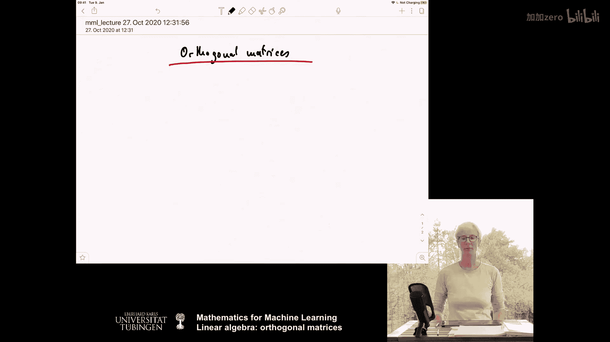

We have seen already ogonal， what does it mean if two vectors are ogonal to each other and what an ogonal basis is？

Now finally， we want to talk about orthogonal or orthoal matrices and these are really sort of the greatest and coolest of all matrices you could have because they really have a lot of very nice properties。

So， let's see。We start with a usual definition。 so assume we have a matrix。

And so， let queue。And it livess in our entrance n。

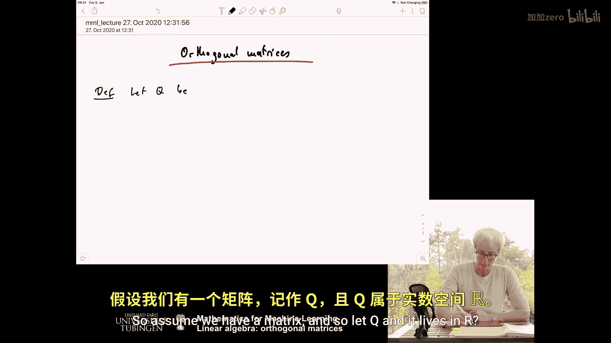

In our entrance times end。Be a matrix。Such that all column vectors are a secondal to each other。

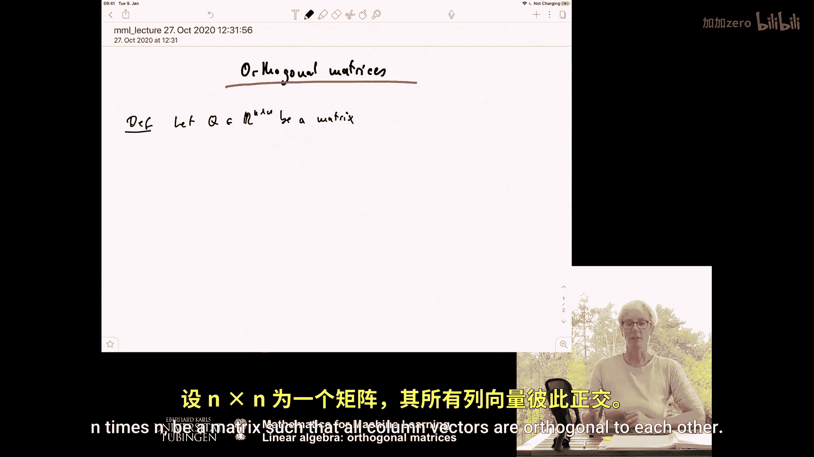

With。

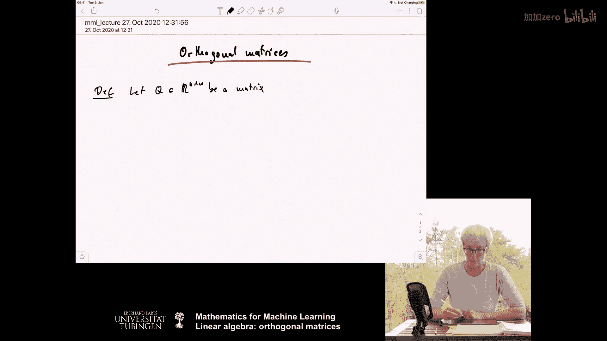

Or soganal。

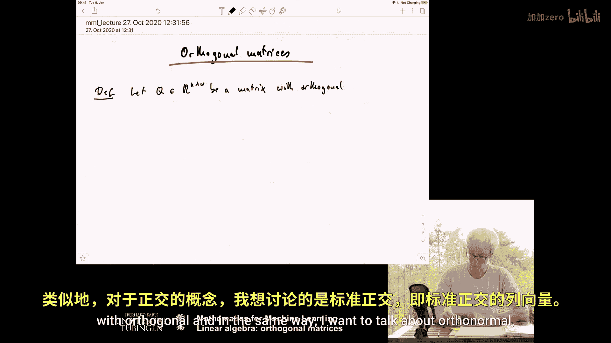

And in the same way， I want to talk about or about orthomal， orormal。Collum vectors。

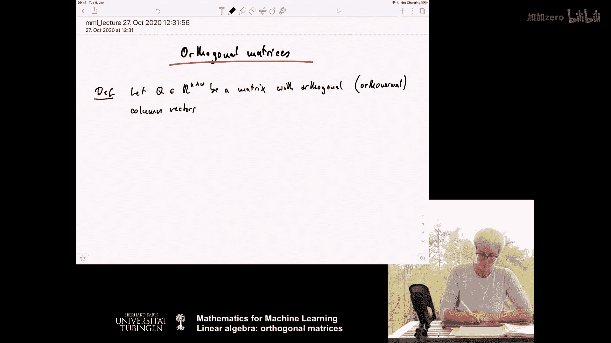

So with respect， of course， with respect to the Euclidean。

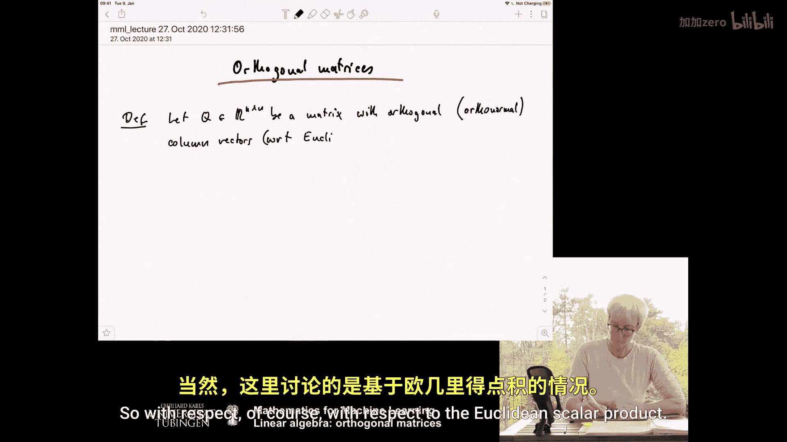

Scalar product。

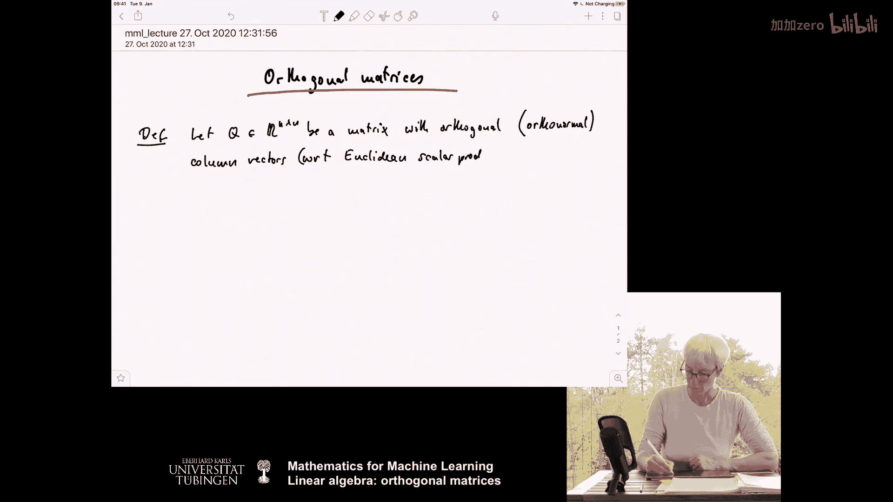

So unless I say something else， if we are in our end and we talk about a scalar product。

 it's always going to be the Euclidean scalar product， or if we are in C。

 then it's going to be the standard complex valued scalar product like the scalar product where we need to to take this complex conjugates。

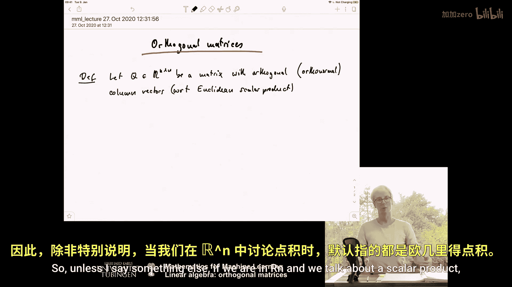

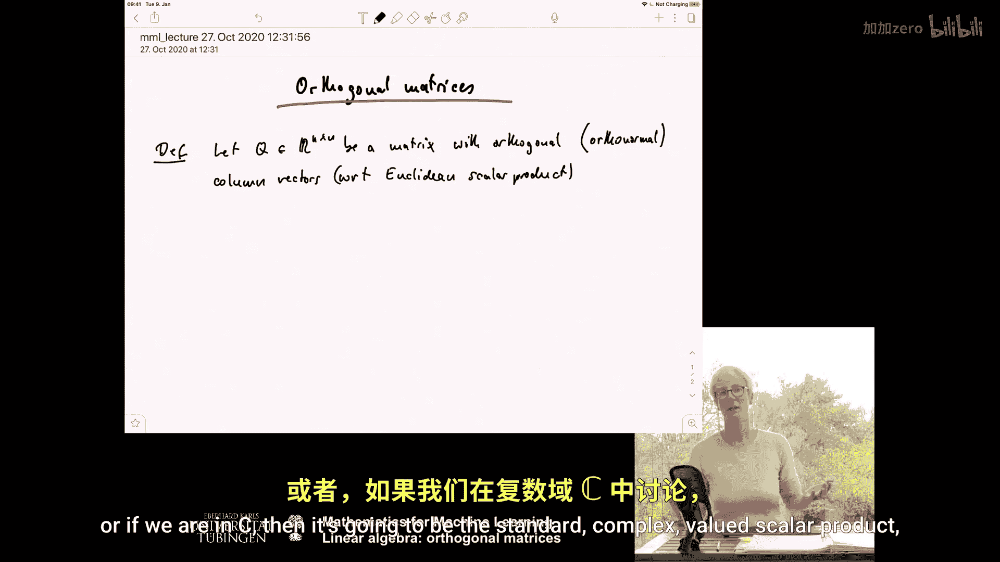

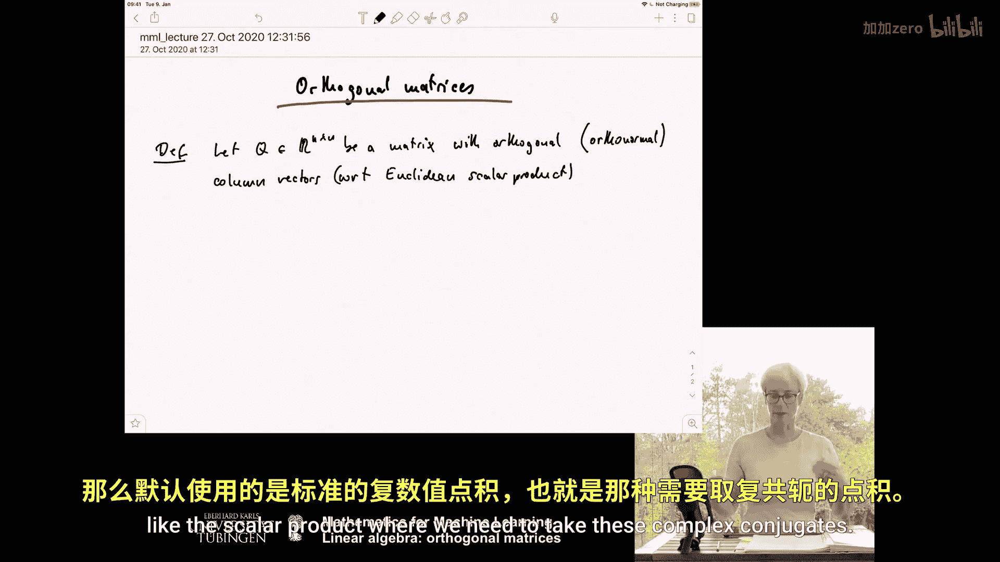

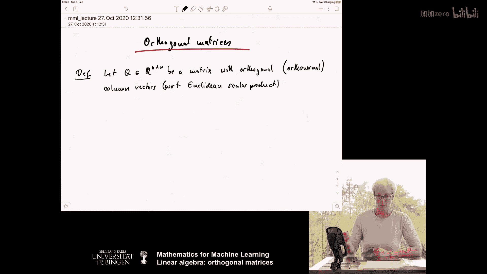

So and now we say we consider a matrix such that all column vectors are o subbinal。

 then such matrix is called oabbinal。

Then Q。

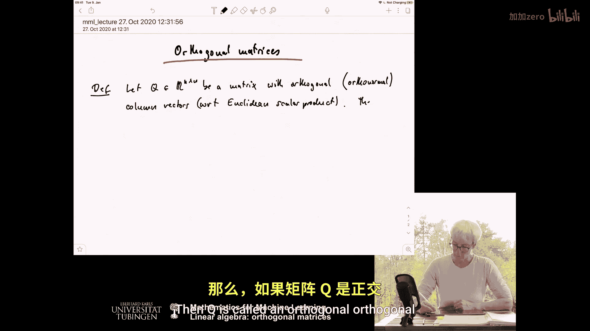

Q is called。An orgonal。

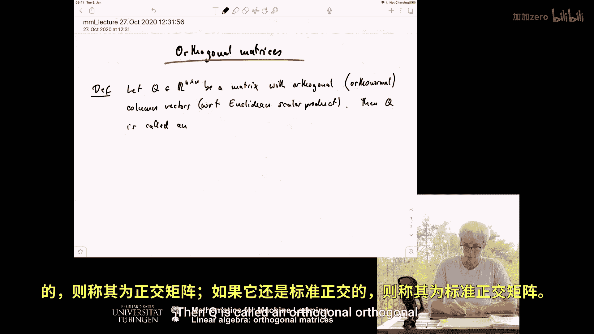

呃， so gonna呢。Or respectively， if it's orthonormal。Ason normalmal。

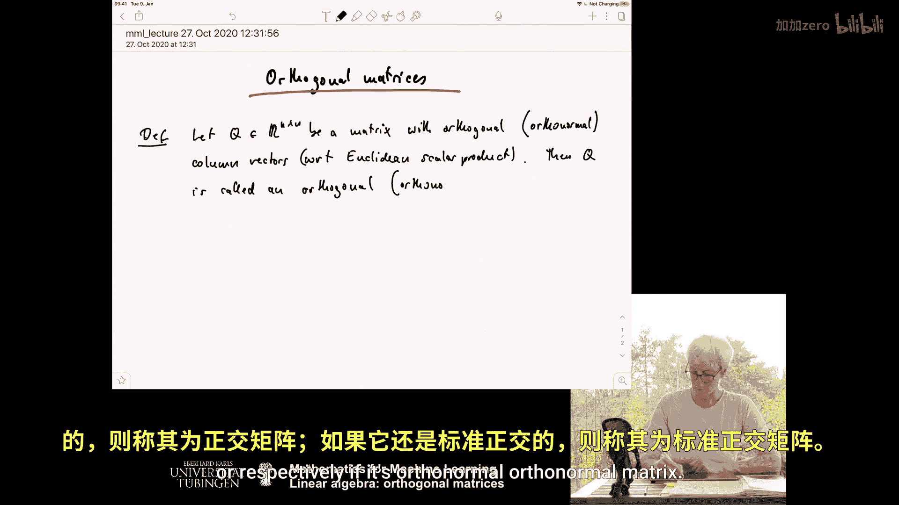

Matrix。They were done。

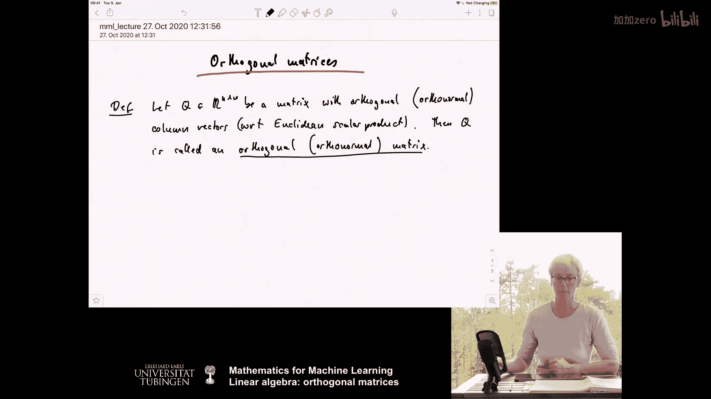

Now， if we are on sea， then we don't call it aconal or aomal， but we call it unitary。

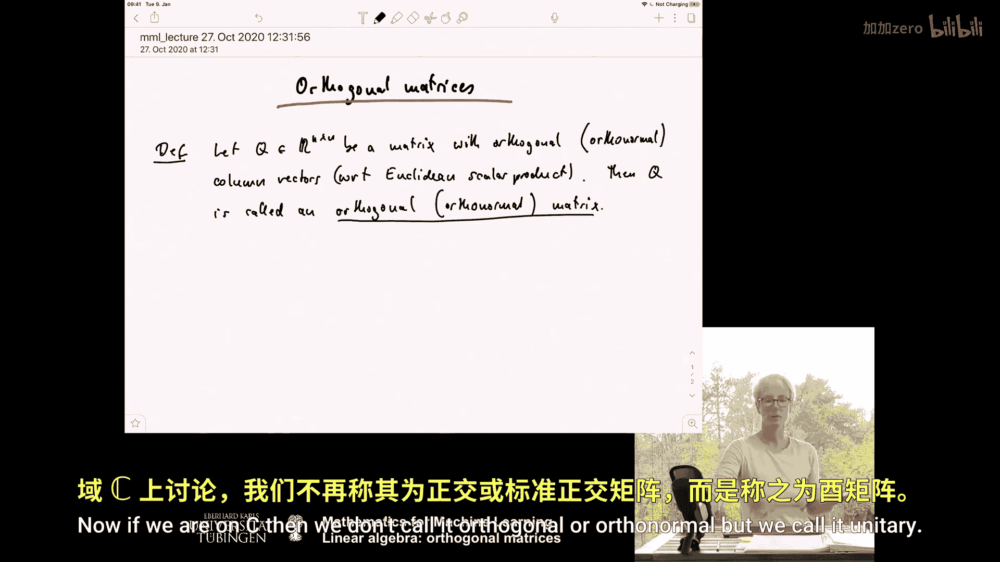

So if Q is。

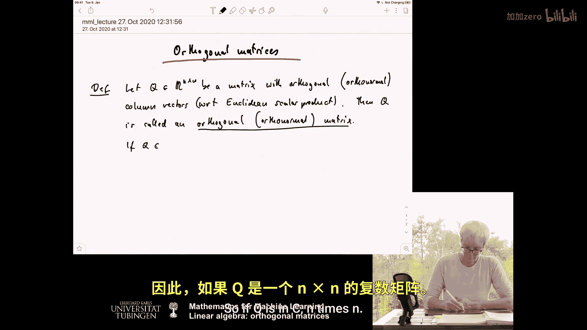