# 图宾根大学【中英⚡机器学习数学｜2020 Tübingen Mathematics for Machine Learning】 p33 P33 (A) Linear Algebra 32： Continuous linear functionals and operator norm -BV1VhbMzKEts_p33-

Today I want to give a quick outlook into some concepts of functional analysis that are maybe not key components when it comes to machine learning。

 in particular if you want to apply algorithms， but if you want to analyze algorithms。

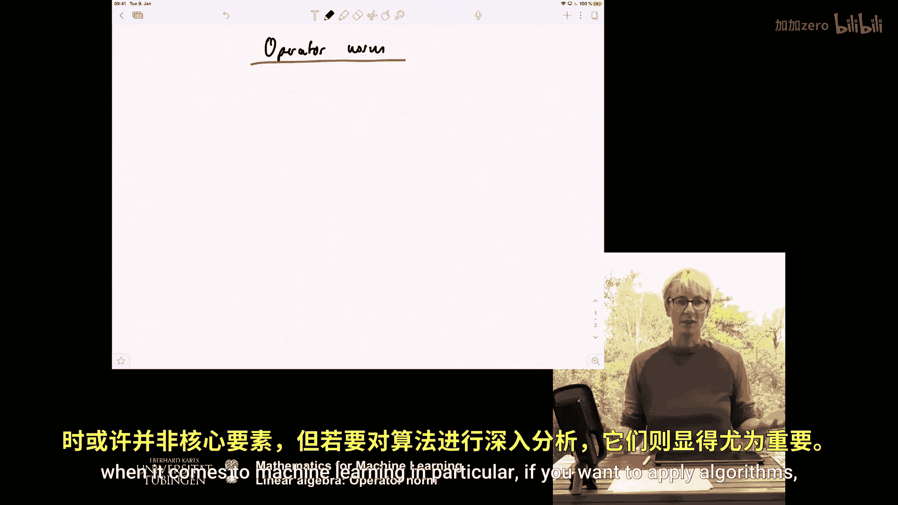

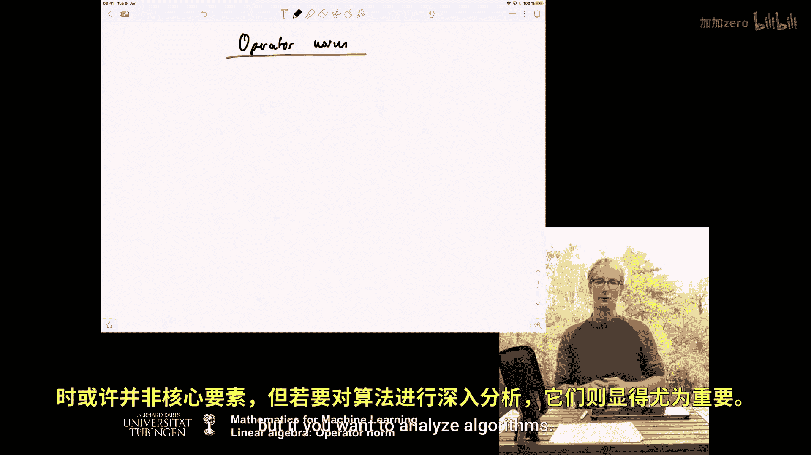

So functional analysis in general studies linear functional on vector spaces and it becomes interesting and important if the vector spaces are infinite dimensional。

 So if a finite dimensional vector spaces， functional analysis is sort of quite boring。

 if functions are linear then they're always continuous if a functional linear function is injective。

 it's also bi ejective and so on。 So in some case linear functions on a finite dimensional space are very。

 very elegant and powerful。😊。

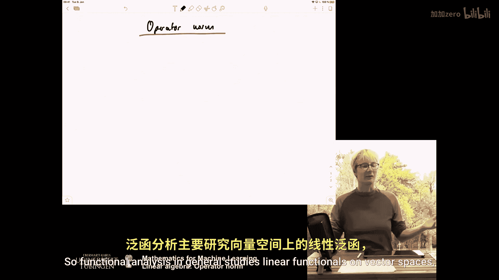

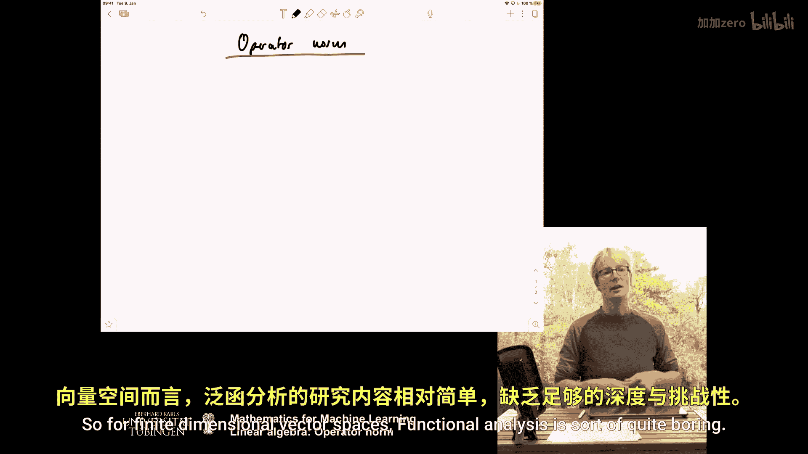

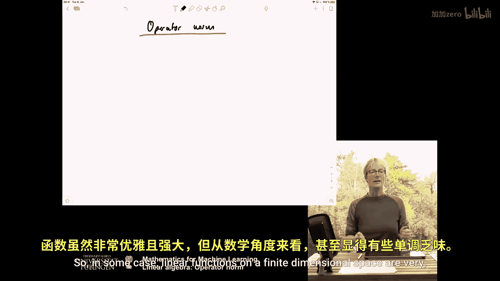

But from a mathematical point of view， even a bit boring。

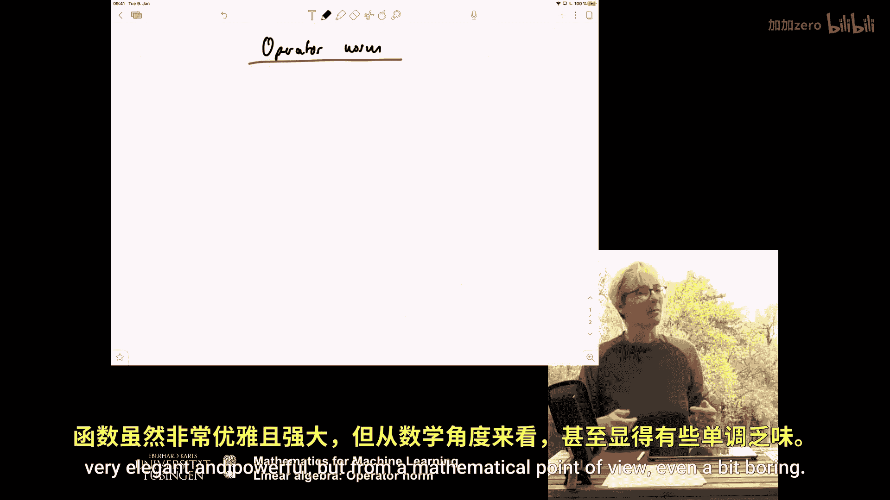

Now it gets interesting when function spaces are infinite dimensional because then all of a sudden。

 some of the nice properties that we have on finite dimensional spaces break down， for example。

 and we no longer have that any function that is linear is automatically continuous and we also do not have that a function that is injective is automatically by ejective。

 So all these kind of properties break。

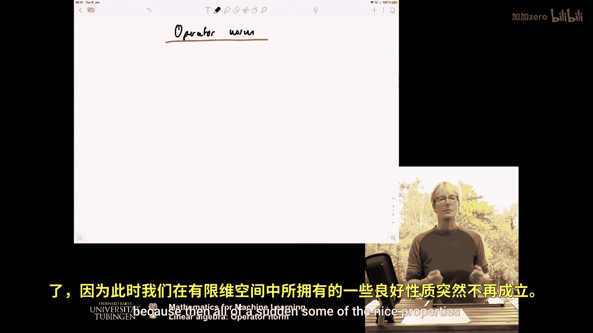

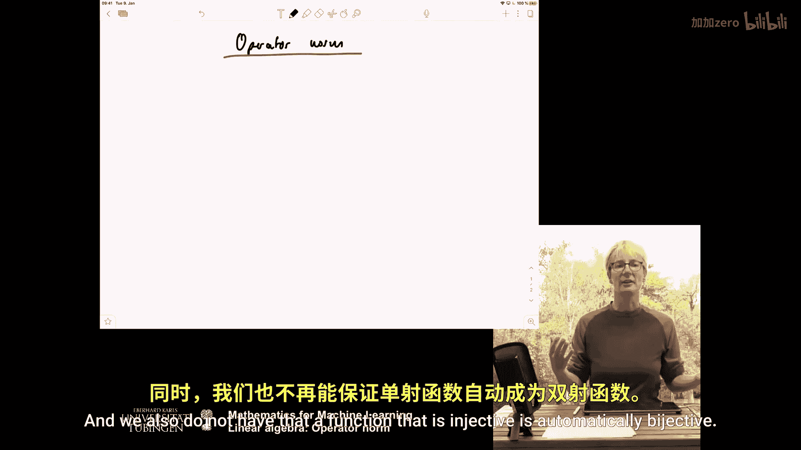

Now you might say， well for machine learning I don't really care。

 whenever I implement an algorithm in the end it's going to be a matrix and a finite dimensional vector because I couldn't even implement something that is infinite dimensional and you're right to a certain point of up to a certain point。

 I would say。😊。

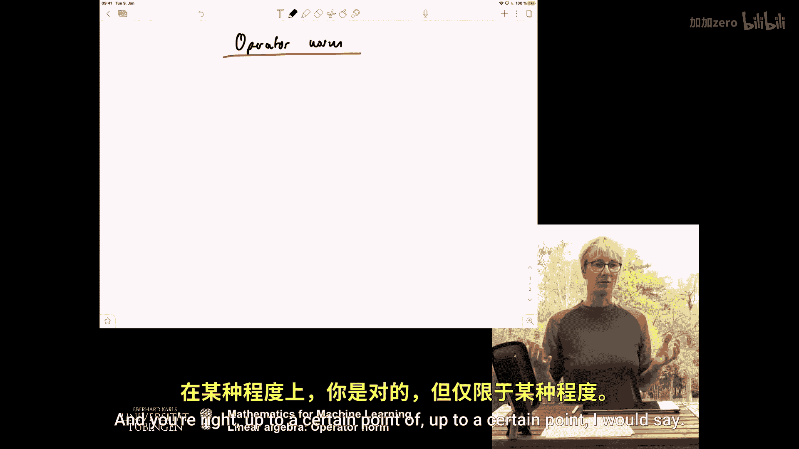

But then when it comes to understanding what the algorithms really do。

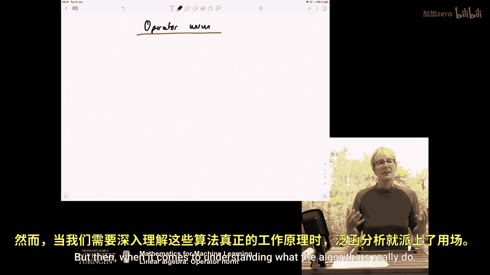

This is where functional analysis comes into play。 And the most prominent example， I think。

 is we're producing kernel hd spaces that have been used to analyze kernel methods in machine learning。

 So kernel methods is really this big field of algorithms。😊。

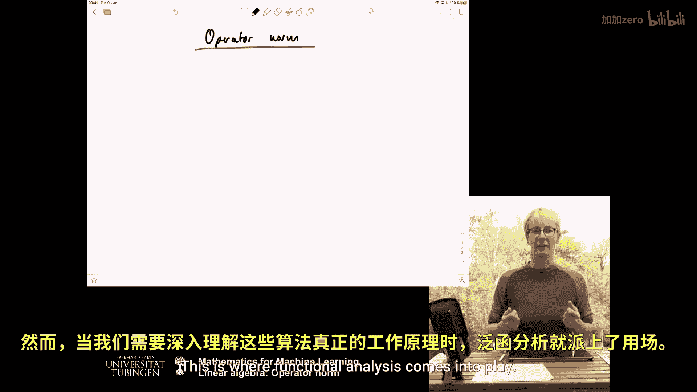

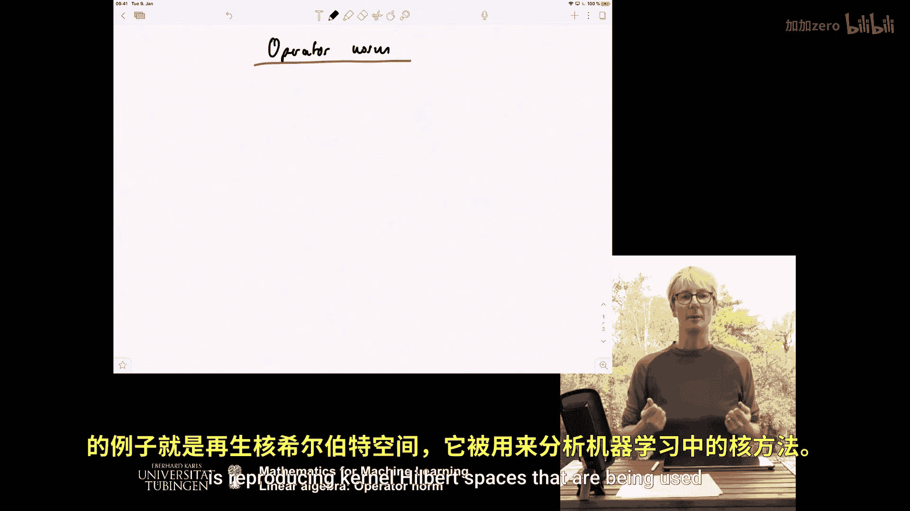

Which is very like a set of very simple， but yet very powerful algorithms。

 And to understand what they really do， we do need functional analysis。

And similarly， there are many other cases where if you want to understand what an algorithm really does and if you want to prove some theoretical statement about it。

 you need to look into functional analysis because ultimately the fact that we often look at finite dimensional。

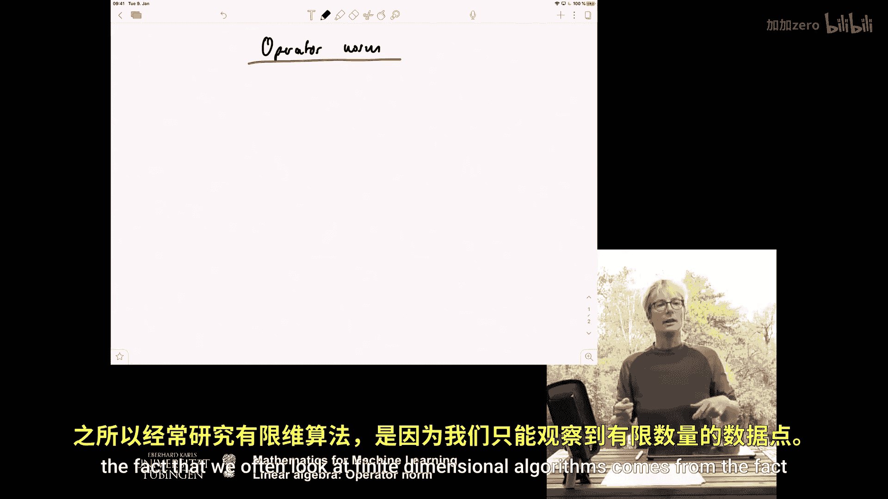

Algorithms comes from the fact that we only see finitely many data points。

 but if you want to make a statistical statement that in the limit were infinitely many data points。

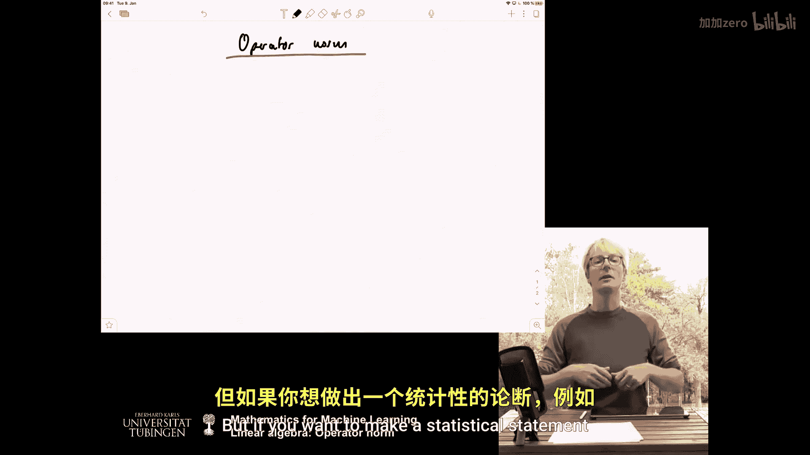

