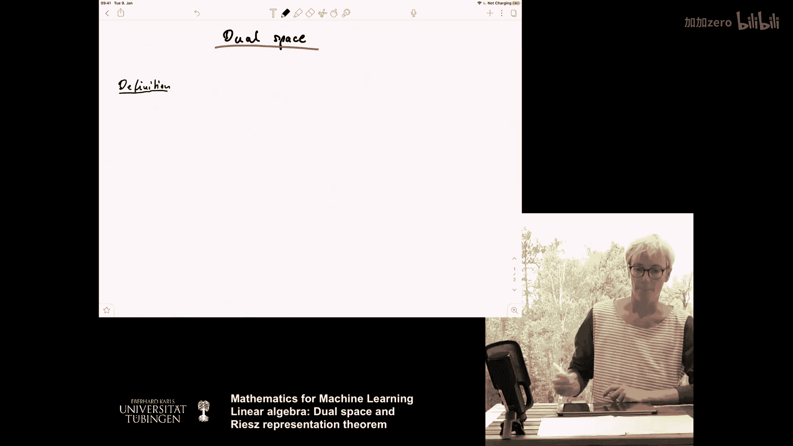
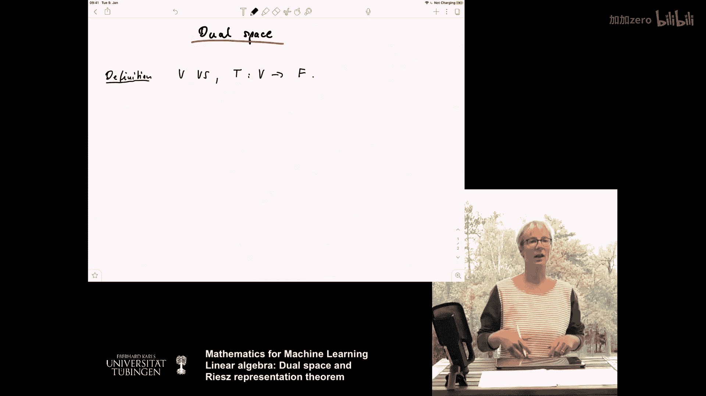
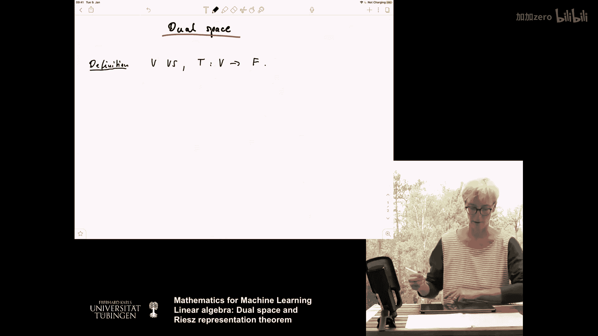
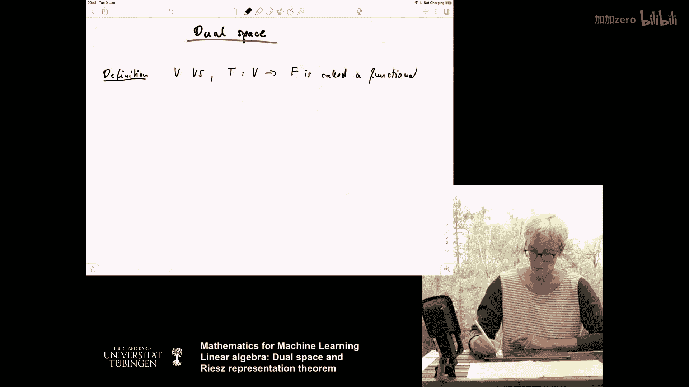
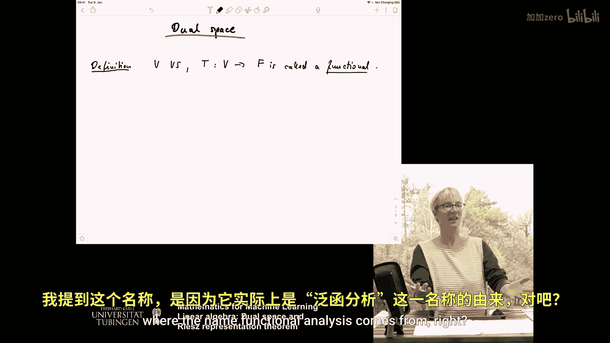
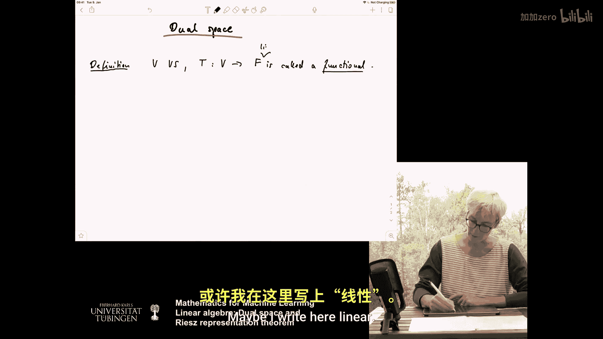
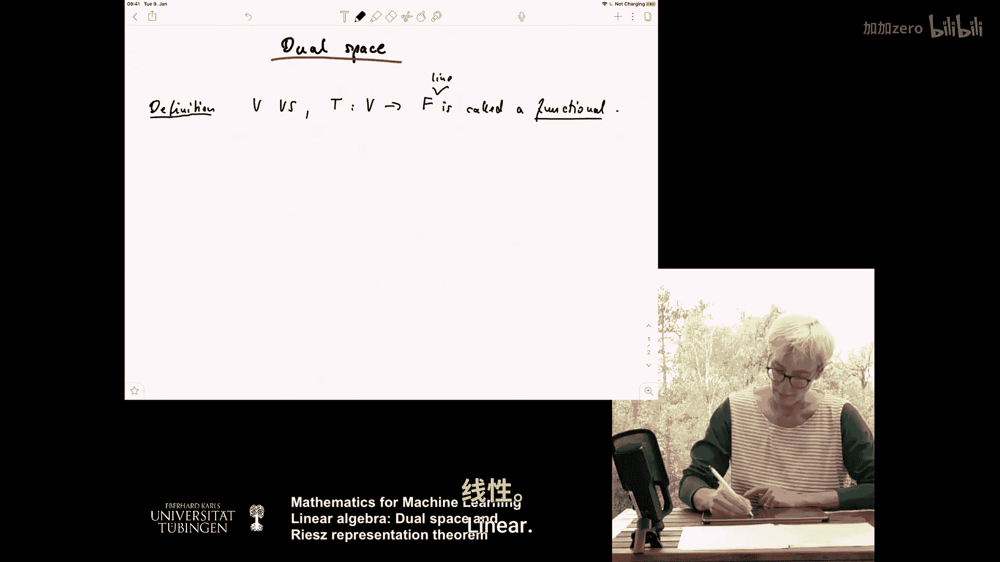
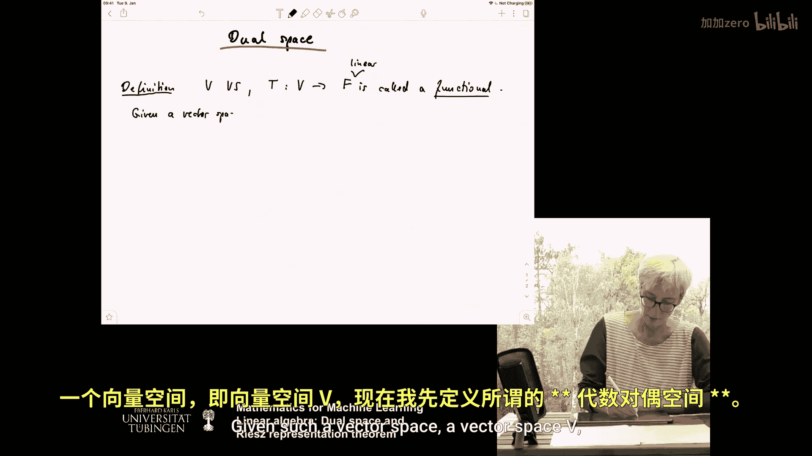
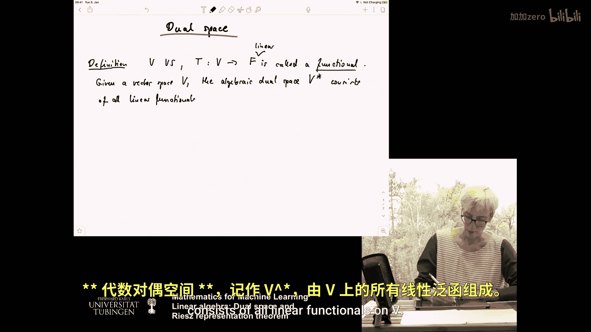
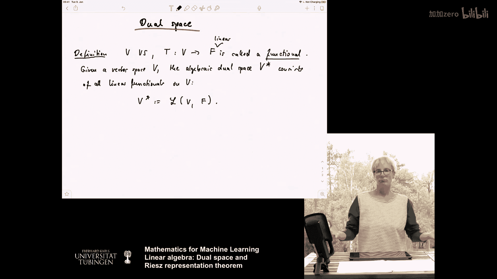

# 图宾根大学【中英⚡机器学习数学｜2020 Tübingen Mathematics for Machine Learning】 p34 P34 (A) Linear Algebra 33： Dual space, Riesz representation theorem -BV1VhbMzKEts_p34-

In the last lecture， we defined what is the operator or of a linear mapping that is also continuoustig。

We simply called the object an operator on， but we didn't even say that it is a norm。

 let alone that we said， in fact， on which space does it act。😔。

And this is what we want to look at now， the space that we are going to consider is called the dual space。

 so let us start with a couple of definitions。

So consider vector space。😊。

So V is an vectorspace。And T mapping from the vector space to the field over which the vector space is defined。

Such a mapping is typically called a functional。

I don't know whether I have used this name before an operator is typically something that goes from one vector space to the other vector space。

 a functional is one that goes from the vector space to the field over which the vector space is defined。

😊。

嗯。Ti。Is called。A functional。

I just wanted to mention this name because that's， in fact。

 where the name functional analysis comes from， right？

嗯。And， of course， this needs to be linearya vectorspace tea。

Maybe a write linear。

嗯。Sorry。😔，Ler。

But this is not the main purpose of this definition， I want to define what is a dual space。

Given such a vector space。

A vector space。

Li。Now I first defined what is called the algebrabaric dual space， theG。

Brag jewel。Space。And this is denoted with V star。Consists。Of all。Linear functional。

 Linear functional。On we。

So the neural space is simply defined as all the linear mappings that go from B2 F。

