# 图宾根大学【中英⚡机器学习数学｜2020 Tübingen Mathematics for Machine Learning】 p39 P39 (C) Calculus 5： Riemann integral on R -BV1VhbMzKEts_p39-

可以。😊，Today we want to discuss how integration works and what I'm going to present today is the notion of integralteeggra that many of you might already have seen in school or hopefully at latest in the university bachelor's education。

 we want to talk about the Liman In。

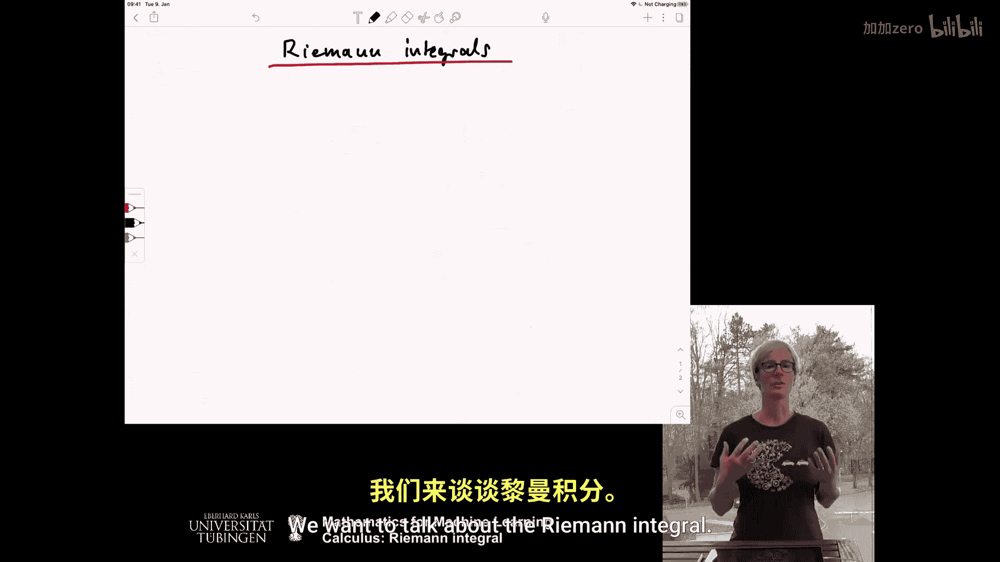

So when mathematicians started to try to formally develop a notion of an integral there were lots of many different attempts and important steps towards coming up with a notion of an integral that's really a good one and that has all the desired concepts and the reman integral is one of these attempts it's maybe not the final step but it's a very intuitive one and I guess most of you know this intuition already。

 but anyways I wanted to recapit so we can build on it later on。

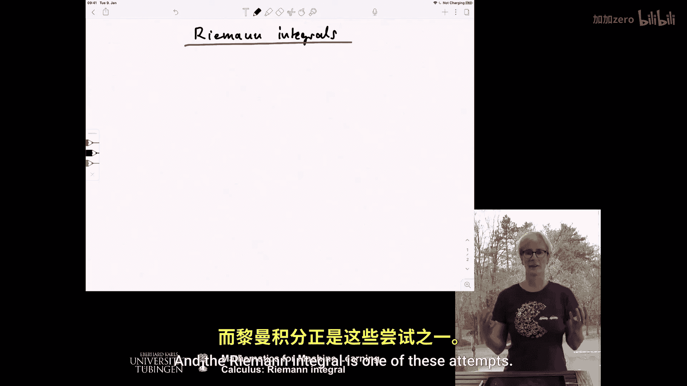

So what we' are now going to consider is we want to build an integral of a function and we begin with functions that are bounded and that are also defined on a compact interval because this is going to make this development much easier。

So we now consider。

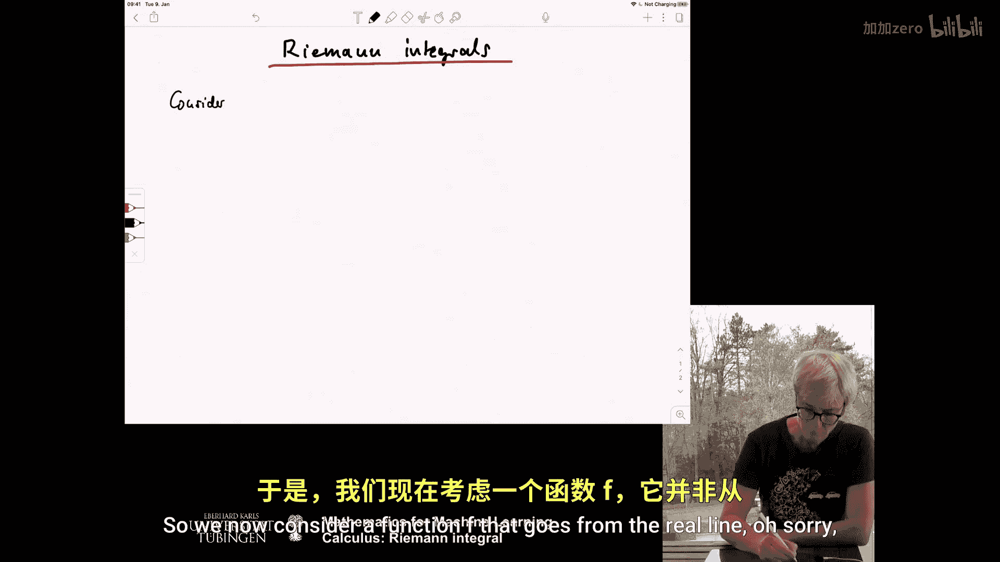

A function F。That goes from the real line。 Oh， sorry， not from the real line。

 but from a bounded interval。

Say the interval A B。

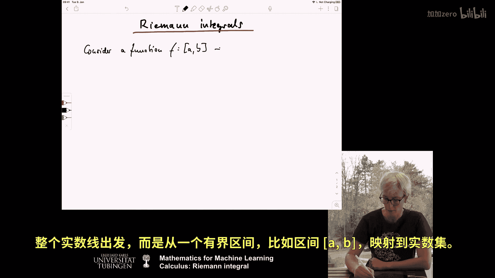

Two real numbers。So maybe something to note first that we are in the one dimensional case and we are going to extend it with a different notion of the integral to the multidimensional case。

 in principle this approach would also work on RD， but for simplicity let's do it on R。

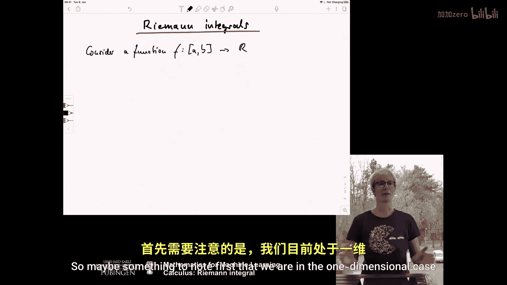

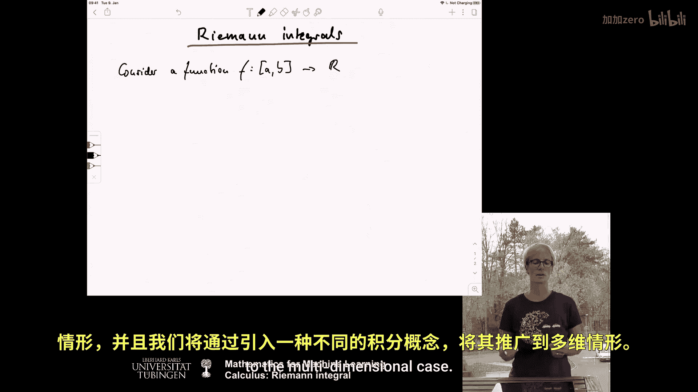

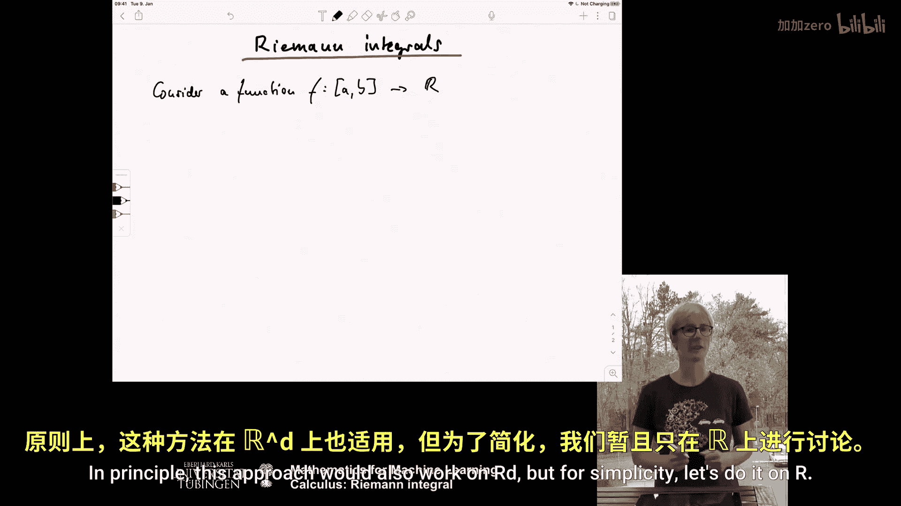

So we have this function and assume。That the function is bounded。

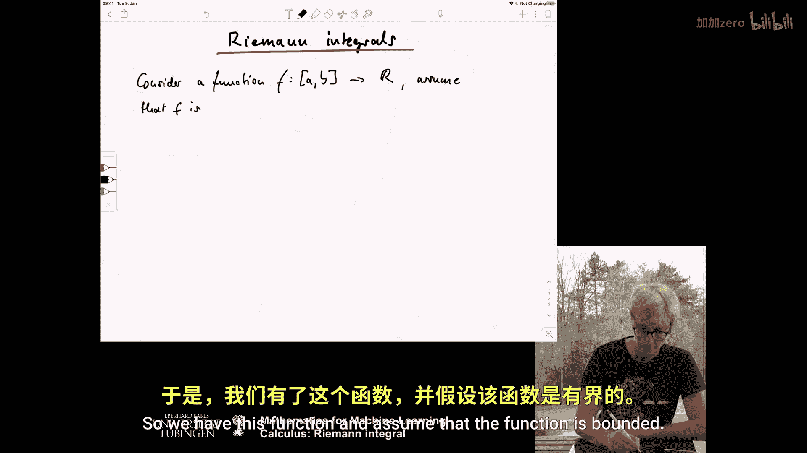

This means。There exist。lowerower and lower than upper bound in R such that for all X。

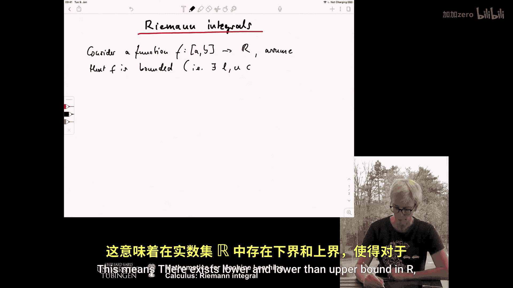

In， in the domain， of course， where the function is defined for all X in A B。

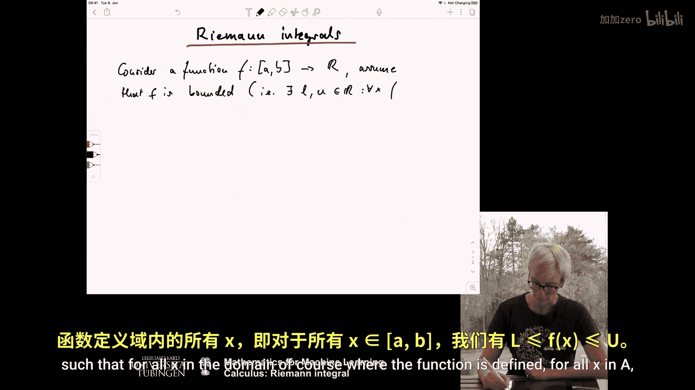

We have that L is smaller or equal to F of x is smaller。 sorry， I write it in the next line。

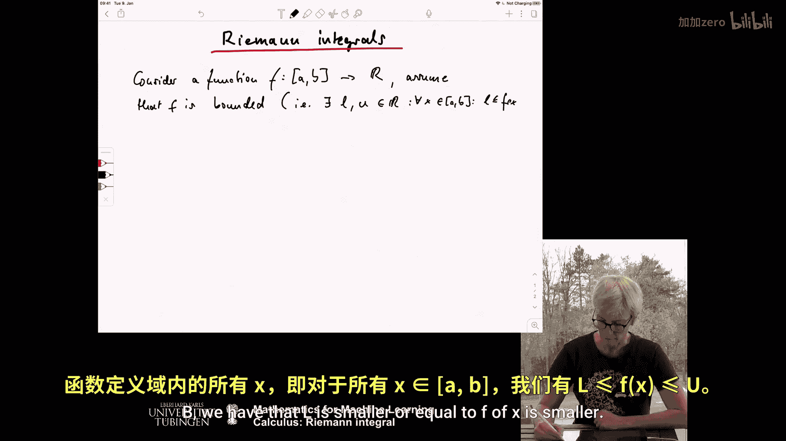

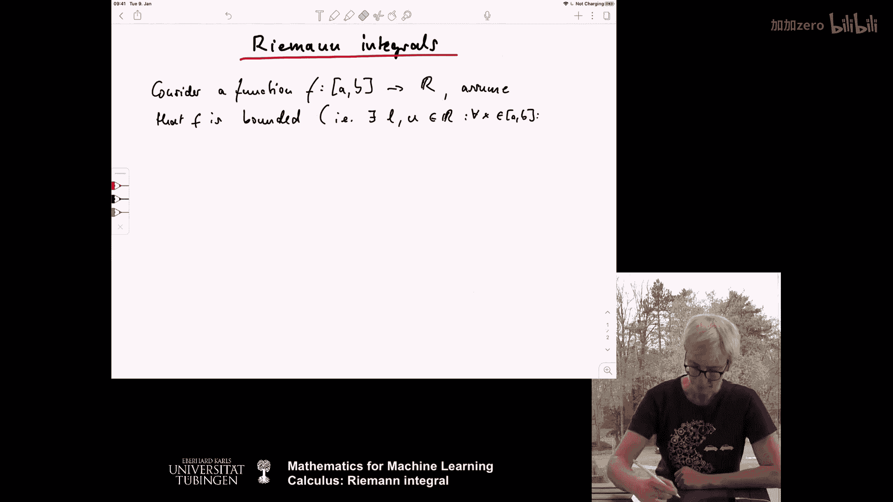

Such that。Okay， I write the whole definition in the in the next line。

 They exist lower and upper bounds。

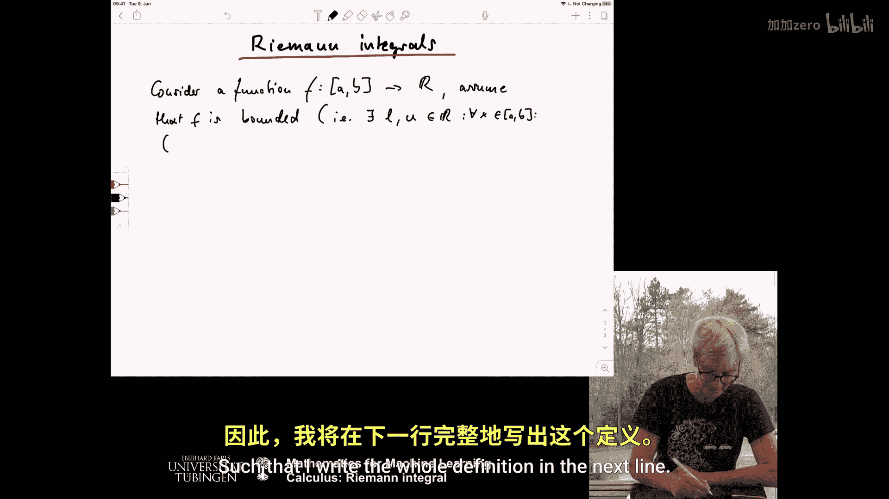

Such that for all X。

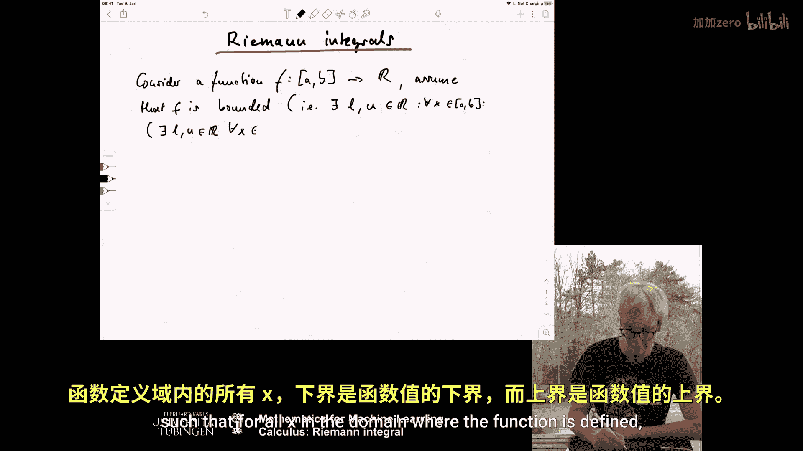