# 图宾根大学【中英⚡机器学习数学｜2020 Tübingen Mathematics for Machine Learning】 p54 P54 (P) Probability theory 1： Definition of a probability measure -BV1VhbMzKEts_p54-

Good morning。 Today， we want to start discussing probability theory。

This is one of the key areas if you want to understand machine learning。

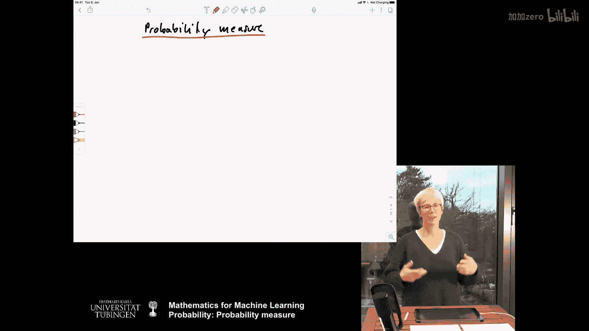

If you consider what is the standard setup in machine learning is we receive some kind of training data。

 we want to learn something from this training data and we want to make conclusions that hold for the whole underlying population。

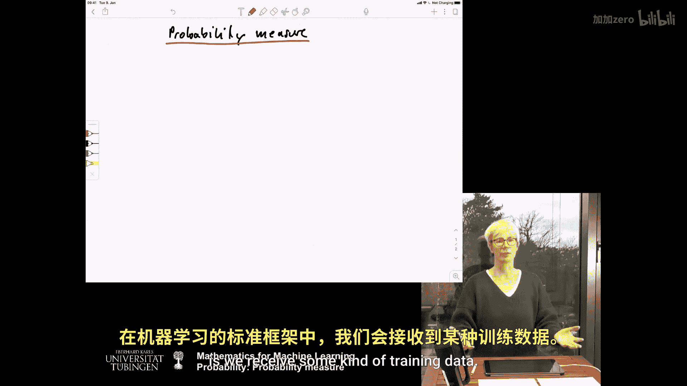

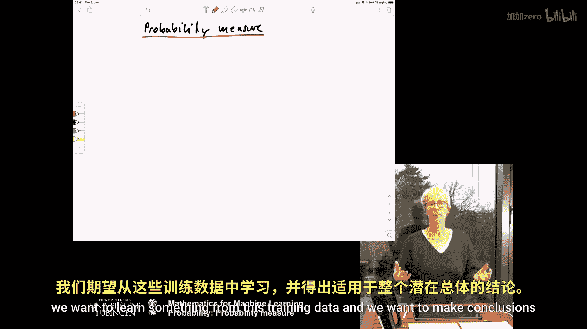

And the standard setup by which we try to model the way this training data is being acquired is probabilityities theory for example。

 we could assume that we have data points that are sampled from somewhere so maybe you want to predict I don't know something about trees so you might randomly select a couple of trees and take some samples from this tree but then you want to make a statement that doesn't know hold for the 50 trees that you've observed but you want to have a statement that holds for all trees or many trees at least。

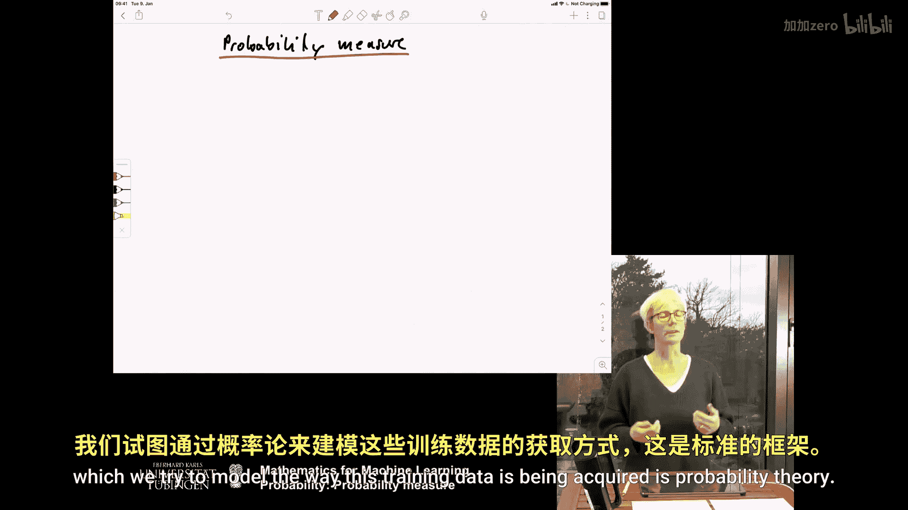

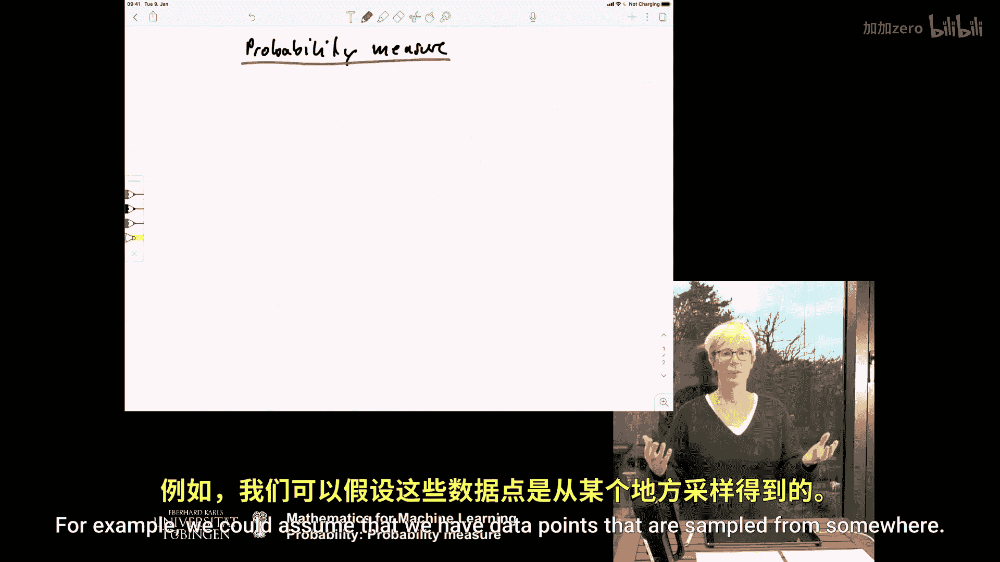

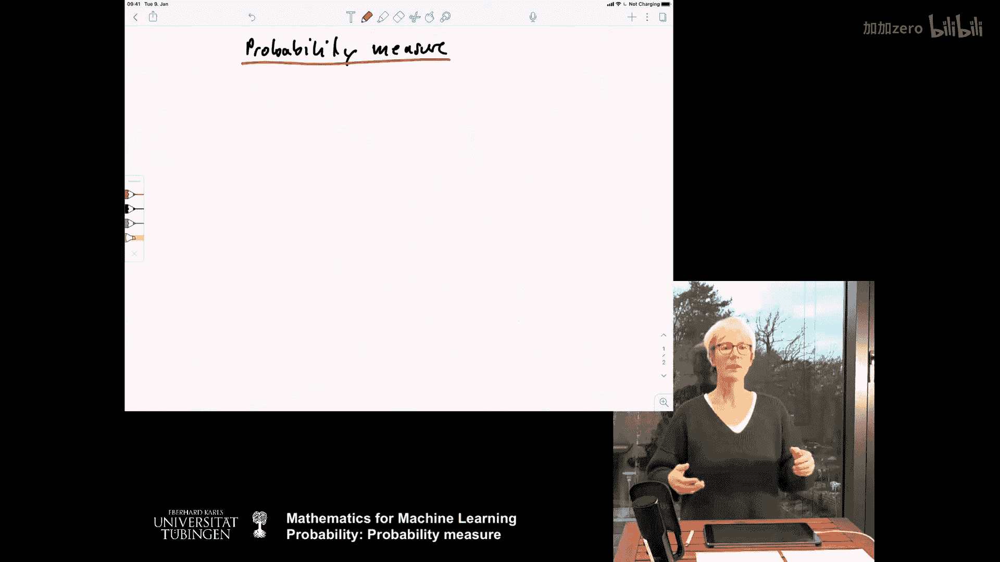

And sort of this way of concluding from something that holds for a finite sample to a larger space。

 potentially of sample points， this is essentially what statistics is about and the tool that we need to be able to implement statistics is probability theory。

 because it defines what does it mean to sample from a space， what is a probability measure。

 what is a probability distribution。

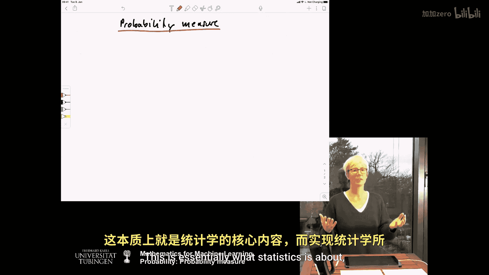

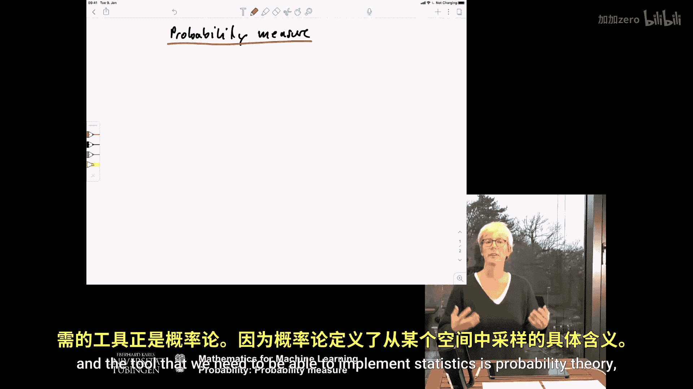

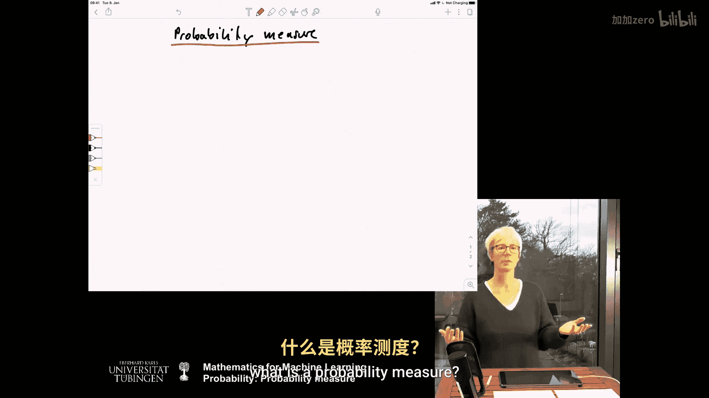

And you will encounter probability theory everywhere in machine learning and also in the classes and tub like the statistical statistical machine learning lecture explicitly bases all the machine learning algorithms in a statistical context or you could look at probabilistic machine learning or you explicitly even model the phenomenon that you trying to learn by probability distributions。

 so you're not going to get around probability theory。

 and this is why we want to study at least in very short fashion as you do it for everything in this lecture。

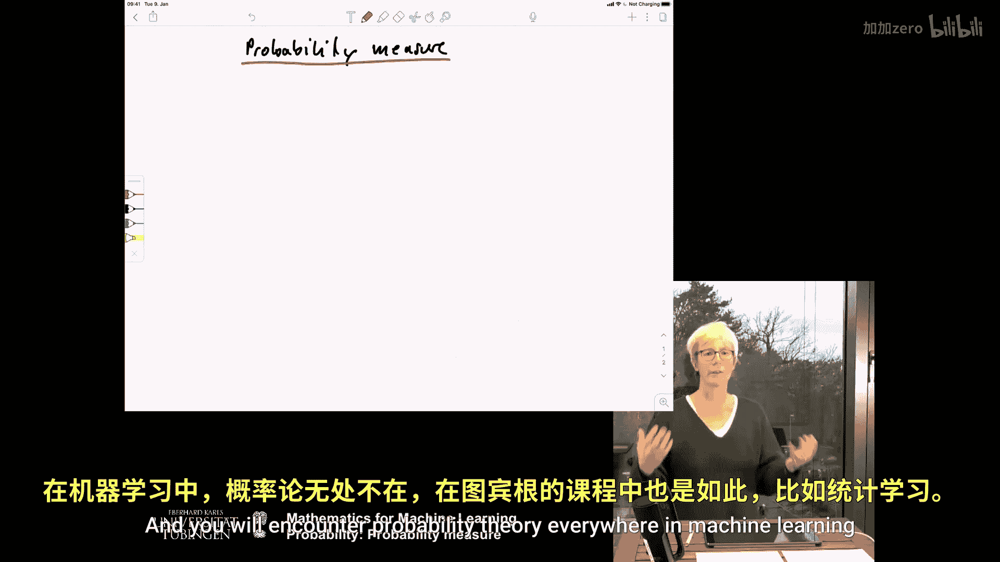

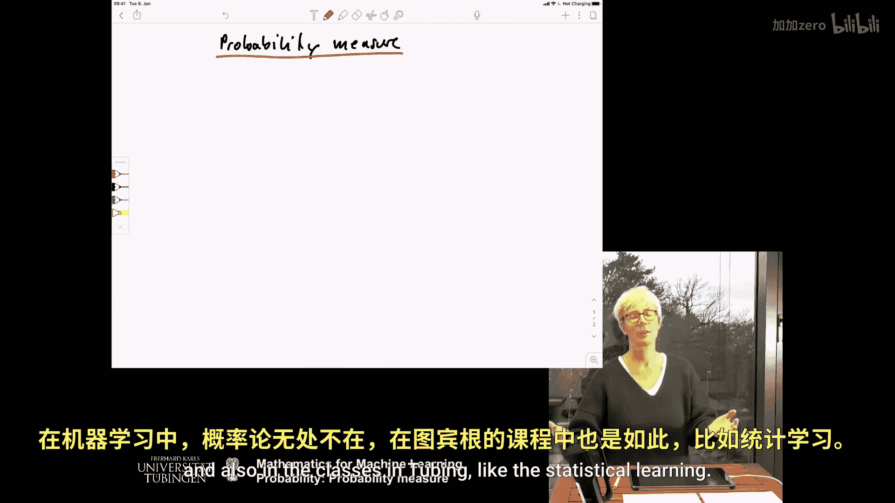

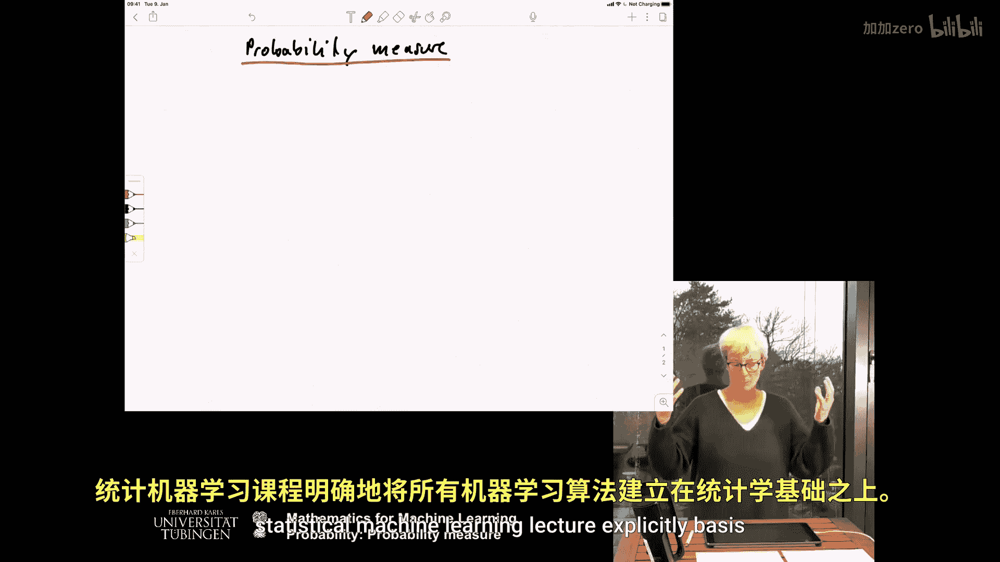

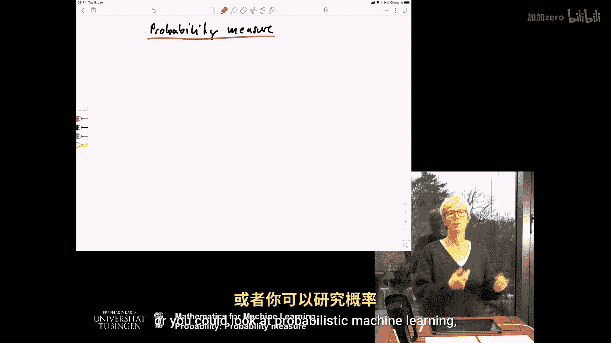

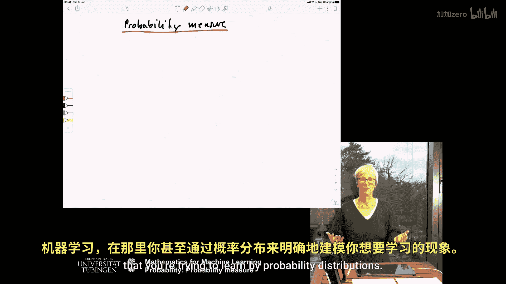

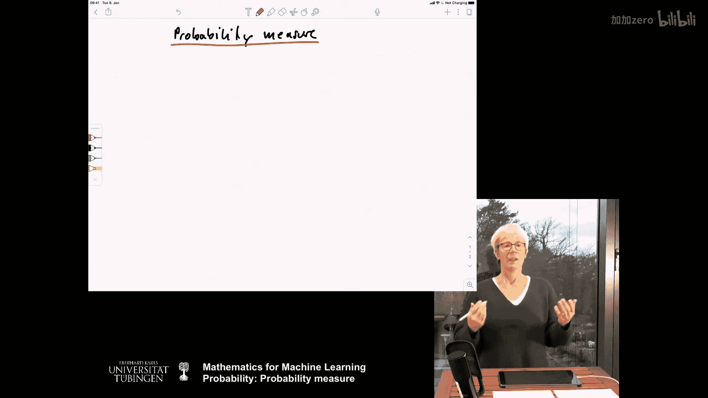

So to start talking about probability theory， we need to introduce what is a probability measure。

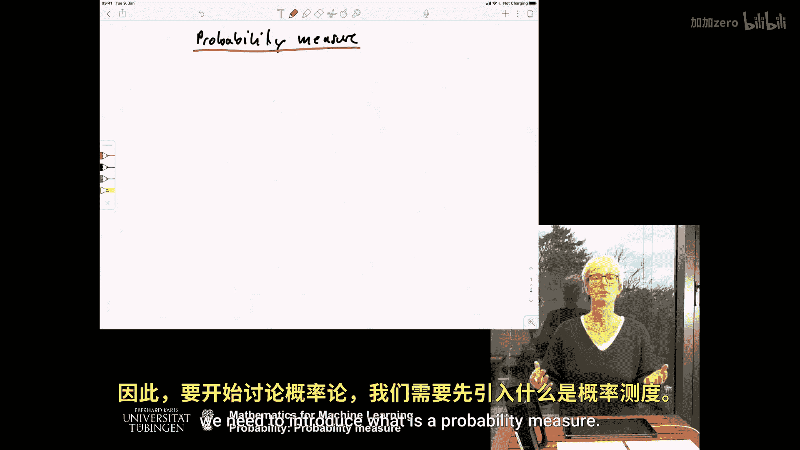

And we have already seen what is a measure and also a sigma algebra a measurable space in the lectures in calculus and if you haven't seen these lectures I urge you to watch these lectures first so the one about Sigma algebras and the one about measures。

AndBecause this is going to be the basis for whatever we're going to do today。

 So I'm not going to recap everything about measures and Sigma algebras。

 I just do a very quick recap now。

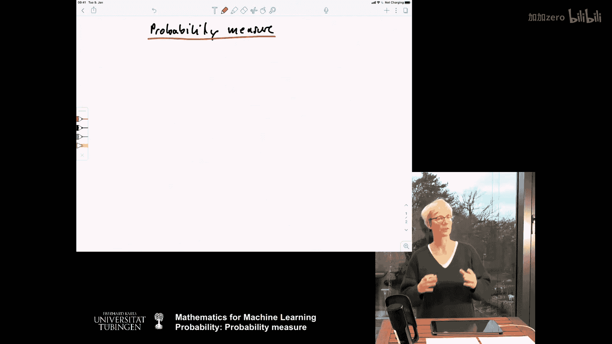

So。

