# 图宾根大学【中英⚡机器学习数学｜2020 Tübingen Mathematics for Machine Learning】 p57 P57 (P) Probability Theory 4： Cumulative distribution function -BV1VhbMzKEts_p57-

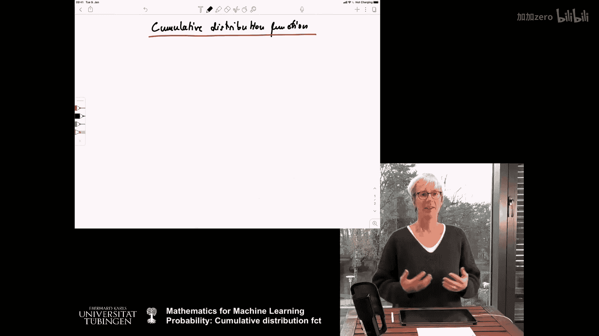

There is one more concept that I would like to describe in the context of probability measures and probability distributions。

 namely the concept of a cumulative distribution function。

This is not something that is very specific for probability distributions on the real numbers。

 this is not a concept that works or makes sense on whatever space you might think about its really something designed towards the real numbers。

 also the one dimensionsal real space， not a multidimensal real space。

Let me try to explain what it is about。

So we assume that P is a probability measure。On the real numbers。With the Brell Sigma algebra。

And now what we want to define is we want to define a function， maybe I just write it down define。

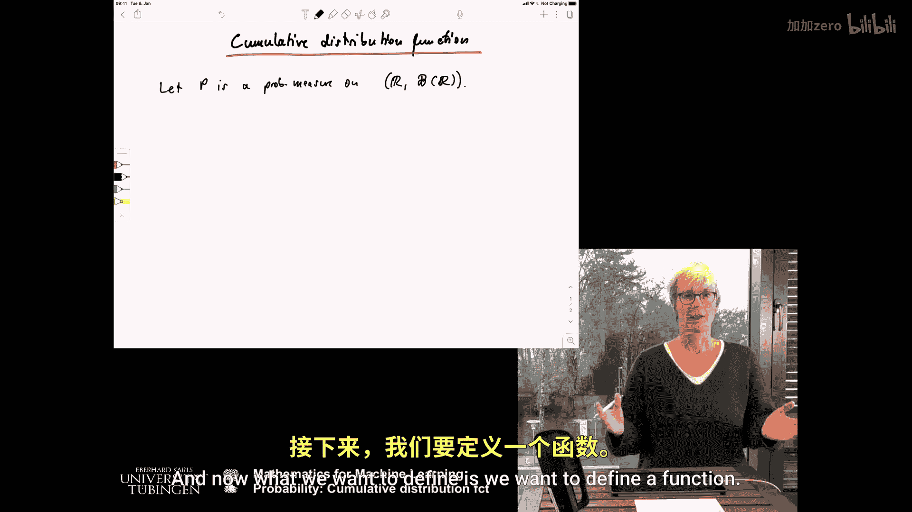

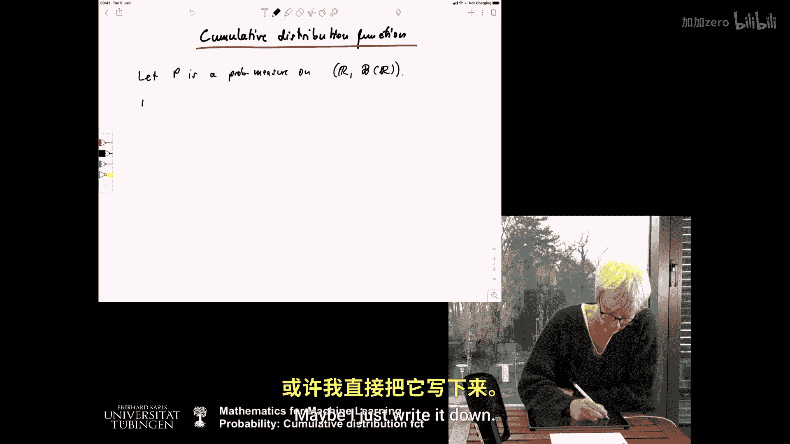

The function。F， and this is the typically letter that is used for this function capital F。

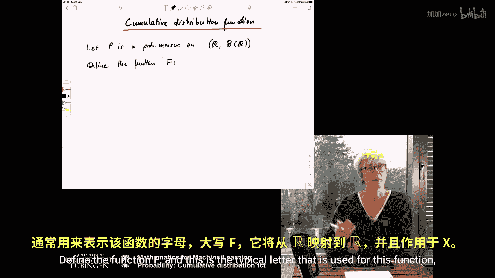

That goes from R to R。

And to x， it assigns the probability mass of the set of minus infinity to x。

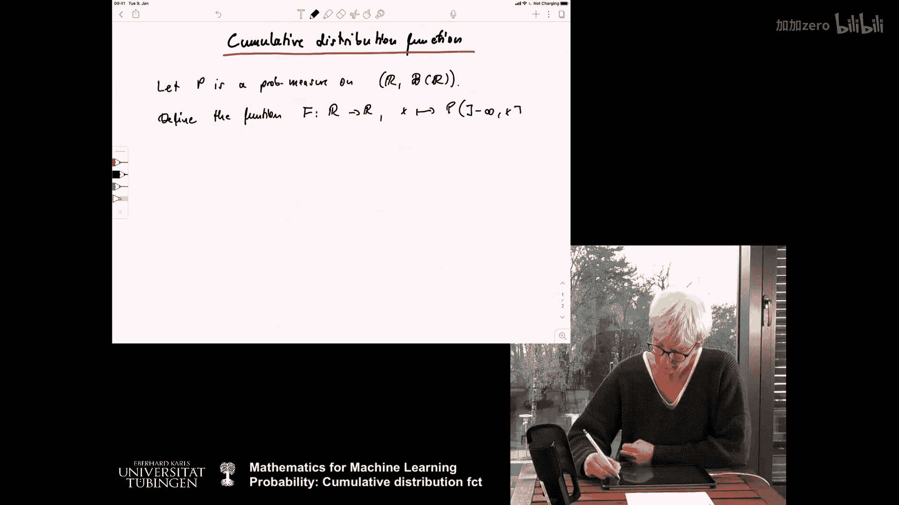

So consider an example， our probability measure is about the height of person。

 so we have the population of Germany， say and we have the height of the different people and now we look at。

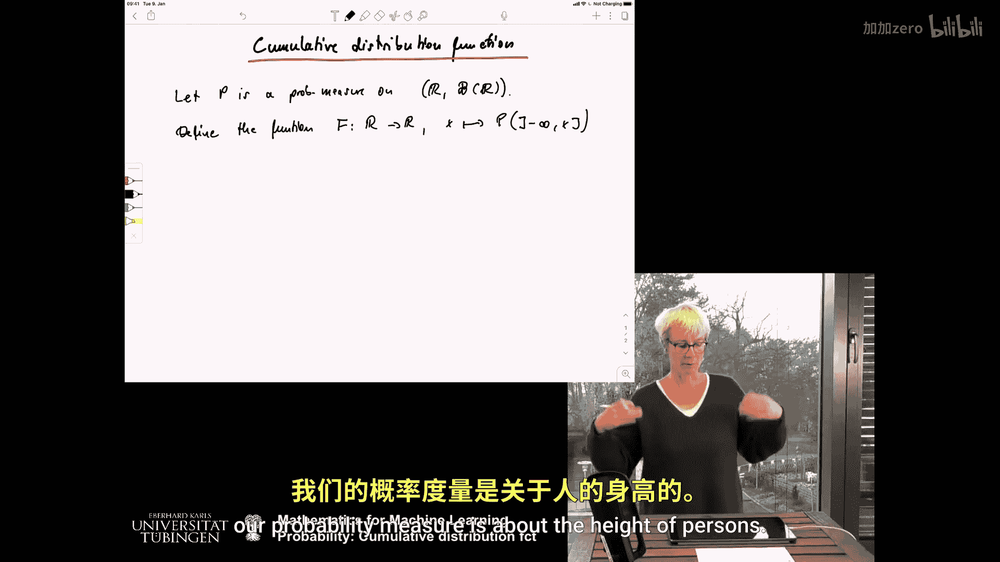

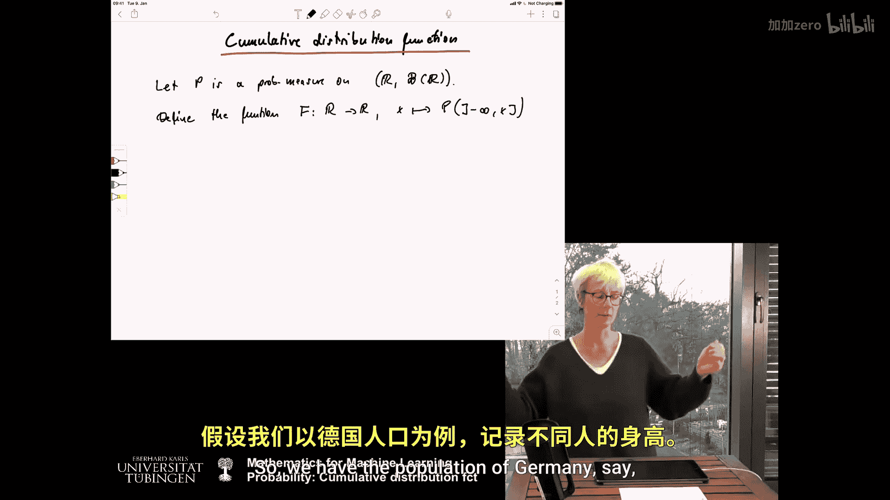

All the events， the height goes up to a certain value X。 So everybody whose height is at most 1 m 70。

 everybody whose height is at most 1 m 80 and so on。 So this is here。

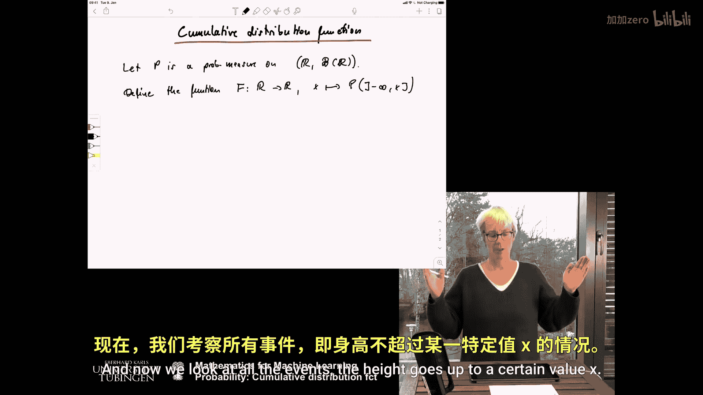

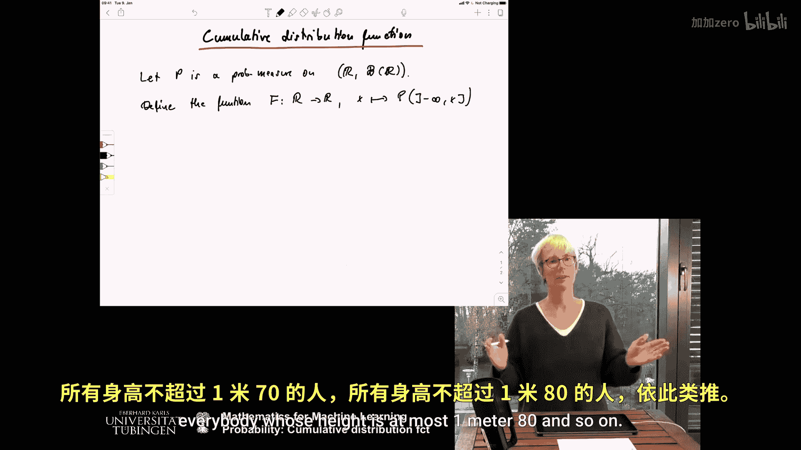

This at most is what I mean by this interval， so the height can be anything ranging from minus infinity to say 1 meter 70。

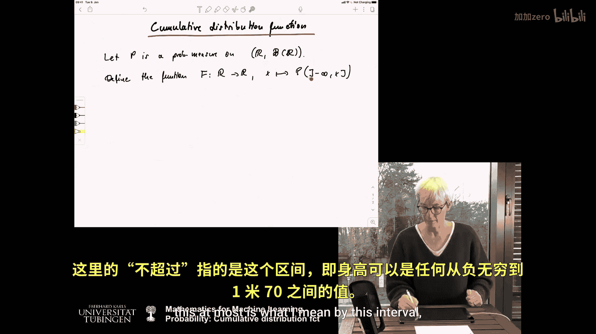

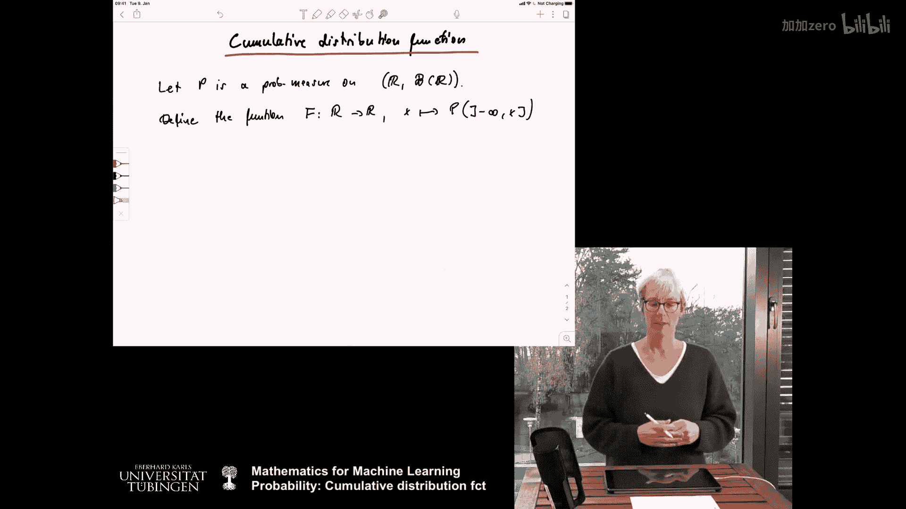

And the function F now assigns to this 1 m 70。 It assigns the probability measure of everybody up to 1 m 70。

 So what is the likelihood up to 1 m7 to be as high as 1 m 70 or well。

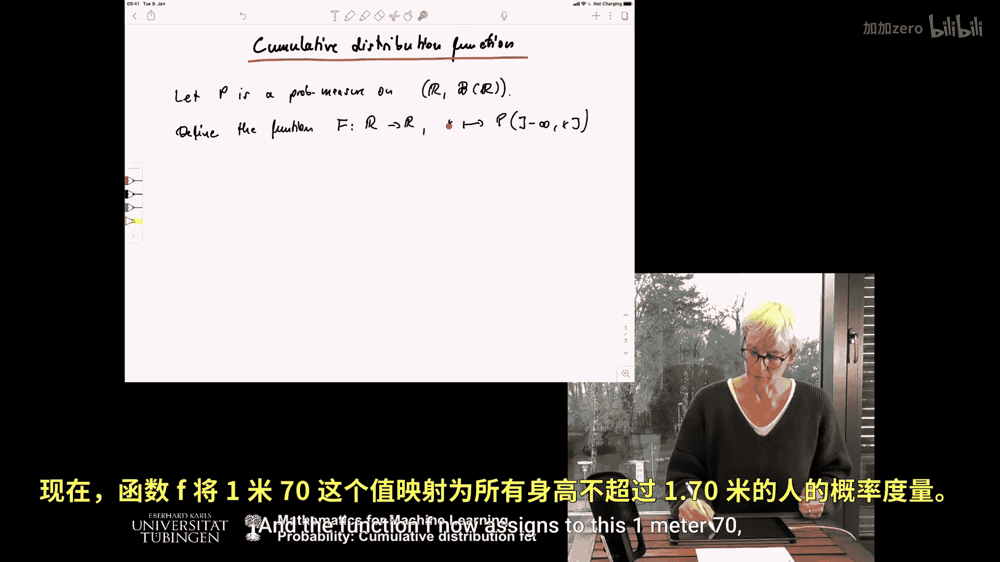

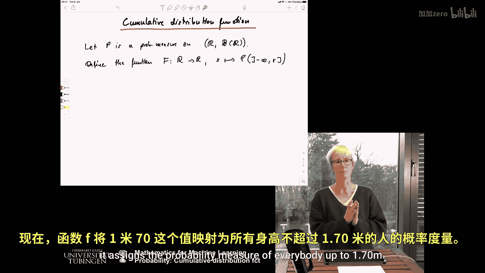

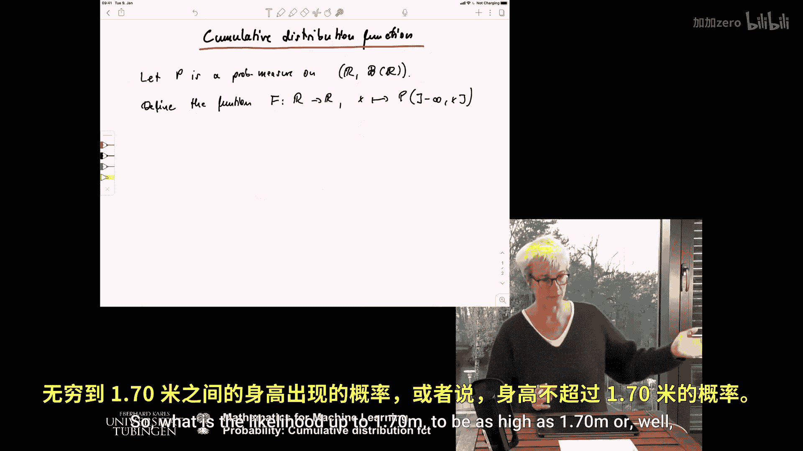

From minus infinity to 1 m 70。And this is a particularly interesting function because it has a couple of properties。

 which I know I'm not going to write down。

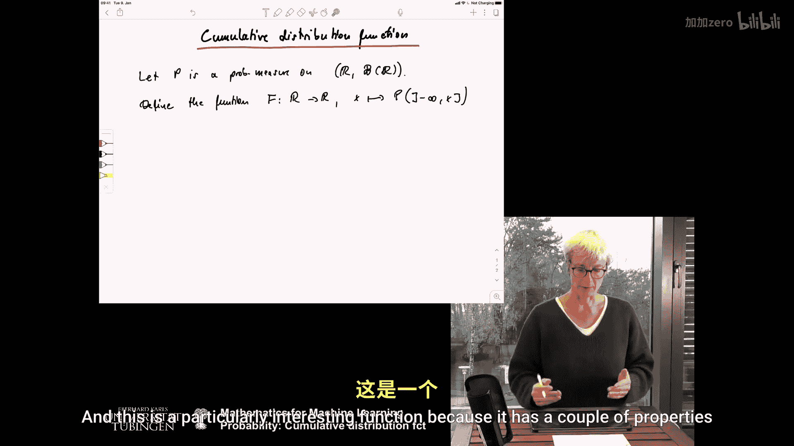

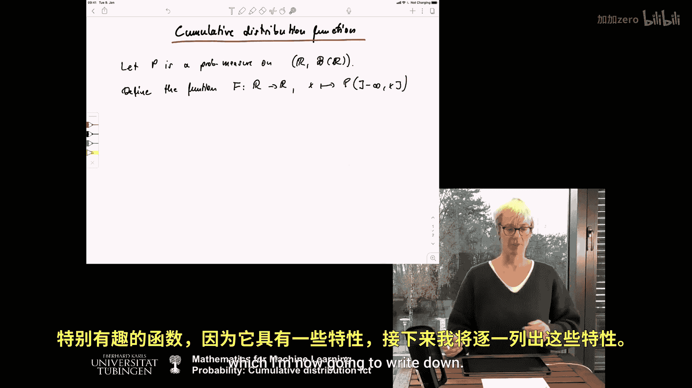

So we define this function。嗯。And absolutely。And we say。

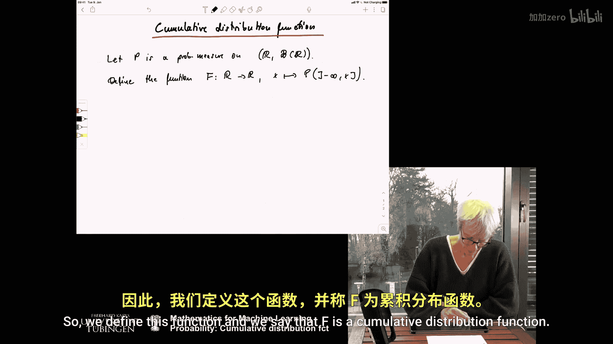