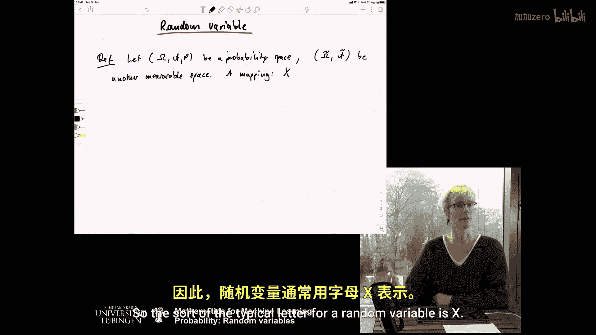

# 图宾根大学【中英⚡机器学习数学｜2020 Tübingen Mathematics for Machine Learning】 p58 P58 (P) Probability Theory 5： Random variables -BV1VhbMzKEts_p58-

In this lecture， we now want to introduce the concept of a random variable。Intuitively。

 the random variable is any kind of property that you can measure on the samples that you're getting。

For example， you have the population of the world and you want to measure how the height of everybody。

 so your probability measure is defined on the space of all persons on the world and it designs a probability of sampling a particular person。

 but the property we're actually interested in is how tall is this particular person。

Or what is the income of this person or in machine only you might even be interested in other kind of properties？

And so of evaluating properties of。Elementary events that are elementary objects that are in our probability space。

 this is what is typically modeled in terms of random variables。

Another example you could consider is you throw a dial， you throw a diet twice。

And you want to consider the sum of the results of the diet。

Then your probability space would consist of the elementary events that you could get。

 but what we're actually interested in is the sum。 And this is now the concept that I want to formally introduce and all of probability theory is based on random variables。

 So this is sort of one of the most important， I mean， next to a probability measure。

 I think this is the most important definition that's out there。😊，So let me define it。

We consider a probability space。So let mega AP P。Be a probability space。Pro the。

Maybe I should write B as well。B a。Probaability。Space。Now。

 so this is the space of the object that we can sample。

 but now we're interested in taking some kind of measurement on the samples and these are going to end yet in a different space。

 so we need a second space so that。How did I denote it omega tilde a tilde？B。Another。Measurable。

Space。This is going to be the target space。 and now we consider a mapping。

That is often called x so the sort of the typically letter for a random。

