# 图宾根大学【中英⚡机器学习数学｜2020 Tübingen Mathematics for Machine Learning】 p62 P62 (P) Probability Theory 9： Expectation (discrete case) -BV1VhbMzKEts_p62-

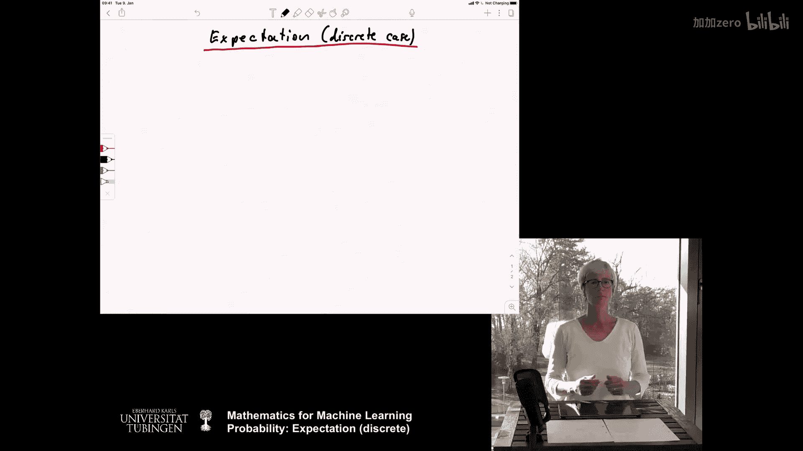

Good morning。After we've now introduced many of these basic concepts that we need in probability theory like a probability measure or。

 independence， conditional distributions and so on。

 we now want to turn towards describing random variables and one way or one the most important number that you could compute for a random variable is its expectation its average value and also in machine learning we do this all the time I would say most of learning theory is devoted to saying can you evaluate the or can you predict what is going to be the expectation of a certain random variable for example the test error and then if you know what the expectation is can you also say how much it deviates the actual test error for example might deviate from this expected value。

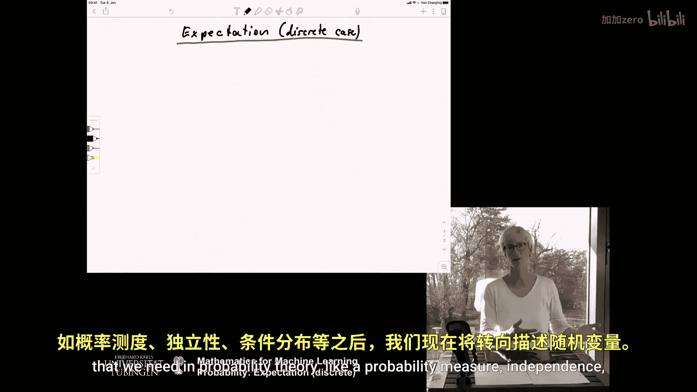

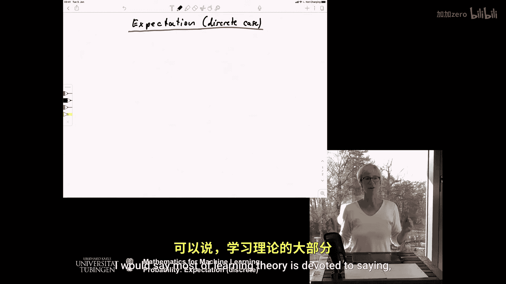

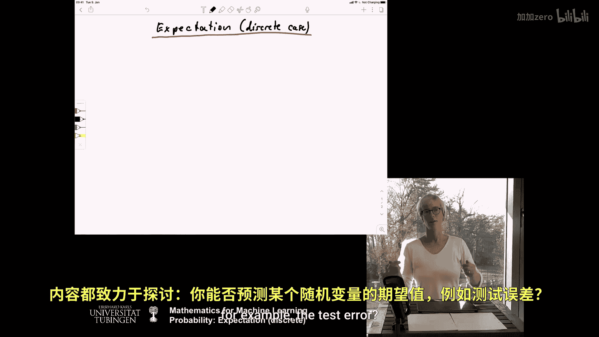

So there are two key concepts here that are needed all over the place。

 and the first one is the expectation and then the other ones are the deviations。

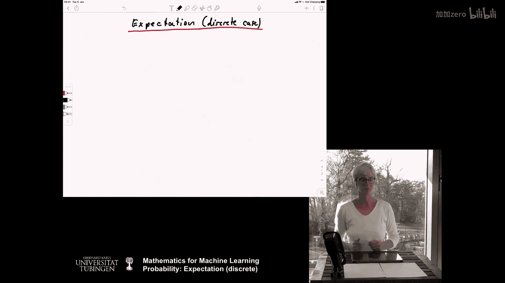

Let us start with the expectation， and for now I wanted to keep this intuitive and talk about the discrete case。

😔。

Because it does not yet involve integrals and I think you can build the intuition easily in the discrete case and then for the continuous case we simply need to do it。

 we need to define it also for like using the integrals。

 but I think it's easier if you have already some intuition for what is going on。

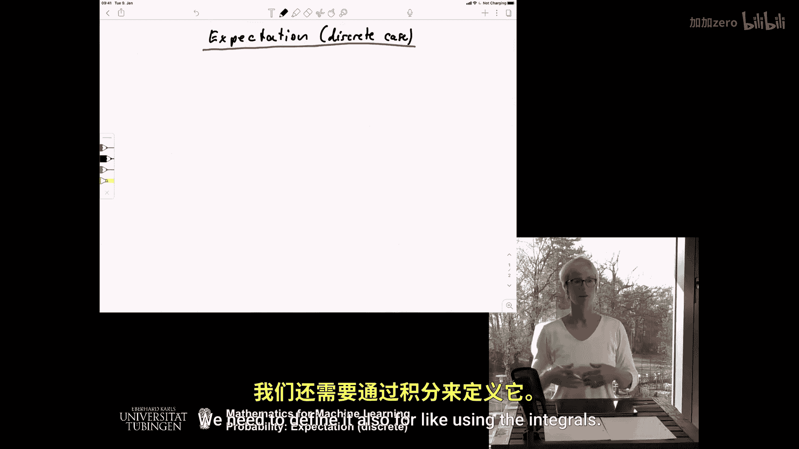

嗯。So we first consider the discrete case where， where we have a discrete render variable， consider。

It is great。Randdom variable。X。

That goes from， say omega to R。

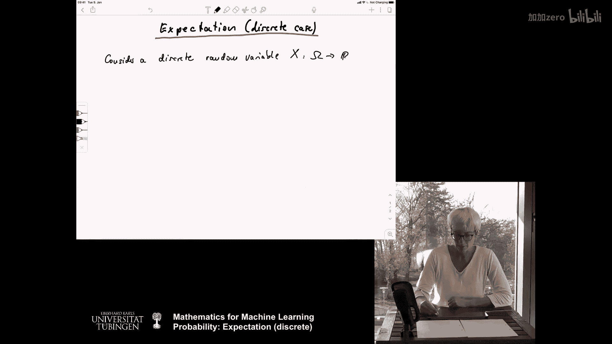

嗯。So this is now also something I probably would need to mention here。

 So when we talk about expectation we talk about something like the average value of the outcome and typically we do this if a random variable has values in R So you wouldn't if if your space is something completely abstract。

 you might not even be able to， I don't know， compute what the mean is to be able to compute a mean you need to have a vector space structure at least。

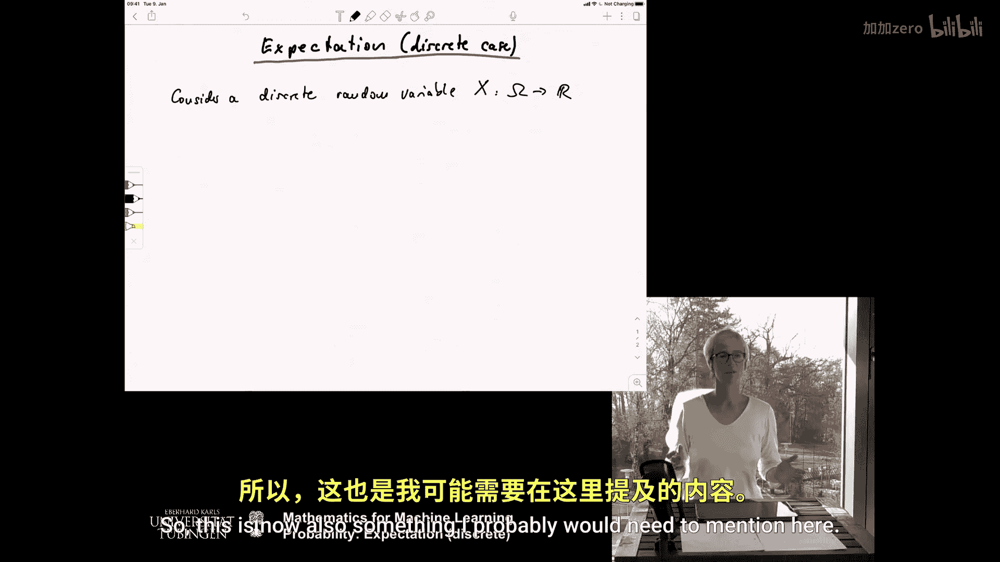

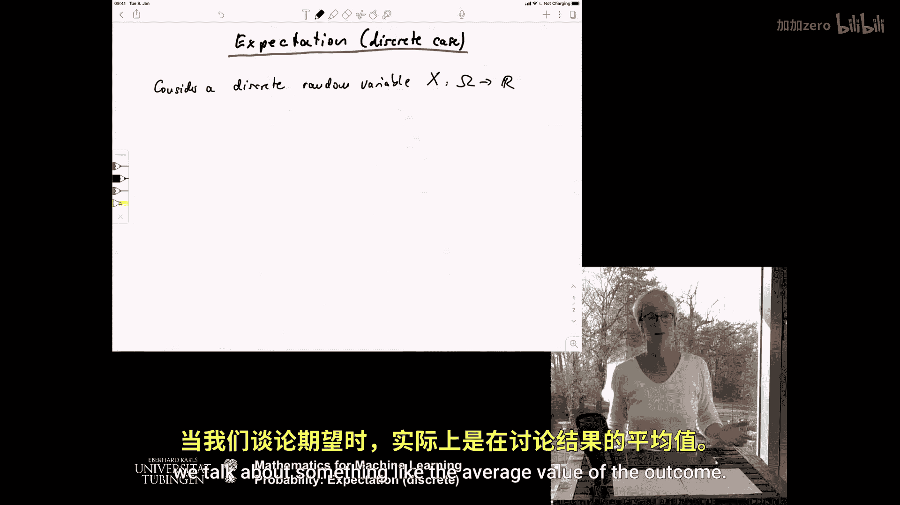

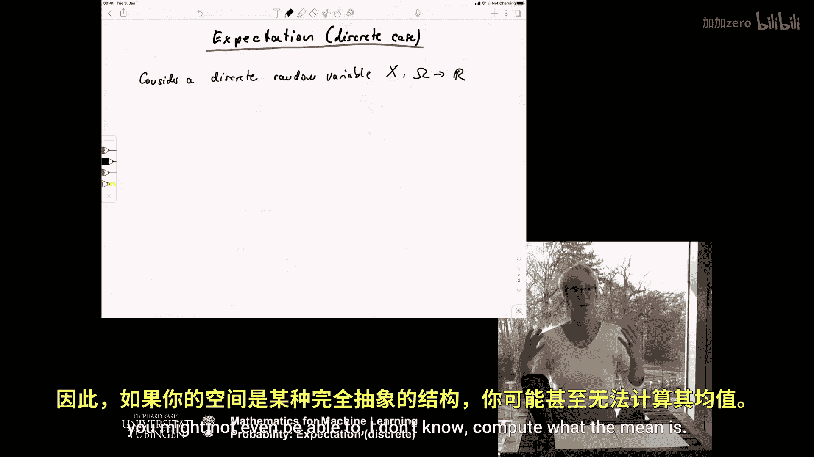

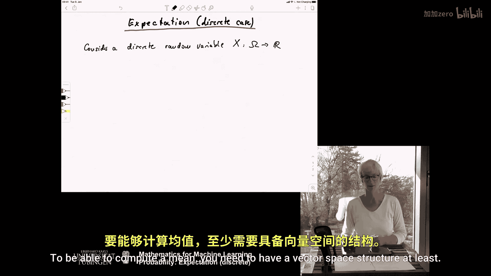

嗯。So呃。In most cases， when we talk about expectations， we mean real valued random nervous。

 It doesn't need to be that we have the hold real line in our image space， but。

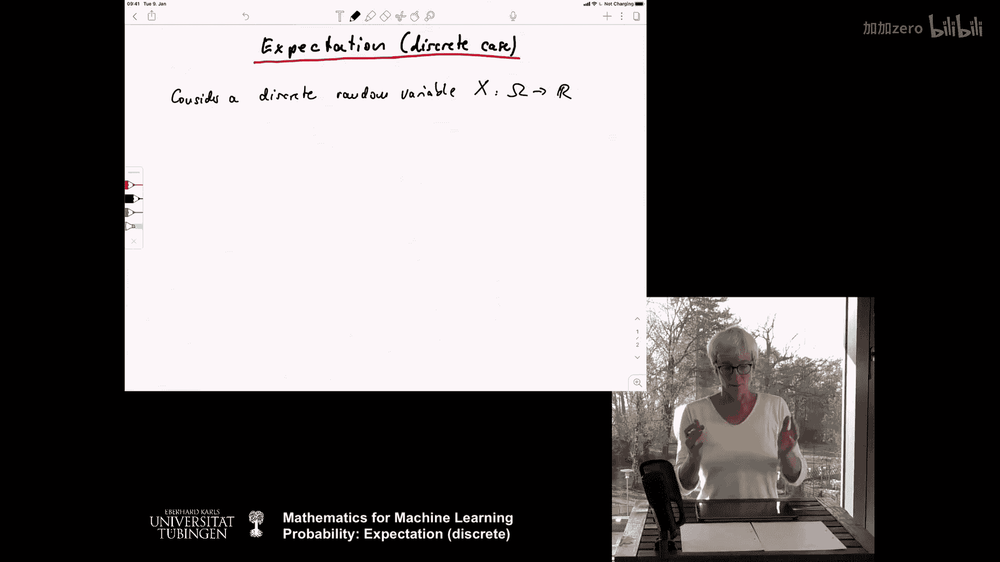

