# 图宾根大学【中英⚡机器学习数学｜2020 Tübingen Mathematics for Machine Learning】 p63 P63 (P) Probability Theory 10： Variance, covariance, correlation (discrete case) -BV1VhbMzKEts_p63-

After we've seen what the expectation is。The next related quantity is the variance while the expectation measures sort of the average value。

 so what is the most would be the most typical outcome of a certain random variable。

 the variance measures by how far actually the actual realizations of this random variable deviate from this expected value。

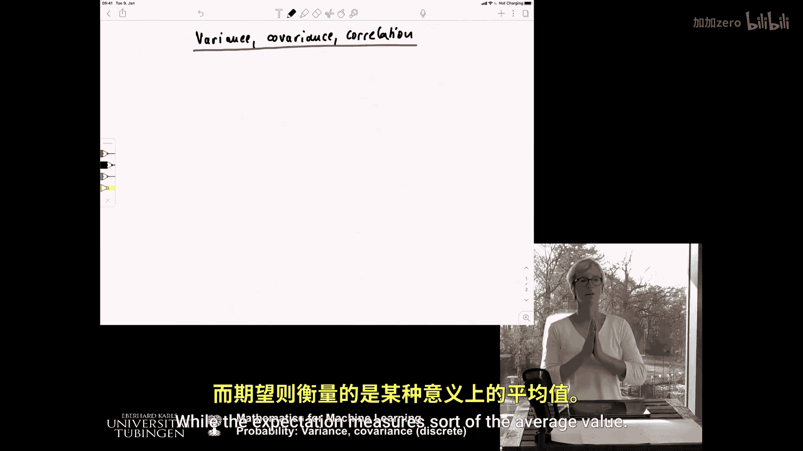

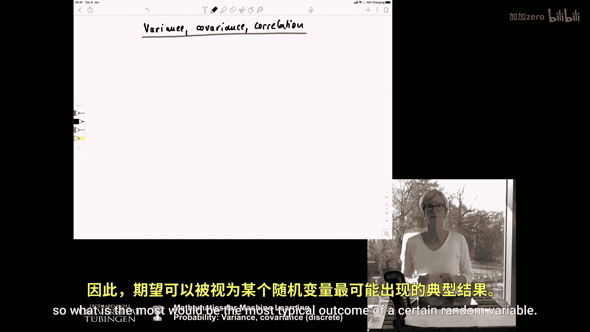

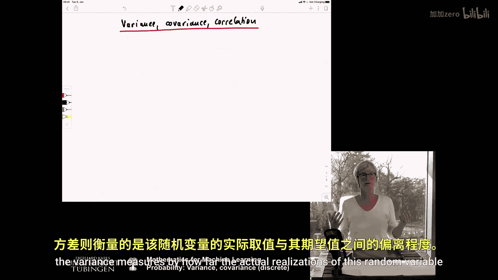

And in machine learning in particular in machine learning theory， but also in other fields， we often。

 I mean， a good situation is if the variance is very small because then we can measure the expected value and know that the actual value。

 the one we might want to or that we would observe is very close to the expected value。😊。

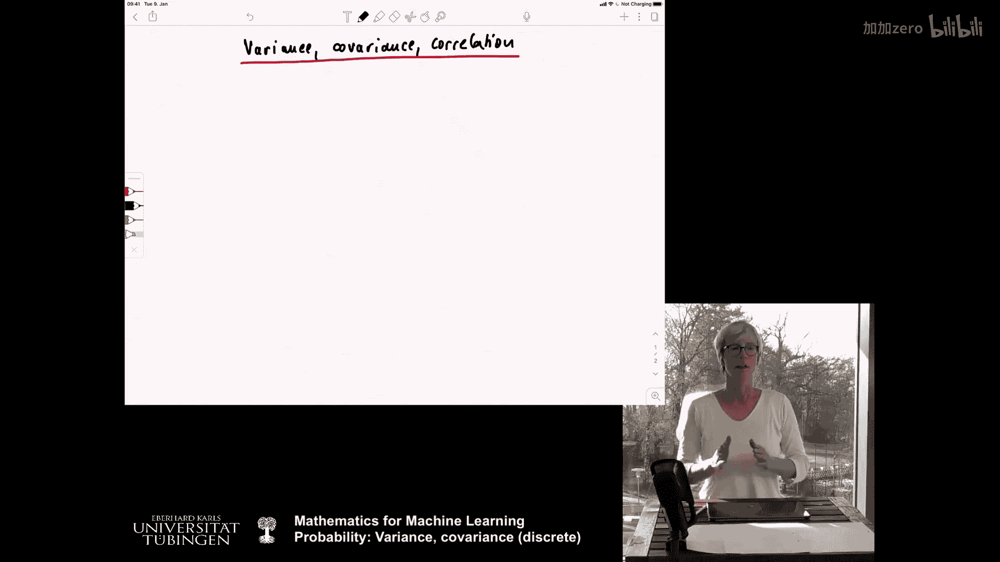

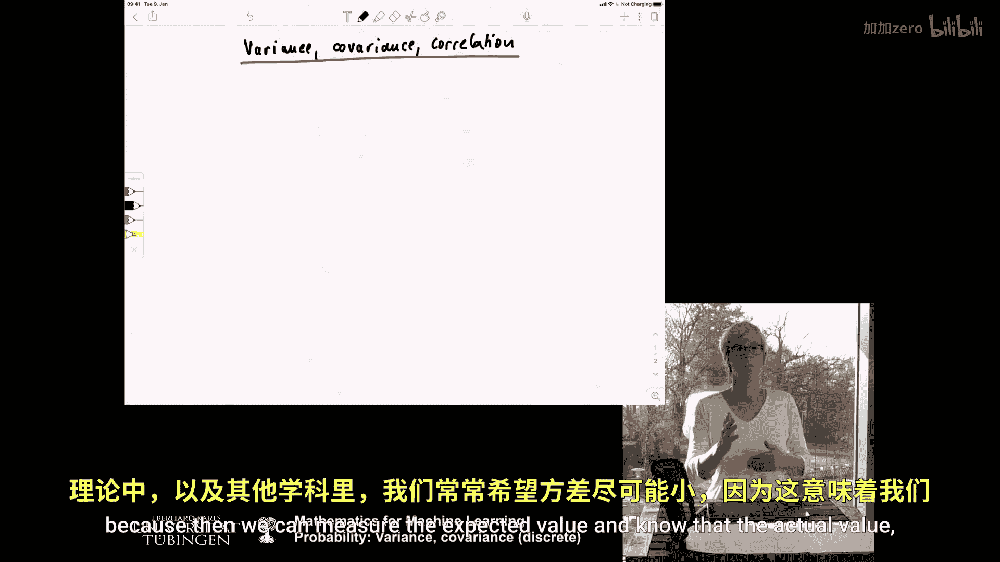

So we need to have tools to measure deviation。

Of random memberss from their expectation。

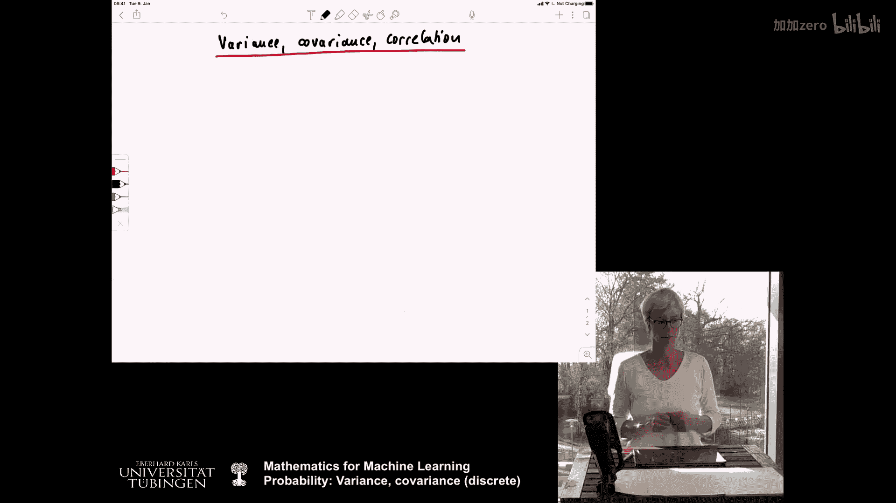

The simplest such tool is the variance and data in the lecture。

 we are also going to see more elaborate concepts like concentration inequalities。

 but it comes much later。

So let us now introduce what is the variance of a random B？

And as before we do it in the discrete case first， maybe I take this down here as well。

 discrete case。

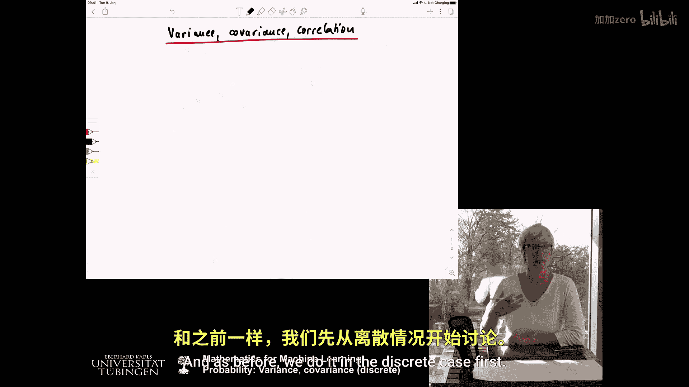

And as I said， the continuous case is coming later。

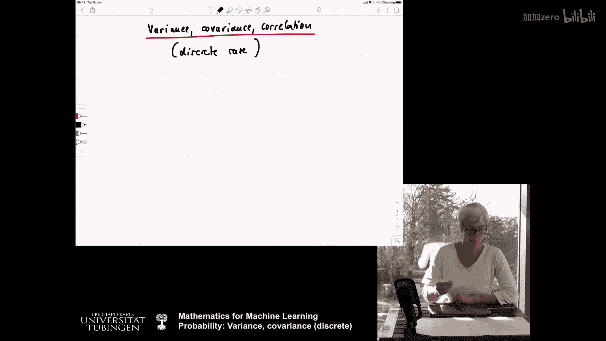

So consider the following definition。We have two random variables。

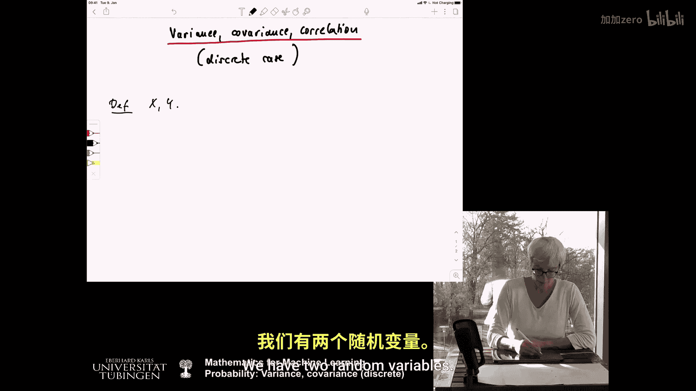

They go from any kind of standard probability space， mega AP。

To儿。Again， we are in the setting where we have values in R。

And assume these are discrete。

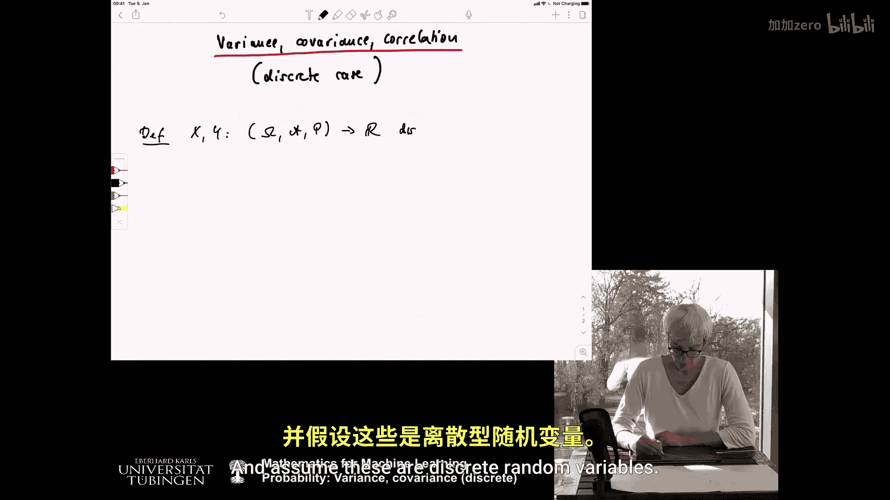

Renddom variables。And now we need to make another another assumption with E。

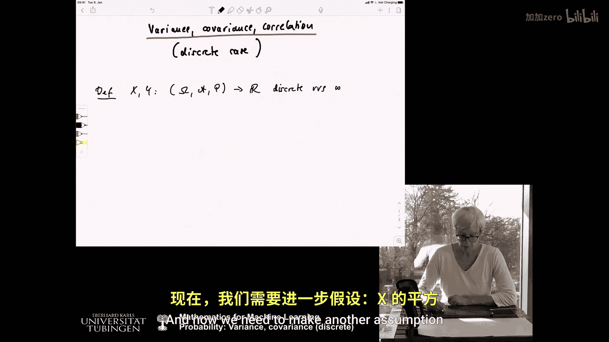

The expectation of x square is smaller infinity and also the expectation of expectation of y is square is smaller than infinity。

 We are going to need that because otherwise we cannot compute the variance。

 We are going to see it in a minute。

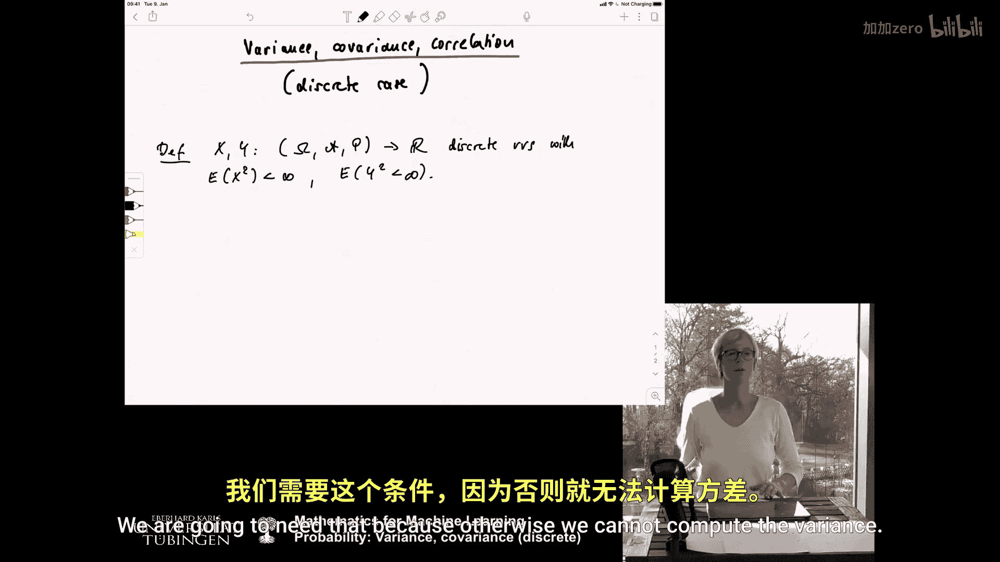

And sorry， here's the parent Jesusis wrong。

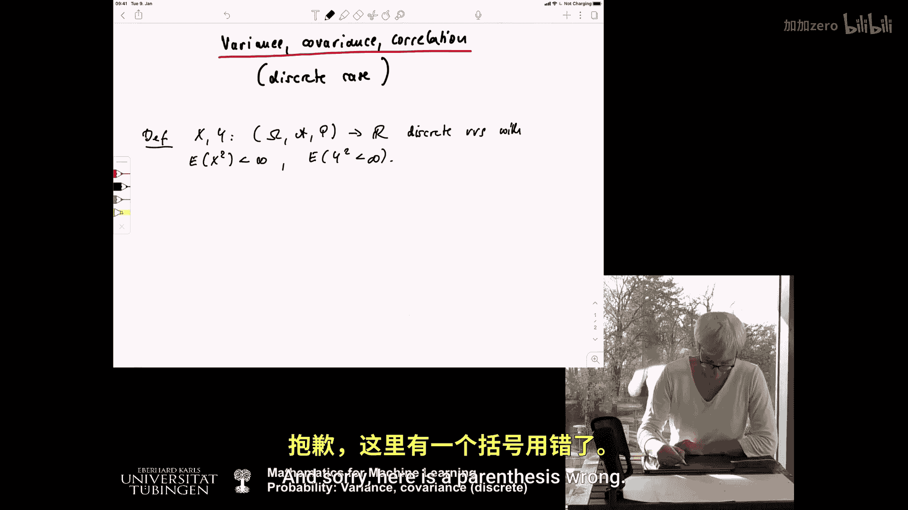

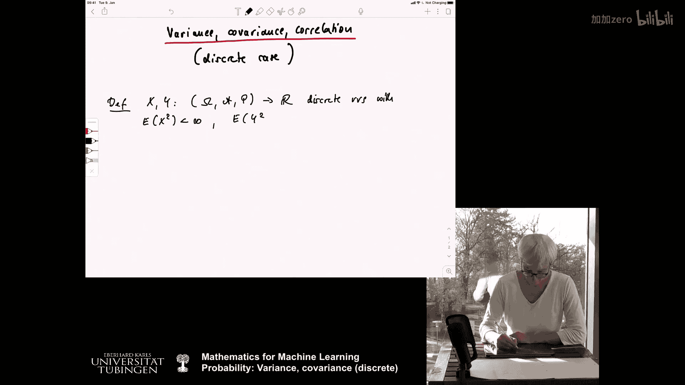

Okay， so now we have then。We consider the variance of x。Which is the expected value。

Of x minus e of x。

Squared。And discuss。

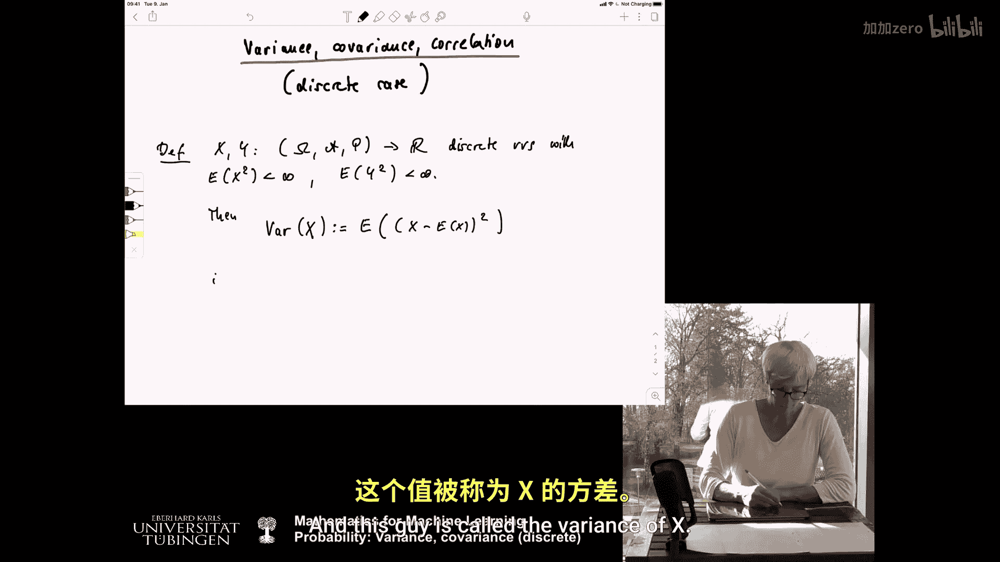