# 图宾根大学【中英⚡机器学习数学｜2020 Tübingen Mathematics for Machine Learning】 p65 P65 (P) Probability Theory 12： Markov and Chebyshev inequality -BV1VhbMzKEts_p65-

Now I want to introduce two really， really important。

 basic but important inequalities for random variables。

These are the mark of inequality in the Cbyev inequality。

Let me simply start right away and before I introduce these two I want to introduce one more。

 which we have essentially already seen， but maybe you might not be aware of that。

 namely the Kshwartzs inequality。

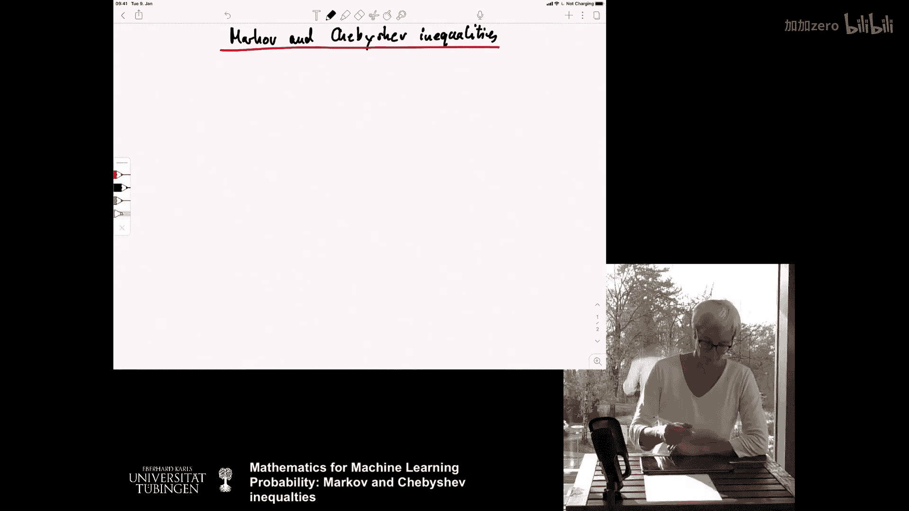

So the course is runs。

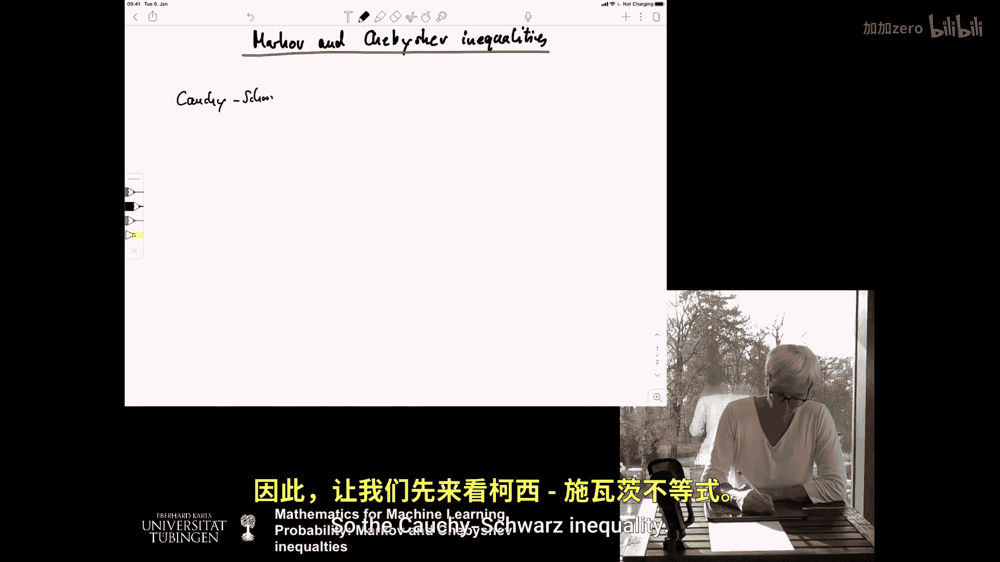

Inequality。If you remember this was an inequality， if we have seen that the linearnar algebrazebra。

 if we're in a hber space and we have a scalar product， then we can sort of。

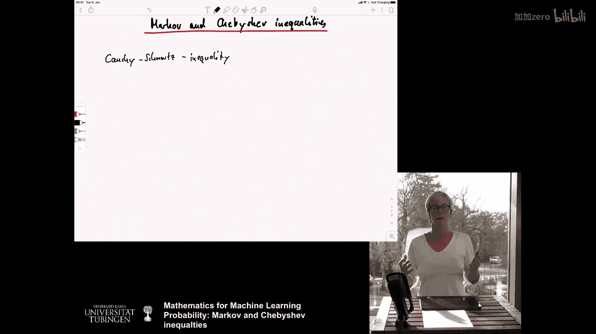

呃。How should I express it？😊。

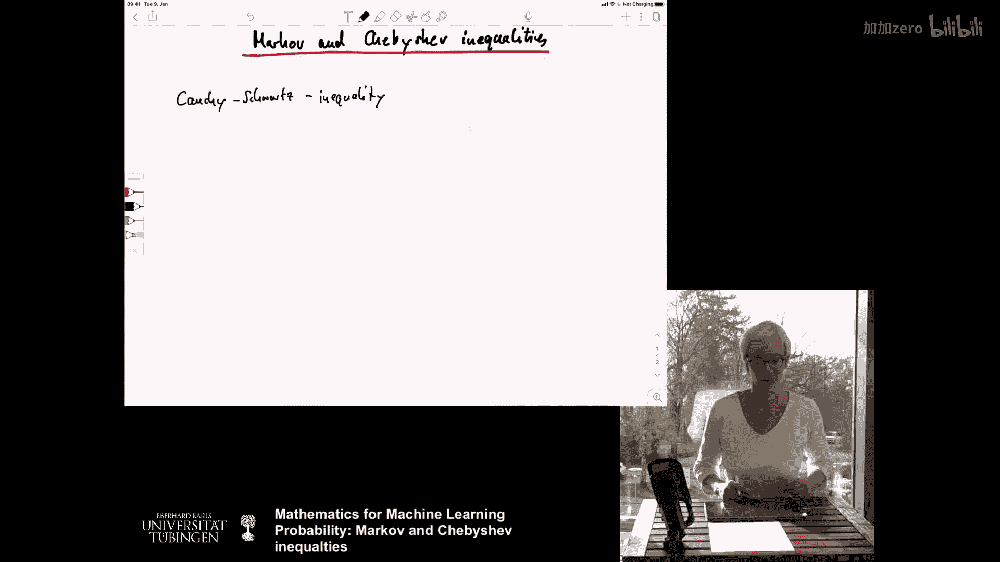

We have an inequality between the scalealar product and the norms of the termss。

 let's just put it like that。 and now I want to write it down in terms of expectations。

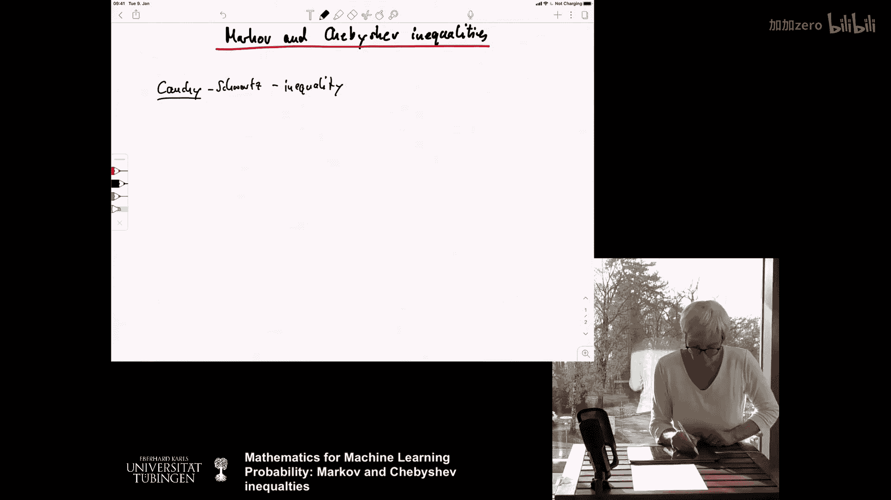

So it goes as photos， assume that x and y are random variables that live in L2 of some omega A。

 so there are lots of things I don't always write down in omega A is a probability space and x and y being an L2 means I can compute the expectation and the variances and so on。

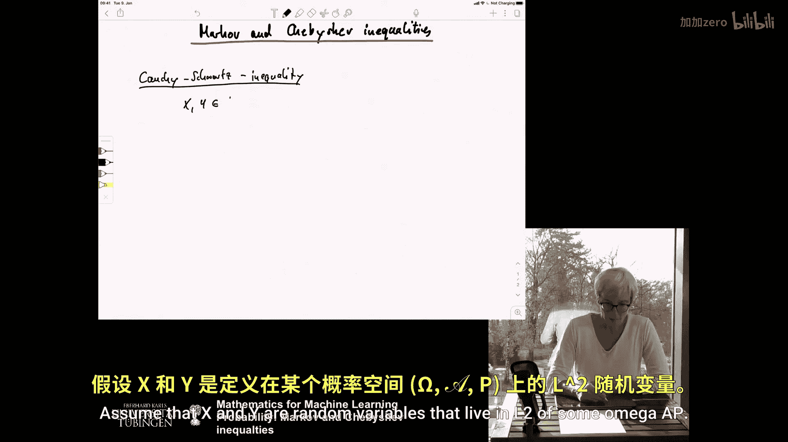

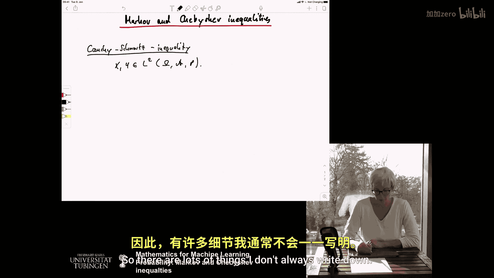

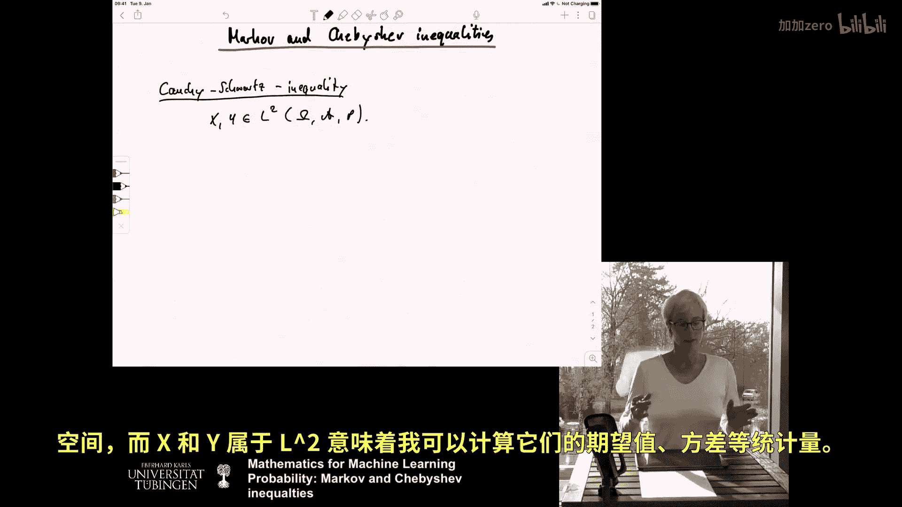

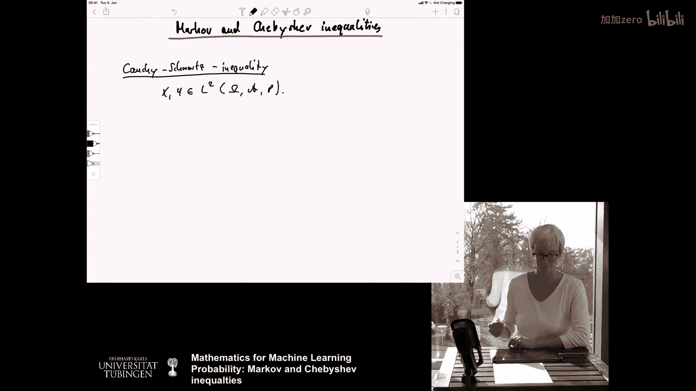

And then the inequality now reads the expected value between x times y。Squared。

Is smaller or equal to the expectation of x squared。

Times the expectation of y is cleared。

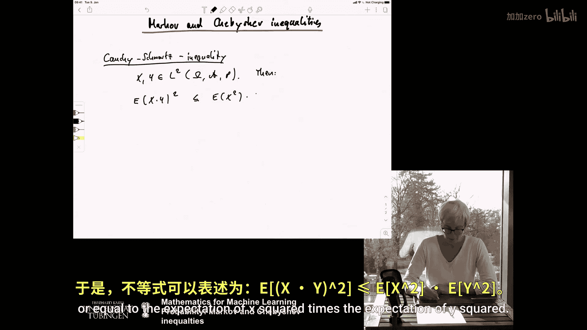

Okay， I mean， this is just one instance。

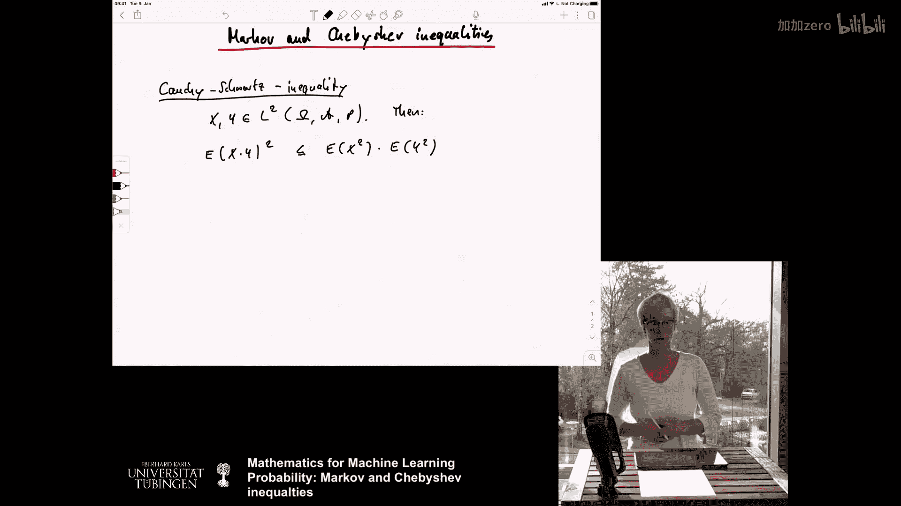

Of the Kishwartz inequality as we have seen it already in linearar Ate Ra。

 and we might have an assignment as an exercise for you to see that。

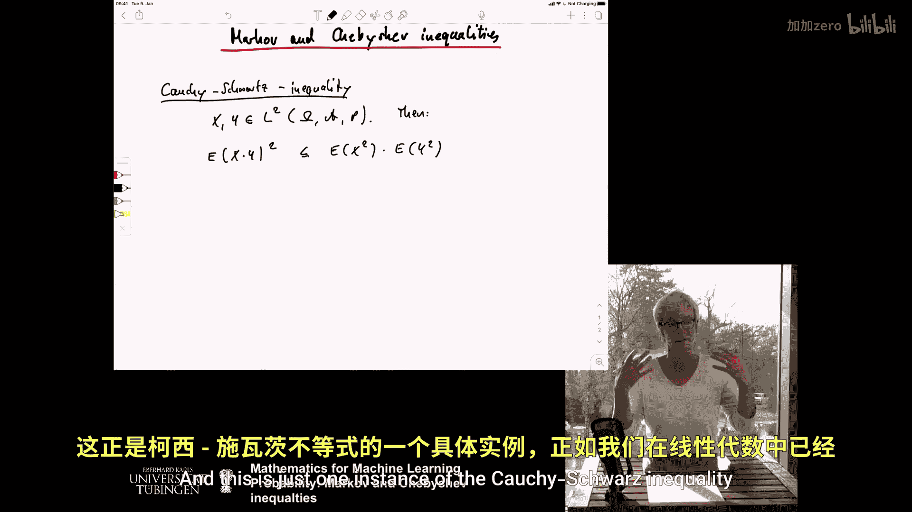

The one that I'm actually heading at is Markov's inequality and then JBS's inequality。

Let me simply write them down the mark of inequality。

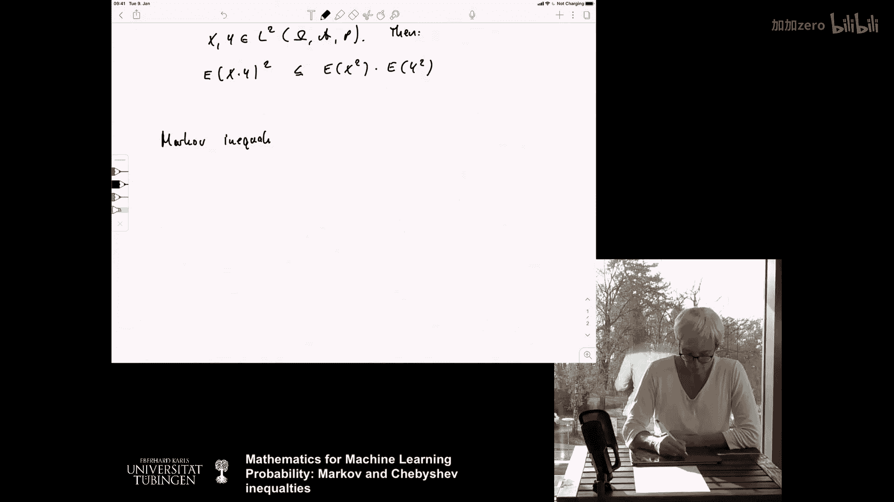

嗯。This goes as follows。So assume that epsilon is on number larger than zero。

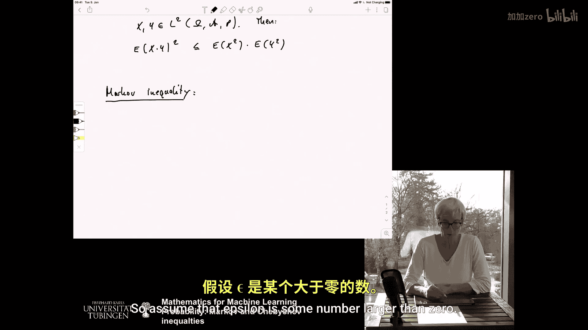

It's going to be a like in all the analysis or calculu statements。

 epsilon is supposed to be a small number， consider a function F。

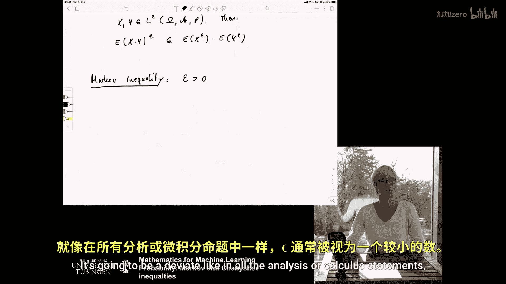

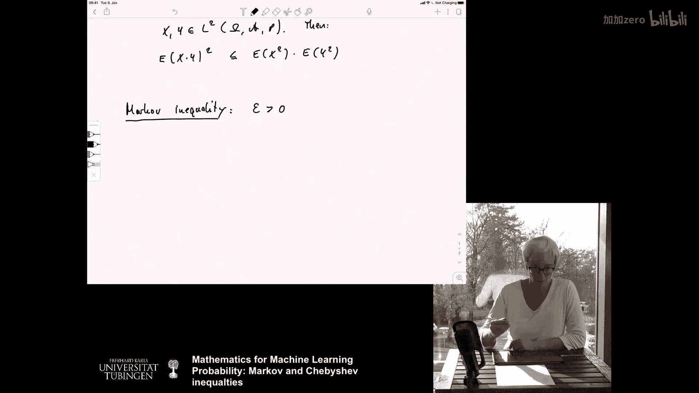

That goes from0。

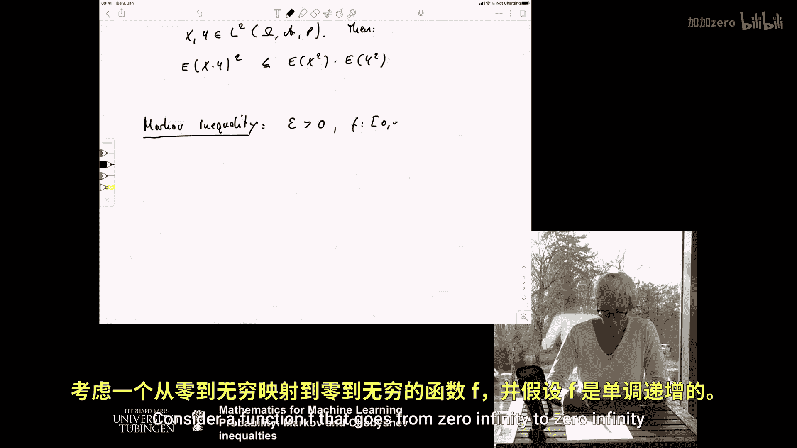