# 图宾根大学【中英⚡机器学习数学｜2020 Tübingen Mathematics for Machine Learning】 p72 P72 (P) Probability theory 19： Marginal distribution -BV1VhbMzKEts_p72-

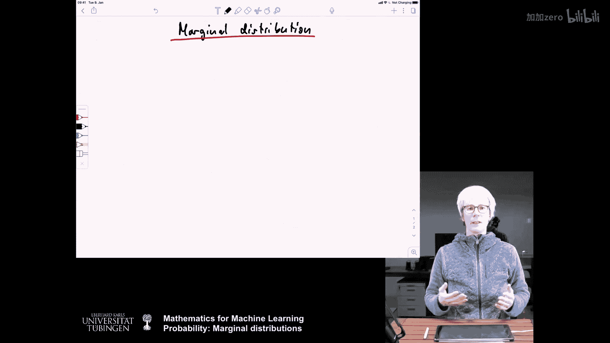

In the last lecture， we looked at the joint distribution。

And now we sort of want to invert that operation of taking the joint distribution。

 which brings us to the marginal distribution。

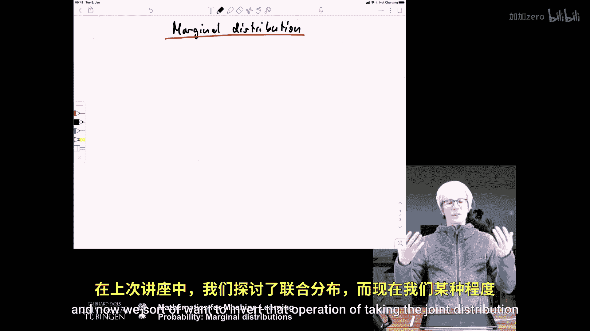

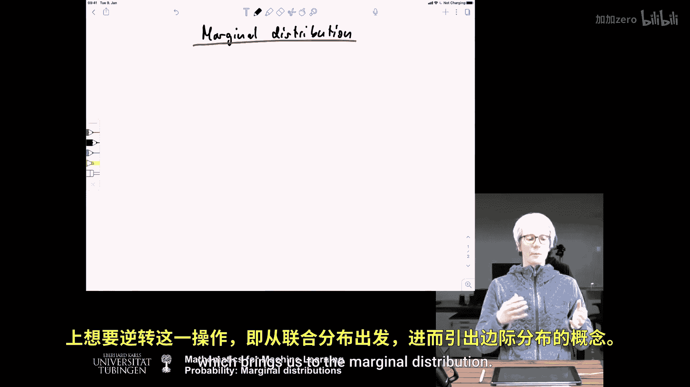

And I want to explain this concept first of all， in the discrete case and then in the case with density because these cases are simpler。

 I think to understand。

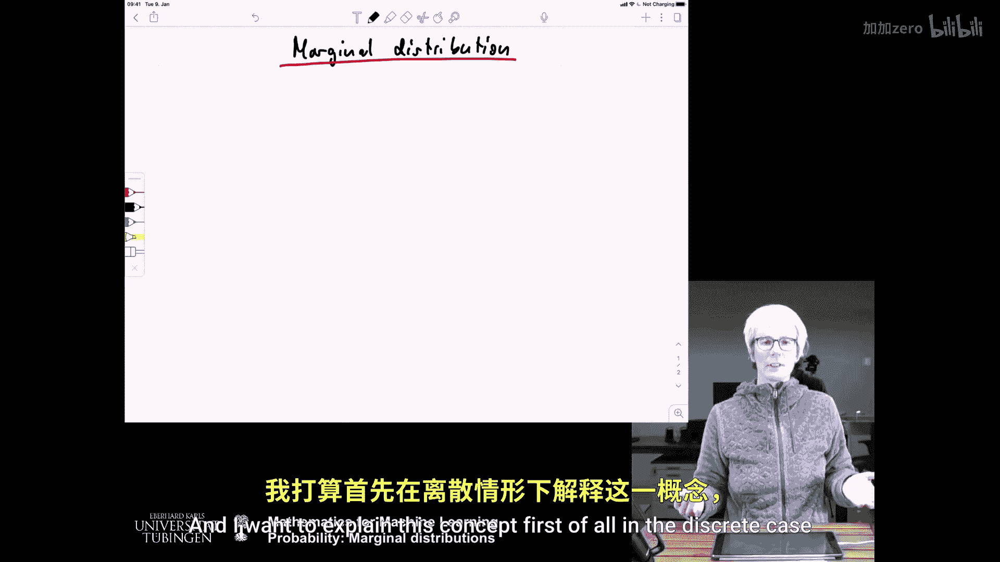

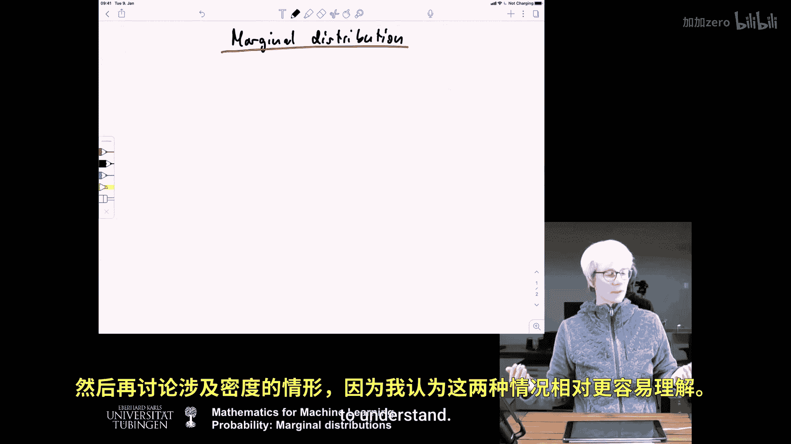

In fact， it's something very simple， let us write it down， so we consider a joint distribution。

We consider the joint。

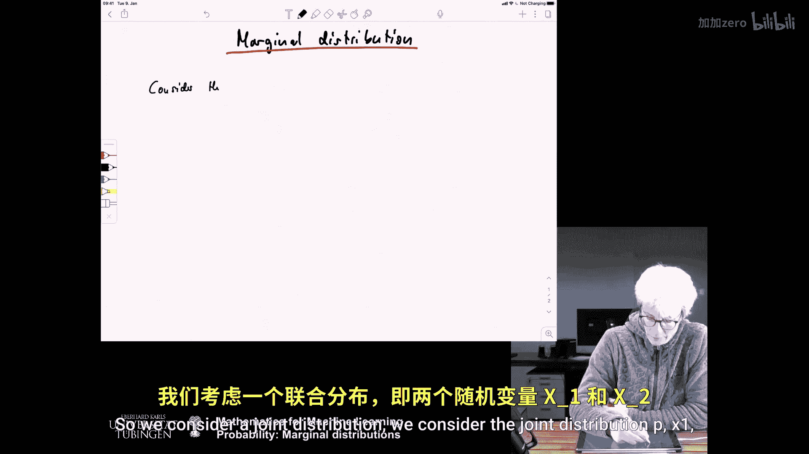

Distribution。P X 1， x 2。Of two random variables。Which I might want to summarize at X， which is x 1。

 x 2。

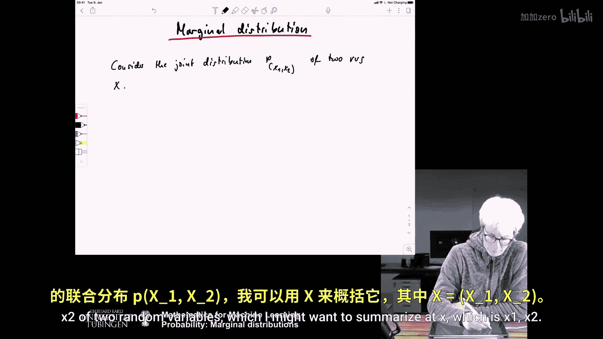

And now we want to say， what is the marginal distribution of x with respect to x1。

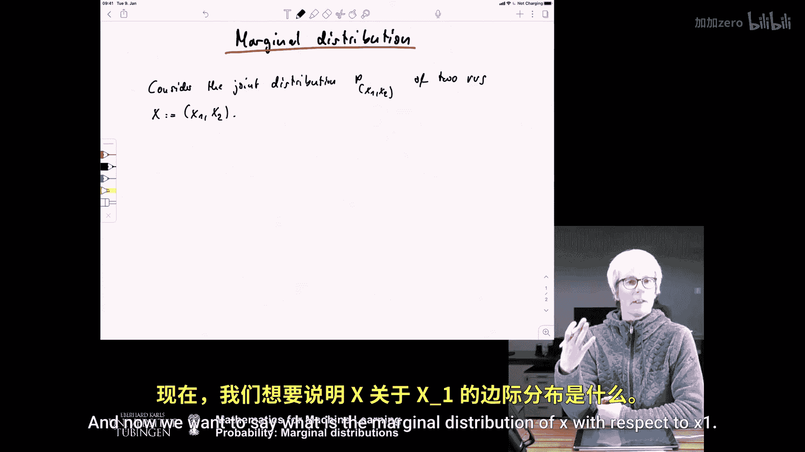

So， the marginal。Distribution。Of x。 So x is now the joint thing。With respect to x1。

 this is what I want to define Mar in a distribution of x with respect to X 1。

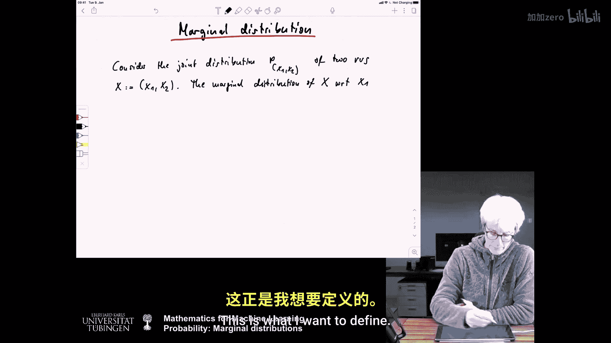

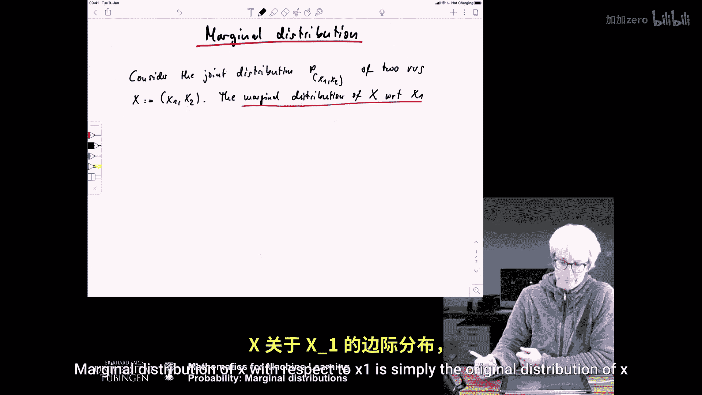

It simply。The original distribution。Of x， X1 on the first space。Oomega1。A1。Namely。

The distribution P of x1。

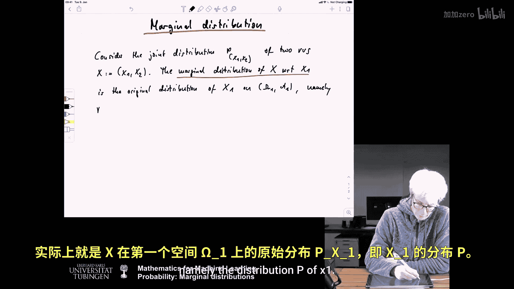

So this is somehow it sounds trivial， so I say here's the child distribution and the marginal is。

 well is the distribution if you ignore the other coordinate。

 if you just look at this one coordinate。

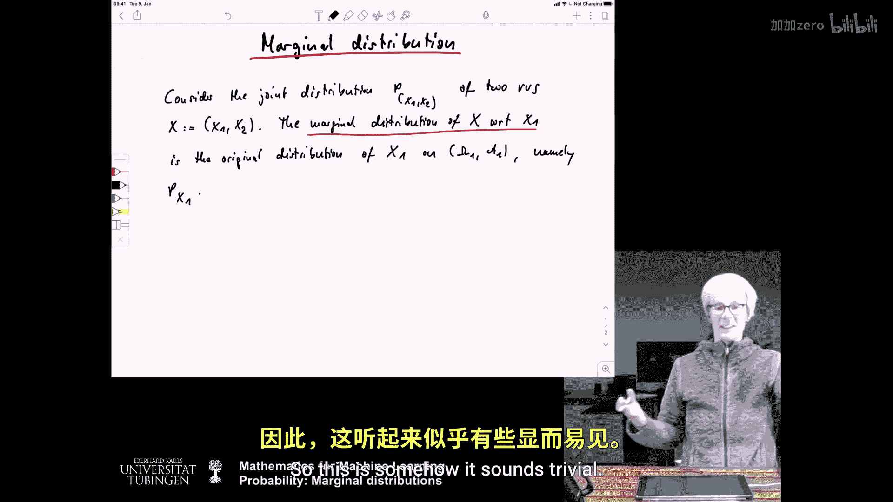

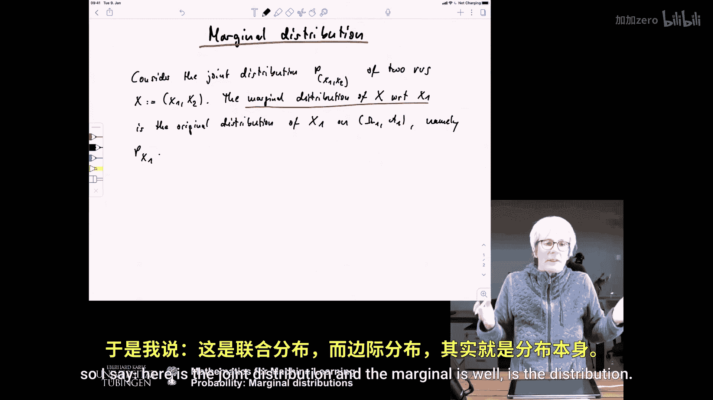

Written like this it sounds trivial， but still sometimes people are confused about what the margin is。

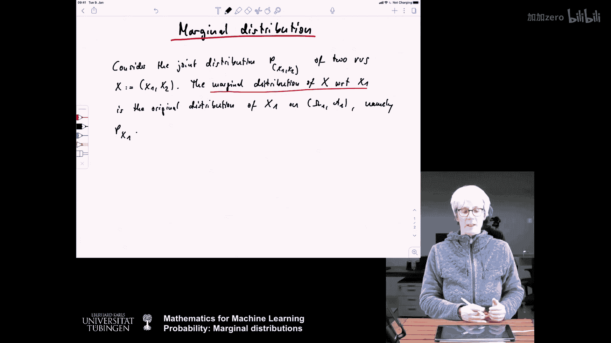

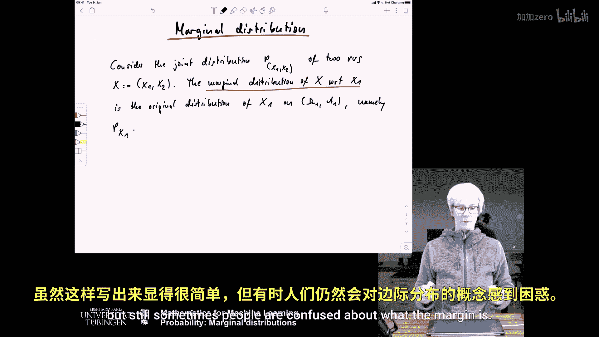

I want to give you an example in the discrete case。嗯。Example。In the discrete case。

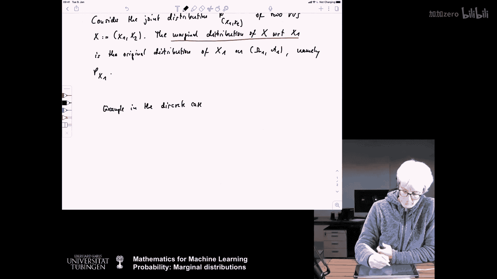

So in the discrete case， say we have two random variabless， we have x1。And it can take values x1。

 x 2 and x3。

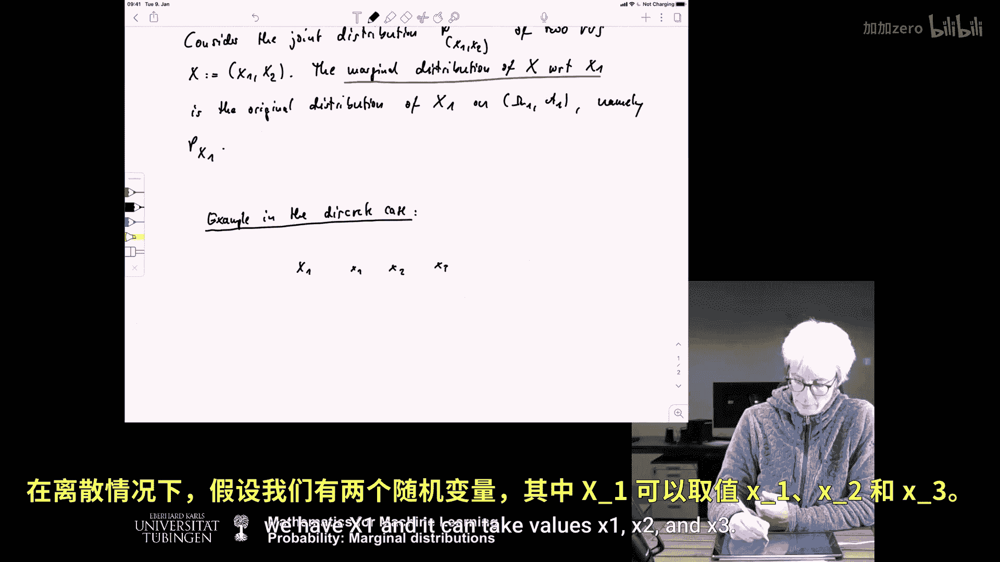

And say。We have another variable that is。

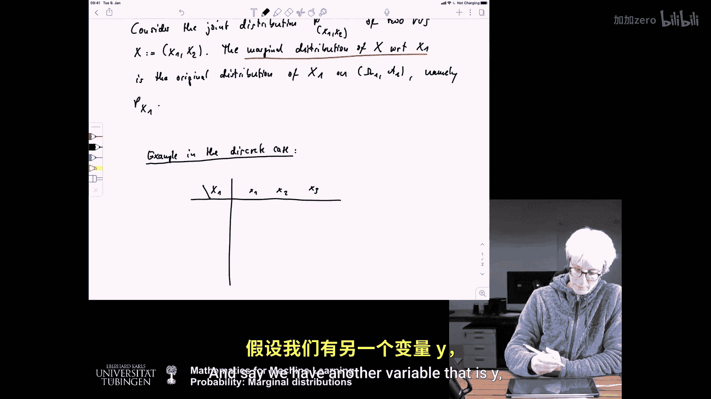