# 图宾根大学【中英⚡机器学习数学｜2020 Tübingen Mathematics for Machine Learning】 p80 P80 (S) Statistics 6： Likelihood-ratio tests and Neyman-Pearson lemma -BV1VhbMzKEts_p80-

In the last lecture we have seen what is the standard concept of a statistical test for testing two hypothesisses。

 an nu hypothesis against an alternative hypothesis。

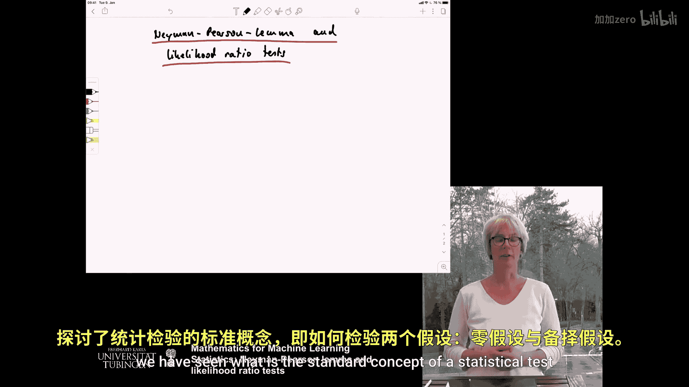

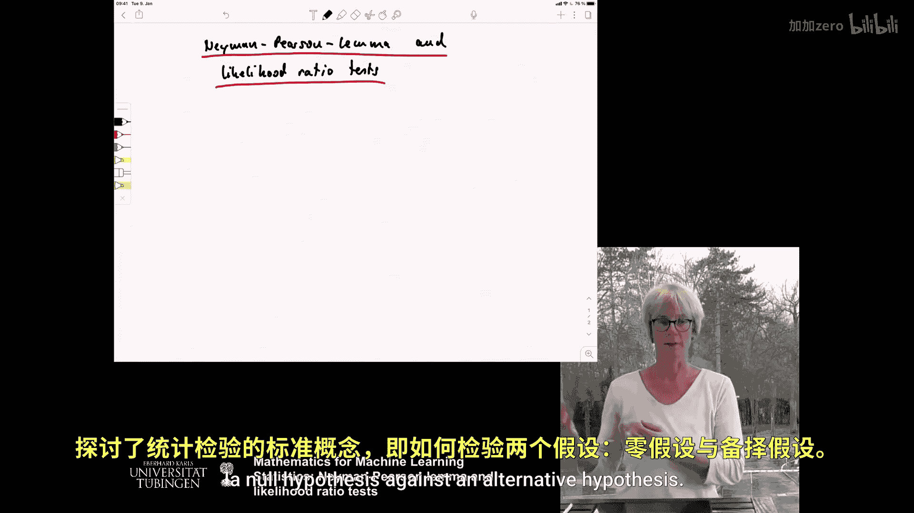

We have already said that to construct such a test， typically you first fix the level of the test。

 which controls that have one arrow。

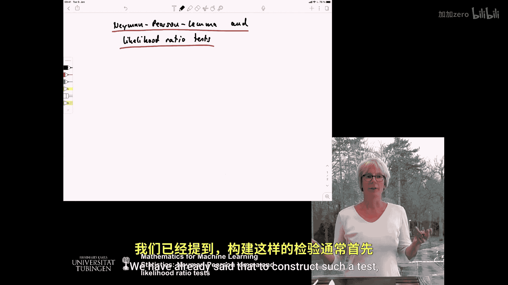

And then if you're lucky， you can also， if you have several choices of tests which all have the same type1 error or at least satisfy your guarantee on the type1 error。

 you can then go and try to select one that has a good power that means a small type2 error。

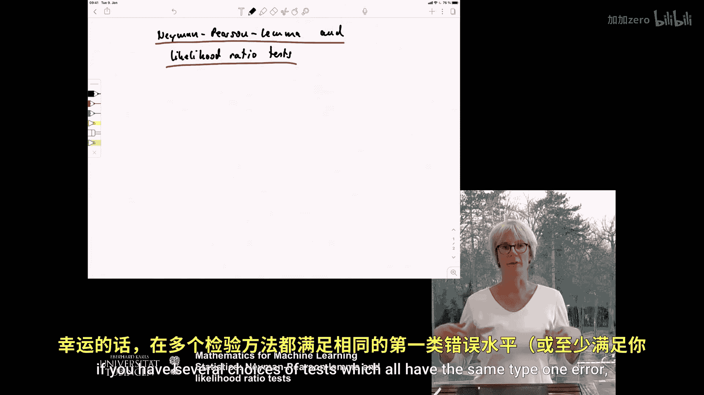

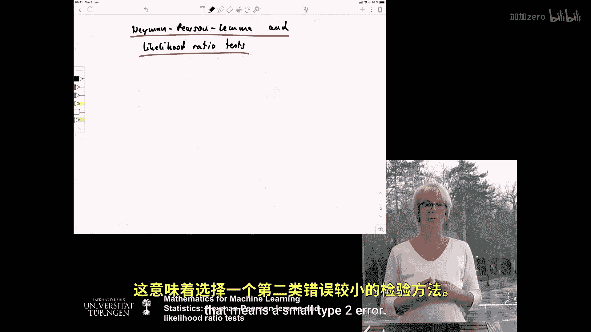

I've I also introduced that there is a concept of the uniformly most powerful test。

 which is sort of if you've given a set of tests。

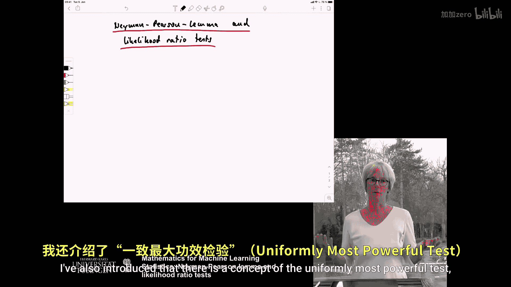

Of level I you can select the one that is the best among all of them and said that this is rare。

 So in practice， often it doesn't happen。

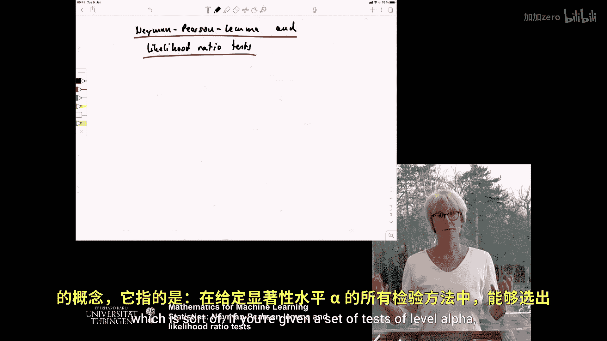

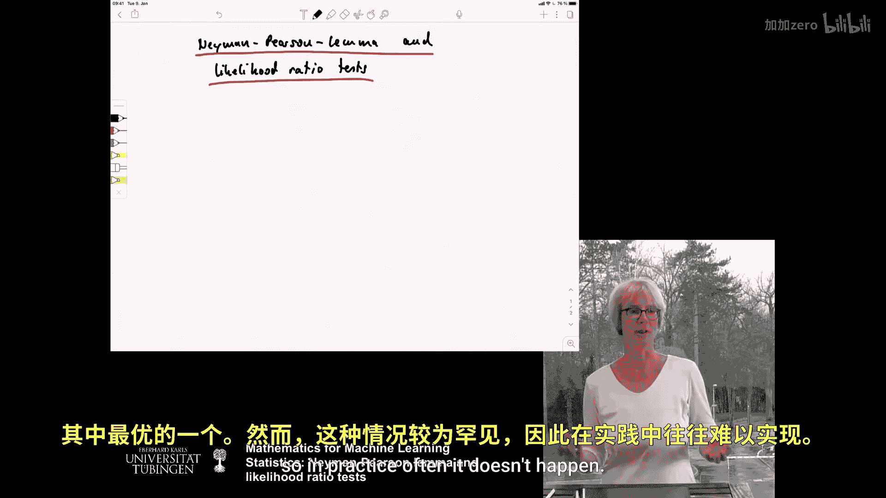

There is one situation where it does happen。And this is described in the name in Pearson Lemma。

 and I want to describe it because I think it's also an interesting concept。

 the kind of test that it is used， name this is a likelihood ratio test。

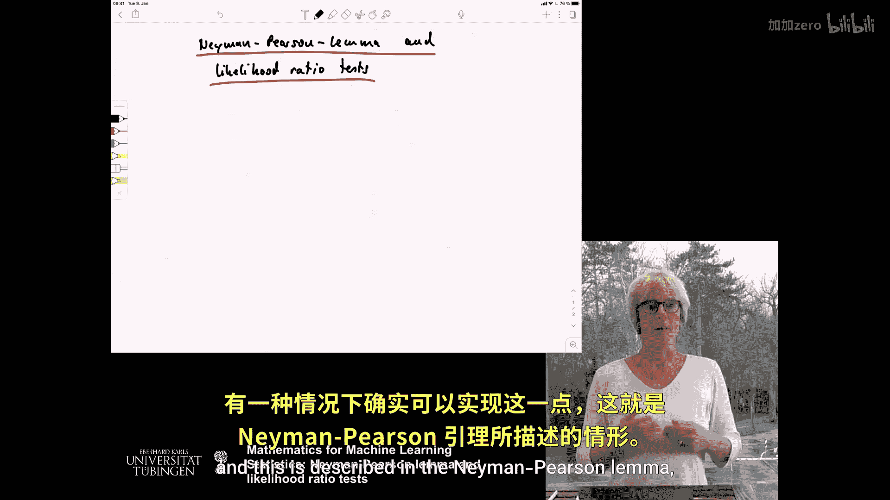

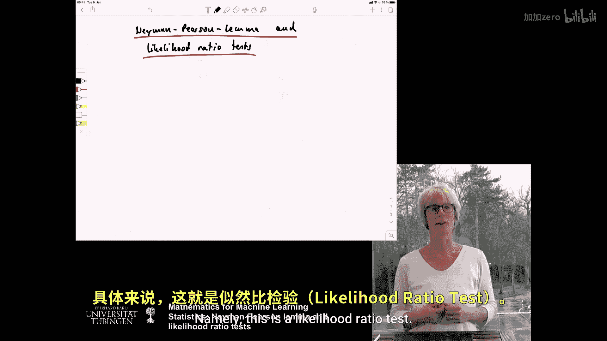

Very intuitively， a likelihood ratio test is something I find very， very intuitive。

So you want to test a hypothesis against another hypothesis。

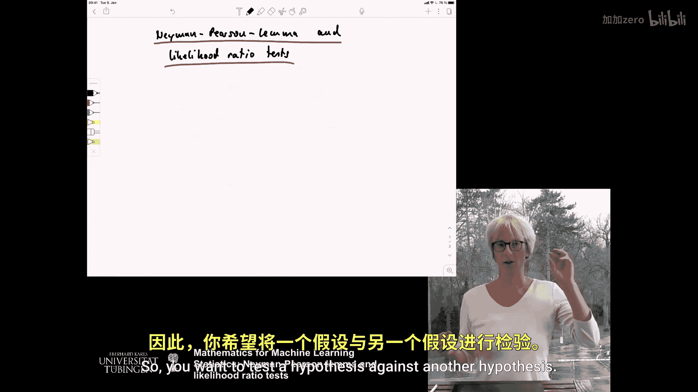

Now in standard Statistic， how do we evaluate how plausible is a certain statistic？

Like a certain density for given data。 we compute the likelihood。 We always compute。

 what is the likelihood to observe this data given a certain parameter。

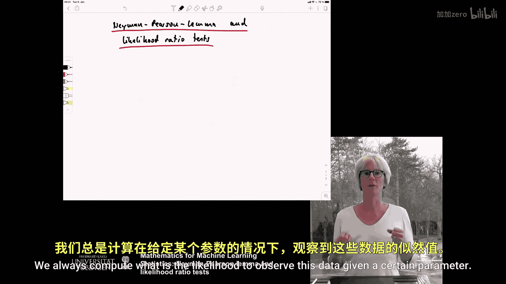

And now the likelihood ratio has simply says， well。

 if the likelihood in the set age0 is larger than in the likelihood age1。

 then I probably retain H0 and if not， I reject it。😊。

So this is a very straightforward kind of concept， and I'd like to make it a bit more formal now。

So first of all， I'm going to write down what the CRorem is， well it's called a CRorem now。

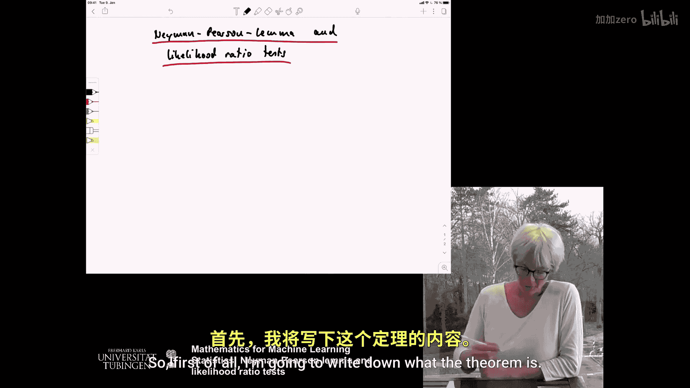

Even though in the literature， this is called the name of kiss and Lemma。

But I called it a serum， I think it's a great statement。😊。

So suppose。So we want to test。 we test a hypothesis， H0， the parameter theta。

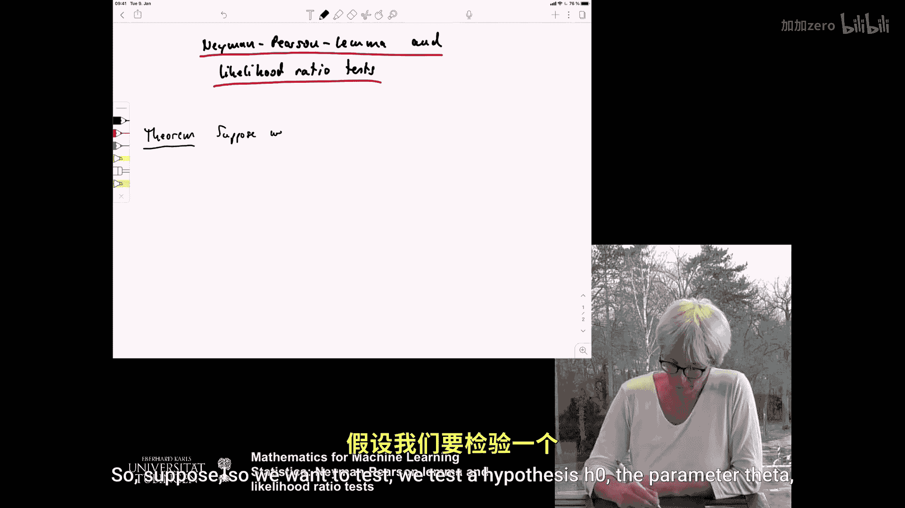

Is theta 0。Against。It's one。The parameter is theta1。

 so this is now a case where we test two simple hypotheses。

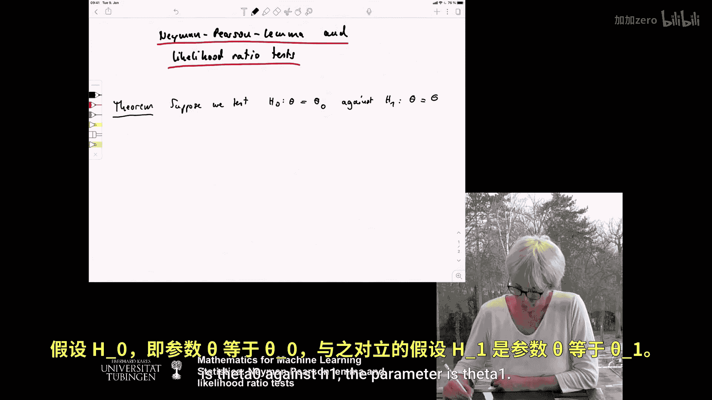

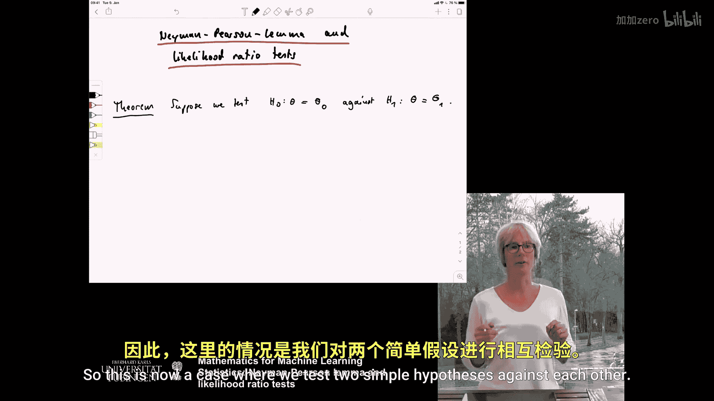