# 图宾根大学【中英⚡机器学习数学｜2020 Tübingen Mathematics for Machine Learning】 p81 P81 (S) Statistics 7： p-values -BV1VhbMzKEts_p81-

In the last lectures， we have looked at hypothesis testing。

 and we have seen what is the level of a test， what is the power of a test。

 what are type 1 and type  two errors。

Now， observe the way a test is constructed， this is followed。

 so we typically first fix the type 1 error alpha and then we construct a test at level alpha which either says yes or no。

 we reject or be retain。 so it's just a discrete answer， yes or no。

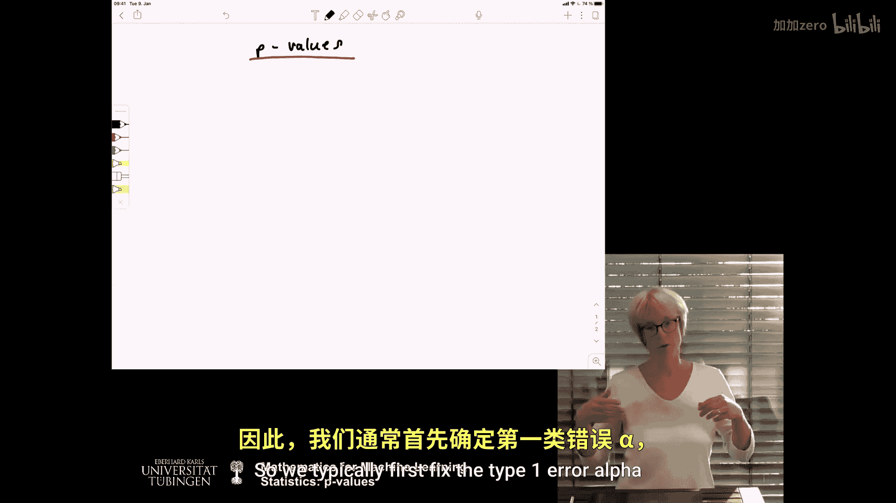

Sometimes， however， you want to know how much evidence would I have for rejecting a hypothesis。

So it's not just giving a binary answer， but a real number。

And this can be done and the concept is called a P value。

 and this is used widely all across science in many fields where people have data and evaluate the data in papers。

 they often report a P value。

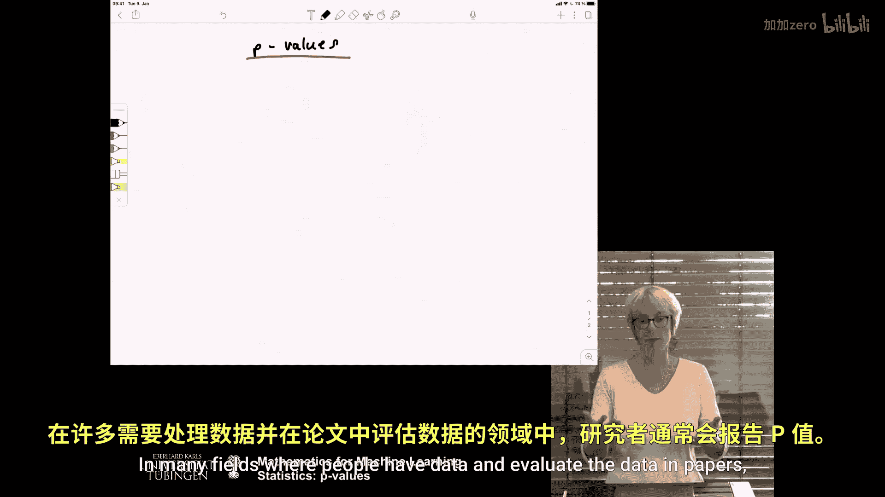

And now I want to introduce how this P value works。

So consider a test。A test。At level。I for a certain quantity。

 I don't want to be more specific than that。

And。Deote。It's rejection region。We not sorry， we。Jack。Reg。

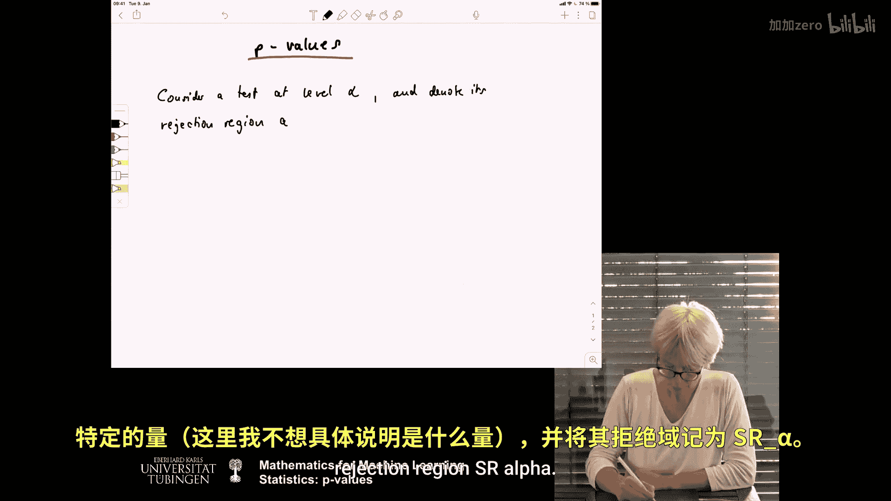

SR alpha。 So in principle， for each level， I， we could define such a rejection region。

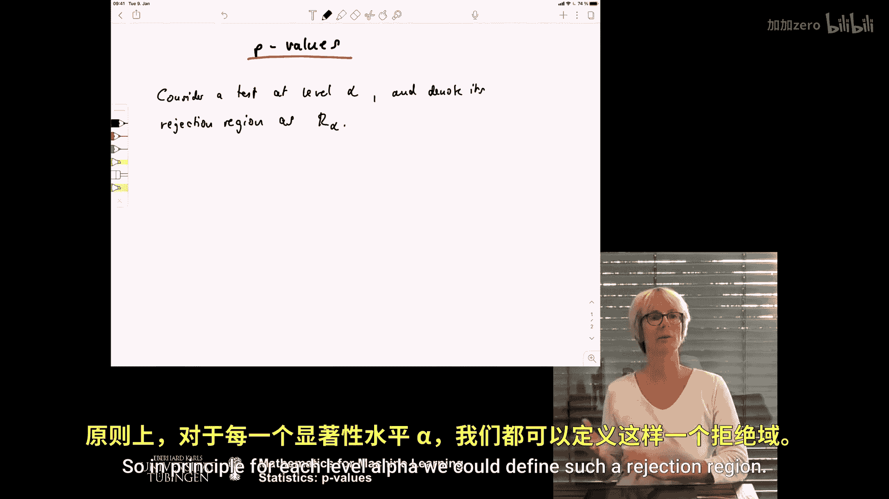

Observe the smaller alpha， the more difficult the test becomes。

 the more evidence do we need to collect to reject the non hypothesisesis。

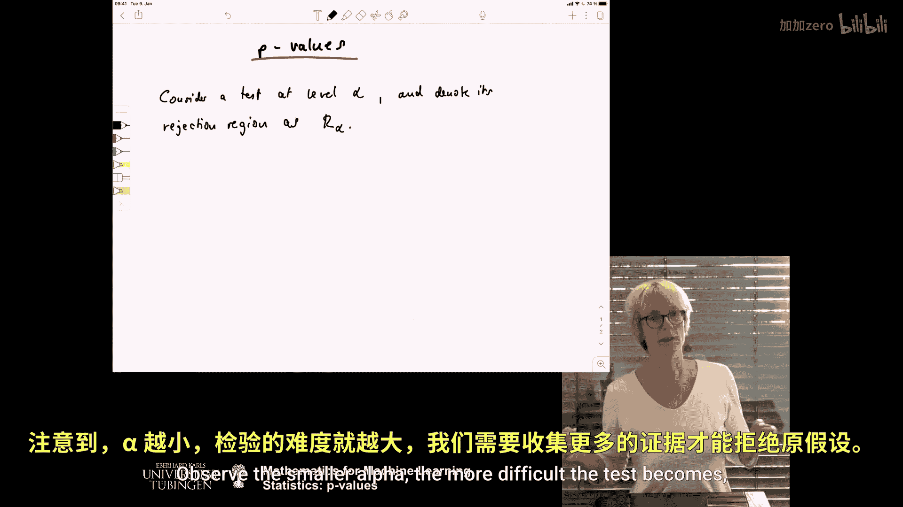

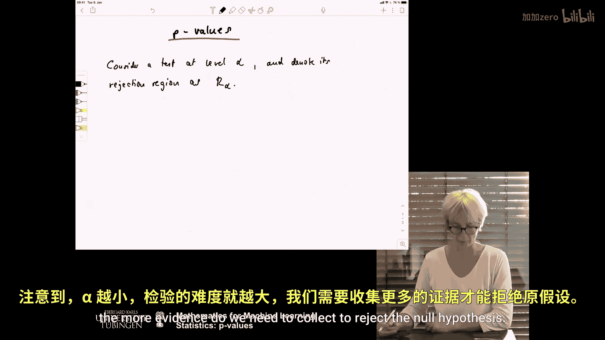

So I write this maybe down， so we call it。Alpha is the probability of a type 1 error。

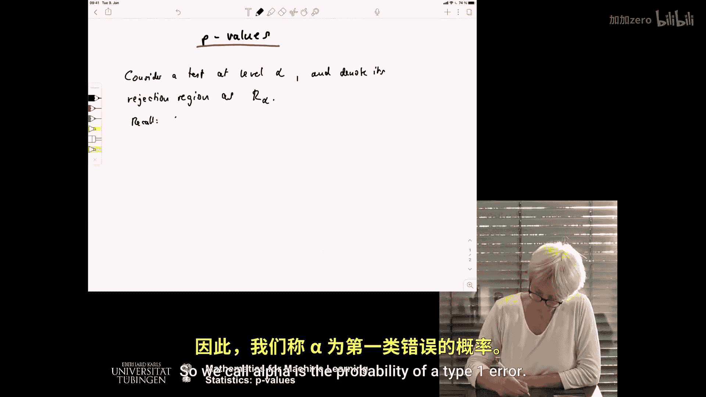

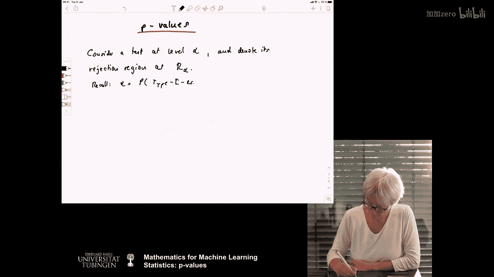

And the smaller I the more complete， like the smaller disrection region also is going to become。

 So the smaller。

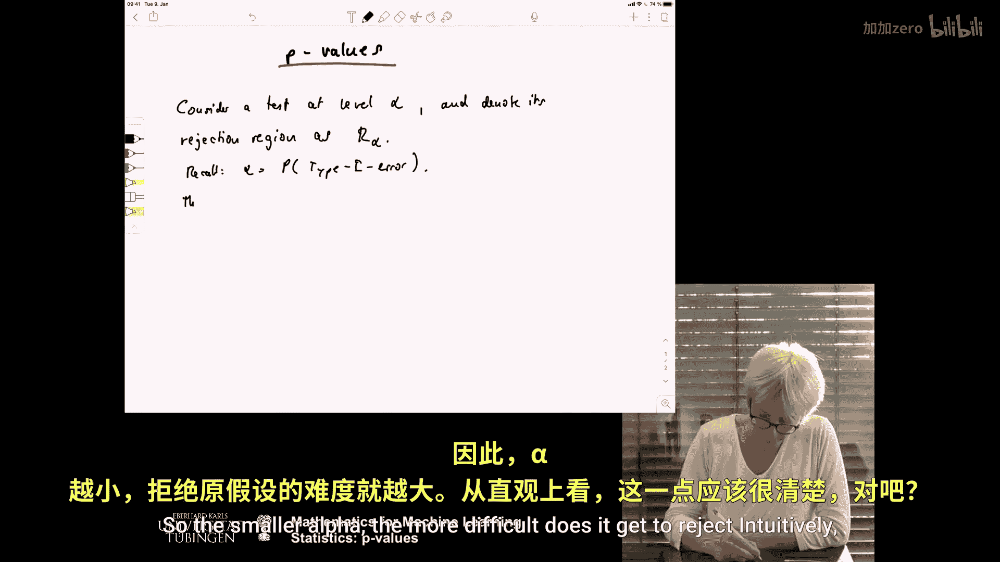

I have found the more difficult。Does it get？To reject。

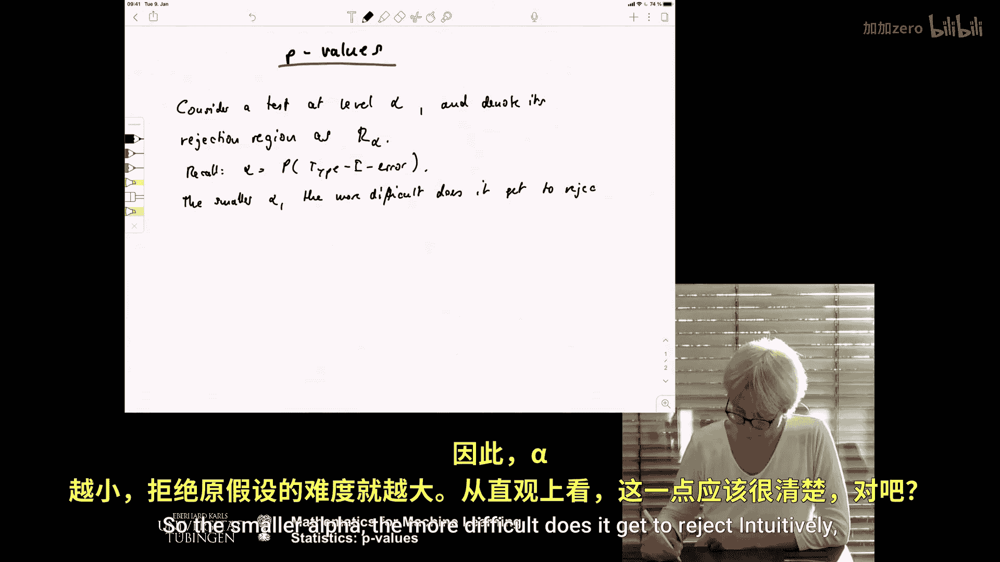

H0 intuitive intuitively this should be clear right you want to make a very small probability of error when you reject the hypothesis。

 so I mean the best thing would be to never reject it and then you will never。

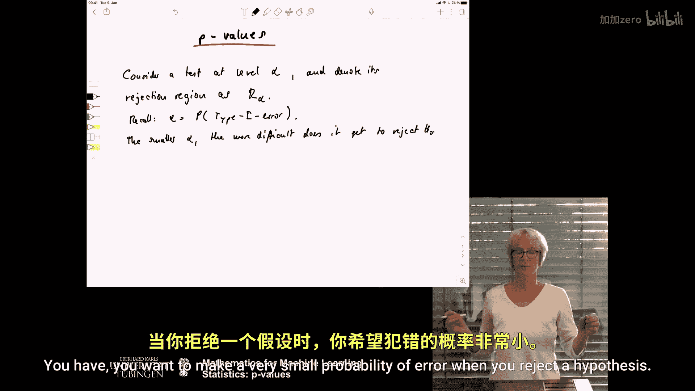

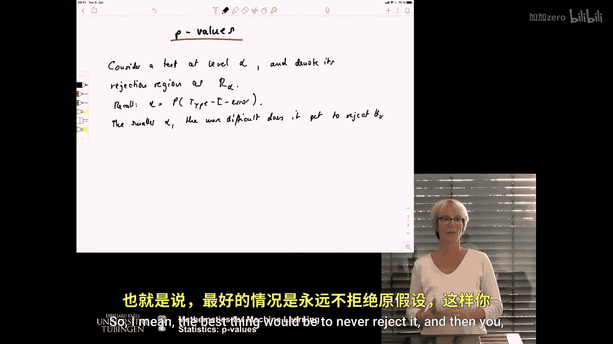

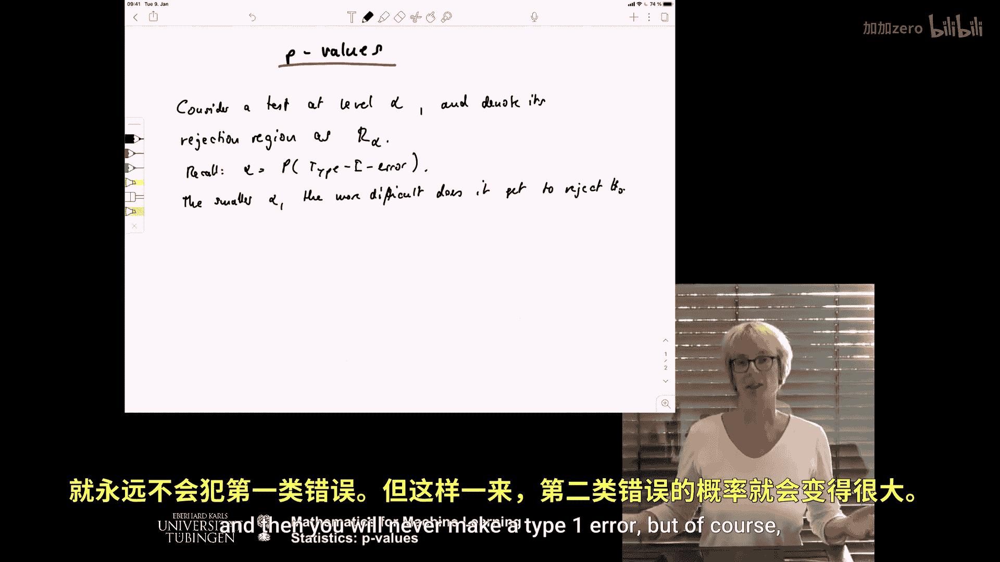