# 图宾根大学【中英⚡机器学习数学｜2020 Tübingen Mathematics for Machine Learning】 p82 P82 (S) Statistics 8： Multiple testing -BV1VhbMzKEts_p82-

Hey， good morning。Today we want to start looking into multiple testing。

We are somewhere in the middle of the chapter on testing hypothesistheses and statistics。

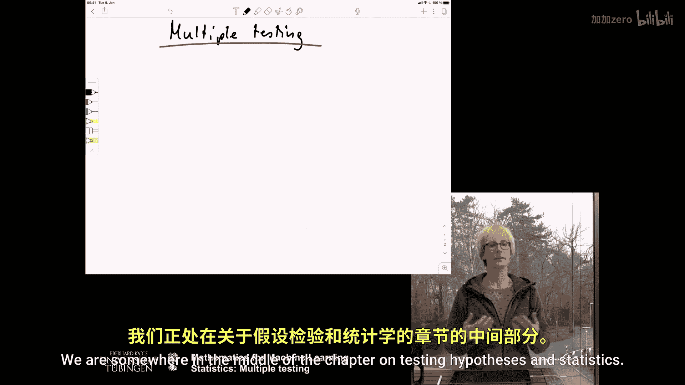

And just to recapb a hypothesis test typically is set up as follows。

 we have one hypothesis called the null hypothesis。

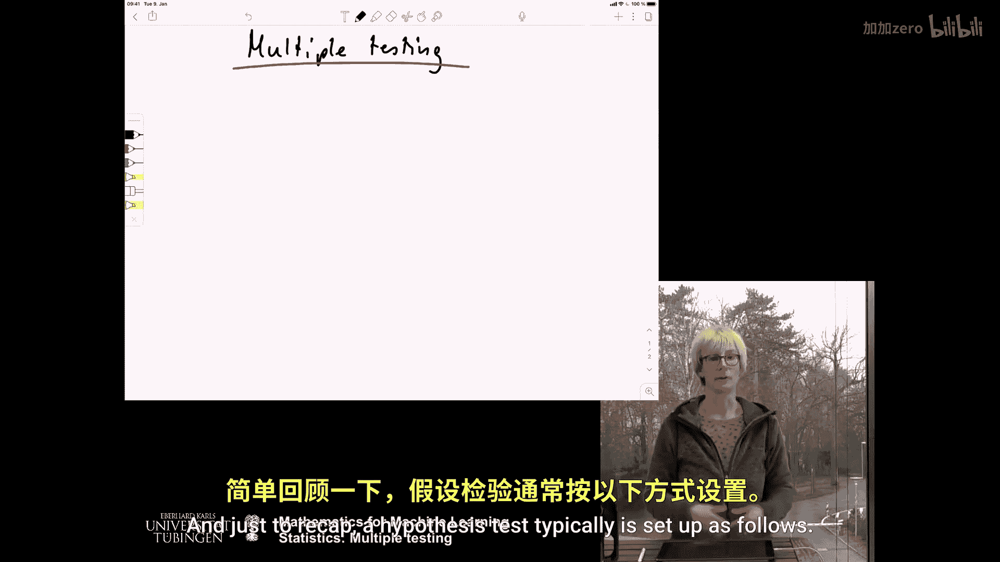

Which we want to test against an alternative hypothesis。 and typically or very often。

 the alternative hypothesis is a complement of the non hypothesis。

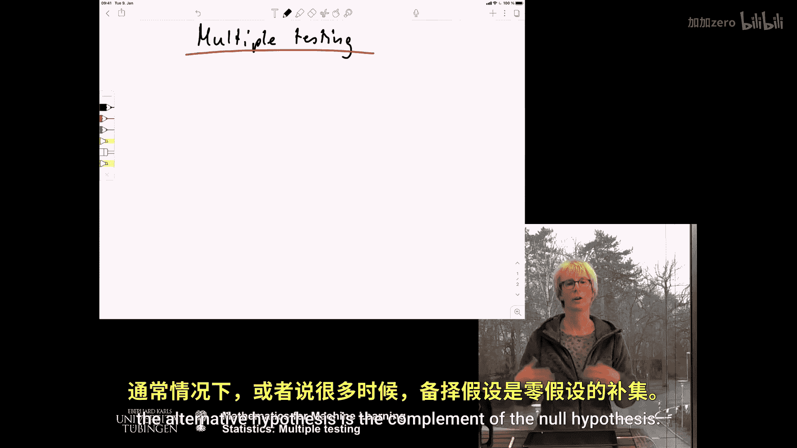

What we do is we observe some data， and then we want to test whether the null hypothesis should be rejected or not。

The way these tests are being constructed is we first fix a level alpha of a test。

 which is the type 1 error that we make。

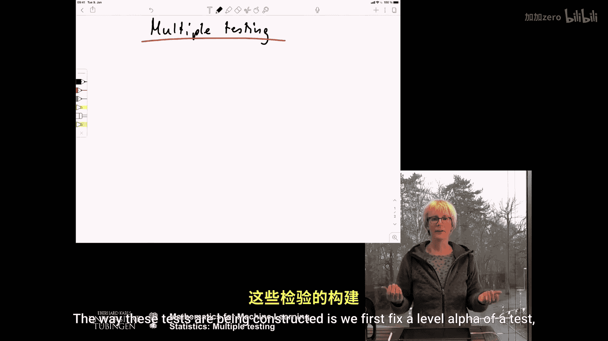

And we say we are going to construct a test that in expectation doesn't make more errors than 5% or so。

Once we have these tests， we can also look at the type2 error， which is is the power of the test。

 which then can be hopefully as high as possible。

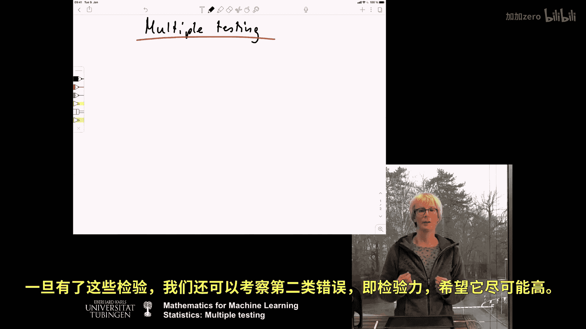

Now， the whole setup worked if we have one thing that we want to test。

But now assume there are many things you want to test， for example， in gene expression data。

 this is one of these typically biological examples， you maybe have two groups of patients。

 one group of 20 patients who have a certain type of cancer and another control group of another 20 persons who do not have this cancer。

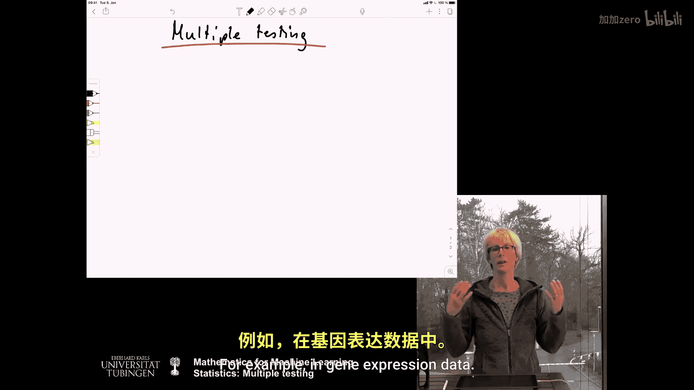

And now you want to find out which of the genes might be responsible for this type of cancer。

So what you could do is you could test like for each now you have lots of genes。

 maybe let me already start explaining it was a table， it makes it easier example。

 gene expression data。

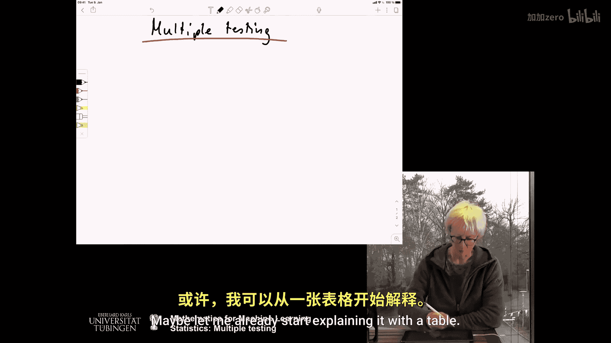

So what we have is a group of patients。With cancer。

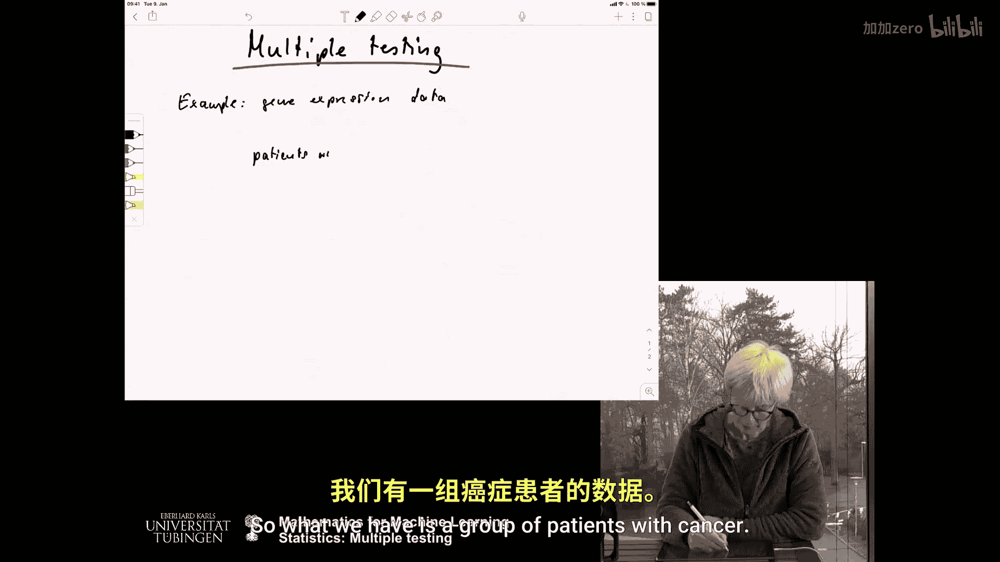

Say 20 n equals 20 also so a low number。

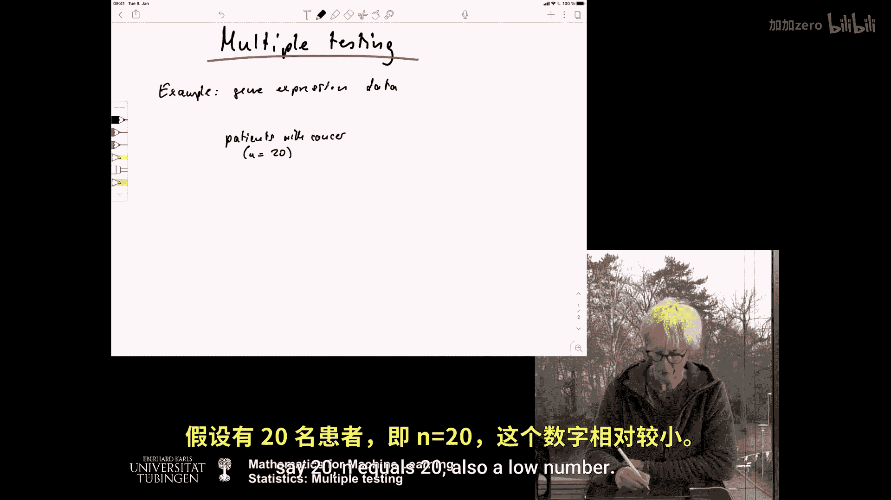

And then we have a controller group。Of people who do not have this cancer， also say 20 people。

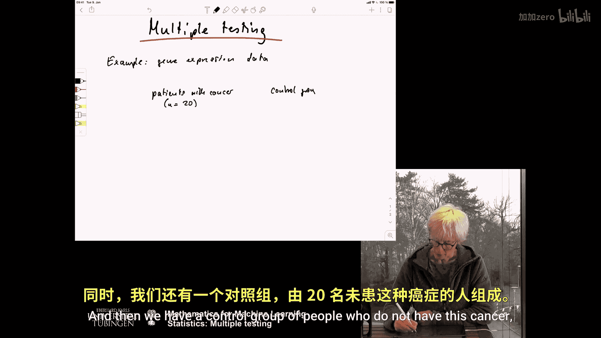

And then we have lots of genes， Gene1。Jan，2， and so。

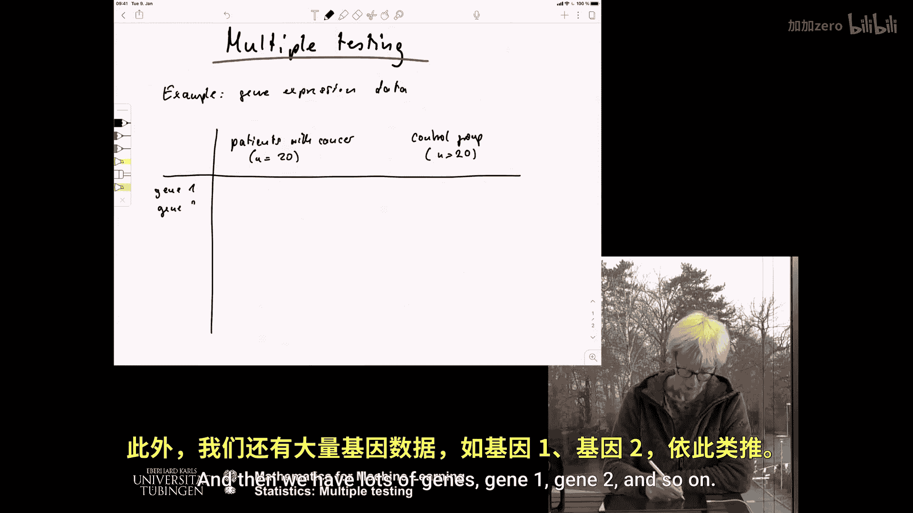

And say we look at1 thousand genes， so it is really many genes， gene 1000。

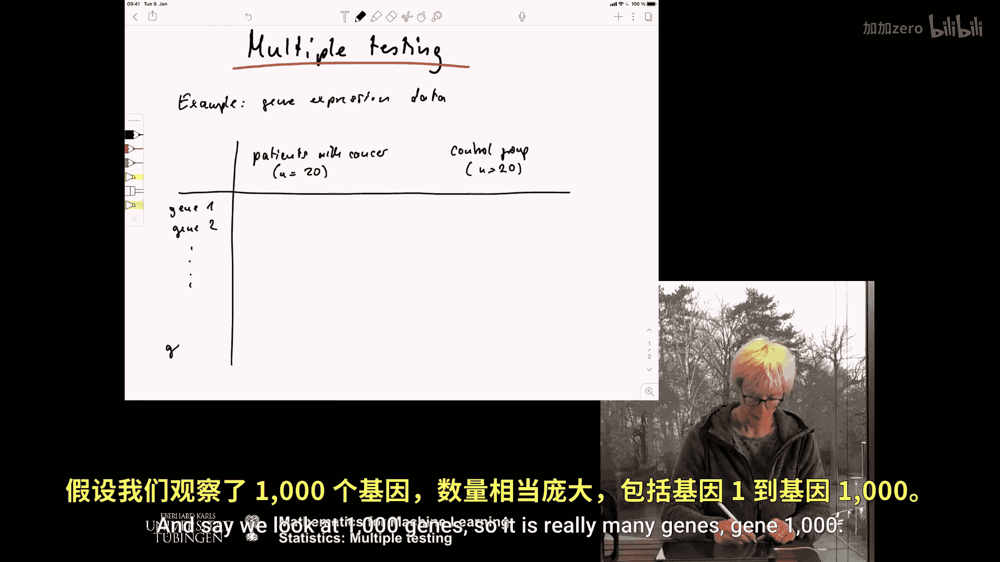

And what you want to find is whether， for example， in the table。

 the entries you have is the level of activation of this。

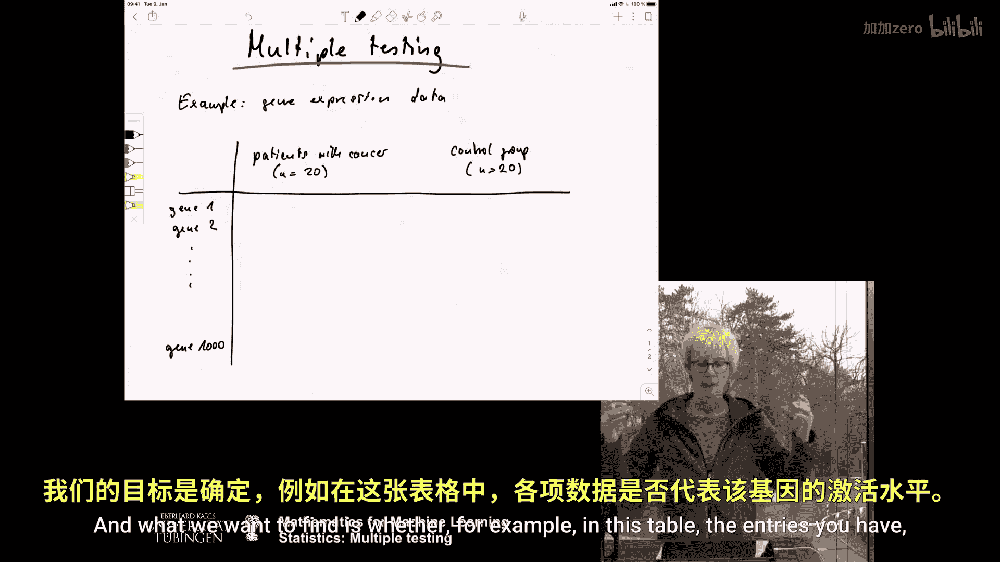

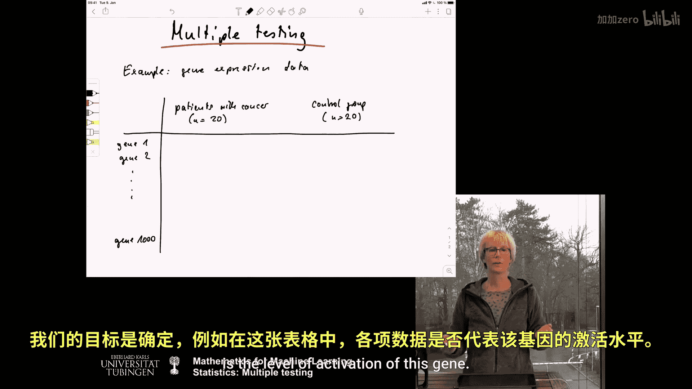