# 图宾根大学【中英⚡机器学习数学｜2020 Tübingen Mathematics for Machine Learning】 p86 P86 (S) Statistics 11： Bayesian statistics -BV1VhbMzKEts_p86-

Now I would like to give you a very brief glimpse on patient statistics。So far。

 all the statistics we've been looking at is the frequent statistics。😊。

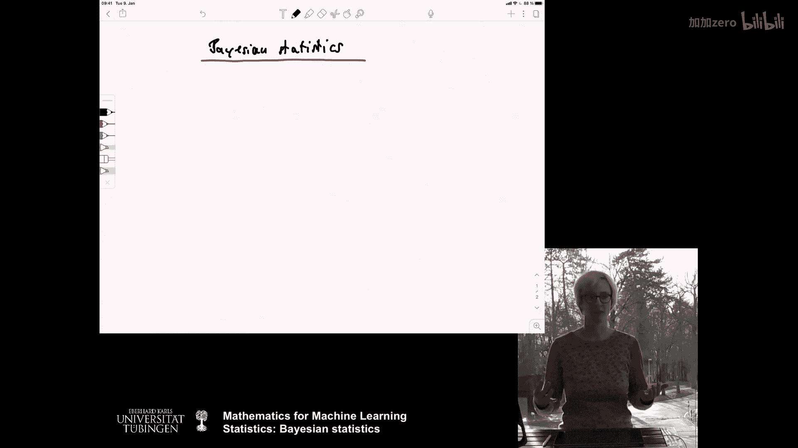

There's yet this completely different world of the Bay statistics， which we didn't even touch。

The reason of this is that I think the frequent statistics is what is used mostly in many kinds of science and patient statistics。

😊。

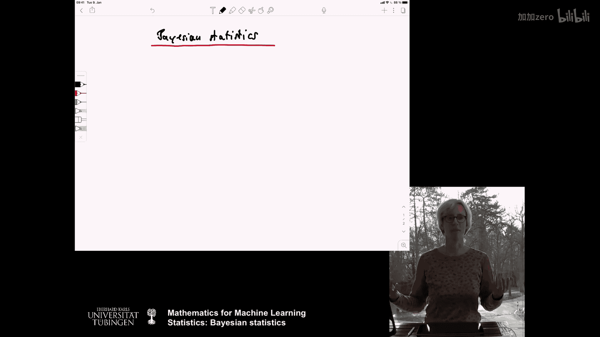

It is being used in machine learning and you're going to see much of Bayian reasoning for example。

 in the lecture on probabilistic machine learning， so I thought it's more important to give you the basics of these frequent statistics。

Yet in case someone doesn't attend the lecture invasions on probabilistic machine learning。

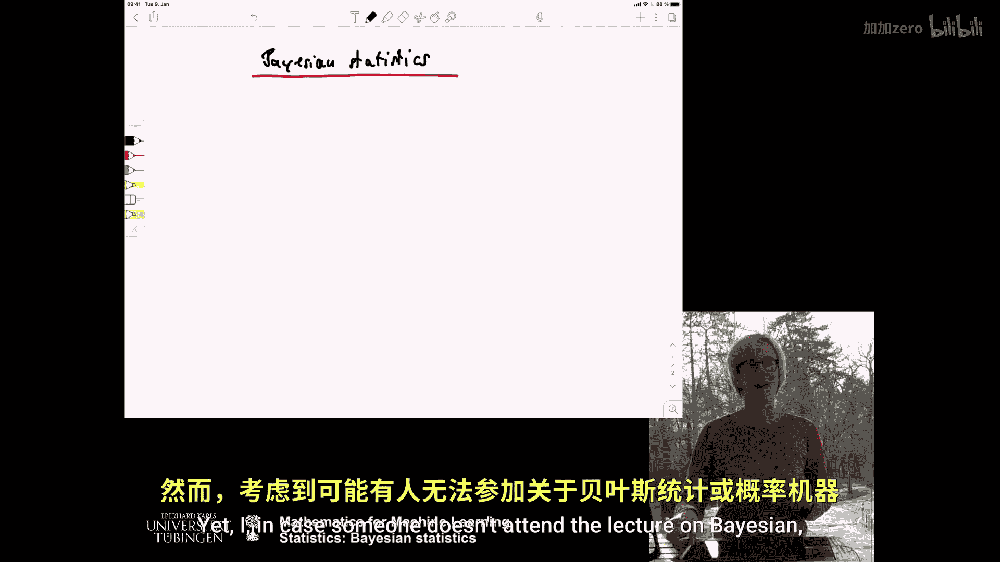

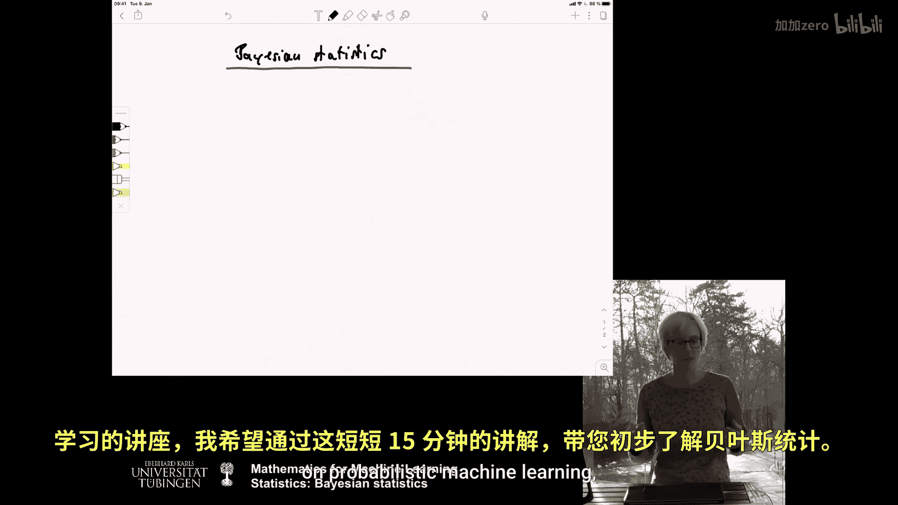

I want to give you this very short 15 minute lecture on patient statistics。

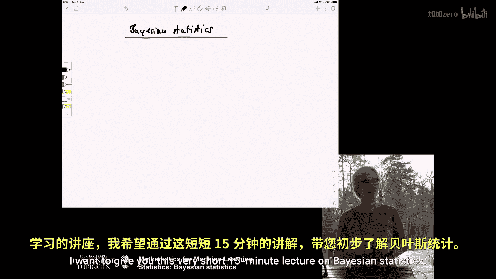

Now， this is a very， the starting point is a very philosophical。 The traditional statistics。

 often called frequent statistics， is based on the following idea。

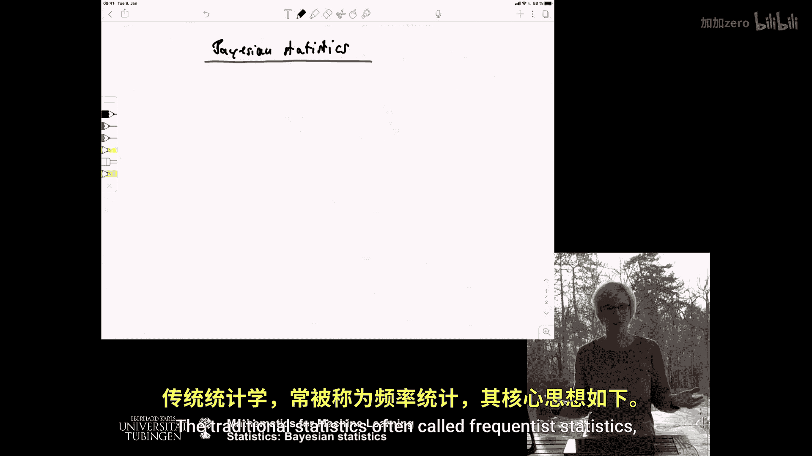

So， a probability。

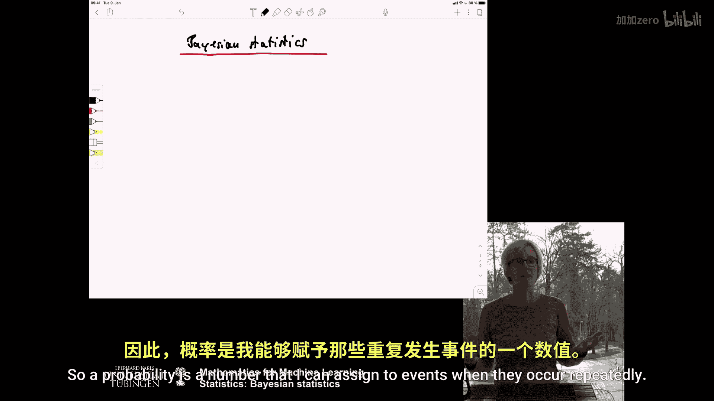

Is a number that I can is assigned to events when they when they occur repeatedly。

 So if I toss a coin and I toss it again and again。

 and I do this millions of times in the limit Infinly often。

 then I can say how often did the coin fall on on heads or tails。

 and I can then express this in terms of probability。

So a probability is a limiting frequency if I repeat the experiment rateof。😊。

In the statistical scenario， parameters that we might want to estimate。

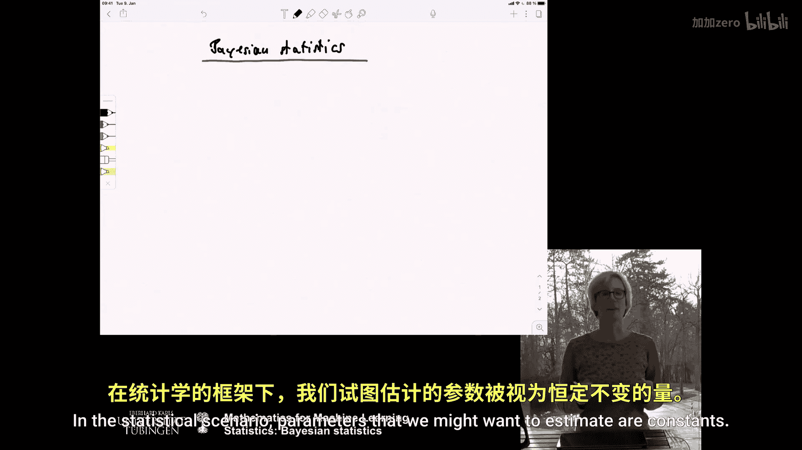

Are constants。 They are not treated as random variabless。 So it's not like the if I have。

 if I know my data has normally distributed。 but I don't know the mean。 The mean is a parameter。

 I might not know it， but it is a fixed deterministic parameter。

 and I will never ever be able to say something like the probability that the mean is larger than 20 is low。

 because I cannot assign probabilities to parameter。 So this is just a deterministic quantity。

 either it is larger than 20 or it's not。

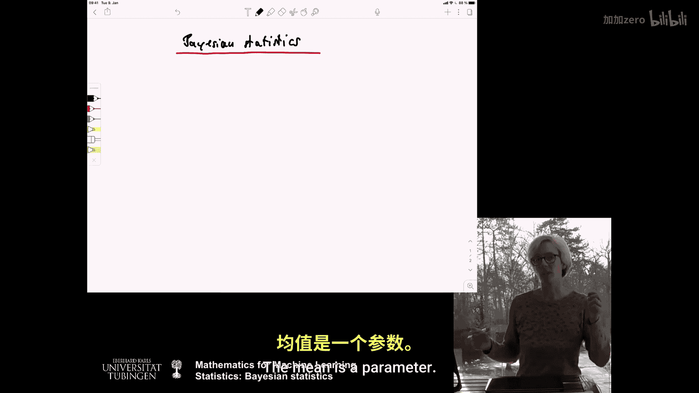

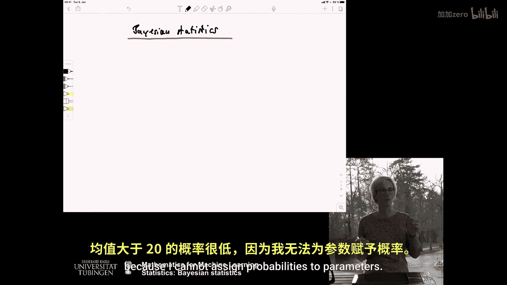

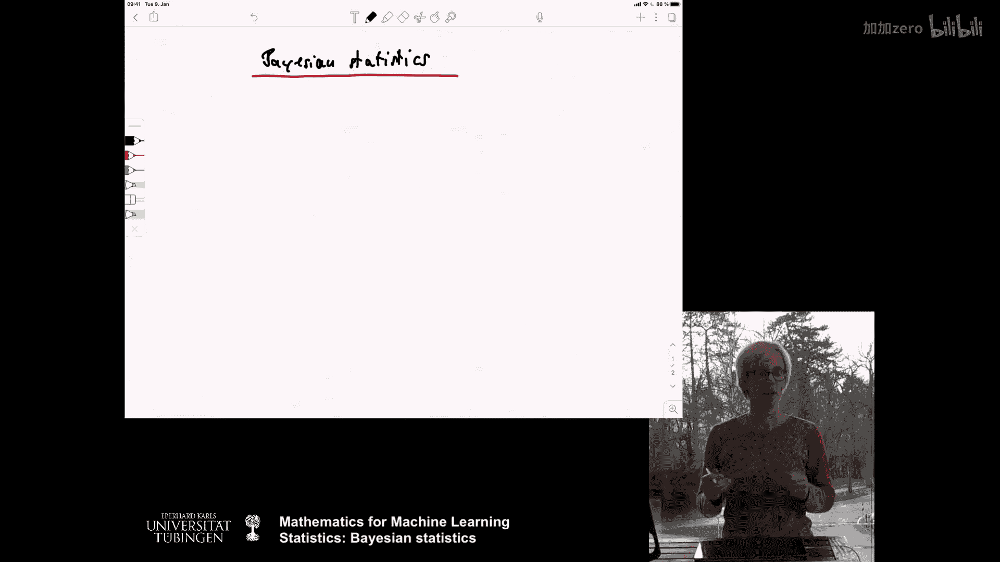

哎。And so the kind of statistics that is being developed is being developed in this frequency scenario in the sense that if I repeat the statistical inference often enough。

 then I can give you guarantees about how often it's going to be wrong or correct。 So this is。

 for example， in the hypothesis test。

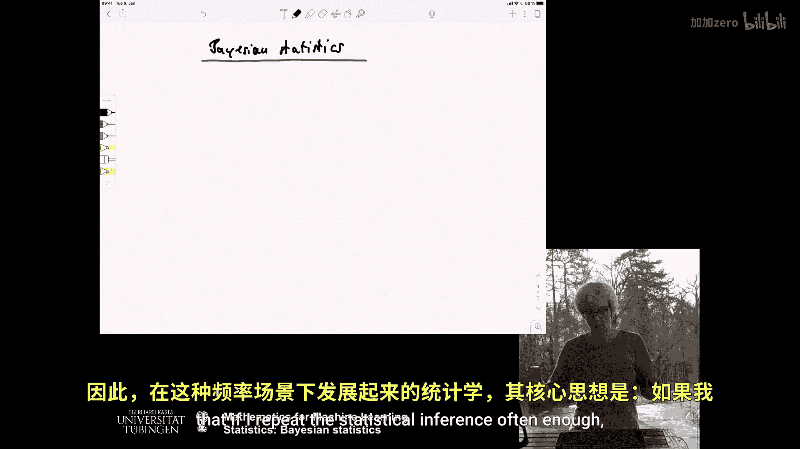

