# 图宾根大学【中英⚡机器学习数学｜2020 Tübingen Mathematics for Machine Learning】 p87 P87 (H) High-dimensional spaces -BV1VhbMzKEts_p87-

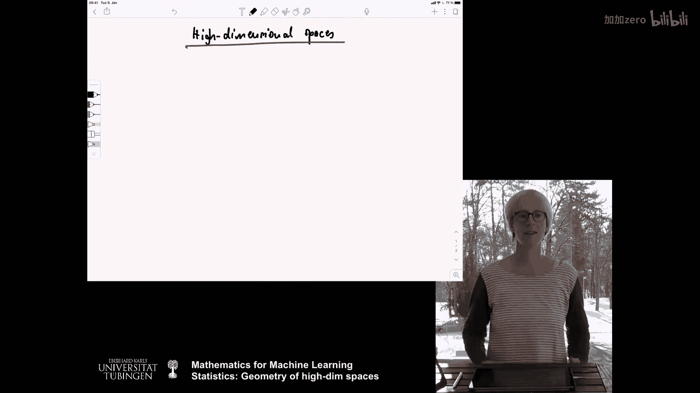

系。😊，Today we want to make a bit of an excursion， namely。

 we want to talk about the geometry of high dimensional spaces。

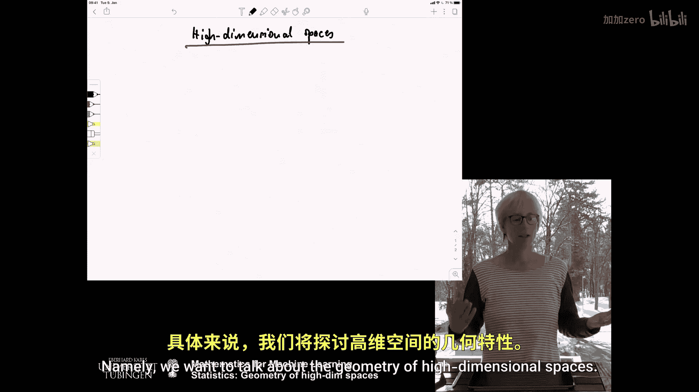

Consider a standard machine learning setup where you have certain objects you want to maybe classify。

This could be images consisting of many pixels， so if you have a nottri image， a couple of megapixs。

 your object lives in a space of a couple of thousand dimensions right each pixel is represented by one coordinate in your space。

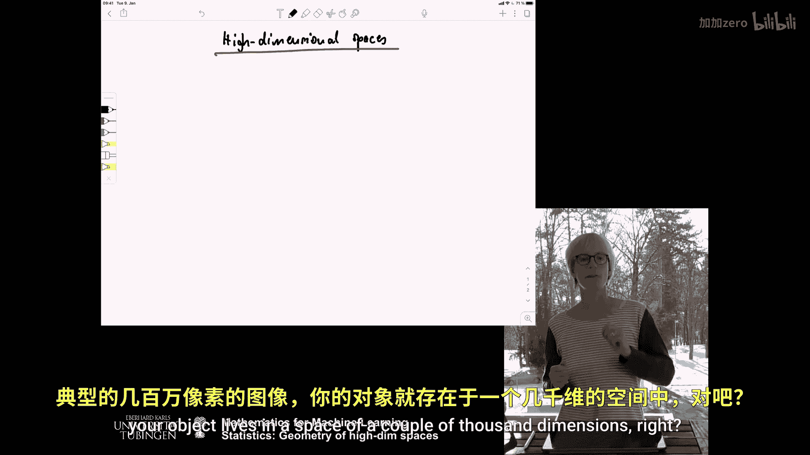

Maybe you have several coordinates per pixel， they say red value， green value， blue value。

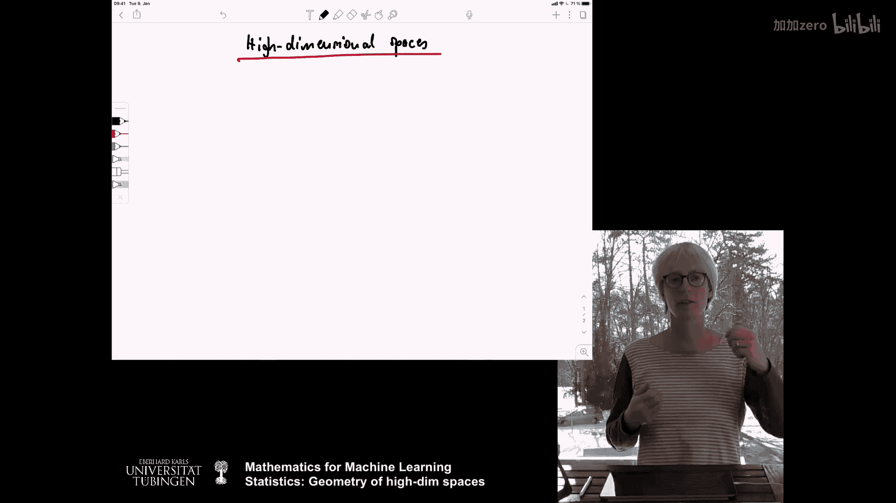

So the object that you have lives in a very， very high dimensional space of maybe a thousand dimension。

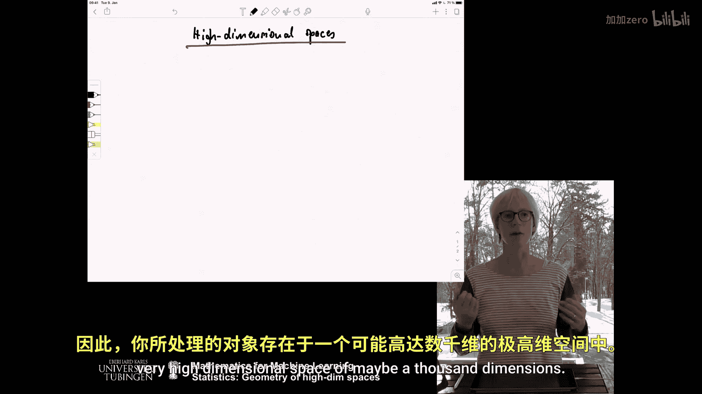

Other scenarios you want to classify， I don't know customers into certain groups and you describe the customers by their age。

 their gender， their shopping behavior， at which times do they visit your web pages。

 how much money do they typically spend， do they buy a lot or do they buy a few things and so on so you have a long list of features。

By which you try to describe your customers and you don't really know which of these features are really important or not。

 but sort of one of the standard approaches in machine learning is you throw all the features that you might simply have into your algorithm mental hope that it makes something useful out of it。

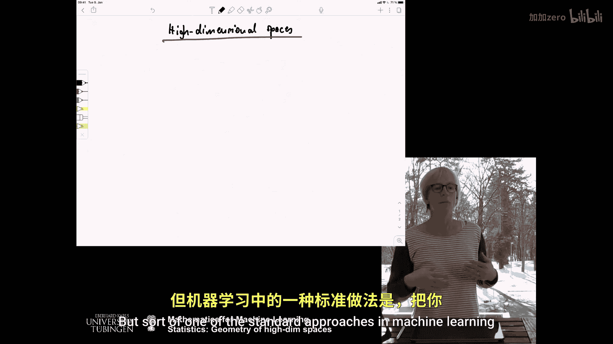

So the bottom line here is in machine learning， typically our data does not live in our2 or our three or something like that。

 but it lives in a very high dimensional space。

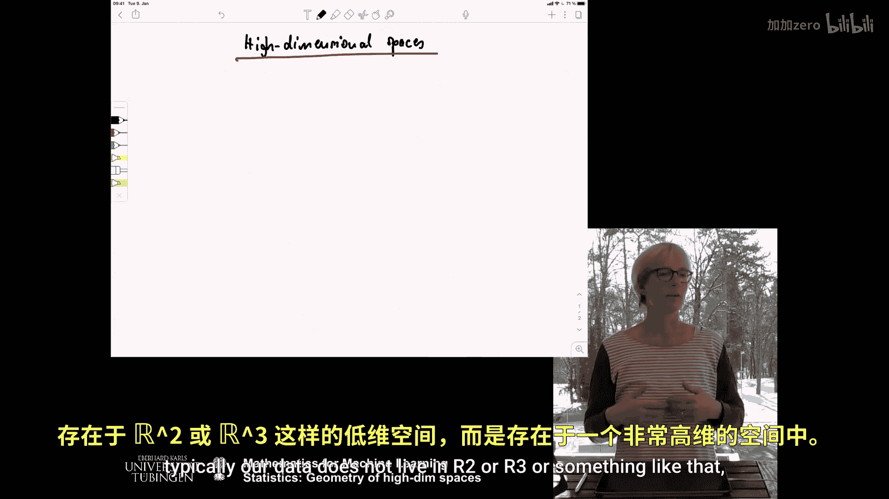

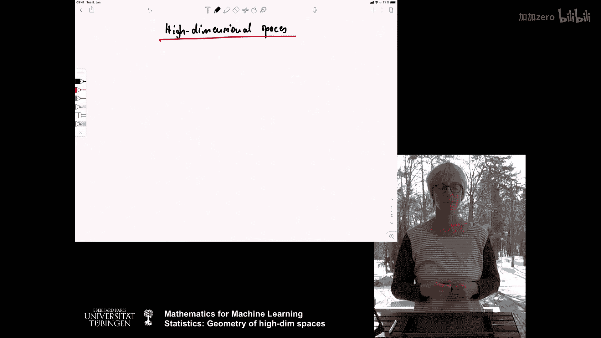

And very high from the point of geometry already starts with maybe 20 or 50。

But often in machine learning， it goes until 10 or so or even higher。

And now what I want to show is。

That all the intuition we might have for low dimensional spaces are two or three。

 these are the spaces we operate with each in our everyday life and also in mathematics。

 whenever you draw an example， you draw a two dimensional example。

 simply because you cannot draw a 50 dimensional example。

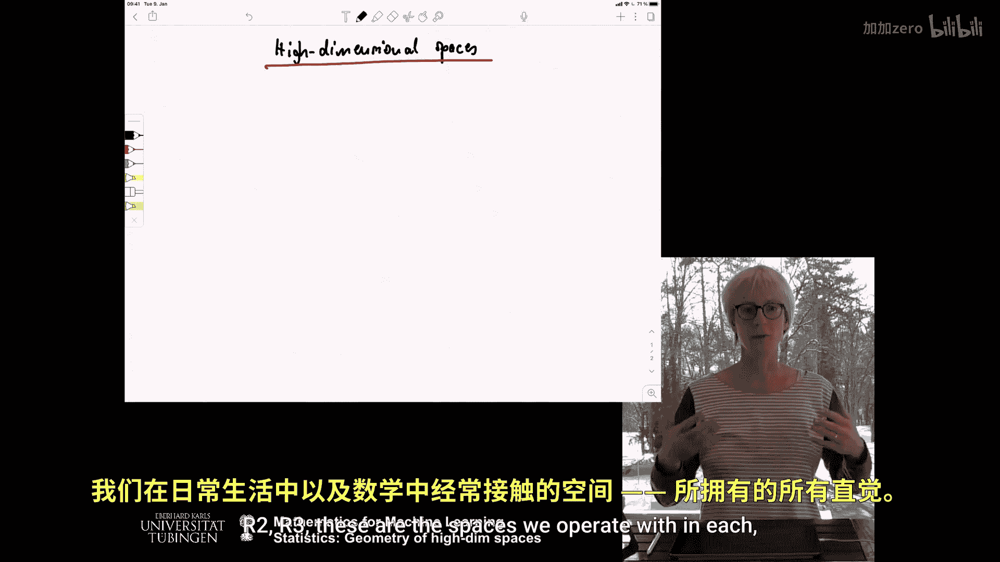

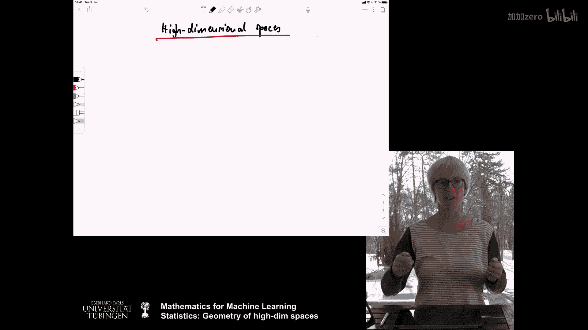

The intuition often is very wrong in high dimensions and this is something I want to show you today。

 I just want to give you a couple of facts， this is not a very deep lecture but it's simply listing a couple of things and showing you how the world changes when you go to high dimensions。

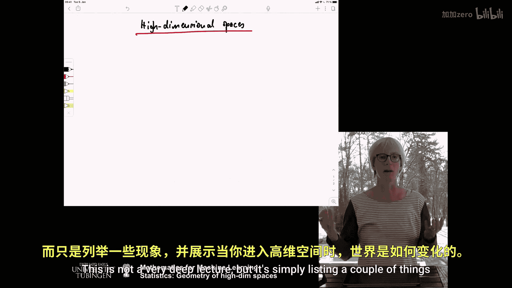

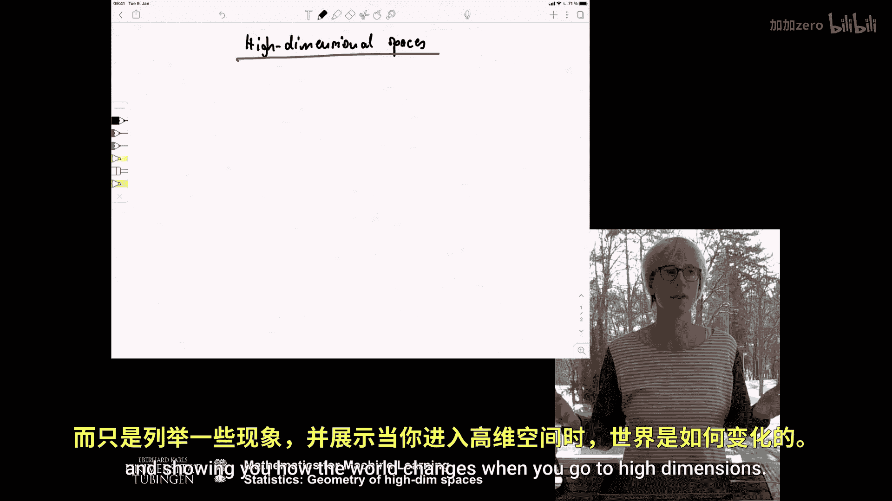

えで。

