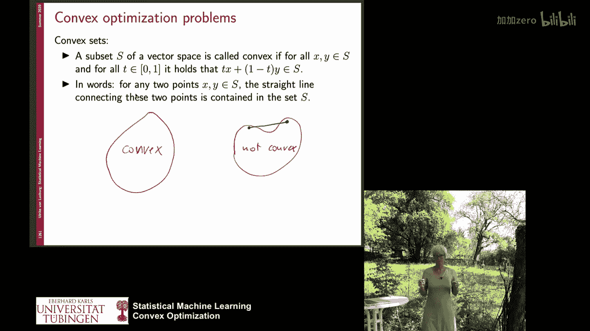
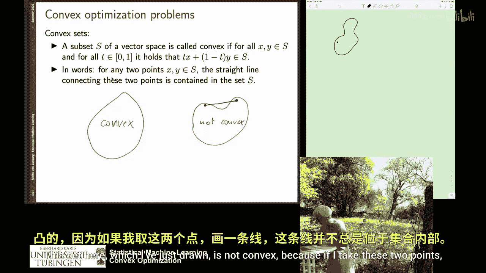
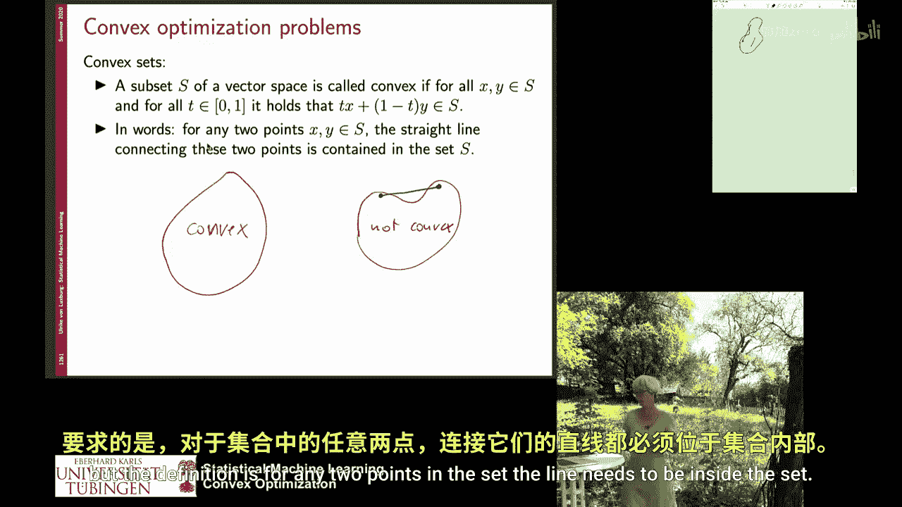
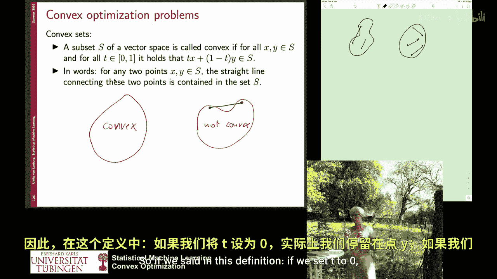

# 图宾根大学【中英⚡机器学习数学｜2020 Tübingen Mathematics for Machine Learning】 p88 P88 Statistical Machine Learning Part 7a - What is a convex optimization problem -BV1VhbMzKEts_p88-

In this short piece of the lecture I would like to tell you what a convex optimization problem is many of you might have seen this before and for now I keep it on an intuitive level later on in the lecture we are going to treat more thoroughly how to solve convex optimization problem and what the Lago approach to this is but for now I want to simply give you what the definition of a convex optimization problem is and why we find it so interesting。

😊，Before we can talk about a convex optimization program。

 we first of all need to know what a convex set is and you see some images on the slide。

A convex set intuitively is a set like the one that is on the bottom of the slide that is round from the outside and that doesn't have any pumps to the inside。

😊，Informally， the definition is a set is convex。

If whenever I can to take two points in the set， connect these points by a straight line。

And then this whole straight line is still contained with in the set。

And maybe let's take a couple of examples。嗯。This set here， which I've just drawn。

 is not convex because if I take these two points and draw a line。

 the line is not always inside the set。

Note that there might be other points where the line is very well inside the set these two。

 but the definition is for any two points in the set， the line needs to be inside the set。

And essentially， a convex set is something like this。

No matter which kind of points I' am going to take。

Their connection is always going to be inside the set。This is the informal definition。 Forly。

 there is also a kind of mathematical formula for that。😊。

The first thing that you might want to note is that if you want to talk about a convex set and about a line between two points。

 we need to have a vector space structure so because in a metric space or in some space which doesn't have any metric any mathematical structure you couldn't even talk about a line connecting two points。

 so we need to be at least in a vector space。AndNow the definition is a subset S of a vector space is called convex。

If for any two points X Y in the set。And for any parameter t from 0 to 1。

 it holds at the point T times x plus 1 minus t times y is still in the set。

And if you look at this definition， this parameter t that goes from 0 to 1 is essentially the parameter that drives you from x to y。

