# 图宾根大学【中英⚡机器学习数学｜2020 Tübingen Mathematics for Machine Learning】 p89 P89 Statistical Machine Learning Part 15 - Convex optimization, Lagrangian, dual -BV1VhbMzKEts_p89-

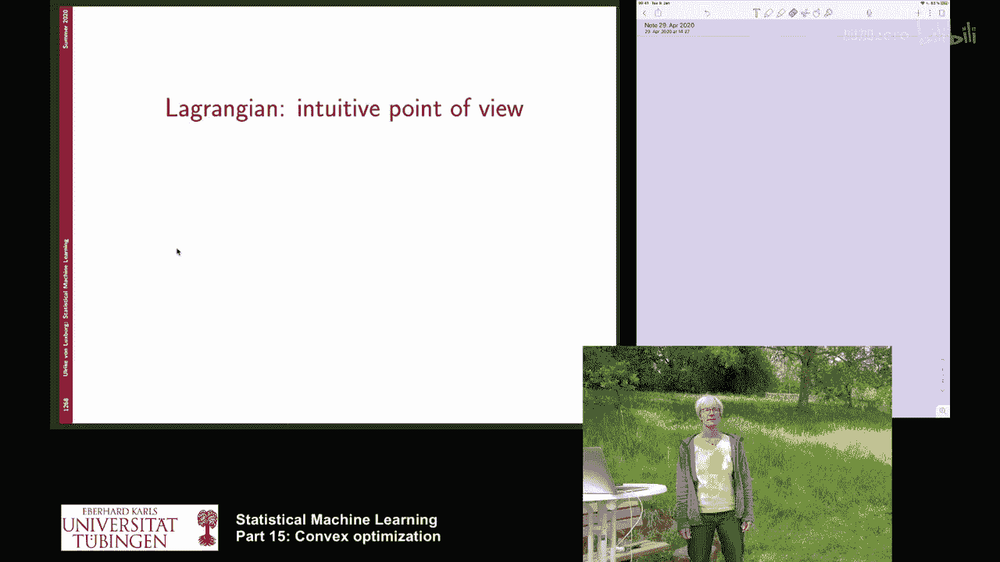

Now， I want to show you。How we can solve convex optimization problems at least sometimes with the Lag approach in convex optimization。

 this is a very， very generic approach that can help in many cases， not always。

 but in many cases and in particular it's also going to help us in support vector machines。

 this is why we are going to introduce the solar approach。

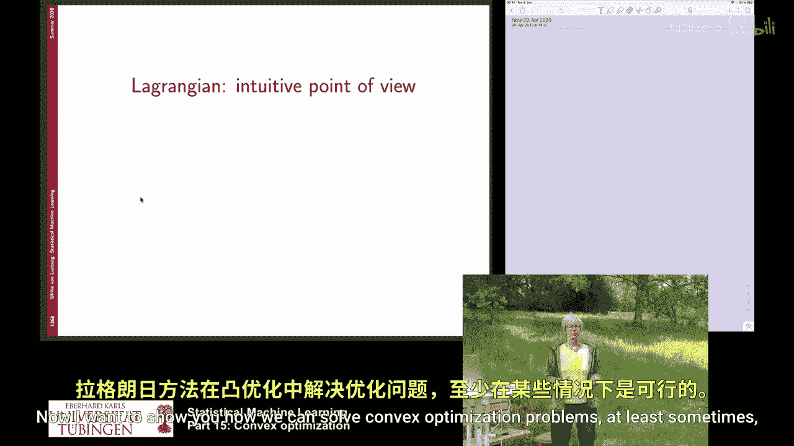

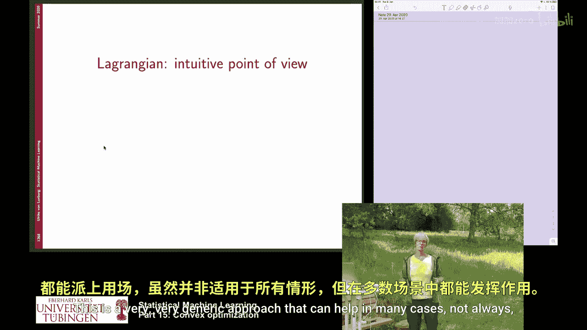

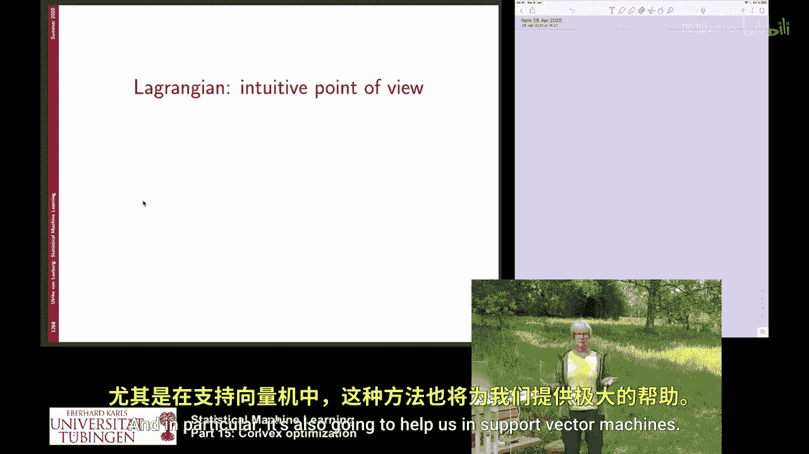

The literature on convex optimization is really huge and there exist particular lectures who for a whole semester try to identify how convex optimizationization problems look like。

 what are their properties， how to solve them， what are all the different constraints under which you can source them in a nice way。

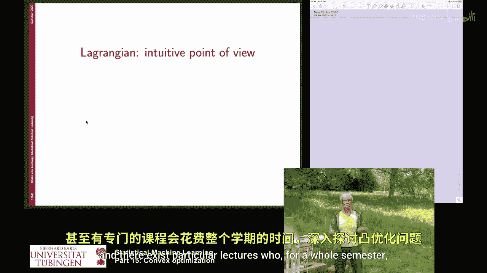

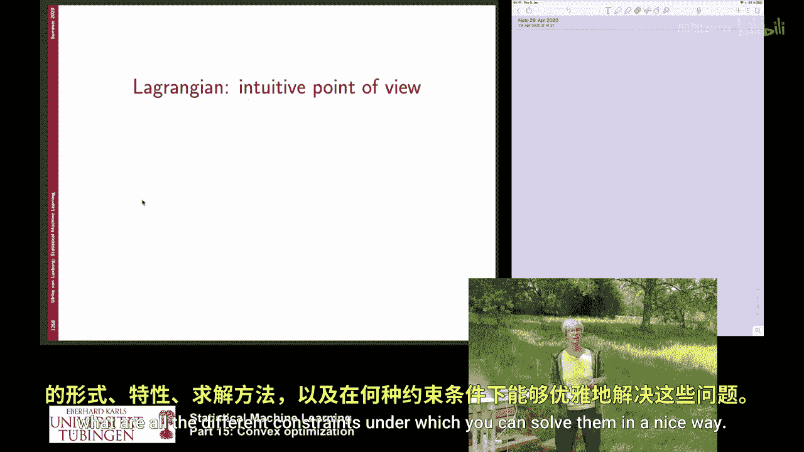

I try to squeeze all of this in one lecture。I start with giving the intuition and start then with giving a couple of formal notations and definitions。

 however this is far from being exhaustive and this is all on a very high intuitive level so if you want to know any details you really need to look in the literature or you need to go to a specialized lecture on contextx optimization here we just do it so far that we can that we can in fact solve the SVM dual optimization problem。

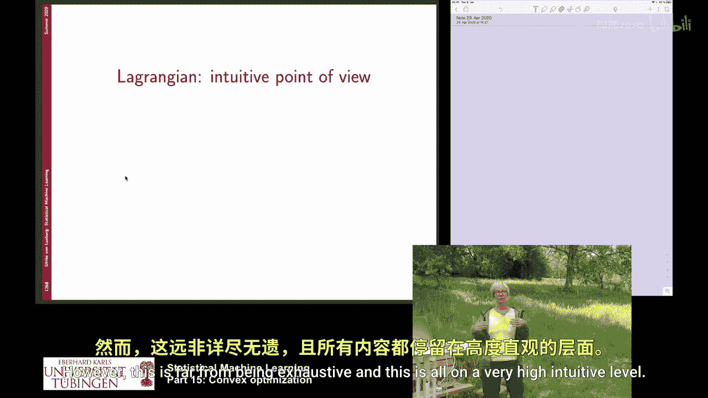

Now， let's simply start。We are going to look at convex optimization problems。

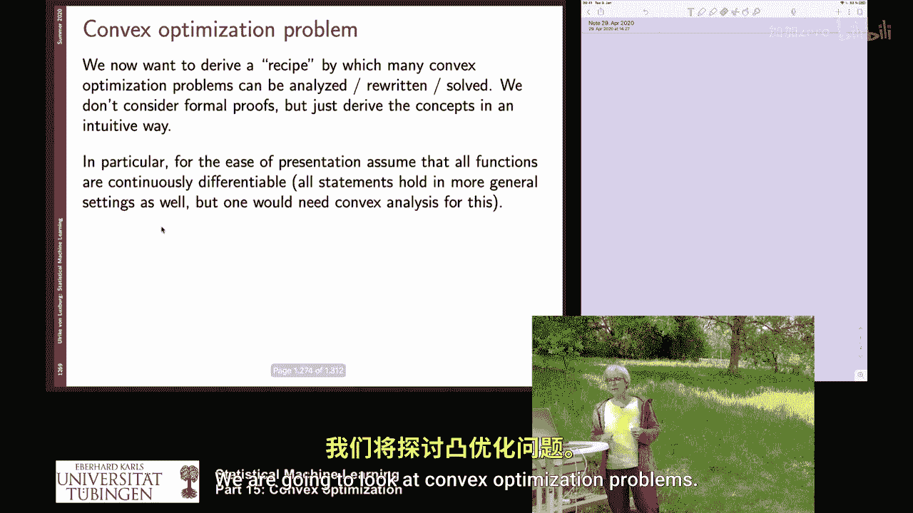

And as I said here， what we're going to do is something like a recipe。 It sometimes works。

 and it sometimes doesn't work。

And in this presentation I make all kinds of niceness assumptions in particular。

 I assume that all the functions that we have are continuously differentiable and if the many of the statements still hold if this is not the case。

 but then the mathematical machinery has got much， much more heavy because we need to use convex geometry and this is much more involved then simply taking gradients of a function。

😊。

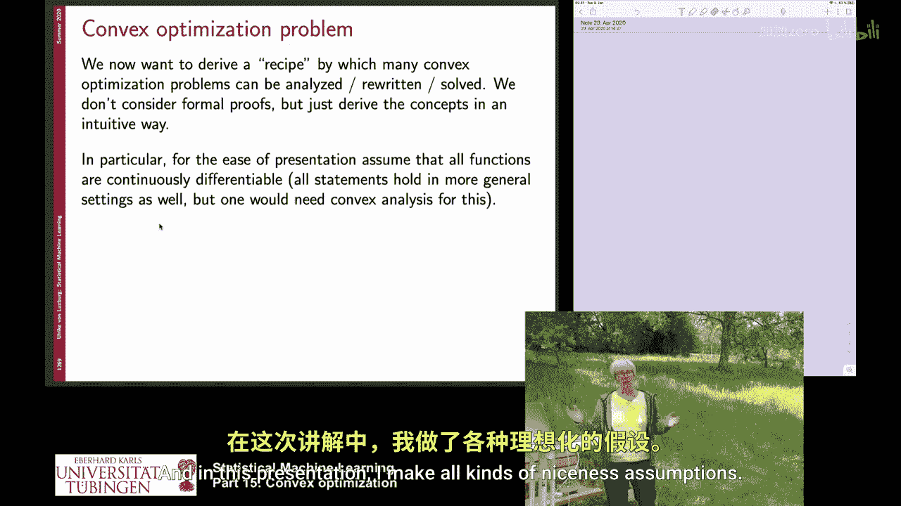

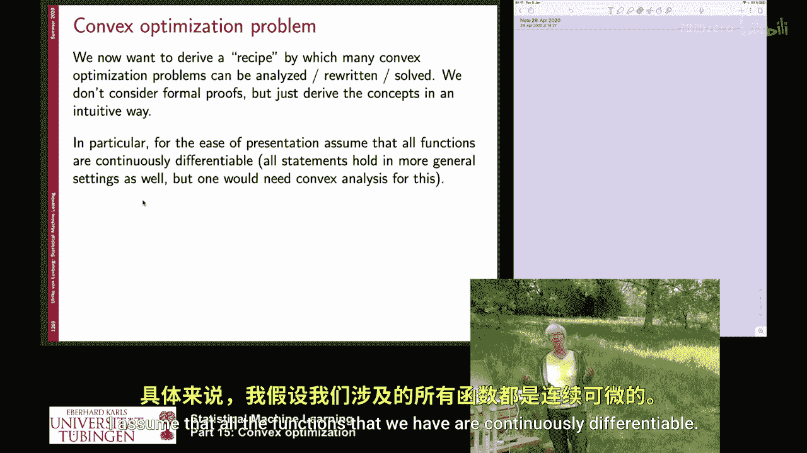

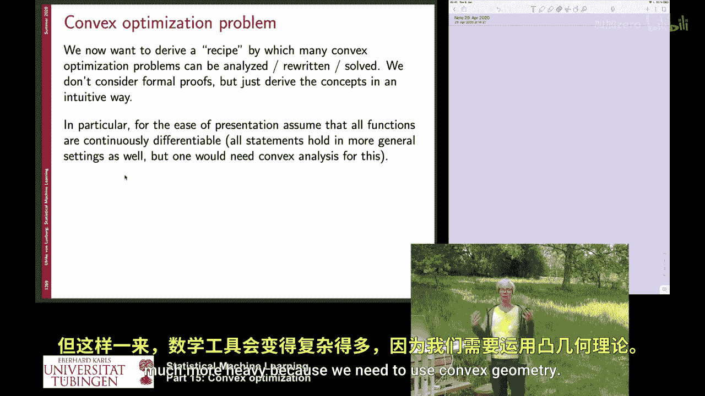

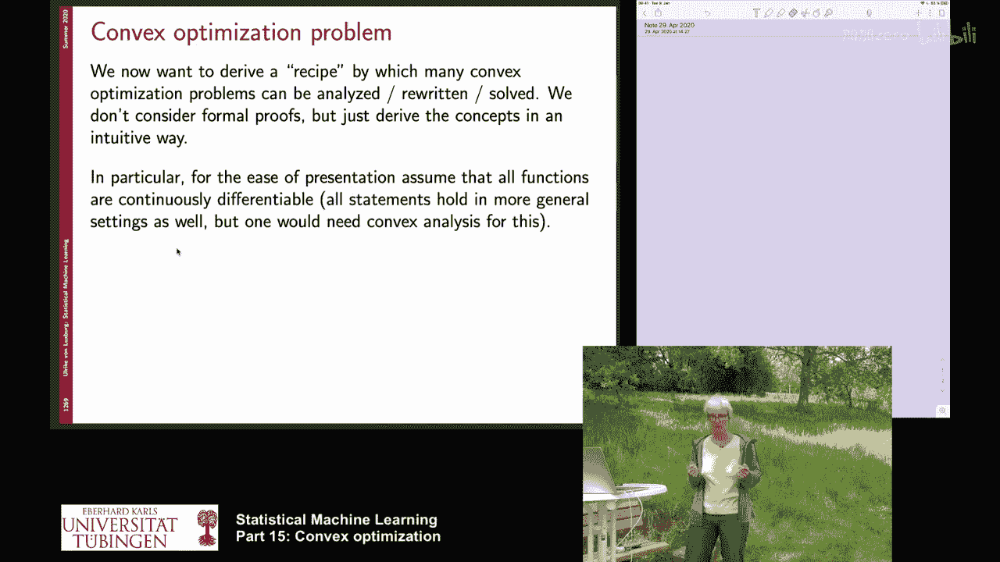

Speaking about gradients， here we are。

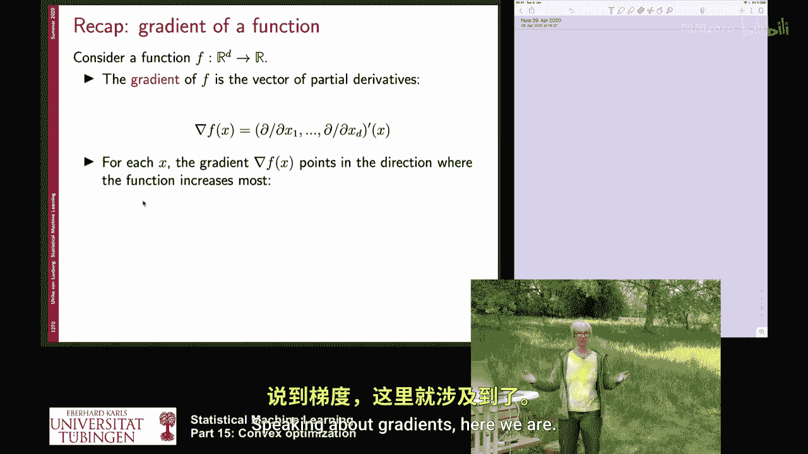

Let's simply recap what is the gradient of a function just to make sure that everybody really knows that if we have a function that F that goes from R D to R。

 the gradient of the function is the vector of partial derivatives。😊。

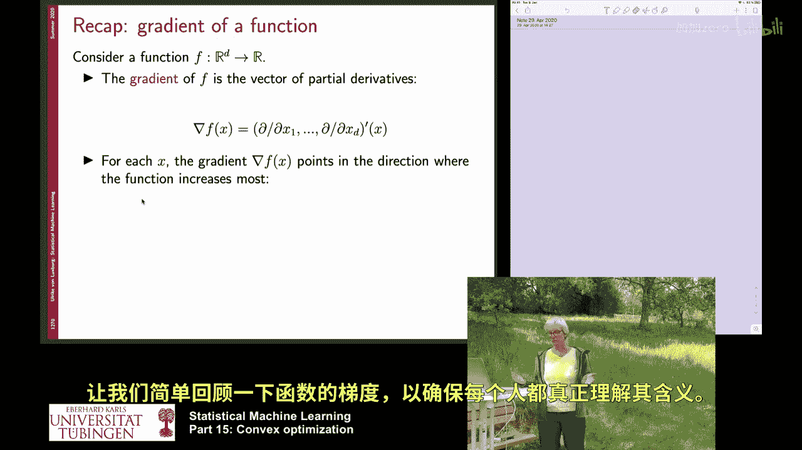

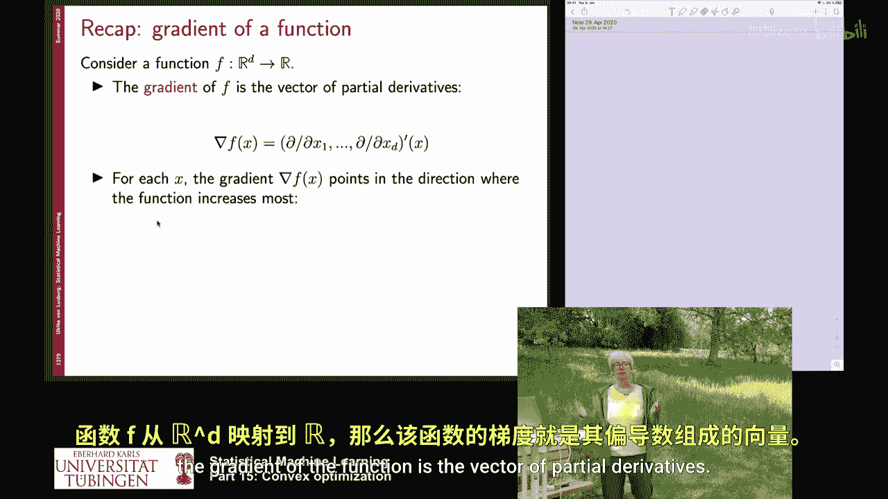

So in each coordinate， you can compute what is the derivative of the function with respect to this particular coordinate。

 For example here we have the partial of derivative with respect to x1。

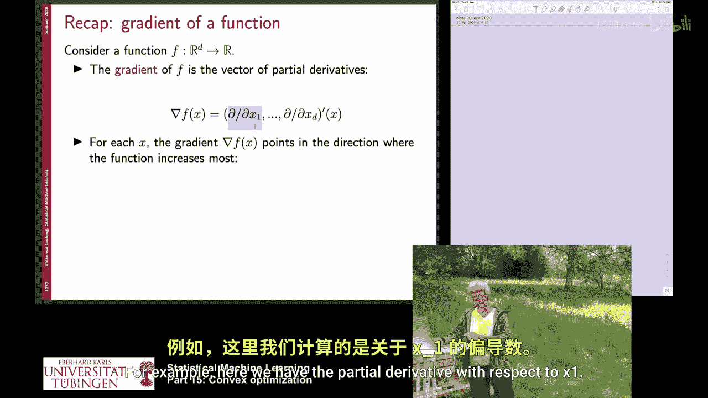

And now we have sorry we haveD such coordinates for the D and so we haveD。

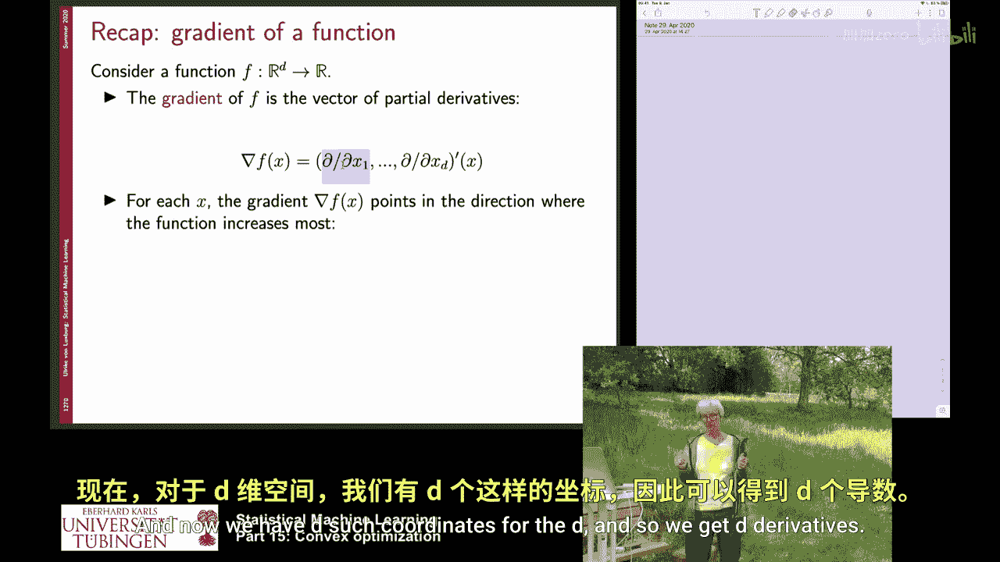