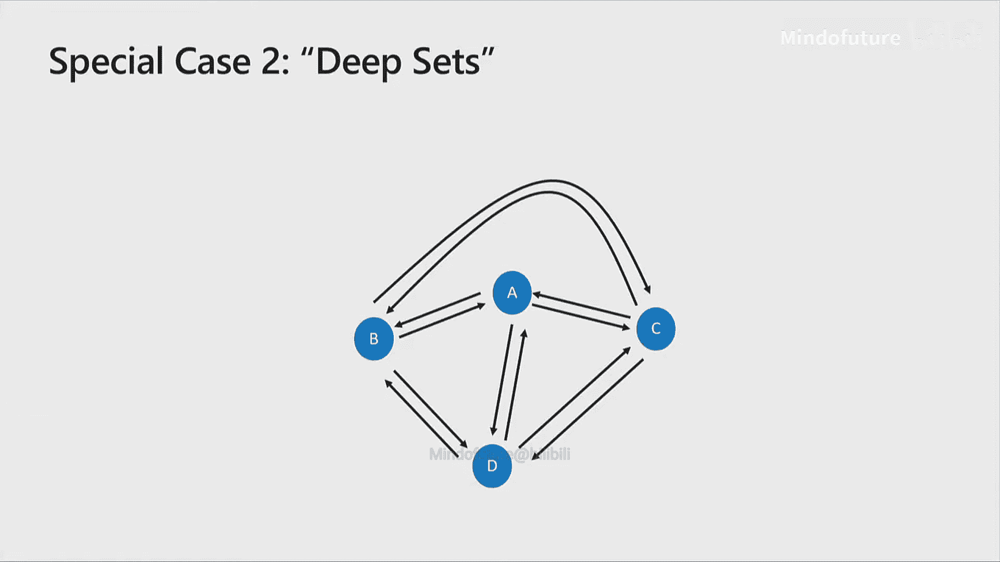
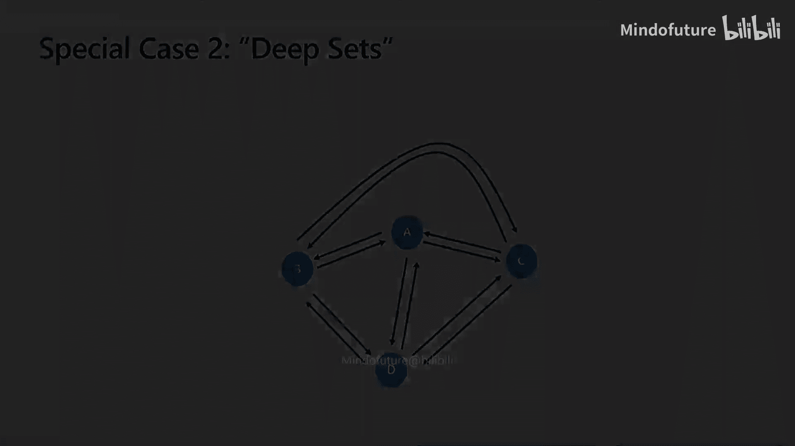

# 图表征学习讲座 ｜ Graph Representation Learning p01 P01_图神经网络导论-模型与应用 -BV1tQxqzYEFP_p1-

。Hello Er， let's get started。So first of all， this is mainly for the residents。

 so I'll be essentially giving they didn't have many of talks about neural networks before。

 things like that so I'll have to give an introduction about these things before so bear with me a few minutes。

Feel free to ask questions at any point when you have them and yeah， let's get started。

So I'm Milus and hopefully you're here because you're interested in learning about graph neural networks。

The first thing， let's talk some high levelvel background。

 machine learning in general and we'll get to graphal networks in five minutes。

 What' machine learning， well we design the model we the humans design the model and the model has parameters The parameters are these knobs that you turn slightly left or right and change the model's behavior the model is something you want to represent and something in the world All the models are wrong some are useful So this is what the machine learning hopes to do is to we design the models as humans。

 we learn the parameters through data。So supervised machine learning。

 which is the most common and most widely used and the thing that works the most we have our model our spherical cow and we get the input data。

 we try to predict something out our data set is the data points which have input X and output y and these data points are independently come out from your population。

 so we assume there is no correlation among them in most cases What do we want to do is we have this loss function。

 something that measures how good or bad our predictions are。

 we start with our model F we give it X and we try to predict y and we judge how close our prediction F is close to Y。

So that's supervised learning， one flavor which is common in deep learning nowadays is the following。

 we do the learning with gradient descent， the idea is as follows while we have not converted。

Somehow we compute an estimate of the derivative of the loss over our data and then we update our parameters。

 this data thing based on how we're going to minimize the loss。

 so we gradually move to a point which is hopefully good this is a computational method to do this not the only one but in any case that's it。

What do we want to hope to get out from machine learning and these modeling things， Well。

 we want to generalize to new previously uneen data。 If we had these data points here。

 we don't want to have a very simple model that is underfitting。

 we don't have a very complex model that overfis exactly in our points。

 but doesn't model the thing we're trying to do。So that's machine learning。

 if you haven't had seen this before， hopefully this is good enough to get started。

So other things that we're going to use the notion of distributed vector representations。

 That's common in natural language processing， common in deep learning。 The idea is the following。

 We have a set of discrete things。 The one way to represent this is with local representations。

 We have a huge sparse vector of mostly zeros and a single one when we represent something like something like let's say。

 a banana or a mango or a dog。This however， has the problem that we don't know how these two things correlate or combine and it's a very discrete representation。

 What happens usually in deep learning， somehow different models do different things learn a distributed vector representation distributed because the meaning is distributed across the components of this vector。

 so maybe banana and mangoes share this yellowness thing whereas the dog has somewhat different。

So how do you do that， How do you learn these things that you can compute them。

 You can learn them as parameters of your model。 The high levelve idea is you can start from these representations。

 the one hot representations multiply them with this embedding matrix and you get this distributed vectors。

 and now your parameter is this E here， which is an embedding。

 maybe you've heard things like word to V or things like that。

 These are the distributed vector representations， they are building blocks。

 let's say of the things that we are trying to get at。 So how you compute them or how you learn them。

's in it's quite wide varying ways of doing this。 but you'll hear me talking about distributed vector representations a few times later today。

 D is a lot smaller than V exactly that's part of the point where the V is you have 10000 elements or 10000 words or something like that。

 D would be 128 or。500 or something like that。So it compresses down the space in some form。

 That's another way of seeing these things。So graph notation again for the residents most of you don't necessarily have a computer science background graphs look like this。

 you have nodes or vertices you can see here you have edges which can be directed or undirected edges these are you can see them here you can have many different types of edges。

 so here I'm coloring some edges with a different color to say this What does this graph say well in this specific one nothing but the main idea here is that you encode the nodes which are elements and the edges encode relationships among among those elements so this is the high level thing and you can encode quite a few things in graphs hopefully if the residents have any questions about notation or graphs let me know。

Very simplified thing。 there are tons， of course， of things around graphs。Okay。

 so we got to the point where I can start talking about graph neural networks。

So the idea of graph neural networks is the following you start with a graph representation of your problem。

 what is this graph where does it come from， this is a modeling decision。

 that's something that you decide that this graph here ands the problem you're interested in。

 it could be a social network， it could be a molecule， it could be a program。

 it could be anything that you're interested about。So that's the first part。

 you as a human have designed a graph representation of your problem。

 The second thing is that for each of your nodes here， you need some information。

 This information is encoded in a distributed vector representation， an embedding， if you wish。

 and this is encoded for each node。 So each node gets somehow a representation。 you can compute it。

 It could be an image， So B could be an image， So you compute it from a convolution in your network。

 It could be a word， So it could be an embedding。 but it could be anything that that you wish it to be。

So this is where we start， this is the input to a graph neural network。

Now the question is how what we were want to do Well。

 the idea is we start from here this graph representation will describe for most of the rest of this hour the graph neuralal networks。

 the output here is going to be again the same graph。

 but for each node you have a vector representation。

 and now these vectors here are going to have information。

 not about node a when you had initially here， but how a belongs within the context of this graph。

So you're essentially saying given the features that I had initially here and the structure of the graph and the neighbors and what the neighbors had to say or do and what is the representation here so you compute a GNN compute these representations once it's trained。

And then what you do is you take this this representation you have of your graph。

 the output of the GNN， and then you can pass it to something that is specific to the task that you're trying to make so it could be the loss or something else。

 but it's something that it's task specific and we'll discuss very briefly two tasks after I explain the graph graph neural networks these funny things attached to each they are sort of somehow meaningful to the person。

Yes， that's not the internals of the G。 That it's a meaningful thing。 It's well。

 as meaningful as a vector can be， right its it comes no part of the mechanism of machine。

 It's not part of the mechanism of graphal networks。

 It could be a neural network somehow processes F。 Let's say an image。

 And the images kind of you get a vector out there which could be the features that there is an edge here or there is a face here。

 or there is a wheel here， something like that。 It could be that this is a word。

 So you kind of have something distribute an embedding of a word like a natural language processing word。

 and things like that。 So it's。The GenN is transparent to what the initial representation thing I think the same kind of thing same length for example they don't have to be the same length。

 but they are they usually are the same length， not the same vector of course otherwise this would be an identity function but they are a representation again。

 its like a feature vector of this this note a is is central to this in this part or this if it were a variable in a program that we'll see later this variable here is acts like a counter。

 people accumulate things in it things like that that are learned we don't explicitly say or know exactly what this is we can find by analogy in some cases。

 but that's。That's all do they have to be unique in identifying so for instance。

 if you have the same type of nodes but with different edges you will have the same node identifier。

 but the edges will be would make it different as if I have two vectors that are identical in the same graph I can assume that they are the same type of node so here yes yes you which means if I have two the same like they don't cl like M5 thing you can assume that you can assume anything you want in this case yes so the simplest scenario here is that。

All these things， all these vectors are identical， and you want to learn about something about the graph itself。

 That's perfectly fine。 There are other cases where you you want to attach some information to the。

So I'm trying to map this diagram to kind of the first slide you showed about what machine learning is which is you know you have the model and then you have the knobs right so is it accurate to say that the model here。

 the human design part is the structure of the graph and then the knobs that you're learning trying to learn the parameters for are the。

parameters so the human element is in here。 We'll discuss this in the next slide and also you can think of it as a feature extraction in the let's call it old fashioned machine learning。

 you extract features is this red or blue is this small or large So you have zero1 things instead here you can think of it as a feature engineering feature engineering。

 your problem into a graph and so this is part of what we humans do but also like there is components in here that are human related but the parameters most of them are here there might be parameters how to compute these initial vector representations。

Should we assume that the graphs were perhaps different examples are variable size or not necessarily the same structure and if so。

 okay， then how after you get the final representation then you have like these vectors that you would like to combine into your log right then how。

Like you have a variable size well get there eventually。

Now just does the output graph have the same structure as the input graph Yes so we're not adding or removing any nodes or edges not in the flavor of the graphal networks you'll be explaining for the rest of the talk In principle。

 you can do some of these things but let's ignore this for all practical purposes。Okay。

Hopefully that's good enough， we have neural networks here， let me zoom in in this box。

What happens is the following， let's take this small example here。

 this F node is connected E and D connected to F through different types of edges。

At some point in time， let's say E and the have some vector representations。

The same thing happens with F。Now the it is is falling。

 we start from our for our neighbors and we're going to do something like computing a message。

 That's the analogy。 The message here is essentially get another vector。

 the it is that we get a function of the input， the the neighboring node。

 the actual current node and the type of the edge， and with this function。

 which could be many things again， that's design decisions about our model willll discuss concrete a few concrete options later。

 we get a message， meaning again， a vector。 the same thing for this for this edge here。

Then we summarize all the messages we received from our direct neighbors。

And again summarizing mean can be many different things we combine the summarized information with the current state of the node and we update the node So now F essentially what happened is it had a state a time t minus1 a time T now it has a new state that has information about itself and how and from its neighbors in some way this is combined there are many。

 many different ways to combine them， we'll get to that very soon Yes when you say this function of both node and also the type of edge Yes is that encoded some hours it just directed undirected。

So no， the type of edge could be that D and F， let's say， are。Then F D is below F， and E is above f。

Let's say。 So it's a， it's a relationship that you encode。 again， the。

 the types of edges you have is something that you decide。 It's， again， the model。

 the modeling decision of of the human。 but then it's encoded directly key in the。Of the Hs。

 We' discuss how and when it's encoded in a second。

 So let's look at the at a function at an equation here， which is hopefully colored in a helpful way。

 So prepare the messages。 This is a function which might be depend on the time step T that takes the representation of of your node that you're currently trying to。

ToTo predict， to predict like F in this case， it takes the type of the edge So this K here and the and optionally the type the the information。

 the state， the vector， if you wish of your of your input。 so you do this。

 you compute a message for each edge， for each edge that connects for each node that connects to NJ。

Now I'm using this fancy operator here mostly because I would I couldn't find another operator in office。

 but the idea is as follows this could be any commutative operation。

 any permutation invariant operation for combining the messages it doesn't matter if D and F the edge from D to F comes first or the edge from E to F comes first this is an important part of。

Of graphal networks because they make them essentially invariant to however you may shuffle your graph and that's an important thing。

 in some cases this could be a summation in some cases this could be a max in some cases this could be something else。

 that's again a design decision of our model， nothing nothing beyond that。

 but this is a general class of operations you should include all the edges。Yes。

 but you include all the edges that connect yes， yes。

Yeah and we're currently here updating only one node， of course we get all our neighbors。

 we compute a message， we summarize it， and then we take our own state， this state here。

 and we combine this with some function Q and we now have a new state over there。Okay。

 so that's the high level thing for each node， you can imagine we have a previous state。

 you get messages from your neighbors and you update your state should from NG to end or depends on notation but。

Under the big union， yeah，It's， I mean， you， yeah， I guess you want and Jay should have been here yes。

So this is the process for updating one node。 How does this most of the common graphal networks work Well you have one of this。

 the parameters are shared across all of this for each node and there is a clock like very much like a CPU at each point a clock ticks when it takes every node gets input from all its neighbors computes messages updates a state the clock ticks again and the process repeats again and again。

 So how many times do around this， that's a hybrid parameter， design decision。

 however you want to call it there is no notion of convergence or other fancy things like that but that's how a graph neuralal network works So the new computer value has to be saved separately So you only update all of the values at the end because otherwise the order in which you the nodes will change Yes you do this in parallel。

 So which brings with the next slide you can think of this as enrolling the the graph。

multipleiple ways in time， and now each vector will get updated again and again and again。

 so all nodes update their states simultaneously in parallel each slice here。

 you see all the nodes in the graph have one state。And as time goes on。

 how are these F functions evolving as well？U by F functions。

 you mean the ones that your compute in this union。

So have inferred once you have trained your neural network。Let show the next slide bit。 Yeah。

 I'm trying to get there。 Yeah， Yeah， you， you can again， modeling decision。

 You might decide that F T is a different。 is a different for It's dependent on T。

 You might decide that Q is dependent on T in many cases， they don't。 In some cases， they do。

 That's entirely up to。But usually in some cases， you can think of this as something that depends on the time T。

 but it's shared across all time slices so the thing I' missing out this。

The question is the parameter right， so both F and Q get。The two is an input as well。Yeah。

 so parameters can be in F and FT of theta and there's other things and its Q of and Yes。

 there's a silent theta here and we'll discuss I think in two or three slides there are concrete choices that people make where the parameters will be more explicitly used。

嗯。Okay。So what this means is that in the beginning， each node knows about itself。

The next step each node learns about itself， well you knew that already and it's a neighbor one distance one neighbors and the next step they their neighbors have also been aded。

 so now each neighbor know about itself about its neighbors and its neighbor's neighbors。

So you increase essentially this field perceptive field of what you know about each node and by more time steps。

 hopefully you learn more about how you belong in the graph I this like spell tree protocol？

Youre networking。I don't think so， I cannot say that I'm very familiar with that。 okay， no。

So graph neural networks， you started from some state。

 you got the output now you have all these vectors here that are about information about a node and how it belongs in there and now you can do anything you actually care about in your application。

 You can say I want to pick one node from this graph that has some property so you can do that。

 This is node selection。You can label each node， you can add some add data class， for example。

 and you take each representation here and classify it somehow。

 or you can decide to summarize all these vectors you have here and do graph classification。😊。

So there are different ways to do this， it's very application dependent。

 we'll discuss when we go to some applications。Okay， so。Let's take a very， very simple example。

 not very practical， but still it's the simplest possible you can get。

 so you have this age which have you've got out from each node the final time step and you multiply it with a single layer MLLP and what you get。

Out of it is a binary decision a01 assuming that this makes sense for your application right。

 so now you have a loss essentially saying that the classical binary crosscenttropy loss。

 saying that I want my decision for then each node here to match my value Y。

 whether it's true or false， zero or one。😊，What's the application I don't know。

 I just made made this just to make this a concrete thing Now what this means is that I have a loss。

 I can compute its gradient and with automatic differentiation。

 we compute the gradient through the graph neural network and I can update the parameters here。

 the W， everything the GNN， everything in the initial layer and this is how learning with graph neural networks could work。

But is this a step that's done so the graph neural network produces this output and from this output youre trying to classify based on it or is it something that you incorporate into the graph of neural network it's all end right so you can think of this as a function。

 the loss for a single example at least over the parameters of all the parameters you have in your model and you back propagate to all the parameters。

In most cases， the most common thing to do。But in doing the about propagation so with the entire stack。

 so it's a pretty giant expression that you're differentiating Yes。

 you wouldn't want to do the differentiation manually that's for sure。Also。

 do you run into problems like slow ingredients and so on。

 like this sounds like a very hard RN problem。And our announcementr。it depends on the architecture。

 again， there are many architectures they are coming up next。

 some of them look more like CNNNs and you can think of them as a stack of CNN layers。

 some of them are RNNs usually these unfolding happens for 10 steps let's say so you never get into that big of a problem and again you use an RN which is like a GRU or something like that so that or you use residual layers like in CNNNs and hopefully this you don't run into this problem in most cases whereas the update rule for these age things。

What do you mean the update rule is sto hasastic gradient in the end or stoastic with momentum or how do you go from HT to HT plus one？

So the H， you mean H is a value in the model， right， you don't update HT is not a parameter。

 W is a parameter。No， I get that， but。Okay， maybe you maybe say in the second I'm not sure what you're asking that's the earlier you said there would be an update rule for each of these states。

 for each of these H。So H here is the output H， so maybe this T should have been capital D。

 the final thing when you go over there。How your day。Yeah， okay。

 that depends on the graph neural network architecture。

 so let's look at two popular graph neural network architectures。

So the first one is gated graphal networks， it was first invented in this building I wasn't here at that time but the idea is is following we want to compute the messages。

 we say that a message depends on the type of the edge K onview on the neighbor and the state of the neighbor D so H of node D at time d minus1。

 this is cod based of course but that's equally wrong and it does not depend on f in this case so here this is E is a parameter of the model and you do a matrix multiplication you transform the state。

 the input state of your neighbor with E。Your summarization。

 your permutation variant method is just a summation。

 so however you order this sum it doesn't really matter。

 it's a sum well moduleular floating point but don't worry and then here you get your previous state yeah you have an RN cell。

 a recurren neural network， this one is called a GRU doesn't matter， it has some parameters in it。

 and it takes the previous state， the message that you just computed that the summarized information and updates it state。

こつけ。K is the type of the edge。Here， so you can say that the white one is 0。 The red one is one。

 something like that。 So you have a finite and usually small set of of edges。

And I guess UF depends on the type of flight you are showing。The the function F yes。

 so that's where the this is what previously we had an F as F here。

 so we have essentially a different matrix for HK。Which is an n by n。

 where n is the dimensionality of H。How there's no biasow？

For EK EK plus you could add one people it depends on your application， there are variants at this。

 I think the original GgenN does not add one， you can say that a bias essentially will be helpful for counting how many edges come in in some ways that's one option。

Okay， next what does the gate referring to。Sorry， what's the gated the GR year which is a gated recurrent geo so this is an RN that says previous state to next state。

 so this goes back to you have as much exploding or implod ingredients as much as you would have for a GR year with1 steps。

 so not much usually。Another variant that is the graph convolutional neural networks and that's because they resemble convolutions and we'll see later how this goes。

 but the it is you take the states from all your neighbors， you sum them up。

 you multiply them with your own state and then a matrix implication and division this model originally at least in its original implementation doesn't support different edge types so you see there is no dependence on Kdon J but again you see a pmutation invari combination and different way of updating your state。

Okay， so。The first thing we I didn't discuss So okay these are design decisions。

 all of them are different modeling decisions and there are tons of them you can go online and find more than 100 papers that change something in this equation。

 but the original equation is still more or less always intact。 you have a way to prepare messages。

 a way to summarize them a way to update your state。So the first thing is now the following。

 there is one trick that I have omitted so far。So let's take， for example， node D。

No D is not connected。 no incoming edges come through here。

 so no D has no opportunity to learn about how it belongs in a graph。

 so a practical trick is that you add explicitly backwards edges So you create you double the type of edges you have and for each forward edge you add a backwards edge and now you still have a graph the same equation apply but information is propagated through the whole graph。

 That's just a trick that that exists。Isn't this related though to the assumptions that you're making about the like surely if you said that D has a directed edge to the rest of the graph and nothing else connects to D then that's a pretty strong statement about how D relates to the rest of the graph so if this is the input you don't want to change it right？

You mean this， yes， but it depends on your application if you want to learn something about D。

 how it belongs in there， then information that has to somehow propagate back to D。

 this is what this tries to solve。Is the。Is the edge you looking the same type or Well。

 you can say it's a different type It's the same like if this is is the left of E。

 this is the opposite of that so basically what you want is getting feedback， right。

 Can you make it like weaker or stronger or can you change。You could， people don't， but yeah。

 there's nothing necessarily stopping you。Would it blow up if I just had an edge type for no edge here and just connect crispisly fully connecteded graph？

TheThere are some people that do something like that where essentially you imagine a node。

 a God super node here that everything connects to that and back， it works quite well in the cases。

There was a question。I thought someone had the same question earlier when you were introducing。嗯。

The function that prepares the message so could you also fix this by changing that function that prepares the message to treat your forward nodes and backward nodes differently sorrys this thing currently。

 I mean the way I have written this is that you take the previous state and you update the state so you still don't do anything to their neighbor to the neighbors。

You could imagine making this more symmetrical， but that's essentially what the backwards edges are doing。

ok。I see， so。Okay， so。Let's go one step further， the equation is nice。

 how do we actually implement it in a matrix operation again very background things an adjacency matrix。

 if you haven't seen it let me know， the idea is that you have nodes。

 you assign them some ID and you say that node node1 node0 is connected to node1 and node 2。

And the same thing for node1 is connected to node2， and node2 does not have any outbound edges。

So now imagine that we have some variable A B and C， just a number for now for each node here。

 then if we multiply these two things we get we get this thing so here you can think of it very vaguely as you had a here and now you multipied it and B got A so you see that the second element is a whereas C here is number two here what's connected to a and B well it is connected to A to B and you can see from the managed multiplication that this is a plus B。

So this kind of implies how message propagation will start working。

And the idea is you can re this and create these sub matrices easily。 it's something Germanistic。

So let's look at some pseudocode like thing， right。

 you have a matrix for where each line is your initial vector representations a time team。

This is a matrix， and here is the size， which is the number of nodes by whatever dimensionality age has。

Now you want to compute the messages to be sent， so you multily。

 you do a multiplication by EK for each type of HK with H。

 and now you have all the messages to be sent outside from an node。

 possibly not necessarily all of them。And now in order to get the received messages。

 you multiply this M with your adjacency matrix A for all edge type K。

 and you have the messages you received。And now you can apply your update function。

So this is the simple mathematical kind of form that you use and if I wanted to use a vanilla then this GRU function is essentially some matrix multiplication with H plus W with the RRT。

Just to make， to make this slightly more concrete， although not very useful。追。ina。Make shapes work。ま。

没。So this M could be times t。Yes， and then you have this matrix E K， which should be D times n。

And then you have M and then this is also something by M and then here they have you need to play around with W or the GRU input to get this work。

You can make it work， I mean usually M and D are the same in most of our implementations you seen。

 but in theory there is nothing stopping us to make this difference you repeat what a is in the perceived messages A which a should be aK to be start with so the typo。

 but this is the adjacency matrix for nodes of type K。So this is where this comes in。

 like the this adjacency matrix that says that node zero is connected to1 and 2 and things like that。

So the key is are like the finite enumeration， like green and blue， it's not like 4。7。In most cases。

 yes， and in the cases we're seeing here， definitely。

Okay so yeah you can also you can get this thing here so again I'm doing the next step is again mostly for a very practical step but I think it's useful for the resonance now let's make this next step we show the high level equation we show the matrix now let's see is a pseudocode first first what's aim some I'm going to use this I thought it will be useful for the residents the idea is that you express operations over matrices with a is of size B Bd B is of size Qd and the output you want is B Q so you express essentially this operation with this Einstein summation here and you can do more complex things you can vaguely think of this that you hear what happens is that you erase the dimension of D。

or sum over it， to marginalize whatever word you want to use。

 or here you remove some other dimensions so you remove a with this and you can express this complex sum with a simple short notation。

So how does the code look like， well， you say my initial states are somehow given to me doesn't really matter。

 we have a number of steps that we're going to unfold our graphph neural network for each time we compute messages for each type K。

 which is this message multiplication that we have here what on this slide I think。

So I' still stuck on the dimensions N D times Dm makes it n times z。And the。

And plus messages K statement， he has that。Andy to to get。It gives you the output and then。Yes。

 that sense Yes， also， it seems that this should have been。Well。

 they are swapped and this should have being exited byking I havent noticed we should fix this eventually。

Anyway， so yeah， this is just an notation here and then you have the received messages and hopefully this also gets you there and you get the older you sum the received messages and you get the G The steps is the input parameter。

Yes， it should have been an input or a hyper parameter or a constant wealth form in most cases。

 when you， it's a constant for all your ads or something like that。 But yes， you're right。

 It should have been also in the input。So this ties with us here。

So hopefully this makes the graphical network a bit more concrete the one thing I'm not going to discuss today is this specific thing here here we have the adjacency matrix which is end by end。

 but in Einstein's summation you cannot say this， but this adjacency matrix may be very sparse but very large。

So how can you make this more efficient？ That's that's something you can we can discuss at another point in time。

The shapes therere also going that right。 Should be M and M and。We're here。And。No， and this is N N。

 but you cannot write that in Nstein sum。 So L equals N to。For your purposes。

 but you you needs to be different。 Yeah， I want part of this yes so。Okay。

 let's I wanted to go through two applications。 I think I don't have the time to so I'll go just very briefly over one with one slide and the idea is that molecules for example。

 you have molecules and you want to predict some target quantity out of it The idea is you can see the molecules that look like graphs I mean the r graphs to some extent。

 and now each note is is an atom if you have different types of node like carbons or nitrogen or other kind of things'm not a chemist and you have different types of edges。

 So some are double bones some are single bones and so on。

 So now the question is can you get from your from your molecule up to some target equation。

 what you do is you take this graph you get this and you you try to predict your quantity。

The your target quantity that's very high level but hopefully it's more concrete than before that's one option with the other thing which I'm not going to discuss is about source code。

 how we find bugs but I don't think that we have sufficient time to discuss through the various design decisions yes swaping atoms so the color representative no no this is well its taken from the paper this is how like features may be computed about this is the same atom repeating again and again the same graph。

 but the graph neural network updates the state essentially for each node for each atom which hopefully has information that is relevant to the target quantity you're trying to predict。

You。Okay to go open。We can do this Well， let's see。嗯。Okay， maybe let me go first to something to to。

Okay， let's let's talk a bit about the code related things so the it is as follows。

 we want to find bugs specifically we want to do the following task。

 given a blank in the program here we want to say which of the things in the code in which of the things in the code are actually should be placed in here so here you have first and class。

Now this helps us find bugs， you like copy paste， I' want to copy and paste at this line。

 but the correct thing would be first。First thing we need to do。

 we want to take a program and convert to a graph How do we do it Well that's a design decision。

 that's a feature extraction if you wish The idea is that we want to take things like how data flows around these things how control flows around these things and get there So one possible thing I'm going to show here is tokins well a very boring graph you can passse code so you can essentially deterministically find the three of these and you can add extra nodes and extra edges again a graph let me hide these edges and take more a simpler program here and we can also add data flow edges so how when was X last reading well when I just enter the loop it was here if I'm looping it itself so we can keep repeating adding more and more edges and more and more different things that we believe encode the problem we have。

So by the end of the day we have a graph for this they we will stepip it this is how our graph looks like it's not easy to necessarily partsse。

 but it's not an uncommon thing in programming languages the same decision would you have all of these graphs into one all of these edge types into one big graph and then run your model rather than have multiple graphs with different types of edges now you have one graph with multiple types of edges and you do the proagation simultaneously this is exactly affect each other exactly so we're just showing it for clarity in the picture because it will be too crowded but yeah is abstract abstract compile then edges are specific Well some of them are of the abstract in X3 some of them are talkingken based things some of them are data flow things things like that。

So how do we go around around doing this thing Well we started with this place here and what we do is we're going to say this whole thing I'm showing it you here is a text but it's a graph I'm going to add a few extra edges and nodes saying these two canded nodes here we want first for example to be how would data flow if first was in the slot here or how class would be data would flow around if class was here and now we have a big graph I'm not showing it all of it and now the idea is we started from our from our code。

 we've got our graph， we somehow compute initial representations I'm closinging around that part and now what we want is our objective we want the output of our graph neural network to have the H of the of the slot node here to be as close as possible to the first and as far as possible to the class which is the wrong。

Again， G neural networks， we started somehow we encoded our problem in a graph that was dependent on what we thought we needed at least a graph neural network says well this is something information about slot about first about plus and now this is our objective this is well not exactly this。

 but this is more or less our objective we can compute a loss， we can back propagate。

 learn and learn things from there。So that's essentially a second application and let's take this simple example where the question is what is the variable that should be here。

 well the answer as you would have not guessed probably is full path。

 the neural network knew that in a few milliseconds once getting this graph。

So that's two applications。 Hopefully you see this is， I mean， graphs are very broad。

 you can do almost anything and represent almost everything with the graphs。

 but this is hopefully makes the graph neural networks somewhat more concrete。

 I wanted to just emphasize two special cases for graph neural networks and this is convolutions Imagine you have a grid like pixels。

 and now you take each pixel and you create the following edges， one which is top。

 top left top right， left， right， bottom and so on。 different types of edges。 and you do this。

 of course， for all nodes。 in some formulation of graph neural network。

 the graph convolution neural network， for example， this is equivalent to convolutions。 Of course。

 it's much more efficient to do it in the current way that that convolutional neural networks work because you can batch this computation much more efficiently than doing this thing。

The other thing is deep sets。 The idea is that you get a set of things。

 It could be a variable size set of things in this case， it's images， for example。

 and you want to predict something about the set。 So this set of images are people with black hair and fsy cheeks and so on and now you get these sets of things and you want to predict things about them。

 How do you encode this problem Well， this is essentially a set is a graph that is fully connected。

 Everything is connected to everything again， you can do a set of graph neural network and at the output of the graph neural network you can predict something about the set。

So these are like two extremes， if you wish， about how this。

About graphical networks and some special cases that resort to something that is more or less similar to the things we have。

I had slides to talk about advanced more advanced GNNs， sorry， not a lot of time for that。

 but again we can play around with how messages are propagated and not do the propagation like all messages。

 all nodes update at all points in time， that's all。

So I wanted conclude to conclude with the following more practical non graph neural network things since I expected more that the residents would be the only ones attending here。

But let's talk about a few things how machine learning， deep learning specifically works in practice。

 you have your data。And now you have to do the following steps first from your data。

 you compute some form of metadata， some information about that you get from your data that will inform how your model looks like。

 so how many words in your tag appear in your text。

 how many different types of edges you have in your problem， things like that。

Now given your metadata， you can convert your data into tensors into things that look like matrices and encode the problem the part of the metadata for example。

 could be that the word is is number 53 and the word R is number 54 so you now need to you can say that you can create the one hot vectors for a specific word for example。

Once you have all your data in tensors， I mean you can do this in a flight doesn't matter when you do it。

 you can batch those tensors into different into small groups into mini batches and how you do it usually this is a separate like problem in most cases you just have an extra dimension which is your batch size and you can concatetnate essentially the tensors then you get a mini batches and you pass them into your machine learning model so you get tensors。

 tensors go in， you get a loss， a loss is a scalar。

 a scalar you can compute differentiate the loss will try to minimize it， propagate gradients。

 update your machine learning model and repeat。So this is a very high level thing of how let's say non computer vision machine learning models work。

 so you have these steps of metadata converting to tensors and creating mini batchges。

The next thing is about debugging。So it's notoriously difficult to actually debug these models because they're not terribly interpretable but the high level there are highle recipes about how to do this especially with deep learning and listing some of things here these things here probably will get access to the slides at some point but common things are take a small sample of your data try to overfit your model if your model cannot learn even your small data you probably have a bug somewhere try synthetic data encode code the problem you're trying in a very synthetic problem and try to make your model actually solve it you can it actually solve it if not then maybe you can find from how it fails where the problems in the code appears there are many cases where you have optimization issues like the gradient doesn't work as you expected one idea is you look at the learning curves。

Does。Learning curves how does your loss evolve for training or the test set This is usually what you see if you don't see exactly like that something like that not exactly you might have a problem it might be you see that your model is never fittingtting or it's underfitting overfitting all these kind of things。

You can monitor the gradients do we propagate updates do we update zeros with like do we propagate zero information about things that's probably indicating that something is wrong with your model and of course there are many other ways to do things like visualizing doing error analysis I had this someone who was telling me that error analysis in machine learning is what debugging is to actual programming and this is like you look at the predictions of your model and you try to see where does it fail and of course there are many other things you can do many things that our project specific but I thought that since it's the first I think deep learning lecture you get as a resident this is a good set of suggestions so with that I think I am mostly out of time there are certainly questions feel free to ask。

Yeah。Jack， so you， you have a。You have your nodes you come up with like a representation but from the edges you just have like from categories are there any do people try and find representations for edges yes yes。

 and there are cases where you have metadata in edges like a number or something like that people do use this。

 you can need to modify the equations in some form to get that but it's possible in most cases in most of the existing data we have the edges are just fixed there or you have a zero to one weight to which extent does this edge exist or not。

Do you always need to process the entire graph something like a social network is it feasible to say have a focus node and only process within a certain number of links of it It depends what you may need in that sense in many cases you don't need to but it's very convenient because。

TheDa processing， GPUs， parallellyzization， all these kind of things。

 if you want to summarize something about full graph then you definitely need to do this in some other cases you just need to focus on something so you can say that if we take the variable misuse example bug thing you're interested at very specific place so you know that message propagation the last step far far away won't affect your result you could have dropped this computation。

Now， writing the code to do this and doing this faster than doing it， everything is a hard problem。

 I don't think that someone has achieved this。So you said that conclusions and deep sets are generalizations。

Yes， well， special cases to some extent， yes。So what's the message passing pixel， pixel？Inテで。呃。Sorry。

 something has gone wrong， anything would be。诶。So the convolutions thing。So this is the in a CNN。

 you multiply the state of each。Pixel， let's say。With something that says with a kernel。

 this is essentially the kernel you would have。And you update the state of that note。

 forget max pooling and things like that for a moment。But you you repeat this。The edges。

 the weights of the edges that he use is essentially your kernel。And of course， this。

 I'm showing this in this node， but the same exact edges would appear in this node in this node in this node and so on。

I'm not sure I answered your questions。And the other example。Here， you get a CNN。You。

 each image is a vector。Now， this is the initial state of each of those things。

The simplest graph neural electric is one without master passing。

 so you sum up everything or you do a mean pool。Or if you want to do something more complex then you still。

 it depends on the flavor of the gen is what define is。Yes， yeah。

 so here you can say that essentially each for each image， let's say。

 you had its initial representation and you get representations from all the other images in the set。

And now you update your own representation as in what are my commonalities as an image B with everything else。

 and the same thing happens with A with C with D， and you can keep repeating this a few steps。

And then at the end of the day， hopefully each image kind of knows how it's similar or how it relates with every other image。

Then you can need to summarize the output of these four in this case or all your images。

 which could be an average will increase average of vectors。

It depends how also deeps have a different formulations depending on the paper you look。Yeah。

 but yeah， you can transformers， for example， are in deep sense， they don't explicitly say that。

This is。All Walter attention。And74。系。

好 Jay thanks。

あんた。