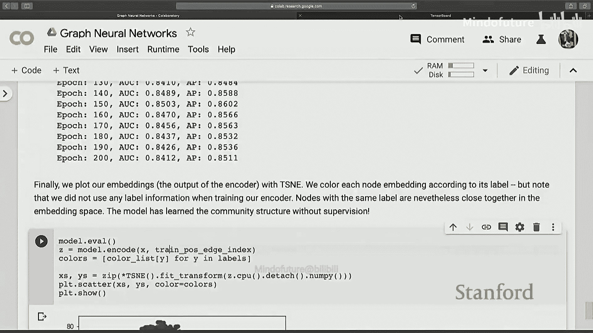

# 图表征学习讲座 ｜ Graph Representation Learning p02 P03_使用Pytorch_Geometric的图神经网络(GNN) -BV1tQxqzYEFP_p2-

So， so for the first part I'll just give a brief introduction on how to use Pytorch or like some python basics to build machine learning pipelines。

 So we'll start with a very simple example， say m classification that every everyone in machine learning should be familiar so the package that we're gonna be using is mainly like those pytorch packages。

 So torch dot n n which we breathe it as n n torch do and n or functional。

 which we as f So and then has a lot of modules on neural networks and function functional has a lot of functions function definitions that's related to neural network operations these two are just specific for m。

 which you don't have to care。 And then the last one is the metrics which we use to do perform evaluations of of the model。

So I've already ran this because so here in the second part， this is just loading the data。

 So this is gonna take a little bit。 So I just ran it before before I came but I guess the thing that you have to know here is that before you start training。

 you have to get a sense of the concept of data。 So this is like the data structure that Pych keeps for you to get input for the model。

 So this stor all the data in this case， this is the data。

 And for later on were gonna use say sites here enzyme ID other kind of graph data。

 but all in the format ofy object。 And so here this is where we define the training。

 this is the loader that loads the training。 So whaty data is it's just inheriting from some abstract data format that is an iterable。

 So the main functions that you want to inherit。When you build your own data set is the thing called land。

 which is the land of the iterable and also the index。

 like you'll be able to index into specific examples into the data， for example。

Maybe I can show here。 So this train set thing。Ops。So， so this trainet is just。Just this name here。

Which is a Pythto dataset。 it's gonna take a bit。But you can also do something that's very common to。

 like。Very common to any iterable Python intervalable。

 which is like you can print the length of the iterable。And you can。And you can print， say。

 what's the first example。Like any index that you can put in。

 So this basically retrieves you the10th example of the。It's still。我还是说说。

We you able to download the dataset。O。And。え零三。Okay。

 but but this is what you what you have to do for it for iterating over the dataset set。

 so you can index into a data set to retrieve one1 example from the training set。 But in practice。

 what we do is mini batch training， right， we do stochastic gradient descent。

 which means that at every iteration or at every yeah。

 at every iteration you take in multiple examples。 So this is also the way like you take multiple example。

 you can take like say101112 or like after shuffling or something。So， yes。

 so this is the basic concept of data set。 And， and as you can see。

 like it will print out the number of data set。 this was actually the previous run。

 So it printed out the the data set itself。 But like now I'm printing out the length of the training set and can also print out like the specific data data example that that's here。

 So basically， this array is just the image array of 26 by 26， which represents the Mnes digit。So。

So okay， so， so once you， once you constructed the maybe you can just yes。

 So once you constructed the data， now is the time to construct the model。

 And so we would do like this we first construct data then build our model。

 And then we link the model and the data together to to do training and testing。

 So here it's a very brief or very simple example of like MP would one one layer convol like really simple model just to demonstrate how how we use Pytorch to build this kind of build kind of network just show of hands how many people are familiar with like Pych concepts。

Okay， like half of it。 Okay， so maybe I I'll explain a bit more in detail。

 So every model in sorry every model that you build in Py is inheriting from something called like an and do module。

 which is like a supercast of and neural network module。

 So this provides a lot of good things that you will later see like provides easy interface to optimize easy interface to run inference and and training on that model。

So this module mainly has like two functions that you have to implement。 One is initialization。

 and one is the forward function。 So the initialization basically helps you to define all the parameters that you use in the model。

 So these are the places where you put in all the trainable parameters and later on you can retrieve parameters in your optimizer and optimize for these parameters right And and the second part is the forward function。

 So what the function is it basically tells you how to construct the computation graph from the input to the output in this case。

 the parameters that we we care here is just the convolution the convol。

 which you don't need in graph neural nets。 But and then the second one is the linear layer。

 The third one is also linear。 So these are all the parameters that we use to train this model。

 And here were defining so linear layer has two inputs the input channel and output channel。

 So these are pretty useful because we see a lot of linear layers in graph neural nets。

So here the input is something like 26 by 26， which is the size of the image。

 And then 32 is the number of channels because we noticed that the number of output channels is 32。

 So here this is the input dimension and this is the output dimension。

 I have a hidden layer of 128 neurons。 and in the second convolution。

 I taking this number of output here。 And then I output 10。

 I output 10 because this is a classification task right so this is classifying which digit is the m the number is。

 So the number of possible digit is 0 to 9。 So this is like a 10 class classification task。And。

 and in the forward function， this is what we do。 We， we take an input X。

 So the forward function takes in the input of the actual tensor。

 and then it builds the come it builds the computation graph here。

So the notion of computation graph actually like starts from Tensorflow。

 But the good thing about Pyth， which also makes it easier is that you don't have to pre constructstruct your entire computation graph before feeding all your data。

 So you can actually like on the fly， retrieve your data from your computation graph。 Look at it。

 maybe even modify it and then feed it back to feed it feed it back into your computation graph。

 So it's like dynamic。 Yes。啊，是嗯。Again， it's not gonna be important for this class。

 but the shape for the con has like three parameters。 One is kernel size， which is like the。

The filter size， the filter dimensions， which is  three by three in this case。

 And the input channel is one because this is a black and white image。

 So just like a gray scale so input channel is one because it's one dimension and output channel is 32。

 It's just like the con output channel for the yeah， but it's not gonna be used for graph neural net。

 it's just therefore for image con switch。Yeah。Yes。喂 sleep。不回。

In the forward position calls to comment about this shape of。In the first forward function。Yes， yes。

 So， so there's like a batch dimension here。 So the 32 in this case is the batch size。 Yeah， yeah。

 again， this is variable。 So there's also like a flatten here。

 which means that you flatten this like multidimensal array to one dimension。

 This can also be very useful in graph neural， by the way。 And this is not the only way。

 So this way this is the flatten is actually an operation that connects the the input tensor。

 which is this x to a very to a different tensor， which is also assign to x。

 So you first do the computational of x。 And then you you put the resulting value back to x。

 but this could be a little bit expensive。 Like what we usually also be able to do is like we can use this like view function like this one。

I think so the tensor dot view。 And we just specify， like because we want to flatten it to 32 by。

Whatever the， the rest of the dimensions。 So just negative one here。

 So this essentially does the same thing with flatten。

But the good thing about this is that it doesn't actually does the actual computation of changing the shape of the X。

 It's just providing a different view of this tensor。

 So a different view mean means like I look at it differently。

 but it's in the same memory in the memory。 So it's a little bit more efficient。

 but computationally they are equivalent。 These two are equivalent。You can， by the way。

 you can look at the documentation of the view in the Py cancer documentation。

But so after this competition， we do non nonlinearity and we produce a logic。

 Lo is essentially the 10 class here。 The output is dimension 10。 So 10 class。

 we pass through a softm on the logics with the logic is the10 class score。

 So for those of you who are not familiar with softm it's just a way to differentiateiably differentiate kind of max。

 right， So say I， I provide a score for each of the for each of the candidate class。

 And I use this particular function。It to the power of C， I over some of it to the power。J forG。

Right， so， so this will be the probability of the model choosing that particular class。

 right This is just basic softm。And then with this software we can use like cross entropy to compute the actual loss。

I， is， is the basics about Pych clear， is there any questions on Pytorch。O， cool。So。

 so once we define the model， we can actually start working on like actually running this model。

 So maybe， maybe let's， let's first start with a very simple example where we don't actually train a model。

 but just like to look at like what these tensors are。 like， for example。

 we can define a equals to is。嗯。So we， we can say define a equals to some kind of cancer。

So this is not a tenor。 This is a N array。now is not different。So this is a N array。

 Everyone is familiar with N array， right， and we can define something like NP dot1。

 We can do like similar things， right。This is just a two by two matrix of one。If your print B。

It will be two by two matrix of one， right， And， and in N， we can do operations like Mattma， right。

 You can do matrix multiplication between these two。 so you can do MP dot。Let's。哦。

So this will give you the matrix multiplication between matrix and matrix B。

 which turns out to be this。 But this is in and which is also which is just using CPU for your computer。

 But the good thing about Py is that you can do this linear competition in like GPU。

 So you notice that like here our runtime type is set to GPU here。

 So which means that we have a GP available。 So we can do this usingy on GP。

 So what we do here is that we can define this thing called tensor。

 which is the the object like Py object that they use to perform certain competition， maybe tensor A。

 is。Something like torch dot tensor。 And then you put in this nu array。 So it will。

 So if you print the T A now， this is gonna be a pi torch tensor， which is wrapped around the。

 the nu array， right， you can also define the data type。Float。Right so it now you， it tells you I。

 this is using flow 64 right， and we can do the same thing for another。

 And so here we can do either torch dot tensor B， but we can also do like torch dot one。 So you。

 you notice a lot of similarity between calling non pi function and calling the the pi torch function。

 so。This one。So， now we print TV。Right， so， and we can also define the type similarly floats。

 This is all very similar to the non interface。 So it's very easy to use。

 And now you can perform computation using torch functions。 right。

 So now instead of calling the nonpy of more， I can do。Torch do Ma， right。

So this will give you matrix modification using Pytoch。And or just as like a very simple shortcut is。

Just do this。Which also gives you the matrix modification， right， But the here。

 the all the tensors still live in CPU because we just tell the Py to construct this tensor。

 but it's still in CPU。 So the way that you do GPU is that you can look at what the GPU is available。

 so。To quo data is available。This will give you。True， so now， because our run time， as you noticed。

 is GPU。 So it's as good ass available。 And because it's available。

 we can now do something like transferring the data into GPU。 And the way you do it is。

The very simple is this。That's the， the torch quoted to any GPU that you can specify。

 So now if you print this thing called T。Sorry， T A， whatever it will give you something in the GPU。

嗯。Okay， yeah， the first time transferring data is a bit bit slow。 but you notice that it's。

 there's like a device device thing that wasn't there before。

 So now this means that it's in GPU right， But a lot of times that you want to make sure specific like which GPU you want to actually use。

 So this， this time you want to call two device。 so。

So device is something like essentially this screen there。 So in this case， we only get one GPU。

 So this is the GPU that we are using， so。So it's like that。So， but it's equivalent。

 It gives you the same result。So is there any question on like GPU using GPU Pyth tensor stuff。Okay。

 great。 So easy。So yeah， so here it's the same thing Here。 we just define if the code is available。

 we set it to could0。 Otherwise we use CPU as the as the device right now we use the two call that I use before to get to the device。

 And this is how we construct the model。 and then we define the loss。

 So so this is the laws that we use to to compute the difference between our train softnet versus the ground truth label。

 which is like one digit out of 10 digits And then this is the optimizer。

 So a lot of optimizers are there。 So you can look at the tor do opt dot whatever like there are a bunch of things likeG R a delta a bunch of those and you can you can try whether these fit you。

 And there's one thing that's looking at because a lot of times you want the learning rate to be。

Kind of anneling over time， right initially， because the model is not very， very trained very well。

 you want the learning rate to be big。 So so you can like step with big steps。 And then later on。

 you want the learning rate to be decaying or like a kneeling。

 So theres an option called schedule in the in the optimization package。

 So there's like different kind of a kneeling kneeling operations that you can do。

 Theres like step a kneeling。 There's like linear kneeling。 Theres exponential kneeling。

 Theres also something interesting called cosine and kneeling， which people in vision likes so。So。

 yes， so you're encouraged to look at this， but it's not strictly necessary， but it will。

 you could improve your performance。 So once you run this， probably have already run it。

 then you can start the training。 So we have everything ready。 We have the model ready。

 We have the data ready。 We have the optimizer ready。 We have the laws ready。

 So now we can do the training。 So the， the training group essentially goes like this。

 So there's an fixed number of apos that we need to go through。Typically。

 like this just represents like the the number of times you need to go through the entire data set。

 right。Were also recording the laws and stuff。 And then okay。

 so here is for each of the airportpo where you go through the entire set of data。

 Now we enumerate over the data loader。 right remember that data loader is a wrap around the data。

 which is like which you can index into So this enumeration here just tells you like at every iteration you want to extract the number of examples equal to a batch size。

 by the way batch size is also defined in the loader。 So now for every iteration。

 this is the thing that that is retrieve from the data。

 Remember the train train set I said trainet 10。 So this is the thing that's in the trainet 10。

 So here in this case image and label So we put everything into GPU。We perform the model。 So when。

 so when you see， see like the model and then parenthees the input。

 this means that this is calling the input function。 Sorry。

 calling the forward function of the model。 So this， this is the function that it cost。

So the input here is x， which is the image。 And that's why we put the image into the model， right。

So once you do that， there's an important， sorry， the loss is， of course。

 the loss is the cross entropy loss， which you can look up is very standard cross entropy。

 But here there's an important step that you really need to do。

 which is0 gra0 gra basically sets the gradient to 0 for all the variables。

 this is very important because if you don't do this by default。

 the py is gonna accumulate your gradient。 right， say like your previous。

 you have already computed your gradient for all your parameters in your previous it。

 if you don't do0 gra， it's gonna add back the gradient of the current computation。

 So it's gonna be a sum of your previous gradient plus the current gradient。

 And this is not what you want in a lot of times。 So you really need to call0 gra。

 if you want this kind of behavior。And and yeah， so this is。

 this is a function where we compute gradient。 So backward means back。

 So back computes all the gradients for you for all the parameters that you define。

 So if you don't forgot where the parameters are。 these are the parameters right， for linear。

 the parameters is the weights， weight and the bias for， So the weight will equal to this。

 the number of elements in weight is equal to the input times the output and the number of elements in the bias term is the number of output。

So。So these are the parameters。 And when we call backward。

 all the gradients of these parameters are computed。 And now we do optimize our thought。

Optimize adult step。 So when we call optimize adult step。Where we were saying for all these。

 for all these parameters where we already have gradient。

 we want to perform one step optimization with the learning rate that's specified here So and also okay。

 maybe Ill also explain the parameters function call。

 So this is just so its perfectly fine if you put a list of parameters there。

 But this model of parameters is just abbreviation to help you So say like I want to optimize all the parameters that is defined in in it。

 So this is what you do right you just call parameters。

 And then you will help you So its essentially giving you all the parameters here And how do you decide is there anyone has a how do you decide whether parameter here is included in in model parameters。

Is there like， say， for example， if I do something like this， say。X equals to N， N dot linear。快5。

Is X optimized。Is X included in model parameter。No， yes， good。

 So anyone know why it it's not included。It's a very， it's a very。Tricky thing。 So， okay， so， so the。

 the reason that X is not included here is that I didn't add self。If， if I do this。

 this is in the parameters。 it's， it's in model of parameters。

 this is just like a very specific thing about N and module。

 Like you have to define this for the model to for the parameters to be included in optimizer so that you can optimize。

And there's also a caveat like， say， I want to have like a list of parameters。

 I want to opt say I have a three layer neural network。 See I， I have this for I in range 3。Oh。

 French for， whatever。 So if I， if I have。If I have this。

 anyone know why anyone know if this is included in the parameter list。

So this will also not be included the parameter list， even if you have self。

 but because this is a list。 So it's not being included。 So what you do instead is do。And， and。

 and dot more Joe list。And then you put the list there。

In which case it will be in the model dot parameters。 and you can optimize that。Yeah。

 just like whenever like sometimes you don't see the loss coming down or you don't see the the parameter changing。

 it could just be because that the， the parameters are not actually in your model or parameter list。

 So you didn't actually optimize that。 So it's good if you know this and know how to debug those。

make sure that the your list of parameters is the list of things that you want to optimize。Okay。

 so now we can， we can perform training。 So this is essentially the entire training loop that I just explained。

 I explained onto this step， which is optimization optimize adult step。

 And theres also accumulating the loss。But these are very simple Python stuff。

And note that this is the label。 So I will talk about it later on the evaluation metric。

 I will explain what this is。 But just to get a sense。

 this is like how you train neural nets like going through a lot of epos。

 So here I'm recording the epo 0， which is here。 But there's we can go through the data multiple times to get results。

So okay， so let's talk about testing。 So I assume that you guys know basic concepts about like test sets training set。

 right， the basic idea is that you want to evaluate how good our model is but you but you don't want to use your training set to evaluate right because you only train on this。

 So there's a possibility that you overfi on the training set。

 but the model doesn't generalize to data that you have not seen before。

 So this is the how you do the test set。 So the thing about test is that the evaluation metric does not has to be have to be differentiable right your training laws has to be differentiable because then you can do S GD。

 but your test test metric need not be differentiable。

 And this are typically things like precision recall F1 things like that。Is there any question。Okay。

 this is just training。 I can kill this。Important。Right。

 but you will see like loss sort of going down and all that。So in the test。

We basically want to evaluate how good it is。 So what we do is we take take a different set of data in the data set。

 So here see the test loader。 So test load is constructed from the test set， not the training set。

 So you， you notice from the previous code section that these are two different data sets。

But the the idea is the same。 We enumerate over the entire test set and for the images。

 we go to GPU for labels， we go to GPU and we produce our model output。

 And remember that the model output is this thing the softm that we kind of computed from the from the model from the model class and and okay。

 so this is maybe I need to decompose this。 So so this is essentially the model output。

 And then out of all the scores that we compute this way。

 we want to pick the maximum of these to be our class right So say like the model predicts 0 with possibility0。

5 0。1 one with possibility 0。1， but two with possibility 0。

8 you would say like the model actually thinks that the dig is2 So in which case we are picking the max。

 So essentially you can treat this as your predictions Soch do max which tells you the maximum is outputs。

And， and of course， you can flatten。For sure。 So， so this is your predictions and。

And this is your labels。So we can， we can print both。 We can print labels。We can also print。

Predictions。We just run it for one itition。So you just just to let you know like what this looks like。

 So this is the our prediction。 The bottle predictions 7。 the label is actually 7。It's all correct。

 right， No it。Well， it's all correct。 Okay， so， but we want to evaluate based on these model outputs and the labels。

 right， So what， what we want to do here is that we， we can make use of the， remember。

 the library that I just taught like I mentioned at the beginning。

 So there's like this S K learn matrix， which helps you which already defines a lot of metric function that you can use。

 for example， accuracy， for example， precision， etcter。 So。

So here were computing accuracy ourselves using me and items， but we don't have to do that。

 We can just make use of the S K。 But the thing is S Klon is implemented based on。

 So you have to convert this thing back to。 And the way you convert this thing back to is you call CPU because this thing is in GPU right now。

 remember and also also you need to compute the。 So convert to。Is that clear。And。

 and I can do something for the labels， labels dot。CPU just。Comfort back to Nai。

And then I can make use of my favorite S K learn thought metric。

See there's a lot of different different functions in it。

 So almost all the evaluation methods that you can think of is already implemented。

 So you can basically call a lot of different things。 for example， precision。嗯。Remember。

 precision is false positive。True positive over what。True positive， plus， true negative。No。

 true positive plus false positive， yes。25，0，5，5，4，57， so。

So this is how you compute the precision score。 You can print the precision。Precisition。

So I'm just gonna run for my iteration。哦。So， so here this is a multi class classification。

 but by default average is binary， which is not， which is only for binary classification。

 So in which case you want to do。Was it called average。microcro。

 say you do micro average of 10 class。Oh。嗯。Oh， yeah， this， this I。I guess don't care about this。

 So now precision is one， but then you can do different other things， right， recall。

And there's PR curve， there's everything like you can do it this way。嗯。O， so。嗯。

Let's remove these just to let you know that you can use S K learn to perform all these evaluations。

 And in this case， it's doing test accuracy， which means that so right now， just now。

 I printed the precision recall for one iteration。 Now here。

 I need to aggregate over all the iterations of the data。 So to get overall accuracy。

 which is happens to be 0。9。 So yeah， so that's the basic。 that's all the basic tutorial for the pi。

 I there any questions on。拍 to。A related training。WithM models。嗯。Is everyone going。

How did the loss get people into account in the？This ist a training。

How do they because power are lost and your variables is lost。Optimr link together。The question is。

 how is the loss and optimizer link together。 So they don't link direct link together directly。

 So what you see here is that you compute gradient of the loss。 So when when we say lost or backward。

 it computes gradients of all the parameters in the model right。

 this is the signal from the loss function。 So once you get the gradient for all the parameters。

 then optimizer here only cares about parameters。 So you realize that optimizer takes in the set of all the parameters right。

 and all the parameters have already been computed the gradient。 So so once you call optimizer step。

 it just take all the parameters。 look at their gradient and it performs one step optimization。

Exactly。But lost。結た？Criterion。Which is。哈。Yes， exactly。 that that's， that's the point。 So。

 so the loss is not relate directly related to optimizer。 La is related to your gradients。

 So loss tells you the gradient of all the parameters。And then based on all the gradient you compute。

 your optimizer comes。 look at the gradient and perform one step optimization based on these gradients。

So the laws and optimizers themselves do not call each other。好，没问题。O。Yeah， the。

 the general idea is that you， you compute gradient for all the parameters and then you perform optimizes based on these gradients。

 So you don't have to look at the laws to compute compute your opt compute your step because you already know all the gradients of your parameters。

啊。So okay， so we'll well then cover the Pyth geometric。 So before covering the Pyth geometric。

 I'll just say like this is just one library that we can use。 We think it like easy to use。

 but it's not like the thing that you have to follow there are a bunch of libraries like graphnets from Google。

 if you interested intensivesflow。 and there's also DL。

 which is from Amazon that supports both Pyth andnet。

 So there are different kind of frameworks that you can use And this is just like one way to as an example of how to do this。

 But if you want can also implement from scratch， not that as you would think because I think in your slide。

 theres also like one slide about how to do the computation which essentially like you just do the matrix modification of your adc of your weight function of your feature matrix you can do this matrix modification in Py。

 So you can even write it from scratch。W it's not that hot。But this is just a way to like help you。

Provide additional utilities for you to write it。So I really installed the， the libraries here。嗯。

And these are the set of dependencies that we would need for the Pyth model。 Pyth geometric model。

 So let me just briefly explain。 you already seen this。

 And here here these two are specific to Pyth geometric。

 So this N end module here is the neural network module that's specific to Pyth geometric。

 So it implements a lot of things like graph con gene con and like different kind of graph convol models。

 and the u here is basically perform some graph graph utilities functions。嗯So。

We also use network X to just visualize the graph。 It's not important and it's not necessary。 Opims。

 So these are data sets that we would use。 So this the good thing is that a lot of standard graph dataset sets are already like easily port port to these libraries。

 so you can just auto download them automatically from from Py geometric。

 But but if you have custom data sets， it's also easy to build them like as I show in the the Pyth dataset function。

Okay， and here are a bunch of things that helps you to perform visualizations。

 So I like tensor board X。 So this is basically an interface between Pitor and tensor board。

 for those of you who have not used tensor board， this is just a way to track your training like how how well you perform over time。

 like you can see like a graph of loss with respect to the number of epos or like metric like accuracy with number of apos and so on。

 So it's very easy to track those during your training。 and I'll show how to do this。

 And this is for your visualization。 So you want to embed the the learn embedding into like a two dimension thing that's easy to visualize。

 This is how this is one way to do it。 And finally， this is just a plot bad plot function。嗯。Okay， so。

 so let's start with the how to write the a general model for graph conf。

 assuming that you already build a or use a built convolution operation that that Py geometric already defined。

 right， So this is just a stack of graph convol like very simple model here。

 And as you already know from from the previous previous example that this is a model。

 So it inherits from the N N dot module。The torture is not actually necessary， I think。

 So because already。So it's inheriting from an end module。 So， so there is like the initializer。

 which you have to implement。 And there is also like the forward， which you have to implement。

 So it's the same。But， but there's a few more things that you have to put in here。 For example， here。

 I was using the module list， which I talked about before。

 So here you put in all your convolution operations。 So here I'm putting in。

A convolution model that takes in the number of input dimensions and number of output dimensions。

 And I'm also building two additional layers of convolution here right here。

 So this is going from hidden to hidden。 right， The hidden dimension。 The input is hidden dimension。

 The output is also hidden dimension。嗯。And， and we can look at the build con iss really very simple。

 I'm just saying like if it's like a node classification， I'm using the most simple GC conf。

 the graph conversional networks。 And here if it's a graph con conversion。

 I'm using a particular model called gene for a graph model。

 But we'll look at how to implement this later。 So you can even like input your custom con function。

 And this is actually the the the the function that we are asking you to implement in a homework。

 right， the the class that is subcast from the message passing supercast。So here。

 here after the convolution， I also have additional parameters here。

 like a sequential sequential here is very similar to module list。

 So we define a list of these these layers And， and the difference here is that if we call sequential。

 that means we execute all these layers sequentially。

 whereas in module list you can execute out of order in whichever way that you like。 So this。

 so this sequential always execute sequentially。 So you perform this first linear layer and then drop out and second linear layer。

啊。Okay， is there a question on the mode。O， good。啊。So we， again， we talk about the。

 the forward function。 But this forward function is kind of specific to graph neural networks。

So this forward function takes in takes in the data， which is which is your input。 So。

 so this data is an element of the data set。 Remember， the Pyth data set that I talk about。

 you can index into every element of the data to get an object here called data。

 So the data here consists of x。 which is the feature feature matrix is the dimension is number of nodes times the number of nodes embedding dimensions and or node feature dimensions。

 And there is also edge index。 You can see edge index as like an adjacency matrix sparse adjacency list。

Basically， it says like what are the edges in your graph。 So if。

 if there's an edge between node 1 and node 2， here， there is the first row is 1，2 right and 3，4，1，3。

 So this is a adjacency list of the graph。And here is the batch。

 the batch is a little bit complicated because now， now we need to。 So instead of batching images。

 which is like regular having the same number of nodes。 now we need to batch graphs。

 So as we all know graphs have different number of nodes。

 So if we want to batch a lot of graphs together， especially in graph classification。

 then we want to know which node actually belongs to which graph。

 So this is telling you like which node belongs to which graph So internally it's an array that says the like which node for every element of the array。

 you record which graph it belongs to。 So in practice， you see something like 1，1，1，11。

 which means there are five nodes that belongs to graph 1 and then followed by say 2，2，2。

 which means there are3 nodes in graph 2。 so So this is a batch of some number of graphs。

If it's node classification， as we will see here。 So there are a lot of node classification that only runs on one graph。

 So in which case， the batchge here is like all once。 So it's like a trivial kind of graph。

So here we have。We have just a sanitity check that if there's no features， we use constant feature。

 we also talked about it in class。 and and here we have a number of layers that executes the convolution So here comess。

 I remember， this comps is a module list here。 So this is a module list which has a list of list of these elements for every element is a layer right it is a convolution layer。

 So for I in these many layers for every layer I'm performing one different convolution here and then pass through a value and dropout So one thing about dropout is that there is also this training flag here which you might want to take a look because dropout computation is different for training and testing。

 As you all know， like at test time you cannot you have to re the value。 So thats。Because。Right。

 it's because training at training time， you drop out。

 So the magnitude of the all all the output is kind of larger。 So at the test time。

 you kind of want to down that。 So you have to， you have to specify whether you are in training or not so that the drop outs knows how do you compute this。

 So at test time， it just pass through everything at training time， you will drop out。嗯。So。

And lastly， we said， if this is a graph cover if， if this is a graph task。

 So here I just mean like you are doing graph classification rather than those classification。

 you have， you need to do a pooling mechanism， which we also discuss。

 So you need to pull all the no yes。port。rry for interrupting， in the previous part， you had P G，NN。

gcN convolution， that creates a convolutional layer。And then just specify the parameters to like。

That to how they。Yes， okay， so， so yes。 So the question is here we have this P Y G and and dot G and conf。

 So this defines one layer of convolution。 And we are now simply stacking together a bunch of these layers as shown here。

 We have a for that stacks all these layers and and every layer here does has its own parameters。

 So these parameters will be internally defined in this GC con function。

 G con module class that I will explain later。 So the parameters are not not。

Directly defined in this model， but defined inside these convolution layers of individual layers。Yes。

 just to continue。 If this is a graph classification， we need to do pulling。 This is one way to pull。

 we can do main pull。 And I think the homework does max pull。

 but doesnt matter different kinds of pulling mechanisms that you can also call。

 So you can also refer to the package to understand like what kind of pulling mechanisms are there。

 And in general， is also an interesting research topic of like how do you actually pull all the node together into into one graph emdding。

 So here， global main pool just means I'm taking average of all the nodeingbeies。Oh。

 and here is the post MP。 Remember， the post MP is defined by this sequential M LP here。嗯。Oh。

And and that's it。And log Som is again。Doing this softm with log so that you can do cross entropy。

I'm also returning embedding here because I want to later visualize what the。

 what the what the graph looks like or what the embedding is is learned to be。

 So I'm just returning embedding also。 And for the loss。Because now we computed log softm。

 We just need to do the negative log likelihood of the。

Of the predicted log softm with respect to the true label distribution。

 which is a one hot distribution of the label class。 So as you can see。

 this is for node classification and graph classification。

 And this is the general model that that is also like very similar to your homework。嗯。Of course。

 in homework here， I was asking to like， implement some a few more details。

 And then also in graph search， we have like specific conversion models。

 But this is the the general homework。嗯。Okay， so now we talk about like。

 what is GCN GCN con and genecom really is， so。So these convolutions are like an concept defined by top Hyython geometric。

 So this is the class。 So all these J Kong and GCN kind inherits from this message passing class。

Have I already run this。O。So here we're saying like。

 maybe we come up with our our own convolution module。

 Maybe we have like special needs that we want to do or like we have special ideas。

 We want to implement。 So we don't want to follow the standard G and conf。

 So here is how you implement the custom convolution layers。

 So your our custom convolution layers is also inheriting from message passing。 And。

And notes that the aggregation here， we when， when we call our superclass。

 we define the aggregation function here。 So here we， we just。Add all the messages together。

 So that's add。 And we can also take me in Mac and all these here， so。But we， we do add here。 So。

 yes， the， the previous students was asking the parameters， where are they defined。

 So here is where it is defined。 So we here we have a linear layer， linear。

 like the parameters in the linear layer that's defined for that specific convolution。And。As usual。

 because this n N dot message passing is a subclass of n N dot module in Pyth。

 We also implement both the in it and forward function。 It's all the same。

 right It's like module inside the module inside the module。 So in this forward function。

 because this is graph neural nets。 We have two things that we want to we want to use as input。

1 is the connectivity， which is the adjacency listed in the edge index。

 and one is the feature matrix， which is x here。 And I also have the shapes listed here。

 The n is number of nodes。 this is the number of input dimensions。

 edge is number of so two here just means like every edge you have two nodes right You want to specify the two nodes and here is number of edges here。

Did something like at cell loop。 This is just means that in because in GCN， we do something like。嗯。

We did。 We do something like the。啊。App to a longity feature matrix and so on right。 So， so here。So。

 so here the edge the， the self loop basically means that my a is different。 So。

 so I also also want to add myself into into your conclusion。 So you not only aggregate neighbors。

 you also like add yourself self self。 This just means that your A is actually like not actually your a。

 but this is actually a plus yourself self loop kind of thing。And that is implementing that。

 But we can change it a little bit also， so。For example。

 like there's a lot of customization that can be done here， right？ you don't have to add self loop。

 And there's actually like a remove self loop over here。

 So you like make sure you don't do self edges。 And the reason we don't do self edges is that then we can do like a skip layer on top of that。

 So what we do is okay， so I have like， say I transform my edge。 I transform X axis。

 And then I do the propagation。 So this propagation what this does is it's calling the message function。

 So it computes the messages for all the notes。 And then does the aggregation to get the the new representation based on your neighborhood defined by the edge list。

 But then I can do a skip skip connection here。Which means that I， I can define say I another。

Another。Dineal layer for say lane self。呃。So I defined， just defined another linear layer。

 And then I want yourself embedding。To be。嗯。Passing through that linear layer。

And then I want the rest， the messages to pass to pass through this linear layer。

 So we we do is here， instead of passing the message self are passing the， the。

 the linear layer here。啊。Like。That so we don't need this。And， and this is。

 this is how we propagate all your neighbor information。 And what you can do is you。

 you can also add yourself information， with yourself。Which is what we just computed here， right。

 I exactly like I at myself。And then I add all the neighborhood messages that we ete from the propagate function。

So the propagate function is propagating all your neighborhood information。

 And the thing that we are propagating is this like X pass through linearly yesterday。Yes。

So here the aggregation sort of happens behind the scenes， we don't have to manually tell it。Yes。

 so the edge list is telling it how to aggregate。 So it's using the edge list to define the neighborhood of the node where you want to pass messages。

 So you don't have to write the the。 So essentially， the this package is helping you to do that。

 That's the only thing that is helpful。嗯。Yeah， so here messages is just computing message。

 I note that a lot of things here And here， you can like kind of switch places。

 It's not like in but it's just that。 so the message function is called inside propagate， so。Oh，Yes。

Super mean， like。When you cook super as a。The question is， what is super here？

Super here means that I'm calling the super pass of the current class。

 so here we see custom count is inheriting from NM do message passing。

 which is inherenting from NM do module。 So when I call super here。

 I'm calling the constructor or the initialization function of the message passing class。

Points be mixed without super， if could not ever。It will not work。 Then you're calling yourself。Yeah。

Yes， you have to call super。嗯。And it's best to call it before everything in youre in it because then you get all the like Pyth and then module is initialized first before you define everything。

 And here I'm doing a lot of computation here just because I want to do this thing。

 So this is the G con。 I'm essentially repro the G conf。

 but you don't have to do this like if you just want to add all your neighbors because there's a paper that shows that adding like allation by adding all your neighbors is best for graph classification。

 you don't actually need all these you just use yourself as messages。 And alternatively。

 you can like put this thing here。 it's all the same thing。

 And and also there's also another thing that so in the message message can take everything that propagateates So these two has the same signature So message can not only take take the Xj。

 which is your neighborhood neighbor embedding。 but it can also take X X is yourself embedding。

 So your message doesn't have to be。Like a function of X J only it can also be a function of X I。

 You can write something like X I。inus it's probably not gonna work well， but like。

 you can define a complex model as a function of X I and X J here as， as your messages。

Update here just means that after you do the message passing， after you compute the node embedding。

 do you have additional layers on top of that to further transform this。 For instance。

 I think in graph search， what we do is I did like a normal embedding， so。I。

 I think it's like something like this。啊。Like P， like do L two normalization with。

 with the last dimension of the。Something like， but I'm not。 I yeah， you can do a normalization。

 You can do M LP or like anything。 that's after message passing。Let's check if the。Yeah。I think。

 I think that's it。 So， so here the， the story is that you。

 once you write this kind of message passing subcast。

 you can essentially replace this with the message passing。 So let's， let's try。Yeah， so。

 so essentially， instead of saying。Where is it。instead of saying like P， U Y， G and N do GC and conf。

 I can change it to our custom con。So， then you can。啊，run run running methods。Yeah， but。Oh， yes。

Are you specify how？Far the messages will go like。TheDe。Yeah。

 the question is how do you specify the depth of your model So so this is in the GNN step。

 remember the modulus where I put all counts So this essentially the three layers right I put in one con from input to a hidden I put a second con from hidden to hidden and then this is a loop over two layers So essentially in the in the forward function this there's also a loop here So I put I take the input I trans use the probability that collect is defined I get output and the output is fed back in this loop right as input of x so。

That's， that's the there。Oh。なり付け。It's a network model， but that could be。你开在。セのスピで。Of the make。

P chaoss weather。Yes， so the question is， I guess， where is the。啊。Where do is so the yes， so。

 so this is still by looking at these few lines。 this model list does this three hops。

 So this is the depth in terms of what you already said like the depth。

 how far you want to find out it's not the depth of your neural network layer because every one of these can have multiple layers。

 And so this is the number of hops you want to go away。 So here in the forward。

 because we have the loop over three layers。 So for every， for every time you take your input。

 you perform your convolution at that layer。 And then you get your output right。

 and the output is fed back into the input as the input of the next layer。

 it's just follow to go over multiple hops。公 message person。Oh， yeah。This one， so。

Because in practice in graph classification， oftentimes it's beneficial if you have a few more linear like few more layers after you finish the message passing。

 So this is just like if you look at the post message passing， this is an end or sequential。

 as I explained and then sequential does like every of these layers sequentially。

 So it performs two layer MP on top of your graph embedding that you just computed。Again。

 it's not necessary。 It's just something we added。 So it's just to show that we can customize the model with different architectures。

So。第二。Let's show the training loop here。Yeah， the training loop is very similar to the previous one。

 So in a sense that we build this data loader and this code already written for you in the homework。

 So you can also look at the homework。 the thing to note is that we have this train loader。

 which loads the data set from the first 80% of the data。

 And then the test loader is from the 80% So the rest of the 20% of data。 So in practice。

 you have to know that there's also like train validation and test split right as you all know test split。

 something that you don't want to look at。 you look at the validation split at training time。

 you you value the performance on validation。 And then you can perform some some kind of early stopping。

 you see the validation curve goes like your accuracy increases， but then decrease。

 you want to make sure you stop at like do some early stopping。

 And then once you determine the best apppo where your model performs like the airportpo that your model performs best。

 you can use that model to perform on your test set。 So test set is like one time。

That you don't look at before your training before you finish training。 So but here for simplicity。

 I'm just， I'm just doing this train and test split。

 but notes that like improper things like you have to do train say from to train from everything to 0。

8 and then validate on 0。8 to 0。9 and then you test from 0。9 to 1。

 So you have a different test split。And specify batch size by 64。

 I also shuffle the data so that I can， I can。Have different ordering of the mini batches。Here。

 here is the same。 I come construct the model。 It's very similar to the emist framework。

 construct the model， construct the optimizer note that I still call all the parameters parameters。

 So the optimizer is optimizing all the parameters of your model。 And then I start the training loop。

 The training loop starts with like 200200 epos。 And and I just for every epoch。 it's the same。

 like I get the mini batch from the loader。0 gra， super important。 get the prediction。

If this is a node classification。I also have this mask。

 So just to clarify this mask thing because in node classification， a lot of times we have one graph。

 And in this ground graph， we want to do train test you want to train a node。

 a subset of nodes in the graph and test on some other nodes that you have not seen before。

 So this masking is like you can have a look at those nodes that are not masked out。

 So this are your training set。 and you must out all the validation test set。

 So this is what this mask is doing。 And this mask is also like is defined in the data load。

 So it's also in your homework， which you can have a look and a test time your mask is instead your validation mask or your test mask。

 So this is like this is how how we train on a single graph with different train validation test notes in the same graph。

But if it， if this is not a no classification， if this is a graph classification。

 typically there are a lot of graphs， right， So we just split by graphs。 So your train set is。

 say graph 1 to graph 10。 Validation is graph 10， graph 11 to graph13 and so on。And。

 and now now we just compute the loss loss。 I so here the loss is added to the total loss。 and we。

 we monitor the loss。 So notes that the a scaler here。 So this is from the writer。

 So I will explain that later。 So this is a very good like tensor board stuff So instead of looking at the loss as we just did in Mist like printing out every entries。

 it is also very convenient if you can if you write out the intensor board。

 So this is the doing this。 So I I'm writing this loss。

 with this total loss value and then the apppo。 So it will help you plot the graph of the of the loss。

嗯。嗯。And this is testing， so。Testing does。It's also very similar， but except the train mask。

 I'm using a validation mask for node classification。

 and I'm checking whether the label is equal to the prediction。Yeah， it's also， it's very similar。

 like you loop over all the all the data， all the mini batches in the data load。

But here notes that this is a little bit faster。 You don't have to add this。

 But if you said with To the nograd， you will not compute any gradients。

 So that will make it tiny faster because at test time， you don't optimize。

 So you don't have to compute gradient stay here。嗯。啊。So， so this is the tensor box up。That's good。

And this is a little bit tricky because we're running on coab。 But if， if you're running on the， on。

 on like a python file， you don't have to say all all these。 you just like。

 you just need to import the tensorboard X。 So this is the URL that they provided。哦。Currently。

 there is nothing because we haven't started training。But this is。

 this is a graph classification task。 So we're using the IMDB binary graph classification benchmarks in your homework。

 I think I， I think you're given the enzyme data set， but it's very similar。 load the data set。

Shuffle the data set。And then start training。 the training loop is。 remember。

 the training loop is over here for every airport you perform optimization。So， yeah， yeah。

 you can also find it。I think it's a little bit slow， but。啊。But that's not waste time。

 in the meantime， this， this is the node classification task。 So we said task equals to node。

 So which means that you don't， you actually using the masking for the train and validation split。

 This is just another data called sites here， which is also a citation dataset set。

 very similar to the core data set that's in your homework。 But this is node classification。Okay。

 so this is training。And when it is training。It will start logging， right。

 So the summary writer is from the tensorboard X。 It will log everything here。

 log everything that where you say， like writer。Forho is writer。

 writer do add Scalr will add the scr to the to this log directory that that you specified here。

SoSo is， this is just like very random。 Like you can name your log everything like your favorite name of your model。

 This is just an example。 Like it will log into that directory。 And when you log into that directory。

 this H TML tensor Tensorboard server will retrieve data from that directory from that log directory。

 And then you will see a visualization of that。嗯。So， so this is the name。

 the random name name that we just give the give our model。 We can see the loss function decreasing。

 So this is for every epoch we're doing this a scalealar function there。 So we log the a scalear。

 So we get a cloud of this and note that this is also the test accuracy。

 but differences that at test time because testing is very expensive you have to look through the entire data set。

 We only perform it every 10 epos。 So you will see one data point at every 10 epos。

 So note that this is also updating because we are running it and generating log in real time。So。

 this is the。This is the ten tensor board。 So it's very simple。 like just to reiterate。

 all you need to do is that you import tensor board X and then you define this writer with the directory that you want to log to。

 And finally， you do where is it at Scr。Right， it's very simple。

And you can also log images and so on。 But that's a bit more involved and I won't talk about it。

 So lastly， we just want to look have a look at the visualization here。

 So once you learn these kind of node embeddings。 no matter from deep work note or G N N。

 you can always visualize them in the to get sense like how well your your embedding is like how well the node are clustered together。

 I I those from the same class are close to each other。

 you can answer a lot of these kind of questions just by visualizing this。

 So this is also very simple。This is just using the standard plot plot mat plot lip stuff that you all probably already know。

 where X， S and Y S is the T embedding here。 and the embedding is also simple to compute because we have this library from s So we call T。

 we construct Disney。 And then we say fit transform。

 And then the input to this fit transform function is our embedding that has been learned。

 So know that this embedding is is an output of the model。 right， remember that in in our model。

Where is our model。Remember in our model， we actually output the embedding right here。

 So it will get the embedding of your graph neural net。

 and it will perform the T technique to map this embedding high dimensional embedding into two dimension so that you can visualize in this 2 d plane by calling product scatter with with the color representing the class of your each node So as we can see。

 like instead here。 for instance， it's not perfect right there's a lot of notes that。

A clustered together， like in the middle of a broadcast cluster。 there's like red node。

 So it's not the perfect one。 It actually gets like 70% accuracy。 So it's not。Yeah。

If it's an issue with。The clustering versus with the classifier。Oh， the question is， how do you。

 how do you know， like if you have something wrong。

 whether it's from the cluster algorithm or whether it's from the classifier。 So I think。

 I think the answer is。We， we gotta trust these， these low dimensional embedding tech techniques。

 So these are definitely not prefer perfect。 The thing is like。

 if you imagine you have like a 300 embedding， like 300 dimension embedding。

 you want to compress it into two principal components or like it's not gonna give you like perfect things。

 right， So so I， I think， I think it's very hard to determine like whether this is like an artifact or not。

 especially from this， this is mainly to like show how。This。

 this is mainly like show why is it disappearing。 Never mind。 So this。

 this is mainly to show like as a comparative study。 So say like if you have two models。

 one model gives you this visualization and one model gives you that visualization。

 And you observe that that model has a better clustering。 then given that you use the same algorithm。

 you think that this one is doing better， right， But like in absolute scale。

 it's very hard to determine whether like two things are close together iss really because your method is not good or your T is not good。

Yeah but yeah， good question。 I think。So that's pretty much the end of the tutorial。 And lastly。

 I just want to show you a little bit about the an extra test that is not required in homework。

 So this is for link prediction， which is also very important if youre doing knowledge graph or if youre doing like graph reasoning It's very important basically is asking whether you can do completion of knowledge graph or things like that。

 you can predict whether to two node are linked together in a graph that has a lot of missing edges like this kind of cases。

 So this is just using the graph auto encoder， which you can also refer to theymetric documentation。

 So the encoder So this kind of auto encoder has this encoder part and decor part。

 So the encoder part here we use graph convol graph convol to get embeddings for all node that's ther part。

 and at the decor part， we basically use something very simple can use in the product if the two embedding have。

In a product close to one， then we think theres likely a link between them。 And if they are not them。

 there's no link。 So the encoder is graph con。 The decoder is inner product。

So here we define very simple encoder。 You probably already。Very familiar of this already。

 like two layers of graph conf here。 This is your encoder right， and decoder here decoder here。

 we actually didn't specify because the default decoder is in the product。

 If you want to have fancy in the product like fancy things like neuraltensor network or any other decoder。

 then you will modify the decoder also。 But overall， it's it's like。

Just just defining another N module。So as usual， we do the train test。

 and we use the sites here data set。 So this is also the same data set that we use for node classification。

 But now we're doing link prediction there。And were recording these two metrics。

 A U C and average precision and both of which are also defined in S K learn。

 So you can use what what I said in towards the beginning of the class to use S K learn to compute these metrics。

 So link prediction is also pretty fast。 And one thing that's worth noting is that there is the split edges。

 So this is important function that helps you to construct positive and negative examples of link prediction。

 as you probably remember in class really talked about like you have to construct positive examples and the negative examples by negative sampling right。

 And then you you have positive log likelihood minus the sum of log likelihood of your negative samples。

 So this is doing this separation between the positive edges and negative edges right So yeah。

 this is a good function for link prediction。 But other than that， everything is very similar。嗯。嗯。

You define the。嗯。All all these parameters and， and make it to GPU。 And then you run over the model。

 The， this is the train function that we， we wrote， so。So yeah。And again， we can also visualize this。

So。Color is not defined。I guess I have to run this again。Just to define the color list。Well yeah。

 so the visualization is also very similar。 So the， the idea is that we have an encoder。

 that's graph count。 We have decoder that's in the product。

 The the thing in the middle is our embedding。 So we visualize the embedding in the middle。Yes。

I don't know why is it slow， but it's the same function as you saw in the previous node classification。

And， and that's it for everything related to pythro geometric。 And is there any question。O， cool。

Thanks。

