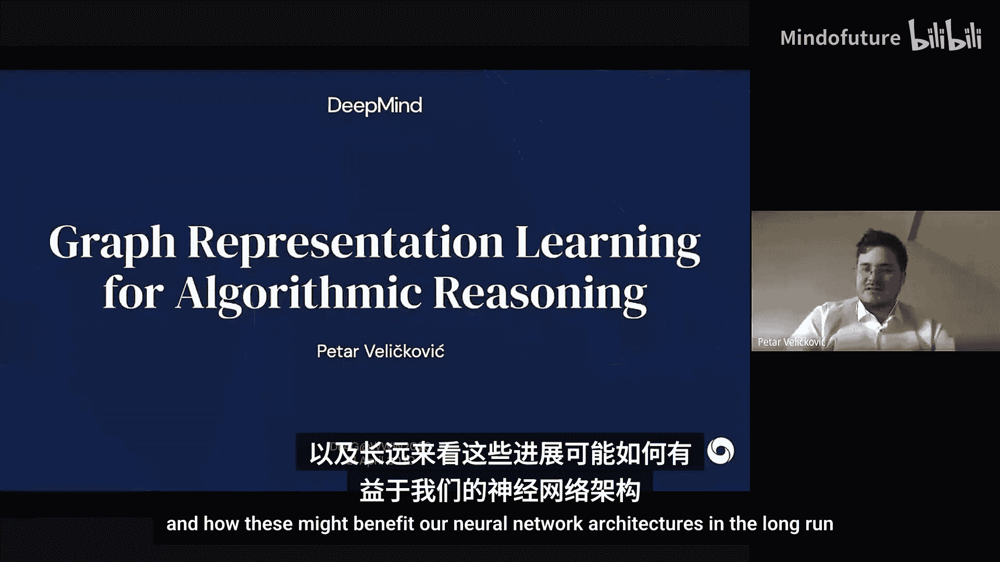
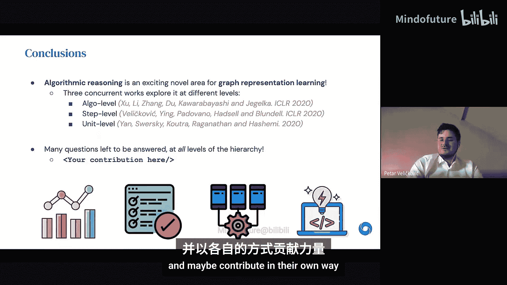
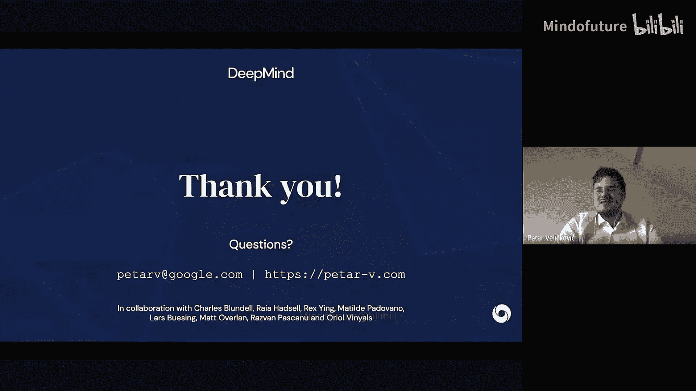

# 图表征学习讲座 ｜ Graph Representation Learning p03 P04_用于算法推理的图表示学习 -BV1tQxqzYEFP_p3-

Okay， awesome。Thank you so much for coming to my TTok today。

 I will be talking to you about how we can use some of the recent advancements in graph representation learning。

😊，To support and reinforce algorithmic reasoning style tasks and how these might benefit our neural network architectures in the long run。

So。When I think of approaches to solving problems in general。

 I usually think of them as partitioned into two directions Either we have this sort of rigorous hardcoded way to tackle the particular problem which takes into account some of the imvariances in the problem explicitly and works the same across different input ranges and this can often be formalized under the umbrella of classical algorithms and on the other side we have machine learning which dynamically learns to adapt to specifics of the raw inputs to outputs mapping based on the based just on the properties of the raw data without necessarily looking into the specifics of the task and I've kind of here。

putut neural networks as an umbrella for machine learning。

 given that nowadays neural networks are used to reinforce almost every aspect of machine learning approaches and these two approaches seem to be quite distinct and quite varied in terms of their strong points and weak points。

In particular， neural networks have the benefit of directly operating on raw data。

 that means we don't have to worry about processing the data in a particular way before feeding it into the model。

 they perform quite well at generalizing to noisy conditions and the models that we get the specific neural net models that we create can often be reusable across tasks。

 meaning that if we have a good convolutional net architecture it works on some kind of image classification task。

 we can usually reuse a very similar architecture， like reuse a lot of ideas when trying to do a completely different image classification tasks。

The downsides of neural nets is that they often require big data to generalize properly and they get quite unreliable when you extrapolate。

 even when you go a little bit out of distribution。

 but even worse so when you go to inputs that are of larger sizes than the ones you've been trained on。

 the predictions of neural networks usually get quite unreliable and uncertain and kind of in line with that once you have a top- performingform neural network。

 it's often quite hard to reason about why it's made the decisions it made and why it's decided to activate it so interpretability is also a big issue with neural nets。

Algorithms， classical algorithms seem to almost fall on the opposite side of the spectrum in that once you write at an algorithm。

 it will usually strongly generalize trivially if you feed in an input that's two or three times as big as the inputs you inspected when you came up with the algorithm。

 the algorithm will work seamlessly on them as well and this is in line with the fact that algorithms can have very interpretable stepwise operations and you can usually prove or guarantee their correctness or a certain approximation ratio through rigorous theory or formal verification methods。

And another good property of algorithms is that they are in a sense。

 very compositional because you can construct algorithms out of a bunch of these precooked subroutines from a cookbook that you can then assemble and build new algorithms based on parts of previous ones。

So in a way， they support a lot of the parts that neural networks tend to struggle with。

 but then on the flip side order to in order for an algorithm to be effective for the problem you have。

 you must be able to cast the inputs to your problem into the specification and preconditions that the algorithm requires otherwise there it's literally anybody's guess what the algorithm would do to them and they're really not that robust a task variations if I give you the task of recognizing something completely different than what the original algorithm was designed for。

 usually you have to go back to the drawing board and reinvent an entirely new algorithm。

 so you lose this sense of reusability of a particular structure across different kinds of tasks。

So if you can see these two， the strong points and the weak points。

 they seem to align quite well with each other， so if we were somehow able to get the best of both worlds and mitigate all the downsides。

 we could be well on our way towards creating a very strong general learner。

And there has been quite some work in using neural networks to reinforce algorithms that is typically using neural networks as an oracle or a heuristic of some sort inside an algorithm。

 but in this talk I will primarily focus on the other direction which has recently seen quite some attention。

 that is， to what extent can we reuse ideas or pipelines that are present in classical algorithms and use them to reinforce the decision making that neural networks do。

So the main question that I seek to answer in this talk is can neural networks robustly reason like algorithms。

 are there aspects of algorithmic reasoning that we can incorporate in neural nets？

And if you look at what algorithms do in general， you give them some kind of ordered or unordered set of objects and potentially some relations between them。

 and then the algorithm just does a bunch of manipulations over these objects and computes the final result that you care about。

😊，Since we have objects and relations， algorithms basically operate over some sort of graph specified over parts of your input。

 and this means that graph neural nets can be quite relevant and quite applicable。

To tackling these kinds of problems。 So what we are going to do here is supervise graph neural networks with their message passing mechanisms to perform algorithmic execution。

 And here I've given just one high levell example of what we mean here。

 the bread first search algorithm that computes shortest paths in an unweighted graph Initially we have a tagged source vertex with a distance of zero and all other vertices don't have a defined distance its infinity and then we supervise a graph neural network which performs iterative steps of message passing in latent space where each node receives。

😊，and exchanges features with its neighborhood and as a result at the output level we should get for each vertex the distance it has to the source and some reconstruction potentially of the shortest path tree。

 which tells us which edges are used to get to the source most efficiently and this approach。

 this general approach of using a GNN to model outputs of algorithms directly from raw inputs is what I will call neural graph algorithm execution。

 and it's the central topic of the works that will be explored here。

Now I often get asked the question， why are we doing this because if you're going to model outputs of classical algorithms。

 especially if they're polynomial time algorithms， why not just go ahead and execute the algorithm why do you need this extra modeling neural network step in the middle and I had to think long and hard about this and I've came up with four larger directions roughly ordered in how short term they are like how quickly usable they're going to be and these four directions are we can use this to get better benchmarks for graph neural nets using this kind of training mode we can reinforce strong generalization our models there's actually an untapped previously untapped and unexplored potential for multitask learning in this setting and ultimately when we leverage all three of the previous ones we could even use it to discover novel algorithms in some circumstances so I will start with the most obvious one the benchmarking aspect。

And there is a big problem in graph representation learning right now in that a lot of our benchmarks that we use to gauge the strengths and weaknesses of different graph neural net models are very unreliable and I've here just highlighted two papers that tackle this issue for node classification and graph classification turns out that some of the most standard benchmarks we use such as Qra and sites here are basically like MNIS at this point。

 all the different graph models that we've proposed recently tend to perform more or less the same with only tiny insignificant variations。

So these datas are not that good for differentiating different ideas。Whereas in graph classification。

 the problem sometimes becomes even more complicated in that it's sometimes better to just ignore the graph structure altogether and an MLP will perform better than a graph neural network in most circumstances so clearly these kinds of data sets that most papers use are not the way to go right now and one hypothesis I have for why this happens in these data sets is that their learning complexity is just not on a very high level。

😊，And I think the SG paper that I've linked here， which seeks to simplify graph convolutional networks to the simplest possible model where they remove all activations from the model。

 and they just have a classification like layer at the end。

 everything else is linear and they just do a bunch of feature aggregation across the vertices。😊。

And already this very simple model where theres no deep learning involved whatsoever。

 but instead just like a classification layer detail。

Performs really well and sometimes even state of the art on many classical graph benchmarks。

 So this shows that the inputs or the relationships between them simply aren't that complex to require complicated deep learning architectures in the first place。

So in this setting， learning how to imitate and execute algorithms can prove very favorable。

First of all， because we're kind of simulating inputs and outputs to a given abstract function。

 we can， in principle， generate infinite amounts of data。

 and therefore we don't have the problem of potentially overfitting to certain specifics。

And algorithms often require complex data manipulation。

 so generally the more expressive the graph neural net model is it's going to get better at modeling the underlying dynamics。

And in all three papers that I will be discussing here。

 you can see a very clear hierarchy of different graph neural network models emerging when you task them with an algorithmic reasoning benchmark。

 so these are the figures from three papers that I'm going to cover today that discuss and tackle different aspects of graph representation learning。

Over algorithmic reasoning tasks and as you can see just by looking at the plots。

 there are clear differences between various established graph neural network benchmarks。

 which would otherwise be indistinguishable in the more standard data sets。

 So this is hopefully one additional motivation for why these kinds of tasks would be a good idea at least for diagnosing the different expressive powers of graph neural nets。

And another sort of potentially over overlooked benefit is that we have a clearly specified function that generates the data。

 which is the underlying algorithm， and this means that there usually is no noise in the data that our model can get confused by and this means that we can rigorously assess to what extent can different GNN architecture's reason about different parts of the algorithm and whether they're actually learning the underlying reasoning role。

 meaning we can do rigorous credit assignment here I provide two plots from our aCCl paper where we have trained the network to do a reachability task。

 which is you start from a source vertex which has a value of one。

And your job is to propagate that value of one to every other vertex reachable from the source。

 and this is a very simple task for any GenN to do but also looking at the fact that most of our graphs are connected。

 you could get equally almost equally good performance but just predicting everything is reachable So most models can learn to cheat and just say attach a1 to everything but with GNNs we know this clear generating function。

 we can actually use some GenN visualization and explainability techniques to highlight which parts of the graph were most responsible for attaching a1 to a particular vertex and here we see for two particular input graphs that it actually learns to highlight exactly the path from the source vertex to the destination and it highlights the shortest possible way to get there so it didn't just happen to attach a one to this vertex by chance it actually learn to follow the shortest path and attach this meaning to the vertex So having this clear generating function gives us a。

😊，way to do model diagnostics in general。And also， even though we're mostly going to be focused on polynomial time algorithms here that are efficient and therefore can be effectively simulated in this sense。

This is still fine because most of the algorithms that we use practically。

 including heuristics for harder problems are polynomial time algorithms themselves。However。

 I should note that most of the techniques discussed here will be applicable to MP hardware problems as well。

 I've here highlighted just one paper from Chatania Joshshi， Thomas Laurron and Xaviia Bisong。

 which looks at the traveling salesman problem in a similar way。

 trying to simulate what the final output would be on some smaller instances and in seeing how well that generalizes more complicated TSP instances。

So from a benchmarking point of view， theres a lot of benefits to doing things with algorithmic generated datas。

 The second point is strong generalization and what I like to highlight here is that when I say I want to learn an algorithm it is distinctly different from saying I want to learn an input output mapping and here I have some figures from the neural turing machine paper which learns to do this copy tasks so you have inputs at the top and the ground truth outputs are exactly the same as the inputs Now one I might ask like from an algorithmic point of view。

 this is kind of silly because learning to copy isn't necessarily like very tricky algorithm at all。

 like it's just take parts of your input and replicate them however。

 if a neural network is just learned how to do input output mappings。

 it can learn to pick up on the subtleties or patterns or weird artifacts in the training data and then when you try to extrapo。

to wider sequences， you can see that in fact， they haven't quite learned how to do copying because here you have a few unseen test sequences which are longer than the training sequences and you have the model errors highlighted in different colors so already once the sequences get a little bit longer than the training distribution the model will make a few mistakes and by the time you spread them out to something that's I don't know four times as long the model will make quite a few mistakes and therefore you can see that it hasn't really learned how to do copying it has just learned how to do an input output copy mapping on sequences of a certain size so it hasn't really learned an algorithm it has just learned a way to circumvent the computations of the algorithm using some specifics of training sequences at smaller ranges。

However， if we have this sort of algorithmic execution setup where we explicitly imitate individual steps of the algorithm。

 this can enable us to actually do strong generalization。

 which means no matter how big of an input I give you。

 I will still be able to robustly give you an answer and this is kind of related to how humans device algorithms by hand so you might on a whiteboard or in a notebook write out a few small graphs and reason about what the algorithm should do to them and the reasoning steps you've come up with will be equally applicable when you scale up to much larger dataset sets and here I've had just a few figures that illustrate in one of the papers that I will cover today。

 the sort of results they've been able to get with this kind of supervision so they've only trained to do sorting in shortest paths on inputs of up to eight objects。

😊，And when trained in a specific unitwise way， they are able to get 100% accuracy。

 even when they scale up to inputs of size 100， which is way beyond the range in which they were trained。

And。What can also interestingly emerge is that the representations of individual objects in the latent space can get quite interesting and generalizable in this sense。

 so on the right- hand side， you see representations from a neural network that was taught just to do binary addition so add two binary numbers together and get a third one which is a very important primitive for many algorithms you can see that it learns the structure its latent space such that successive integers kind of follow this bendy arrow pattern and when you follow thearrow pattern。

 the numbers always increased by one and this kind of data organization is critical to being able to generalize properly because when I'm faced with an unseen binary input I know roughly where I need to map it in this space and it kind of naturally generalizes。

So。What we do here is we're basically grounding the graph neural network in the underlying algorithmic reasoning rule。

 and if we say that all of deep learning is about learning abstract representations in this setting where actually learning representations of manipulations。

 so we learn a representation of what it means to do an atomic change of the data。

 which when composed sufficiently many times will lead to a desirable ground truth output。So。

Once we have this strong generalization concept narrowed down。

 we can see that it actually unlocks a lot of potential for multitask learning。

 because if we're learning representations of manipulations。

 this means that there is a lot of potential for knowledge transfer and reuse that just wasn't there before。

 this is because many algorithms very intimately share some subroutines and here have given examples of two algorithms。

 the Pris algorithm for computing spanning trees and ditros algorithm for computing shortest paths。

 the pseudocode is basically copied from the introduction to algorithms textbook and you can see that even though these two compute quite different things on an input weighted graph。

 you can see that actually there is a massive correspondence between different subroutines inside them and in reality there's only minuscule differences in how you manipulate the data if you have these two algorithms side by side。

So if you have meaningfully learned how to manipulate data for one of them。

It should be quite possible to reuse some of the knowledge you've gained to learn to execute the other one much more easily。

So basically these manipulation representations can truly positively reinforce one another leading to a sort of meta representation of algorithms。

 and this gives us plentiful opportunity to do all sorts of multitask and related kinds of learning such as meta learning or continual learning。

 and we have the added benefit of because we know the underlying algorithms and the links between subroutines we have clearly defined task relations which I believe is missing from a lot of standard meta learning or continual learning data sets。

 so a lot more structural inductive biases that we can use to kind of further propel our models in our benchmarks。

And I like to think of it also in the sense of there can be easier algorithms and harder algorithms and once you learn how to model an easier algorithm perfectly。

 you can use its output as an input for something that's harder so if you look at breadth first search which kind of learns how to do shortest path in an unweighted graph。

 you can generalize some knowledge from breadth first search to learn how to do shortest path algorithms in more general graphs such as Belllman Ford or ditra because the reasoning is quite similar。

 the only difference is that now you have to accommodate for the fact that some of these edges may have weights attached to them。

So once you have the concept of multitask learning and representations of manipulations。

It actually isn't a massive leap of faith to reach algorithmic discovery as an end game。

 because if you have an algorithm， the executor that stepwise simulates a particular algorithm。

You can then inspect some of these intermediate outputs of the algorithm and as a result。

 decode the underlying behavior。And if you're able to make some reasoning about the decod behavior。

 you could end up deriving novel algorithms and in particular。

 I think two directions are going to be quite exciting here。

 one is we could end up with more interesting heuristics for problems that are intractable。

 such as traveling salesmen。😊，And here on the right hand side， I have just for visualization。

 one possible way to do traveling salesman in Euclidean space where you kind of line up a particular tree spanning tree of your data。

 and then you kind of take a walk on the spanning tree and you use that as your cycle and we could easily use some of these modified heuristics to come up with novel with novel and improve heuristics。

 but another area which could be quite exciting is that a lot of these algorithms as well as heuristics have been devised with you know a single threaded CPU machine in mind。

 which can only really focus on one node or one object at a time。However。

 GPUs and TUs are what we use nowadays for executing neural networks and hence graph neural networks as well。

 and these have a very sweet benefit of being able to look at many nodes at the same time and make reasoning steps on all of them independently at once。

 and this can give us opportunities to devise novel robust algorithms that could run on a GPU or a TU and achieve much better。

 say approximation bound and we can use the outputs of these。😊。

On neural net executors in order to get better at devising such algorithms。

 which I think could be also quite an exciting area for application。And in a way。

 because we're doing we're looking at sort of these input output mappings and we're reusing this previous manipulation knowledge。

 which is like all the algorithms you've been taught in the past。

 in a way this is contextualizing competitive programming into machine learning because a competitive programmer looks at a new problem。

 a description of a problem， a bunch of input output mappings that it needs to model and the competitive programmer is also armed with the knowledge of all the other algorithms they have trained on in the past so they can reuse some of the knowledge from there。

😊，And at least to me， this correspondence is quite exciting because I have used competitive programming as a way into computer science in general through solving tasks on platforms like sphere On Judge and code forcess。

😊，To like also participating in the ACM ICPC where on the right hand side is a photo of my team actually winning the ACM regionalionals one year。

 so to me personally this direction is quite exciting because of the links between the between the two fields。

And I think there's one conjecture that I have about how。

These sort of algorithm executors can help us discover at least novel heuristics in the sense that we can start by training them on a huge amount of these efficient polynomial time algorithms and when you look at say efficient search algorithms on graphs and polynomial time algorithms on graphs。

 there's actually not that many there's maybe 20 to 30 algorithms so it's not that infeasible to have a multitask learner that picks up on the manipulations on all of them and then unleashing this network as a prior starting point to solve something that's MP hard or something that's much harder from input to output mappings only and what I hope a neural network will be able to do is this notion of soft subroutine reuse it's going to be able to recombine pieces of knowledge from previous algorithms that are efficient but recombine them in a way that makes it more efficient to reason for a much harder task and therefore basically use this softness property of neural nets to explore the space of。

Ponomial time heuristics in a much more efficient way than say a human would。

 because we can only see into so little of the of the combinatorial space of heuristics。

 So this is my thought on how we could use this eventually to end up with more efficient heuristics for really complicated problems。

And I will now completely switch gears and present three very recent pieces of work that have been used to kind of kickstart and set up the field at different scales。

It's quite exciting that all three of these papers have came up basically concurrently and they explore completely different areas of the algorithmic reasoning setup and they all make basically very favorable conclusions to start with I will start with an analogy which looks at different levels of programming language complexity depending on the kinds of tasks you want to solve or the level of operations you want to have control over。

 you can have highlevel languages like Python which are scripting and often like many really complicated subroutines like I don't know computing and eigen decomposition of a matrix can be done with just the one liner in a language like Python then you have a language like C++ which gives you control over much more the internals and if you wanted to you could also to down to the pointer level and like the underlying machine level but it also allows supports for things like classes and constructs that you can use to streamline your program and make it a bit more readable so it operates。

This like middle level and on the lowest possible level。

 you have languages such as pure assembly or even like binary machine code or。

Other sorts of simple T complete languages where you explicitly have to write out every single operation that the machine has to do。

😊，And it's like native language， however。By doing so you also have guarantees that your program will be as efficient as it possibly can get because you hand designed every instruction to map to the underlying architecture and in this correspondence there are these three related papers two of which have been published at IC just now that operate on different levels of algorithmic execution。

 so we have on the algorithmic level， the from paper from Klu2 and others what can neuralnet's reason about on the step level our own contribution to ICear on neural execution of graph algorithms and finally at the unit level this work from Google Bra on neural execution engines from Eugeneia and others and all three of these explore algorithmic reasoning on different levels using graphra neural networks。

The algorithmic level paper。Looks at learning an algorithm just end to end。

 So input output mapping without any additional supervision on the manipulations。

 and they focus more on the theory。 They establish a theoretical link between parts of the neural network architecture and how it aligns to the underlying reasoning procedure and the generalization power that you can expect from this architecture。

 And they formalize this and prove a few theorems that are quite relevant and most notably。

They prove both empirically and theoretically that graph neural networks align really well with dynamic programming on which most polynomial time algorithms are basically propped up。

 so this is quite encouraging from a theoretical point of view that it makes sense to use GNNs to do these kinds of execution tasks。

😊，In our own step level contribution， we actually supervise on atomic steps of an algorithm so we figure out what's a particular unit of time that an algorithm executes through and then we try to supervise on all the intermediate values it has access to and we actually then push this idea forward and realize that when you do this atomic stepwise supervision。

 you can get much better at strongly generalizing and testing out of distribution。

 which is exactly what we do and we verify and also at the step level we can do multitask learning to kind of reuse knowledge from subroutines and we find that using this multitask learning plus neural network architectures that rely on maximization。

 you're going to get much better strong generalization so it's also evidence that this subroutine reuse is a concept that is potentially going to be quite useful in this space。

And lastly， at the unit level。These algorithmic executors actually only learn to execute very tiny operations like think of things like addition。

 argument， multiplication， so very trivial individual steps。

 which can still get quite complicated for neural nets to do。

 but they learn how to do them very strongly。😊，And then they compose them in a particular way to reach specific algorithms。

😊，And using tricks like binary encoding and conditional masking。

 which basically also hints that this architecture is also closest to the bare metal of the algorithm。

 they're actually able to achieve perfect strong generalization because these tiny components can be perfectly learned and then composing them can leave no particular harm on the underlying algorithmic performance。

 So it's also a good hint that if 100% accuracy is what you care about。

 it is also possible to achieve it using these kinds of methodologies， at least。😊。

So I will start by briefly covering the first of the three papers。

And it asks this generic question of which networks are best suited for certain types of reasoning。

The theorem that they formalize and improve is that if your neural network has better structural alignment with the underlying algorithm。

 that means that it will generalize better on the tasks modeled by this algorithm and specifically graphra neural nets map really well to dynamic programming here they've given both a single example of mapping graphph neural networks that a Belman Ford algorithm for shortest paths and at the bottom a bit more generic expression of how different components of a graphraph neural network directly relate to the recombination and update rules that a dynamic programming algorithm might do and hence why they are very well suited to modeling dynamic programming tasks。

The architectures that they look at are first multilayer perceptrons that just take the concatenation of all the objects in the set and produce an output。

 so these kinds of structures， they cannot really reason that well about the interactions between objects。

 they can only do really well at potentially extracting a particular feature of a particular object so basically isolating a particular component of the input。

 this is something that they can do well。On the next level。

 we have a set wise architecture like deep sets。Wwhich processes each object independently and then aggregates them together into a setwise representation to get the final result。

 these kinds of architectures， even though just like MLPs， they're universal approximators。

 they are going to be much more sample efficient at summary statistics tasks So if I take a set of inputs and I ask what's the maximum。

 what's the average or something like that， deep sets can very easily compose these kinds of object level statistics into summary statistics。

And then GNNs are a further step after that in that they explicitly model pairwise interactions between objects。

 so you take the hidden features of two nodes and you combine them using a relational MLP and then you sum up all these interactions together。

 you can derive some answer on the graph level which explicitly takes into account relational information So say if I want you to compute for me the longest distance between two points in a set of points。

 deepets could answer that question well。But if I want you to identify for me which were the two points that are furthest apart here。

 deep sets would struggle because they have to summarize the entire set。 and as a result。

 they've lost track of which two objects actually had the longest distance whereas GNNs can explicitly encode for this in their relational reasoning and they can more effectively isolate what are the two objects that contributed to a particular result and I here put pairwise and brackets because there's also an notion of potentially hypergraphs with more than pairwise relations。

 but it turns out that in most cases， you can decompose satturnernary relations into a bunch of binary relations and just stacking a bit more layers。

 So usually pairwise relations are all you need to model arbitrary scale relations。

And the results that they get on three differently constructed tasks largely highlight these benefits。

 so if I ask you for summary statistics， so in a set of a bunch of objects like integers or real numbers。

 what is the maximum difference between two items， MLPs are going to drastically struggle at this。

 they get 9% accuracy， whereas deep sets are going to get quite good at modeling it 87% accuracy and GNNs are also quite good and quite competitive on this kind of problem？

But then when I ask the Argmax question， which is。Which are the actual two furthest objects or some feature of them。

 like what are their colors， Deep sets will now suddenly get a huge challenge to disentangle all these setwise relations and actually tell me what are the two objects that are furthest apart。

 So their performance will drop to about 20%， whereas G NNs。

 which are specialized to process relations， will still perform really， really well，And lastly。

 they ran this on a dynamic programming style competitive programming task。

 which forces you to figure out some sort of shortest path in a graph or a problem that's related to it。

 and once again deepets struggle quite badly on this and MLLP2 and GNNs depending on how many steps you perform the actual DP algorithm requires seven steps so to closer you get the seven steps you're going to get better modeling performance。

 but already with only a few steps of message passing you're able to get much better inductive biases than if you used a deepet style architecture。

So hopefully this illustrates that GNNs are a good idea to modeling at least dynamic programming tasks and most efficient polynomial time algorithms can be phrased as a form of dynamic programming。

Now we will focus on actually learning to imitate the algorithm a bit more closely。

 which is what we've done in our eyeCcl paper。😊，So in this case。

 we are supervising on output values of an algorithm at every step of the way。

 So here on the lefthand side， you have an example of Belman Ford algorithm for shortest paths。

 which at each step maintains this x value in each one of the nodes and this x value tells you the current belief of how far away am I from the source vertex and at each step you will take the x values for all of the neighbors。

 combine them with the edge weight of going from the neighbor to the central node。

 which is just the edge edge value from that node to U and in one step of the algorithm。

 you're going to aggregate all of these options together by choosing the neighbor that gets to their the fastest。

 So you take the minimum possible value of x neighbor plus edge from neighbor to vertex and on the right hand side。

 you have computations performed by a standard graph neural network like a message passing neural net。

 which looks at latent features of the two nodes attached to an edge and。Essentialally。

 any edge features and computes a vector valued message using this message function M。

So each node basically sends a vectorvalued message to its neighbor and then a vertex aggregates all the messages sent to it using some kind of permutation variant aggregator。

 which I've here denoted with this O plus which can be anything like summation maximization or something like that and then it gets recombined using this readout function U usually both m and D are just simple linear layers and what we're doing here because there's clearly strong alignment between what the message passing that is doing and what the algorithm is doing is at each step we're going to force these outputs of the readout function to be predictive of the knowledge the algorithm would have So after K steps of a graph neural net that's designed to simulate shortest paths I should be able to predict the khop shortest path distance from each node to the source So if I'm using no more than K edges。

 how far away can I get how close can I get to the source So this is the。

of our algorithmic execution framework and the way in which we've conceptualized it is that for each algorithm。

 so it's a multitask setup potentially for each algorithm that we care about。

 we're going to have these very tiny encoder decoder and termination networks， which are just simple。

 usually just simple linear layers that our algorithmic algorithm specific and they're tasked with taking your inputs from the raw input space into the shared latent space and also taking it back from the latent space to the desirable output space and the termination network is something like adaptive computation time in that it decides that each step whether or not to terminate using the graph level latent embedding。

😊，And the crux of the algorithm executor is the processor network P。

 which sits in the center and operates directly on the latent space executing the underlying algorithm。

And this is the part that we actually model using a graph neural network and it explicitly takes into account the edges and we try a variety of architectures here for the shared component and what we hypothesize is that because algorithms have complex manipulations。

 message passings neural nets are going to be the most generic and most useful style architecture and because a lot of these dynamic programming algorithms require choosing like searching for a particular neighbor or a small set of neighbors so you have this inductive bias of needing to do a rigorous credit assignment。

 we find that probably maximization aggregators are going to perform the best because they directly encode for this bias of I only want to select a handful of neighbors rather than aggregating all of them in some way。

We evaluate this execution architecture on a variety of parallel and sequential problems for parallel we look at reachability and shortest paths what I mean by parallel is that all the nodes can get updated at the same time in one step and then at the same time we look at sequential algorithm specifically the Pris algorithm for minimum spanning trees which is sequential in the sense that it only adds one node at a time to the resulting spanning tree and we actually encode for this inductive bias explicitly we learn a mask which selects using a softmax a vertex to change at every point and we only modify the outputs for that particular node。

 all the other nodes remain the same and this inductive bias actually ends up being very useful for strong generalization。

We generate undirected graphs from a wide variety of distributions。

 both naturalistic and more regular。 So things like Erdo Sreni， Barbaie Albert。

 but also grids and tray， and we attach random valued weights to each edge。

 which more or less guarantees that the solutions are going to be unique。

And we study this human programmer perspective where we train on fairly smallish graphs of 20 nodes or so to execute individual steps of these algorithms。

 and then we see how well the learned executeecutor generalizes when the test graphs are much bigger up to 50 or 100 nodes。

And critically， we learn to do these parallel algorithms。

 BFS and Belmon Ford at the same time with the same processor network to see to what extent can we actually leverage subroutine reuse because the bread search can be thought of as the Belman Ford algorithm specialized for unweighted graphs。

And the results that we get here we train on 20 node graphs and we look at a variety of processor networks in how they perform when modeling the shortest path algorithm Belmon Ford on graphs of up to 100 nodes and what we can see is that when we scale up the test graphs that are five times as big as the training graphs。

 as we predicted the message passing neuralNe with the maximization aggregator emerges as the best option which preserve the inductive biases the best。

 and actually it stays at about 89% accuracy of reconstructing the shortest path tree。

 whereas most other architectures by that point are catastrophically losing performance。嗯。Critically。

 we also compare against the variant which only trains on shortest paths without this extra BFS objective。

 and it turns out that first grounding the algorithm in reachability。

 which is very simple to do is a good first step before you scale up the shortest paths because you're going to lose about seven percentage points of accuracy when you don't have the reachability objective when you're just doing single task learning。

And also the stepwise supervision is quite important because a variant which doesn't include supervising on individual steps。

 but just goes straight from input graph to shortest paths after a certain number of message passing steps that one also loses about 10 percentage points of accuracy so both the stepwise supervision and multitask learning are quite important for strong generalization and maximization aggregators line up really well with this kind of reasoning。

And the results largely carry over for sequential execution tasks in particular。

 this inductive bias of picking one node at a time and then deciding how to add it to a tree。

 turns out to be quite beneficial if you have the no algorithmic variant which just goes straight from input to spanning tree without this bias of having to process one node at a time。

 even if we give it a lot of computational credit， it it's still reasonably OKish at the training distribution level。

 but when we test on graphs that or five times as big。

 it actually performs worse than even a non- graph baseline and LSTM which doesn't take into account the graph features that well but it actually has this bias of picking one node at a time。

 so this inductive bias is very helpful when we know that the algorithm actually proceeds sequentially。

And finally， I will briefly touch upon the neural execution engines framework。

 which learns to simulate tiny operations at the unit level and actually can achieve 100% strong generalization。

😊，So what we're doing here is we're teaching a graph for neural net to strongly perform very tiny tasks。

 such as summation products or arguments， and then we can compose them to specify most popular algorithms。

 This is still a fairly challenging task because these building blocks must stay robust when you give them very long or out of distribution rollouts。

And they reuse a lot of ideas that sort of。Touch the bare metal。

 like assembly level ideas into their model。 One idea， which I thought was quite cool。

 is that they encode all of their inputs using bitwise embeddings。

 So they don't represent scalrs like we did in our paper。 They actually have binary inputs for。😊。

For their individual objects， they use transformers as as the main execution block in that they learn how to focus on a particular input and then they learn how to process it to get a particular output using attention。

And they also predict a mask at each step， this notion of conditional masking says that at each step you model control flow by only looking at a certain subset of your inputs So for example。

 if you want to do sorting algorithms at each step you could think of this transformer as isolating the smallest element and then updating the mask at the next level you're not attending over that smallest element anymore。

 so you're kind of iterly learning to extract one smallest element at a time and this you might recognize is exactly selection sort So repeatedly composing the argument operator and masking out the element that you've just pulled out leads to exactly the selection sort algorithm and it's their first motivating example for doing sequence to sequence modeling of sorting and so at each step their execution engine takes in the array and the mask that they have so far and they take out the minimum element out of the unmasked elements and they learn how to mask it again for the next step and as a result。

get sorted a list of outputs and when they train on sequences of length 8。

 their variant of the transformer is the best performing。

 but they're able to modify some vanilla transformers also reach 99% accuracy but the true differences come up when you try to scale up the trained model to sequences of up to 100 items Transers。

 the basic transformers seek to seek basically just lose expressive power sometimes very quickly when you scale up the input space whereas this neural execution engine idea of explicitly picking out and updating a mask remains that 100% throughout all input sizes and at the bottom left corner of this slide you can see one reasoning for why this happens。

When you try to scale up this seek to seek attention to longer scale sequences。

 the attention quickly gets quite fuzzy after about processing the 30th element。

 the attention coefficients become very unclear and kind of frozen。

 whereas on the right- hand side you can see the attention coefficients for the execution engine and you can see that it very robustly learns to focus on individual elements even as rollouts get very long up to up to 100 steps。

 so this is one qualitative reason for why these architectures perform as well as they do。😊。

And then they proceed from there to see how these individual execution engines can be composed efficiently to get Dyxtras algorithm。

 you need to combine a summation engine with a minimization engine and then an argument engine at the end。

 and these three are kind of composed sequentially to iteratively export shortest paths in a graph。

 and they also show that they can be composed recursively。

 so if they learn the merge operation within merge sort which looks at two subs and pointers into those subs and learns how to iteratively merge them together into a sorted array。

Then they can recursively compose this to learn the merge sort algorithm and they found that both for selection sort。

 merge sort and shortest paths when they train on eight object inputs and try to generalize to up to 100 element inputs they get 100% strong generalization performance in all of these cases So robustly learning tiny components is one way if you want to kind of guarantee the strength of the execution。

 however， the problem is that they have to kind of bake in at least in the architectures they have so far。

 they have to bake in the control flow of the algorithm by explicitly deciding the output of which engine gets fed into the input of which other engine but other than that it seems like a very robust and promising direction forward at the more unit level execution So to conclude algorithmic reasoning is very exciting and novel area for graph representation learning which can support both benchmarking graph neural nets better strong。

ization potentialent for multitask learning and eventually algorithmic discovery and three works which came out more or less at the same time explored at completely different levels。

 reaching very interesting conclusions at all these levels。

 so you have the algorithmmic level approach of Kluu and others the steple approach that was published by us and the unit level approach that came from Google Bra Egenan and others and obviously this is this field is still at at its infancy so many questions are still left to be answered at all the possible hierarchy levels so I'm hoping that this motivates people to potentially explore a little bit in this area and maybe contribute in their own way。

 I would just like to conclude by thanking all all the great collaborators I've had with this work Charles Ble Rahatel Rexing Matilda Padovanno Labuing Mat Razvan Pshcano and Oriel Viigns and if you have any further questions that would be very happy to answer。

 Thank you。

