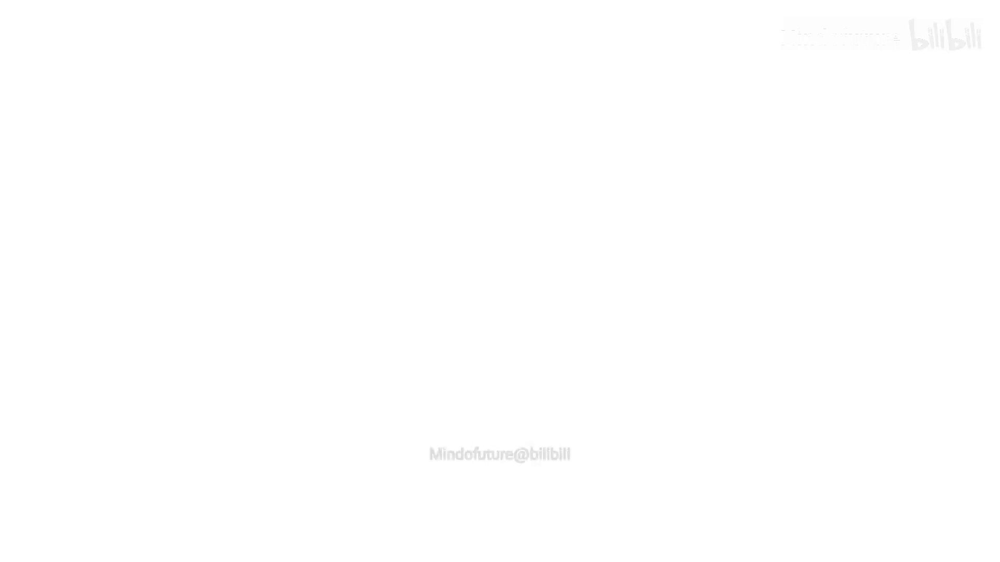
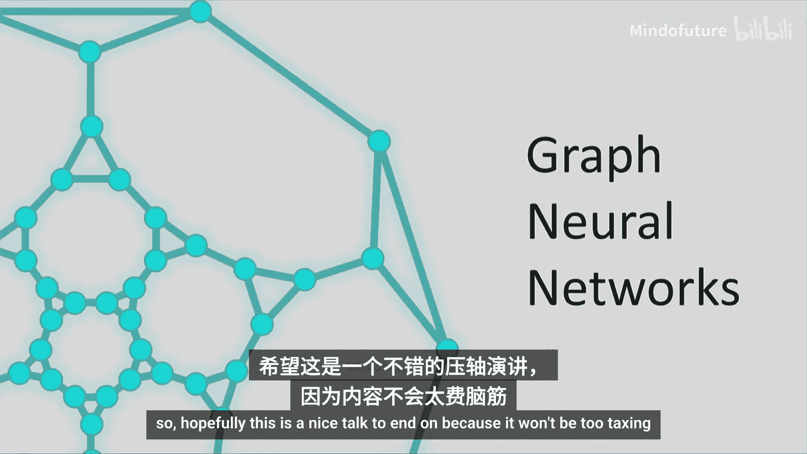
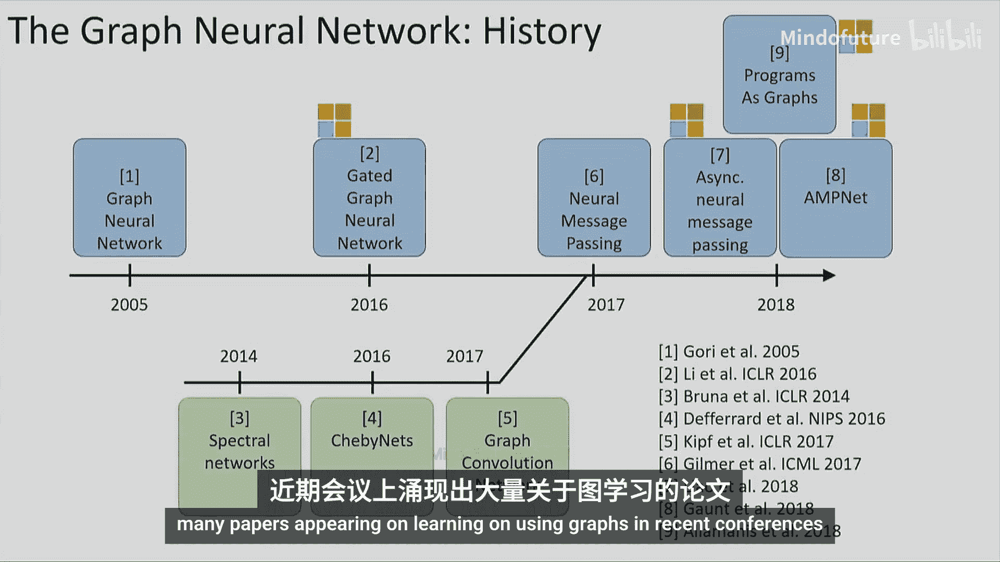
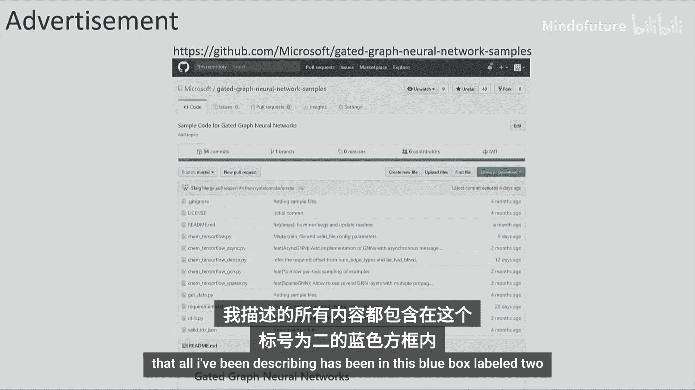
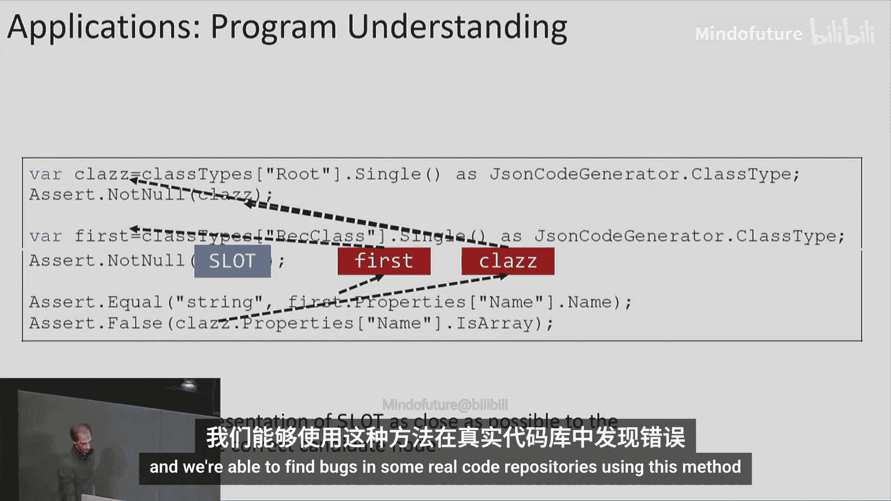
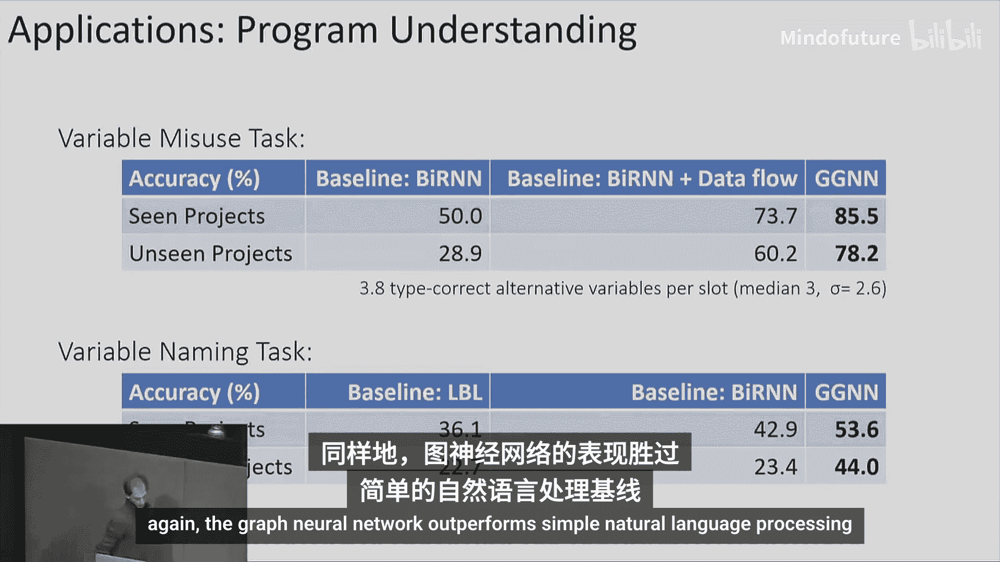
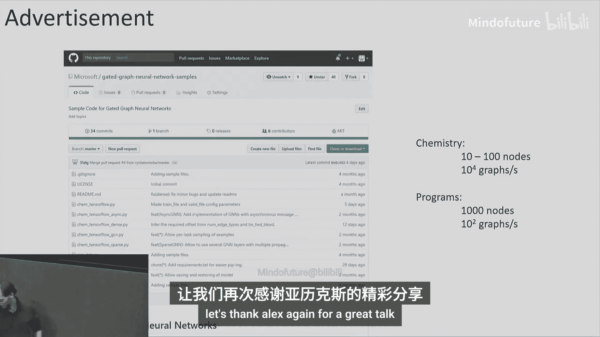

# 图表征学习讲座 ｜ Graph Representation Learning p04 P06_图神经网络-变体与应用 -BV1tQxqzYEFP_p4-

Much next speaker is Alex Gaunt， and he will be speaking about something very exciting。

 actually partially invented here in Cambridge， Graph neural networks。😊，Thanks very much。K hear we。

So， yeah， I want to talk a little bit about graph neural networks。

 And I wantna give kind of just an overview of what's been going on。

 Microsoft Cambridge has had a lot to say in graph neural networks。

 But I I just wantna give a very gentle talk introducing the idea of of the graph neural network and the history behind it and give a couple of applications。

 So hopefully this is a nice talk to end on because it won't be too taxing。😊。

嗯。So one big objective I also have is to advertise the fact that we have released very efficient implementations of graph neural networks on Github。

 So there's the link there。 And people have already So， our code is intensively。

 but people have already started to convert it to pietorch and things or your favourite framework。

 So if you want to try out some of the things I discussed to say there's this Github。

 you should get yourself over there。So what's the problem that we're interested in。

 Suppose you have a dataset set that contains many graphs。

 and each of these graphs has some sort of label。 Maybe that's a real value or a classification or something more sophisticated。

 And you want to design some sort of machine learning function that can take in a graph as an input and return you the label as the output。

So to give you a concrete example， maybe you have some molecules that' naturally represented as graphs。

 and these molecules all have some properties。 So maybe an interesting property would be how likely that molecule is a drug。

And you want to build a function that's able to take new molecules and tell you whether they are likely to be a drug or not。

How are we gonna approach this problem？ Well， the， the starting point is gonna be recurrent neural networks。

 It's a good place to start。 They're very successful。😊。

And recurrent neural networks basically operate on a very special type of graph， The chain graph。

 So if you have some text， then it's a sequence of tokens all connected to each other by these links。

And we represent chain graphs using recurrent units。 We replace each node or the recurrent unit。

 which I'll represent with triangles， and we link them together with arrows。

And then we proceed by embedding each token in our sequence。

 So there's some sort of words stored in these nodes。 and we embed them。

 and I'm gonna represent the embeddings as an envelope to sort of invoke the idea of a message。

And each。Noode gets these envelopes。 And then we do our usual thing of just running the recurrent neural network forwards。

 using some sort of recurrence relation， which given a current state and a new message gives us a new state。

So hopefully， this is all very， very familiar。 And really the。

 the purpose of this slide was to kind of introduce this kind graphical notation。嗯。

Because all we're gonna to do now is we're gonna go go to graph structured data。

 So if we start adding edges to this chain， then we get a general graph。

And the important thing about graphs is so you can represent them as a nice adjacency matrix here。

But the， there's， there's a a fundamental symmetry that graphs have that， you know。

 if you can draw them in in many different ways and they all represent the same thing。

 you can permute the ver the， the the order of the V vertices。

 and you get a different adjacency matrix， but fundamentally all of these representations on the slide represent exactly the same graph。

And so any model that we construct for analyzing graphs has to be invariant under these symmetries。

So how are we going to adapt the RN operate on graphs。So here's a graph。

 It's provocatively shaped like a molecule， but it could be any graph。And we're gonna start。

 just as we did before， by taking some features of the nodes。 So maybe this node is a carbon atom。

 and our， our feature vector is just， you know， is the atom of hydrogen， Is the atom of carbon。

 So we put a one in that slot， is the atom of fluorine whatever put zero is everywhere else。

 So we can put， put some features onto the nodes。 And we store them in the state of the nodes。

 So that's a grey envelope。😊，And then we will we do that for all the nodes。

 they all get their features。And then we associate a neural network with every edge of a specific type。

 So maybe we have single bonds represented by these green edges。

And double bombs represented by yellow edges。 But in general， you might have。

Many different edge types are like that。 Knowledge base would have different types of relationships and so on。

So that's the basic idea。 and then we're going to replace all of the nodes with the recurrent units。

These triangles。And。The message passing is going to proceed as follows。

 Imagine you zoom in on this particular node。That node will pull all of the messages from his neighbours。

And as the messages are pulled， they will go through the neural networks on the edges that they have to pass over。

And all nodes at time T will pull the messages from time T -1 from their neighbors。

 So all nodes are pulling simultaneously from the previous time step。

And once we've collected all the， all the messages， we perform a sum。

 and this sum is invariant to the order of the。Of the neighbouring messages， right。

 So you can commmute the envelopes inside that sum the the sum doesn't change。Heyification。

Neural networks are they。Somehow。Dectal。What is mean usually neural network of maps from outputlet so're supposed to think about the virtual。

The neural network simply maps a vector。 these messages as vectors。

 and it maps to to a vector of the same size。 What happens So the edges are all directed。

 And if you want an undirected edge， you can add the same backwards and then share the network on the on both edges。

Okay。嗯。Okay， so that was a single time step。 So we just pulled messages from our first order neighbors。

 And so you can think about that after this single time step。

 each node basically knows about its own information and information from nodes that are distance1 away。

And then we just repeat this over and over again。 So after the second time step。

 each node about knows about its first order and second order neighbors。 And we can just keep going。

 and we stop after a fixed number of time steps and that fixed number in。

 in our particular variety of graph neural networks， that fixed number is a hyperparameter。

 So you decide how many steps you're going to propagate So sort of the radius of。

 of your smushing around of information before you start。

Once you finish going round and around and round， you have representations stored on all the nodes that somehow have collected information from the local environment of the graph。

 And then you just collect them all up and perform a sum。 And again。

 this sum is permutation invariant， so。And then you have a representation of your graph。

 which you can feed to whatever higher layers that you want to perform your action on。

So that was a very Microsoft centric view of what the graphph neural network is。

And it summarizemars the code that's in the the Github。 but graph neural networks。

 like all good ideas， were invented a very， very long time ago。At least in deep learning standards。

And in this work。诶被。They， they， rather than we， we have this hyperparameter that says， you， you know。

 you're gonna unroll for certain number of steps In the original work。

 they said we're gonna just unroll forever， and we're just gonna keep going until you reach a fixed point。

 and then we'll stop。And you can show that if you do that， you have to。

Put some constraints on the forms of the neural networks of the recurrent units。

And those constraints mean that actually， even though you're doing all of this on rolling。

 you can own the the the influence of one node on any other node exponentially decays with the distance between the nodes。

And so it's actually not a very good way of sending message sending information around the graph。

And so this was updated at Microsoft， Cambridge， to use。Gated recurrent units and all LSTMs。

As a means of transferring longer range this information across the graph。And sort of in parallel。

The， the， the story I've， I've told you has been approaching the whole idea of graphs from starting from recurrent neural networks。

 But in parallel， people were thinking about。Convolutions on graphs。 And so theres，s it's very you。

 you can perform a convolution very efficiently in Fourier space。

 And the Fourier transform of a graph is a well definedfin operation。 And so people came up with the。

 the concept of convolutions on graphs。 And there was a series of approximations。

 performing the Fourier transformers is very computational expensive。

 So these guys just just did the co expensive computation。

 And then they made a progressive approximation to make it more and more efficient。😊，Until finally。

 some guy realized that they'd made so many approximations that actually everything was just the same thing。

 these convolutions had converged on exactly the same architecture as the， the graph neural networks。

 And there was a great paper， which was the first sort of proper application of this to some serious chemistry data。

😊，That was unifying all of these different methods。And now。You know， the field has kind of exploded。

 So I've just mentioned the Microsoft based papers here， but there are very many。

 many papers appearing on learning on using graphs in in recent conferences。

So。Yeah， just once again， flash this advert up that all。

 all that I've been describing has been in this Mobox label  too。 So。

 so that's the particular variety of model that I've been describing。

So what can we do with this？I've been mentioning chemistry every now and again。And sure enough。

 if you put these graph neural networks inside some other optimizationisation algorithm and use these graph neural networks as a scoring system。

 then you can come up with molecules that are very， very likely to be drugs。

 So theres this drug like in this scale goes from naught to one。

 and you can generate these molecules that are very。

 very likely to be drugs and have't been discovered before。We have to be careful， because。You know。

 you can come up with adversarial examples that the network is very confident of drugs， but actually。

 they are very bad and not drugs at all。So there's a lot of work left to actually use these in。

 in real this stream of deep learning to revolutionize it。The drug industry。

But it is promising that we can very easily get these very high scoring molecules。

And maybe another example that has， there'll be a talk about this particular example that I clear comes from Miltos Alammanis and Mark Brochm。

So the idea here is that。A programme is， you can see it as a list of tokens。

 Its just a stream of tokens。 And you can see the stream of tokens in grey at the bottom there。

 So for example， assertt dot not all open rackets。 But you can augment this stream of tokens with the abstract syntax tree on top of that。

 that stream and you can add other edges like， you know。

 connect positions where very variables were lost red and and written to。

And so you can build a big graph that represents programs。

 And you can ask a graph neural network to solve problems on programs。 So for example。

 if I gave you this snippet of code， and I asked you to fill in the blank。嗯。

Knowing that the possible type correct variables to put into this slot are class or first。呃。

Then it turns out that the developer who was writing this code had written class。And。

You can see that that has come about from a copy and paste problem they should really have written first。

 but they've just copy and pasted that s of code。 And so we want to use a graph neural network to。

Instead， look at those possible candidates first in class。work out a representation for the slot。

Variable。And work out the representation for the first and class variables in that graph and find which representation best matches the slot。

And the graphraph neural network will point out that in this case。

 the first variable should should be placed in the slot。

 and we were able to find bugs in some real code repositories using this method。

So just to give you some idea that， you know， graph neural networks are actually better than some other baseline。

 you can do exactly the same sort of variable misuse task using an R N to look at the surrounding context or an RN around each use of a variable。

 and you get worse performance。And similarly， rather than selecting from a set of type correct variables。

 you can use the representation of the slot to initialize an R N。

 which is going to produce you a string， which is the the a good variable name to put in that slot。

 And again， the the graph neural network outperforms simple natural language processing baselines。

So， yeah， that was kind of a whistletop tour。In 17 minutes of the area of graph neural networks。

 And if you want to dive in， then。You know， get yourself over to the the Github page。questions。

 In fact， we need to fill three minutes until hold the pizza is there。Hey。一回長会。嗯。不。はれい。

That was a while ago today。I wondered if you'd like to comment on kind of what these。

Does theoretical of results about graph icemorphism say about how？

So we've never actually tried using a G just to directly solve the grass isomorphosis problem。

And really， we've been I mean， we just built in the symmetry。

 the permutation symmetry into the model。 That was the priority。

So we haven't really thought too deeply about isomorphisms。 but what I mean。

If you have two isomorphic graphs。Then what， what would you hope。Converation is how to evaluate。

So I guess the question would be。knowAre there limitations to these methods on that basis。

 maybe the classes of grass grow weren't？So one big issue is。That we do this。 I mean。

 it's not related to isomorphism， but we do this truncated propagation。

And so if you have a cluster over here and you're propagating inside that cluster and then you have a very long。

 thin connection to another cluster， then if our propagation doesn't go far enough along this branch。

 then we won't be able to tell the difference between that graph and a graph with a slightly longer link or or anything like that。

嗯。So yeah， I mean， it's not ideal， but it's the first stab。I mean。

 it seems to work very well better than me。I think that's because natural graphs are not pathological。

In some sense。系y。So， that aggregate。Operation you do because the almosts all。The recycling。

I kind of see that as a pulling operation I was just wondering if other types of pulling would make sense Yeah。

 I mean， that's we have a hyperparameter。 some mean Max。 Yeah， Max is a bit unstable。

 but someone mean a fine and you can come up with your favorite and maybe it will do better。

Are there probabilistic version disease？Things yeah， I guess。感染なっです。诶。I mean， at the moment。

 we've done a very。実せする。Very much a clone of R&N style thingss。There's no stochastic。

Nurse inside our models of。So they would be interesting to extend that。

One last question or is everybody hungry could smell the pizza outside。Okay。

 let's thank Alex again for a great talk。

