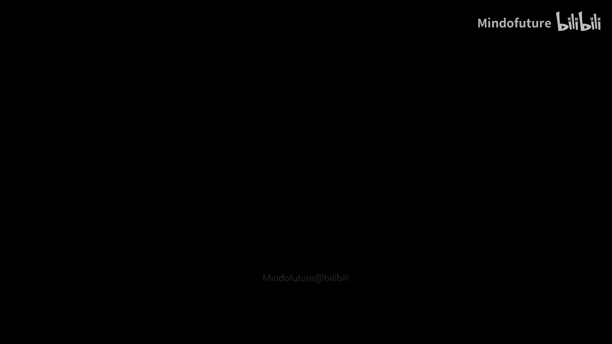

# 图表征学习讲座 ｜ Graph Representation Learning p05 P07_-IPAM2019-_Thomas_Kipf__使用图神经网络的无监督学习 -BV1tQxqzYEFP_p5-

Alright， thank you for the introduction。 So we， we had already two talks on this topic on like graph neural networks and deep learning on graphs。

 And I thought I， I make this talk as a bit of like a tutorial talk in the beginning and then dive into into one more project at the end。

 And the talk is gonna focus mostly on unsupervised methods for learning on graphs。😊。

This is in collaboration with a couple of people from University of Amsterdam。

 the Amsterdam Machine Learning lab， but also University of Toronto and University of Edinburgh。

And to start， so we know we have lots of like graph dataset sets in a while。

 but there's also another motivation for why learning with graph structure data is important because if you look at the world around you。

 there you see a lot of implicit structure in your environment。

 If you look at this image here of a traffic scene。 immediately recognize as cars。

 like different objects they have different relations between them like one car is in front of another car。

 and these kinds of entities and how they behave that dictates us or tells us how this kind of model evolves in the future。

 I can easily imagine how like the next few time steps in this image would look like。😊，Similarly。

 if you look at this picture here， you have a sports scene where everyone is fixated on this ball。

 so you have like different easily recognize different objects or different people and how they relate to each other or similarly。

 if you try to understand what is going on here as many like Lego blocks and you can think of you like how to basically put them together and you easily understand the relations between things。

 So this kind of world understanding in terms of objects and their relations a very kind of useful way of abstracting things。

😊，For learning。 Now， this doesn't end here。 So we also have like a lot of explicitly graph structure data in the wild。

 If you look around you， then as like social networks， citation networks or the worldwide web。

 it also in sciences， you have like molecules， you can represent as graphs。

 biological networks or also what's。😊，In relevantle for industries like representing knowledge and in a graph structured format where we have attributed edge types like how one person relates to another entity in an knowledge graph。

 for example， or something like roadmaps。And what got a lot of this research started is basically that when you look at these these data sets。

 you realize that in the standard deep learning toolbox like convolutional neural nets and recurrent neural nets。

 they don't really work here。 So of course， you could do like a convolutional neural net on this like map here。

 But at the same time， it doesn't really have the right inductive biases for learning very effectively like what does it mean if a car moves along a certain street and so forth。

And in this talk， I'm going to start with a little bit of background on different variants of graph neural networks。

And theirre tradeoffs， if you want to use them in practice。

 and then I'm going to focus on graph neural networks for unsupervised learning with explicitly graph structure data。

 So let's say you're given a graph and you want to learn some representations on this graph。

 And these representations or node embeddings could be useful for full prediction。

 not classification。And。Lastly， I'm going to talk about。in relation to this motivation the beginning。

 like what happens if you don't really have explicitly graph structured data。

 but you still want to use the useful inductive bias you get from these models to learn something about relations in some data。

 for example， you have sort some dynamics of some like mystery physical system and you would like to figure out how things are relating to each other or how things are interacting。

And I'm going to conclude this。So graph neural networks， the way I usually look at them is view。

Half like a model where the main idea is to pass messages along edges of a graph。

 And then these messages are basically parameterized by some neural network。

 and then you have some accloeration function， and you transform the final output again by a neural network。

 for example， and all the。Like notation I'm going to use here is basically we have a graph it's like a tu of vertices and edges and we represent nodes here by node feature vectors H and we represent edges by feature vectors HIJ。

 so that's basically all you need to know at this point。

And I've already seen in a last talk that you can basically put these models like together in like a multi layer neural net。

 you have many layers and you stack them， and each layer you have this kind of like message passing operations。

Now， to， to start as a motivation。For why this like message passing paradigm may make sense and how it relates to things you might already know。

 if you look at convolutional neural nets on grids or like on images。

 then you can also see them as a message passing operation so usually if you look at CNNs you see them as like sliding a filter over an image and you take the in a product of this filter of the filter weights with the image but equivalently you can represent the same kind of system as you have each pixel is like a node in this kind of grid graph here。

 and in order to update the representation of this like middle node here in the next layer you pass messages from all the neighboring nodes and you can give all these node a name here and this could be these notes。

 it could be like RTB values at a certain pixel or like hidden layer activations at a later layer and。

Then the whole convolutional update basically looks like this。

 You have transformations or you have messages， which are basically the feature vectors at the neighboring nodes。

 and you take a linear transformation of these feature vectors。

 and then in the end you add everything up and the special thing here is that for each different neighbor relation like you have an upper left neighboring up an upper right neighbor for each of these relations with a different weight matrix。

 So you have now here going from W0 to W8 and each of these basically is specific to the relation in in the image。

Now it it's not hard to see how this could be generalized to say undirected graphs。

 So if you have some kind of graph with like a kind of a richer structure where you don't no longer have like this this nice symmetric grid structure。

 and so one one model class that I know here referred to as graph convolutional networks this is related to earlier work on graph neural networks which has quite a long history these days。

 but essentially the model here looks as follows。 So you would like to learn a model basically on this undirected graph here。

 and you want to。Update for this node in red， you want to calculate the update for the feature vector the next layer。

 basically。And again， you can solve this by a message passing function。 And if you。

 if you look back at like what a convolutional neuralne images would do。 So the。

 the easy way of like generalizing this would basically be to。

Not assume anything about the neighbors， Basically say every neighbor is has the same relation to to the node。

 Basically it could be the relation could be a friendship relation on Facebook。

 And then you would assign the same like linear transformation。

 the same meaning to each neighboring edge。 And in this case。

 all all the model would do is basically have like kind of this diffusion or aggregation operation here over these neighbors。

 So here these are all the neighboring feature vectors。

 you transform them all of the same weight matrix。 And then。

You normalize the sum because if you don't normalize it very often。

 these things blow up for very large graphs。 if you have very many neighbors。

 and gradient in descent is not is not scale invariant。

 so you really care about the scale of these activations。嗯。And yeah。

 the only thing that you can really discern is like first order neighbor versus like a self connection that has kind of a different relation。

 So you can assign it a different weight matrix， or you cannot。

 So you can also put them in the same kind of relation type。

And this type of model now has weight sharing over all locations。 So basically this。

 these weight matrices or this update rule is applied in parallel of the whole graph。

And it has linear complexity。 like you only need to touch every single edge basically once in the graph for its update or once per direction and。

You can also apply the same message update rule in an inductive setting because of weight sharing。

 you can basically train to someone part of the graph and apply this once it's trained on like an unseen part of the graph。

 for example。The only problem is that it doesn't really consider any pairwise interaction。

 so it really looks at neighbors in isolation and it pulls the update in and then it updates the node itself。

 so it doesnt really it cannot really be sensitive to something like like physical dynamics where you have forces that depend on the distance between two nodes。

 for example， like inverse forces so this is a limitation of this model and it also doesn't have any support for edge features like if you had different feature representations for edges like edge types or some richer information。

 this model would not directly support it。And then at the same time。

 what I forgot to say is we have this activation function here。 And， of course， this can be anything。

 This can be like a pointless activation function。 It can also be an MLP。Itself， so you can。

 you can basically flexibly choose what you what you put here。And now， if you。

Once to make this model more expressive， there are certain extensions of this basic framework。

 So essentially they， they most， mostly follow this， this type of rule here。 So essentially。

 this is inspired by how like a convolutional neural network work on images you basically take each neighbor now has a particular relation。

 for example， and then。😊，You transform each neighbor if you have some particular relation type for each neighbor。

 you transform each neighbor according to this relation type。

 and then you also sum over all the relations in the end。

 And this is something that basically fits in the framework also called Moned or something we've done on what we call relational GCNs for for knowledge graphs when then the edge type dictates basically this relational matrix。

And an extension of this framework is basically to not fix this normalization constant so so far I haven't really talked much about this normalization constant。

 usually in the early works it would basically just say the normalization constant。

 something like one over the number of neighbors or something that depends on the number of neighbors。

 but you can also。Choose this normalization constant here basically based on the features of the neighbors。

 So you don't have to necessarily take the note degree， but you can also choose。

 just choose the activation of the neighboring neighboring feature vectors。

 And that's basically what is the basis of selfat models or transformers and NLP。

 But also it has also been basically this model has been applied to graphs in this paper called graph attention networks。

 And here， most of the papers follow this roughly follow this kind of rule that they basically take neighboring features of both notes。

 and they do a biin your product and then a soft marks。

 And this gives them like a learned adjacency matrix。 in a way。And if you apply this to NLP。

 then these relation types like this graph that the model learns can discover things like semantic relations to some degree。

And。Lastly， a third type of models that has been around for some time now that people are using in practice and in many of these deepenial graph tasks is graph neural nets that have explicit edge and embeddings。

 So this is often not known as neural message passing because of this paper here in 2017。

But an earlier version already has been has been published in Nps 2016。 And essentially。

 the main idea here is that you take。Pairwise into actions into account。

 So instead of taking like transforming each neighbor individually and then summing them up。

 you take a pair of neighbors you calculate a representation for this pair。

 an FE here would just be an MLP or neural network， a small neural network。

 then you get like high dimensional representations for the edges。

 So basically have like a node to edge space update。

 And then once you're in edge space and have these edge features。

 you can move back into node space by summing over all the say incoming edge features for a particular node and pass them for another MP。

And。This type of model now has so these types of model are very powerful in practice。

 they have explicitly support explicit support for edge features。

 they are very flexible and like you can basically choose any kind of model here so you have a very flexible and expressive parameterization if you choose so and you can still support spa matrix operation so you can still implement this efficiency efficiently with spa matrix multiplication or with Skega operations on GPU。

And。The problem with these models is that you need to store intermediate edge space activation。

 So for each edge in your graph， you would have to store really high dimensionional activation vector for backpro later。

 and this can be very memory intense。 So let's say you have a million edges。

 and for each edge you have to store like 256 dimensional vector that can be very expensive And in practice because in edge space calculating these activations it's also much more expensive。

 So it's significantly slower than these models that operates solely in like the node space like GNs。

Now， if you now want to use any of these models for say supervised semiupvised learning on graphs。

 then you can basically follow a very simple recipe and this would basically look as follows so you have a graph as an input you have node features for each each node which you would summarize here in this H matrix。

And then after a couple of these updates at the end， youre you basically so the graph stays the same。

 And at the end， you would basically get for every single node。

 you would get an output feature vector。And then you can put these output features into an node classifier。

 So you just basically put a put a softmax function on top a Somax classifier on top and train the whole thing end to end。

 This is something we've done in in a paper called semisupervised classification with graph convolutional networks a few years ago。

 And similarly， you can do the same kind of protocol， but use it for graph classification。

 but then you need to do some kind of aggregation operation。

 So the the naifs one is to just take like some pooling over the whole graph。

 but you can also do like things like tenttive pooling or。

Average pooling and then have like a softm classifier on the graph level。嗯。And lastly。

 you can also take exactly the same model and use it for link prediction。

 So you basically would use your final note features。 And then you。

 in order for basically having a link classifier， you have to compare。2 node embeddings。

 where you have to have basically define a function that takes two node embeddings an as an input。

 And one of the simplest one is basically just taken in a product。 But it can also。

 if you want to do directed edges， you can do an MLP here or any kind of more complicated function。

 And in this simple case is it looks like an order encoder because you start with like an adjacency matrix and the feature matrix。

 And then you try to reconstruct the adjacency matrix at the output。 So that's a framework。

It's also known as graph auto encoders。And so this is kind of just a very quick overview of how you would do supervise or semi supervised learning in kind of a simplest case with these models。

 of course， there are many extensions that you could come up with and now。Like the last point。

 like graphph Al encodes already gives you kind of an idea of how you could use these models for unsupervised learning if you really only care about learning node representations。

 but you don't really know what the downstream task would be like if you want to do later link classification or node classification and so here what I mean here is basically the objective in this part of the talk will be to learn node embeddings for certain downstream tasks。

And。Most recently published approaches here follow like this kind of modular framework and in the end you have sort of a contrastive learning approach。

 So how this would look like is you start with some kind of graph。

 then you would encode like node in this graph according to either an MLP that only looks at the node itself or you have some kind of patching code and it looks at the neighborhood you embed it into some kind of space So this representation here you can choose freely。

 it could be just Euclidean space， you can embed things on a hypersphere and a hyperbolic space or you can represent things thats Gaussian distributions as point cloud。

 So basically it's only up to your imagination， what you put here and then later you have to score。嗯。

Things you have to score pairs in this embedding space。

 pairs basically should be scored as positive if they're connected in the original graph and is negative。

 if they're not connected。 and the negative component here would basically be sampling。

 So you would you would sample some negatives because it usually have like many more negatives and positives。

 So you would have like a sampling component here that samples some some negative examples and then score your positives。

 you score negatives and then feed into some kind of loss function。 And and all of these components。

 basically， you can， you can freely choose。 And there are many。

 many published like frameworks that use certain combination of these， basically。

 So for the sampling strategy， you can， for example， take。

A positive sample would be just a direct neighbor in the graph。

 A negative sample would be a random node。Or for a different encoder variants。

 you can use a graph convolution network or something with attention or an MLP。

 or you can use a lookup table if you don't have any node features。

 like basically an embedding feature。In terms of node representations， you can。

 you can change out the geometry of the latent space， or you can use distributional embedding。

 You can embed things。Like Gausian distributions or point clouds。

 And you have a lot of like flexibility in also choosing the score functions like there's basically whole literature on these like energy based or contrastive learning score functions and you couldn't choose any of these basically。

And lastly， with many of these， then you last have the choice of a loss function and here most people use cross entropy losses or hinge losses。

 but there's also other energy based losses that are very powerful in this case like square exponential losses。

 that's a question here。When I think about our supervised learning。

 I think of things such as classroom spring or dimensionary reduction。And so it wasn't clear to do。

And again how these proposals would support traditional advanced revised learning tasks。

So this is related to things like spectral clustering on graphs if you would take just a lookup table here and you would take positive sampling and negative sampling just based on neighbors and random nodes then this would be like a sampled version of spectral clustering in this case so it relates to established methods but for scalability you might want to use something like sampling here So in the end it's basically a more scalable framework of more traditional methods like in traditional methods you would maybe do for spectral clustering you would actually calculate the eigenvectors and for very large graphses can be quite expensive you would want to get like not just a few leading eigenvectors So that's just an alternative way of looking at these types of models。

 but a very good question。And so these a simple table。

 well kind of maybe a bit of an overwhelming table of some examples in the literature that fit into this framework。

 and I don't want to go over all of these， but maybe just out pick out a few of them。

 so this is graph auto encoder framework where as an encode you would use a graph convolution that and you would embed things in Euclidean space and then the score function would just be。

A do parallel between between two embeddings， the loss of be binary cross entropy between the positive and the negative score。

 and you have the simple sampling strategy。Then a recent method called DJI looks very similar。

 it basically has almost everything the same apart from this score function here where they don't score two nodes with each other。

 but they basically score a node embedding against a global summary where they basically pool old and node embeddings and the sampling is now done by having the positive samples are basically given by the original graph and the negative samples are given by a randomly corrupted graph。

And。Similarly， you have a method here， graph to Gause that basically uses an MLP encoder and then embeds things as Gaussian distributions and a score function is now based on the KL averages。

 which defines like an energy and then the user an energy based function。 But in the end， you could。

 you could switch all parts of these frameworks and then compare them against each other。

 And that's something。We we've done。 it's not published yet， but we have some early takeaways。

Essential what we found is that graph based encoders do very often improve performance。 like if you。

 if you use an MLLP versus if you use local patches to encode nodes into this space。

 then very often sort of a patch encoder wins against。Simply MLlP encoders。And also。

 neighborhood based scoring is very effective for link prediction， especially。

 but you can also use it for node classification。 I can also embed nodes based on this simple link prediction objective for using these node embeddings for downstreamcast like node classification。

And another method like this this deep draft infoax paper， they do local global scoring。

 and their method is especially effective for node classification。

 but the embeddings you learn there are not very useful for link prediction directly， for example。

And lastly。The ideal representation here is a very highly data dependent。

 So there is basically no clear winner across data sets。

 If you take multiple different data sets and for some data sets like hyperbolic embedding spin。

 for other data sets， Hyspherical embedding spin for other data sets。

 you might just use a euclide an embedding in that。 that's the best representation。

And we're going to soon release a library that is developed by Daniel Dsa。

 it's a master student I'm currently supervising， and he's basically put all of these components together and has a nice benchmark suite where he can basically run all of these methods of an automatic hyper pararaid optimize and just see like how different choices compare。

And this is going to be released， hopefully not quite soon。Right。

 so that basically concludes the part on unsupervised learning of explicitly graph structured data。

 And I want to just briefly mention a few other applications of graph neural net。

 So you can also use this paradigm of like auto encoding a graph for link prediction for recommend systems because recommender systems。

 you can also see them as bypartite graphs and we had a paper essentially to start take this auto encoding approach to recommend links and this can also be extended to very large data sets as paradigm if you if you use a sampling encoder as a paperical graph stage that basically subsamples neighbors in like this GN framework and that can basically lead to very large。

That can basically help you apply this data this method to very large data sets。And similarly。

 it doesn't。 since the model doesn't really care too much about what kind of data you apply this to。

 you can also use this for knowledge based completion。

 where you can use the same paradigm for link prediction， knowledge basis。嗯。

Or you can use these methods as what we've seen in an earlier talk for semivised learning。

Now to go to the second part of my talk。One recent application I want to highlight for a graph neural nets is it's going a bit beyond beyond like explicitly graph structured data。

 you can also use these methods for problems where you say have an image and you would like to ask certain questions about an image you would like to understand what's going on in image。

 And in this case， if you're given what like the notes in the graph are then for example。

 to answer these questions question are all these animals of the same color。

 you would have to basically first identify all the sheep and then compare each like the color of each animal basically to come up with the final answer。

 And this kind of graph structured representation is also very useful here is sort of an implicit inductive bias to solve these problems。

And so in the second part of my talk in the last few minutes。

 I want to talk about how to model implicit structure with graph neural networks and especially a framework we call neural relation inference where we try to discover certain interaction types and graphs。

And a motivation here is that let's say we're given some kind of mystical physical system like this one on the left here。

 and you would like to understand the dynamics of what's going on here。

And looking at this might look a bit confusing， but if you highlight the connections between these particles。

 they're connected by say invisible springs and this givess the rise of these interactions。

If rise with the dynamics， then you can better understand what's going on。

 but our goal is basically to look at the system on the left without revealing what are the actual hidden dynamics between or hidden interactions between the systems and try to model this of a graph net。

And if you try to build a model for this type of data， then classically in machine。

 if you look at a machine learning toolbox， what it would do is basically you take all the particles in this case and the trajectories。

 you would encode them as some kind of feature vectors。

 you would concatenate all these feature vectors and then feed them into some MLP or some RN if you come to model the dynamics。

And surprisingly this already works quite well。 but then the problem is once you。

 let's say you train this model on five particles and now you get suddenly get a sixth particle in the box and you would would still like to be able to predict because the dynamics probably haven't changed too much。

 but your model is only basically applicable to this particular setting because。

They don't really do any parameter sharing。So this is kind of a big problem。And。

Another problem is that the nodes are basically completely arbitrarily ordered if you would like to use something like an MLP。

 so you need something like permutation invaris in this case so that you can basically permute the order of the nodes and still be able to predict。

And the model also doesn't really know about the structure of the interaction many。Physical systems。

 but as a re systems you have。Interactions that are pairwise。

 so it's a good abstraction to just look at pairwise interactions and in these cases graph neural networks an ideal can because they fulfill exactly these points so they are invariant or even equivariant permutations in your representation and also they consider explicitly pairwise interactions。

And this has basically led to this development of these interaction networks。

 which was later extended through neural message passing for a physical system in a paper by Peter Battalia。

嗯。And here we know that using graph neural networks。

 we can model interacting systems of a very high precision if we know about the underlying structure of the interactions and their types。

 So basically， if we inform the model that these all these particles in the string are connected。

 then this type of model can do really well， but。We looked at this and thought like， okay。

 what can you do if you don't know these interactions up priori。

 can you basically build a model that has like a two step training phase one where it tries to discover what are the actual interactions between like products in your data and then predict the future dynamics given this interaction graph that it discovered。

AndThat's a paper we had at IML last year with Ethan Fataya。

 who was an equalco contributor on this project and several people from University of Toronto。

Here as I mentioned before， so the idea is basically you would like to learn the dynamics of an interacting system without knowing the structure of these relations and you would like to infer as latent interaction graph plus maybe even edge types using some kind of auto and code framework and so we applied this model also for interacting systems motion capture data and multi-age systems that's very flexible the only thing you need is basically fit these assumptions that your data is consistent of multiple objects and you have pairwise interactions。

And how the model works is basically again， an auto encoder uses graph neural nets but now turned inside out is it essentially so it's exactly the other way around that the model from earlier from the earlier project works。

 So here now you essentially have a proposal model that。

Runs a graph neural network on the initial fully connected graph and you don't know anything about how things are interacting。

 and it proposes an interaction graph。 So basically you have a model that tries to predict how things are connected or tries to predict the graph from some non graphra structure data。

And so the graph here is represented by this latent variable Baette。

 and you essentially tried to build this variation posterior here。

 kosat given x and x your dynamics data。And then in a decoding step。

 you essentially run a graph neural network that is now constrained to send messages on this graph。

 so it cannot send any messages along edges where there was no edge predicted for example。

 or it can only send messages along edges that belong to the certain edge type that the graph neural network is particularly operating on。

And then it has to reconstruct the dynamics。So with this auto encodeder framework。

 we can formulate this as a variational autoencoder。

 which basically if you're not familiar with this just means we have a reconstruction objective that tries to encourage the model to reconstruct the original dynamics or predict future dynamics and we have part of the objective should regularize whatever the the latent graph here looks like so basically if you already know the graph should be very sparse you can put a prior on that that says okay we want to have a sparse graph and then this term here would basically tell the model to only predict sparse graph so in this case is the fully connected graph yeah so we have we started with some proposal here。

 this proposal can be fully connected， it can be nearest neighbor graph but you have to start with some kind of proposal here the late。

only on the opposite edges。 Yeah， so the latent graph essentially。

 it follows this kind of proposal mask here。 So if the proposal here is fully connected。

 then the latent graph predicts for each edge in this fully connected graph predicts like an output。

 like whether this edge should actually be there or not。Yeah， that's a very good question。

So just for a few more minutes， I want to go into details and how this model works and practice。

 So the encode part you would now if you don't know anything about the interaction structure。

 which is okay everything is interacting and you run like a graph neural net on this fully connected graph here So first you would like to embed the observation that you have which is like multiple time steps of dynamics for example。

 and this embedding module can be a CNNN it can be an RN this can be anything that embeds like。

A certain trajectory of a particlean。And in practice。

 we use like a CNNN with some self attentive pooling here。

And then essentially you have like node embeddings which represent the trajectory of a single particle in isolation and then you would essentially like to do some message passing on this graph so every single node embedding in the end nodes about all the other trajectories and how they all influence each other so we first go to edge space by basically concatenating node features feeding through an edge update function and then we move back into node space to inform all the nodes basically about their neighbors and。

Lastly， because you want to make edge predictions here for this graph。

 you move back into edge space and have a final output here。

And just as a reminder so these update functions look like this。

 you have like if you want this node update， here， you have all these edge updates that you calculated before。

 and then you just sum them up on the incoming node here。And in the end。

 we care about this latent interaction graph so we can basically parameterize that as a binary adjacency tensor if we have multiple edge types。

 this would be like an n by n where n is a number of nodes by k tensor and then we can index here is Z IJ would be the edge type on a particular edge and this can be a 100 vector if you have multiple edge types so the distribution we can choose here is basically a categorical distribution that gives us a particular。

Edge type as an output， and it's just parameterized by a soft max of this edge output here。

Now at training time since this is all discrete and we have basically a discrete distribution so we could use an EM algorithm to solve this。

 but we can also on the contrary we can basically just relax this discrete distribution and a soft distribution using what is called a concrete distribution of gum softmx distribution and that's a very simple re parameterization essentially what's happening is now we just say this latent variablet here is given by a soft marks of the edge embedding plus some noise。

 so G is。It's noise from a gomal distribution and a tower is some kind of temperature that basically tells you how much how good the approximation should be。

 if tower is very low， if the temperature is very low， you get closer to discrete distribution。

 if it's very high， you get closer like a uniform， kind of very soft distribution。

And then you can just get gradients for this whole thing by repair precision trick。 Basically。

 this just means you can just implement this in your in Pyth， for example。

 And the gradients will just directly flow through the soft mass function here。

 And the noise and the sampling procedure is all happening in this non parameterameterized gum distribution。

And then we can put a prior also on these edges。 and we explore a couple of different priors。

 and essentially， we ended up with either choosing a uniform distribution if we don't know much about how the。

Edge types should look like， or we can also use a sparsity inducing prior。

 if we just say that if whenever the model predicts the the first edge type。

 then this means that there is no edge between two nodes。

 So you can hard code one edge type is no interaction。

 and then you can put a large weight on the prior on this like no interaction edge。

 and then essentially you get a sparsity inducing prior。And then once you have this latent graph。

 then all we need now is basically decode the dynamics back from this latent graph。 And essentially。

 what we want to do here is we run a graph neural network on this latent graph that has to do some message passing。

 and of course， the the dynamics have to be conditioned on some initial conditions。

 So basically we start by feeding in the initial conditions。

 and then the graph here is given by this adjacency tensor。 and。For each edge types。

 what we found is very important for each edge type， we have a separate message function。

 And then you can basically just run this model here。

 This basically passing messages from nodes to edges。

 And then you go back from edge space to node space。

And here we use what looks like a residualital connection。 But the idea here is basically that we。

Predict the location difference instead of predicting the location itself。 So basically。

 it gives us like， it's easy to predict the location differences because it's independent of the coordinate system。

And lastly， because the predictive model we would like to predict a distribution instead of just a single point estimate。

 So here we choose a fixed variance， but of course。

 you can also think about modeling this is some kind of parameterized distributions which you like to learn the parameters of it doesn't have to be Gausian。

We explore a number of decoder variants， I'm not going to go into much detail here。

 but you can think of like also having a recurrent decoder that predicts multiple time stepss。

 you can also because a decoder directly corresponds to the same structure as a typical physics simulator you can actually just swap out the graph neural network with a physics simulator and back propagate through the physics simulator to train the encodeder so that's something also we've done in experiments or you can take a true graphs and fully connected graphs or you can also reestimate this graph over multiple time stepss。

And we tested this model on a number of sort of toy physical systems so we really know the ground truth interaction structure where we have to full control over what's going on and where forces are getting more and more complex。

 So first we start with linear forces that basically only depend on a difference between node embeddings and we just wanted to see if the graph neural net can learn these And because we have these flexible edge update functions MLP basically can very easily learn this like functional form then we also use inverse square law forces with charged particle system is a bit more difficult to learn for an MLP。

 And then we also looked at more complicated sinusoiddial interactions。

 and we also found that these are actually quite easy for the model to learn and then we applied the same model as for like some real world data like NBA data which we got from laterronterors and motion capture data。

And the only table I'm going to show here now is basically that this model does。

 if you apply this an unsupervised way on these data sets。

 then can without any supervision on the ground truth labels。

 it can discover the interaction structure like basically we just sample random connections like basically in the spring system here we would sample springs at random so two node are connected at random and then we run the simulation。

 we run our model on it and we just see whether it has a right latent graph structure that it discovered and we compare this with the ground truth later and we found that basically with very high accuracy can discover。

These latent graphs， and even if we have a simulation based decoder for some。And。

We can also the interesting thing is that it learns both this interaction structure and the dynamics at the same time。

 So if you look at the predictions of the dynamics。

 there's some interesting failure cases like this one up here where the prediction this blue particle here moves down and moves away from the other particles when the ground truth case。

 the blue particle moves up and it seems like the model here is sampled the wrong interaction type。

 but according to this wrong interaction type， it is a very reasonable kind of dynamics prediction。

So to conclude， I think just to summarize the graph neural network field in a few sentences。

I think Graph neural networks recently have really come out as a model。

' a very powerful class of model models for data with explicit or even implicit relational or graph structure。

 And I think in the last three years or so there has been massive growth in this research field and it it's even so massive that when I started my PhD。

 but there were like six papers in this in this like domain like three years ago。

 And by now at the last some objectives like over 1000 papers。

 So there has been massive growth in the last three years， which is very exciting。

 but it's also dangerous in terms of many， many results are basically reinventing things that are happening in parallel。

 So we have to be also careful in terms of benchmarks and these kinds of things。😊。

And I think what's important is to more systematically explore like the benefits of certain variants。

 model variants and basically also better benchmark data sets and like one big limitation that we had now in this paper here that we always assume we have some kind of structure already given like either we've given the complete graph。

 we have everything given like many graph data sets or here we're basically in thes simulationimil data sets we're given what the nodes are but we're not given what the edges are but the ultimate holy gray is kind of we're just given an image like this and we would discover everything from scratch like what is the node。

 what is an edge and discover like both the objects and the relation structure from raw data。

And it doesn't stop with like relational learning or relational inductive bias。

 I think in order to make better improvements in terms of generalization in machine learning。

 I think we also should look more into things like hierarchy or compositionality and how we can build this in into neural network based models。

And if you're interested， I have a few more references here， also there's a lot of code on GitHub。

 we published all the code from all these papers and a few blog posts so and lastly I want to thank my collaborators and I think we have a few minutes for questions thank you。

