# 图表征学习讲座 ｜ Graph Representation Learning p07 P10_图神经网络的理论基础 -BV1tQxqzYEFP_p7-

Good afternoon。It' is a pleasure for me to welcome Dr。 Per Veikovvi。

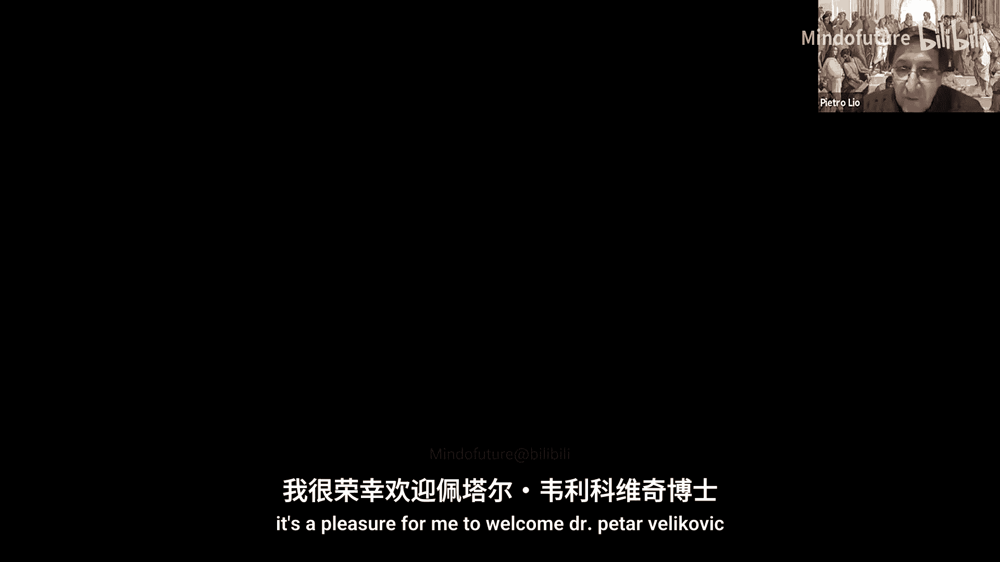

Who is going to deliver a to kind theoretical foundation of graph neural networks。Better started in。

2012 as undergraduate at the computer laboratory。I remember I received an mail around May 2014。

 and he was asking for a Part two project in bioformatics。When VPHD。And his， his examiner was。

Youre a lesskoic。And immediately after submission of it he started with Deep mind。

 he's now a senior research scientist。Ptter is always audience400 people。爱尔海。Going to listen to you。

Thank you very much Piro for the fine introduction and thank you so much for showing up in such big numbers I'm truly humbled and I see so many people I know so it's really a pleasure and honor to be back to the computer lab even if it's virtual and to talk to you all about one of the topics that I've been most passionate about over the past few years and as I've grown to understand the field more and more I've also sort of tried to improve the way I present the whole field so I hope that you will find today's exposition interesting regardless of whether you're a seasoned GNN practitioner or someone who's just getting started with the area of graph representation learning So in this talk we will be covering neural networks that operate over graph structure data or they are more popularly known as graph neural networks or GNNs for short First。

 if you haven't come across the area before I would like to give you a little bit of an overview on why why might it be a good idea to study them by giving you an example of just a few fantastic graph neural nets you can find in the wild now。

😊。

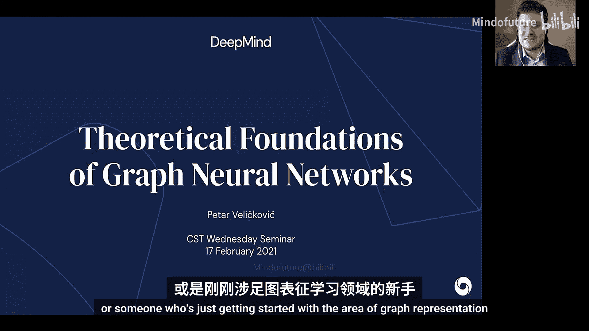

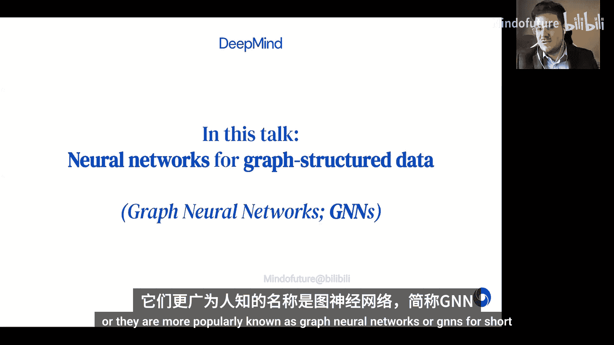

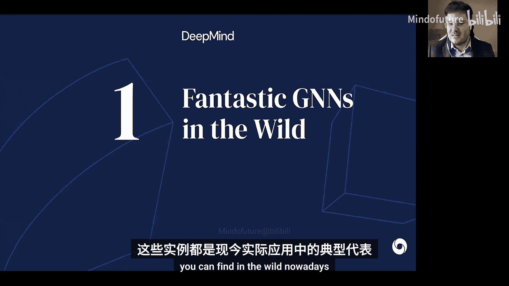

です。The first and perhaps the most direct example I like to give is the case of molecular data processing so you might fairly obviously see that molecules can be naturally represented as graphs you can look at here the molecule for paracetamol and look at the different atoms of the molecule as nodes and the molecular bonds is edges connecting them and then you can meaningfully attached some features to both the atoms and the bonds such as the atom type the charge the bonds type are we located in a ring or not and so on and so forth so once you featureize the molecule in this way one very interesting question you can ask a machine learning system is is this molecule going to be a potent drug and one particular way in which you can pose that question is a binary classification problem so taking a representation of a molecule as you have it you can ask a G will this molecule inhibit a certain bacterium for example is Shaia coli and then once you have set up a task like that with a training data set of。

Mles with known responses to E coli， you can train a graph classification system using a GNN to predict whether or not this bacteria is inhibited。

Now one thing that's really cool about this is that once you've trained the system like that。

 you can meaningfully apply it to any molecule， even the ones you haven't seen in your training data so you can now execute your system on a large data set of known possible drug candidates and your model will give you some probabilities that those previously unseen drugs are going to inhibit E coli you can select the top 100 candidates and then shift them to chemists and have them thoroughly investigated and it just might happen that in these top 100 candidates lies a highly potent antibiotic that was previously overlooked by researchers in the area here I've shown you one such example of a compound that was discovered in this way which is Heison and of course this is a very important discovery of using graph representation learning to detect antibiotics so you obviously published it in a high impact journal but then afterwards this basically kicks up a bit of avalanche in the press so it gets reshared by nature afterwards gets reported on by the。

Times by the BBC and so on， if you've seen at roughly the start of last year。

 all of these titles like scientists discover powerful antibiotic using AI。

 you can now know that actually underneath all that AI at the core is basically a graphph neural network so this is still to this day probably the most popularized application of graphraph neural networks。

😊，Now for a completely different example， which is much closer to what I've been involved in lately。

 you can represent transportation networks like the ones you see on Google Maps naturally as graphs。

 you can look at different nodes intersections and edges as the roads connecting them and you can put various interesting node features like the lengths and speeds onto these inputs。

And within deep mind， we have a very successful collaboration with Google Maps where we deployed a graphraph neural network on road networks constructed in this way to predict what's the current estimated time of arrival。

 which is obviously a very important problem in transportation modeling especially for a service like Google Maps and what's very interesting and as a success story of GNs we've already deployed the system in several major cities around the world。

 you can see the picture on the right explaining some of these cities and in some of them such as Sydney we have reduced the percentage of negative system predictions by over 40% so this is also one example how graphraph neural networks in graph representation learning are affecting basically billions of users every day if you're in any of the major cities around the world and you ask for the shortest path from point A to point B in Google Maps。

 it's very likely that your query will be passed through our implemented Graph neural network。

And generally， they're a very hot research topic even outside of the realm of applications。

 Graph neural networks are regularly among the top and fastest growing keywords for the major machine learning conferences and also graph representation learning workshops are regularly the most attended one at conferences like Ns。

 so GNs can be seen as currently experiencing their imagenet moment and it's generally a very good point in time to start studying them。

And besides that， you have a rich ecosystem of libraries if you want to get started with implementations。

 regardless of whether you use Pytororch， Tensorflowlow or JX。

 there is a library that can be found to suit your needs。

 this talk will be recorded and released so you can check out the links afterwards。

 but rather than just libraries， there are also a wealth of useful data sets that you can use to validate your models such as the OpenGraph benchmark TU data and the dataset sets and benchmarking graphraph neural networks。

So hopefully now I've given you a convincing argument for why it's useful to study GNNs if you'd like to see a bit more of these bleeding edge applications I've given a much longer talk on this at EML 2020 which is available on YouTube and you can check it out what I want to do today is to give you good blueprints in context if you want to study the field further so I'm first going to drive GNs from first principles and then position that in the context of several independently studied directions that ended up driving essentially the same idea so hopefully this is a perspective it will be useful both the newcomers that are looking for a good survey of related work and implementations to check out and also season Graph neural network practitioners who might benefit from this particular perspective and way of looking at it Of course I welcome any and all feedback so please let me know during or after the talk how you liked it。

😊，The content is based on my current collaboration with John Bruna。

 Michael Braunstein and Taco Cohen on categorizing geometric deep learning。

 and you can see various contexts that I'm going to present here within chapterpter7 of Will Hamilton's excellent graph representation learning textbook。

 I also put some thought into the historical context behind everything here and I would like to thank the researchers outlined here for at various times presenting me with useful insights that I placed within this talk。

 but of course any errors and os made are mineone and please let me know if there's anything that I have misrepresented during this talk。

Finally， before we get into everything the talk content here is geared to a general computer science audience we'll just build useful functions that work over graphs and we will use concepts that you can commonly see in a computer science curriculum if you actually want to get started with implementing any of these models it will require a bit of background in machine learning with deep neural nets and you can use the great deep learning book to get started in the area by goodfe Benger and Corll I recently put up a Twitter thread which lists many useful graphra neural network resources and when you feel ready to start implementing Alex Agordch's recently put out a very influential GitHub repository that presents our graph attention network model from the ground up and it might opinion it's probably the most gentle way to get started with the implementations with all that out of the way let's get started and let's try to drive GNNs from the first principles so we will see how we can define useful functions that operate over graphs and basically we're going to study what are the properties that are useful for a function to operate meaningfully over graphs。

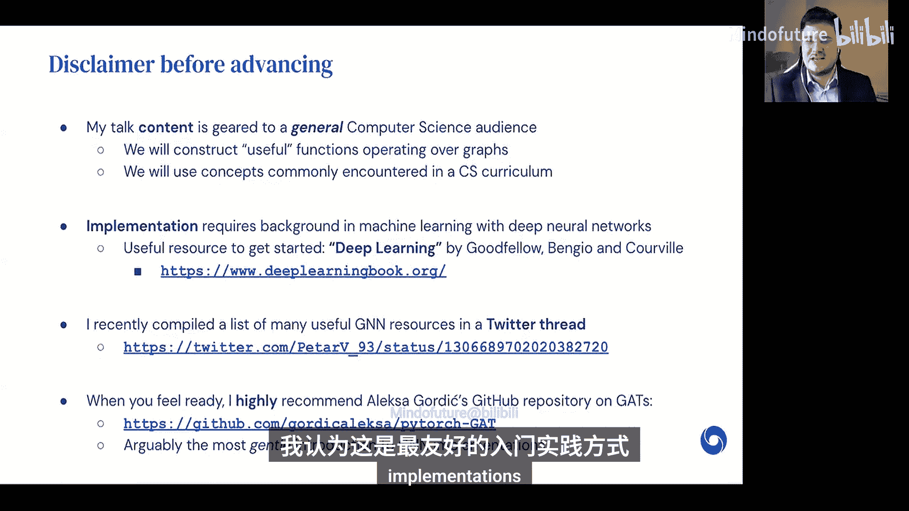

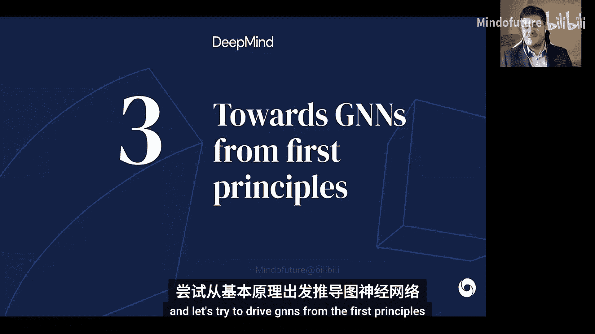

Specifically， what are the symmetries and invariances that a graph neural network should ideally preserve and to kind of jump into the study I'm going to revisit a known example that you've seen if you've done any kind of image processing is this idea of an image convolution and here have provided a brief animation of how it works you have this small kernel matrix K which is slid across an image and locally captures patterns of interest around the image。

So what this kind of model encodes is this concept of translation and variance。

 it means that a pattern is interesting no matter where I find it in the image。

 that's why I slide the matrix across everywhere， also it encodes an assumption of locality pixels that are close to each other are probably going to be far more strongly related than pixels that are far away in the image so these concepts are very useful for images what might be the case for graphs。

And in the case of graphs， you might look at them for a little bit and realize that if you don't assume any particular geometry to them。

 then the nodes of a graph are assumed to be not given in any order。

 and that means if I give you two graphs that are completely isomorphic here given two examples of if you look at them you will see that they're actually the same graph。

 we would want our graph neural network to give us exactly the same result for those two graphs and what we're going to do now is see what are the basic building blocks we can use to enforce exactly this。

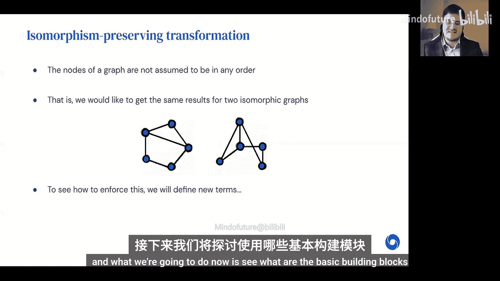

This will bring us to the concepts of permutation and variance and permutation equivariance。

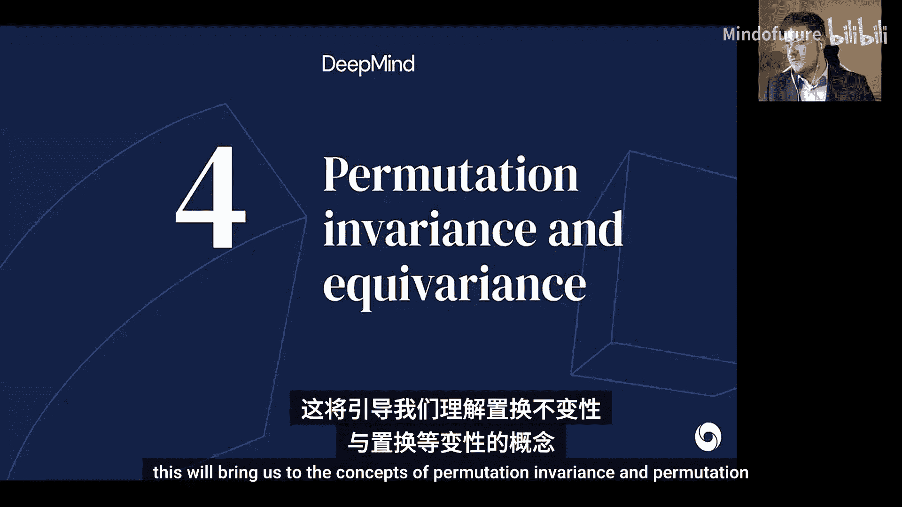

In order to simplify the setting for now I'm going to assume that our graphs have no edges。

 so we just have a set of nodes V and in each one of those nodes we may have a feature vector Xi for node I and the way in which we typically process this in graph representation learning land is we stack these row vectors into a matrix of shape n by K where there's N nodes and K features in every single one of them that is the I throw of the matrix corresponds to the I feature vector and one thing that's very important is that just by the act of stacking the nodes you've specified an order in which you're visiting them and we would ideally like any result of applying a graph neural network to not depend on an operation like this。

So it's useful to think about what are all the operations that might just change the node order and do nothing else you may know for mathematics operations like this are known as permutations for n nodes there's n factorial many of them and it's very nice that we can think about permutations and stay completely within the realms of linear algebra because each permutation defines a unique n by n matrix here have given a matrix for the case of2413 each of these matrices are called permutation matrices and they have exactly one entry in every row in every column everywhere else they have zeros and as you can quickly see by a matrix product with one of these row stacked feature matrices the only effect they have is to permute the order in which you have your vertices and nothing else so these matrices are very useful as a tool to study this further。

So in order to design functions over these set matrices X that will not depend on the node order。

 we basically want to say that if I were to apply a permutation matrix to the input。

 that is if I were to change the order in which I present you the nodes that shouldn't change the result so this gives us a very useful notion of permutation invariance and we say that a function operating over sets is permutation invariant。

 if no matter what permutation matrix P I apply to the set before applying the function。

 I'll get the same result anyway， like as if I never did the permutation in the first place。

You might have seen some models that exhibit permutation invaris before。

 one very generic form is the model presented in the Deep sets paper published at Nur 17。

 where you basically represented the function overs as some independent function p Psi applied over the row vectors Xi。

 and then you perform some permutation invariant aggregation function。

 which is agnostic to deordering。some like summation and maximization or averaging。

 and then afterwards you might also stitch an extra function at the end of this Phi function that operates over the aggregated representations and because you have this critical sum aggregation。

 you're able to summarize your entire set in a way that is independent of the order of the nodes you've provided。

Now this is a very good way to obtain outputs on the level of entire sets because we're aggregating the entire set。

 but what if we want to do predictions on the level of individual nodes now if we want to do that we don't quite need permutation invariance we need something a bit more fine grainined we want to be able to once we've performed our function on sets to still be able to identify what part of the output belongs to which node and a permutation andvari aggregator would pretty much destroy that because if we kind of crunch together all the nodes into just a single vector。

So what we might instead seek in this case are functions that don't change the order of the nodes。

 that is if I have a permutation specified by permutation matrix P。

 it doesn't matter if I permute the nodes with it before or after I applied the function。

 the function itself will preserve the order so accordingly we can define the notion of permutation equivaris if no matter what permutation matrix I throw at the input。

 it doesn't matter if I throw it before or after I applied the function and that's neatly summarized in the equation below。

Now with this， we can say that equivariance mandates that every node's row remains unchanged after I apply this function。

 and we can think about it basically if we focus on the function as operating row wise。

 this will be a very important perspective when we move to graphs so we can think about permutation equivariant functions on sets as these psi functions that are independently in isolation applied to every node I giving us latent vectors H。

And once you stack the Hs you can get a latent space matrix H which represents the features in each of your nodes once you've applied the transformation combined with invariance this gives us a very powerful blueprint if we stack together these equivariant functions that transform each node in isolation。

 potentially with some invariant tail if we're interested in like results on the level of the entire set。

 this gives us many useful functions on sets， arguably this is as far as we can get with basic sets without assuming or inferring additional structure which I will get into later on during this talk。

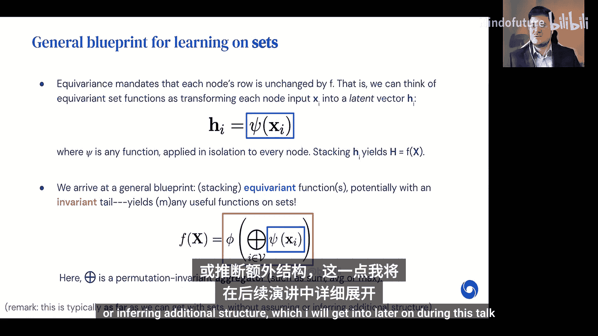

So now that we have these concepts of invariance and equivariance on sets we can try to transfer them to graphs and it turns out to transfer quite easily so now we assume that rather than just having the nodes we also have some edges between them so we have a set of edges E which is a subset of the Cartesian product of the nodes and we can often represent them conveniently with this adjacency matrix a which has one entries whatever there's an edge and zero otherwise and there are other additions you can add to this like edge features。

 edge types and so on but I'm deliberately ignoring them to keep the blueprint simple it's usually quite easy to introduce all of these things back and the main things we want permutation variance and equivariance they still hold we just need to express them slightly differently。

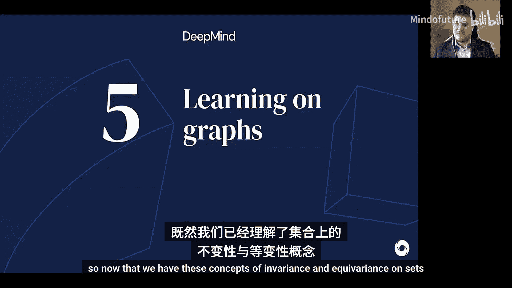

So the main difference now is that when you apply a permutation to the nodes you're also applying a permutation on the edges right because the rows of the node feature matrix correspond to both the rows and the columns of the adjacency matrix you need to apply a permutation matrix to both the rows and the columns of A in isolation and this is conveniently written down is PA transpo and this just gives you updated versions of the invariance and equivariance rules for graph structured inputs just as before so now our function takes in node features as well as an adjacency and if I were to permute the inputs and the adjacency appropriately for invariance it doesn't matter if I did it before or after and for equivariance I'll still be able to identify all the node features regardless of whether I've done it before or after。

Now this is a concept that very clearly generalizes。

 but there is something extra we have on graphs that we couldn't quite do on sets like as we mentioned on images we really like this notion of local functions functions that operate only over a locality of a certain node and graphs give you a very nice context to do that which is a nodes neighborhood so for a node you can define its oneh neighborhood as all of the nodes that are adjacent to it so there exist edge connecting them。

And accordingly， you can extract the set of features that are in the neighborhood by just pulling out all the x matrix rows for the nodes which are in your neighborhood and I've denoted this as X and I to theote all the feature vectors off the nodes adjacent to node I。

And if you want to define a local function， you can say that now a local function G operates over a node and over the multi set of node features。

And this gives us a recipe for generic graph neural networks because now if you want to build a generic permutation equivariant function。

 you can just appropriately in a shared manner apply this local function G over all of your neighborhoods and you stack the resulting latetnts as different rows of a matrix in order to ensure that this thing is still equivariant。

 we need to make sure that G does not depend on the order in which you presented at the neighborhoods。

 so G should be typically constructed to be permutation invariant to the entries of x and I。

And this is just to give you a visual of everything that we've covered so far。

 we're going to express graph neural networks as a local shared function G applied to every node and its neighborhood in isolation and as a result of applying G。

 we will go from input features XI to latent features H and here I've given this one example of a node B and its local neighborhood in a graph containing nodes A C。

 D and E usually we also include node B itself and this function then transforms that neighborhood into the next step latents。

Now once you have a GNN like this I'll just quickly look back at how you can use them to solve actual problems specified on graphs。

 so imagine I give you a graph with some input features x and some adjacencyency matrix A such that Xi contains the features of node I applying a GNN on it transform these x's into latent features by being mindful of their local surroundings and now if I have a node classification task I can look at each of the nodes latentency in isolation and learn a classificationifier on them if I have a graph classification task I can use again a permutation and variant functions such as some to combine all the nodes into one representation and then apply my graph level classifier to classify them and for certain kinds of GNNs if you want to predict properties of edges or even existence of edges which is known as link prediction you can also build a function that operates over the latents of the two nodes and potentially any edge features you might have between them so this is the general recipe of once you have。

And you use it to get equivariant latents， how can you then use those latents to do anything else that might be of interest on a graph？

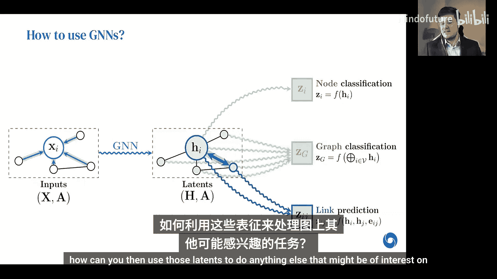

YeahYeah。So once you have a grasp of this main blueprint。

 let's see what are the ways in which we would typically instantiate them。

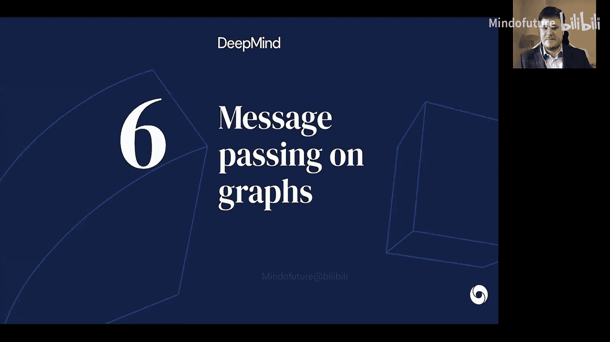

So as mentioned， we construct these permutation equivariant functions F by shared applying a local permutation andvari function G over all the neighborhoods and under various guises you might have seen G referred to as either diffusion。

 propagation or message passing and now we're going to look at ways in which we can actually define G。

 this is obviously a super intense area of research， but very fortunately for us。

 almost any layer that gets proposed nowadays can be classified as one of three spatial flavors of GNN。

And they are the convolutional， attentional and message passing flavors。

 which I will now present to you one at a time。So first of all。

 in the convolutional setting we are just giving an interaction constant CIJ that says how much do I value how much this node I value the features of node J and then they're basically coefficients in a well weighted sum or different kind of weighted combination of locally transformed features so I have a psci function applied to every node feature in isolation I aggregate them by weighing their contributions using the CIJ constant and I use some permutation invariant aggregators such as sum to combine them and then that gives me the recipe for the features of that node in the next step usually these weights CIJ will depend directly on what's in the adjacency matrix and some famous examples are the chbycheev networks。

 the graph convolution networks and the simplified graph convolution networks。

They're very useful if your graph is homoophilluous because when your edges encoded labels should be similar。

 you can usually just get away with doing a very simple average of what's inside your nodes and it's also very useful because they're very scalable like if you know your graphs are going to be homoophilluous this kind of model is very lightweight and easy to implement using simple matrix operations and as a result it's much easier to scale to say billion node graphs。

Then if you want to make things a little bit more complicated like let's say your edge is no longer just in code for label similarity but there could be some repulsion effects。

 for example， if I retweet someone it doesn't mean that I entirely agree with them。

 I could actually thoroughly disagree with them we just replaced these constant fixed weights with weights that are learnable and this if you've done something like transformers in the past might be familiar to you as an attention mechanism it is any function that takes features of the sender node and the receiver node。

 this a function here and it gives you a coefficient that you can use to weigh that node's contributions to the receiver and this is one very elegant and powerful way to learn more complicated weighted combinations but it still doesn't require that much information to be computed and stored there's a several models implementing this idea some of the earliest ones include the Monet model the graph attention network and the gated attention network that are listed here and they're very useful as this sort of mill。

And like if your edges do not encode strict homophily relations。

 you might want some more complicated sums， but you still want to just only compute one scalar per every edge。

 so it's still reasonably scalable， this is the choice that kind of offers the middle ground between the two。

And on the far end of the expressivity spectrum you have the message passing GNNs where the sender and the receiver worked together in thisscii function to compute an arbitrary vector based message which is sent across the receiver node so keep in mind in the attention case we still sent just the raw neighbors features weighted by some constant here the sender and the receiver collaborate together to compute what the message is going to be and it's appeared under various guises within interaction networks。

 message passing neural networks and the graphnets model and they can be seen as the most generic GN layer as a result this means they can fit some very complex simulation data like algorithmic reasoning physical simulations or computational chemistry but that could imply some scalability or learnability issues because now you have to store and compute an entire vector for every edge in your graph and there's typically a lot more edges than there are node。

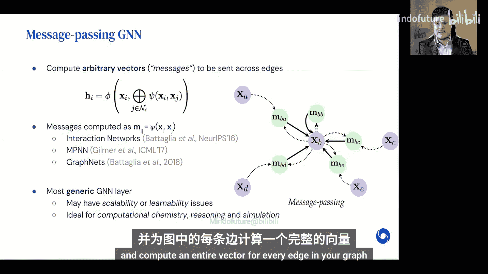

So now， once I have covered this basic blueprint and the three basic ways in which you can instantiate it。

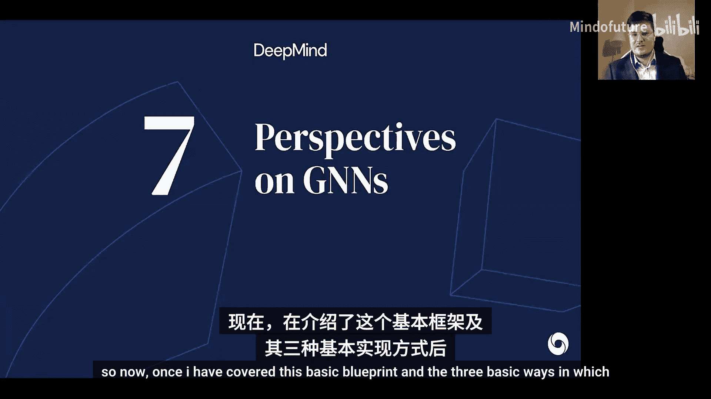

Well， you can see that presented in this way it looks quite clean but one thing you can remark is that we didn't actually start researching graph neural networks from a blueprint like this and if you've studied graphph neural networks especially if few years ago you haven't seen them presented in this particular way。

 you might have seen a perspective like spectral versus spatial or deepwalk and note tove or something like this and the reason for that is that graphs very naturally arise across the different branches of science and different disciplines have found different tools to process them but now I'll give you a feel for how accurate this blueprint actually is by surveying a lot of these prior and concurrent approaches and showing how in most cases they map pretty much exactly to this blueprint that I've just shown you and if you've read up any kind of graph representation learning before。

 there's a good chance you will have at least seen a few of these but it's perfectly fine if you haven't seen some of them I've left enough references that you can get started on any of them in isolation。

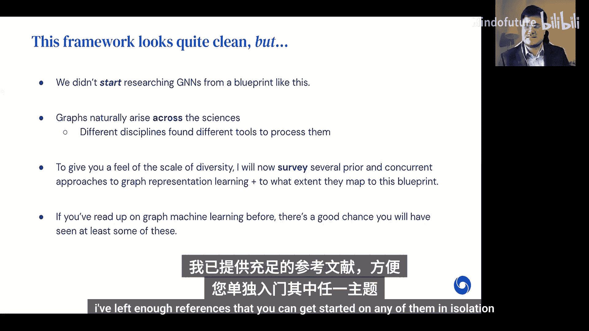

So the first one， perhaps the most kind of traditional boom of deep learning on graphs。

 came through node embedding techniques。

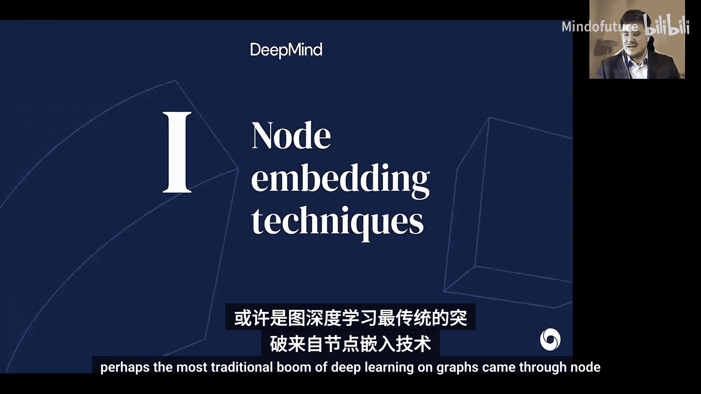

And they rely on finding good ways to embed nodes in a graph into vectors。

 I've taken this figure with great thanks to Will Hamilton where he used the Z notation for the embeddings。

 I'll typically use H。And it's using an encoder function。

 but at the time all these encoder functions were actually lookup tables。

 so you were just learning a flat representation of every node without any particular or complicated function used to derive it。

And now the question is what makes this H vector good well graphs carry interesting structure and if you have a good representation of nodes it should ideally preserve this structure and what's the simplest possible notion of structure you can have well it's an edge。

So if I have features H and HJ of two nodes， they should be somehow predictive of whether or not say their exist edge between the two of them and this gives us a very straightforward unsupervised objective。

 we can optimize these H vectors to be nearby if they formulate an edge or far away if not。

 and this allows us to just take the dot product to the dot product similarity of the two nodes will tell us what the estimate of this value is。

 and then we can optimize it using standard binary crossenttrotropy。

 make these dot products high for edges in the graph and low for non- edges in the graph and this is actually just a special case of a far wider family of methods called random walk objectives which try to make this a little bit more interesting by refining the condition from they should be close together if they're in an edge they should be close together if they co occur in a short random walk so this allows you to slightly expand your receptive field。

It should be noted that this dominated unsupervised graph representation learning before GNNs became a thing。

 and if you've been around that area， you've probably heard of approaches like Deepwalk or Note Ti or line。

 which are sort of the flagship papers that spearheaded this area。

But one thing that's very important to note is that as I mentioned these random walk objectives force the embeddings to be close to each other if they are close together in the graph。

 but what does a convolutional GNN do， it summarizes an entire set of neighbors around you into a vector embedding so because in most of these like small world networks like the one I pictured here if you have two nodes like INJ here that are connected with an edge。

 they're actually going to have a lot of overlapping nodes in their neighborhoods see like for all the neighbors of INJ only two nodes this red and blue node on the side are not featured in both of their neighborhoods so if you just apply a GNN and without any particular training it should make them have similar embeddings just by design。

And basically from a representational perspective， these deepWC style models emulate an untrained convolutional GNN one corollary of that is that typically it doesn't work that well to combine random walk objectives with GNNs and actually at times you can match the performance of deepWC by a convolutional GNN that hasn't been trained at all I first spottedted this within the DeepGraph infoax paper as an accidental consequence of setting the number of epos to zero and it was since then independently verified by several other researchers in the area。

So one thing that you also might find interesting here is that there is a clear correspondence between the node embedding techniques that I just mentioned and some of the more traditional word embedding techniques in natural language processing。

 if you think of nodes as words， if you think of these random walks as sentences you can basically equate node to Vc with the word tove objective and their optimization objectives are actually near equal。

 they even both feature negative sampling and things like that。

And actually this is a correspondence that continues even nowadays。

 some of the recent work on pretraining graph neural networks borrow a lot of concepts from BERT and I've left a reference here if you would like to read a bit more about this。

 but speaking of NLP， let's make a quick remark about NLP。

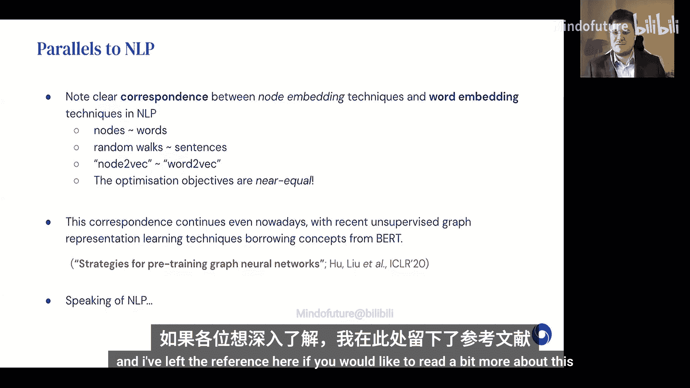

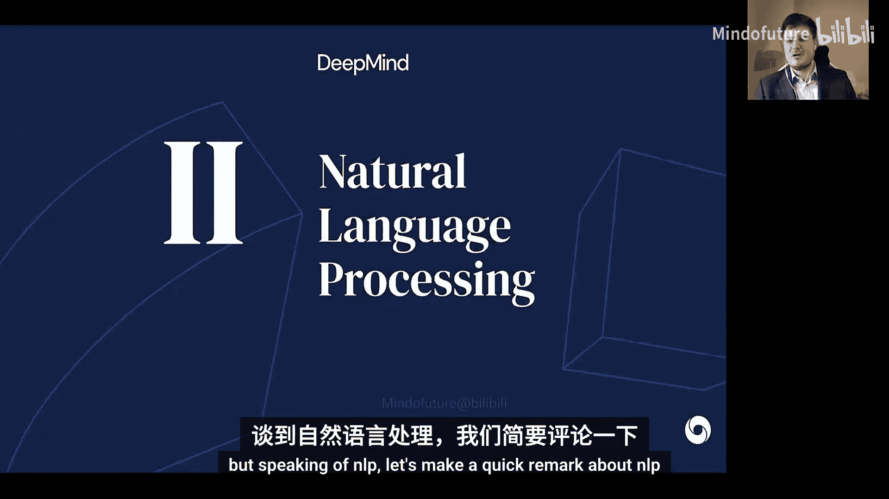

So。It's not just that GNN design is inspired by NLP sometimes you can see concepts going the other way if you look at words in a sentence。

 they're obviously going to interact in some interesting ways like subject object in these kinds of relations and they interact in a way that's not trivial and not sequential that means that processing them using a simple recurrent model or a convolution model may not be the most accurate way to look at them we may actually want to use a more generic graph over them。

 but the problem is what is this graph。And one common assumption when you don't know what the graph is is to just use a complete graph and let the graph neural network infer what the relations are and if you worked at all in natural language processing over the past few years。

 this should sound very familiar in fact have've literally just described transformers to you so this is no coincidence transformers actually can be seen as a special case of graph neural networks。

 they fall very nicely into the blueprint I mentioned because they work on a fully connected graph and they use the attentional flavor of GNNs。

How do you tell a transformer that it's still looking at a sequence。

 it's by putting them these extra features， these positional embeddings that tell you exactly where you are so that you're not just looking at a bag of words。

 but if you were to drop these position embeddings。

 you' get a very standard vanilla fully connected graph retention network model。

You can another very great perspective of looking at this is that these attention coefficients can be seen as a means of inferring a soft adjacency matrix this is a very interesting area and the links have been brought about in much more clearer detail by Chatanya Joshshi in this gradient publication so if you're interested to find out more about this link I would highly recommend that you check out this paper。

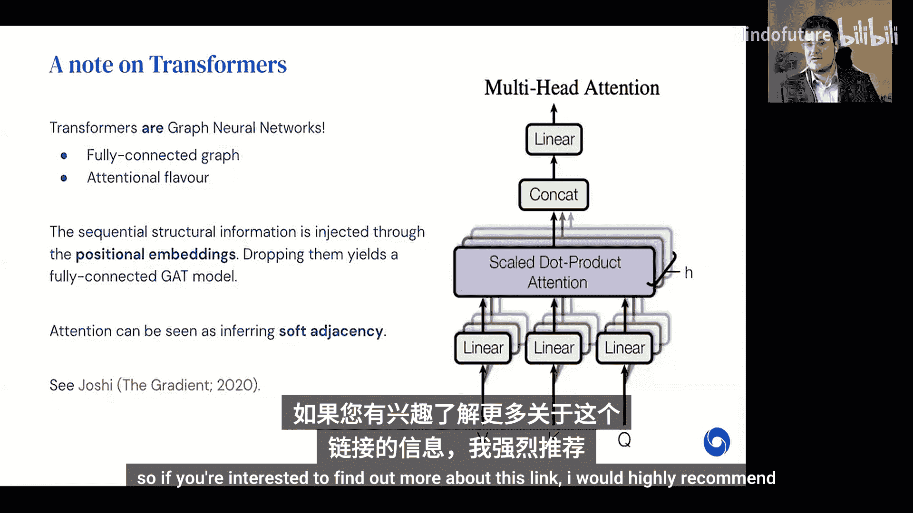

But in the meantime I'm going to move on to one of the most popular early approaches to deploying graph representation learning。

 you might have seen in many cases that early papers including one of my own。

 would classify graphraph neural networks into spectral and spatial。

 I am now going to hopefully show to you that in most cases this divide doesn't actually truly exist。

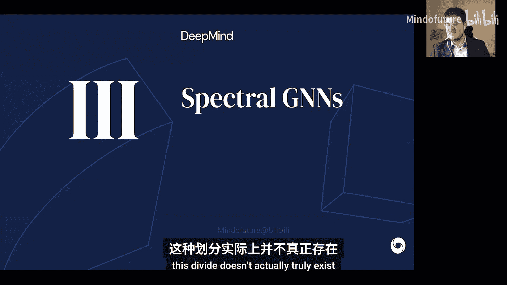

So how did we get there Well one very useful quantity from digital signal processing is the convolution theorem which defines an identity that is very attractive to us because it's allowing us to express a convolution in some domain like the time domain as multiplication pointwise multiplication in some other domain like the Fourier domain and this is a detourt to defining convolutions because defining an operator that does pointwise multiplication in a learnable way something that's quite easy for us to do but the problem is you know the convolution theorem and Fourier transforms are usually defined over these timespecified signals so what would be the domains in the case of graphs well to get there we will first see how graphs come up when you look at discrete sequences。

We can imagine kind of a time series or a sequence as this cyclical grid graph。

 the reason why I've added a cycle from the first to the last time step is so I can more easily handle the boundary conditions but generally it doesn't change the findings that I'm going to have and we can express a convolution operation this is kind of by analogy to images as something that looks at a current time step and maybe some immediate neighborhood of it so we compute the updated features of node2。

 the H2 by applying some local weighted sum of node2 and maybe some immediate neighbors for example nodes one and3 and let's say that the coefficients of this operation are these constants well I'll sorry learnable constants A B and C。

Now what's very important is take a look at the bottom of the slide this specifies a matrix operation that you're applying over every time step in isolation and we call these matrix ciulent matrices they're called because you can start with the first row and then as you go down the rows you always shift the all of the coefficients by one to the right any matrix that has this property is called a ciulent matrix and in the case of 1 d convolutions it's very evident。

Now one very important property of cient matrices is that they commute that is no matter what vector I choose as the first vector of a ciulent matrix I'm able to commutatively apply it with any other and matrices that commute are also known to be jointly diagonalizable that is the eigenvectors of one of them are eigenvectors of all of them that means that the eigen decompose in the same way and very conveniently all ciulent matrices decompose to exactly the discrete Fourier basis of these vectorctors formed by the complex roots of unity。

And you can very easily compute these eigenvectors by studying one ciulent matrix like the shift matrix。

 which has only one parameter in the second position。

Now if you stack these Fourier basis vectors into a matrix。

 you recover exactly the discrete Fourier transform because if you multiply by the conjugate transpose of this matrix。

 you transport your signal into the spectral domain and this also allows you because all the ciulent matrices share this eigen decomposition to decompose any ciulent matrix as a product of the Fourier basis times a diagonal matrix of eigenvalues times the conjugate transpose of the Fourier basis and from this you can naturally derive the convolution theorem。

 any ciulent applied to a feature matrix X can be expressed using this eigen decomposition and therefore you can first multiply your features x with phi star to cast them into the Fourier domain and then because you're multiplying by the eigenvalue matrix which is a diagonal matrix this exactly corresponds to just pointwise multiplication one very important corollary of this is that as long as you know phi these Fourier basis vectors。

 you can express your convolution。Just using its eigenvalues and not the actual parameters of the ciulent。

To kind of summarize everything that I've said so far in the spatial domain we might apply convolution by applying a ciulent matrix directly to the inputs X。

 but now I've just offered you a detour， I can instead first apply the discrete Fourier transform phi star to transport x into the spectral domain and in this domain applying a convolution is just elementwise multiplying with that convolutions eigenvalues and then once I have the result in the spectral domain I can cast it back into the spatial domain by applying the inverse discrete Fourier transform which is just phi。

So the key idea here is that I don't need to know what is the convolution operation if I know its eigenvalues with respect to the Fourier basis。

And this gives us a recipe for graphs now the problem with graphs is that convolutions of interest are usually far more generic than ciulent matrices。

 so it's really hard to reason about what those matrices might look like。

 but we can still use the concept of shared eigenbases。

 so if we know some graph Fourier basiss for our graph we can only focus on learning that operations eigenvalues。

😊，For grids， we wanted to commute with shifts， so that's why we had the ciulents and we can think of these shifts as an adjacency matrix for the grid。

😊，And this can generalize when you don't have a grid so if you have a grid convolution on end nodes。

 your Fourier base was always the same it was the n discrete Fourier transform basiss。

 but now for any graph you will just compute its own phi that's dependent on the graph structure previously the structure was fixed Now one thing we would very much like our convolution to commute with is the adjacency matrix because that specifies the graph structure in the most direct way but unfortunately we cannot always eigen decompose the adjacency matrix。

 so instead we choose to represent the information in the adjacency matrix in a way that's easily mathematically eigen decomposable and that leads us to the graphalplsian matrix which is the difference of the degree matrix and the adjacency matrix。

So here you see an example a plus matrix and you can see that it represents all the properties of the adjacency。

 but in a way that's going to be shown to be more mathematically convenient。

 so see you have in all the minus1 entries the edges of the graph are encoded and along the main diagonal you have the degree of each vertex in the graph ordered from zero to five in this case。

So assuming your graphs are undirected， which I'll focus on here。

 the loplace matrix is symmetric and positive semideinite。

 which means that we'll be able to eigen decompose it。

 and this means we can express the loplace matrix as this specific Fourier basis phi times sum matrix of eigenvalues times phi star and now if I change these eigenvalues。

 I get all the matrices that jointly diagonalize with L or ie any matrix that commutes with L and we usually look at this expression as the graph Fourier transform as popularized by John Bruna at Ile 2014。

So now if you want to convolve， like apply a graph convolution to some new feature matrix specified on the nodes。

 you first multiply with this previously precomputed Phi star， you've entered the spectral domain。

 now you pointwise multiply with these theta coefficients which now can be learnable。

 you can specify them as something that can be learned by gradient descent。And finally。

 once you have the result of that product， you can cast back to the spatial domain by multiplying again with Phi。

Now， however， directly learning these datas that I just mentioned is usually inappropriate because it doesn't localize。

 it doesn't generalize to other graph structures， it's computationally expensive so there's a lot of problems with directly learning the coefficients even if it gives you a much more powerful class of operators instead what we commonly do to make this tractable is to make the eigenvalues related to the eigenvalues of the Laplian and usually we force the eigenvalues in this diagonal matrix to be a polynomial function of the eigenvalues of the lapplaceian and some popular choices for this polynomial or cubic liness。

 Chevychev polynomials or caley polynomials。Now one thing that's important to note is that once you forced yourself to use a polynomial in the Laplian。

 you have defined a convolutional GNN because you can literally compute the polynomial of the Laplian and use it to specify coefficient CIJ in the blueprint that I previously mentioned and basically most like most of the efficient spectral GN approaches spatialize themselves in a way like this so basically this spatial spectral divide that many papers talk about is not really often a divide because the true spectral non-spatial operators typically don't have the computational performances that we would like or localization properties that we would like。

🎼Now before moving on to the next perspective I'd like to just briefly look at transformer positional encodings again。

 if you've read the transformer paper you'd know that these positional encodings in each of the nodes is given by these complex series of signs and cosines that are related to the position and signss and cosines are very related to the eigenvectors of the discrete Fourier transform so one could actually interpret these positional embeddings as eigenvectors of the grid graph and that was the connectivity between the words that we initially assumed like the cyclical grid graph of time series coordinates。

And you can actually use this idea to run transformers over generic graph structures。

 just change these positional encodings with some top K eigenvectors of the Laplian of the particular graph that you're assuming of your data。

 and this was actually recently applied in the graph transformer model from Wi Iduwedi and Xaviia Bsson。

 which in my opinion is one very exciting direction to consider in graph representation learning。

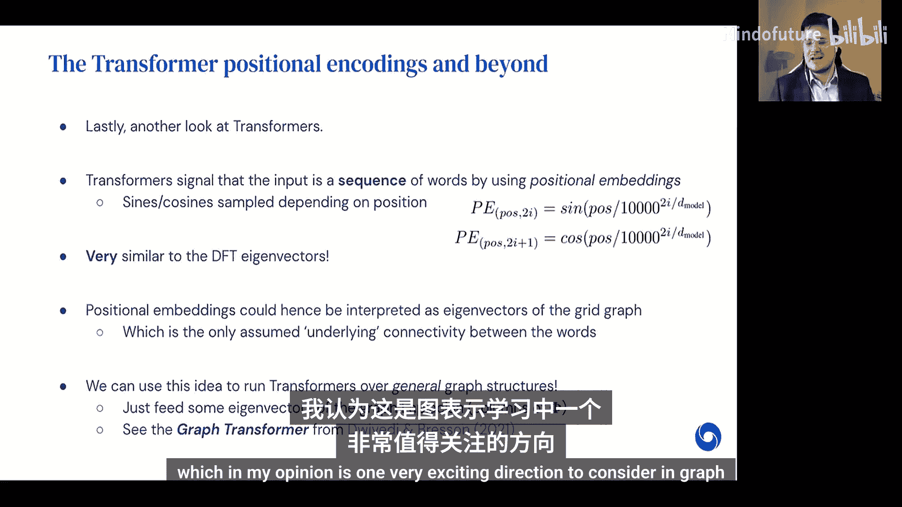

So having finished the spectral section， I will completely shift gears and look at it from a more probabilistic perspective。

 the perspective of probabilistic graphical models。

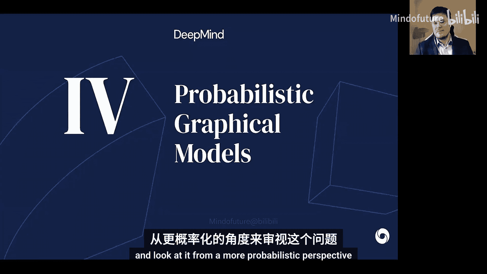

So far we've used edges in a graph to say there's some kind of relation between the nodes but I wasn't very explicit about what kind of relation that is。

 but we can instead take a more probabilistic view and say nodes correspond to random variables and edges are dependencies between their distributions this allows you to specify these notion of probabilistic graphical models and these edges help you decompose a joint probability distribution into a product of much more manageable distributions so in this canonical example Bayesian network at the bottom you can decompose the overall probability of A BC D and E as a product of probabilities specified by the edges of the graph and have kind of color coded it here so that it makes sense a directed edge means of direct dependence。

But one particular PGM that we will study here is the Markov random field。

 which allows you to decompose the joint into a product of these edge potentials。

 specifically if we assume nodes can be represented by inputs and the latent representation that we wish to compute。

 so H for node I and H is the X is the input for node I and H is the latent for node I。

There we can assume that they're related for every node in isolation and then assume that the latents are related to each other only according to the edges of the graph。

 and this factorizes your probability distribution into something that's proportional to one potential function applied to the X and the H for the same node and a product of potentials of pairs of latents across all the edges of your graph。

So these phi and psi are any real valued functions which tell you the energy of this particular node latent or latent latent pair。

 and that specifies the probability distribution。Now if you want to embed nodes if you have some inputs X and you want to compute H。

 you need to sample these vectors from the posterior distribution P of H given x Now even if you know the potential functions。

 this is generally intractable and you need some approximations to actually do it properly and one popular method that resolve this is so-called mean field variational inference where you assume that the posterior can be approximated by a product of these node level densities Q which are specified for every node in isolation and they're well defined and easy to compute and sample from such as say a Gausstian distribution。

And then we can obtain the parameters of Q by trying to minimize the kL divergence or some other notion of distance to the true posterior P of H given x now minimizing this kL is intractable。

 but it does admit a very favorable approximation algorithm。And if you look at the final formula。

 the actual way in which we derive this formula is unfortunately out of scope。

 we can iteratively update of H starting from some initial guess by just following this formula to get Q of T plus one having Q of T Now if you start this equation for long enough you'll actually see that it corresponds quite nicely to the computations of a message passing GNN I've specifically isolated what would correspond to a message function what would correspond to a permutation in variant agregator and what would correspond to a final transformation so essentially you can embed all of these standard PGM computations within GNN computations the key difference is that in PGMs you expected potential functions to be specified and known upfront but here the GN defines them implicitly within its latents the actual first model derived in this way structured to V was not in itself quite unlike typical MPNNs。

But recently there's been a whole lot of other approaches that unify Graph neuralal networks with PGMs。

 and in my opinion， it's a very exciting area to look at for the future。

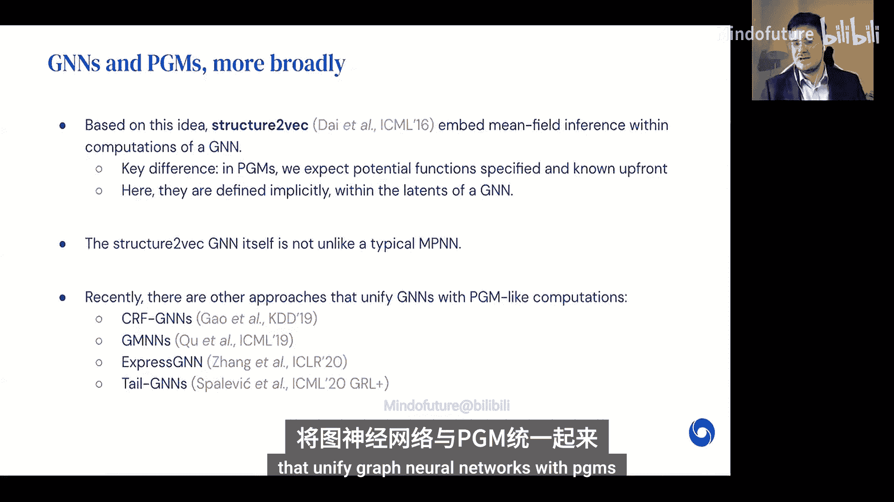

Finally， I would like to make a few remarks on the booming area of graphiteomorphism testing and some future implications。

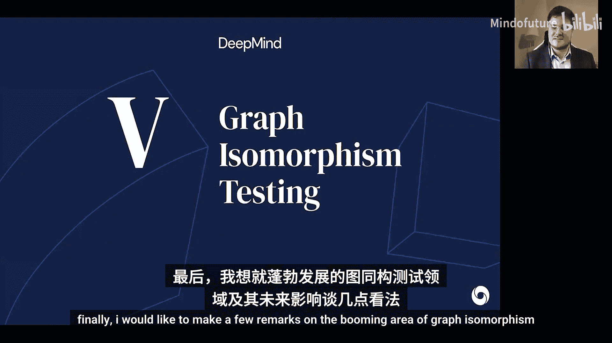

So we might often ask ourselves the question of how powerful are GNNs。

 they're powerful tool for processing graph data， but they won't solve any task on a graph accurately and one canonical example we use to estimate the power is the example of deciding graph isomorphism are we able to use the GNN to distinguish two non isomorphic graphs so if you have graphs G1 and G2 that are non isomorphic will I get the different embeddings for the two of them by applying my GN if I cannot do that then any task where I need to discriminate these two graphs is hopeless because they're going to get exactly the same encoding。

And one very simple way of distinguishing isomorphic graphs is passing random hashes along the edges and summing them up this is the Wfi daman algorithm which as you can see in the bottom right corner aligns really well with computations of a commGNN and this connection was spottedted very early including the first GCN paper by Thomas Kiiff and it explains why these untrained GNs work really well untrained GNNs are basically relatable to a random hash function one thing that's important to note is that this test is quite powerful but it does fail at times for example it cannot distinguish the two graphs in red and blue that I've highlighted here keep this example in mind I will come back to it in a second。

Now one thing that's very important and somewhat surprising is that over discrete features。

 graphra neural nets can only be as powerful as this test that I just described to you。

 and in order to reach the maximal exclusivity， it's important that your aggregation function is something that's injective such as a sum graphify smorphism networks propose one maximally expressive GNM that follows this principle。

 you can see the sum aggregator over there。😊，And you can actually start to make GNNs stronger by looking at what are the failure cases of this wise file Laman algorithm for example。

 as you can see in the bottom right corner it cannot detect the you in a closed triangle which GNNs cannot do as well by corollary so augmenting the nodes with some randomized position features that will tell you where you are in the graph or counting interesting subgraphs is one way in which we can make them a bit stronger and we can also look at having subgraphs of k nodes and embedding them together which was exploited by one to three GNs。

And there are other very interesting avenues like directional graphnets or invariant and equi graphnets of Hagi Marron。

 which further elaborate on the idea of expressive graph neural networks。

Now one final remark I'd like to make here is that things actually change quite a bit when we dropped the discrete feature assumption so so far I've assumed that my features and the nodes were discrete。

 but if my features are continuous which is very common in real worldorl applications。

 the proof of the injectivity of the sum aggregator falls apart and here I've just given you a few examples where you can look at the two neighborhoods of node V and show that actually the sumagggregator and also many other aggregators will fail at distinguishing them。

 particularly the example that's thirdd from the left where both mean and minimizing and maximizing fail at distinguishing the two neighborhoods。

So now the question is what's the best aggregator in this case and in the principal neighborhood aggregation paper by Gabriela Cor Soluca Cavalre and others we actually proved that there isn't one in order to discriminate between neighborhoods of size N when the features are continuous。

 you need at least that many aggregators to fully discriminate them and check out the paper in my opinion has a really cool proof that relies on the famous boiculum theorem and in the paper guided by this theorem we propose one particular empirically powerful combination of aggregators for general purpose units。

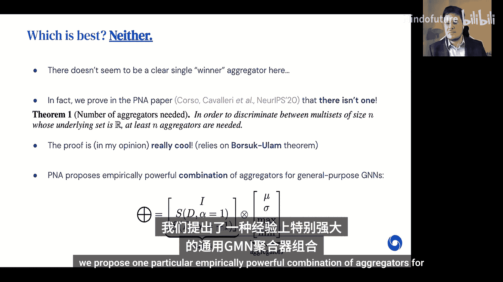

Finally， I would like to remark very briefly that we use this blueprint of invariances and equivariances to describe GenNs and to also cast many other research lines on graph representation learning into it。

 and in fact it's remarkably powerful beyond graphs so if you have this local and equivariant layer that looks at neighborhoods an appropriate choice of activation functions and potentially maybe some pooling layers that make the structure more coarse and maybe at the end some global or invariant layer over the entire domain。

 you can actually recover many standard architectures like CNNs and transformers but besides that you can also recover a much more interesting class of geometric deep learning architectures that sit somewhere in the middle between convolutions and graphs。

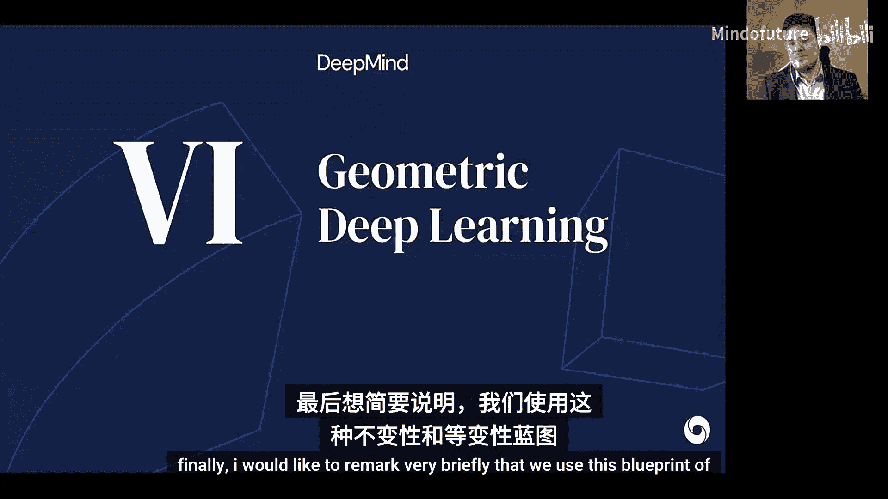

And they may be broadly summarized as groups and gauges。

 so groups might encompass some notions of rotational symmetry so if your signal is specified on a sphere。

 it might need to satisfy certain symmetries， gauges might relate to more generic manifolds like this human pose on the right-hand side and alongside Michael Bnstein。

 John Bruna and Tacocohen， we are actively working on categorizing these fourGs of geometric deep learning。

 and I've just listed a few standard instantiations of appropriate domains。

 neighborhood metrics and groups that you want to be invariant to。

 and how they recover architectures such as CNNs， GNNs， deep sets and transformers。

 but also many interesting architectures in between like spherical CNNs or gauge equivariant mesh CNNs。

Before closing off I would like to just very quickly mention how did we get here like how did we come to this particular point and in fact。

 you know processing data on graphs is so important that early forms of graph neural networks can be traced back to the early 1990s but they usually looked at very specific directed acyclic graph structures and they didn't like treat graphses of firstclass citizen and kind of the first fully proper treatments of generic graph structure processing happened in the 2000s from two groups in Italy。

 the GN framework from Marcogori Francos Sctli and others and the neural network for graphs framework from Alyio MiKli。

And this g and model of Goius Scceli and others primarily use these recurrent style updates。

 which have been updated for modern best practices by Ejali's gated Gin and layer。However。

 one completely independent line of research that deserves to be mentioned at the very end is computational chemistry here's a quote that I found on Twitter in response to one of my threads。

 chemistry disrupts machine learning not the other way around and it's a very important and concurrent area that develop GNNs from computational chemistry obviously graphs are very relevant to chemistry because molecules can be naturally model as graphs and first GNN like machine learning models of molecular properties arise also in the 1990s including models like Chemnet and the work of Baskin and others In fact the molecular graphnet paper that came out in 2005 already proposes many of the elements you'd commonly find in a modern messagepa neuralnet and the drive pushed well into the more later years including work on GNs from molecular fingerprinting from David Duveno and GNNs for quantum chemistry from Justin Gilmer Finally recall the very first example I showed you for detecting antibiotics effectively chemistry is to this day。

A leading outlet for GNNs and is a very important subfield to study if you want to learn more about Graphnet development and implementations on that note I would very much like to thank you for listening and I hope you found this enjoyable and that the perspective was useful for you if you have any questions you can feel free to reach out to me offline either via email or all my social networks are listed on my website Many thanks to Will Hamilton John Bruna Michael Brownsstein and Ta Cohen for their inspiring work that helped drive these slide deck and I'm now happy to take any questions Thank you so much。

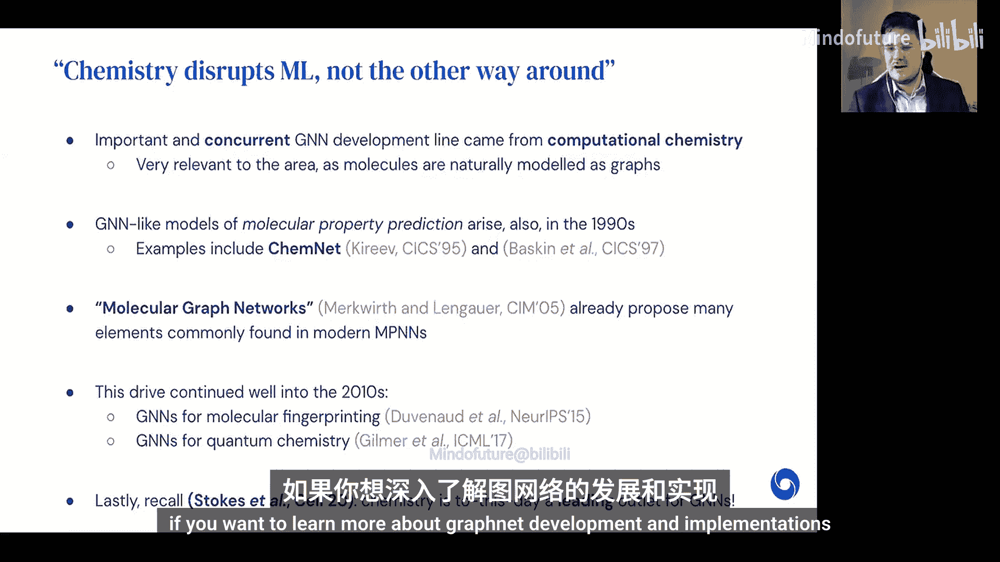

Thats， I think you're muted。Better， there are already few questions in the chat。 Would you like to。

We three or4。That you think are more relevant to for your total' there's an interesting question from from Gu。

完成。Ptsy， can you see this one' so far you've spoken about learning representations only from the graph。

However we often know something about theverities outside of the graph context。

 for example the semantics of words which appear in a knowledge graph what are some ways of incorporating this information This is a very good and very important question which sort of relates to kind of partial observability of the entire system and what I would say like one kind of classical way in which we would represent all this external information is you can just summarize it if you have no further assumptions about it you can just summarize it as one kind of global vertex which is connected to everything else in your graph so you know that something else exists you know it interacts with everything else you don't necessarily know how so kind of the most natural way to represent it is this sort of master node that interacts with everything within your graph now obviously there are more clever ways you can do if you actually know something about the structure or the relations of this hidden context but yeah without knowing any additional information about it I would say a master node is probably like one standard way of tackling it。

Okay， that's great。I thought I might sort of cheekly take advantage of my position chairing to ask my own question so you mentioned Will Hamilton's sort of excellent textbook a few times during the talk and he finishes the he concludes his book by highlighting two directions that he thinks are going to be important in the future and obviously you're just given this excellent talk on sort of where GNs have come from and I thought maybe you could comment on this Will says Will highlights latent graph inference and going beyond。

Message passing is a formulation。What's your perspective on this。

 where do you think where do you think things are going do you think there's another area yeah what do you think？

Yeah so thinking about future prospects is something that I regularly like to do and Michael Brownnstein actually put out a very nice blog on what 2021 holds for graph machine learning where myself and a few others contributed a few thoughts on what are the relevant papers if you check out if you want to look at emerging trends in my opinion latent graph inferences definitely important so even without improving the basic blueprint of message passing we can still go a super long way if we choose the right edges very often the edges that are given to us in the data are actually not the best edges for solving the problem and actually sometimes we don't even have the edges so we have to make very crude heuristics to assume them。

 so if we get better at techniques that automatically extract edges that can give us a huge boost in performance because it might shorten the path that signal needs to travel before it hits an important part of the graph even without improving the message passing mechanism itself。

That being said， besides learning the graph structure。

 you might also find it very useful to indeed like learn new forms of message passing which may not depend directly just on the features of the sender and the receiver and kind of neurally combining them into representation we can look at more interesting functions that combine the sender and the receiver。

 we can look at more interesting ways to define aggregation directions I particularly like this directional graph networks idea I think it's a very very cool future approach and yeah otherwise personally I'm very involved in using graphra neural networks for combinator optimization unfortunately I had almost no time to mention anything about this in the talk but I'll just say when you start using graph neural networks to solve classical algorithmic problems。

 you discover a whole new wealth of prescriptions on how to design them so I feel like if you want to look at where the bleeding edges happening look no further than algorithmic reasoning and physical simulations。

Cool， that's great。 I think we had a few questions in the chat relating to this， actually so。

Maybe you can talk a little bit more about other areas， so Indigo asks。

Whether there are any particular emerging fields with promising applications。

 so it sounds like you've already highlighted one and then so I think related to that you know I think your survey。

It's obviously really interesting about you know， where these things have been independently developed。

 Do you think there's sort of like。Anywhere else where these methods have been used maybe that hasn't been connected to the sort of like the family of people looking at GN type methods or if there's something that sort recently become connected that you think it's can to be a very sort of fruitful area for people to work in I guess you could just expand on what you just said Yeah I guess I'll just very quickly highlight one area because there's a lot I see graphs pop up in areas where I would never expect them necessarily thats because they really are so ubiquitous way of representing information one area that I particularly enjoy recently and I think Ben you can also confirm this for me is particle physics I think that particle physicists are starting to discover this notion of symmetries and invariances in graph neural networks and they're finding it quite attractive to model important events especially on like these high energy systems like the large Hadron collider I think Carl Kanmer had a lot of very interesting talks in the area that I would recommend if you want to brief intro but just very quickly saying I think that particle physics is going to be。

Very fruitful area of exploitding graph representation techniques。

Yeah I think that's definitely going to be the case it's another one of these areas where the workshops just keep getting bigger every year。

I'll just pick out some more questions， I think。嗯。There was a question early on about relating to attention and the question is about some traditional it's from Vdim and it says some traditional methods often enforce some kind of symmetric properties and they mentioned that the dot product attention is。

Traditionally not symmetric。But it still works and they ask when is it important to enforce symmetry whens it not needed。

 whether you can comment on that。That that's a very important question and I would say that generally speaking with graphs generally and with this whole area of geometric learning the answer is unfortunately it depends so you need to look at the specifics of the problem that you're solving what are the kinds of invariances you would like to preserve and then design your model such that those invariances are as preserved as possible I think in algorithmic reasoning I see a lot of examples of this where we've recently concluded that if you really want the best possible extrapolation performance which is very important if you're learning a generic algorithm you need to design both your features and your systems so that what you need to learn is basically roughly a linear function so you can get very stringent conditions and what your message passing should look like or what your features should look like based on the requirements of your field so if extrapolation is very important this is what I would do if instead you care more about interpolation then I would just put us some aggregator and kind of throw it that the maximally expressive architecture possible and。

Usually going work really well so yeah I guess it really depends。

 unfortunately I kind of give a wide range of prescriptions。

 but there's obviously a lot of papers dealing with these issues。😊，Yeah， of course。

Yeah thank you so I think I think that there are loads more questions I don't know how long you're happy to keep answering questions but they just keep coming yet should we take some more yeah we can take we can stay until like for10 or so and answer a few more if you okay great。

Okay， let's have a look， so I know there was a question from Emma who was asking about whether or renting with node position。

 whether this breaks peration invari。Yes， exactly this breaks permutation variances if you explicitly specify a node position as a feature and this is actually exactly the approach that RPGNNs use。

 which is one of the methods I've cited and long and short of it is you need to be careful to kind of break that well to fix that breakage that you've just induced and what they do in that paper is theoretically what they do is they actually aggregate their prediction over all the possible permutations of the nodes now of course this is a kfactorial kind of thing and you cannot actually compute this but they've shown that in practice if you just run it on a few randomized permutations and you average the results you get performance which actually converges to the actual performance if you use all the permutations so like there are ways to both theoretically and empirically go around that problem but yes definitely introducing these features does violate permutation variants and you have to be careful about that。

Okay， cool， so there was a question from Pablo。About incorporating sort of higher order things like higher order sympathsies。

 I think this is。Quite hot topic for going beyond message passing。

DoDo you have any thoughts about this？嗯。So things like。

Incorporating information about faces in high dimensional cells。Yeah。

 this is a very promising approach I'm seeing it not only in like computational chemistryemistries where I've seen most of it where you can kind of naturally figure out parts of a molecule like you know motifs or functional groups and this like representing them explicitly and assigning them explicit feature vectors is not only a way in which you can increase the representational power of your model but also it can help you even generate novel molecular structures more easily because you start by generating this higher order blueprint and then the lower order one so definitely it comes comes up a lot when hierarchy is necessary。

 I've seen it also recently in these like relational inference approaches where you not only reason about the objects at the bottom but you can also think about the wider classes of objects or clusters of objects moving together and generally the more of these symmetrymetries on higher orders that you can bake into your model and not make your model learn it the model is going to have an easier time so generally I'm very excited about those approaches and they're already showing quite some。

Sa computational chemistry approaches for sure。Yeah， definitely。Okay。

 so we've got another question that's from Sarias asking about。

In standard CNNs we have we have some kind of coing we have down samplingling he's asking about whether thered be principal ways of doing this so obviously this to know that has been explored within。

Tometric deep learning， but they're asking if there's any sort of principal ways for doing this。Yeah。

 so coarsing is something that we're actually working within our right up to try to categorize it as well as possible。

 but for now there's been quite a wide family of approaches proposed for generic graph structures which seems to work well in various in various settings so in my opinion currently the most promise comes from actually topologically analyzing the graph structure like those are the kinds of approaches that I think are most robust there's obviously approaches that look at just the features and kind of try to soft cluster them to coar in the graph but I feel like currently or at least with the benchmarks we have right now in graph classification we cannot quite make a cutting edge for those models as opposed to just running a simple graph model and agrating all the vertices at the end right so I would say that currently the most promising approach if you want to kind of principally coar in a graph is to look at topological methods of doing that like graph min cut pooling clpoing in these kinds of things are the approaches that I would highlight there。

But I believe that sometime in the future， when we have better data and a bit more principled methods。

 we should get to a point of being able to more principally course and graphs based on features as well。

Yeah， I think it's definitely really exciting。So we had a question from Andre。

 I think this is from sort of quite early in the talk asking about if transformers are GNNs。

 why don't we just directly use？GN and NLP and what are the disadvantages So I mean okay I'll give I'll answer this in two ways The first of all。

 the most generic GN that you might have is this message passing GenN so you could try to go further from attention and actually compute messages from every word to every other word I believe that it's just that tradeoffwise this obviously gives you an expense in terms of computational cost and representation cost and maybe it doesn't justify the tradeoff maybe transformers are just so easy to scale up that you don't need to worry about this special case but I would also like to remark that recently in NLP there's a booming body of literature trying to make more efficient version of transformers that don't attend over all the words pairs but instead they choose like this locally sensitive hashes or something like that know reformer performer all these differenters and at this point when you apply something like this on sential input I mean you're basically running a GN at this point so that would be my answer to this question I think that everybody hope。

I a transformer is applying a genN there's not really a distinction there that I would make Yeah I think I'd agree Yeah。

 perhaps the better question is when do we expect to just have transformers be the only genN that we're using？

Okay， so another one was。From。Luca who asks， do you see， have you seen。

 I guess this would be the last question， have you seen any exciting research lines on continuously evolvinglving graphs such as social networks or abstract syntax trees？

This is yes， I think this is a very exciting line of I mean my work on algorithm reasoning is also dynamically evolving because as the algorithm executes as a simulation runs state updates on the graph at all times but that's a very specific class of graphs known as spatial temporal graphs where the graph structure is always fixed and you just basically have a time series in every node and arguably there's a lot of research going on there。

 very exciting for traffic forecasting and so on but I think that it's a very special case of a more exciting area called dynamic graphs where edges can arbitrarily be added and removed and features arbitrarily kind of interpolated extrapolated as you go along and on those lines I know of two models that seem very exciting one is the temporal graph attention network and the other one is the temporal graph network from Twitter so those two I'm aware of try to do a really principled attack at this class of this class of graphs I think we' still early stages there's going to be a lot more interesting work especially as we gather more。

Prinipple data sets data sets are always the issue。

 but those two I would highlight if you want to like really get started on dynamic graph representation learning I think it's a very exciting area I think we have time maybe for one more question。

Yeah， sure so。诶。I mean did you see any questions that you're particularly interested in I think there's there's loads of things let me see let me see some maybe maybe one stands out to you yeah there's there's a lot of very exciting questions here by the way if you would like to see me because zoom is probably going to drop these questions after we're done if you'd like to see answers to some of these questions please like I've put a Twitter thread on my Twitter profile you can kind of send the question in there。

Okay and i'll be happy to answer it afterwards so okay let's。Let's answer the question from Joa。

Wwhich talks about an area that I used to work on and I haven't had a chance to I haven't had a chance to talk about it in this talk unfortunately。

 like you mentioned a work that combines some ideas from Bke with GNNs do you think pre-training will become as relevant in the graph domain as it is in other areas of deep learning my answer to that is an unequivocal yes I think it's already a big area is just that most of these applications remain hidden from you because companies are applying them to get efficient graph embeddings but basically in many like social networks of interest you don't necessarily know what the task of interest is going to be at the time of specifying the graph so it's very useful very cool computationally it's computationally very hard to run a GNN in production so it's much easier if you can use a GNN to kind of bootstrap good features using these unsupervised self-supervised losses and then just use a simple MLP to classify Amazon recently put out this peak companion paper which illustrates this very nicely they said we cannot use a GNN to like online serve queries of people buying products。

We're going to use a GNN on a product graph to bootstrap the features and then we're going to use an MLP in production so I think it's a very important area that probably many companies are already doing it's just the question of how much they're talking about it and in that area I worked on methods like DGI and recently we put out a paper called Boottrap representation learning on graphs which I think is a very exciting addition to the family that's attractive because it doesn't require any negative sampling。

And yeah， just generally， I think there's going to be a lot more work in this area that needs to be done before we're really。

 really competitive on all kinds of structural and kind of domain scenarios， but yeah。

 without a doubt， I think it's already very important and pretraining and embedding learning on GraphNes is going to become super impactful。

Cool， well， I mean there's still like tons of questions， but I think。People can just。

Get on get onto your Twitter probably there I've actually been dismissing a lot of the questions that we've been answering which I think I'll try and add those back into the thing and then hopefully they're in the recording。

嗯。Yeah that sounds good so I'd like to thank you all once again for sticking around for like 15 more minutes I see there's still quite a lot of you and I see I know a lot of you so thank you so much for showing up I hope you enjoyed the talk I hope you found the perspective useful if you have any comments on how it was presented anything you'd like to see them differently basically how did you respond to this talk in particular I would be very much interested to hear because like after iterating on how to present graph representation learning for many years I've sort of converged to this particular direction and kind of I hope that that it's as attractive to others as it was attractive to me so yeah please let me know and thank you so much once again most appreciated and thank you Ben for chairing the session and asking the questions yeah I mean thanks for our excellent talk。

😊，And yeah， great quite question session。😊，You really got grilled， I think。Cool， cool。All right。

 so take care everybody， stay safe and well I hope to see you in person at whenever conference has become physical again。

Thank you so much。拜e拜。

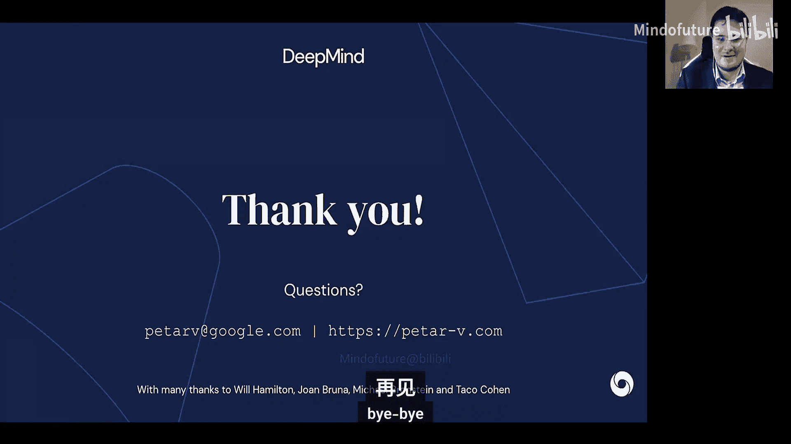