# 图表征学习讲座 ｜ Graph Representation Learning p08 P11_-CVPR_2021_教程-_别管那些网络了-自监督学习的进展 -BV1tQxqzYEFP_p8-

having看。

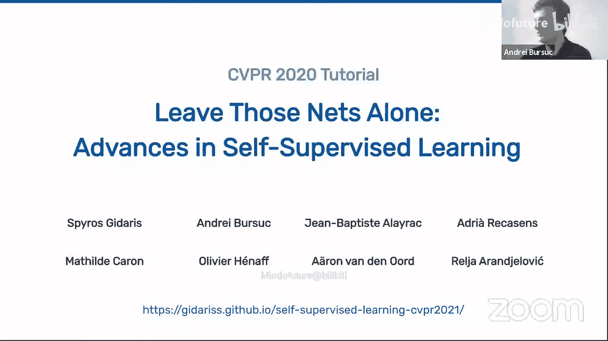

Okay so so welcome everyone arriving there my name is Andreberook I'm a researcher at ValAI well together with with my colleagues will and happy to welcome you to our tutorial so we'll be starting with an introduction of the concept of subservised learning what does it mean exactly what does it come from is it something that we never did before or is something totally sub that existed a long while ago what does it try to solve and how you evaluated so this will be like a prequel to show you an overview of what is what is subservised learning and then in the subsequent talks by my colleagues by Sps Ar own。

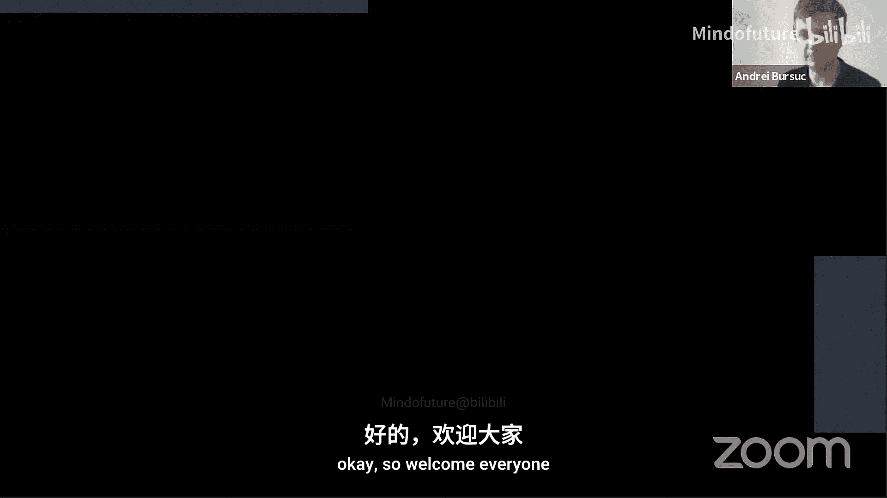

Andbaistan material and the others will be discovering in depth each one of those。

As we get confused me if it's visible， yes， okay， thank you。你响唔安全嘅大嘛。

So I'll start first well with the motivation of selfupervised learning。

 so this is no secret to us that while deep learning and selfupvis and supervised learning sorry。

 it's a really strong strong combination so we have seen it in the past in the past well almost 10 years now how it has been outperforming any other technique until until then especially in tasks involving computer vision and we have seen it that it's versatile is powerful and it works most of the time。

 so well there's no need to mention it all the use cases that we have right now with supervised learning and in deep learning it's enough to look at the list of accepted papers in the past few years and to summarize how。

Well how this pipeline works for deep learning with fully supervision。

Even though we have a lot of different tasks and approaches。

 they usually amount to these three steps where you first predeeffinine the set of visual concepts that you learn so you have a task at hand with a certain type of data that you think of and you define the set of visual concepts that you want to learn in a second stage you collect a diverse and large number of examples for each of them。

 there is a that acquisition that acquisition。Stage and finally。

 while you trade a deep model for several GPU hours or days depending on the capacity of your model and the size of the deficit so and this is a really successful recipe。

But in practice we see that there's a few drawbacks and unfortunately。

 well this is a really nice recipe but we cannot apply it in sample of the wheel world situations that we encounter so to be more specific so in general on the data side is really difficult to acquire this data that we need and also and then to create it using annotated human annotations right so getting the hands on image nets for the equivalent of an image net for whatever task you might have in mind。

It's really difficult so imagenet is a great data set it's there's a lot of investment in there it has impacted significantly the community。

 but unfortunately we don't have an image net for force of driving cars so an image net for for the for object detection an image net for。

😊，For satellite imagery and so forth so having such a data set usually requires intense human labor to annotate and to clean the raw data that we have and this usually costs both time and and money so this is really long to annotate so I think the statistic from the city case paper is quite quite known nowadays that annotating an image a high definition high resolution image for a semantic segmentation takes about one hour and a half so imagine that if you want to do that for tens of thousands。

 hundreds of thousands every couple of times a year because you will see as you'll see later。

 the data data data changes and you need to always keep up with the changes that occur in the real world and in addition to that annotations are usually prone to human mistakes and it's not always easy to model the noise that we have in。

These human errors on the annotations。So as I was saying。

 in addition to the cost of having a bigger acquiring， a big data set。In practice。

 we have to face with a few other challenges so one of them is what we call the distribution shift or the data shift or a concept shift。

So meaningan that the world and the images or the data that we have to work on changes all the time so here while I made well just a snapshot on how once something that is supposed not to evolve too much like a men's fashion trends but so you can see here within a decade that the clothing of men in this period was changing quite quite significantly here so we have different types of colors then it's a different type of garment then again changes the garment and so forth so imagine that you work now on recognizing clothes and in fashion right so this data changes all the time so if youre algorithm and was tuned to recognize the specific type of brand or of t-shirt which was trained on this data while one year later you would see that actually most of the data that you have to use was mostly unknown you would not recognize it for you would not have lib predictions right so since。

This shifts happen all the time you actually find yourself in the situation where you have to annotate the data data all the time and starting all the time from scratch。

 annotating again these large amounts of data is also not a very appealing avenue and what you want to have rather is to have something that exploits this large large amounts of nonlabel data and a bit of label data such that you will get to good performances and also in the same period on how the world changes around us so here I'm giving some examples of how Mariio evolves across the years。

Right super Mario from the 80s in the late to 2010。

So you can see that there's an increasing high definition in the margins so the graphics the hardware have progressed quite a bit think about cars right you kind of have the same situations where you want to you have a project for a car you design a certain camera so a value my employer works on different sensors so you acquire a lot of data based on a certain sensor but the car will arrive a few one two years later so at that time you will have a different camera which is better and higher resolution so again what do you do you start again over you acquire data you annotate and by the time of that cycle youll find yourself that there's actually a new camera out there so this can happen also with devices with phones if you're an Instagram or flicker you have a lot of new devices with different cameras with different specifics and you have to find a way to be up to date with all of them but without all the time starting to annotate data from scratch so the main point of。

This is what the main that we want to put in sort ofvised learning is。

Can we the starting point of selfupvised learning actually can we exploit anything from raw data I mean can we find a way to make everything faster and cheaper in terms of leveraging andnot annotating data？

Well put it laundry like that， if we just apply the regular strategies that we have。

 well we know that acquiring raw labeled unlabeled data is easy。

 but we don't have a very good mechanisms and supervise the learning tool to exploit them properly so on this part we'll be trying to work。

 so we assume that raw and label data is to some extent the easiest part the easier part in our project。

So to summarize what all the idea is so far， so deep learning requires large amounts of and carefully labeled data。

 and this is difficult to acquire into anity。AndEven with these larger but there's another view on this。

 which is often maybe not put up front， which is also another motivation of self supervised learning。

 is that in general， even with large amounts of data， with supervised learning。

 we still have a few blind spots in terms of learning useful representations。

And that will be more specific to that with some examples from models that we are familiar with。

 so here I'm taking some images， sorry I take a model trained on image for image classification。

And the goal here is to show that the supervision signal can bias as the network in rather unexpected ways。

 so here what the authors did and what they noticed is that if you take an image。

 for example this is a collea dog， you have a very good prediction from your image network in the model here it's VGG6。

The authors then did an experiment and they started scrambling the image and im painting different textures。

 parts of textures from this dog all across the image， so we had these types of images。

Until that point， kind of the general belief was especially visualizing after seeing these nice visualizations paper where you see that you have neurons specializing on the cat or a part of a leg and things like that。

 the belief was that the network was learning and internally was learning the representation of the world and of the objects。

But the experiment actually informs that and what the authors noticed across several experiments of these types of images is that the predictions for these types for both the original and the textureized samples is very similar so the network actually it seems to fire on these random textures and it doesn't even know to know what's the shape of the dog in order to get it right。

 you might say that okay you can to some extent mitigate this by annotating images with polygons like in semantic segmentation and this way the network will learn thisrepresent will learn to debiase itself from this texture bias。

Yes， this is possible but it's again it takes time and ensure that there's other types of biases in our data given by the superfvisicion signal that we have and we'll be always chasing chasing and chasing this so。

 this is one of the arguments of self supervised learning into learning the representations that actually are actually not dedicated to a task because in the end while the network does。

just what is needed not more into solving the task right so we don't ask it here to give us tell us where is the dog to just tell me what type of dog and for this you don't know how you don't need to figure out the object you just need to look at these patterns。

So a similar one kind of in extension of this experiment in。

by the same authors from Guros et al which is quite known paper is again to to show further that this is a bias of neural networks towards textures so they took two images so here is the skin of an elephant and here this is its an image of a cat with the top three softmax scoress predicted called the top three predicted classes by the softmax output and then what they did they the inpaed one into another so we can see here on you have the shape of the cat which is relatively visible。

And they compared it is the predictions between humans。

 what would a human say it's an image and what is a network and we can see that in general the neural networks are largely。

Don't move， so we still have the same order of the cats of the categories is just as before。So again。

 well， there are several biases actually in size of these these models that are given by the type of annotation that we。

And the signal， the twist per vision signal that we give。

That you will never get away with it and just to show that maybe self supervision could go to the rescue so this is a nice paper from CBPR 20 last year。

Where the authorss picked up on that， so they generated two dataset sets so this is the original data set with natural images and then they generated another data set ofd scrambled images roughly they took a title of four by four and then they shuffled it and they use the conditional again to process it and to make it look a bit more realistic such that you preserve local statistics and what they noticed is that if you take if you put a binary classifier on top of cofi features from a network trend on this data。

If it's and then you you use you show these classifier images trained on these types of images and then on these types of images。

 so you train your network on normal images， but then a test time you want to see with just whether this binary classifier will recognize。

Which type of images is at seen so if it's a scrambled or a normal normal image。

 so if I take a model pretrained on imagenet the accuracy of this classifier binary classifier is 78% right so chance is 50% here if however my model is trained on this data using self supervision actually you can see that accuracy goes upper 25 so this means that we can figure out from these features whether the images were scrambled or home so this this is to show the impact that self supervision can have can have here。

So。Coming back with the wrap up right now， so on this part we've seen that selfvision would be useful foregoing the limitation of annotation。

 but in the same time as we see now， it's also we see that the improving representation learning requires teachers that are not actually specialized for a particular task as we've seen with the classification。

 but rather encompass different enriched statistics that are useful for various thestream。

 downstream task and this is what we want with formalwell from self-supervised learning。

And finally another motivation that we have for selfupvised learning is the success that we had from self supervision in MOT。

Think of a quarterbackbe。So， there。We can see some of the most successful approaches coming from there where they have a large amount of text just download it from Wikipedia readdit and various text repositories are there and you use the data to invent a new tasks so in this case I show you two two main tasks one is is masking a certain word and asking the network to predict it so here the man went to a mask one he bought a mask2 of milk and the responses here will be store the man went to the store and he bought a gallon of milk it could be also be a bottle but depending on the context you might have several good answers and another task that you could come up with to it to invent in this case is to connect two sentences you feed that to the network and you ask the network whether these two sentences fit together are one the other so they are in a sequence so here we have sentence A sentence B the man went to the store。

He bought a gallon of milk， so this is a。This is a re。

 it's a plausible sequence of sentences and the other one was the men went to the store。

 penguins or fightist， this is clearly not then the next sentence。

Over several iterations of seeing many， many， many pairs of text like that。

 the network largely learns to deal with text and to deal with concepts。

 and's able then to learn features for the text that could be then used to other tasks by fine。

So after all this introduction I would just maybe ask give some sort of specifics of what is selfservision。

 so selfsupervision is a form of unsupervised learning where instead of the human we have actually the data that gives the supervision signal so we don't have the tedious human annotation。

 not meaning that the human is not involved there。It's involved in rather defining the task。

 but there is no human label use there， so in supervision what we usually do we define a pretext task and in this pretext task we we force via this task use we force the network to learn what we actually care about from this data and the most common instance of this pretext task is to withheld some parts of the data so the network has to predict it。

And then in the second stage， the features and representations that are learned here are used for a different downstream task that we actually care about and where annotations for some annotations are available。

Coming back to images， so the most popular commonly well easy to understand the conceptually easy to understand the example of subservised learning of a pretext thus for subsupervised learning。

 sorry， is the prediction rotation prediction。Meaning that in this task we train the network to learn to predict the orientation of the image。

 so we assume that all images are oriented upright。

And we do different rotations multiples of 90 degrees and feed those images to our network。

 and it has a four classifier， four way classifier where you have to predict whether it was 0， 90。

 180 or to 70 degrees in the rotation。So after a while， actually。

 even though it seems like a very simple task， actually the network learns to look at the image differently and to look at different cues for helping it do well at this task。

 which is kind of unexpected to what we had at that time for classification task。

So I will illustrate to the pipeline that we have in selfupervised learning。

 usually we have two stages， so in the first stage we train the network on the pretext task。

 the task where we don't have any human labels so this is a stage one and in the second stage we keep this encodeder。

 we usually remove whatever is related to this pretext task in this case it was a small network or just a linear classifier that decides which type of classification it is so we just remove it and we go to this downstream task where we have some data in here we either just use these features and train a linear classifier on top of it or if we have more data and the task is a bit more specific like object detection is segmentation。

We keep this encoder， but well we add another decoder。

 a detection head or an object proposal heads and so forth， and these are our tunes。

 but we start from these initializations from provision。

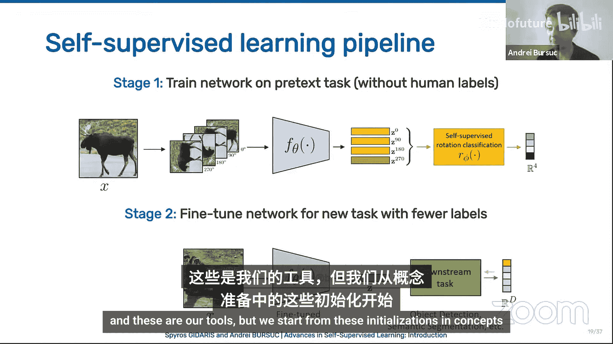

So to better grasp and understand a bit the concept of self-supervised learning。

 I'll be using a metaphor from some popular movies， so in this case it's Karaate kid。

 I don't know how familiar you are with it it was in a movie in the 80s。

 I think it was quite popular in the 90s， at least in my home country。And in this movie。

 so you had this boy， whose name is is Daniel and he was bullied at school and he wanted to learn pallateate。

And he went to this kate master， Mr。 Miyagi and said， I want to learn kraate， Mr。

 Miyagi said good okay， but you'll have to start preparing for that then while this preparation was actually doing various daily chores in the house of this instructor like painting。

 watching the car， watching other things in the house and so forth。

So to spoil you a bit well the characters in the corresponding to our topic， so Mr。 Miyagi it's us。

 the deep learning practitionerer， Daniel is the confident that we want to trade the daily chores our preex task and learning kate is is our downstream task。

And our goal as deep learning practitionerctioners is actually to think of what pretext tasks would be useful。

 such that I would learn in an effective manner， something that is useful for this。

And at some point in the movie while after working hard on daily chores for quite a while。

 Daniel is annoyed and says look you didn't teach me anything I'm just you're cleaning a cleaning person here and Mr。

 Miaggi says look actually you've learned krata all of this time but you learn to prepare forti but you didn't realize that and you just starts to hit them but marketers nothing harmoning here because no harm here because the way he learns to defend himself using all these motions that he had already learned from the daily chores so kind of this is what we try to do with sub supervision to train on some tasks for which is cheaper to get data such that then it's easy to fine tune the network on the a few label data that we have。

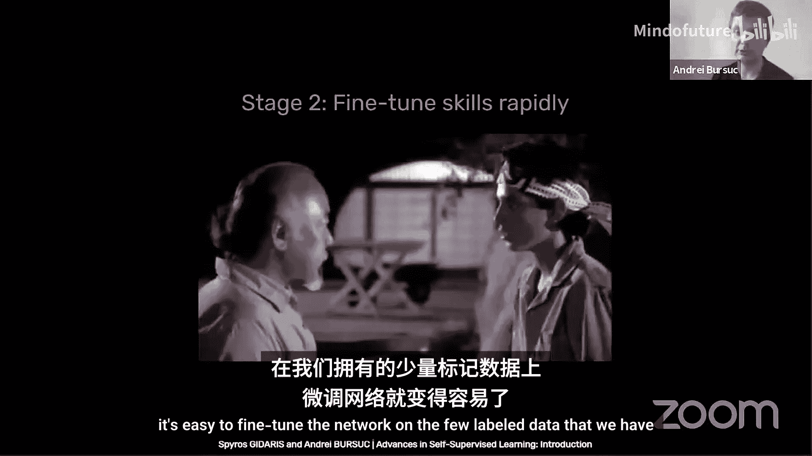

Yeah。Okay so just to well so the question now is okay this is is a necessary idea。

 but does it actually work is this actually useful in practice so it depends on when you when you ask so if you have just maybe like two years ago it was still。

Not clear two or three years ago， but if starting from almost two years ago。

 the answer is quite clear that there is some benefit there is a significant benefit in selfpervision so just explain to this plot so here these are all models that are pretrained to an imageNe and then fine tune in a self-upvised manner and then are fine tuned on classicalcal useC。

And these are the conference venues where they were presented and you can see that the Jigsaw one of the early methods for self supervision was here while the supervised bound was way superior and starting from LaVPR all of a sudden have a bunch of models that were outperforming this supervised fully supervised baseline。

 so this was a key milestone and it launched even further excitement in the area。

So by the definition that I gave， there's quite a few approaches that would fit to some extent in the definition of selfupvised learning。

So I'll not to go through for all of them so I just gave her references just because to know that well if you do input reconstruction like photo encodes。

 kit could be also some form of selfurvised learning if you do GANs again it can be considered as a form of self supervised learning。

Not the one that we are interested in this tutorial。

 but it can be considered one if you train with pair signals like data from different sensors again it can be something like that if you hide data from networks that we saw before it's a form of self provide learning or if you do instance discrimination that you' will see within our own stock in a moment you are also doing search provide learning。

So the scope of tutorial is to focus on to delim a bit the scope of this tutorial。

 we focused on representations that lead to useful methods that leads to useful representations and that are obtained through the invention of a pretext task。

And or by hiding a part or a view of the original data to the network。So on this part。

 I will go a bit。You'll discover it into more details in the respective talks。

 but just to give you an idea what numbers we usually look at when we evaluate and we compare subsvised methods in general we use a lot of data sets and of tasks to show that these methods are useful and the common part is that we usually pretrained on imageNe and then we subsequently fine tune this model once pretrain on various data sets in imports so the three main ones that you will be seeing across most of the talks are linear classification of linear probe efficient learning in transport learning and in linear classification is pretty straightforward it's a very simple approach you just look at the output of the network of your encodeder that you've trained in a subsupervised manner。

Tin a linear classifier on top of these features so this is a way to evaluate how good are actually these features because if you put just something simple like a linear classifier and they show good results it means that they're pretty useful and most commonly we evaluate on imagenet principally but there's a few other data sets that you usually see in the papers to show different types of images。

 for example places is landmarks so it's not always objects and it's a data set of2m million which is more than imagenet VOC is a bit smaller and it's a data set of small objects INNe is a data set of finegrained animal species and so forth。

And while usually you can see that while you get these types of figures where you have various previous methods。

 the supervised upper bound so in INe I'm showing here ImNe in ImNe well it's kind of difficult to beat the supervised model but we're gaining on that and usually have these figures with with the supervised upper bound and then all sorts of methods with different types of encodes and performances in this task so this is simpler so this is what in January 2020 and by by June 2020 the scores went even harder so this was simpler before and then we have bio well and we're gaining closer to the supervised upper bound。

Another second evaluation protocol that we have is what we call an notation efficient classification。

 sometimes it's also called semisupervised Class learning where we pre-trained on the entire data set and then we find tune just on subset of labels typically is between one and 10% and most often again it in that we evaluate on here and this started with a paper by bioEDA and AO Aaron a few years ago where they were showing some impressive gains when comparing a self-supervised model with fully supervised one trained on the same amount of data arguably the self-supervised model has a bit of an advantage because it has seen all the images even though unlabeled but the differences staggering and it's one of the most compelling arguments for。

For the interest of using the subupervised learning。Finally。

 another task that is quite popular in a setting where we evaluate these methods is transfer learning。

Where we augment this encoder with some test specific models like modules related to object detection and semantic segmentation and here we fine tune。

A large part also of the model so before they were kept frozen now in the first linear classification。

Tus we were keeping them frozen， but now we fine tune most often even the entire model for this task and the usual suspect here are VOC。

 Pacal VC detection and COco detection and CTscape for smatic segmentation and more recently at the 20k so I'm done with the part of introduction here。

I can， I can leave the but the only if there were some questions on the chat sps or we can go to Aaron。

my。Yes， there are some questions maybe till Arron is set his。

Yeah I will my I will make the questions so one of them is。

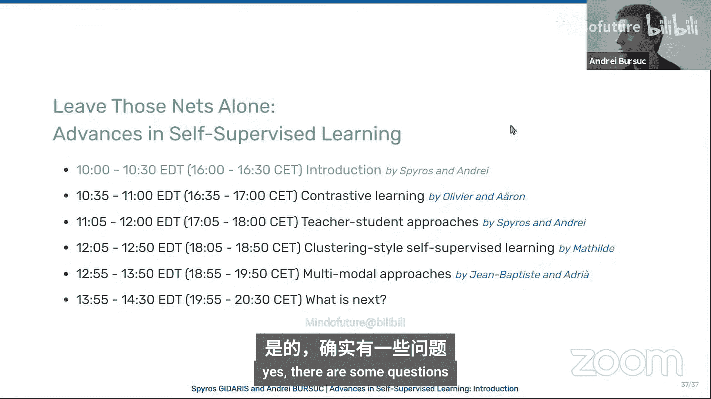

That one of the motivations for self superervised learning was stated to be that self supervised learning can handle concept shift or domain shift and the question is how does self supervised learning handle that isn't the representation equivalent equivalently biased to the domain of the input data in as I said？

Yes， so just to bring you a clarification there， I'm not saying that the selfsupervision copes with distribution shift。

 I' think that you know that there's this shift right so what you can do is instead of restarting your entire cycle of annotations in the annotate today I don't know these hundreds of thousands of data points。

 when you notice that there's this shift you can pretrain in a self-supervised manner on shift data and you use some annotations that you have on this new data such that you'll do well here and to complement a bit there is a nice paper by Daniel Hendrickx at New Ris 19 where the trainer model for。

Classification and they have also a rotation prediction head so it's like a multitask head setting where you have supervised head and a self supervised one and in this case it was rotation prediction and what they show there is that。

Your model is。Is actually quite robust when accumulate you analyze the behavior of the two heads on corrupted data which is like distribution shift actually your model is significantly better than simply supervis supervised model so to some extent it does deal with distribution shift but it's not it was not the main point that I wanted to say there。

in that case， they work on this what you call corrupted CF。

 so it's CF1 see corrupted and CF1 have the C where you have。About 75 yes。

 15 corruptions with five levels of degree and they analyze how robust is your model to as you corrupt the images even more。

AndBut it was better than simple super typeyon。Yeah。YeahI cannot hear the Spirit you're on mute。

 sorry。Maybe because we are a bit of schedule we can go to the next talk from ourron and I will try to answer the remaining questions directly on the chat box yeah we'll also go on the chat we'll be answering on the chat questions related to that and also if there's any questions there for our own。

みみたい。Okay。Aron， can you share us？

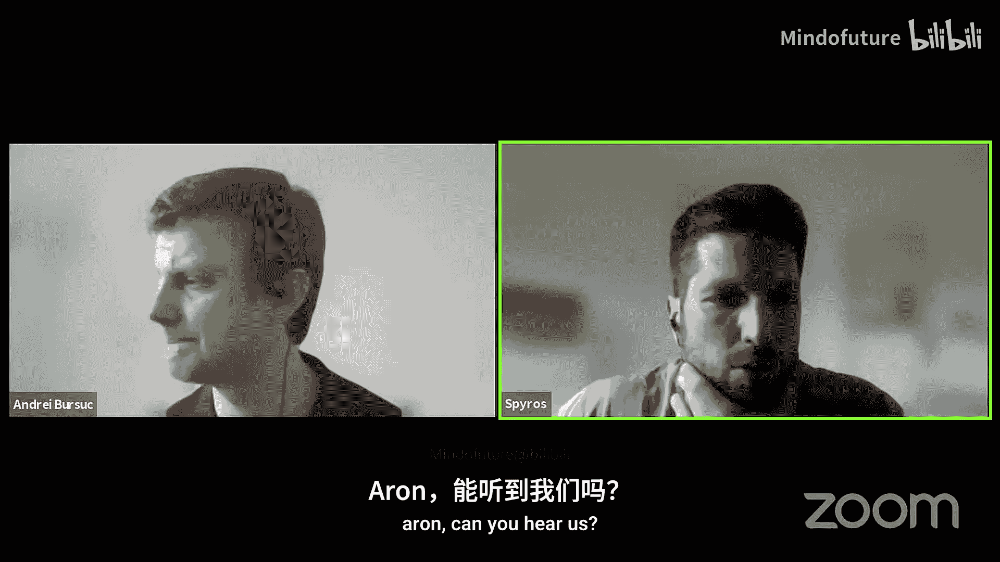

Yep， can you hear me Yes， yes， you're fine so。Just to introduce Aaron is from Deep Mind and in this talk you will talk about contrast learning from where has a lot of expertise。

Welcome around。The floor is yours。Right hi everyone。

 my name is Aaronord and welcome to the second part of from the Se Learn workshop。

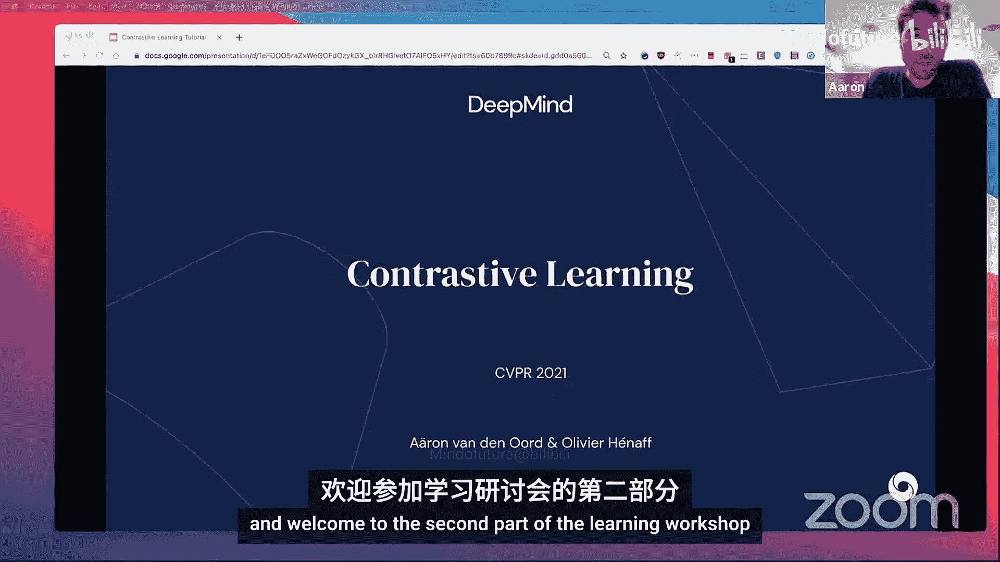

And I'll be talking about contive learning。Unfortunately。

 OlV could not make it due to the last minute emergency， so the talk has changed a little bit。

Normally we would have talked about what is contrast of learning or makes contrast of learning work and the applications of Con of learning。

But now we'll mainly talk about the first part， basically what is contrastive for learning。

 what is the motivation， connection to fire work。Three interpretations of contrastive learning and also a little bit of how mixed contrast of learning work。

 the intuitions， and why it works。All right， so。嗯。Let's go straight to the point maybe。

 so here is an informal definition of what is constive learning。Well。

 so basically you take an image X， then you sample a positive image。And also a negative image。

 so exos and ex neck in any way you want。And then you try to fit the scoring function such that the score between the x and a positive sample is higher。

Then the score of between x and the negative symbol。

And the positive and negative samples are drawn randomly in a way that every time in any gradient update。

 you get different positive and negative samples。And the positive sample is basically something that should be similar to x。

 while the negative is something that you think will be thisim to x。

So this gives you a bit of an informal definition of contestesttive learning。嗯。

A congestive loss is used in a couple of different places， and for example， in supervised learning。

 this is often used in a metric learning scenario。Where the positive image。

The positive and x are samples from the same class， for example， and for the negative we draw。

An image from a random different class， but we're not using the same class。

 so we're making sure that the negative sample does not use the same。Gla。This is， for example。

 useful if you have a large number of classes or you don't know the number of classes in events。

 for example， when recognizing faces， new people might be added to the system later and you might also want to recognize those。

In self surprise learning， it is a bit different because we don't have access to the class level information。

So here we sample two parts of the same image， for example。

 or it could be two parts from the same content， one could be the video。

 like a video frame and the post could be the audio。And then the negative is random other。

Rin imagech or random piece of audio from a different example， and we know that the a and positive。

Should share the same high class level information because they're from the same example。

And we can also use different augmentations for all of these different kind of bo views。

 and this works almost better than anyone could have imagined and it almost shouldn't work as well。

 but we're going to go to some yeah。Explain a little bit why it works as well as it does。Now。

 some of these ideas about contrastive losses have been around for a while in different sub fields and sometimes named different things。

 and it's not always obvious that it's a contrast of loss and the lines are also a bit blurry sometimes。

For example， in ranking losses， you have a query and you want the correct result。

To be retrieve to a higher score than the other ones。

 but you don't care about how much the score is better。In language modeling。

 you might have a large number of words。And there's too many to have a softite over all of them this is similar to clubs filtering where you have millions or billions of items or users and it's and you have to kind of sample them in your loss rather than' going through all of them。

Generally， this is the case with。classasification problems with many classes as well。

 so I won't go into literature review too much and spend and I'll spend much more time on the intuitions and interpretations to get a better understanding of contrastive learning whether I'm going through all the papers。

But so let's start with some very common contrast of losses that are unknown。

That's starting the one from Tp Pri all 2005， is is not the earliest congesal flow that I found that it's one of the notable examples that were well known。

And it's it's a pairwise loss so basically you have either you you sampled a positive example or you've sampled a negative example。

 if it's a positive sample， you're trying to。Push the positive as as close as possible。

To x in this kind of embedding space shown on the right。

So in the center is your x and then the black points are your positive examples and you're trying to push them as close as possible。

2 x。If it's a negative sample， so that's in the bottom image。Empty spheres。

 if they're inside of this。Apsilon bowl。If they're inside， you try to push them out。

If they're outside of the apsom ball， the loss is basically zero。

So it's kind of a max margin contrast of loss。To make sure that the positives are closer to the x than the negative。

This was then extended to triplets with a triplet loss。So we used before are triples。

 so either you sample a positive or you sample a negative。And then you adapt to the loss accordingly。

Here you always need three examples。Anchor bes。Your image， and then you have a positive sample。

 and then you also have a negative sample。And the way it works is that you care about the relative distance of a positive and a negative2 x。

If the negative sample。Is closer than the positive you're trying to push it away。

Or you try to push the positive closer。To to x and there is this margin introduced here as well。

 so you want the negatives to be at least。A margin further away than the positive。Interestingly。

 it's kind of similar to before， but now you don't have this this。

Fixed apsilom ball units sphere around the target， but it kind of depends on the positive。

On the positives that you have。You just want the negatives to be at least a marginal away。Another。

Very notable example from contrastive losses。Is in Waterre， it's called the negative sampling here。

 and it's one of the big first successes of self Sur learning actually。

And not many people may realize that it actually uses a contrast of loss。

It uses a pairwise sigmoid causecent laws。Where the negative samples are drawn from。A modified。

 unique arm distribution。So you take。The ability to have a certain word， of course。

Then your database， and then you。due to the power of three divided by four。

 so it kind of reormalizes this distribution and you're basically sampling where words like frequent words less。

 but non frequent words you're sampling more， this is kind of to make sure you're not using a lot of the stop words or kind of if you get the harder negatives like this。

Another loss， one of the most commonly used losses currently in congestive learning is infency。

 which is based on noise constive estimation， which I'll maybe go to you later。

And there is also a similar loss in metric learning from So Itel。And the way it works is as follows。

So now you have。Multiple negative samples， it could be one， it could be 100。

 you can basically choose the nerve negative samples。

And the law scales gracefully to using these more negatives。

So there's one positive and n minus one negative samples。嗯。

And the loss is basically the look likelihood of predicting the positive sample correctly from this of set of examples。

Based on the score outputted by the model。And the way。

It works is also similar to triple loss where you're looking at the relative comparison between the score from the positive and the scores from the negative samples。

So he's not fair wise， but he's always a relative。And the closest negatives account the most the loss。

 so if there is one very hard negative and all the other ones are easy。

 then it will the loss will be almost zero on these other negatives。

 the large the hard negative will take over to automatically kind of those hard negative mining as well。

The most common way to use this loss in South Square learning。

Is of making the score this kind of bilinear mapping here so you have your X and Y and you have an encoder for each of them or that you could share the weights。

And then you obtain an embedding for x and an embedding for y so x F of x and F of y。

 and you do the beenium like a dot predict between the two to get a score like a logicit of them and you then put this inside of softmax classificationals。

So the higher the inner product between these features。

 the more likely the more similar they are and and vice versa。

 so that's the way you get an embedding or like features from these images。嗯。

You can show that this maximizes the mutual information between these embedding of x and and of the embedding of y by extracting the information that these two views have in common。

And。The loss is basically lower bound and the mutual formation。

And I'll get back to this later as well。Now the optimal score for S for this is for this neurotric。

iss actually given by P of y given an x divide of P of y。

 and this is regardless of the number of negative samples used in the loss。

 which is very counterintuitive and is not something that is well known， so if for example。

 if you would train the model with two negative samples and you evaluate it。

On 1 thousand00 negative samples， you would be able to compare it for the model chain with 1000 negative samples and if you would chain it to convergence so if your model would be optimal。

At convergence， it wouldn't matter if you train with two negative samples or1 thousands。

So that's also why it kind of scaled gracefully， however。

The number of negative samples used during training。Quite improves abilities quite a bit actually。

And the reason for that is that you get more gradient signal from every gradient update。

 if you have more negative samples， all of the stuff I mentioned before is until convergence。

 but you will converge slower with a smaller number of negative samples。

This is a very nice figure from Chinaedal that highlights this kind of。ThisVery nicely。

 and the reason for that is that。If you have a batch size of 1000。

 then you usually typically use also 1，000 negative samples all the other ones in the mini batch。

And so you have a quadadtic number of。Comparisons that you make。

Compared to if you have a smaller batch size。And so， that's why。

More negative samples are much better。Also important to mention is the temperature variant。

I think it's introduced by China Do as well。And where the embeddings are first normalized union。

And then you also add a temperature scaling in the exponential。

And this clips basically the difference between logicits and make sure that the softm cannot be very peaky。

Now I'll go through three different eventss of congestive learning among other ones。

 and I'm grouping insights roughly based on these categories。I start with a geometric computation。

So Ive already give you an adaptation of the pairwise loss some tripleperieal and also triplet loss。

 but what will happen with this info andC loss that people currently use？嗯。

So how will they behave in this setting if you're using the unit norm version。

 so let's say our blue point is our positive， as is our anchor X and the green is our positive and the red ones are negatives。

 then after gradientding updates they push them away and they positive closer to each other。嗯。

And you can do this another time and so on， and after convergence， the positive。

 like if the model convers to the optimal solution。

 the positive is also always very close to the anchor。

The all organizations are very close to each other and。

You're kind of using the units sphere maximally as possible。This was kind of an illustrative example。

 but Wang etal have written a very nice paper that formally show that in their paper。

 it willmp kind of congestive lossesosis or asymptotically optimize for this kind of alignment and uniformity。

So similar samples will have similar features in the embedding space。And you want to maximally。

Be uniform in the space of Max preserve。Maxim amount of information。

And they have a lot of different insights in this paper as well， for example。

 this also shows why a spherical。Like a unit norm space works well because if the classes are well clustered。

Thesepherical caps will be linearly separable， and this is not the case for nuideium space。

Now let's go to the languageal implementation。In language models。

 you want to output the probability of the next token， given all the previous tokens。And。

ThisWhen the vocabulary size is too big， for example， if you have a lot of words。

 typically you would have， for example， a million words if you have a big database then。

Having a Somax over all of them is。It's kind of annoying。

So that's why people have lookeded alternatives， for example。

 ha Kosof Maxax or decoding in a smaller token， so a longer sequence length。

 or there is also a lot of research on sampling based approaches。

Now the sampling based approaches are actually some kind of contrastive model。

 and we can also learn a lot of their insights in this way， for example， the adaptive。

 important sampling from Benjo， most contrast estimation from good money atal negative sampling was used in Word effect。

And this table from Tensorflow thequation has kind of a pres summarymer of some of these examples。

Let's go to one example， the noise constive estimation one。So。

We draw a few random negative words from noise distribution。

 either we draw from all the words equally weight or use unogram distribution and so and so。

 and this is where the negative samples come from。to given the context， which is the previous words。

 the model outputs the score for the next word W。Wwhichch is this F here。

 if you convert this into logics by taking the lock and adding a correction term from the noise distribution it used。

 this is the lock P of the lock I think of the word。W in their noise distribution。

Then we can use this core into a logistic logistic regression regressionian model to classify between the correct word and the noise similar to。

 again， does it like what is the probability that this is a real world。

 a word given the context or is a fake。And if you。Tras to convergence， this score will actually be。

Converting to a normalized distribution over the next word correctly。As like automatically。Now。

If you don't have access to the noise distribution， you cannot evaluate the likelihood here。

 but you can only sample from it。Then after convergence， you have this density issue instead。

Which is basically what inency gets。And。Infency is just an extension from the logistic case to the multi multi multi negative samples case with a soft nextax。

So how does this？Kind of work for us。In contestive models。

 the vocabular size is actually all possible images rather than just the next unitgram of rewards。

And instead of keeping embedding for every word， every possible word。

We have used a neural network to go for the pixel student bedding。嗯。

And the candidate sampling distribution is P rights。

It's very easy to sample from this distribution because we have a data set full of samples actually。

 but we cannot evaluate the score of these images X。

 and that's okay because we only need to obtain the ems and the mapping for our features we don't care about evaluating the pur of PX given the context。

Finally， let's go to the information theoretic interpretation。嗯。And。

The interpretation is here basically that we're trying to maximize the mutual information between features in the embeending space。

嗯。And。Shan and etel have shown that there are a few issues with the disinterpretation。

Basically what I'll go to next is that it won't explain why the features extracted by contrasttive models are represented in the right way。

 for example， if you use an identity mapping， you also preserve the mutual information as maximally as possible。

But the following will show you where contrastive losses will work and where they won't work。

It'll also gives you some insights on how to set up the self Surse learning task for the contrastive model。

And it will also explain why the hlu formation will be in the features。嗯。So let's go through this。

Hypothetical example， imagine you have a database of x and Y pairs。Both the same class。

 so this is kind of a cheating example， but is going to give us a lot of insights of what why and how it works。

Because in this case， the mutual information between x and y。

As two because they're in four different possible classes。

And the only thing you know when you're trying to predict y from x is the class level。

 that's the only thing you can actually learn。And you predict the why from。

And there's two ways we can do this。One is sort ajunctive model。

Or the contrast of loss and both have their pros and cons。When you have a terms model。

 you're trying to predict P of y given x。Well if it's uncompressed， this image takes about 1。

5 fromlim bits。But a pixel seen in like a lossless compression algorithm。

 you maybe could reduce this to 500，000 bits by modeling all the pixel level details。

Now from a titic。Point of view， you can only lower the loss。はい。By an extra two bits。

By looking at the image on the left。If the model does it perfectly。

 it would only reduce it by two more bits。So this makes a key an a geneerative model。Canand Lordlo。

Much， much more easily by just learning the pixel level details because it kind of over lost quite a lot by then。

 and so it won't have any incentive to look at the image on the left。Now。

 contrastice models are kind of the opposite of that。

If you have this random of negatives here and this is the positive on the bottom。

And you kind of output your probabilities scores like this。

then the only way that the model is able to reduce the loss or like lower the loss。

Is by learning something about the class level information。

 there' is no other way that it can lower a loss。So that is actually exactly what we want。

 but it also has a negative like a problem。Mainly， congestive losses are lazy。And to explain this。

 I'll kind of use a similar illustrative example， but let's make it a bit harder。

So now we have four classes mutual formation of two。But what if we concatenate two different images？

From two pairs of classes， so again， x is this two images and y is two random images。Now。

 the mutual information has doubled。If the model has， for example。

 already learned after a bit of training， it has learned to look at the top image and has learned to match that correctly。

And has learned about two bits。Now。If you look at some of negative samples and look what will happen then。

Is that。It can get rid of a lot of these negative samples just by looking at the top image。

The other examples won't account in the loss and there won't be any gradient coming from these examples。

 so if the effective batch sizes， so effectively you have only one negative sample left。

So roughly one in four samples is informative because one in four will have， for example。

 this cat in the top。And then you will start learning the bottom image。

Now if you extrapolate this to Kbits， so for example， after learning Kbits。

 you draw a hard negative sample almost one every two to decay K images。

So every bit is twice as hard to learn because you need twice as a number of the negative samples to get the same amount of gradienting signal to learn from so this shows why contrastive flo while very effective。

Are kind of lazy and will only learn information needed to solve the task。

So they can make very abstract predictions， but they don't need to be very specific。And extra。

 every bit of mutual information is twice as hard to learn。and it's going to be good at embetting。

 but this basically tells us something about how we should set up the task and where it will work and where it won't work。

Let's go to a few examples， this is a video prediction case where we try to predict a frame case steps in the future or predict the audio from the image。

This is the example that we had before， two images from the same class。

 and this is the self surprise one case2。All plantations from the same image。嗯。

To give a brief visual reminder of what mutual formation is， if you have the entropy of the joint。

 x and y and entropy of x and entry of y， and this bit that overlaps is the mutual information。

So in these examples thatll we。Highlighted above。In the video prediction case。

 there's a lot of mutual information because all of these pixels have barely changed。

 so there's a lot of information。From x that you can port over to y and you can lower the loss if you would be able to。

 if we would change a gen model， the gen model will be very happy by looking at x。

And this is also why， you know video codex use Delta coding as a way to make sure that they don't。嗯。

T me too much information。In the audio case。There's a lot less mutual information。

 but you can still maybe predict a lot of from the audio by looking at the image by cars moving by or like blood breathinging and all of these things happening in the scene。

Then the third example is what we had before this very little mutual information。

 just a glass level information。But a lot of other。Like entropy of the image。And then finally。

 we have the augmented。Vi shall go a bit more in detail， so let's zoom into this part here。

 the bits that we care about， the mutual information between x and Y。Now。

 the green part is the class level information。That's the useful。

 that's the useful bit that you want to learn。All this other information are kind of distractors。

These can be pixel information， color histogramms， image details， JPEC artifacts。

Promatic aberration and other artifacts and so on。And if we had the perfect augmentation strategy that would map any。

 for example， image of a doc to a completely different image of a dock， then this would go away。

But obviously， we don't have that。The best we can do is try to accommodate up the best amount of mutual of augmentation or the best kind of augmentation。

If you have too little augmentation。You will have a lot of distraction here。If and the。

 the loss the basically really。Easily be solved by just looking at these kind of。

Shortcuts in the image that will give away what the positive is and what a negative is。

If you have too much information augmentation。You will remove useful information， for example。

 you will zoom in in the grass and you will not see the class level information anymore。

 or it's hard to make up the classes from the orientation。If you have just enough augment。

 you remove as much of the distractors as possible while retaining the useful information。And。

This was kind of like an illustrative example of something that is。

Be unknown and Jen and all have written a very nice paper on this topic。

But basically makes good views for contest of learning。And on these figures shown here， for example。

 on the left， show that there is an optimal amount of color jtering to be done to get the best emission accuracy or taking the size of the crop。

 the random sizeized crop。Is also an optimal amount of there。Now， the optimal amount of it。You know。

Aation， a which augmentation to apply will also depend on the downstream task。

Because that will basically decide what information will be retained and what information will be removed。

So all of this tells us that if。We have the perfect prediction task。

If you kind of set up the perfect views for x and Y。

So that the high level information that we want is retained and all the other information is removed。

 then we basically solve self service learning。嗯。Obviously that is now the hard part and maybe we I'll go to a few examples of prediction tasks。

 people have come up with。嗯。I won't be able to cover all of them， but I'll go to some notes。

A examples first is the exemplar learning， which also is sometimes called。Instance discrimination。

And Michel covered quite a lot in my talk already， so you want augmented views of the same image to map to the same lant。

 but different views from other images map to different lants。

And the most common approach for that is by having an encoder。

For extracting these different views and using un contrastive fl。

And this is currently the best pro task， for example。

 for learning linear classification features in ImageNet。

All'll let these papers kind of use this kind of framework。

Another way one could come up with a prediction task is by predicting the future， for example。

 by contrast to predictive coding。We can also predict the audio video correspondence。For example。

 by look， listen and learn。For predicting the time correspondence between different camera viewpoints。

By time contest test metrics。Obviously， I've only covered a few of these endless possibilities that you can come up with to make the quick proxy task or pretext task。

But I hope this was enlightening and thank you for your attention。Are already any questions？Yes。

 thanks Aaron for the talk。 I noted down some questions on your talk， so one of them is。

In multimodal scenarios， data augment may may not work to update pairwise。

Correspondences because that are a heterorogeneous。

 so how do derive positive pairs for contrastive learning in this setting？那都是。One question。

So could you repeat， so it will not work because of。え？

Because the data are of different modalities or heteroroggeneous so how to the question is how do derive if positive pairs for contrast blend I think this this question will be answered on the multimodal talk in general。

Yeah， but I think。What I would answer is that you would have a different encoder for the different modalities and you can also use different augmentations for each of the modalities separately。

And yeah， again， the choice of augment will be quite important。

To get good features depending on what you want to learn。And another question is。

 doesn't relying on a cosine systems between the embeddedbetics？

Prese implicitly that the dimensions of the betics are correlated。

Why is this not explicitly enforced in contrastive learning？Well。It can still be that the。

The features are correlated。If if all the embeddings are， for example。

 if the models and identity mapping would follow the future or like if it outputs a constant vector。

 then the similarity between all the examples positive or negative would be the same。

But the contrast of flow the contrast of laws。Itll try to make sure that that doesn't happen it will try to push the negatives away and then by doing so starting to use the whole space and in the limit。

The congestive model will make sure that， you know， the embeddings are kind of。

somewhatwhat interrelated to some extent， like the uniformity principle that I mentioned from the other paper。

Thank you， Aaron。 I don't think there are other questions on contrast is learning or。

So maybe we should move to the next talk。And。

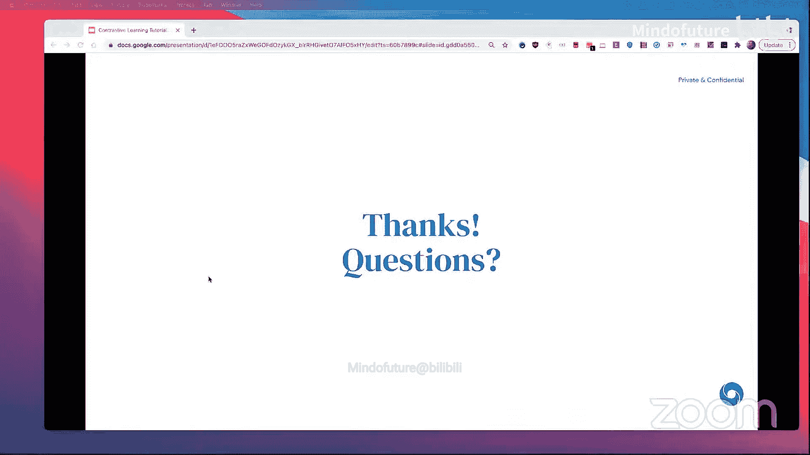

Okay。So for the next talk。😔，It would be me。And。Give me a minute to set up the setting。😔，Yeah。

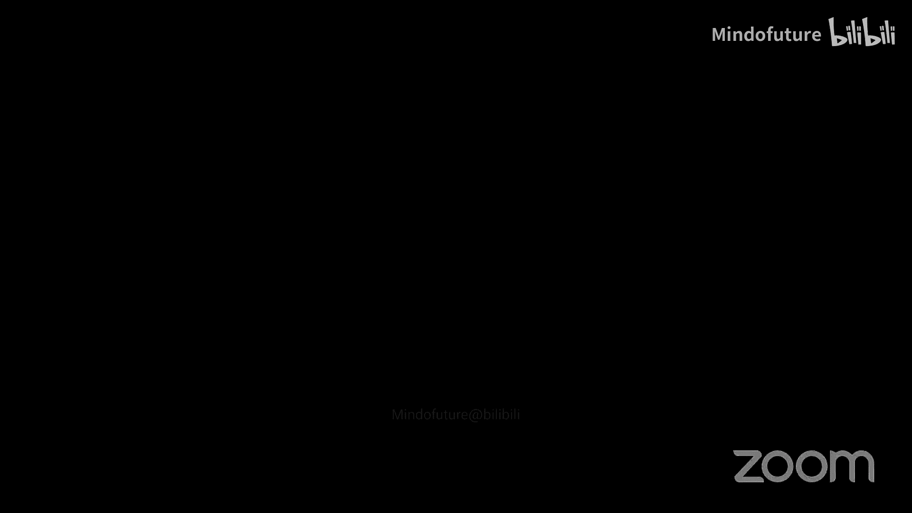

Andre is yes， it's visible。

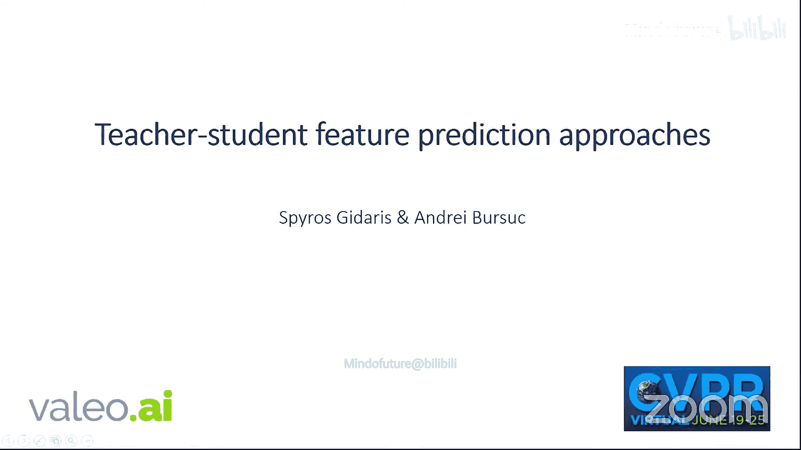

Okay， thanks， by the way， now now it switched to your you have to switch the presenters view because we see。

The presenter view instead of the full screen。You mean so yeah you have to go display settings okay now it's it's full screen out check。

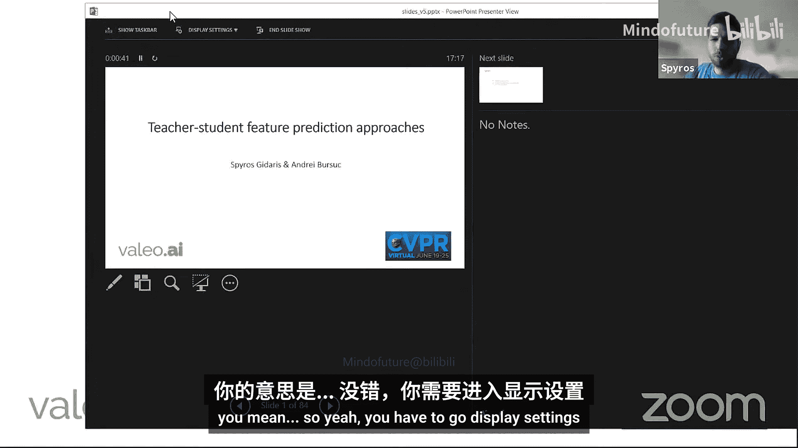

Okay， and before it was the other view for。开始。So I will start now， so in this part of the tutorial。

 I will talk about teacher student future prediction approaches for self supervisor representation learning。

 those slides this talk was prepared together with Sandre that we are both research and value AI。

So the agenda of these talks includes first， I will give you as an introduction。

 first description of some initial methods for self supervised representation learning。

That were proposing tasks based on reconstructing the input image。

 then I will move to the teacher student feature construction methods and then I will finally conclude with the wrap up。

And an evaluation of those feature construction methods。So。

Reconstructing images usually is actually one of the earliest methods for selfupervised representation learning in general the way they work is that they take an input an image。

 they place some random pertuubation， for example some noise on this image or they remove an aspect of that image and then they train an under。

 for example not to encoder to reconstruct the original and pertu the image or the removed path。

The intuition is that to perform this task， the algorithm must recognize the visual constant depicted on its input。

For example， we are better able to discriminate in this se and noise。From the actual elements。

 from the actual signal， if we can recognize the picture digit。So based on this situation。

 the noisy auto encoders take a input a noisy em mass and a trend to reconstruct its original version。

This is a s and classic method for selffur supervis representation lab。

 however this denoing task tends to be too easy and the network can solve it using low level visual cus without actually being required to develop high level illness the second representation。

Another construction task there might be some light on your mic。Or on your speakers。

 I'm not sure there's some interruptions。嗯。Is it really like a microphone noise like when you speak it' it because do you see this you？

😊，No， I don't hear you。You cannot hear me now no no， yes no it's yeah， there's a bit of an echo。

 but it's a lot there's no longer than I think it's worth something in the mic。Okay。

 so I will continue like that， let me know if the there is a problem with the noise。

So as I was saying， another input construction task is to take an image。

 remove part of that image or for example， the central religion here and then print the network to reconstruct the missing image region。

To a couple this task the network must recognize the intention is that the network must recognize that the depicted object here is an elephant and also it should be aware of how the elephant looks like。

 what is used to actually say in order to fill the missing pixels。

So this task requires from the network to present finegra information and also to develop contextual awareness skills。

 since it has to infer the pixels of the region only from the context。

 the surrounding of that region， however， the the pixels of such a missing region can be a very difficult and abi problem that would require from the network to spend a lot of effortfur or capturing usually as details such as the exact color of a pixel or the exact boundaries and by useless I mean that capturing so high level of pixel details does not necessarily to features good for re misunderstanding task which is what we really want to learn。

Yeah。Another research task based on input construction is to colorize the pixels of the scale image。

 so in this case we take elements we remove the color formation by keeping only the lu cell and train the network to predict the colored form action of each pixel in the image。

So to accomplish this task， the intuition is that the network has to understand the exact type。

 for example， of this phase in order to know what is the color of this pixel here and so on。

So it also requires for the network to caps of fine drain formation from the image。However， in jail。

 this input construction task is too hard and ambiguous and forces are inadequate to spend a lot of effort on using the CM details。

So to re up the the main limitation of filter construction methods is that the high level of pixel details that required on those tasks might not be necessary for good representations。

Representations I mean that are good for even understanding task on the other hand。

 it forces the network to spend a lot of effort， a lot of capacity on caping those。

Find grant details on the pixels。One way to avoid the ambiguous and expensiveive input reconstruction task is if you are contrastive learning。

 specifically contrastive methods，re the problem of input reconstruction methods by reformulating the prediction problem into one of the discrimination that is from the representation of an augmented view。

 they learn to discriminate between the representation of another augmented view of the same image and the representation of augmented use of different images。

However， this discriminative approach typically requires comparing each representation of an view with many negative examples in order to find sufficiently close examples so as to make the discrimination task challenging and thus for the network to learn good representations。

Moreover， since we readilyly sample the negatives in contrastive leveling。

 it's impossible to know if the sample negatives are actually images of the same object type or even of the same object instance。

 thus if we sample such a negatives， we wouldly force the adequate to discriminate images of the same object over the same object object instance。

So the teacher suit future construction approaches that I will talk。Here。

 I offer an alternative to the inputory reconstruction methods that allow to learn high level you must understand the task without requiring a negative examples。

行。Specifically in the teacher student process we have two networks to the teacher network and the student network。

 given an image the role of the teacher is to generate a target feature vector。

 then the student to learn representation is interpreting this target feature from giving an input a different random view of the same image。

To that end， the construction loss is applied between the predicted feature here and the target feature here。

 and this construction loss can be the mis square error or the cosine distant or the crosscentro pi loss。

Assuming that the target feature vectors encode high level visual cus and in ignore pixel level image。

 reconstructing features should be a easier and more meaningful task for learning representations than reconstructing input images。

Also， an inevitable advantage is that the student this thing has to predict the same target feature vector regardless of the applied perturbation on its input。

 therefore the student is forced to learn perturbation in varied representations。

So representations that are required to the applied for re and at the same time does not require negative examples as contrasting methods require。

Ter student approaches are actually a quite common technique for disilling the Netherlands of capture from high capacity between T network into a smaller and thus faster student network。

To that end， to geographical the classification task。

 the student is trained to give image to predict the output of tree trained dis for that same image。

This technique is commonly called knowledge disation。

 the goal of having sense an auxiliary knowledge distillation task is to learn a more accurate student model than if we have trained the student only on the classification task so early on available classification levels。

Some examples of teacher targets used in knowledge desillation are the predicted classification logic from the teacher or the immediate features of the teacher or the attention maps extracted from the teacher。

哎呀。However it's important to be aware of some important differences between the teacher student approaches from selfvised learning and knowledge isolation those are that in knowledge isolation you have access to a good teacher good teacher that is pretend a supervised on classification Also the student is typically a small network and the goal is to make it rich the same classification performance as the large teacher level were at least as close to this performance as possible。

In Qra in contrast， in selfsvised learning， we don't have access to a good teacher network。

 in fact since we don't have any human labels available to train the teacher。

 the teacher could be a weak model and the goal is during training to make the student which has the same size as the teacher to surpass the representation quality of the initial teacher。

So the key questions in teacher student future construction approaches for such revised learning is at what the teacher to use。

 how to make the student surpass the student teacher。

 and what type of target features to use for the construction task。

So I will begin by describing some early attempts on future construction based on methods of use static teachers。

One approach is Bot that together with Sandre and other colleagues we proposed we published on CVPR last year。

Bonnet proposed a selfupvised approach that attempts that are constructing targets that can code discrete visual concepts here called visual words。

To this end， given an imagema， the teacher first tracks feature map from that teamma and then converts those feature maps to a bug of gross representation here。

Yeah。As a self supervised task， the student is trained to predict this bug of gross representation。

 given as you call a per version of the image。So in bonnet the。

Proposal construction tasks defined of bug ofverse representations。

 but what are those bug ofverse representations？So prior to the arrival of deep learning computer vision the typical way of describing an image was by extracting handcrafted descriptors from hundreds or actually thousands of passes of that image for example the hand handcraft crafted descriptor could be the histogram of the edge orientations on multiple sub regionss of a patch so having extracted these sets of local descripts from an image one way to compare two different images was by cross matching the two sets of local descriptors however due to the fact that we have too many local descriptors this way of comparing image is very expensive and also prone to noise。

The Bverse model， which is inspired from natural language processing community。

 offers a better and faster alternative for describing and recognizing image based on its extracted local features and to do that it actually propose a model for computing a single image level descriptors from the hundreds or thousands of localscripts that we have available for an image。

Specifically in natural micros processing from where the Baverse model originates a document can be described with a histogram of words that appear in the document。

 this is essentially a vector with as many dimensions as the number of words in the vocabulary of the considered lab and each dimension of this vector poundsce the appearance of the corresponding world or the document。

Similarly， therefore， in computer visual， we could represent animals with a systemogram of local visual features that appear on these signals。

So to compute the Ba voice representation of en， we first need to build a dictionary or vocabulary of the most representative local features in the data set。

 this can be done byJas clustering， the local features extracted from a set of imagess and then using the discovered cluster centroids as a visual course of the vocabulary。

Then to describe enimas， we first assigned each local feature to the visual world of the closest the cluster centroid。

 and then compute the histogram of the visual words of that image。For example， this here。

 this animation here。So going back to bonnet。Bonnenet。

 in order to generate a bug of construction task， it uses a teacher for extracting feature maps。

 local features from animals， and then assigns those local features to the closest visual world ofJa's base vocabulary。

Then having discretized the image over this vocabulary of visual words。

 it converts this discretized version to a histogram of the visual words that appear on this images here。

As I said， the intuition for teacher student approaches is that future construction approaches is that instead of constructing inputs will construct targets features that encode highle visual concepts in order in order to achieve that in order to make the construction targets and encode highle visual concepts。

 we use as a teacher and network that is trained with another conceptual revise method， for example。

 the rotnet method that and the first taskch in the introductory tool where the network strain to recognize the rotation that applied to end。

So and indeed， as we can see here， the visual world classes that Bonnie discovered and more high level visual concepts such as the nose of dog。

Or the length of a course that are rid off of low level pixeling case。

So the B ofverse targets in Bot conveniently encode high level volume statistics from hundreds of the local features that were extracted with the teacher network。

Then the student noted learn representation is trying to predict this bug of Vo representation given a input a perdbed version of the image to that end the teacher gets a pertubed imagema it pass it through a feature extractor this can be for example a reson integral and this feature extractor will now put the global feature vector from that image and this can be example the output of the last global average only layer of the reson heat texture and there is a prediction here that will take as input this global feature vector will pass it through a fully connected layer that will have as many as the number of words available on the vocabulary and then from a softms unit in order to normalize a prediction to have a unit length and this could be the predicted bug of Vo。

To trade the student， we apply the cross centralropy laws。

 letting the predicted soft soft much bug of distribution and then target bulk of distribution。

ANot here that in this teacher student approach， there is a symmetry between architecture of the teacher and the student。

 specifically the teacher generates back course by processing local features by processing the feature map of ens and quantizing those local features over the。

Vocabular or visual hoic has available while the student， in order to predict the bug of words。

 it processes， it uses a global fit a vector of the and pass it to a fully connected layer。

So the overall pipeline of Bot is to start as I says from a selfubvised pretrain network。

 so from a selfubvised Pretrain teacher such as aOnet network。

 then we use this teacher in order to train a student on the back of Work prediction task till conversion for example for hundreds of Fs and then after we have a trained student。

 we update the teacher with this new enhanced student and repeat this training process one or two more times。

So this bugverse reconstruction task by leveraging standard augment techniques such as random image cropping or color distort distortions or。

Deterring the scale or the a of the image forces a student to learn perturbationvari features。

 since a student must predict the same output regardless of the applied perturbation and second context away features since a student to do random cropping。

 it has to predict to infer the words from image regions that are missing from the image that takes and therefore it has to develop context reasoning skills。

This so this bug of construction task leads to new enhanced representations that are qualitatively and different from those of the initial pretrained teacher。

 for example as we see in this table Rotennet is a network that we use for the teacher and bonnet share is a bot model after a one training cycle this here is a bonnet trend after two training cycles and this here is a bonnet after three training cycles we see that there is shoot improvement going from Ronet to bonnet of more than for three sps I think there was a 10 seconds。

I'm not sure if it was just on my head or on your side， but。I will start from this slide。As I said。

 a bonnet leads to new enhanced representations that are qualitatively different from those of the initial pretrained teacher for example。

 in this table， Rodant is the initial pretrained teacher that we use for training bonnet。

So in bonnet here is that the model that we trained after a single training cycle。

 bot times two is a model after two training cycles and times three after three training cycles。

 so we see that going from sorry rotnet to bonnet， there is a huge improvement in terms of the linear classification evaluation protocol that are more than 14 accuracy points higher。

 so indeed the student has managed to surpass the teacher with which it was trained in the setting。

Okay。By those advantages however， the Bot approach exhibits some important limitations。

 one of them is that it relies on the availability of the nonread pretrained teacher network。

 more importantly it assumes that this teacher remains static throughout the training， however。

 due to the fact that during the training process as we saw the quality of the student representations who surpass the quality of the teacher representations a static。

 a frozen teacher is prone to offer a appointment less supervisory signal to the student and to lead to the inefficient usage of the computational budget available for training。

So in this in the remainder of the talk we willll focus on methods on just student approaches that have a dynamic setting where the teacher is continuously updated together with the student。

I will'll start with the buy one method。Bel proposed selfupvised task based on reconstructing the global and feature vector extracted from the net。

😊，Specifically the teacher in bio well gets randomly pertu de image it passes through a feature extractor and so it resonate that output was a high dimensional feature vector from the entire mass then this high dimension feature vectoror is passed from another。

A network component which is called projection mlP that projects this high dimensional feature to a lower dimensional feature with only 200 or 128 dimensions and this consists target feature for the reconstruction task this projection she here this projection mlP is implemented essentially with two。

As the two layered per centralro network。Then the student has to predict this target feature and for that it takes as input put a different random view of the same image。

 it passes from the feature extract of the projection she that have the same architectureor as a teacher and also it has an extra an additional she that is called prediction she or predictionP that will take as you put the projected feature and will predict the feature of the teacher then to train the student。

 the coation is applied between the target feature and the Pre feature。Also。

 another characteristic of biwell is that it has the same loss in the sense that the student。

 given the X tda so one view of the Nes predicts a target extract from the other view and also it takes the other view or x and predicts a target extract using the teacher from the first view。

Similar to bot biowell is based on the idea of building a sequence of student representations of increasing quality。

Specifically given a teacher， the Bi trains a new enhanced student by predicting the teacher feature。

 then itatively applies this procedure by updating the teacher with the new enhanced student and repeating this process。

However， in contrast to bot by well the teacher is not portrayed using another self supervised method。

 instead it actually starts from the same random initialization as the student also the teacher does not remain frozen static during the student training rather than the teacher paras are continuously updated together with the student。

to that1， the Ter parameters， as I say they start from the same random initialization as the pseudo parameters and at its training step after updating the parameters of the student who isto has the gradient descent step。

 the Tser parameters are updated as an exponential moving hours of the pseudo parameters essentially。

If those here are the parameters of the student on step1 and those are the parameters of the teacher on the previous step。

 the new parameters of the teacher will be computed as a linear combination of the previous parameters of the teacher and the new parameters of the student after the class gradient the same step。

 and alpha here is a scholar value that is momentum coefficient and controls how fast or slow the teacher will follow the student。

So with the proper tuning of this moment coefficient parameter。Alpha。

 so by sending this alpha value close to one like 0。99， we can make the。

The teacher to slowly follow the student network。In a continuous way。Yeah。Yes。Just as a note。

 this type of teacher is typically called momentum or mean teacher。

So I will do a here to mention that the teacher student approaches are actually quite common in the same supervisory learning。

Specifically in same supervised learning， a common technique is to apply consistently regularization laws that involves a teacher that given an image。

 it add the classification probability prediction for that image which is treated as a target and is called pseudo label and then the student is taken it takes an put a randomly pertu version of that same image。

And its trying to predict this。This pseudo label that was exactly with the teacher。

 so this consistency loss applies on both the label and on the label imagess where the classification loss will be applied only on the label imagess。

The goal is through this consistency regularization laws to force the model。

 the student model to learn。Better representations， better。

Beta classification model exploiting raw by exploiting unlabeled data。So mink teachers have be shown。

To improve the results in same supervised learning with this consistency consistency regular utilizationization set。

The reason is that ME teacher can be seen as to be similar to an assembledem of the student model caps from different training Ss during of the model。

 so like a table and assembly of the student model。

 however a mean teacher instead of averaging the multi predictions from different snaps of the student model。

 it averages actually the weights of the from or those snapses training samples。

 so this offers a more stable and more accurate network for providing targets for the consistency regularization loss than if had used the student itself for providing those targets。

Also， in contrastive learning， MoCO uses a momentum encode。

 a momentum teacher in order to maintain consistent representations of negative pairs strength from a memory body。

So going back to Biwell bywell can be seen as a mid teacher approach but without any label so in bywell the momentum teacher or the mid teacher offers stable but slowly evolving feature better for the construction task and when compare to bot is a more efficient alternative since it doesn't require a pretrained teacher and it does not。

Fhroze a teacher during the training， a training cycle。Yeah。

So another key element of bio is that it has also an asymmetric architecture。

 specifically in the teacher and the students the same have the same architecture for the feature extractor and for the projection she。

 but the student has an extra and additional prediction sheet as I already talked about。So。

Bio can be seen as。This actually when compared to contrastive methods。

 does not require negative examples in order to learn representations。

Due to that by well is less affected by the bad size used for a training。

 so simply this cloth here we see with blue is the contrastive method called simpler as Ar Ron already talked about contrastive methods require typically a lot of nedes in order to learn。

Interesting representation so and this is usually provided by having large mini batchs in order to have many negatives so if we reduce the batcht size the performance of the contrastive method simpler drops drastically in contrast the performance of bioL is read here is more robust with the respect to the batcht size and which is expected since it doesn't require a negative。

Also by well it's shown to be more robust with respect to the augmentations that are used for training。

 so we see here that as we remove some augmentation techniques，The contrastive metal simpler has a。

A dramatic drop in its performance， while bioola is more robust， has smaller drops in performance。

Another interesting finding is that by well is。In by well。

 a cropping grto cropping is more important accommodation than。While in in simpler。

 color littering is the most important augment， this hint that bywell is maybe less about distance discriminationri and more about context prediction。

 making it more similar to the balance approach。So， since。

These dynamic decision processes don't require negative examples and the teacher is continuously updated to slowly fold the teacher while we avoid feature collapse so feature collapses both a teacher and the student to output a constant feature which will actually minimize the reconstruction loss。

Before I move to this about this subject I have to note that in Bahwe the teacher network is not explicitly trained to optimize the construction loss by that I mean that there is no gradients back propagated through the feature structure of the projection she of the teacher instead the teacher is updated with this momentum of days and the dynamics of this。

Biowell setting are not necessarily in the direction of minimizing the construction loss in the sense that biowell does not explicitly optimize the loss with respect to the teacher parameters However。

 this does not prevent。Yeah。FF collapse still might happen in some cases。

So because I'm suggested that the reason that biowell avoids fish collapse is because batch normalization units is by well。

impmplicitly causes a form of contrastive learning in the sense that collapse is avoided because all samples in the mini buds cannot take on the same plasma view after batch normalization since they are normalized to have zero min and units under the VAs。

However， it was shown from the Office of Biwell that Biwell works even without batch statistics。

 so it works even without the batch normalization unit。

 specifically we see here this is a vanilla bywell。

So the typical biowell method and if we remove the batch layer indeed we have a feature collapse。

 however with better tuning of the random initialization of the teacher and the shootter parameters。

 then we can still learn good representations also if we replace the batch layers with group normalization weight as standardization。

 they that are not dependent from the other samples inside the minis。

 the biowell still can list very good features that are almost as good as with batch。

So this means that the bus nor maybe are not the only reason that biowell avoids probably is not the reason that the biowell avoids future collapse。

It，In the bioin paper the hypothesis was that the momentum teacher。

 actually bioena feature collapse because the momentum teacher allows to have a near optimal student predictor that forces a student to encode more and more information within its projected features。

 therefore the feature would not collapse the projected feature would not collapse to constant feature。

So it was shown that removing either the predictor here。Or removing the momentum T year。

 the bio end will collapse and constant features， will collapse and will not earn anything。So in。

Both the momentum teacher and the。The a of having an external prediction set shelf for learning good features。

However， new work called S Xam it was shown that the momentum teacher is not actually necessary。

For learning features， for avoiding feature collapse in this Bi setting of teacher student approach。

So they showed as in this group， essentially the teacher is identical to the student。

And they showed that the momentum teacher helps to improve their performance so to learn better representations。

 but without it， the approach still is able to learn good features without having and suffering from the problem of feature college。

Insteadsstand。In this paper， the authors argued that the most important ingredients for avoiding future collapse is stop grant operation operation here and additional prediction shared that actually without them。

 the network will be trained essential to minimize their construction loss for both the images suffer from future collapse will be led to constant features。

Okay。Anotherル。This certain approach for future construction is deal。

I will be briefly about this paper since Matt in your next talk will talk more extensively about this work。

So some of the key elements of this method， however， is that。

Instead of using the consent distance it uses a consent forpy loss。

 so because of that the search max operation has to be applied on the outputs of the teacher and the student and the network in order to avoid feature collapse does not in the prediction she。

 but instead it applies some post processing of the teacher output those up to center the teacher output here by trackinging the big feature vector which prevent collapsing into constant one hot targets where some dominant features constantly activated regardless of the input。

And sharpening the targets by using a loss of thermal temperature share。

 which will prevent collapsing to a uniform a constant target vector。So En goes on that。

In this setting， in Deno setting crossroent is important for a genuine good performance without the moment in teacher Dno will suffer from physical collapse and in Dno the predictor is not necessarily actually Dno works better without a predictor。

In the first part of in the beginning of my talk， I talk about bonnet that has， as I said。

 is able to then perturbation embarium the context aware of features。As I said， however。

 it has a limitation of because it uses a frozen teacher。

 the supervisory signal offers for the training of the student is aum。

So to that end in this CVPR we propose a new backword based approach called OO that overcome this limitation of Bot。

 specifically the key elements of fo R2 one， it has a fully online teacher pseudo learning approach for B ofword based selfprovis training and also let's。

Ler representations but by enforcing contextual reasoning skill and contextion reasoning skills。Yeah。

So in ObB， instead of using a P teacher that remains frozen during the training and offline K means vocabulary as B does。

 ObO uses online updates both for the teacher network and the visual vocabulary。

So in order to online update the teacher， it uses the same mechanic as bioware。

 so it uses an explanation moving governance of the student parameters。

However in the Bverse prediction task we also have a vocabulary and since the this is constantly updated offline length the vocabulary of visual goes 15 minutes is not a viable option anymore。

 to that temp we use a two based vocabulary of random features specifically that its training step we update the current vocabulary by selecting one feature vector very much from the current minibus added using this selected feature as a new visual word and then we added to you the Q while removed from the Q the all item so the older visual ver that goes in the Q。

To learn the presentations， the suit must predict the bug of words of animals。

 however in noble the vocabulary is constantly updated。

 the words are changing from one step to the next， therefore predicting the bug of words with a fixed linear layer as one and dust will make training impossible。

In standing No， we use a dynamic back ofose prediction sheet that can adapt to the evolving nature of the vocabulary。

Specifically， we employ a generation network group that takes as include the current vocabulary of visual words and produces predictions waste for them using the two layer perception。

 specifically for its visual words on the input， the two layer percentnra would output a weight vector。

And this would be the prediction weight that will be used then to predict the bug of G。

 we compute the scholar product between the students's feature vector and the produce weights and then pass the results so a assessment operator in order to predict the bug of course is reduce。

Apart from fully online training OB it improves overbonnnet by further promoting the learning of contact survey features to that end OO uses to techniques fast。

 the student must predict the bug of course of the original image here using as you put very small returns of that image that's definitely iny。

And the student to infer visual words come from hidden image。

Also the second technique is to multi scale to use multi scale bug ofverse targets。

 specifically apart from the con5 features who extract bug ofverse。

 also from the conf features of the teacher， the latter have a smaller receptive field。

 which means that the visual horse coming from hidden regionss would be less influenced from visible to the student thus better promoting context reing at the Susan side。

Since the B ofverse targets， a computer using a constantly updated set of randomly assembled local features by construction does not suffer from future collapsell。

 thus making it robust to the momentum coefficient in Tfa and that is used for the momentum teacher。

So as we've see question in this table， even setting the momentum coefficient to zero。

 which means that the teacher is the same as a student。

 the network still manages to learn good features that which however are not as good as with a better tu of momentum coefficient close to one。

 but still are good features。好。So we'll move now to the last part of the agenda。

 which is wrap up evaluation。Of the methods， future construction methods that I presented。

So we see in this table， we evaluate the Re 50 pretrained methods with several silkcurvis methods and those are evaluated on linear classification task on imgenenet places in Voc 2007。

We see that the fixture prediction methods are actually achieved excellent in。

 often sur passingssing， mostly these arepa passinging contrastive methods。

Also we see that all that despite the fact that it's pretrained using only 200 epos while others are pretrained with many more epos and shift on par or better results on this evaluation product。

Also O achieves the state of the art results on the same supervisor evaluation protocol despite using fewer approximately competitive methods and also strong results on the bulk of the detections and task。

So to conclude。Fitzture construction and selfupvised methods are again gaining ination in the selfupvised community。

 they have they managed to learn as we saw state of the results without requiring negative examples and very often surpassive and supervisoror representations。

 however it's not entirely clear why they avoid future code labs。Still。

 and actually the peculiarity of physical enlase in the teacher student approaches has inspired other ideas midway between contrastive and future construction methods。

For example， methods like bundles include the letter presentations with specific behaviors by learning different views of the same input。

 by leveraging different views of the same input and information from other not related values in the same meaning。

Also classical install methods can be seen in teacher student approaches I didn't cover them in this part of the talk because actually Mattil will talk about them in the talk that follows。

And this concludes my talk。

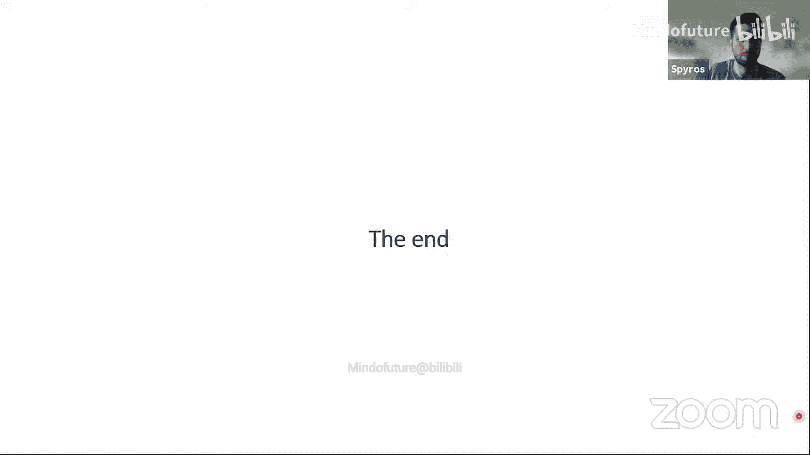

Okay so。We have some questions。Well I responded to some in the chat but I think it's what it can be helpful to respond them live in case somebody is missing the chat so it's related to Bot should the teacher be pretrained with all in domain label data in hand the existing data or use imageNe for this task what happens then if a target classes is missing EG horse so I think it's maybe it's a bit of a misunderstanding that we we don't use the classes there yes we don't for the teacher we don't use labels in order to pretend if this this is a question Yes we just Bot as I said requires in order to have good performance。

Some initially good features the teacher to have some initially good representations we pretend with another supervised method so with roten specifically the trends are not good to really the rotational supply to a so still is completely unsvised have there's a question regarding the vocabulary so how to define the visual vocabulary does the grain of vocabulary has an important impact on the representation learning for NLP vocabulary is natural well for images it seems abiuous。

Yes， so the bonnet or the vocabulary is actually discovered from the data sets of the training imagess that you have available by applying chains。

 so it's cluster。would be one visual words and indeed you have to select a proper number of of visual words。

 however from the experiments we have seen that choosing the number between 2000 and 8000 is enough and is robust in this range of。

Visual words vocabulary size。And there is a question on Bot again when you were transforming the student in the teacher and starting again。

 if this leads to twinstaabbilities or not switching the student。

From time to time you repeated a bit so in Bot you train firstly with Rotnet as a teacher and you have a student and then at some point the student becomes a teacher and you train another student in does this lead to any intabilities during training you're do do some specific things for that I know this alternative training model doesn't lead misability and well there's I don't know with Baki whether to read this question here at the end so there is a question on why contrastive learning methods perform outperform pretextupvised learning except for Sw all the contrasting learning methods don't learn anything from explicit inatory examples with respect to each other in a data set instance discrimination。

I guess the question was yeah， why contrastive learning is better than Rotnet and Jigsaw and the others。

Yes。嗯。So， I mean， those initial Zigaw ronet methods were a bit。

C shape they were defining tasks based on intuitions like that in order to recover a natural location。

 you have to。Okay。是。To recognize the depicted object or in order to solve a six of puzzle。

 so in order to correctly order the passes you have to recognize the depicted objects。

 but in fact quite often there were trivial solutions that were。Leading to。To。

The network would sit and not learn good features， so actually the task itself。

It wasn't leading to so strongly representations because was very like predicting only four classes for rotation prediction is very crude。

 while contrasting learning where you have to discriminate between images。

 it more it is so empirically actually that to learn better representations so to representations that vary for example and that can discriminate between images。

And I would say also the task is more difficult and indeed it benefits from longer training。

 whether the rotnet and the others might saturate at some point， I guess。

Well with this you have a spectrum of very a large spectrum of data augmentations and pairs of positive and negatives right and this allows well an expectation to learn to learn more so this is why we see these methods strain on such a a high amount of iterations and what I guess is also it's generic metric learning right if you think of contrasted and the information well there's a lot of information also coming from the data augmentation。

Okay， well somebodys asking for a review on data augmentation strategies I'll put it in the chat but I think in simpler they do a very nice ablation on the impact of pairs of data augmentation strategies or individual ones over the impact of the performance and in general the rule of thumb for subsvision is。

More aggressive than in a supervised learning so whatever the orientation strategy。嗯。Make。

I think that's it。Oh。Yeah， and the question while the comment is that contrast learning forces the model to discminate multiple two images of a course just because they appear in two different examples could be detrimental to learning representations yeah that's one of the drawbacks of contrastive learning that the negative might be actually a positive。

So let's move to the next talk yes， yes， and Andrea no its case material now。

very so now we're to because her talk was at 1805 and it's 1808。😊，Okay。

 so well Mattil unfortunately could could not make it for the life。

 but she sent us a nice well video that I will be putting on on streaming right now so it's in the same session it it will be launch in。

😊，In a second。

Okay， so you should be visible now on the screen。Itsspec hospitals so。Hi， everyone。

 I met the last year PhD student at Fair Paris and In Riel。 And today。

 I'm going to talk about clustering style self supervis now。 So let's div in。😊。

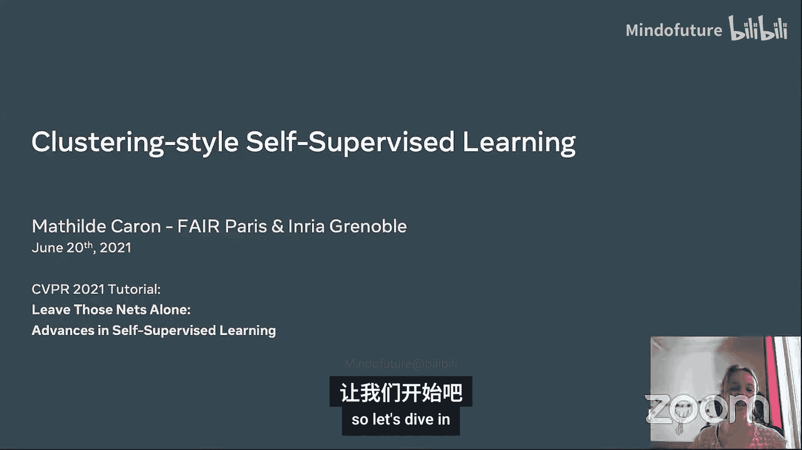

So as you may know at this point of the tutorial， a search of learning consists in designing a learning task that does not rely on human annotations and I think a good example of it is colorization where you actually train a neural network to colorize input grayscale input input images。

And here， the hope is that if the network is good at solving this task。

 then it would have acquired a good understanding of the scene and objects presenting the images。

And you see that for solving this task， you don't need to have any labels because the target。

 the RGB information is already present in the images。So that is a pretext task。

And in the past years， designing Sevis learning task has been a very active research area。

And so in this presentation， I'm not going to talk about all of this contribution。

 but mainly about the clustering based approaches and in particular。

 the contribution that I did during my PhD。And so at the beginning of my PhD。

 all of this was unknown and actually at this point。

 self supervised learning was not working very well。And in that。

 I mean that it was working below the performance of supervised pro training。

So let's start by see what we do when we do have the labels。

So supervised per training often takes the form of label classification。

And so here we train a neural network。To classify the images into the corresponding labels。

 so for example， here the label of that image is Mon and so we train the network to classify it into the maintaine label and it turns out that if we train the network long enough on a like large scale dataset set。

Then it learns useful representation that are going to transfer to many dolphin tasks。

But in our case， we do not have any labels so we want to I mean our motivation was to try to adapt or mimic this supervised label classification task。

 but in the absence of labels and so if you think about it。

 the labels or the classes in the data of they kind of form a clustering I mean a grouping of the images into the different classes and so we thought maybe we could use clustering to generate pseudo labels that we could use to train the network。

And so can we replace labels with clustering。So that's the question we address in Deep clusterster。

 which we presented at ECCCV in 2018。So indeed cluster， we start from an unlaable data set。

And so and then we take the representation given by a neural network for this entire data set。

 And this is represented by the do in the feature space。And so， for example。

 the dot on the top could be the feature representation of the image of the mountain。

And so now we perform a cameian clustering in that feature space and the。

Cloluster assignment of the images are going to。To be the pseudo labels for that image。

 so for example， the feature representation of the image of the mountain belongs to the yellow cluster and so now the pseudoo label for that image is yellow cluster。

And so now we have a data set with pseudo labels given by the cluster assignments。

 and so we can actually train the network to predict those pseudo labels and so we do so exactly as in the same way as in supervised learning with label classification but instead of labels we use pseudo labels given by cluster assignments。

And so we trained the network this way for one e book。

 and then we freeze the weights and we do another pass on the data set to have refined new cluster assignments。

And so we it between this feature feature learning stage and refinement of the pseudo labels with cluster。

And so here， one motivation of why this would work is that we are kind of bootsrapping on a randomly userized network。

So as you may know， a network with random weights has bad representation。

 but not completely random representation。And so if we actually do a clustering on this on this representation。

 the clustering is going to be bad but not completely random。

 And so then if we train to predict this bad but not random clustering。

 the weights of the network are going to improve slightly。

 and then the next clustering will be slightly better。

 And so this clustering and feature learning stages are improving one another。

And so that's one motivation of why this would work and another one that we actually discovered when training the network。

Is that we are implicitly learning invari to cropping。 and so at this point。

 if we use exactly the same code for the cluster assignment part and for predicting this cluster assignment。

 then we do not learn any useful features。And here it's super important to actually apply a data augmentation so random them copying of the image when predicting the cluster assignment。

So now that we have a method to pretrain neural network。

 we want to evaluate this pre traininging and so how to evaluate self supervised learning。

So where we use the lung representation for solving downstream disk。And so in our case。

 we will use object detection on the Pascal VOC dataset set。And so here。

 the object detector that we use is fast fast R CNN。

And so the neural network weights can be neutralized by different ways。

 So either we start from random weights。 So there is no proing。Always start from supervised weights。

 So its weights which have been portrayed with the label classification task。

Or we can start with the weights which which come from the self supervisorvised pre training and one of this self supervisorvised pre training is the deep cluster the training。

So now let's look at the results。So we are looking at the mini precision on the object detection on Pascal US。

 And this is the performance when the networks had no pretraining。 so random waves。

And within that when we apply self supervised pre training。

 we have a large boost of performance compared to no pre training at all。

 and these were the best self supervised published results at the time of the cluster publication。

And so Deepluster was outperforming these best published numbers at this time。

 but it was still below the performance of supervised pre training。

So another interesting thing about the cluster is that it also produces cluster。

 which is interesting per se， and which is like。Research direction in itself。

 And so we can actually visualize these clusters， which is a nice way of spending a PhD afternoon。

And we can also evaluate ca quantitatively in this cluster。

 And so here we are looking at the normalized material information between the clustering that we get and the real classes of imaginationgenenet and we seen that this like correlation is improving over the time of training。

 So it means that the cluster that we have are becoming more and more similar to the real classes of hegenenet。

So yeah， that's it for the presentation of deep clusters。

 So I think I kind of see it as a proof of concept that we can use clustering for selfsupervised learning and that it works well。

 but there were like many limitations with the model which we're going to to to look now。

But I think the main limitation of the clusterster is that it does not scale and it does not scale because it depends on the dataset set size。

So here we start the cluster by performing a first clustering on the feature of a Ho mini network and then we train it for one epoch with this cluster and so then we do another pass on the dataset to perform a new clustering and so here the clusters are refined and so we do so for each epoch of the training and so it means that during the whole training。

 the clusters are refined the same amount of time as there is epochs in the training。

And it's very important for， I mean， it's very intuitive that it's important for the performance of deep cluster that the that the clusterings。

 so the pseudo labels are refined regularly during training because they want the clustering from the beginning of their training are not very good。

And so now this does not scale when we have huge data sets of for example。

 billion scale data set where in this regime we can usually afford only a very few number of epos so for example。

 here， let's say we can afford only two epos， then it means that the clusters are going to be refined only onces。

And even worse， like if we have an even bigger data set where we never see an image twice and we only do one a book。

 it means that the clusters are never refined。So we really need to adapt deep clusterster to I mean。

 to to have a method that works online。 And so that does not rely on this on the sides of the dataset。

 and that does not rely on the notion of epoch。So another main limitation of the clusteror is that we are wondering if we are really。

 if we really need cames， so that's in more detail。 So this is the I mean。

 the representation of the feature space where we perform camin clustering on the entire data set。

And so a Cam in restaurant gives us two things。 On the one hand， it gives some。And on the other hand。

 it gives cluster assignments of pseudo labels for the， for the dataset set。

But here it actually turns out that we are not using this this sunroids at all。In our algorithm。

 and the only thing that we are using are the cluster assignments are the pseudodu labels。

So here we have an algorithm that gives us like too many inputs， too many outputs。

 and so that is a reason why it's possible we don't need it that it's a kind of overkill for the problem that we are facing。

And then a third limitation of the cluster is that we are using tricks to avoid the collapse。

 and so the collapse of the representation is the following。

 It's when all the representation are mapped to the same output。

 and so in this case we have only one cluster and so here all the images in the data set we we have the same assignment。

 And so in this case we have I mean the loss is at the minimum。

 but we have not learned anything useful。ButAnd in the cluster to avoid this situation from happening。

 we are using tricks like sampling tricks。 So for example， if a cluster is becoming empty。

 we take the biggest cluster and we divide in into2。

 So that's that's very like empirical and heuristic to prevent this situation from happening。

And then the last limitation of the cluster is that， as we have seen。

 there is this superim of the random proppying， but this is only implicit。

 and this is not accounted for in our formulation。So at this point。

 we were wondering how to overcome this limitation and maybe overcoming this limitation would allow us to have a better model。

And so addressing this limitation resulted in the suwave model。

 which we presented at Nares last year。So I'm going to introduce how we change the way we generate so the labels in s compared to the cluster。

 So this is like。For you to remember how we were doing in the D cluster or we were doing came in in the feature space and so here to get the cluster assignment and so the so label ball of an image we were comparing that feature representation of the image to the different cented and we would pick the cented so the cluster which is the closest to this point。

So let's do this process again， but by reporting the scores of similarity with the difference cent into a table。

So we compare with the light grey century。 So it has a， it's very far away。

 So it has a low similarity。And so the yellow sunry is very close。

 So high similarity and the dark gray suned is far away。 So low similarity。

And so that's how we get our yellow sodu label。But here will observe that actually all we need is a score for each cluster。

 We don't really need to go through this sensor generation process。

 and we only need to have a score for each cluster。And actually。

 having a score for like1 different dimension， it's something that we can use a neural network to to produce so we can directly use the neural network to output this scores。

And so that's what we do in Swb。 So we simply do a forward on the on this forward pass on this image。

 and this gives us like score for like the K or three different output dimensions。

And so this is inspired from the work cellar and the unsupervised image classification。

So we also need to have some kind of constraint to avoid the situation where like only one output or one cluster is dominant in the in the in the assignments。

 And so for this， we're going to like。Imose a constraint where the total score for each output must be the same。

So let's like accumulate the different scores for the for the different outputs and the different images。

 So here we start accumulating。 We have a new image with a new target so we accumulate the scores and we do so for the entire dataset set。

And so we seen that now the constraint is not satisfied。

 and there is like naturally one cluster that will dominate。And so for this， we use a， I mean。

 in order to， in order that the constraint is like satisfy， we use an optimal transparent algorithm。

 So single on nu that will adjust the different clause。And so this way。

 the cons is satisfied and all the output， all the clusters are like selecting the same amount of time。

So let's recap what we have so far。So we have seen that we don need Ks to generate pseudo labels and we can actually use directly the output of the neural network to have these pseudo labels。

We have seen that we can use an optimal transport algorithm to like incorporate explicit constraints to prevent the collapse。

And also， this new formulation allows us to have a scalable approach because here we only need。

 we only work with the mini batch。 And so we only apply this constraints and this assignment on the mini batch and not on the entire data set as we were doing with the Kmin on and the crystal。

And so it means that we get the pseudoable at each mini batch of the training。

 and so it does not depend on the notion of epo or on the data size dataset size。

 and so we can potentially train it on like a data set of any size。

So let's look at the full picture of ss。 So here we are given， we take a mini batch of images。

And so for this mini batch of images we're going to take for each of the image。

 one that augmentation and well look at the and we'll generate a the label for each of this by simply looking at the output of the neural network and here remember that we need to do a score adjustment to prevent the collapse and so we do so with syn on。

And so now that we have the pseudo labels， we want to actually predict these pseudo labels and for this we take another data augmentation from the images of the batch and we predict the so labels and that's how we train the neural network。

And so here we are also using like some improvements that come from CCella， which came out last year。

And so some of these improvements are like improvement on the data augmentation that is used on the optimization and also on the neural network architecture and so for example here we are using projection heads on top of of the neural network backbones and that improve a lot the performance。

And we also got inspiration from SCella because as their work from the same mini batchge。

 we take like two data augmentation for each of the instances in the mini batchge。And so yes。

 so here like exactly as in a deep cluster， it's very important to have a different data augment。

 so a different hom cup for the image that will give the plus pseudo label and for the image that will actually predict that pseudo label。

And so here by doing so， we are actually learning invariance to random copying and to that augment because we want to predict like the information of one cop given the other crop。

And so。Yeah。As in depressionor， this is absolutely crucial for the method to work and if you remove this ho copying then you basically don't get any cement I mean any useful features and so at this point we were wondering if if we could reinforce this signal and so if we could reinforce the importance of this random precise copying in our training and that's what we tried to do with the multi。

And so this was also inspired， I mean， our。The Mintic copy is also inspired from jigsaw and Npre。

And so here， what we do is that from an image， we are going to take like two different sets of hopes。

So one set of crop， which we call the global cops and which cover like a large part of the image。 So。

 for example， more than 50% of the reality of the image。And then we will also take like local cops。

 which are of smaller resolution。And which cover like only zooms of the image。 So less than 50%。

And so now what we do is that the local cops should predict the so label given by the by the global cop and doing so we are like encouraging local to global matching and as we will see in the next slide。

 this is super important for the performance。So let's look at some results now。

 so we look at the linear benchmark of Inet， which is a standard benchmark for evaluating cell supervisor approaches。

 and here what we do typically is that the neural network is portraytrained with the cell supervisors then the weight are frozen and we train only a linear classifier on top of this one presentation。

So here is the performance with two crops， and there is no MItic crop happening here and we are comparing sinceclella。

 which was the state of the Earth and the time of s publication。D clusterster of V2。

 which is an improved version of deep clusterster that we use as a baseline inwa。And finally， s。

And we seen that deep number2 and so， outperforming sinceella by two points on this benchmark。

And also you will notice that D plus R2 is performing very slightly better on than sb。

 So I think it's that I mean， it's like a noise level。

 but we still prefer swab because it it has much nicer property， as we have seen before。 So。

 for example， it has the nice property of but not depending on the dataset set size。

 And so it can scale on yeah， on billion scale dataset。

So now let's look at the results when we train this method with our multiCp strategy and so here we will use two global cops and four local cops and so we have adjusted the resolution of the different COs so that this setting has the same computational requirements as the setting without multiCP。

And so we've seen that using this multi strategy improves the performance of the three method。

 like considerably。And interestingly， the classroom based approach seemed to benefit more from that effect。

And so all in all in Su， we got an improvement compared to S of 6% on this linear benchmark on imagine it。

But perhaps more importantly than this benchmark on Manet。

 we want to evaluate the capability of the features to transfer to nonwim task。

 And so here we're going to compare like cell supervised or swab and supervised per training and remember that when we were evaluating the cluster we were still below the performance of supervised per training。

And so here we will consider like a different down swim task。 So classification on places。

 for example， on Pascal VOC and on anyatist。And we will also consider a transfer task with object detection with full fine tunings on Pascal US on Coco and on Coco。

 we use two different object detectors。 so， mask or CNNN and data。And so in gray。

 we showed the performance of supervised play training。And in yellow。

 that's the performance of12 pre traininging。 And so we seen that remarkably this performance is better than supervised per traininging on all the considered transfer plans。

And I think at this time， that was a great milestone for SE supervised learning to be able to actually outperform the performance of supervised patron traininging and there were many workss that were having the same observation that we had in。

And so overall， I think 202020 was a great milestonestone year for selfupvised learning and like some works achieved excellent performance on Inet。

 so for example， sincere L V2 and bio rich performance that are like above 79% on Iate。But， I think。

In my opinion， the recent self you provide methods are very similar to each other and they all more or less followed the same recipe where from an image you take two different onm solidized crop so two different crops and you want to somehow match these two representations and so as you have seen during this tutorial there are many ways to actually operate this matching so you can do it with a contrastive loss you can do it by directly matching the representation like in bio you can do it through like a cluster assignment as we did。

 but all in all what you're doing is really like learning this invariance to that augment and more importantly to cropping。

And so the fact that all these methods follow more or less the same recipe has led to a somewhat saturation the in the benchmarks this year。

And so at the beginning of this year our mindset was to try to seek progress in an autogonal direction and like for example we have seen that there have been like recent advances to applying transformer to a visual task and to emerge classification task and so at this point we were wondering the ring can we improve selfupervised learning by using visual transformer。

And so this is the question we have studied in our recent work Dino and that I'm going to present now。

So Com have been the de facto architecture for images。 and recently， as we were saying。

 the vision transformer have emerged as an alternative to them。

 And so now I'm going to very briefly like review this vision transformer architecture。

 So that's a figure from the dosoquiator paper。 So here what you do is that from an image you're going to patchify that image。

 So it means that you're going to divide the image into non overlapping patches。

 And so this gives you a sequence of patches that you're going to embed into feature space。

 And so now that you have this patch embeddings。 So this sequence of patch em beddings you're going to process it with a transformer encoder。

And so here importantly， we also add class token whose role is to aggregate the information from the whole sequence。

 and so we take its state at the output of the network as the representation of the image。

And so here on the transformformer encodeel is really like a multiy head， self attention。

 standard transformer architecture。And so， yeah， let's look at some results when we actually train Swab to either with Con or with vision for。

So here we're going to consider two different benchmarks。

 So linear evaluation and also KNN evaluation。 So linearar is the one that we were considering before。

 So linear evaluation on imagenet and so KNN is a simpler evaluation where there is no learning at all So we simply a computer representation of a data set given by our pretrain network and we simply apply a KN classifier on this representation So it's kind of zeroshot learning in this case。

 because we are not doing any gradient update or we are not learning any weights for this evaluation。

And so this is the performance for sve with Con。 So as we were showing before。

 And so now let's see what happens when we train swave with a vision transformer of the same size。

So here the results are quite disappointing， so in linearar we are all losing about like two or three points and in Canan it's very slightly better but yeah not very significant。

So simply applying swab to this vision transformer， I mean， it's working。

 but it's not improving anything in any ways。 And so we tried so here I'm showing the results forswab。

 but we also tried using Moco V2 and also bio and we were having like the same conclusion with this different works。

So at this point， we were thinking， okay， maybe we need to improve our method and try to to have a method that will perform well on this on the vision for architectures。

So here we started from Swab。 And so as you remember， that's yeah， that's how swab works。

And so here inspired by different works， so in particular Moku and Bayur， we replaced I mean。

 the neural network that we use to get the pseudo label。

 we replace it with an exponential moving average of the main network。

And we have seen that by doing this small change， we actually have a large boost of performance in the benchmarks。

And so not only using this exponential moving average or momentum network improves the performance。

 but it also stabilizes the training and it makes it more robust to avoiding the collapse situation and so it means that in this case we can simply remove the synon algorithm and remove this reliance to the optimal transport algorithm。

And so that's our method know， which we self dist with no labels。

 because if you actually look this model like straight into the eye。

 you see that it's actually like exactly an unsupervised self dist model where you are training a student network to match the output of a teacher network。

 which is built network from the student previous instances。So here， yeah。

 there is something that we need to do in order to avoid the collapse。 So yeah。

 we there is still something that we need to do。To avoid the collapse to one unique representation。

 And so here we use centering where we compute the average score for the different output dimensions from the different images in the batch and we subtract that average score。

 and so it does not look like this because it's probability in distribution。

 but by doing by doing so， we have seen another form of collapse。

 which is the collapse to the uniform assignment。And so in order to prevent this situation from happening。

 we want to enhance the small differences that there are in in this score for different dimension。

And so we do so with sharpening and sharpening is simply using a low temperature in the。

 in the softm optor。And so this way， intuitively， like we are kind of forcing the network to forcing the teacher to actually make a decision and to choose a dimension。

And so by combining these centering and sharpening operations， we。

 we managed to have a training without any collapse。

So not that we have present the Dno search provide method。 and let's look at some results。

 So as we did forwab， we are going to compare the performance with Comnet and vision transformformware。

 And so that's the performance when training Dno with Comnet。

So it's like at the same level at it's more or less and the same level as what we had with Swwab。

 And so it's kind of reflecting what we were saying before that there has been kind of saturation in this benchmark when using conventional networks。

But now the story is different when we train dinner with vision transformer and we see that on all the on yeah on both benchmark。

 we have a very significant， significant boost in performance。

 and especially in the canan performance we are we are seeing this boost of  seven points。

And so we have evaluated like different vision transformer with a D training。

 And so here for different level of of compute requirements。 And so here on the way axis。

 we're looking at the throughput。 So， so it's like the。It's kind of a measure of the inference time。

 And so if you go on the right hand side of this figure。

 it's like networks which are very fast to train and on the left hand side it's like network which are very slow and heavy to deploy and to train。

And on the Y axis， we look at the performance on Inet with this canon evaluation。

And we seen that Dno plus vision transformer across the board is like having a large improvement on the the performance compared to prior works。

 And so compared to prior works that using conet and also prior works。 I mean。

 like moku or bio or swab that are trained with vision transformer。

 So it's really the combination of this selfupvised method and the vision transformer architecture which are going which are giving this like。

Nice property of having good canon classifiers。And so actually。

 having good KNN expressivity has many application in image rerieval or also in copy detection。

 as we're going to see now。😊，And so on the task of copy detection iss like when you have an image。

 you want to find like duplicates of that image into a data set。And so this has many， I mean。

 that's a very interesting task for Facebook， for example。

 for like when there is let's say an image of propaganda of terrorism propaganda that is uploadloed on the platform you want to be able to actually yeah you want to be able to remove that image from the platform。

 but also all the potential copies that have been made of that image。

 so it's important to be able to retrieve that copies。

And so it actually turns out that you know is very good at this copy detection task。

 even though it was not trained especially for it， and it's actually better than the same vision transformer network trained with supervision or multigr。

 which is an architecture， which was an task， which was specifically designed for this copy detection task。

So that was quite exciting to have this results on cooking detection。

And so yeah to summarize what we have so far， so we have a Dno which trains to high performance with vision transformer。

 it has like like very particular KNN expressivity and this has many many potential application and we have shown some of them for copy detection and image retrieval。

And we will see finally that training self supervised learning with vision transformer provides like a great interpretability of of what the networks are paying attention to。

And so here we're going to visualize the self attention of the class token on the last block of the vision transformer。

And so weve seen that the attention is really paying attention to what is salient in that image and if we。

 for example， threshold that self attention map。We obtain kind of segmentation mask completely for free。

 So I say for free because the network has not been trained with any labels and also。

 it has not been trained with any like segmentation mask。

And we were actually even surprised that we we could have like dense like patch level representation。

 even though the self supervised task is only for， I mean。

 it's mainly focusing on global representations。And so we can actually do this visualization for different images and we've seen that yeah the network is really capable of focusing on what is salient and what are the objects in the image and so we can that's a qualitativeative assessment and we can actually compute a measure to evaluate what we are seeing and so here what we do is that we compare the IOU between this generated mask and the ground truth mask on a Bacal use。

And so we can do the same with the same network trained with supervision。

 and we see that the label classification task does not I mean。

 to perform well on the label classification task， you do not to you do not to do not need to have this like salient feature map self self attention patterns。

And so we have actually trained vision transformer as we were saying before with other self-upervised methods and we have seen that they were also like they were also exhibiting this nice property of the self-at visualization and so at this point it's really a matter of selfsvised methods like which are all of them focusing on。

 as we said， random learning and violence random croping versus supervised training with label classificationification。

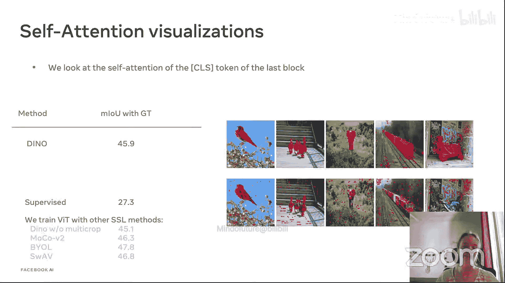

So we can actually apply this self attention visualization to the different frames of a video。

And so we've seen that， yeah， there is a nice consistency in the video。

 even though the network has not been trained to model， I mean that's very per frameman。

 there is no temporal modeling happening here。

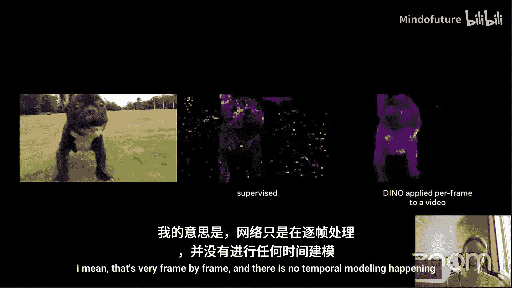

And another nice property about this self attention is that we have observed that different attention heads focus on the different parts。

 on different parts of an image。 And so here I have met， we have materialized the different。

Heads by different colors。 And so we see that one head is focusing on the flag while another head is focusing like on the structure of the tower and a third head is focusing on the clock in that image。

And so yeah， as I was saying like briefly before this， I mean， I think these self attention maps。

 they also show that we are able to learn like patch almost patch level representation and like dance representation and so maybe we could actually use the features learn with D and vision transformer to dense recognition task。

 And so here we are using like a tracking task with the object video object segmentation on Da。

And so here the goal is like given a first frame of a video and the segmentation mask for this first frame。

 we want to propagate this mask to all the frames of the video。

 so we really want to track this mask to all the frames of the video。

So let's look at the results so here I have shown the results which is the best selfupvised dance approach for it。

 so by Jaton， which is especially targeting this kind of dance correspondences between different frames of a video。

And so we've seen that when we apply Dou like out of the box on this tasks I mean there is a decent performance。

 but it's working like below the best published results for self supervised model on this task and so here were thinking so maybe one way to improve this performance would be to actually have a denser more dense representations and we can do this by reducing the size of the patches from the vision transformer architecture and so we have trained Dou with eight by8 patches and so this way we are more dense representation which are more effective。

For this tracking task on the da。

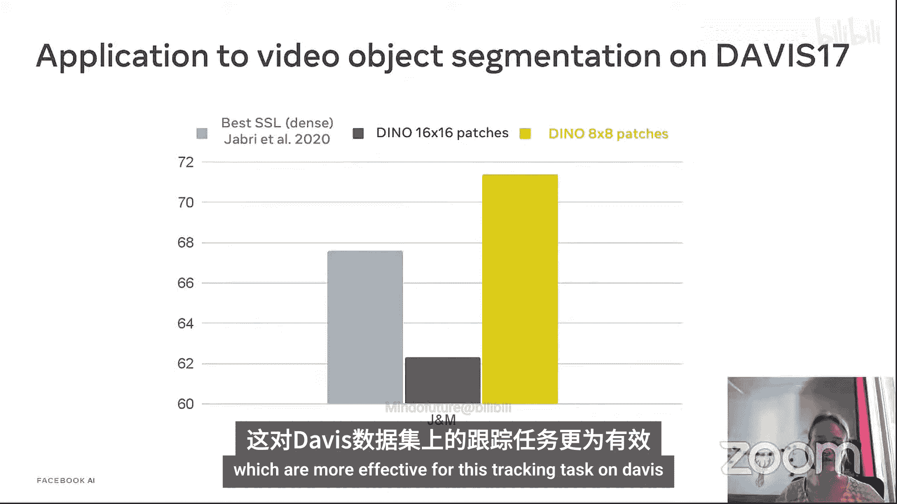

So that actually concludes my presentation on the clustering based approaches for self supervised learning。

And so I will leave the discussion of open challenges and questions in the future of self supervised learning to my co organizers at the end of this tutorial。

And so yeah， now it's time for me to thank you for for attending this this talk。拜拜。

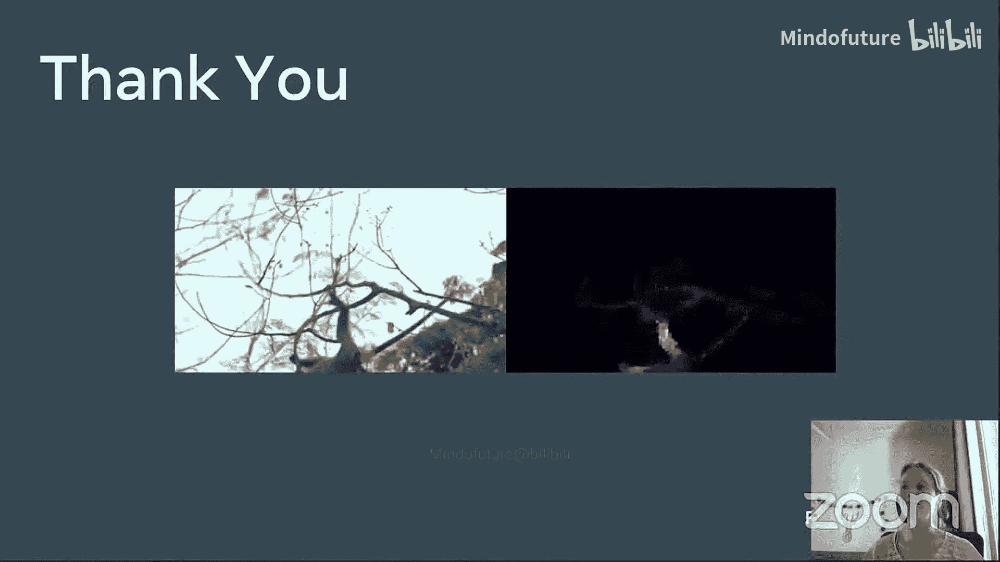

아。So that was a talk of Matt。 That was as Andra said to pretty content。

 So there would be no questions for Q& A after this talk。 so would move。

Directly to the talk of Adria and exampleist on multimodal approaches for supervised representation learning。

Just just to mention there were some questions on the chat that we responded no but that we responded so I guess well people can find them in there there were some responses some questions regarding the type of clusterstering the size of the。

Of the size of well the number of clusters and I think there was also one in the iterations。

 how do you do when you change each time the number of classes and well then the classes and if you change the fully connected layer something。

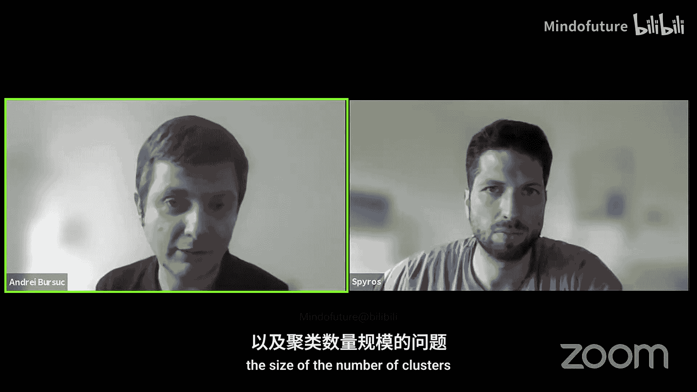

that was in a nutshell most of the questions。嗯，行。So let me introduce the Angel。

So I guess Adrea will take this talk， hi Aa work hi， thank you。

And I guess I will leave a floor to you to start or or maybe I think。

Maybe this tough minutes should start in three minutes。You can wait if you want for three minutes。

 Yes， maybe of。Ta will try to want to talk follow the specific talk and we haven't seen it。Okay okay。

 I guess I can take some of the questions from the cluster to respond them here in case they will not be available in the chat。

 so one of the main questions was on the optimal size of the of the how many clusters you need to have so the optimal K。

In the initial paper， the optimal range for imagenet was between 1000 and 10，000。

 and after that it was dropping steeply。So it's likely very data set dependent。

 but on the quit training data set。SoWell in image， you have at least 1000 classes。

 and if you account a bit for the graarity you have for some of the classes。

This should be roughly the value。 So if you apply deep cluster to to some other data sets。

 I guess you should have a rough idea on the amount of。Classes that you could could encounter there。

你跟把吃再做个那口。so it's no。Time for the next talk。So again。

 I would welcome Andrea and example of this from Deep Min to。Talk about moving what approaches。

Thank you Spus for the introduction yeah， so I'm Maria Raquezs and with Jimbaiz at Iraq will be presenting basically。

The different multiple approaches for subservised learning。

 so essentially the way you can think a bit about this part of the tutorial is that we've seen many methods for like image based approaches and now we're going to see how this can basically expand on different modalities。

So before starting， I would like to show you 10 seconds of a video and pay a bit of attention of what's going。

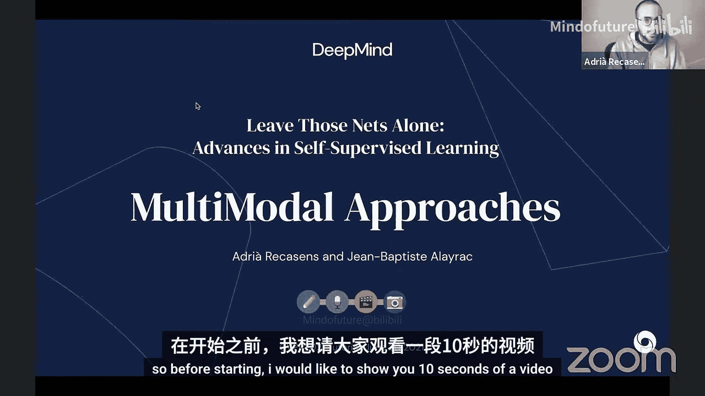

🎼这是。🎼Yeah。🎼，🎼Yeah。这。😊，In this video， I guess the question is。

 did you feel that the audio went with the video？So basically。

 probably most of you felt felt it didn't go with the video and the reasons are bad reasons and I would like you to think for aminoino。

Why you thought that？So a few things that comes to mind is first that maybe the instruments didn't match one the audio was basically playing guitar while this person is playing the trobone。

 maybe also there is no synchronous between the audio and the video when the person was doing certain things you would expect certain audio to change while it wasn't changing so there are basically all these few things that for us when we would video with audio we basically do these associations very quick so now I'm going to play the audio again and you can basically match these things to now。

🎼The like。Sleepy yeah。🎼，So this was the true audio of the video and as you could see here。

 it's easy for us to kind of pick up with the different details that might between the video and the audio when the person stopped playing the sound stopped when the person was kind of talking to the other person we could hear the voice then actually the sound was kind of in sync with how the person move his hands。

 so there are many cues that we as a humans are basically taking for videos to kind of mentally match the video and the audio。

 and essentially in this tutorial will show how these different methods that we've seen now for images can translate into multiple modalities to kind of make use of these cues that are already in the video data to learn strong representations for video but also for audio because nothing prevents us to learn the representation for these different modalities。

So just for completion， I'm going to play the final video， which is essentially the original music。嗯。

🎼，🎼Yeah。🎼不是。🎼，🎼Yeah。So again the same cues happen again right you can see how he's moving his fingers through the guitar。

 the sound is actually matched with that， so there are many things in here that make us make us link easily the videoTMD。

So we've seen in this tutorial many ways of doing Uniimod learning and essentially most of them basically were based on the idea that you have an initial image and then you can produce many different views by doing different things and these different things could be cropping they could be color augmentation they could be rotating the image they could be stretching the image so essentially you have these single image and you can do all these different operations that produce all these views and then with these views you can basically train models to match them together right I mean you know that you have two augmentations you augment the image into two different ways and then these two are corresponding to the same original image so they should go together and maybe in contrastive methods you have like different images and then they should go apart。

Now in the multimodal setting this still hall， but at the same time we have all other dimensions that we can play with so let's think about this with a video so we have a collection of frames。

 but then we can augment this also in time so we can take different moments in time of these video when he is playing when he is talking we can also take the audio so basically when the person is playing we can hear the trobone and when the person is talking we can listen to him and even we can apply speech recognition and listen to what the person is doing can basically have the text so we took from the YouTube automatic speech recognition and essentially here the ideas that in multimodal subupervised learning we have everything that we have before in image plus many additional transformations in our data that enable us to use additional views and these additional views could be other modalities or could be different transformations for instance in time of the same。

もられて。So what's the usual training evaluation setup we take a large dataset created or incorporated。

 it doesn't matter we're not using the human labels at all and essentially we have all sub of bias method that is going to ingest all these data and learn a representation from it so we're going to learn some weights for the backbone network and also sometimes will use prediction heads or projection heads you probably have seen this before in other thoughts that people uses these auxiliary weights to improve their training now what do we use for training so there are many data sets we listed here5 I'm sure there are more but these five are commonly used those are basically data sets that contain videos with video audio there and some of them even contain text so this text can be extracted just by running automatic speech recognition。

And I' taking just what the people is saying in the video so these three modalities are present in some of the data sets。

 so these are the ones that we use for training， but now we want to know how good our models are and what we do is we evaluate them。

And how do we do that we use other users smaller dataset sets。

 these data sets come with labels and essentially we start with the backbone that we have pered in stage one and we evaluate how good is the representation that the backbone produces we have different techniques that we'll see in a minute。

 but basically in a nutshell that。So what do we use for evaluation。

 we listed five dataset sets again there are more but people use for video so the top row is video data sets。

 so we have HMTV and UCF which are kind of maybe the smaller data sets but they are very common and then kinetics which is a bit of a larger dataset but it's starting to be used as evaluation data sets for video and in the bottom row we you see the audio ones so audio set is a very large data but it's also being used for evaluation and then ESC50 is a very small dataset but traditional and we also has been used for evaluation audio audio model so the bottom two our audio classification which basically means going from the raw audio signal or spectrogram but basically an audio representation into a class and the top ones are action classification or basically video classification dataset。

Now once we have these evaluation data sets and we have our pretrained weights。

 we can do different things to evaluate those essentially we want to know how good the representation is but this could be evaluate in many different ways so we list it four typical ones the first one is New Year's neighbors it's kind of the easiest probably because it doesn't require any parameters you take your representation you generate the filter for the training and the test set and then for each element on the test set what you do is you go and see which are the closest training examples and you basically decide a label from that。

So we really like N's neighbors because we think it's nice that it doesn't have parameters to tweak at the same time it's the lower performing one probably compared to the others。

 but yeah we think it's a good method because you don't depend on how good you are in implementing those things。

Now the second evaluation is the linear evaluation in this one we freeze still our representation and what we do is we train a linear layer on top which is basically going to predict the classes of the dataset so if our data has like 600 classes our linear evaluation it's basically going to predict which one of these 600 classes the input is so this is cheaper because we don't need to update this is cheaper than fine tuning for instance because we do need to update the weights。

But it starts being more and more dependent of hyperparameters so to train this linear layer we have different ways we can use SBM。

 but we can also use SGT and this could change things a bit also all these methods have already some hyperparameters that are normalization things to take into account so there are many things that can play a role here。

Now the third way of evaluating our network is fine tuning。

 so this is probably the one that it's most used， we basically take our network。

 we put an extra layer to go to the classes and then we update the weight of the full thing。

So this one is computationally more expensive because we need to update all the weights。

 it's very dependent on hyperparameters because essentially it's training again a full like supervised model and that can be very dependent on as you know learning rate optimizer I mean many different parameters but it performs better and that's something that it's good so there is this balance basically between how much compute you use and then how good is the performance。

And we wanted also to kind of highlight this final method which is cross model retrieval。

 so this is a bit different than the initial three ones are only so they can work with a single modality while cross models retrieval is basically this idea of I've got some videos each video goes with a text for instance so these are two modalities and given a text can you basically retrieve the video that is coming from this text so this is parameter free you can basically run them and then evaluate how good you are doing this ranking but。

but it requires pair data sets because basically you need this mapping between each video and each text。

 so yeah it's very specific to certain works， but we think it's a good way of evaluating things and it's worth adding it here。

So now I'm going to hand over to Jambati， who is going to start the rest of the talk。Thanks。

 thanks a lot， Adrea， so yes I'm Robbaist and now I'll give you the outline of the talk where in the first part we'll have a review of the modern selfsupvised methods for multimod data and in particular we are going to follow the same structure that you add primarily in the tutorial by starting with the contrastive learning approaches。

 then the teacher student， then the clustering methods and we'll conclude with some opening remarks about the multimod approaches。

So let's start with the contrastive learning methods。So in a nutshell。

 the goal is to learn from the semantic correspondence between synchronized modalities。

 such as audio and video， like the example atria shared in the beginning。

 and for that we want to use a contrastive approach。And what does this mean。

 it means that we are going to try to learn a joint multimod space specified by this sphere here。

Where the embeddings of modalities that occurky together will be close in that space and far otherwise。

And to impose this kind of structure on the space， we are going to use the contrastive loss。

 which we have an attractive term to kind of add the embeddings of the modalities that occur together to be close in the space。

And recursive to have the negative ones to be followed about。

So one important question is how we build those positive and negative pairs in practice。

 well it turns out it's pretty easy to do and it's very similar to the kind of the game that Aria played in the beginning。

Where to create positive， we can simply take a video and take some frames of this video and it's aligned audio。

And to create a negative， we can simply take video and audio coming from different videos。

So we can build those pairs basically for free， which is the really nice thing about selfupvis we don't need human labors at all。

 we can just take a large collection of videos that we can find online on YouTube for example。

 and just create pairs like this。So in more details。

 this is what the multimodal contrastive objective looks like。

 so we have two networks in the case of video and audio， one for the video F and one for the audioG。

And we'll try to maximize the following quantity。Which is this kind of log ratio of two terms。

 so on the numerator we have the positive score which is this exponential of the dot product of the two representations。

And on the denominator we have the negatives on the right。

 which where we sum of our multiple negatives， the de scoress。

 and again those negatives can be created by those pairs of ordinary those coming from different things and this is called contrastive because we want to contrast the score of the positive against those negatives and by doing so we are going to learn this kind of joint multimod embedding space and in turn learn good representations。

So now that I've described this objective， I'll dive into one specific method that we've introduced last year at Ns。

 which is called multimodal versatile networks。Where the goal for us was to learn representation from multiple modalities present in videos。

And not only video and audio， but also still using language in the form of text that we can extract with automatic speech recognition。

So some few key results from that method is that we demonstrated that learning from stream modalities was better than two。

 which was kind of expected。But it was nice to confirm this。And in this work。

 we also explore different strategies for embedding multiple modalities in the space that I will describe in a moment。

We also explore how to efficiently transfer from video to image。And importantly。

 we also get like state of the art performance on multiple sub supervisbe。

And the year I've listed some resources to learn more and the slides will be made available。

 so we have the paper as well as the code and the model weights that you can reuse for your own application。

So yeah， I was saying that there are different options to embed the stream modities in the space。

The first thing you might have in mind when trying to embed multiple modalities in the space is to simply use a shared space where all modalities are embedded in the same embedding space。

So this is nice because it enables to compare all pairs of modalities very easily。But as a drawback。

 it's also trying to do everything as if all modities were equal。So to address that。

 we can separate the spaces to have specific spaces for the pair of modalities， for example。

 for video and audio and videoo of text and this is nice because。

Video and audio might be more fine grained， for example。

 than the space that you want for video and text， and this can be a lawsuit for example。

 because let's say you take a guitar， there are many sounds of the guitar。

 but there is a single word to describe the word guitar。But as soon as you do that。

 you lose this kind of ability of being able to share everything together。

So to address this we introduce a hiarchical space where we have a first space of video and audio that we call this fine grain space and then from that space we project back to the text space that we call the cost space and by doing so we still have this advantage of having different spaces to compare the pairs of modalities。

But we also have an easy way to kind of go from one space to another thanks to this yaical space and this can simply be done by。

By having different heads that goes from one space to the other。So okay。

Now that we've trained those networks， we can try to see a bit what they have learned。

And one nice thing that you can do is take the representation and check whether or not a audioio representation is close to kind of associated videos。

 so for that we can play a video nodio sorry。🎼Now we can embed this audio in the space and retrieve the closest video from that audio。

And this is the kind of videos we retrieve where we have someone playing wind and instruments。

 which kind of match what we have in mind。We can take a note our example。

So you can hear like some water， maybe some people。

 and indeed the videos we retrieve on this L data are some people walking in some river。

 which again makes sense。But not only looking at qualitative results。

 we can also get quantitative results by evaluating the networks we've learned in the way Adria described and the MMV got very good performance on HMDV51 where it was state of the art at the date of publication and also very close to be state of the art on the UCF101 at Ben。

So now I would like to share a bit some metricss that we've learned and that are not always kind of explicitly stated in papers when working with contrastive learning in the multimod domain。

 so first observation is that the choice of backbones will be really important for the performance you have and in particular what we've observed is that the more power methods you have for your backbone。

 the better the performance are and it's even more pronouncedunce I think than for superwiseed methods and intuitively this can be explained by the fact that when we use up of supervised methods we don't have a single label per image but we have now a more rich and richer signal which comes from the different modities。

So there is less chance to kind of overfi to a very simple task。

 and therefore you can really have big gains by growing the backwardbones。

Another important thing to note is the way we create the negative usually is by taking elements in your batchge and taking negatives by taking other elements in your batchge and yourself。

So basically the bigger the batch size is the more the negativity you will have and usually the better it will be。

And in particular， if you are in a kind of military worker setting。

 it's usually important to kind of share those negatives across walk。

This brings me to the third point where we've often observed that it was nice to kind of shout the data set acrosswalkers to make sure that each piece of data is different on each walker。

 and this kind of prevents the problem of having like twice the same example in a batch and hence kind of a false negative by imposing that the two image are negatives when that shouldnt be。

Another important thing that we've noticed is that it was sometimes important to prevent shortcuts that would kind of make the task easier。

 easy and trivial and NL leads to less performing less good performing of representations and in particular one kind of tricky thing is when using batchn when use batchn when the small batch size kind of the algorithm can communicate information via the batch statistics。

And therefore， one way to address this is to increase the size of the bash and in particular。

 to try to share the statistics。Of the ba across workers， and this can lead to performance gains。

Of course， another technique is to just not use any normalization to prevent this from happening。

 and this can be done with recent networks that try to remove the need for patch normalization。

So just to recap a bit， so the contrastive loss is used to match embedding across multiple modalities。

And there are some pros to it， so the first thing is that it's kind of easy to understand because the objective is retrying to kind of embed things in the space and put things close together when they should match and far otherwise。

Another nice property is that as a byproduct of this learning。

 you learn this joint em meeting space where you can do cross motor ritual as I demonstrated in the example。

But there are also some cons so first there is this kind of negative requirements that require to have like large batch size to have lots of negatives and an improve longing and this can quickly become computationally intensive。

Another important thing is that the negative choice， the choice of negative scan matter a lot。

 and there is always this tradeoff between adding two easy negatives or two r negatives。

 so you have to always kind of find this right balance between the two。So with that。

 I'll hand over to Aa that we go through some teacher student method for multimod applications。

Thank you， Ja Baist， so I will cover a bit of teacher student methods to apply to mostlymod work。

So basically what does this mean， the general idea again is to learn semantic correspondence between the different modalities in here we are writing Adium video but as you will see in this work we could think about like different views of the video or audio videoium flow or basically combinations of modalities that you can think。

How are we going to do that in the previous partm but this describe the contrastive method where basically you attract a the positive close by and then you have your negative。

 which basically you force them to be far away from your samples。

And here we're taking a bit of a different strategy， essentially。

 the idea is that given different representations of the same data。

 what we want to do is we basically want to regress one from the other。 So we are going to predict。

 So let's say we have video audio。 what we are gonna to do we are gonna to predict the audio from the video or the video from the audio。

 And the goal， of course， is to learn a parameter space where in this different modities。

 we can do this regression and basically this representation is semantically meaningful to then apply the final evaluation that we're interested on。

So again we have this embedding space and now this is a bit simpler because we have the video。

 we have the associated audio and what we're going to do is we're going to process this so that we can embed it into the space and essentially we just have the attractive laws now this is good because it's simpler and it doesn't require this kind of negative laws to kind of pull into different directions to the negatives but at the same time the fact that we don't have these negative laws is going to create some issues that we need to solve and I'm going to go into this in。

So basically we have a video， we have the associated audio and what we are going to do now is we're going to take a crop of the video。

 essentially the same crop， or we'll see how we basically sample temper for the audio。

 and then we do this basically prediction or regression of the different modalities。

Now I'm going to go into details something that Ja ofs did with MMB I'm going to describe into detail Bra。

 which is a model that was。Public a few months ago。

 and basically I'm just going to detail that and then in a further reading list you can have other papers that are interesting on this area。

So for G， the goal was to learn representations from multiple modalities present into the video。

In here， we're going to focus on modalities that you can extract from video audio。

 so it's going to be video audio and then flow， which can be extracted easily from from our TV images in the video。

The key results are basically first that temporal context is a good subservisory signal。

 so as you will see in a minute what Bra does is basically try to predict from a short view of the video one to three seconds。

 we're trying to predict the temporal context and that's something that seems to work very well as a subservisory signal。

Additional augmentations are basically to improve performance。

 so basically what we will see is that certain augmentations actually improve the final performance。

 but maybe these augmentations don't need to be into the original video data but it can be in some auxiliary data so we're kind of transferring the augmentation ability through the model。

So another good outcome of this work is that negative art not needed to learn state of the art representations。

 which is it's good news because negatives usually imply larger computational resources so that's's good and finally Bra gets state of the art in selfservised benchmarks as we will see in a minute and that's also good because it means that the method really learns strong representation。

So we link the paper， we'll share the slide so the link will be there and here I'm leaving just the reference for people who wants to just search it in archive。

Now。In this video here， you are just seeing one second clip of a video。

 you see this person jumping and basically we're seeing the person doing this kind of jump into the air。

What we want our model brief to do is we want to predict essentially the temporal context where this happens。

 so now I'm going to show essentially a 10 second clip which is basically the before and after of where this clip was taken and you will see basically what's the task of brief。

I。Y no。So basically what we want our models to do is given this kind of one to threesecon view of the video。

 we want to predict essentially a longer broader view。

 which is it could be around 10 seconds so note that this is actually a good sub-supervision task because it requires the model to pin of reason about the video it has to understand that when the person is in the air previously to being in the air it has to jump so basically it can predict that the person has kind of jump before that and after that it's going kind of splash into the water and you can have the visual of the splash but you can also hear it so basically you have this multimodal experience of after and before of the view so basically this is the main task of the model and maybe going a bit more technical in the left we have this kind of one to three what we call the narrow view which is kind of the shorter view which is high resolution。

to be processed by a backbone， of course， and then we have what we call a projector and a predictor。

 which are essentially two MLPs that are processing the。

A processing the representation and then as supervision we have this Brad view which is longer in time but then it's smaller in resolution because Bra keeps the number of pixel fixed so basically if you have four times more frames you can divide by two the spatial dimension and you end up with the same number of pixels and essentially these two videos are reing each other Now let me stop here just to make a couple of comments the first one is that the backbones that are basically processing these two representations are different So in the left you have the backbone that processes the narrow view and then in the right the orange colored backbone is basically the one that process the broad view so this weights are not sure and this basically enable us to apply different augmentation to to the different view so basically in the right we can have strong augments which maybe would hurt if we apply it to the narrow view because we're going evaluate at the end these narrow backbone but we can just apply the augmentations into the right and。

Baically it's going to basically represent each other and the second common。

Is that you see here that there are two losses there is the narrow to broad loss and the broad to narrow loss。

 so each loss basically trains one of the backbone so the loss in the top which is basically taking the narrow view and predicting the broad view it going to only train the blue backbone so it's basically there is a stop gradient which means the gradient of this loss doesn't go into the orange part it just goes into the blue part and then if you basically we the flip。

 the bottom loss which is basically going from the broad view into the narrow view only trains the orange part and this is important because otherwise what happens is that these models converge into a constant or in a trivial solution and doesn't learn any representation so this trick co a stop gradient which is not new and actually in by all the use these to basically prevent also the collapse were using it here also to prevent collapse。

So again， as the backbones are different， we can do strong augmentation。

 but we can change the modality basically in the broadview， so in here we are using flow。

 which is a different modality。Also we see that improved performance and we can use audio which is what we have been talking about for a while where basically。

You have anarrow view， you predict the audio that should basically go with this view。

 and then to train the audio back when you do the other way around。

So I'm just going to show now examples of the narrow and the broad bill just for you to get a sense in the narrow view was this 1。

1 or two second clip， the broad bill can be different modalities。

 so here is the LGB broad bill which is this kind of 10 second clip and now we can see the flow in the flow only the thing is that move will get kind of highlighted so here you will see the car and that's good for and now we're going to listen to the hydr。

So that's what to。So basically that's the task that Brave is doing and essentially once we train with large dataset sets what we get this state of their representation。

 so assuming same data same backbone brave in the video audio settings such like having video audio input is better than HTC in terms of HMTV and UCF fine tuning performance which is very nice another realization is that when we start making the backbones larger and La。

 we're getting closer and closer to the supervised numbers which we also think is cool in the supervised numbers are basically what you would get if you train your backbone with a supervised data and then you basically fine tune or apply a linear evaluation on UCF or HMTV。

And finally， have I brought to all of these is that when we train this video audio setting。

 we end up with a very strong audio representation and that's captured in these kind of numbers in the right where you can see how both in ESC50 and in audio set。

 brave basically makes an important gap on performanceform compared two previous methods。

So basically overall， what these results show is that the performance of this method。

 which I think simplifies a bit the work of the model because it doesn't need to kind of do this positive negative balance。

 results in a very strong representation。Now啊。Let's re up a it。

 the ideas that we have been regressing across different views and when we say views。

 we mean given a certain modality like video， we can crop in different parts of the time or we can crop in different spatial locations。

 and then we can also regress across modalities。So the pros is that we don't mean negative and it works very well。

 I think that would be the good summary， but then the cons are that the optimizationation is a bit harder to understand。

 so we basically given that we have these two losses regressiongressing each other but we are adding these top gradientding in the two losses。

 what basically means is that there is no kind of global optimma that we are optimizing as happens in the contrastive learning。

 but essentially we're finding an equilibrium between these two players。

 the two networks and we just find an equilibrium which leads to very strong representation。

 but I think in general the intuition is a bit harder than what it is with contrastive where everything is kind of more clear。

And then the final thing in the practical setting is that it's very sensitive to hyperparameter。

 so basically if you use the around hyperparameters。

 it can collapse the training so you need to be a bit careful on which hyperparameters to use。

So as Jambaptist did into the contrastive setting， I'm going to just talk about a few tricks that we found useful when working into these and playing with these models。

First， as I was saying， the hyperparameters are usually the model is very sensitive to that。

 so I would recommend starting from something that we know it works and then essentially moving towards your research goal。

 so this way kind of your research process is a bit easier because you don't have a lot of issues starting because you can basically start from some graming that you know it works。

In terms of augmentation， so I think Jabaist will talk a bit about this later。

 but basically into the multimod setting augmentations are not maybe as important as into the un model。

 so sometimes you can spend a lot of time ablating called these can of augmentations in the different modalities but at the end some of them may have some high impact。

 but some of them could not have impact at all and basically you need to find which ones to can of work on otherwise you can get lost into a lot of different augmentations and possibilities。

And finally a couple of comments on maybe more practical side of things。

 usually when we iterate to find the right model， we do it in a smaller scale setting where we can iterate faster and things train fast the issue is that these models are kind of sensitive to going from small to large scale so if you basically go to small scale at the end and when you do this change where you use a larger backbone or you use a larger data。

 this kind of switch can change things quite a lot and the hyperparameters can be different and the opt have change so basically what we would recommend is to try to stick to the larger possible scale that enables you to kind of iterate on research but still don't just take decent account because that's something that could happen and same thing with the backbones backbones are can change things quite a lot because there are still backbones that are kind of temporal shift models so there are many things that you can use us a backbone and each。

This back has its own particularity in terms of like optimization。

 so if you really are doing many work with one back。

 choose one that you can basically scale up easily。

 otherwise things can get a bit complicated when you scale things up。

So now Jambaatiist is going to talk about cluster setting methods。Thanks， Aa， so yeah。

 let's dive in the clustering methods for multimodar approaches。So again， the same goal as before。

 we want to learn from the semantic correspondence between synchronized modalities and let's take audioUN video as our running example。

But this time we want to use a clustering based approach。

 which would be similar to the tutorial that Matt just did before。

And the main idea is like instead of directly trying to predict embedding cluster。

 we will cluster the features and instead use the cluster ideas as pseudo labels so in this first step we are going to take all different videos and the audio and we' are going to cluster them together and get some kind of cluster ideas for those that are picture with the different colors in。

Then once we have those crystals， we can use them as pseudo labors。So in the Unii model case。

 you can， for example， user neighbors from the video to kind of。

Kind of supervise the video and use the audio pseudo labels to supervise the audio network。

 but now that you have multi model data， you can also kind of。

Use the pseudo labels in a different way by， for example。

 using the cluster IDs from the audio as pseudo labels for videos or the opposite for the audio network。

And then once you've done those two steps， you're basically going to rhins and repeats and go back to this process of like clustering the features again。

 then optimizing your network to kind of follow those subid labels and so on and so forth。

And if we go a bit in more details in terms of the objective， so the step one。

 we are going to cluster the features and usually people use gaming clustering。

And then based on the clusterors you find on the different modities you。

Define your offsetid labels based on that。And then in the second step。

 what you're going to do is to really use apo labels as if there were kind of classes in a standard classification setting。

So people usually just use a crossenttropy to kind of optimize the video backbone。

 the audio network and also the different a that goes from the representation to the number of classes。

 and usually you do that for the video on one side and for the audio on the other side and just sum the two kind of classification loss。

And as we did before， we're going to dive into one specific example， which is the XDC method。

 which was introduced by Uma AL at last Nres。And in there， the work is to learn from video and audio。

And there are key results is that they really explore very well different clustering prediction strategies to get theidal labels。

 and they also obtain very good results on self supervis benchmarks。And as we did before。

 we've linked different resources to learn more like the paper and also the code and model weights that they've released in Pythch。

So what like one main kind of contribution of this work is to explore different ways to kind of predict the cluster across modalities so the first thing that we can do is to do the uni model setting where you cluster your video features on one end。

 your audio features on one end and then，You use subtle labels to just supervise their own modality。

 so this is not really multimod because it's just doing everything independently per modality。

 so it's really similar to kind of the deep cluster approach that material that described before but applied on video and audio。

So how can you integrate multiple modalities？So one thing they explore is this multi head deep clustering。

 where they will still kind of cluster the data for video and audio separately。

 but then they will use the labels from both modities to supervise each individual network。

Then they also explore a neutral strategy which instead of clustering the features independently their modality。

 they concatenate the features of the video and audio that happens together and they they cluster those features instead and then use them as pseudo labels followed back。

And finally， they look at cross model deep clustering。

Well they're going to still cluster the features independent hipPA modality。

 but use subtle labels from the oza modality。And this is what they found to of the best in practice。

So again， if we look at the quantitative performance。

 they were a state of the art on HMDB51 sorry on UCF 101 and quite close like beyond MMV on HMDB 51。

 but basically this metal perform very well。So let's now go through some pros and cons of the clustering approaches。

 so first the pro compared to the contrastive approach is that you don't need for this kind of negative definition。

 it's kind of all implicit。Because of this clustering that you do。

 so the cluster ID in which you fold will be your kind of positive and all the other clusters are going to be your negative cluster。

Also it's a standard classification problem once you have your cluster ideas and hence you can use all the techniques you know that works well in SupervisSa。

Also in the offline induction， meaning that we do these two steps of clustering and then optimization。

 you can afford small batch sizes， which is not the case for conive learning。But there are some con。

🎼First of all like most methods at least in the Real model domain proceed in those two are donating steps where you first do the clustering and then you predict the clusters and this can usually be a bit cumbersome and do not scale very well to very huge data sets as Matt mentioned before Also some tricks need usually to be done to avoid collapse of the clusters so for example。

 like rebalancing small cluster into bigger ones to make sure that not all features are going to fall into the same cluster。

There exist online methods which do not require those two steps。

 but they might require video batches and also like more。

Fine grain setting as this becomes a more kind of challenging optimization for them to do。

So we've also compile a list of like files are reading for you。

 like starting from early multi Moerella approaches。

 so before those's more modern like contrastive approaches。

 teacher student approaches and clustering approaches for you to have a look。

We've also said lots of contrastive approacheses that have been done over the last years。

 also some recent teacher student approach which are a bit less frequent but start to appear in the vermodar domain and also some clustering our approach and here it's the same there are less work that are doing that but I guess we're going to see that more and more。

And also I wanted to highlight some of that kind of use Oza signal than multiple modalities to learn from video。

 such as the arrow of time， where you kind of use the fact that videos go over time to get some kind of supervision and you can do that for example。

 by cho writing videos and people have shown that tracking can emerge from that and also a paper from January et all。

 which kind of as a nice training objective by using random work over time。So yeah。

 that kind of concludes the part of the talk where we've described and dive deep into the details of the different approacheses and now with Aya we'd like to conclude with some opening remarks we have about this kind of multimodal selfrivis domainoma。

So first of all， yeah， multimodal learning is great and this is the case because at least in the video domain。

 it's clear that multimodal method outperform， method that only uses。

 for example single modalities such as single LGB and for this you can check for yourself on the kind of the benchmarks we've listed here on this website that kind of look at the different benchmarks。

F steps not me。And also， I think that was one of the question that I saw in the chat。

 which is so we saw that in the Uniimod case augmentations were important and we saw also in a spo stock that in bio。

 they show that they don't need as strong augmentation as a SCR。

 but they still obtain a kind of 10% decrease of performance on INe when having kind of only the crop as augmentation。

And we've performed a similar study in our MMV paperap and so that's kind of。

So the first line in this table where we don't。Sorry。

So and that's yeah the table on the right where we do very little documentation on the video and the audio。

And there we see that we have a much less decrease in terms of performance compared to the Uni case。

So now I' would like to maybe talk a bit about good practices in evaluation。

 so as you know evaluation is what enables us to compare the different models into the papers and after like looking into many papers there are a few things that we believe are worth mentioning here and also kind of good practices that we think would help the community move forward。

So the first thing is there is always the question on okay。

 what should we report performance on as in the beginning， I kind of highlighted five data sets。

 Fi video1s and to audio ones where people is reporting performance。

 and in here I basically plotted the size of this dataset， but note that the Y axis is in log scale。

 which basically means that ESC 50 is like significantly smaller than audiodi set。So essentially。

 I guess the takeaways for me is that of course the more numbers the easier is then to understand。

 we think that every dataset tells us something about the model。

 but we also think that maybe the community where as a community we kind of overfitting a bit to certain dataset sets that are used over and over。

 so I think HMDV and UCF are probably one example of these things where every paper reports on it。

 but can of the performances have been growing and growing and so UCF finening for instance is getting to 9697 regimes which is very。

 very high and it's very hard for us to of understand where the improvements come from at this point and the last point is that we think also that larger evaluation sets mean that you have more robust results so we can basically trust a bit more in the numbers so we are cane of in favor of moving to larger evaluation set or today。

ets that basically enable us to evaluate things in a more robust way。

 so I guess as a takeaway or important practice note。

 of course reporting in as many data sets as possible is very informative as a paper reader also because we can compare then our methods to the older numbers that we have。

 but we also think it's especially important to report in dataset that have larger evaluation set where we think that we can basically trust the numbers a bit more。

And then in terms of evaluation settings， at the beginning I went through these basically three or four evaluation settings and we've seen that basically the community has focused a lot on fine tuning and some in linear evaluation but maybe less in neighbors and essentially we think that although it's true again that the more reported numbers is the better。

 moving to linear evaluation or the nearest neighbors that require less computational resources and maybe are available to a larger set of people would help the community move forward and at the same time we think that this way it's a maybe more challenging for the filters and it would tell us something additional about the quality of our filters so again as a kind of practice point towards evaluations that don't require so much tuning because sometimes to kind of get your fine tuning right you need。

do a lot of tuning and that creates differences between methods which are not actually in the pretraining subvised method but in the evaluation pipeline so we think that kind of moving towards evaluations that don't require these kind of highly tune evaluation pipeline would be good for the community and finally sharing the details of your evaluation is something that I think I at least appreciate when I'm reading a paper because then I can kind of reproduce this in the code while sometimes it's harder if the details are not as explicit so yeah as a no as a kind of point we want to kind of encourage people to share all the details as much details as possible so that others can really reproduce results and yeah Jaapist is going finish with a couple of extra points so I guess one thing that you might have thought about is the kind of computational consideration to kind of train those networks。

And here I wanted to make a small point about like academia and industry and especially labs that do not have like huge cluster such as the ones we could have in a deep of Facebook。

And yeah， I would like to say that like Seupvised learning from videos does require lots of compute and probably more compute than what Imaginenet requires because we tend to have like huge video data set and then there is a time dimension which makes it even more expensive。

And we see the gains from bigger and bigger data sets。

 and so there will be this kind of ways to go towards even larger data sets in the future。

 but in the same time I see that there is an opportunity for kind of。

Finding techniques that do not w off such kind of eye compute。

 so to try to improve the training efficiency of Seship multimod methods is going to be something very interesting to pursue in the future and I believe there is a space there to kind of use like smaller kind of setting and so we should encourage people from you know having potentially a bit lower numbers than the state of the art。

 but while using just like a few GPUs to train。But in general。

 like it's really important in practice to share the code from the selfsup based methods we developed and maybe more importantly to always share the model weights because people can not always afford to rerun the code themselves and it's really important to share the weights because people can reuse those models in user application build on top while still claiming that the methods are selfsupwes。

 so we really encourage people publishing in this area to always share the model weights once they've publish their paper。

Another kind of guide for people that are be new to this area and wants to learn a subsupervised multimodal paper as there are different things that can lead to better performance it's important to know what to look for to make sure you really understand what's new about the metal and what's really key for the performance and in particular you should be very careful for what is the dataset use of training so it's not as standardout as in the image case where everyone is using INe。

People use different dataset sets such as the A mode data， the audio set or kinetics。

 so always look for which training that set is used。Also。

 check for the number of epochs and the optimization details because usually the longer you train those approaches。

 the better they become。Also check the size of the backgroundbone that I described before it can have a quite important impact on the performance and it's particularly important to always look for the number of parameters of the networks that are used。

Also check for which modalities are used because as I said， usually the more modalities you use。

 the better your presentation should be， so in order to have a fair comparison across methods。

 you should always know what other modalities use during pretraining。And finally。

 also check the details in the evaluation setting， for example。

 what is the video resolution used during fine， what are the number of of use for evaluation？

So more and more the paper are giving those details。

 but there are still discrepancies across papers so look for those and as also we should really be transparent about all those details while publishing papers。

And maybe to conclude and maybe introduce the next part of the tutorial。

 I guess in this talk we've mainly focused on video flow audio language which are kind of modalities that we can easily extract from large collection of video data。

 but there are many more modalities out there that we have not really described in this tutorial such as depth or point clouds or even touch in robotics smell maybe。

 and I believe the future will be multimodal and well see more and more approaches that will walk across all those kind of modalities and so I'm really eager to see this happening。

And with that final remark， I would really like to thank you for your attention and attending this tutorial。

 and I think now we'll be able to take a few questions live。

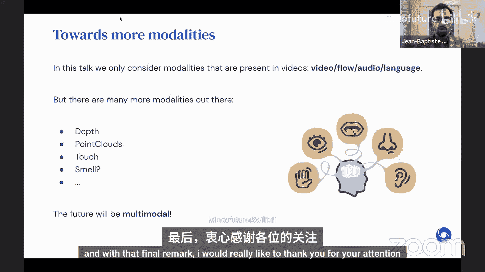

Thank Andrea and Zam Ba for this wonderful talk and yes now you will answer questions just you will make the questions yourself said part to the other。

Are you going to read the questions？So I was in the chat。

I think it the questions from the chat if there's any that were not answered。Oops。

So I guess there was one question， any thoughts on how to combine evaluation on multiple task data sets？

When trying to optimize a representation that can benefit many downstream product teams。

 while the task might not be evaluated。Adrea， do you want to take that one？嗯。Yeah， I mean。

 if I correctly understand the question， I guess。TheThe question is basically。

 how do you find out if you want to solve certain tasks where you're not evaluating。

 but you have some other task， how do you。How do you deal with that I guess that's a good question because sometimes we are kind of building representations kind for certain downstream tasks。

 but at the end these representations can be used for many other tasks so one thought here is to look for evaluation procedures that maybe are a bit less dependent on the data in the sense that so for instance。

 one thing that you can see on certain methods is that they perform better on the linear evaluation and that's probably a signal to kind of look for if you want to kind of take those features and apply to a different model so basically if what you want to do if you want to build representation that is then deployable to some task that you can now not evaluate on maybe what I would recommend is to essentially think about representations where you can you don't need to kind of learn thing。

But just good fine representations or fine methods that produce representations that are in general good for many tasks so that then you can do this final transfer I think。

 for instance fine tuning maybe is a bit more data set specific because essentially you're learning the full thing and might be less informative of how good your model is to transfer to this task so I don't know if but this wants to finish up with some top functions in here。

那先。You did well， so maybe I'll take the next one so。😊。

Like Linuus is asking our current sub based learning methods tested on a wide enough range of target tasks。

 if not we risk optimizing only for features good on classification。

 what is the state of benchmarks in different modities。

So yeah I think that's a great question and that's a risk for sure in this domain and so at least in the multimod domain we have multiple data sets for evaluation but mostly there are classification ones and I think that HMDB51 and the UCF101 on the video side and the ESC50 audio set on the audio side are both starting to saturate as benchmarks so that's why we kind of encourage people to move towards better onstream tests such as audio sets and the kinetics data set。

But I agree with you that we should not only look at classification and going for more complex tasks。

 such as kind of temporal detection or detection in general will be a very good thing for the field。

Another question， so I guess the back experience you answered。

Then there was one question from me so selfupervised learning pretrain on your own collected dataset or on those downstream video data prospective。

 so usually we pre train on large data sets and that's not our own that's our data that are available to the community and those are the ones that we've listed above and then the downstream tasks are usually smaller ones where we have labels and where we can easily evaluate the representations。

So I hope that answers your question。And I think that was the last one。Yeah， you think so。Okay。

 thank you very much I。😊，Now is the time for the final part of this tutorial， so for the talk。

 what is next？

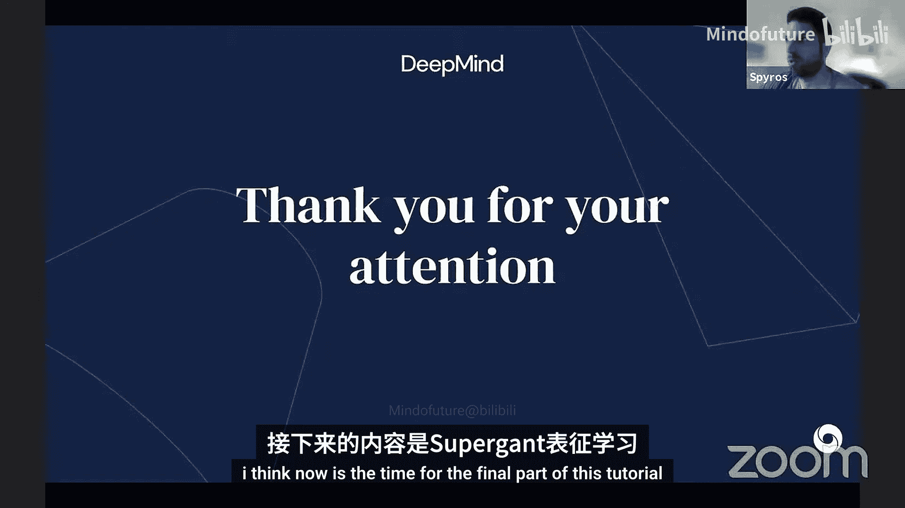

Representation learning。For this talk， and Dr will present some slides。好。Yeah。

 is it visible it should be yes Im looking at the other screen Okay yes。

 so so welcome to the last last talk of of the day so we'll be doing a wrap up of the of the the things we talked today and try to to give some some some directions and some ideas to work on or where where where things could be improved in general in sort of supervised learning in。

At large， well not just contrastive or teacher student or multilo。

 so thank you already Jean Batista and and Adriria for showing also some examples of good practices and some considerations and I will build up on that。

Speaking of what is next， there was also a nice what is next to the workshop at ECCB 2020。

 the videos are online and there are some interesting talks there that are still still valid today。

Coming back to our。不是。To our talk。So。I'll first start with going a a bit backward like to see where we come from in selfupervision and how things have evolved and to see then well next how how and what where to wh for improving students so the first generation of selfupervised approaches that we didn't covered this year we covered last year so think of an alternate net relative match location。

 jigsaw puzzle colonization and and all the others so at the beginning they explored a new paradigm they achieved some really interesting results but they were still well let's say acute acute techniques so it was something going look like an emerging area but。

There was not something really mind bone at that time so we could see that even even in the force so this is an image from pearl so these are the new methods。

 but if you look at the methods that I described here from the first generation they were still lagging behind the supervised supervised bound that we have seen far so far today so it was clear that they were reaching a saturation and something had to be improved and I recommend you a nice paper by U Asanno Mial that was doing a study to disent to show that as little as a single image is actually sufficient for these methods along with data augmentation to learn some very useful representations for the first layers so what they did here it was a very interesting approach so they took a high resolution image like this。

They extracted1 million crops and augmentations from it。

And they repeated the same procedure for three images and the results were rather similar。

 so the idea was to see how much is the impact of the data and how much is the impact of data augmentation in these selfvised strategies that we had at that time。

 so mind that this is the first generation of selfupervised methods。

So what they show actually they did the protocol that we've seen before of fine trainingning a linear layer on imageNe。

 so they pretrain a neural network on with rotnet with by then with deep cluster on this1 million crops and compared it with a model trained on 1 million images and they compared the performance on the linear classifier on top of COv1 co2 coV 3 and the other layers。

 so what they noticed that actually for first for the first three layers。

 there's actually little difference between between the variant trend on 1 million images and the variant trend on 1 million crops of the same image。

So you see here rodnet in blue in dark blue you have the one image Rodnet is actually better than the regular rodnet here there it's a bit the other way around and well fromron CO3 you start to see bigger gaps if you take by again。

 well the shift I think happens just in co5 well until there there they get similar similar results and for deep cluster you also see a liking Ronet starting from from CO3。

So the idea there is that with sufficient data augmentation one image allows self supervision to learn good than generalizable features。

 which is a was a bit actually going on the other way for what was advertised at that time that self- supervision exploits the knowledge that is found in these vast amounts of unlabeled data sets so this could be also an explanation on why these recent line of approaches so this is a second generation of approaches contrast their feature reconstruction clustering multiple supervision so practically what we saw today。

Went beyond that， so they had a few few heuristics which allowed them actually to separate from this bottleneck and actually make use make use of the information that is in the data not just from the implementationnots of these different different patterns so what actually helped in the performance of these new methods that we have nowadays so is the contrastive learning in particular with more negatives and a better use of these negatives because we had the exemplar well instance discrimination that was also using contrastive learning but you had like1 million negatives and they were not moving too much and it was a very difficult problem but we've seen since two years ago that contrastive learning with more negatives that managed to get really impressive results feature reconstruction so we've seen this year that it works very very well and it brings some particular benefits in。

In training with some computational benefits， momentum update which was practically the star of these two years so you can see from the talk of Matil in the wall of sps and the others that this was actually the common pattern between those and then there's a few well let's say training heuristics that contribute to that so people have learned to better craft and to better deal with these beasts and to learn their dynamics to get used to their dynamics and to figure out what works and what doesn't work and among these it was the output projection had that we have been in most of the methods right now better and design and stronger augments and also a benefit of todays today's computer a longer training so these were the the main benefits that we've discovered until now so the question is now what should we expect from the next generation to solve so we have a new generation。

Of hopefully a new generation of selfsupervised methods what areas should they tackle so we compiled with the organizers of the workshops。

 some areas that we find interesting and that we find problematic in this field and we shared them with you so well one of the specifics of self-upervised methods is the longer the longer training and in the complex setups usually some papers require TUs in the order of the hundreds and in large mini batches and we can see that in general when we compare training on a supervised manner so in a vanilla manner in image let's say usually for 100 epos most of the other methods for at least 200s but what's quite common nowadays is actually to train for 1000 epochs on me imaging so this means。

10 times more longer training that you would have simply supervised methods right well if you compare if you compare to the cost of annotation。

 theres surely some gains but and also due to the nature of the task because it's still some form of unsupervised learning it's normal to take longer。

 but I believe that we should make some efforts into finding out some strategies and some methods to train faster so this is what we also did at some point in Noble and then well glad that Adrian and John Baptti also mentioned that that it's good to find some areas of research where we improve on not just on the performance but we might well trade off some performance by training faster so we have one direction is how to improve data and compute efficiency for these selfupervised methods。

A second area is well it's related a bit to our field of activity。

 but I think I'm working for an automotive company。

 but I think it's valid for other fields and other tasks as well so the thing is that actually a few exceptions most of the self-supervised methods deal with image net images where there where we know that there is a dominant object in the image so already we know that there is an object and we exploit that and there is an object there so theres these two things that allow us to better craft and to design these these algorithm but if you take an image like that from this is an image screen capture from new scenes。

In autonomous re at least you have high definitionfin images and large and complex scenes and if you take a crop and a patch like that you might not have an object and so you don't have this assumption so you can have an object or not we don't know that and what do you do when you don't have the object so how what strategies should we envision for these types of imaging and it could be the same thing for medical imaging where you have just parts of the images that are interested and and you want to localize that while the rest is redundant it resembles a lot with the others so one axis will be how to go beyond the single object images and well I'm pleased to see that there's already some first steps on that so theres as the paper at CVPR which is called Psbough which brings contrastive methods to the level of the pixels so you have two views of the same image with different augmentations and instead of doing the contrastive to contrast。

Images between themselves， what they do， they learn what pixels overlap between these two images if they seem multitic crop or if that's a deformation and they learn to do the contrasted learning at the pixel level and this well this kind of cuts a bit of the performance on image classification but brings a significant boost in object detection。

 which is a task advancingstream tasks that of a particular interesting interest for many。

There's also a recent paper by Jean that and Well Manadas team it's called Dtcon so again they kind of build on a similar somehow related principle on contrasting parts of the image and not not the entire images and here they rely on super pixelixs from unsupervised segmentation and assuming that inside super pixelel there is an object and they try to do alignment and contrast it between these regions in the image。

 so there is some progress into that area and while I'm looking forward to see some some more for this particularly daunting task。

another axis of improvement is on the data side， so as you I've seen also in the questions。

 you might have realized that while most of the selfsupervised methods Win model well to be clear Win model that selfsupervised methods are pretained on imagenet and this is actually curated and perfectly balanced dataset so we have certainly we don't exploit the labels but we know that there's 1000 classes each class has the same amount of the images and they kind of come from similar distributions。

 images shared by people on the internet so there's a lot of investment there in these dataset。

This is a particularly useful dataset set， but in and self supervised learning actually the date itself becomes a form of supervis in particular in this case。

😊，So how do you do when you want to go to other to other data sets that are not curated that are boring so that there's a lot of boring data and how do you select actually the particular points of interest that help you in learning in self-supervised manner and not let your your algorithm and practically get drown in in very redundant and similar similar data again which is more convenient for me to bring this analogy from autonomous driving data but it can be generally apply both for robotics and well even and also cameras for surveillance for transports and for this you will have a lot of redant data so we have large dumps of data but most of it is redundant again while I'm reporting some very recent work that pushes a bit the envelope here so this is a method calls here and what they do they train a swave like。

Like method， instead of imagenet they train it on Instagram images and they show some benefits because they have a lot more data。

 so they think they have like at least 10 times more data than INe but they trained on the same amount of iterations and they show that actually this diversity brings some significant performances with respect to regular civilvis pre training on INe。

Well there is a butt here， so it's certainly a progress here but well it's Instagram images and we know that in general people shared on Instagram nice photos so it's not again it's not boring photos。

 it's not noisy things， it's really something that usually have an object or something interesting in the images。

 but still it's an interesting progress and I'm hoping to see some further works in the future。

On the evaluation side。😊，So there's a bit of a struggle at attention in the selfupervised community。

Evaluating on many data sets is good， it's actually it's proof that your features are robust that they generalize and that's very good。

But we generally tend to evaluate on the same data sets and also some of these data sets can be can be quite quite quite expensive so if you want to fine tune for example on Coco for object detection with a mask or CNNN using the electron so this is the regular pipeline that you have with a GPUs you need to spend the 1818 hours just for that while if you do want to fine tune an imagenet again if you don't have many GPUs so you don't have a big cluster just a linear classifier training here it takes you a few at least at least that depending on the amount of GPUs that you have and same for places that have that have2 million images so that's on the cost level but also there's a bit of a problem with imagenet imagenet is also used for pretraining so we pretrain the search models on imageNe。

And then for evaluation， we also use the same imagenet so certainly it's a big data set and it provides some insights。

 but if we continue evaluating mostly on image and guide the progress with respect to the performance on image that we might risk overfitting and while getting biased on this specific type of images。

So。So well what I hope is that in the future we'll find better and more compelling evaluation strategies to complement these existing ones while we with Spros we at some point we we had the thought on this and we propose in an older paper in ICCB to use the few short learning protocol for assessing selfupvisor presentation so what we do in a few short in future short learning we have。

We practically sample a set， well a few thousand pairs of trainings and set images。

 training and test images， sorry。Usually we have like 25 train images and well at least55 test images and we use the training images either for training either to generate some prototypes and we can do either a classification or a nearest neighbor to query these test images and find the class their corresponding class so this is nice because it allows actually to see different configurations of training test sets。

 so we might have different abiguities， different edge cases and and also well it's a large set of dataset sets that we evaluate on and at the same time it's something that is really cheap to compute so at that time we showed it on mini image but this protocol can be generalized easily to other data sets and here we evaluated that time rotation prediction and a relative patch location and we could see some findings that were coherent with other scores in in image。

data sets。Well this is one of the options well Ive included here a few papers that propose different data sets and settings to evaluate on。

 so these first three ones consider pre contrastive methods so it's still a roadnet relative patch location and so forth while these two are deal with more recent approaches contrastive by well moco and so forth and they propose some data sets to evaluate on。

Well， be sure to teach check them out also to see how are the different methods sending in different benchmarks。

Next well it's a remark concerning the previous talk on multione multimodel selfupvision。

 so again here traditionally these multimodel selfupvised methods certainly use one of the other one or two of the other modalities to teach the other one but in general what happens is at the end of the day we still have one network for each modality and we process them individually so at test time again we just we just test each of them on a different downstream task and show that look we learn some meaningful and relevant features。

I think we can go beyond that and while I'm a bit biased by robotics and again by autonomous driving but as robotbaist and Ara said there's a lot of other sensors that all humans we have and how do we manage to use self-upervision to complement these sensors each other and treat them jointly to better understand the environment so here I'm putting a picture on the various sensors that value does to the car so we have frontcams lids radar indoor cameras fish eye cameras for the side of the vehicle or there's also GPS and the in measurement units so there's a lot of information in the car and we rarely exploit it and self-upervision other than one modality teaching the other so this is one for the directionxes of study I think there's also some interesting ideas in the embodied self-supervised agents by the。

Perfect on this area。I'm giving some examples of some recent papers on looking a bit further at different modalities。

 so here is point contrast。Here they work on point clouds and what they do they have different views of the same scene and they try to contrast points between the scenes。

 so they do some augmentations and they do what there's pretty practically different perspectives on this and they try to align the points and we have seen that these approaches have been recently complemented by by RGB images or dense depth in other modalities。

In particular， the boostrap your correspondence is a paper that that was showing in the chat。

Another way of using multimodality well for different types of supervision in autonomous driving is this paper by datinging from Uber where they use the optical flow as supervision coupled with bio well to better align these two images and to better grasp on objects and in particular moving objects that have flash displacements and where there's interesting things in the happening in the images。

 also they couple the video since it's optical flow and it pushes a bit。

The state of the art and in the ideas into these types of images。And then in the final final remark。

 so in spite of the impressive progress that we've seen in the past years。

 still well we well there's a lot of nice ideas about beyond behind supervision。

 well if you look at the young economy， these energy based models。

 while getting to know the universe， well if you look at theal people。

 well it's understanding the environment that you are。

 but still in most of the cases at the end of the day。

 we still use mostly supervision for pretraining，And while we try on a certain task and then we fine tune and look at how or sometimes directly。

 but this is more rarely how this method performs on this task so well what I hope is that well people will found out some new applications of selfupvisor learning and my giving again just a simple example that I thought interesting from the list literature and this this is a paper from ECCV。

But there are some similar ideas also in other parts on how to exploit test time training by the use of self-servision so in this case they want to do test time training to adapt your aoric detector to the incoming images so here put yourself in the skin of Google or General disk companies like well Instagram where you have feeds of images coming coming in all the time and they might be all of different styles right so here they compile the authors compile the data set of different styles of bicycles。

And well they they're clearly not all canonical bicycles and you cannot know that at test time so what they did here they coupled an object detector with cell training with end rotation prediction。

 so they were using Ronet to rotate different object candidates and to use that that as supervision signal coupled with with some cell cell training and this actually was shown to improve quite a bit of performances on these。

Domains well domains that were not seen during training。

So this is a recap of the idea we've mentioned for so far。

 but I think we can have a short Q&A in the next minutes。

E on these ideas or on some other potential ideas that might be interesting to explore in selfupvised learning。

嗯。

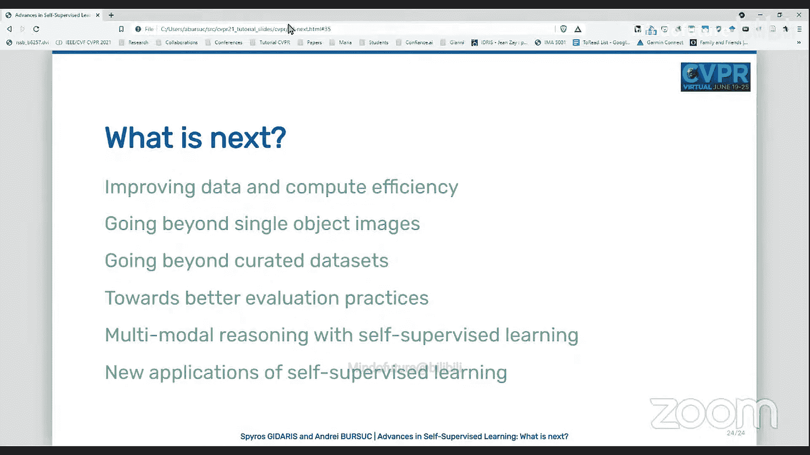

Thanks， Andrea。嗯。嗯。Maybe we can answer questions from the chat。

One interesting a question that I don't know to answer but maybe some of you Andrea or Randya who knows。

Given the ever larger data， how well do we know what social biases are learned in print training。

 for example？If videos are only by users in a few countries。

Are any good general rules for analyzing this biases？是。I don't know if any of you knows。

I answer this question。So can you repeat that question again because they have to open the window？

So's becoming noisy from the outside zone so the question is that we train self supervised models or never larger data sets and so how well do we know what social devices are lent in pretrain。

 especially for example videos might be uploaded only in few countries？

It's a legit question to what direction are what will biases？

Well it's a tough question and good question so I guess yeah that's well in general like like all machine learning nowadays we're faced with with this problem right and it's a really difficult not to crack because we've seen that even when you know what types of biases you want to address you don't always have a control of what happens down downstream in terms of a fairness or further bias that is that I propagated and in here while we're speaking in general of just one type of bias I when well I think people generalize of the social biases that we have an idea about。

But it's clear that in general in machine learning there's some other blind spots and biases in the data that we have that could be risky downstream and we don't always know that because well it's easy probably to see on some cases and some injustices that exist that we know about like so from for example some minorities that are disadvantage in that is the data but these we know because we see them in the society and we kind of expect to see them in the data but there's also some other blind spots that we don't know about what I would would there to launch maybe but this is just it's a personal opinion so again coupling with the paper from Hendrickx that I was mentioning in earlier on。

 so with self-supervision we kind of and also the other findings so with self-supervision we go a bit beyond the supervisory signal that we have in the。

In the task because well normally a network will have no interest in going beyond solving its task that we give a supervision。

 while with self supervision we insert some more complex inductive biases and we actually have a role there and into because self-upvisvision in essence is in essence is reflecting about the data。

So while supervision in fully supervision， you kind of reflect more about the model and how do you get to capture these specifics that are in the data such that you'll maximize the performance on this model in self supervision we reflect a lot more on the data itself。

 so I think that if there will be some biases and things like that。

 will not be worse it might be better than practices in a completely supervised environments。

But that's might been needed with other several。Yes。Thanks， thanks， Andre。And。

There is another question， it is about the point on pretraining and then evaluating onsNe so the question is how useful would be a large scale unlabeled data set of more than 50 million images to the research community for selfvisor presentation learning。

诶。Okay。I think。If Iative training or so big level data sets。

 if that would be useful for the research community might not because not all labs or research labs have the ability to。

To do such large scale experiments。 So experiments from solar large。Data sets， however。

 its I think it's quite interesting to look into it on how to learn from such large data sets and if there are modifications that needed。

Well I guess the interesting point would be how is it different from imagenet data set， is it well。

 as I said， has boring data that is imbalanced， maybe if it's something that is completely random and not just for Instagram or from some other。

popular venues right and well if you have the license also to share it in respect to GDPR and things like that I think it would be interesting from this point of view to explore these data sets that are more imbalanced and full of boring stuff so in this sense I think it would be useful。

😊，Yeah the size， but I guess not using the entire 50 billion for trading all the time。😊。

Another question I think on this topic is how big is a difference between very large un curated datas like what C uses and more curated and well balanced statuss。

 for example， the subset of female can we create a very small dataset but？

That would still allow to learn good features， just I think is a question。

Maybe I can try an answer on this one。Yeah， I guess maybe it was related to the the thing that Andre mentioned。

 which is。I think the interesting point about like going large scale in terms of the data。

 it's not necessarily to do better in terms of representation。

 but really to see if self supervised method can do well on dataset set that have less kind of strong bias in terms of their creation with like wellbalanced classes such as an Inet and for example like clustering type methods maybe you could think that they kind of use the fact that actually there are like a thousand image in pair classes etc so it's more a question of like going into those large scale data sets where we are not expecting such strong construction on the data and this is the interesting thing but I think as always yes there is a possibility to potentially learn from smaller data but I would say that self supervised technique might kind of shine more with like more data at least that's the hope I think。

是。I think another question that is also on with the model， I think。So oh no。

 the question is for other modalities like camera and mu sensors on phone。

 we may not have a large data set as Vi plus audio for pretraining the model。

 so is it still better to start with subvised tasks？嗯。

I think one point about this question is if you don't， I mean of course。

 if your dose is extremely small， probably selfvised returningtraining on it will not offer mask。

 but if you，Don't have any labels on this small data set still will be better than。

Tranning pro or even smaller set of labels。So if I can add something to that point。

 I not sure if that's the spirit of the question， but another thing that happens in the multimodal areas that you can have like datas that are not aligned in terms of modalities so you have a data which has like video audio and other data that says like video and some other modality and then I think it's an interesting research menu you have to think about models that are able to kind of deal with these kind of missing modalities if you want to say so。

 and essentially train models that learn from many modalities but not in the same aligned data but just like having pairs of modalities and train from that so I think that's also something that it's going to kind happen as we can increase the number of modalities because it's very hard to have like many modalities at once but it's going happen that we have certain modalities for certain set of data and then other modalities for other data and then we need to find a way to。

Kin of put everything together into our model so yeah。Thank。

I don't see any other question on the chat box for now。least。嗯。Yeah。

We have like 20 seconds of delay so this from this point onward yeah， we count like to 28 to see。😊。

It's。你三蚊多钟。We still have one or two minutes。Is the audience room to make a last question？Yeah。Yes。

Yeah。Yeah。Lis，'s en throing there。😊，Okay， so yeah for the audience so it also provides learning the roads to AGI I don't know。

😊，Who's trying to solve intelligence？😊，是实。Yes。There is a question that asked。

 are you aware of any such initial process that try to combine initialign analysis？

But what Michel thatto is because I I think it's referring to what Andrea described Yeah。

 maybe I can take that one。Yeah， I mean， I was thinking that you have MMMB so in MMB we do have the situation where we train with A set。

 which is video audio and then we train with how to which is video audio text and we have in the paper you will see that there are some rows that actually have both together so we cannot deal with this kind of misalignment and I think that can be a bit more extreme because it's not necessarily the case that one is a subset of the other it's just that you need some intersection but the representation can be learned with like data sets that are misaligned so yeah I think MMB to begin with it one example of this setting。

And yeah， maybe to add on to complement what Ada said in another kind of paper。

 we were also exploring learning to how to translate。

So the different modalities will be like different languages basically。

 and we will use only the video as kind of the the only like shared modality。

And we were showing that we could learn how to translate from one language to the other only by sharing the videos。

 but we will never have pair data between the different languages and that was basically using the same idea that Ada described and I can link the paper Cons if you want in the chat。

瞓。And yeah I guess so you just ask now what if there is no intersection at all and I think for now if there is no intersection at all。

 there is no I mean at least as far as I know good method that can deal with this so in language people can do that with kind of unsuperized translation techniques so I don't know if you follow those kind of things but like beyond those idea they use the fact that there is similar scripture between the different languages。

 for example French and English will be very close in the way you connect the sentences and you can leverage this but I believe it's much more challenging when you for example take audio and video where the kind of the scripture of things are not as strongly related so yeah it might happen in the future but I'm not aware good methods that are doing that for now in kind of more standard modalities such as video or audio。

Maybe one just to complement one exception to that is in that paper。

 there results also a deflation strategy where basically goes from video to image and I mean we just use it for evaluation but that's something that could connect modities but of course video image image are。

If you want to think of them of modalities， they are very connected， so yeah I mean。

 as Stevie was saying modalities that maybe are a bit far away way harder to connect them together。

Yeah。Okay， thank you， Andrea。I think it's past the end of the schedule。Of the Staulent time。

 so maybe we can finish the tutorial here。I would like to thank all the speakers or my organizers and for the audience for attending editorial。

Let's see。As a note I will will post the slides on the website and also the video will stay available on this YouTube link to follow it might disappear for a few hours after right after but it will come back afterwards it's just YouTube post processing and。

Deimizing it for space， but it will be there and what we' add some chapters where。P videos。

 if not to chunk it， but we'll see， but anyway， the info will be available on the website the whole time。

Okay， so I'll well， thank you， I'll just end the screen。嗯。Yeah， so it's ended。

