# 图表征学习讲座 ｜ Graph Representation Learning p09 P12_我见过的最好的走法 -BV1tQxqzYEFP_p9-

Ladies and gentlemen， on my YouTube channel， you are likely to encounter a wide range of incredible chess game。

 Sometimes at the lower end， they are played by two and300s。

 creating some beautiful adventures on the board and at the highest level。

 they are played not just by the world champions， but also by computers。 Now。

 today's game is set in Banu in 1973 in France。 And the players involved are Emil Joseph Dimer and Fud Tromzorf。

 Now， Dimer， very strong player， very kind of crazy guy in history。

 Doctor told him to stop playing chess， actually， because he kind of went a little bit nuts。

 And also， he was a Nazi sympathizer。 He was the chess editor for the Third Reich。😊。

And his name also the Blackmar Demer Gambit。 But now that stuff I don't like very much。

 But what I do like very much is this game featuring an absolutely insane fight。

 And one of the most insane moves I've ever seen in my life。 So here we go D4。

 Now Demer played the Blackmar Demer Gambit or he probably thought was just the Demer Gambit with E4。

 So his opponent plays 92 F6。 we have 9 C3 looking to take control of the center of the board。

 And obviously if D5 well then we're gonna to get E4 G6。 and now the game becomes a Pi's defense。

 Now， I don't know if in 1973 was known as the Pis defense might have been known as something else。

 but basically Black wants to play Bishop G7。 And here Demer once again finds a way to play very interesting chess。

 he plays Bishop2 E2。 I've seen this line before and the idea of this line is to play the move G4。

 It's not to just develop like a normal person or maybe play a4 and Demer was certainly not a normal person。

 So he plays G4。 This is actually very good to try to play G5。Black has to be very accurate。

 If I'm not mistaken， there's many lines where Black actually has to play a move like Queen A 5 very early pinning the night and trying to take this pawn because it no longer has a defender in this game。

 though Trumps North played the move B5 looking to create queenside counterplay with the pawns。

 But this is a bit slow because after G5， your night gets kicked out of the center。

 and it's worse than that。 I am following up with a haymaker H4。 I mean。

 we're in business here with H4 H5 coming。 This is this is like a way to play。 I mean。

 this is not bad at all。 This is not a madman versus a guy who's never played chess before。

 This is a madman versus the guy who has played chess before the madman's got a good position in the opening。

 though。 B he just brings the night right back。 Why。

 because the night is going to be better toward the center than out here on the edge of the board。

 So D5 tries to create some havoc in the center of the board。

And here would have been better for Demer actually not to deal with this。 And just to play H5。

 And here's why。 Because， for example， if you just play a move like Bishop G7。

 then I kick your bishop back and you're just terribly lacking in space。 This is really， really bad。

 If you take my center paw。 I take this。 You can't take because you'd lose your rook。

 You go here and this is just very ugly。 Your king is really weak。 So H5 would have been good。

 But instead of that， Demer plays E 5。 Again， he's still going for the suffocating the opponent approach with chess pieces。

 E 6。 Now H5， the attack continues。 Black plays the move。

 C 5 looking to create a little counterplate， we get takes takes and Bishop D3。

 There is a very nasty little trap associated with Bishop D3。

 And it's the fact that you want to take on G6。 H G H G6 and take the rook。 However。

 this move is necessary， but still succumbs to a nasty tactic。

 But a tactic that really sends the game for a spin。 White cannot take。

On G6 any longer because the rook is protected， but white detonates the second idea of the bishop ro combbo。

 Rok H 7。 you have to take。 otherwise I destroy everything。 And now I take with check。

 And now you are down two paws。 However， even though you are two paws down。

 your attack has been extinguished。 The only thing that you have left is a bishop。

 I'm about to take on D4。 then take on E5， then develop all of my pieces and actually I'm very happy。

 And my king will evacuate this way， and I'm completely safe。 So Black place C takes on D4。

 And here again， a move that stabilizes the center。 He does not want to take back right away。

 Pat F4 Demer glues together the pawn structure So the dark square bishop for black。

 and then I dont D 7 have nowhere to really go。 Black place Queen H A a natural move。 Now。

 white can play G6 and glue in this bishop， but that's a little bit depressing。 Okay， like that's。

 you know， it's like moving into a home and closing all the blinds forever。 let's not do that。

 Queen H5， Black plays bishop A6 just developing a bishop。Nothing complicated。

 White develops a night。 Black develops a night。 I wish all of chess could be solved with just be explaining things in five sec。

5 sentences， not sentences，5 words。English is a difficult language， now。Here。

 Demer plays the move Night H 4 because the king is stuck in the center and you have ideas to just very cleanly play the move Knight to G6。

 So Black plays night of 8。 Black is also a logical individual。 This bishop has some problems。

 This queen， you know， you could play Bishop G6 here。 And if Knight takes， of course， Knight takes。

 If queen takes them this。 But Demer just plays G6。 He's like， look， you can take my bishop。

 And if you take my bishop， of course， I'm gonna take play night G6 and you resign。 So G6， great。

 Black does not want to have any check in this situation。

 So in the middle of a game where they have five pawns， two Knights to Bishop's queen and Ruok。

Black moves the king out of danger。 This move us two ideas。

 First idea is that anything landing on G 6 will no longer be a check。

 The second idea is that9 to E 7 is possible。And there's also a third idea。

 The third idea is to run the king over here。 I'm not even joking。 That's actually a potential idea。

 White develops with night D2。 Black evacuates the king， Night F 3 and night D7。

 So the Knight has kind of done with job forcing these pieces to get locked in。 Now，966，9 D7。

 Bishop D 2 and black turns the attention toward the potential F pawn or potentially something on the queen side。

Computer here， despite white's1 paw material advantage， gives the position 0，0，0。

 but the computer is probably a little bit high。 So we'll just excuse the computer。 Now， here。

 Demer played Knight to G5。 This is a very natural move attacking this pawn。

 Black defended it and White restocked the ammunition to try to attack the E 6 paw。 But Trosdorf。

 you see， was very familiar with the YouTube video danger levels。 the concept。

 one could say 48 years into the future。 You see that Trosdorf is a time traveler。

 And Trodorf understands that what's worth more than a pawn。 A queen。

 A queen is worth more than a pawn。 and here explodes with night takes E 5。 Now。

 oftentimes when you have like five or six pieces ready to burst and one little thing closes them down。

 Sometimes you can sacrifice。😊，One of those pieces， Night takes E5 is a fantastic move。

 Here's the problem。😊，If you take it， it's made。So， yeah， right。 So， so that's just the problem。

 And if Knight takes E 6， then black actually just moves the king。

 Remember I told you about that plan of evacuating the king to be 6。 I wasn't joking。

 That actually is the plan。 So Demer must have thought or blunder this。 But， you know。

 must have thought that after Queen age 3， he still has 96， he covers mate。

 and this is now a threat because he's covering mate。 So black obviously comes forward。

 striking on D 2。 here， Knight takes E 6 as played。 And black plays a fascinating move。 Black has 1。

2，3，4，5，6 moves。😊，With the king and plays one of the worst ones and plays this move。

Although logically， it looks pretty good because you just pressure this night。

 remember this this night can't move because there's a pin over there。 So White Sn's move is forced。

 you have to defend yourn。 And here， Tromdorf has a few different moves possible。

 The machine gives Queen F 6 as the only move for advantage。

 a little bit hard to understand that move， but probably the idea is to play D3。

 When the queen and the bishop will just destroy on B2 and and rip apart the queen side。However。

 he took on D2， and that actually also looks pretty smart because it seems like white is going to take back。

 And then you will probably hit with the bishop and like Queen of6。

 But here is where this game goes absolutely completely， supremely。Off the rails。

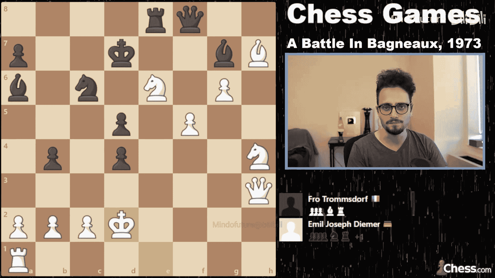

I hope you're ready。 Okay， that was a little 8 minutes of introduction。

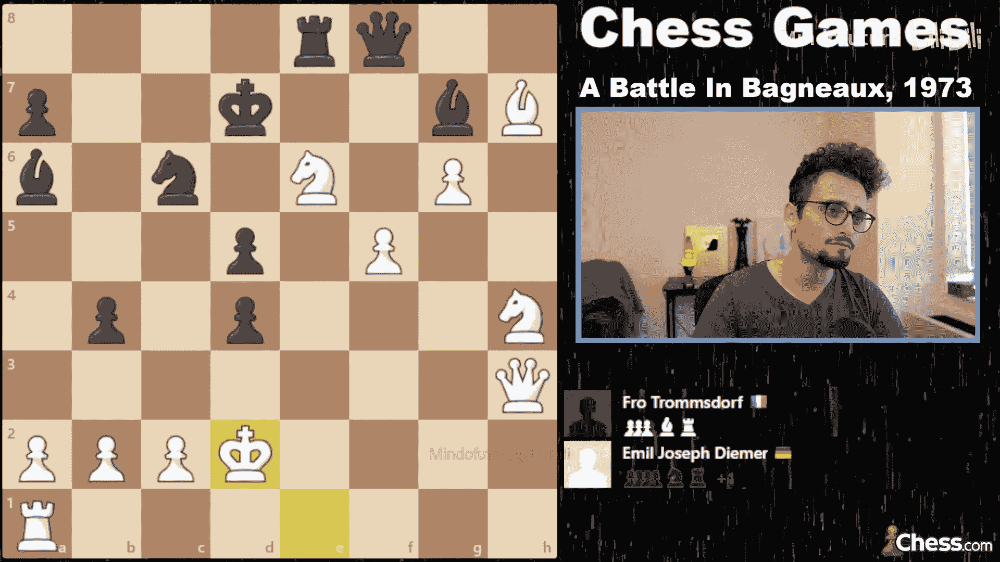

Here we go。 Now we're gonna have the main event。962。

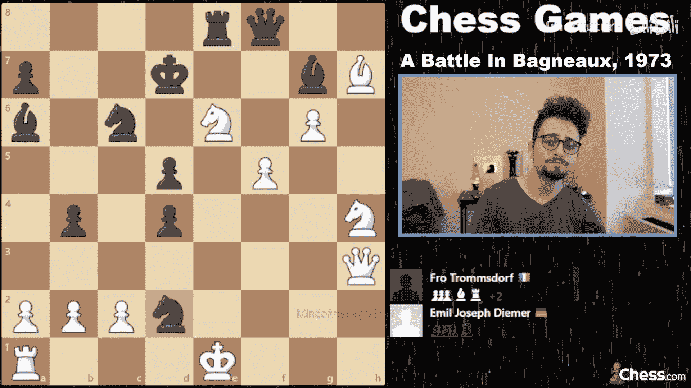

Kingty two did not happen。Long castles。

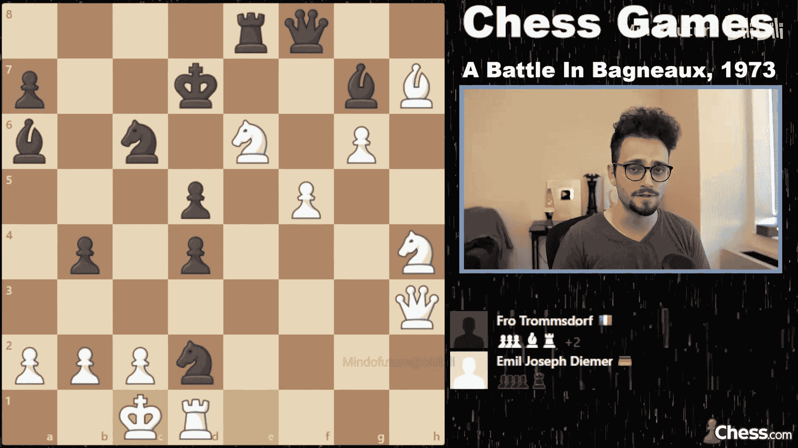

That move is legal。 You see， a king cannot castle through check， right。

 But none of these moves are C。The rook can castle through danger。

So sometimes when a knight is near a king like this， you can actually steal a castle。

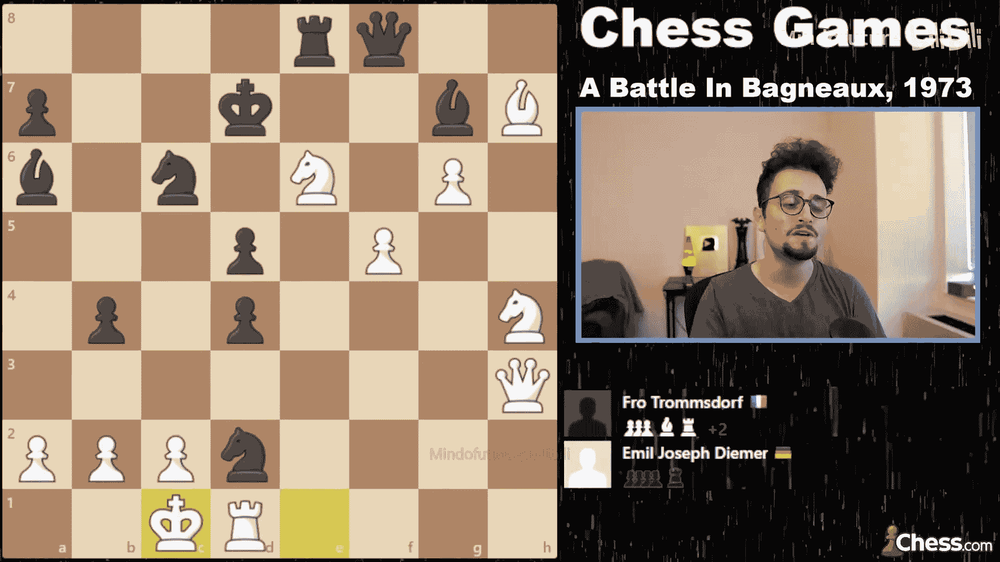

So now， White is going to probably take this with the rook。 Now， here's the thing。 If blank says。

 you had a chance to take my night， you can't take it anymore。 There's a queen hanging， folks。

There is a queen hanging and the queen hanging is possible because now you're unpinned。 You see。

 you got to keep in mind what's important here。 What like what's what， Why we castle。

 We got the queen out of the way。 So now Black plays Queen F 6。And here， still， we can take on D 2。

 But if we take on D 2， there's all this bishop page 6 stuff in D 3， as I mentioned。 So first。

 we need to get rid of the bishop。 Now， if just Queen G7， we take， we take this night at some point。

 but actually， there's still this。 So F 6 wins the game for white。This is just check boom。

 That's not good。 So the only move here for black。 Now， at this point。

 black plays a couple of very accurate moves。 The only move here for black。

Is this incredible move R to E3？night is hanging， night is hanging。

 This bishop is locked away over there。 You know， the tallest room in the tallest tower or whatever it is。

 Just locked away on H 7。 You go for the queen。 Here's why。

 Because anywhere the queen moves like G2 or H2 or H1 or G4。 There are certain problems like。

 for example， you'll bring thisnight back。 And then now that the rook is more active。

 It's no longer in the line of getting captured， you always have queen G 5 ideas to create an attack。

 You have Knight F2 ideas。 Just an absolutely insane position， just take my word for it。

 If this position gives you a headache。 Yeah， I get it。 So instead。

 Demer also proves that he has seen the danger levels concept。

48 years into the future and plays this move。 What's what's worth as much as a queen， a queen。

 Queen's worth as much as a queen。 Black here plays a move， getting the queen out of danger。

 pressuring everybody And in the future， there is an eyeing of this king。 Okay， and here， we get2。

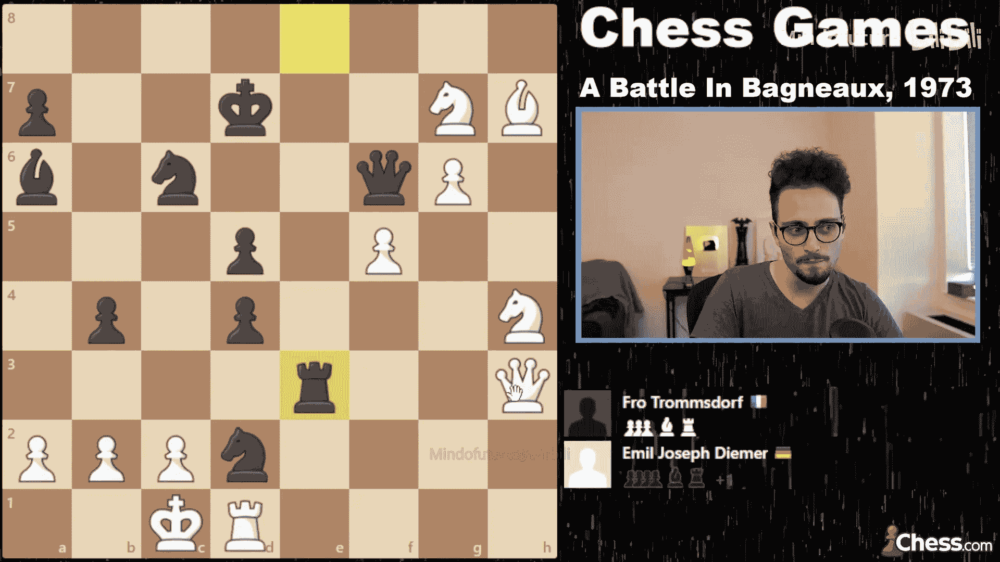

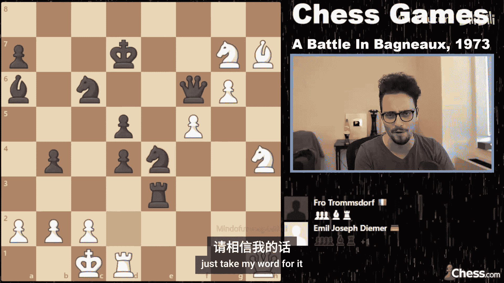

Insane moves。The first one is this absurd move queen to G4。

The point of that move is that you're forced to take。Right。

 because now there's a fork and I win the queen back。

 And the reason that this position is simply winning for white is you have two paws about to become queens it and the knight is hanging and the rook is hanging。

 It's all completely lost。 If you don't take， if you just step away， well， the knight is hanging。

 I mean， you know， in， in some lines， not right away。 But I I hello。Right， that's the problem。

And ladies and gentlemen， this is where black play is the craziest move I've ever seen in my life。😊。

I， I've， I've played half a million chess games。 I've probably watched。 I mean， I don't know。

 The numbers are insane。 This is， I am proud to say。

 the craziest move I've ever seen Black here plays。

 And you for feel free to pause and try to find it。😊，Black plays the move。B3。That's it。 Levy。

 I don't just the punt。后的。You're about to appreciate what this is。 All right。

 It's like the truffle ingredient in cooking， right， Isn't that like a very high end。 I don't know。

 It's like one of those ingredients， very hard to source， okay。B3。

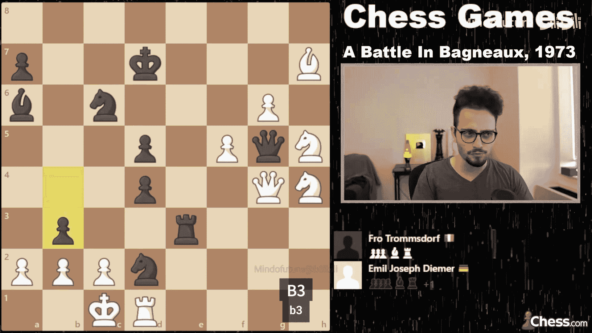

What's so special about this move。 Well， if you take the queen。Right。

 which then this and you can't stop this。

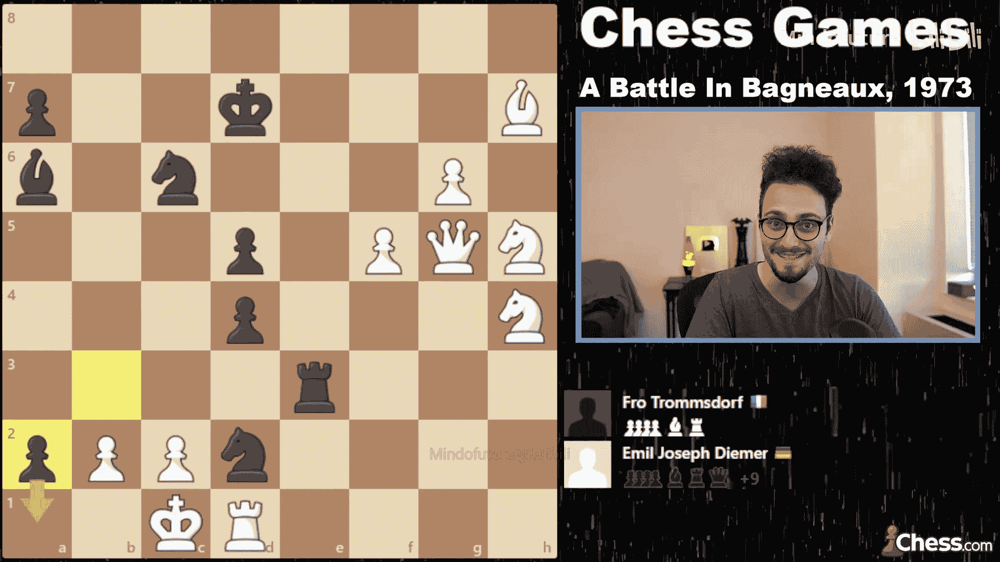

Yes， you can。 No， because Rok and Bishop check。You can't go up。 So you have to come back。 And now。

 of course， you get BMed rookmate。 What， wait， so you can't take the queen。 Okay。

 we can't take the queen。 fine， What if we take the pawn。

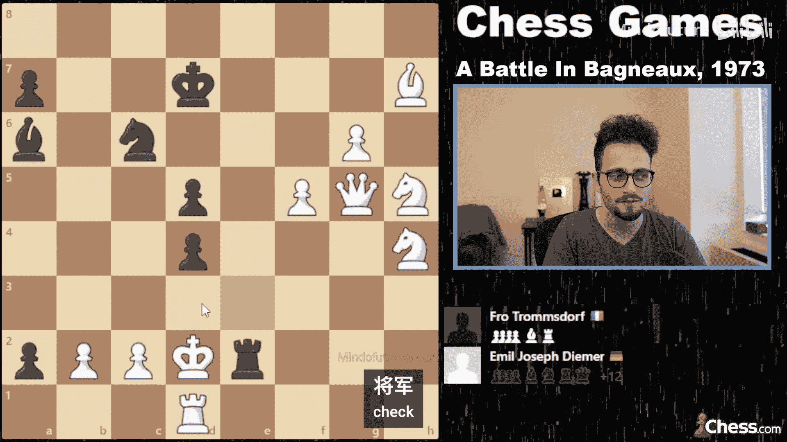

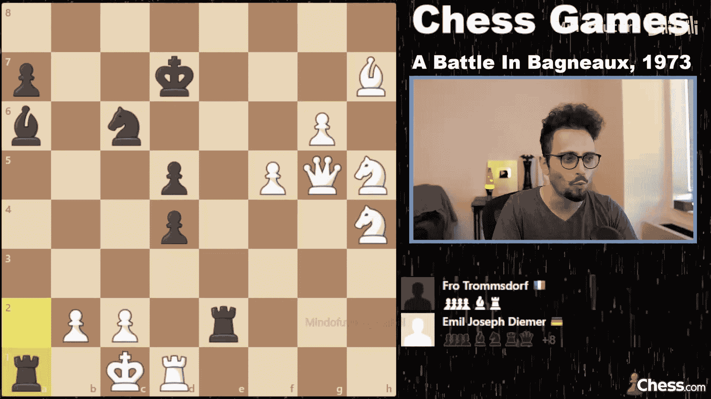

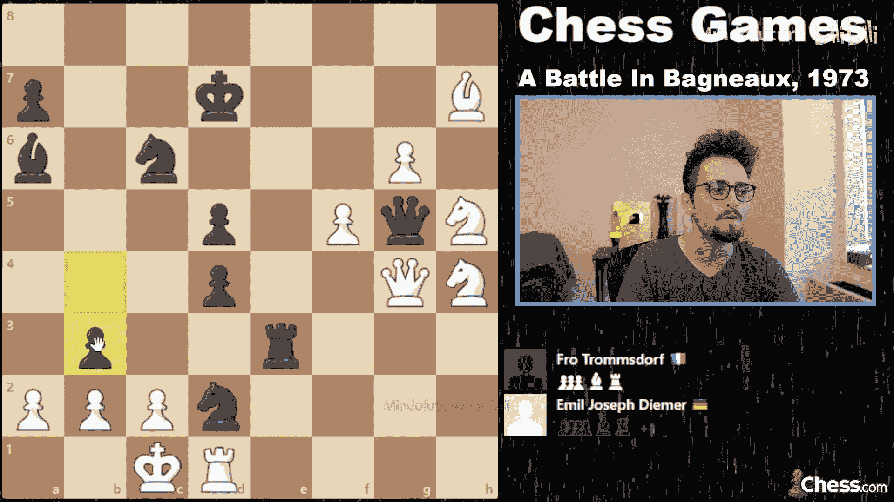

Alright， what if we play A takes B 3。 Now， that's what happened in the game。 We will look at that。

 First， what if you take with the C paw。

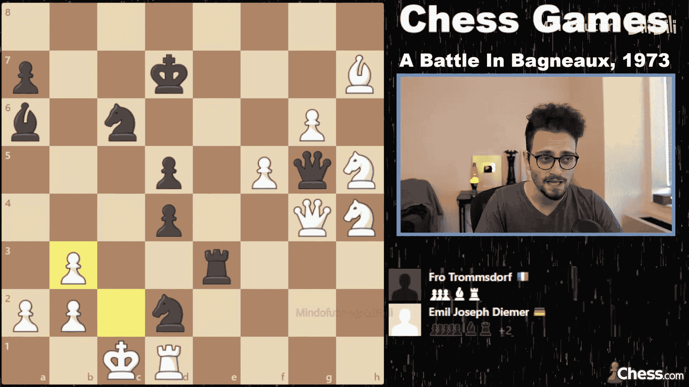

If C takes B3， then there would be night takes B 3。 Check。 So obviously。

 nothing can happen with the queens anywhere you move the king， you will get mated very promptly。

 You will get mated with a combination of the bishop in the night。

 If you take Then here there is double check。 You go here， there is now bishop D 3。

 you cannot take it because I come in with my queen and mynight。 So you run。 So check。 So here。

 and Rook C 6。 with the threat of Rok a 6 and Night C 2 combination。 And at any moment。

 I can come back with my queen， you are dead， lost Man 5 Man 6， Man 3， chooseose your poison。 Now。

 after the move B 3， there is also the move A 3。 And this leads to the most disgusting thing I've ever seen in my life。

 Here There is the move。

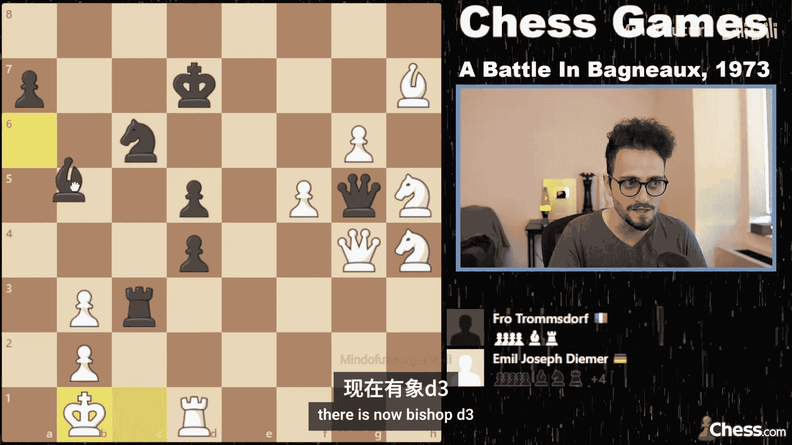

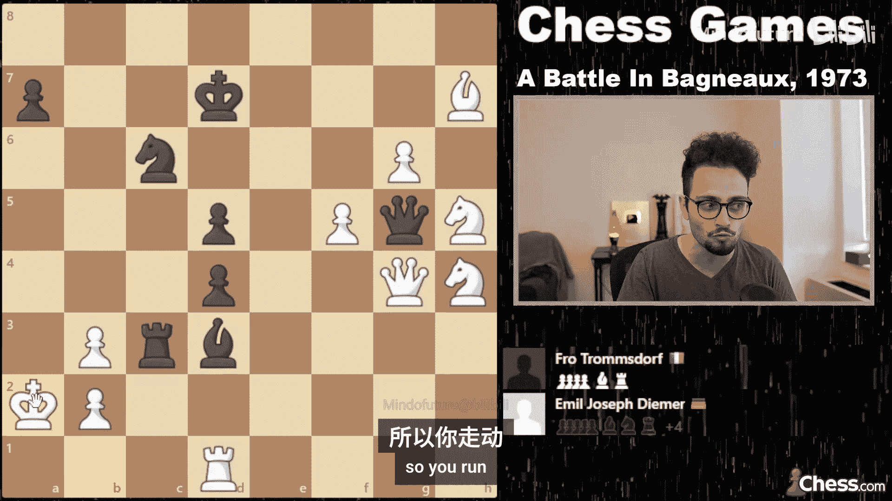

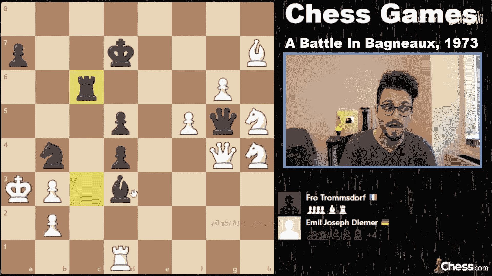

C 3。 Now， the threat of Rsy 3 is Roksy 2 mate。So naturally， what if you take the rook。

Then black just takes and be true is made。

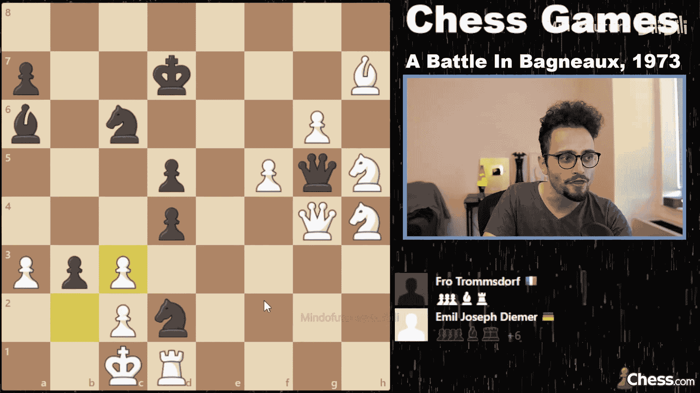

Pon to beat，2。 you're like， okay， well， that's obvious。 If rook takes night， the queen comes in。

 that's bad。 What if I take this。

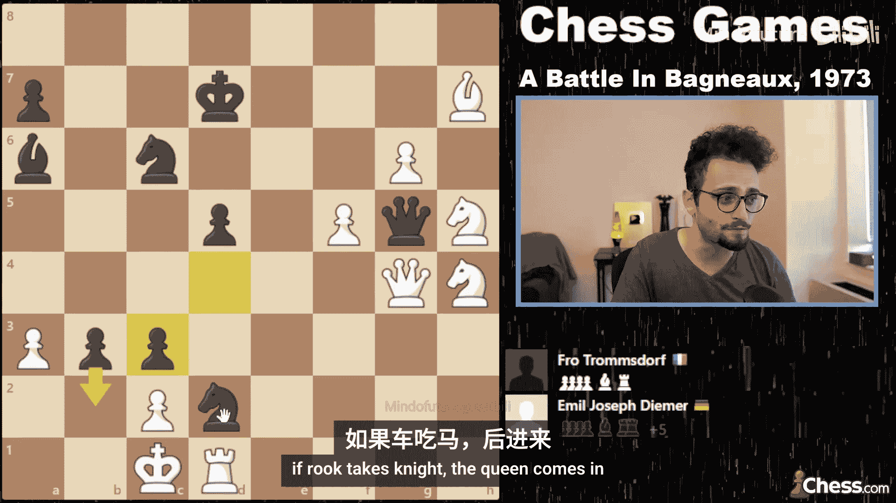

Bishop to D3， and you cannot stop Night takes pawn checkmate。If you play a rook move， like。

 for example， to give defense to your queen and provide King D1， it doesn't matter。 Check， hear。

 mate or mate or C 2 and see 1 ladies and gentlemen。I want to draw your attention once again to that。

 Ro to C 3， here， here， here， here。 are you what what And last but not least， A takes B3， A takes B3。

Night to B Night takes B 3 was played in the game， and it does win。 There is also night to be 4。What。

 well， here's the point。If queen takes G5， 982， here， mate。Night before is winning。

 Night takes B3 check is also winning。 King moves to be one。And now， Rok to D 3。 Now。

 what's funny about this game is that here， if Black had played instead of Rook D 3 repeated moves。

 you say， how does that make sense， Well， well， here's the thing。 You got rid of the B3 paw， right。😊。

But there used to be paw there。 Now， night before is winning once again。 It's the winning idea。

 You have this night before move。 You sack your queen， Anything that gets taken。

 you get crushed down the middle。 And there's the threat of  night82 King2 rookie 2 in the game。

 we got rook to D3。 So now there is a hanging queen， Another hanging queen。

 a hanging rook and a hanging Knight。 And this is right， The only move here， queen to G1。Back up。

 I'm sorry。Not the only move。 But what I meant to say is you， you need to deal with Ru D1。

 your queen。 And it's the only move that looks like it makes any sense because you get your queen out of the way。

 You guard the rook。 You guard the back rank， maybe queen C 1 now。In this position， we have 0。

00 Queen G1， which does look like the only move that guards everything， is made in1 for black。

Black now once again needs to give this check and successfully does so King to a1 now。

There are a lot of ways to win this game。 Knight to be is still one of them。 The queen escapes。

 The queen escapes and is on the way to a 5。 This king is about to face the wrath of a knight。

 a rook， a knight， a bishop and a queen。

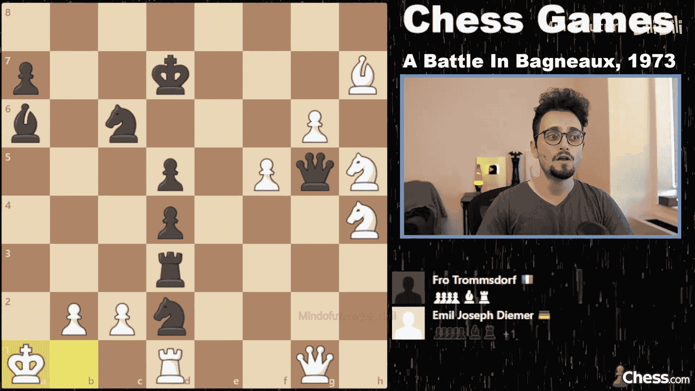

Now I'm not very good at math， but I'm pretty sure that's 23 to nothing。Allright， so what do you do。

 Night2 F6 check。 Now you start getting creative。 You gotta go for the king。

 You gotta go for the king。 That's what you gotta do。 Queen F 6 is playable。

 but that deflects the queen away。 So King to C 8 runs away。 Now， Rook takes D2。

 We got rid of one of the Knights。 If you take this， which looks pretty natural G7。

 Don't forget white is about to make a second queen。 So black has to be be quick。 Queen a 5 check。

 only move this Now， you have an option。 Take the rook or play Knight to be4 Knight to be4 best move。

 Queen  A2 is on the way。 Rook takes D 3， White is trying to escape。

 Now black is left with three pieces， but it's still forced mate check here， What do you do。

 Do you play Queen A 1 and take， or do you play Knight takes D 3。😊。

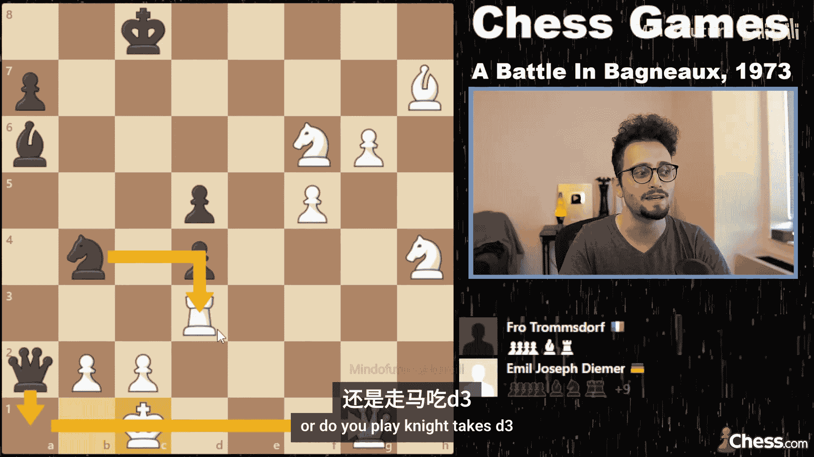

Queen A1， King D2， and Queen takes G1 is minus 15 for black。

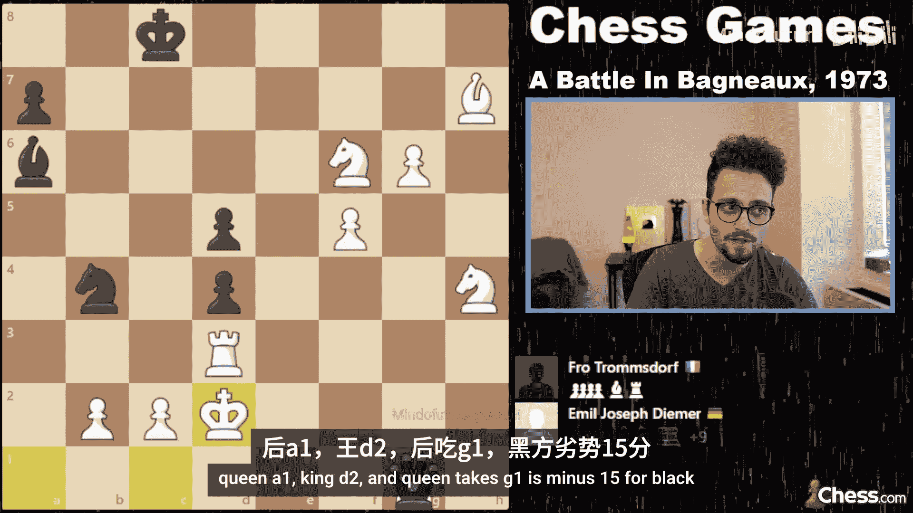

Probably black got a little bit scared of upon promoting or something and chose to instead throw in night takes D 3。

 The problem with this move is I don't need to take and lose my queen。 I can go here。

 Now you are not getting my queen。 and now we're black。 We' we're black。 We're black 2 plus。

 We're back 2 plus 5。

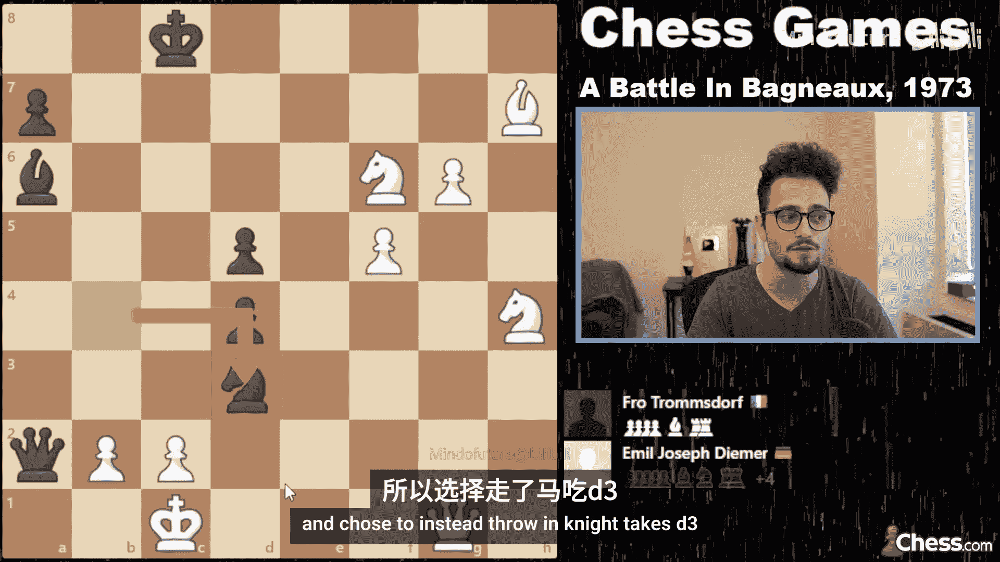

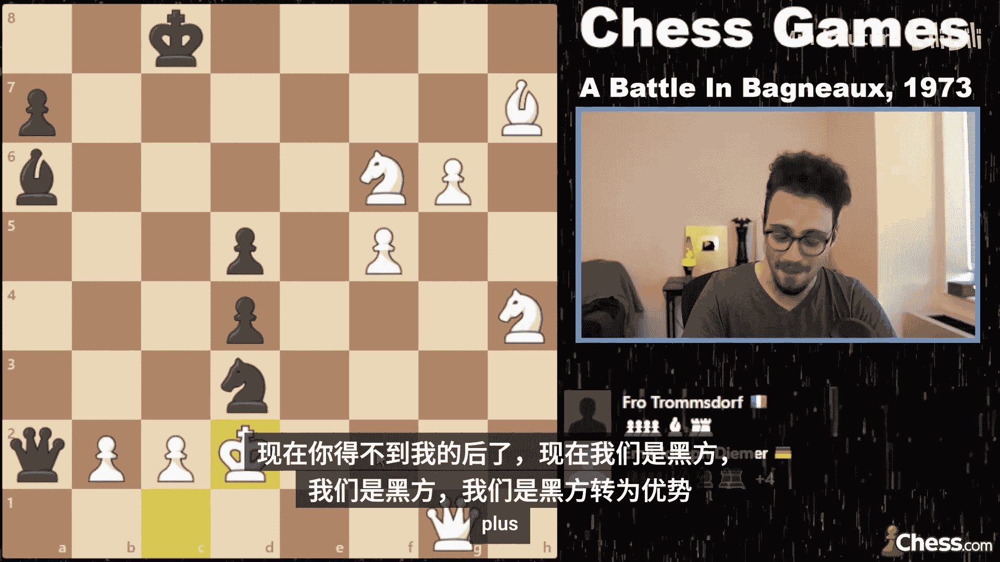

It's plus 5 for white。

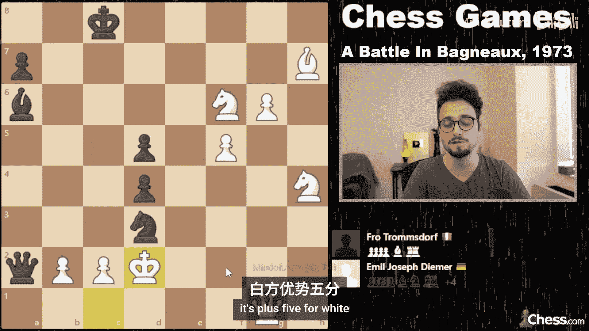

Queen a 5。Can you choose。95。King F2， queen2。This king is being hunted down。 Now。

 if we just instant replay that real quick， queen have5 check。

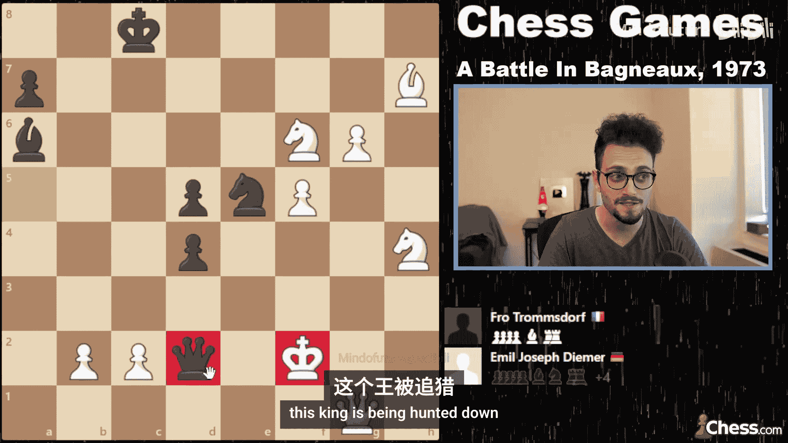

In this position was White's final attempt to survive with the king。 the move C 3。

 This survives because after D takes C 3， you play B， C 3 and you get away to E 3。 Now。

 because White played this move。

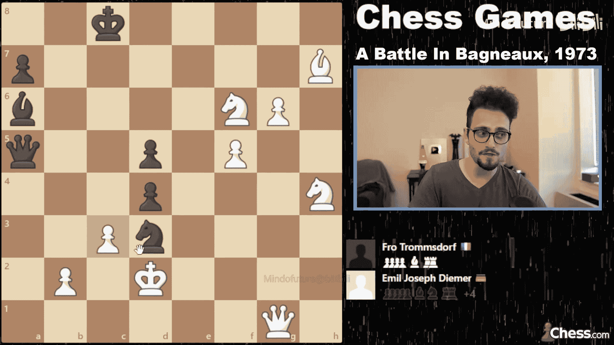

Check here， check， here。 And there's no escape。 Your escape is taken away。

 Queen G 5 King here and the players repeat moves for a draw。

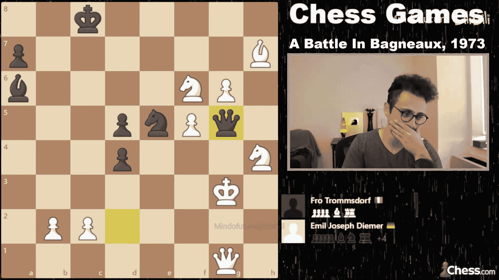

Now， listen， I understand that you might be on for blood with a game like this。 And trust me。

 when both players are on the verge of defeat。We definitely want somebody to lose。But。

I'm not going to lie to you， folks。 Qui G 4， B3 is one of the most savage things I have ever seen in my life。

And I wanted to share it with you as we continue our tradition of you all sending me various games。

 I've never seen this game ever。 So thank you to the individual who sent it to me。Incredible stuff。

 B3 is the most savage move I've ever seen until perhaps a future game of one of my viewers。

 As always， take care。 I hope you enjoyed， and I will see you in the next one。 Get out of here。😊。

