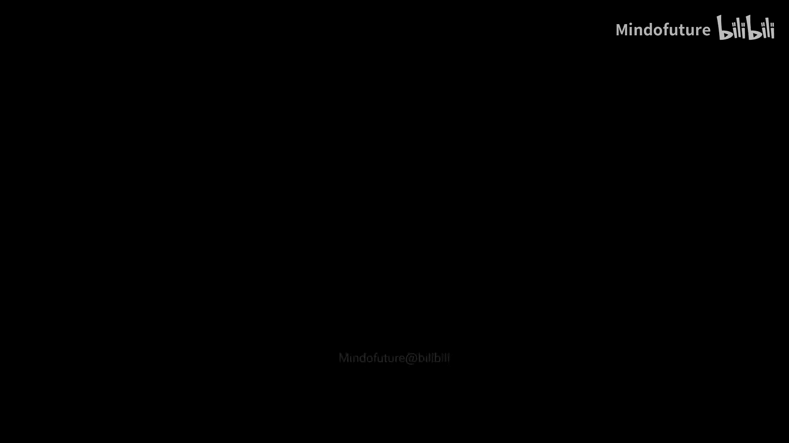
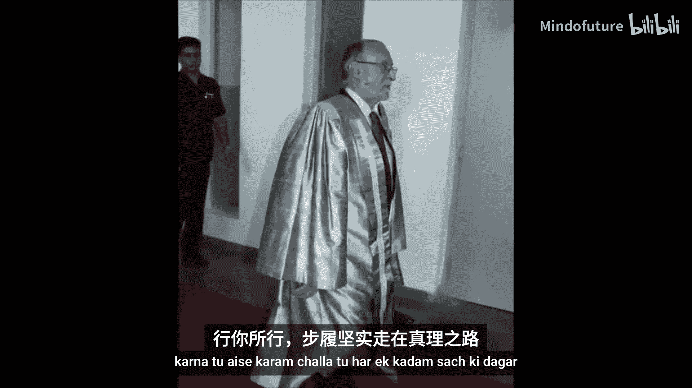
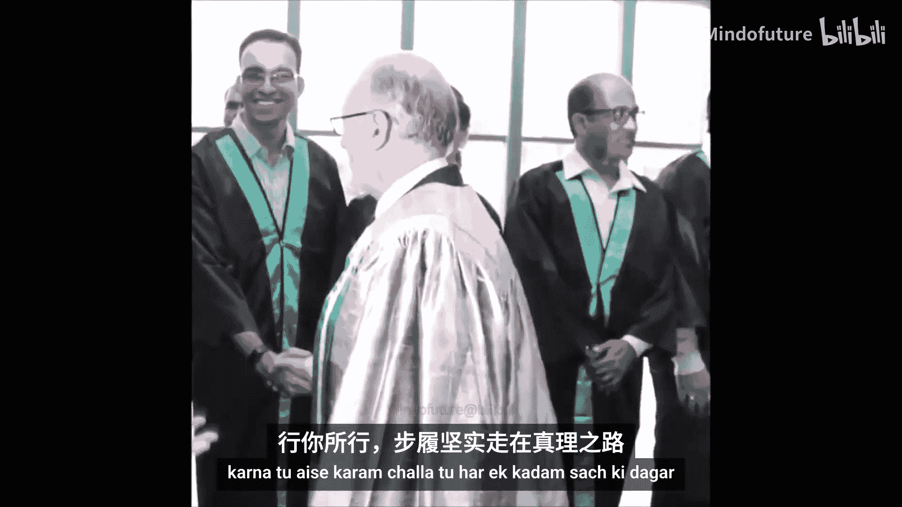
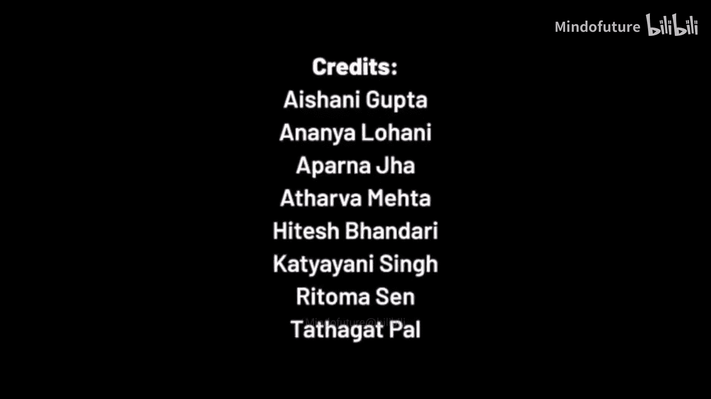
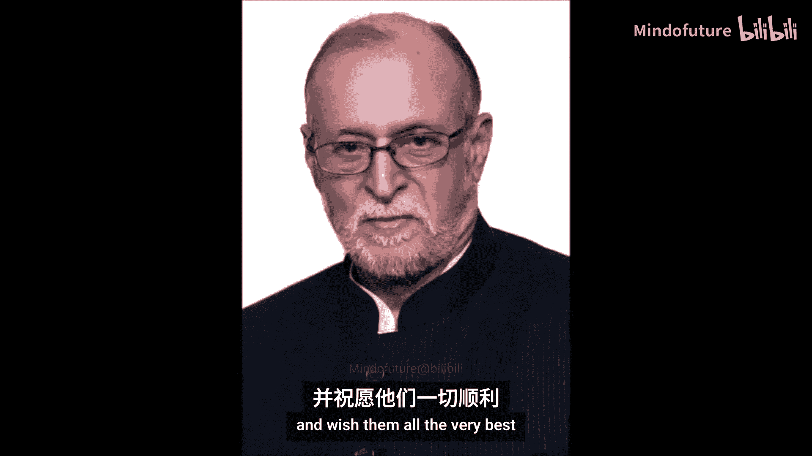

# 图表征学习讲座 ｜ Graph Representation Learning p10 P13_IIIT-德里第十届毕业典礼 -BV1tQxqzYEFP_p10-

A very good morning to all of you。Welcome to the 10th virtual convocation of Trii Delhi。

The convocation ceremony is about to start。🎼梦妈。🎼风妈。🎼不怕。🎼梦风。🎼明み。🎼的问。🎼그の。

🎼す。🎼一可能。🎼真。🎼爱。

🎼い。🎼的等。🎼さ聞たが。🎼셋이。🎼两个人。🎼不是。🎼歌唱。🎼夜色纷。🎼都ち公。🎼你不朝我碎日。At the start of any convocation。

 it is traditional to have an invocation song。This year we have decided to have an invocation song。

 Ru Bru Roshni， composed by A R Raman from the movie run De Bani。🎼This。🎼而咿而嘿。🎼，🎼왜에게。🎼기해。🎼，🎼我却没给你。

🎼好一次吧。🎼My次个。🎼So裂的出来。🎼你。🎼呦爱呦。🎼若是你。え？🎼噜果。🎼如果是你。はい。🎼조금说다。🎼s카ブ타。🎼我没有改呀。🎼我 killed的啊。🎼乌龙和他。🎼比可的雅。🎼ケチャキチャ。

🎼마这歌야。🎼Sa out to me。🎼我的歌啊。🎼ル吧。🎼我是你。🎼不白路。🎼若我是你。🎼두와철 다 후라가 내 밀라， 내리다그 내 아르 밀라， 좁 은석이 후 항를 밀라， 나름 네라 제라。

🎼누와 제다꾸닥 가 게 믿어 내댁을 내아 믿라 죽 은 새 도멍 사를 믿라 내 자를 믿다。🎼How do you see这个 yellow美。🎼我路不。🎼那么想。🎼在那嘿。🎼可离看吧。

🎼美那哩哩。🎼我家里没。🎼一个样。🎼了什么啊。🎼记忆乐。🎼Sa帝。🎼Yeah。🎼噜吧噜。🎼的是。🎼，🎼若是你。🎼。🎼。🎼你走。

Thank큐。We will now start the proceedings。Mr。 Chairman， sir。

 I request you to declare the convocation open。I declare the convocation open。

 I request the director to present his report。 Hoable Chancellor， Mr。 Anil Bagel， chief guest。

 Professor Gaganip Kang， Mr。 Kiran Knick， chairman board of Governors， members of the Senate。

 members of the faculty and staff， invited guests， are well wishers。

All the graduating students and their family members joining us online。

It is my pleasure to welcome you all to the 10th convocation of Trii Delhi。

I take this opportunity to express my heartfelt gratitude to Professor Gaganip Pang for accepting our invitation to be the chief guest and kindly agreeing to deliver the convocation address。

😊，Professor Kang is the first Indian woman to be elected as a fellow of the Royal Society and the co author of the book。

 till we win India's fight against the COVID 19 pandemic。

I would also like to express my gratitude to the honorable Chancellor for taking out his valuable time and sharing his thoughts on this occasion。

In this convocation， we are proud to con 345 BTEC， 204 MTch，1 dual degree， and also 26 PhD degrees。

Congratulations to all the graduates。This year， we have admitted 232。

Mt students in three programs with7 different specializations and also 43 PhD students。

The undergraduate admissions are underway。Triple Delhis strives to attract and retain the most outstanding faculty。

 The faculty members are amongst the finest in the country and are internationally recognized。😊。

Last year， the Institutestute added 11 new faculty members of which nine have a PhD or a postdoc experience from a abroad。

Triplei Delhi has always been sensitive to the importance of gender diversity。

 and over 35% of the new faculty members are women。

The faculty members have also received several awards and recognitions in the past year。

Some of these are C XO Health Excellence E， the Guinea's world record for the largest camera trap Wildlife survey。

 U C Young scientistist Ever by the International Union of Radio Science， National Systems。

 gold medalal and many more。😊，E of our faculty members were featured in the world's top 2% scientist database。

The int's unflinching commitment to scientific leadership is easy to discern。Last year。

 the faculty members and students published over 478 research papers， including 234 journal papers。

 184 conference papers， 42 workshop papers， and 18 books or book chapters。

Some of the papers have received the best paper award in prestigious national and international conferences。

Many PhD students were selected for coveted research grants and fellowships such as the Prime minister's Fellowship。

 Google India PhD Fellowship， etc。Externally funded projects are essential for strengthening a curiosity driven and applications inspired research culture in the Institutestute。

In the financial year 2021， the Institutet has received external funding worth over 33。6 grow。

New ways of thinking bring about the advances that benefit the world。We live in。

 including technologies， innovations and out of the box ideas that enrich our lives。

An example of this is the creation of the center of sustainable mobility。

Delhi has been suffering from serious problems related to traffic congestion。

 pollution and road accidents。This center of Sustain mobilitybility at Triti Delhi。

 which is set up with funding from DKDF。We'll focus on solving the current challenges of urban transportation in Delhi and the NCR。

The Covid-19 pandemic has highlighted the immediate need for a transformative change in the health care systems in India。

The Center of Excellence in healthcare， which was started last year。

 is already making an impact in this direction。In response to the pandemic。

 the centre is looking at epidemic modeling for hyper local interventions。

 ways of developing a robust crowdsourced to citizen centric。Information system and in the long run。

 a comprehensive plan for a sustainable， resilient and healthy city。😊，Recently。

 the instute also received funding from DBT to set up a bioinformatics and computational biology center。

In response to the urgency of the challenges facing the national capital region。

 Tri I T Delhi is creating new methods of catalyzing hyperloc solutions。

 The intitute is actively contributing to Delhi Research， Implementation and Innovation Program。

 Drive， supported by the Office of the Principal Scientific Advisor Government of India。

The basic philosophy is that of a problem first approach with an eye on scalability and long term sustainability。

As a part of the endeavour to augment a global connect。The center of excellence on lifefi。

 which is light fidelity， is being set up to design relevant courses on lifefi and facilitate capacity building by supporting research collaborations and exchange of experts between India and the European Union。

The IAA International Conference on Advanced Network and Telecommunications System was also organized atAAIT Delhi in December 2020 in an online mode。

Tripleati Delhi has signed MOUs with Taas India research and technology， fast retailing。

 logically AI， University of California San Francisco。

 and several other universities and industries to expand international linkages。

Tple IT Delhi and II T Delhi have also signed an M O U to help the two institutes collaborate and cooperate in various domains。

Tripleti Delhi has always believed in creating and nurturing the spirit of innovation amongst his faculty and students。

The Institutestute has set up I Hub An Ubui， a technology innovation hub under the National mission on interdisciplinary cyber physical systemss supported by DST。

The TIH intends to establish itself as a hub of research。

 entrepreneurship and innovation in the area of cognitive computing and social sensing。

And also build a nationwide shared and distributed facility for public research and commercialization。

The institute takes pride in developing strong linkages with industry as well。Recently。

 we have signed MOUs with Donjust PTY， slide rule Las， India， Care onco biootech， ST Mielectronics。

 etc， to carry out research driven projects。The Data Car Center of Excellence has been established in association with GS1。

 India to apply AI and EL for improving the quality of product data in the National product Data repository。

Trii Delhi has also been in sync with the needs of the industry in terms of capacity building。

The Institutestit has started two PG diploma programs。

PG diploma in data science and AI with IBM and PG diploma in computer science and artificial intelligence with C learning。

The Institute has also started the professor of practicee category for distinguished professionals who would help in designing and teaching courses in research and developmental activities。

 setting up research collaborations， promoting industry intitute linkages， etc。

TripleIT Delhi has also designed a certificate program in CS teachingching that would allow experts across the country for improving computer science teaching in colleges。

The Institute has started its international admissions process for all UG and PG programs。

It has set up an Office of International Affairs to attract talented international students and facilitate their transition into the TriIT Delhi ecosystem。

The intute has doubled its international student intake in the past year。

As a proactive step for our students， the inst has strengthened the Student mentortorship program。

 which helps students interact with senior students and faculty members and discuss the issues they are facing in an informal setting。

Tripleti Delhi has also reimagined and revamped its induction program。

 which was conducted online due to the pandemic。In addition to the standard activities。

 this augmented induction program includes invited speakers from across the country。

 alumni interactions， self growth sessions， self help sessions， incubation center sessions。

 and parents virtual tour of the campus。The Institutestit has also started conducting student and faculty wellbe surveys。

To gather data and use it to improve the quality of life on campus。

The institute has planned for and executed all its educational programs online and continuously adapted to the dynamic scenario based on constant feedback from our students。

The students who did not have easy access to the internet were also financially supported。In fact。

 how Triati Delhi has adapted to the new normal during the pandemic。

Using information and communication technology is a living example of how ICT can connect people meaningfully。

Entrepreneurial thinking is a mindset， and the Institute is focused on how innovation and entrepreneurship can play a positive socioeconomic role in society。

Precubbe is a pre incubation programme by Tri T Delhi。

Tripleite Delhi's incubation center for early stage innovators helps to build startups from their basic ideas and help them enter the market。

Sparark is another program to support startups in education， healthcare， green technologies。

 robotics， digital humanities， and next generation computing。

While the pandemic has definitely slowed things down。

The Incubation centre has chosen to embrace the uncertainty with zeal optimism and have rolled out various initiatives such as programme for women entrepreneurship development。

 faculty entrepreneurship development and technology entrepreneurship development。😊，Last year。

 the Institutes received over rupees 1。2 C from My and DSSD to support its entrepreneurial activities and initiatives。

The incubation center has also procured a funding of rupees 6 C。Under the DSST Nhi prayer scheme。

Currently， 24 startups are working from the incubation facility at the campus。

 Tri IT Delhi has been categorized as a band A institution in the category of government and government aided universities in the utter ranking of institutions on innovation achievements。

Sustainable development is now a responsibility that must be shouldered by every organization in the light of the daily degradation of the environment taking place all around us。

The Instituteute has consciously decided to dedicate its expertise to promote and support the Age 2030 for sustainabletain Development goals。

Triple IT Delhi has started the tradition of hosting an annual conclave with a simple idea。

To create a public platform， to discuss the use of information technology for sustainable development of the national capital region。

The online conclave held in December 2020。Had the theme Urban Sign for sustainableable citiesities and communities。

It had keynote speeches， panel discussions and documentaries。

Triple I Delhi also celebrated the Vigilance Awareness Week under the ages of Central Vigilance Commission in November 2020 with a theme Saarkath Samrithharath。

Being a state university， Tri I Delhi is committed to contributing to the region and being relevant to the community。

Three of our faculty colleagues were part of the technology Innovation group found by the Delhi Government and helped design the Delhi Corona app。

Which was used to obtain the latest details about the availability of beds and ventilators in the carpet。

Tripleati Delhi has also contributed towards the efforts of the Delhi government for its war room for CoVD 19。

The in's student placement activities are seeing a robust trend。😊，During this placement season。

 despite the effect of the pandemic on the global job market。

 a total of 618 offers were made at the institute， which comprises 474 full time job offers and 144 intern offers。

There is a significant growth in the A plus offers。Im happy to observe that this year also。

 a sizable number of our students have opted for higher education。😊。

Our students are going to talk overseas universities like the University of Texas at Austin。

 the University of Texas at Dallas， Georgia Institute of Technology， Purdue University。

 Iowa State University， University of Torento， University of Stuttgar， Germany， and ISC Bangalore。

Along with research and education， the students are also involved in many extracurricular and sports activities。

😊，The students run as many as 25 clubs and have won several medals in prizes。

The students have won the MIT COVID 19 Chaenge。The U G Student Consortium Award at the 6th IEee Big MM M Iriee Vehicular Technology Society。

 U Innovation Challen 2020， the 5 G hackathon organized by DoT， Adobe。

 India Women in Tech scholarshipship。Audience award at the prestigious filmilm festival calledRough touch 60 seconds Film Challenge and many more。

As a part of its outreach activity， the inst organized a five week summer camp 2021 in a virtual mode in this。

 the Tri IT Delhi students trained over 125 students from nearby governmentman schools and provided them with a learning experience that was interactive。

 absorbing and enriching。This year， Tri Iti Delhi received the Federation of Indian Chambers of Commerce and Industry Ficky Higher Education Excellence Award in the category。

 Excellence in faculty。The QS ranked Tri IT Delhi in the top 500 in the Asia University rankings 2021。

The instute also featured in the THE World University rankings for the first time in the band 601 to 800。

The Times higher education ranked Tri IT Delhi， 143rd in Asia。

Tripleati Delhi ranked 13th in the category top government colleges for engineering in 2020 by India today。

In the QS rankings， the in currently sorry in the CS rankings。

 the institute currently holds eighth overall rank in India。Before I conclude my annual report。

 I gratefully acknowledge the support and encouragement I have received from our chairman， Mr。

 Kiran Knick and all the members of the board of Governors。😊。

I would also like to acknowledge the proactive support received from the Delhi government。

While the last year has been a year of disruption and transformation。

The Tri IT Delhi community has not only demonstrated resilience but emerged wiser and stronger。😊。

I would like to commend the students， the faculty members and the staff who have chosen to ride the wave of uncertainty with determination and zeal。

Finally。Dear graduating students。On behalf of Tri Iti Delhi。

 I congratulate each one of you for your great achievement。

I have no doubt that the experience in the last year or so has left an indelible impression on your lives。

I compliment you for your commitment to learning。And your tenacity in making the very best of the rapid and challenging transmission to a fully online mode of education。

Your graduating class has been put to test。And you have passed with flying colors。

You have undoubtedly grown academically in the last few years。You have developed as leaders。

 You have formed priceless friendships that will last a lifetime。

You may have identified talents that you didn't know even existed。😮。

And then in the last several months， you perhaps took a crash course in the meaning and purpose of life。

It also gave you a different perspective on science and technology。😊。

Science must ask consequential questions。And technology matters only if it can improve human lives。

Im positive that you have nurtured the skills needed to become future leaders who are compassionate。

 dedicated to problem solving， forming meaningful communities and bringing about societal change。😊。

As soon to be alumni， I am sure that we can count on you to spread the word about TriIT Delhi and to support those who come behind you。

Please continue to be in touch and consider giving back to the Institutestitute。

We thank you for all you have done for the Institutes and will continue to do to take IIIITD to greater heights。

For now， stay healthy， work smart， and enjoy life responsibly。

I'm confident that you will help in defining。Shaping and inventing a new tomorrow。Ja him。

Honorable Chancellor， Sir， I request you to deliver your address， please。 unfortunately。

 due to some unforeseen circumstances， Hoable Chancellor is not able to deliver his speech in person。

We are reading out his message on his behalf。Distinguished guests。

 ladies and gentlemen and dear students， it gives me immense pleasure to congratulate the graduating students and the meritorious medal winners on the occasion of the 10th convocation of Inroppresta Institute of Information Technology Delhi being held virtually。

Your efforts during the past year， disrupted substantially by the pandemic。

 deserve special acknowledgement and recognition。I also take this opportunity to congratulate and thank the teachers。

 parents， and all those who played a role in helping the students come out of these trying times。

The year and a half that went by has been of immense and unprecedented challenges to mankind。

The COVID 19 pandemic affected every aspect of our society。

 especially so the academic sphere where the age old systems of imparting education and classroom interaction faced absolute disruption。

While on the one hand， this drastically altered the way our institutions of learning operate。

 this adversity also provided us with an epocaly opportunity to innovate， adapt and succeed。Today。

 classrooms have breached their physical boundaries and transcended campuses。

The new global normal involves online classes at home through televisions。

 laptops and apps on mobile phones。😊，Even in our country。

 the government has been encouraging online education to achieve academic continuity and ensure enrollments。

Our schools， colleges， universities have more or less shifted to the online method of imparting education。

While I agree that the shift may have caused some initial glitches。

 especially for our teaching staff having to learn about this new media and the software。

 but there can be no denying the fact that online education has democratized education like never before。

With ample technological support， education can indeed become affordable and universal。

 a goal unquestionably desirable。😊，Friends， the disruptive changes that have happened during these times also provided us with an opportunity to reorient and align ourselves with a larger goal of skill and ensuring employability and also adopting the objectives set forth。

In the visionary new education policy， NEP 2020。One can see that the current shift to online learning could be the catalyst for creating a new。

 more effective method of educating students， and it is incumbent upon all of us to explore its full potential。

In my view， we can successfully move towards virtual schools and digital platforms for imparting education in the remotest villages of our country。

😊，It will be worth under here that apart from achieving almost universal reach。

 this would also cut costs drastically in terms of capital as well as recurrent expenditure that are required to establish and run schools and colleges。

In this regard， the widening digital divide and the limited penetration of the internet is something that needs to be addressed by all stakeholders。

 most of all the governments in a mission mode。Additionally。

 government departments and organizations， which were till now switching over to digital delivery of services and technologies that minimized human interface at their own pace。

We have to necessarily adapt to such technologies on an emergency basis。Friends。

 having outlined the way forward， it will only be prudent to look at the pitfalls and limitations of this isolationistic and individualistic pedagogy。

 bereft of physical contact and social interaction。😊。

The near absence of physical activities and outdoor sports will only get accentuated the more we shift to online education。

 with myopia， obesityity， depression， anxiety and stress acquiring epidemic props as a result of overexposure to digital screen and lack of emotion connect due to social distancing。

 the onus lies upon parents and teachers to ensure and achieve a healthy balance。😊，Dear students。

 as you step out from the portals of your alma mater today， I would like to tell you that to my mind。

 you are the scholars and practitioners of alchemy。

 the alchemy of education that has the power to fundamentally transform your personal lives。

 the society as indeed the nation。You should continuously cultivate and enhance the traits of ingenuity。

 innovation and integrity， and master and perpetuate this alchemy and shape your personal and professional lives as indeed that of the universe around you。

Convocations， while giving us an opportunity to look ahead。

 also call upon us to take stock of our endeavors so far。

 I'm happy to state that this institute has made commendable progress and remains committed to achieving high standards in teaching and research。

Tripleati Delhi has earned an excellent reputation in India and abroad for being an institution of quality education。

 research and interdisciplinary studies。😊，With world class faculty。

 thriving research and an environment of innovation。

 Tri IT Delhi has grown to become one of the most promising young institutes in India。

Various Indian and international rankings have recognized the strides being made by the institution。

In 2021， QS word ranked the insute in the full 101-450 band。

And Times Heart Education World University rankinging 2022 ranked the instute in 601 to 800 band。

The CS S rankings put CSC research in Tri IT Delhi at rank 8 in the country。

While this is a matter of satisfaction， it should also egg us further on on an incremental path of excellence so as to achieve higher rankings。

The instute attracts the brightest minds because of its reputation in academic excellence and research。

It is a matter of pride to know that in the field of research。

 the faculty and students of the Institute have received various awards and fellowships from the industry。

The faculty members have also received several prestigious awards and recognitions in the past year。

E of the faculty members have featured in the world's top two person Sc database。

For creating and nurturing the spirit of innovation amongst his faculty and students。

 I congratulate the Institutes on setting up Ahab Aubhuhi。

 a technology innovation hub under the National mission on Interdisciplinary Cy Phsical Systems supported by Department of Science and Technology。

Besides teaching programs and research， TriIT Delhi is also committed to sustainable development goals。

 I'm happy to note that the annual digital Delhi conclave for IT leaders is one of the initiatives of the Institutes in this regard。

It is indeed remarkable that the work done by the faculty on the largest ever Cam Tra Wildlife Sur has made it to the Getddess Book of World Records。

Dear young graduates， this is a moment of pride for you， your family and your alma matel。

I'm confident that each one of you has potential for excellence as we embark on an extraordinary journey towards a professional career and bigger responsibilities。

A new role for each of you is about to begin。 You will be the brand ambassadors for Triti Delhi。

 and your achievements will add to the development and sustainance of the Institutest。

I'm confident that through your successes， values， and winning attitude。

 you will bring an even greater sheen to the reputation of the Institutes。Once again。

 I congratulate the graduating students and their parents on this happy occasion and wish them all the very best。

 Thank you Jayhimp。

Mr。 Chairman， sir， I request you to deliver your address， please。Chancellor。

 director of the Institutesute， faculty， staff。Our special participants today。

 the graduating course of 2021 greetings to all of you。

 greetings to wherever in the world you might be， and welcome to this momentous occasion。

Momentous certainly for the graduating students， but momentous also for all of us connected to the institute because this is the 10th convocation。

 it is indeed a milestone and a land mark。So special greetings to all those involved and as I said earlier。

 my special greetings to graduating class this is your day and my much of my talk is really。

Aimed or directed to you。It's been indeed a difficult year。A year in which our whole world。

 in some sense， was turned topyervy。Everything went upside down。

 life as we knew it changed completely。In these difficult times。It's indeed。

Unimaginable for all of us。Of the kind of changes that have happened。

And I can imagine that most of you never imagined in your wildest dreams that anything like this would happen。

For the young students in particular， this was something which they could not have。

Ever anticipated more than that。Even when they went。As I know。

 many of them must have done to their families， their guardians， even their teachers。

There was little that any of us could do because all of us were as unsure， uncertain and very。

 very wary of the times that we lived through。In these difficult circumstances。

 I think it's a very special compliment。To the graduating students and of course the faculty and staff of the institute that we saw through these difficult times。

 not only did we go through them， but we went through them continuing the efforts that we've always made。

To ensure that our academic quality and regard stays where it is。

All of you have had to participate in online classes。

Many of you had difficulties of one kind or the other be connectivity， device， timing。

 disturbances in your home or wherever you were， and yet you've gone through them。

 and we made the transition as an institute smoothly from one form of teaching one form of learning to another。

And I think it says a great deal。For the kind of。Community。

 the kind of resilience that you build up that we saw this through in a very smooth way。

And the learning was not compromised， the rigor was not compromised。

All of you went through what you might have done。Had you been physically in the institute。

 and yet it was so vastly different， such a different way of learning。

 such a different way of not being interacting with faculty。

 not being able to interact with fellow students， not living on campus。

 and in many ways enjoying the joys and thrills of campus life。

But that is what these times brought on us。And as I said。

It's a compliment to all of you students in particular whove had to go through these other difficult and trying times and yet come out in many ways in flying colors。

 so my congratulations to the graduating class and indeed to all those who guided them through these times being uncertain themselves。

 the guides， the teachers，Families。All those who supported them and the staff of the institute who through very tough times。

Continued to provide the support that was so essential to look at this。It's in this context。

That I think that many of us saw this as dark times。Many of us。Suffered tragedies。With friends。

 sometimes with families， with people we knew well。Pre to。live through sorrow， through difficulty。

 through concern， through worries。And these are the times that we have test us。I not only hope。

 but I'm confident that they will not recur。And that we will not be troubled by something like this again。

But it have been testing times， these have been indeed difficult times for all of us。

 for those of you who are trying to learn to get through your course to see how you can make the best of where you are。

 to faculty who had to switch to online learning to learn how to do things in a very different way while themselves going through concerns。

 difficulties and worries， and as I said to the staff who' had to support this indirectly and directly in various ways。

And most of all， the leadership。Our director。We led the faculty and the transition and the registrar who saw that all the support that was required was provided there to them。

And I' am sure that each of you now is looking forward to times when you're true with these uncertainties and frustrations。

And when you look back， you will see these as times with very。

 very serious problems with where you learned a great deal。

And the learning is not just the academic learning that you went through。

 it's also a great deal about what one might call life lessons。

The real life things that we have to go through sometimes with sorrow。

 sometimes with difficulty and yet you live through them so when you look back I'm certain you will see that these times。

That is they were have given you new lessons apart from the academic lessons。

And taught you the importance of resilience。Of being able to stand firm and also of critical things that we have all been through。

The importance of working together。Of looking beyond one's own problems and looking at other bigger things in the bigger picture。

Hoping others。And I'm sure that all of you have done all these and seen what they mean and how they help us。

I spend time on this because this has been top of her mind to the last one year。

And I know that all of you have had to face these rather uncertain difficult times and be through them。

I'm confident that we have not only seen the worst。

 but we are practically through them the last couple of months。Ive been improving。

Vaccinations are going rapidly ahead。And indeed， we seem to be not only seen the light of the end of the tunnel。

 but almost out of the tunnel itself。I hope that's true。

 I have live with confidence about that and optimism about it。In this context。

 I want to put in a word here and say， I talked of vaccination， I talk of the epidemic。

 I talk of the difficult times。And what can be more appropriate for us？Then to have。Dr。

 Gganvi Kang as our chief guest today， you will hear more about her and the director will introduce her。

 but I want to extend a very warm welcome to you Dr。 Kang and thank you for joining us today。

I just want to say that you're a role model certainly as many， many people tell me to young women。

About what one can become and how one can achieve。 But I think that's incorrect。

 It's incorrect because it's not the full truth。 The full truth that is that you're a role model for all。

 not just women。 You're also a role model for young men and the graduating students within in particular。

You know， learn and look up to you a great deal， but I will stop there and leave it to the director to introduce you more fully and appropriately。

On this ceremony， which is， as I said， a very special one。

 it also marks the second edition of a virtual convocation。Personally， I hope this is the last。

The last edition of a virtue one， I know how much each of you。Were graduating students。

Would have wanted to be。Physically present on campus。Share your joys with each other。

 with your families， with your friends， whereever could have been here and of course。

 with the faculty and staff of the int。All of us from the institute would very much have wanted the same and are'm missing the fact that we are doing this convocation without。

All the people for whom this is specially done and indeed a special day for each of us。But that is。

 as it is， as I said， my hope is that this is the last virtual one from next year we will get back to physical ones and not ever have to go back to virtual one out of necessity。

 if we all do so in times to come it will be by choice and not by necessity。You know。

 we would have to， of course accept that the last year。

 last two years in some ways almost 15 times when we've had to live through all the kinds of problems and to recognize the wonders that modern technology enables us。

Even as we've seen the kinds of problems that we've all had。

 we've also experienced in some sense the wonders of technology， the fact that we can meet like this。

 the fact that many of you maybe in different parts of not only the country but possibly of the world。

 we have participants from all over joining us today。

 and it's all made possible by a virtual platform， where we can see each other， hear each other。

 but as I said sdi， not connect with each other in the same way as we might have done in physical presence。

Yet we've seen that we can overcome a lot of these difficulties through technology。

And that's the last part of what I want to touch on you have yourself experienced。

You have known it earlier， but you' experienced now what technology can do， not only for learning。

 but also for your day to day life。Be it ordering groceries all design。

Be it meeting your medical needs by connecting with a doctor on online。

Platform or even just through online you know communication system like Whatsapp。

 you've seen how you can download entertainment。how you can connect with friends who may be anywhere。

 you've seen all this。And you're seeing what it can do。I would certainly think。

 and I'm almost certain this will be so that will inspire you to see how technology can continue to be used to take further what we all want。

How technology itself can push the boundaries and how you can help that to happen。

 but also how technology will be used by the community。

How to be useful to people in their day to day lives in making life easier， simpler， more efficient。

 and enable to do new things。This is what technology can do。

 and this is what you've spent years at the insute learning。

 honing your skills and taking it forward。Your capabilities in this。We really hope。

Not only you and your organization， but indeed I'm sure to help the community as a whole。

I want to also take this opportunity， I mentioned the difficult times， I mentioned the faculty。

 staff， the students those connected to the intitute。

I want to use this also to say a special word of thanks。To my colleagues on the Board of Governors。

They have continuously been helpful in guiding us through these times and giving advice in their wordsge of wisdom。

 in sharing thoughts， in sharing experiences from elsewhere， so my thanks to my fellow members。

I want to finally thank our great supporters through all these years。

 through the years from the early setting up of the Institutes to the present day。

 the government of NCT Delhi， we continuously had their support from all levels the administration。

 the executive， the political support we've had， I think it's been truly one of the pillars that is helped to go through。

I want to thank our Chllor， the E governor of Delhi。

 who has continued to support us always and for everything。

 we've gone to him when we've had any serious problems。

 we've gone to him to share our joys and tell us tell him where we are and he is being so much with us and so participative of our joys and sometimes our difficulties that indeed I'm grateful to him for all the support that he's provided。

To all of you graduating students， I want to end by saying that。

The Tri I Del has always been your family， you're part of it。

You will continue to be part of it forever。Do continue to stay in contact with this family。

 stay in touch。You will find mutual support useful from the Tri ITD community as a whole to you and certainly from you to the institute and the community。

Of the to P。But to go beyond that， you can do wonders for the broader community。

 and I'm sure you will。I would urge you to do that。Hish you， great success in whatever it is。

That you do， whether you're working， researching， becoming an entrepreneur。

 my best wishes for your success， my congratulations to you and your families on this momentous day。

Go food。Get into the word。Do well。Enjoy yourself and continue to be part of the Tri ID family thank you。

It， it is my proud privilege to introduce Professor Gaganip Kang。

 Professor Kang is the first woman from India to be elected a fellow of the Royal Society。😊。

She is also the first Indian woman to be elected the fellowship。

Of the American Academy of Microbiology and the only physician scientist to receive the Ins award in life sciences。

Professor Kang received a training in medicine and microbiology at the Christian Medical College Vor and is a professorfe of microbiology at the Christian Medical College in Vor。

 India。She works on enteruric infections in children。

 particularly on transmission and immune responses in order to design effective interventions。

Current studies include active hospital and community based surveillance and clinical trials of new and existing vaccines。

With use of molecular based assays to study the diversity of pathogens and the immune response of children with viral and parasittic enteraric infections。

May I now request Professor Kang to kindly deliver the convocation address， Mr。 Carnick。

 members of the governing board， Dr。 Bose， director and faculty and graduates。

Of the In thepress Institute of Information， Technology and Par。

Thank you very much for the invitation to join you here。The 10th convocation。

 this is a very special location， it may not be exactly the one that you had expected when your batchmates and you started。

On your journey of education here。After years of effort。And hard work。

 you've achieved what you set out to do。And except for a few of you。

 the path to this success will not have been easy。So my congratulations to all of those who are receiving their degrees today。

And a special appreciation to those who have distinguished themselves。And received awards and prizes。

It is of course， a matter of great privilege to be from A ITT。

 which describes cutting edge research as part of its institutional DNA。

The mission is focused obviously on excellence in information technology。

 both in terms of education and in research， but very importantly to also be innovators who are socially relevant。

So if the goal of your education here is to prepare you for outstanding work and for citizenship。

What are the factors that we need to be thinking about？In discovery and in application。

 science and technology do respond to societal needs and to global challenges。

In my own field of medicine， engineering and technological advances。

 including in information technology most lately， have played a major role in discoveries and in their clinical translation since the invention of Xrays by Rachen in 1895 since then we've had technologies from a range of disciplines that have led to improvements in healthcare。

Starting with molecular approaches to imaging to what is currently becoming more and more important。

 which is artificial intelligence and machine learning。

 which have applications in identifying and monitoring disease and predicting its outcomes。

Droundbreaking inventions， not just in medicine， but in every field of science and technology in the past century and in this one have changed the way in which life sciences and other sciences work together to address major challenges。

This year， health has of course， been central。The pivotal events of 2020。

 continuing into 2021 have required us to mobilize the scientific engineering and medical communities to work together in accelerated and creative new ways to address the COVID 19 pandemic。

And to develop interdisciplinary approaches to solving problems， and we have needed to do these。Very。

 very rapidly and holding ourselves to rigorous standards。In India in particular。

 we have had a number of challenges because of the infrastructure that we have had to deal with。

Primary health care was not a priority for India， although on paper we have an excellent system for delivering care。

Most recently， the government had conceptualized Ayshman par as a start to deliver healthcare to those in our society who were not served or were inadequately served。

This did not meet the promise that was there on paper。

 we however have a new opportunity now through the National Digital Health mission announced just a few days ago to try to truly address inequity and time and our joint efforts will show what we are committed to and capable law。

When we look back on the last year and look to the future。The question arises。

 did we really do a good job， how much damage？Did happen。And what does the future hold for us？

In many ways we got lucky the fact that we have poor infrastructure at primary care was countered by the fact that this was a virus that while it infected a lot of people did not necessarily result in severe disease and mortality in the majority who got infected however。

 because of the large numbers of people who were infected we did have our health systems overwhelmed。

We had issues that could have been solved through better logistic planning and through better supply systems。

We had outstanding successes in what Indian medical systems were able to do and in how society and industry responded。

If we look at the examples of where we were in terms of production of。

Personal protective equipment or ventilators。We were able to meet the challenges of those rapidly and with a relative ease。

But we had failures as well， and those failures were evident in Delhi less than six months ago。

The pictures that we saw， what was displayed on the media。The kind of panic that was engendered。

 some of it could have been done away bit。If you look at the requirements that were sold to us as rational treatments。

 which hydroxychloroquine remeddesir， convalcent plasma。A lot of people。

Tried to do their best to help people in need。 And yet， these were largely wasted efforts。

 Could we have done better。 Yes， of course， we could have。Could we have countered。

Some of what was communicated in media that was not based。

On science we could have and we tried to speaking truth to power is not simple and especiallyly not simple in the context of a pan。

Nonetheless， we all survived with losses and very serious losses at that。

 but we are in a stage today when we can look to the future。

 a lot of questions remain will there be a third wave are we done What does the future of our society look like what is it that we can do that allows us to build a better society for。

The generation to come India is a relatively young country。

 we are in the 75th year since we became independent and you are one of the first generations or some of whom at least whose grandparents may have been born after India became independent。

When we look around us， we see successes。And we see how we define success。

 It worries me that in many ways our definitions of success seem to depend on power and on wealth。

We look around us。And we can see a lot of problems as well if we look at rankings。

Of India's place in the world， we find that for many things that matter for individuals and particularly for someone like me in the health sector。

The health indicators like life expectancy， infant and maternal mortality， health development ind。

 education， transparency， we rank well below other countries that also became independent in the 20th century。

But there are things that have changed and we have come a long way in the past 75 years when I joined medical college。

 infant mortality was 125 per thousand live birds。Now it is less than a third of that life expectancy has gone up by 14 years。

 The literacy rate has gone up by 30%。In the past few years， wherever we look。

 our world has changed quite dramatically。😔，And mostly， for the better。

We just do not always see the upward trajectory。But in India and for the world。

 we do have a long way to go。And that places a responsibility on the faculty and on you to build abilities and skills that allow for transformation of students to enable them to contribute to society。

The merging of foundational knowledge of the leading ideas that shape our worldview with the ability to think which is required for making informed estimates and inferences resulting in intelligent decisions is the basis of education。

To all the graduating students， you will be part of that changing India。And for you。

 I have three messages。The first is to build your scientific temple。

One thing that we have seen all too often in the past year is a belief in。

What science tells us is unsupported by evidence This has been particularly true in medicine。

 I mentioned the need for remdesivir andhenvalcent plasma a little while ago。

 but we also have the proposal that traditional medicines could play a large role in preventing or treating Covid 19。

We know for a fact that many of these are untested interventions and should not have been embraced。

Either by leadership or by individuals， but we rely on scientists and doctors to tell us what is and is not appropriate and it is a sad fact that we were in many situations found wanting。

There was no need for the prescriptions that we saw of 17 or 18 different drugs being given to people who could be managed at home。

Oxygen was used for people who didn't require it， we were told stories of what was happening in private hospitals。

And thereby， you know， because private hospitals were not available to much of the population。

 we had people struggle for public services。Now， all of this。

 because we did not follow a unified evidence driven science based approach to the COVID 19 pandemic。

Will we do this again in the future， I think it is for all of us to decide whether we are willing to accept。

What is called eminence based medicine rather than evidence based medicine。

 and I hope we will go for the latter Now this is true in medicine。

 but it's also true in every field。To think critically。

 to evaluate the evidence allows us to make informed decisions that allows us to think about what a better tomorrow is likely to bring。

And if we follow the science， including the uncertainties of science and discovery。

 I think we will find our way there。The second message I have is to think about increasing the struggle。

Your abilities and your skills are foundational to building your careers and to changing the world as scholars of technology and creativity。

 you have the tools to change every field of knowledge and application now the problem really is that when our society expects us to succeed all the time then we tend to pick problems that are likely to be solved easily。

Now， if you look at today for you， today is a day of great success。But new relationships。

 new knowledge， new products， new approaches do not miraculously appear。

Almost everything that is new and valuable requires iteration， learning from what did not work。

These insights come only after a failure。And accepting and learning from those insights is key to succeeding in every project。

And in life。Think of the opportunities that youll miss if you let your failure stop you。

This is why I say embrace the struggle。When we struggle， when we fail is exactly when we grow。

My third message to you is to empathize。If we look at what is defined， as I said， as success。

It's frequently about power and frequently about wealth or what we own。

And this worries me about our society。If we define empathy and I quote here from Danping。

 it is the ability to imagine yourself in someone else's position and to understand what that person is feeling。

 to stand in their shoes， to see with their eyes， to feel with their hearts。

It is a stunning act of imaginative daring to， the ultimate virtual reality climbing into another's mind to experience the world from that person's perspective。

And I think if we can do this， if we can understand what it is to walk a mile in other people's shoes。

We will understand what is it that we need to do to be able to help not just ourselves。

 but society as well。When I think about my own life。

And think about what I value as my achievements and my opportunities， it really is。

What I have done to help other people， nothing else， you know。

 whatever constitutes success for me doesn't really matter。

What I was able to do to help other people。Re does matter。That is what I value。

 and I hope that you will， too。And， finally。I think one of the things that is important for all students。

就是。😊，Think about to prepare for is what is it that you will do to be ready for the future。

And for that， it's important to understand that there is never any will to be completely safe。

There is no foolproof way to live life。To plan ahead， to identify what is critical。

 what the risks and the threats are and understand their impact allows for ways of thinking about mitigation and minimizing poor outcomes if we have thought through what problems we might encounter in the future we can also think about and prepare solutions。

 we remove fear by creating a path to handling what might be the dangers and risks of failure。

So to end， I want all of us together to thank our parents and our teachers。

 all of those who support us， build us up and keep us going as we set out to become contributors to society and good people in our personal and professional lives there is no question that there will be challenges to come。

 but with the strong base of your education and upbringing。

 you are well positioned to take on the future I wish you all that is good in the world。Japan。

We request Chairman Senate to admit the students for the various degrees by virtue of the authority vested in me as the chairman of the Senate of the Inrepresta Institute of Information Technology Delhi。

 I hereby admit the duly qualified candidates listed in the scroll for the respective degrees and charge them to prove worthy of the same。

The Chllor's medal and other medals have been awarded to the following。

Chancellorss gold medal for the best academic performance among the students of all the baachelor of technology programs。

 graduated in the year 2021 is awarded to Subum Takal role number 2，0，1，7，1，9，3。

 Comp science and engineering。Institute Silver medaledal for the best academic performance among all the students of the Bachelor of Technology in EC C E program graduated in the year 2021 is awarded to summer single roll number 2。

0，1，7，1，8，8。Institute Silver medaledal for the best academic performance among all the students of the Bachelor of Technology in CM program。

Graduated in the year 2021 is awarded to submit the Hu roll number 2，0，1，7，2，6，4。

Institute Silver Medal for the best academic performance among all the students of the Bachelor of Technology in CSD program graduated in the year 2021 is awarded jointly to Riasing Ro number 20。

1，7，3，0，9。And Angel Wia， roll number 2，0，1，7，1，3，2。

Institute Silver medaledal for the best academic performance among all the students of the Bachelor of Technology in C SS S program graduated in the year 2021 is awarded to Arushi Agraal role number 20。

1，7，3，2，4。All round performance medal for the best academic performance and co curricular accomplishments among all the students of the Bachelor of Technology in CSE program graduated in the year 2021 is awarded to Chira Jan role number 20。

1，7，0，4，1。All round performance medal for the best academic performance and co curricular accomplishments among all the students of the baachelor of Technology in ECE program graduated in the year 2021 is awarded to Khalid Loy roll number 20。

1，7，1，6，0。😊，All round performance medal for the best academic performance and cocurricular accomplishments among all the students of the Bachelor of Technology in CM program graduated in the year 2021 is awarded to Chavis 1 E roll number 20。

1，7，2，2，7 All round performance medalal for the best academic performance and Cocurricular accomplishments among all the students of the Bachelor of Technology in CSD program graduated in the year 2021 is awarded to Rya Sing Ro number 20。

1，7，30，9 All round performance medalal for the best academic performance and Cocurricular accomplishments among all the students of the Bachelor of Technology in C SSS program graduated in the year 20。

21 is awarded to Suhangi Bta Ro number 20，1，7，3，6，4 gold medal for excellent academic performance。

Among the students of all the master of technology programs graduated in the year 2021 is awarded to Ca Singla roll number M T 1。

9，2，1，4。PD dissertation award for excellent work in his or her doctoral dissertation among the students of the Doctor of philosophyosophy program。

Graduated in the year，2021 is awarded to。Akiita Sla。

 thesis titled Exping Gemetric Cont for Learn representations for visual data。Ian。

 his is titled Op inference algorithmths for higher order MRF map problems。

Tania Siana for thesis titled Contracyclic codes over finite commutative chain rings。

 Aksha Agraal for thesis titled Panoptic Defs for Se computer vision。

 the pi Ben for thesis titled highly flexible dwell and triband impedence transformation techniques and their applications in advanced passive and active circuits。

Anngeli Leval for thesis titled in Silo identification of biomarkers and vaccine candidates for advancements of lung cancer therapeutics。

 Versha Johan for thesis titled multi twisted codes over finite fields and their generalizations。

 Nehagen。Thesis titled。Idag integrated data and energy gathering for wireless systems。

 Snahi Gal for thesis titled coexistence between heterogeneous wireless networks。

 Disha onese for thesis titledpat temporal Line Stability of Vioastic free Share flows Nta thesis titled noninvasive variableable biomedical frontend for continuous health monitoring。

 using flexibleible Es Mega Agraal for thesis titled Aentated encryption for memory constraint devices。

 Lo in the Tewa for thesis titled robustt scene Understanding Rahul Guppta thesis titled In Aation of impedance Trans in the design of highly flexibleible Multifunctional RF or Mi circuits and Comp Deep Ka for thesis titled Support ongoing training of Community Health workersers through mobile based solution。

In rural in Push Kummar for thesis title building Per。

 privacy enhancing and blocking Regant communication systems。

 Ch Aurora for thesis title prediction of high risk cancer patients using clinical factor and expression profile of apoptosis regulators。

 the following 26 PhD students have dually qualified with degree data，21 January 2021。21s June，2021。

And 21st September 2021， to receive the degree of Doctor of philosophy。D。 Manoch Gulati。

This is titled leveragingaging EmiI signals for App detectionte and energy Haring。Supervisors。

 Doctor Ajit Singh and Dr。 Shoba Sunaram。Dr An Mona。

 thesis titled Matri Comp Tech in bioioinformatic Supervisor， Dr Ansul Majuar。

 Dr Reup Ca thesis titled user Ident linkage， data collection， data set biases， method。

 control and application。Supervisor， Pro Poranam Kragu。Dorctor Anta Sla。

 thesis title Exping geometric Con for learning representations for visual data。 Supervis。

 Doctor Saath Tan， Doctor Ian thesis title Op In algorithms for higherer order， MRF map problems。

 Supervisor Doctor Chaan Aura。Dorctor Cail Conul thesis title Moality guided representationation Learning for Per reidentification。

 Supervis Dr Awi Somanium， Dr Ta Sidaana thesis titled Contracyclic codes over finite commutative Cha rings。

 supervisorvisor Professor Unrasrma， Dr Akshagraal thesis title Panoptic Defs for Secure Comp Vi。

 Supervisors， Professor Rechassing and Professor Manquets。

 Dr Dpaan Bener thesis title High flexibleible Du and Tri and impedence Trans techniques and their applications in Advanced Passsive and Act Circuits。

 Supervisor Professor Mohammad S Hashmi。Dr。 Anjuli Lawell。

Thesis title insilico identification of biomarkers and vaccine candidates for advancement of lung cancer therapeutics。

 Supervis Professor Gaja P。 S Raov， Doctor Washa Chohan。

 thesis title multi twistedted codes over finite fields and their generalizations。

 Supervisor Professorrasrma， Doctor Neha Jann， thesis title Idag。

 integratedegrated data and energy gathering for wireless systems。 Supervisors。

 Doctor Wek Asok Bora and Professor Anwaguta， Doctor Snehi Gopal。

 thesis title Coexistence between heterogeneous wireless networks。

 Supervisor Doctor Sunje Krishnan call。Dr。 De Sha Bsel thissis title I Sp T Linear Istability of Visco Elastic free Share Fs。

 supervisorvisor Dr Saok Sirar。Dorctor Nita thesis titled non invasiveive variable Biommedical Fend for continuous health monitoring using flexible electronics。

Supervisors， Doctor Perdi Gga， Mamba。Bahu Baini， Doctor Sujoi Dave。

 Doctor Mega Agraal thissis title Aated encryption for memory constraint devices， supervisorors。

 Doctor Dong H Chang and Doctor Soit Com。Dorctor Loerwari thesis titled Robt scene Understanding Supervis Doctor Saith Ar。

 Doctor Saar Doer thesis titled Mining High utility item sets from a transaction database。

 supervisorvisors， Profesor Vikram Goyle and Doctor Deva Ju Ber。

Drctor Sururabi Gerk thissis title on the Se design of multibimetric template protection approaches for biometric authentication。

 supervisor Dr Dong Hchang。Doctor Rahul Gupta， thesis titled innovative augmentation of impedence transformation in the design of highly flexible multifunctional RF or microwave circuits and components。

Supervisor Profesor Mohammad S Hashmi， Dr Di Pikaov thesis titled supportinging ongoing training of community health workers through mobile based solution in rural India。

 Supervisor Profess P Pan nursing， Dr Push Kumar， thesis titledBuilding Per。

 Pri Annocing and blocking Registant Com Systems Supervisors。

 Dr Samuddo Chakraworthhi and Dr Mukuka May， Dr David Ca on the thesis title leveraging the external resources and met data to highlight the gap between a program I and its Do。

 Supervisor Dr Rahul Parri。Doctor Cht Aurora thesis titled Pre of high risk cancer patients using clinical factor and expression profile of。

Apoptosis regulators， supervisor Pro Gaja P。 S。 Raga， Doctor Dananja Kimmoy。

 this is title Learning Reations for Mocular Sequences， Supervisors。

 Doctor Pravesh Bianni and Doctor James M。 Hogan。Doctor Hidoi anchor that the thesis titled Detecting and reasoning Colive activities in online media supervisorvis Doctor Tmoy Chakriworth。

 Now we announce the names of the Mte candidates of the Department of Computer Science and Engineering。

Electronics and communication engineering and computational biology following 93 candidates have duly qualified with degree dates 21st January 2021。

21st June 2021 and 21t， September 2021。To receive a degree of master of technology。

And computer Science and engineeringrauptarik。ancy Sherma Ni Agual， P Akumarrupalli， Samsha guupta。

 Sanjana Sony， Soyanumarwari Vial Shermarivavaurhii Goililitrajiandalgirarivihrmailalumariguraal Shiva Su Arabjisi Krisnaumrihandosnaumaraziljavani。

 following 18 candidatesduly qualified。21 January 2021。

21 June2021 and 21 September 2021 to receive the degree of Master of Technology in computer science and Engine with specialization in artificial intelligence。

 Mahiwani， Visal Ruhi Patelnihi Praamma Su Di following 20 candidates with degree date 21 January 202121 June 2021 and 21 September 2021 to receive the degree of master of Technology in computer science and Engine with specialization in data engineering。

 So Takuhima。Raha Diendu Roriu Saath Chandradi Krishnaov Minath Khan， Mohamdt Ali。

 Mukulrmaingh Sennehi Soal Agraal Jai Muafa Farki Ammanahshanak Rojmaamja Srialla Survi following one candidate had duly qualified with degree dates on 21 June 2021。

 to receive their dual degree of Master of Technology in Comp science and engineering， Rual。

 the following 37 candidates have duly qualified with degree dates，21t January 2021，21 June 2021。

 and 21t September 2021， to receive the degree of master of Technology in Es and Coms engineering。

kvarish Kumar Arunni David Kumarmanhiham。Goti Sherma， Knaanti Kan Kumar K M。 Dkshativari， Mukulgk。

 Musan Guupta， Paak Sativa， Rahanna， Prahiba Guupta， Rahul Kumar， Rajni Baya， Rimjim Rupali Tvari。

 Savawedi Sam Subo Kumar Shirma， Sunk Ja Thar Sahu， Uman Mial， Visal Jut Yesan Ja， Aperna Gupta。

 Chitrashu， Diksh Mira， Samkshgk， Skin Koar， Atul Kiishhar Kumar Singh， Chandravi Sh， Govinsoni。

 Thar Mahiri， Visal Singh， Kavi Vwa Kurma， Taya Srider， the following four candidates。

 haveduly qualified the degree dates，21st June 2021。And 21st， September 2021。

To receive the degree of Master of Technology in Es and communications engineering。

With specialization in communications and signal processing， Momad Tahasha， Rajet Kbannda。

 Prachi Sukla Stutti Jane， the following 26 candidates have duly qualified with degree dates。

21t June 2021。And 21st， September 2021。To receive the degree of master of technology in electronics and communications engineering with specialization in Vsi and embedded systems。

 Abbiek Tici Aurva Guupta Di Panhi Agrava dudlakavaish， Gomanandini Mavi Agarva， Manoip Chakrati。

 Mukesh Kumar Srivaov Raba Singh， Rala Pit Kumar， Rahulvari， Rish Anand， Riav， Ros Mishra。

 Saen K Sam B Srit Sanra Sriath Jshan Verma Divia Shirma，tika Wzirai， Praavja Rael Pandivari Sam Kna。

 following Sid havebduly qualified。With degree day。21st June，2000。21。

And21 September 2021 to receive the degree of master of technology in computational biology。로힙굽다。

Debais Monta。Ganendnder sing。Ggel行了。라디가 아로라。Cidra Muam。

Following 14 candidates have duly qualified with degree dates 21st June 2021 and 21t September 2021 to receive a degree of Bachelor of Technology in computer science and engineering with honor。

Tragen。The Pali travella。For more than a year。Kea Krishna Jejbai。Kriika Wekaalam。Pav Goyle。

Samamiya code。사타굽다。She per not day。Tishsha Pane。Vniek。슈범터크라。A Verma。Then me本son。

Following 119 candidates have duly qualified with the degree date 25t， January 2021。

21s June 2021 and 21st， September 2021。To receive a degree of baachelor of Technology in computer science and engineering。

Ashan with Shaan。Unku Dhaka。Saer。Abi thanver。Aush Sirivasva。A youhi Sirivasva。Depoing。Hit bunanger。

Nman carrier。어러한 적가라。数日。Web Go。We shock。Bhi Joshshi。Aushi Aguwa。Atiist Johan。Ayu gupta。

I'll be my new lockerer。Abishik Goam。Abiishik Gpta。A we sure that Kna。I be one month pan day。

Aid the Bau。Adiya Verma。Inal our own。Ashuya Kumar。Aashash thing。Okshad Gupta。Oxid psing。Aman Miharra。

Amid kummar。Amogulati。Ananyaatya。안 good 저들이。Un shouldll goam。Unsman thing。Ano즈 Verma。A pooring。

A poor patanni。아루이굽다。Avawa。Are you Kushhuaha。Are you Shi though。Ba라kumarトラド。Bvia Shirivatva。바위 안굽다。

Brigo Sherma。Bage think kind。Deepponiam。Dd。Through aora。Drew Verma。Dvia Baveja。Theganshu Kmar sing。

Goorra Nuti。Gupying below。Hsh an。Hershit Kennojiia。Ia Goyle。Iani。Giant turnoverver。咁么里都。

Current turnon。Cartiga Verma。Kushag Aroda。Moto Sai。M做不的。나꼴 굽다。Nman。나만곱다。Neha Ra Somanagri。

Ne of divan。Nvad Mira。방까지 야头。라지 aa。P deep gosh。Pradual Bndaer。브란절 가우라。Prince satは。Preya Gohen。

Ravrati。Roak Shirian Muhai。Rb Kumar Raja。Rishb Sharma。Rohode Verma。Rohan Rajaal。Shir Robert。

Sil Rahul Parai。s케， 가juia。Say had singh。세젤 발라。Sil took。Shahied de Nowajianhan。Shua Zhen。Shoia bugga。

Shallock Agaal。Sriion Napaal。So thehan Mohan。Sumit large。Sunil kumar。Sushan to Verma。So Ali。Tarish j。

Tishka srivava。The nose， the bars。U they and not。Uder power gold。With it， gen。You of。Yimumar Aroa。

Mehir Goyle。라가 굽다。Gandar Mohan。Goorru Agaal。Her senior sing。Un more single。Dch Saha。That it Jen。

And they just overy。The following two candidates have duly qualified the degree dates，21t， June 2021。

And 21st， September 2021。To receive the degree of Bachelor of Technology in Es and communications engineering with honors。

Carhalid Loy。M but three。The following 70 candidates have duly qualified with degree dates，21st。

 January 2021。21t June，2021。And 21t， September 2021。

To receive the degree of Bachelor of Technology in Es and communications engineering。

A they T deunddi。요 계다。Aishha fazah。They wish other。Fhy is nay。N미ta Mera。Pny the other。Sartec Aa。

Sidan Sh。Sounil。Are you scpta。Abiishik Sony。Aitya Pravin Shie。Akil Gerroia。Anate Praan。

Anit Raj Guupta。A poor vkuar。A F Malik。Ajun Gerk。Asushos Bel。Bvia Verma。British thpathy。

The paner aval。Dristy Jane。I시ita。Gil Shaar。Her ship try。Hmansu。Giant chiller。Giant Jane。

Currentem we sing。Cararik。Karik verma。Kinushumar。Shitilaati。Mcy。Mod ahit。Neha Brivi prakia。

Nikil Johan。Nant Kumar Bdela。Gimla Pavankuumar。Pyush Rajin Sahu。Pradip kumar。Praik Prabu。Pan sing。

Rahul Madan。Ramishwa missra。Rgque kballi。Rishav Raj。Section。Ser devea。Some are single。Shehiva saying。

Sreya Prasat。Shubam。Shuunar Panrick。S be Sherma。Sid that Wind Nair。S venkataai Santosh。Soomia Shirma。

Srija An。Stutti Rat。Tanishsha Gssein。Thar Guupta。Because Agnihotri。Vin Sammaria。Vishhal Summeruel。

Yes， gupta。Should they sing。Pu Sherma。The following 10 candidates have duly qualified with degree dates 21st。

 June 2021 and 21st September 2021。To receive the degree of Bachelor of Technology in computer science and App mathematics with honors。

Panche Rastogi。Arish Chabbra。Akshita Katal。Chavi Kashwani。J Raul。Maha Shama。Rhi Sharma。Samip thehal。

Jinmei。Abiishik Rajgaria。The following 59 candidates have duly qualified with degree dates。

21st January 2021，21t June 2021 and 21st September 2021 to receive the degree of Bachelor of Technology in Computer Science and Applied mathematics。

Asishshカojiia。Adiia Chetan。Ait Rana。Aansha Gotham。Akash Shama。Anishmaan。Anked Sharma。Asshawani Kumar。

Mahiika wasan。Mandip Sh Chaar。Nish。Bush Kushwaha。Po sing。Shir Hassan。Tjiemia das。Van Shiika Chora。

Viishal Yadov。Annuhiika guupta。Tve kdu。De Vam and Summan。Aush Talwar。Aush Bail。Augustia Bputti Cha。

Anmore Kraa。Ashwin Singh。Avi garg。Bau Dogra。De Panchhu yaov。Divm Agraal。Dvish singing。Hkian sing。

Hush bunday。Hman Kummar Sahu。Hmanshu Bsal。Hmanshu Nanda。Justper sing Marva。Kanish Rana。Carartke sing。

Laksh Sharma。Mish Kumar。Manbal。Mo hit。Pavni Agawal。Phar guupta。Pne Si。Branshu yaov。Pratique Partuk。

Prak Sharma。Stk， Umeish dot。Shiam Shankt。Soib fazel。Usav Gangmar。Vva giantant。Vva Pestia。Vpo cup。

Yashkaliai。Rud thero Rae。Panhi Jane。Man gupta Kamesh。

Following two candidates have duly qualified with degree dates 21st June 2021 and 21st September 2021 to receive the degree of Bachelor of Technology in computer science and design with honors。

Kannuya sink。Nta single。Following 34 candidates have duly qualified with degree dates。

21st June 2021 and 21st September 2021 to receive the degree of Bachelor of Technology in computer Science and design。

Angel Wia。Anand。Dash may sing。Aashsha Robert。Aksha Jen。Aman Rahman。Anish baradwaj。Upper the anket。

Aul An。Aviak guupta。Girra Praat。Goav gotam。Hmanu sink。그랬 될까。Ksel， John Montero。My young Jan。

Mihatewari。Nikil Kumar。Push busist。Porwell。Pkagoyle。Push branchage。Rar sync。Royal Tomma。

Sunjectt metal。Soya Sh。Srivanka srma。Suthi de bars。Sonic gupta。To sadan。Weabab Sada。Verica Kron。

Wishnu Mohan。Jubeir Islam。Following two candidates have duly qualified with degree dates 21st June 2021 and 21st September 2021 to receive the degree of Bachelor of Technology in computer Science and Social sciences with honors。

And with such they。Sbhangi butta。Following 33 candidates have duly qualified with degree dates。

 21st June 2021 and 21st September 2021 to receive the degree of Bachelor of Technology in Comp Science and Social sciences。

Aushi Agraal。아데떼 굽다。Aka Shaang。Aitanchu。안过 ran기。Au Kaur。Ayush yaov。뒷박 tackle。The Shaant saer。

The Bm 박chandani。D Vance girl。Gorry butnagar。Gjo S Tora。Jin gerk。Giant Malik。그래 Verma。La motu。목끌구mar。

Musan Mani。Nikita Chora。Ns Verang。Nta Ahuja。N take gapant。Push Agraal。Rathna council。杀in。

Saaloni Norway。Sunkl Agraal。단야 무들라 하자。Tania Kapur。Varinni j。With it then。Weas bulky。

Let the record of the degrees be presented to the chairman for signature。

Let the oath be administered。系。系系。Andby pledge that pledge that。Wch tell me。shall be。

My constant endeavor，To uphold that dignity， tohold dignity。Of the individual of the individual。

And the integrity。And the integrity of the profession。哦，快点。To be scrupulously honest。

 to be scrupulously honest。In the discharge of my duties of。As an engineer， as an engineer engineer。

And a scientist。Ut my knowledge， knowledge。technology and science。Of technology。

The glory of the institute。I what all things to do to do。And in the service of the country。

And then service offered the con。And mankind at large。 and mankind at large。Mr。 Chairman sir。

 I request you to kindly declare the convocation closed。I declare the convocation closed。

🎼제네가 너 만 아 나의 그 제의 힘 허 파괴게를닿 아 반짝을 신드 부 말 더 더 웃。😊，🎼的问康。🎼히 마 제르야무나 강 우 제르这列 기렌。🎼德瓦苏up阿弥迦给德瓦up阿枳什么帝。

🎼那利德波伽耶达塔。🎼제呢得那 망达热 나의一个这耶。😊，🎼看着的跑道。🎼加呀嘿。🎼这嘿。🎼伽耶伽耶伽耶伽耶利。

