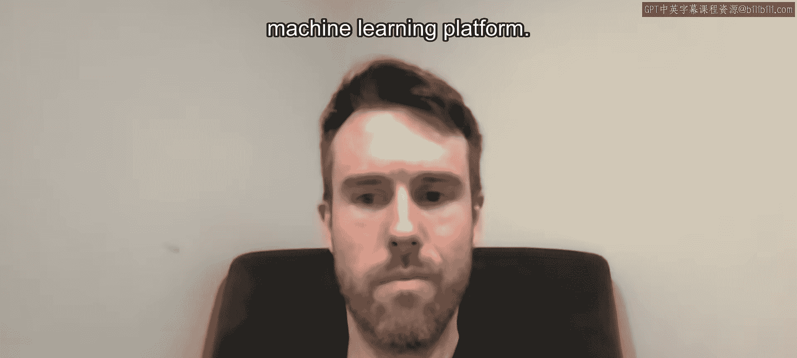
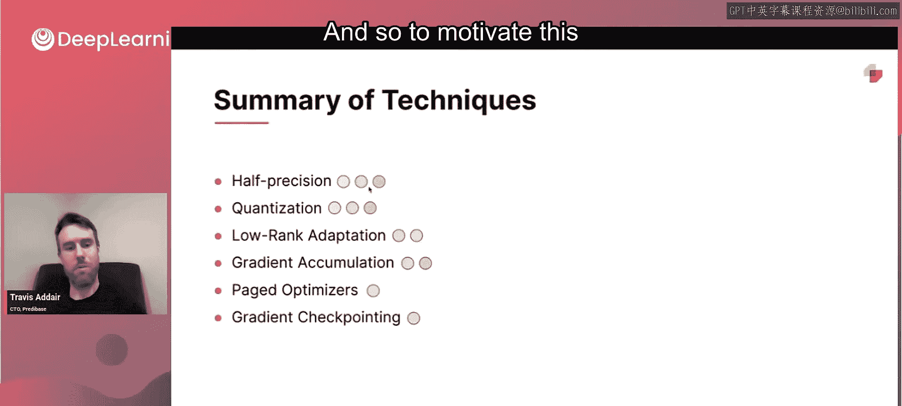
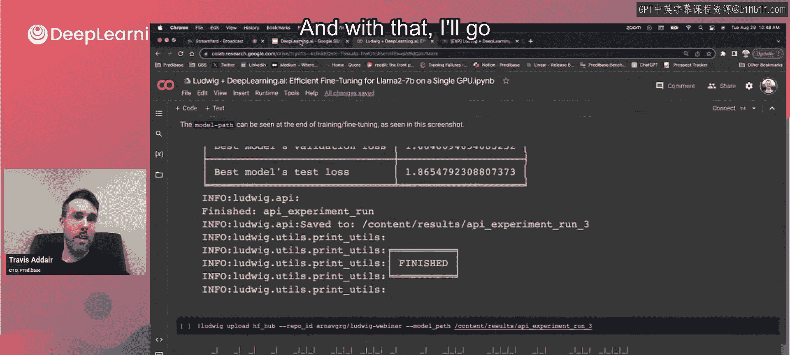
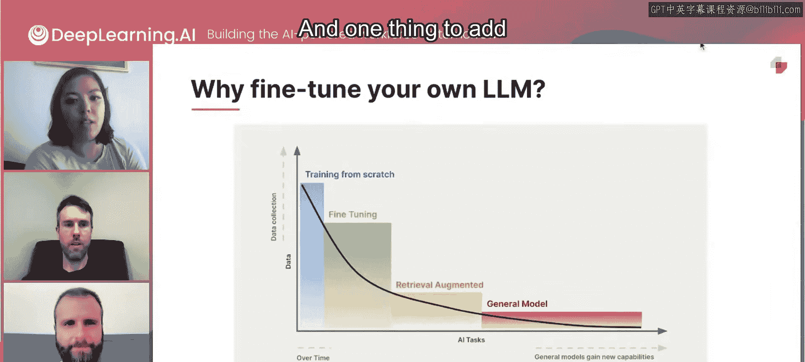

# 在单个GPU有效微调Llama-v2-7b｜Efficient Fine-Tuning for Llama-v2-7b on a Single GPU中英字幕 - P1 - GPT中英字幕课程资源 - BV1qu4m1379n

Hi everyone， My name is Diana T Morgan and I am part of the Deeplearning。

 AI team bringing you all together for all things AI community and events Today we are very lucky to have a workshop with some special speakers from Prebase in this handson workshop will discuss the unique challenges in fine tuning LLms and show how you can tackle these challenges with open source tools through a demo By the end of the session all attendees will understand how to finet LLms like Lama 2 on a single GPU techniques like parameter efficient tuning and quantization and how they can help and how to deploy tune models like Lama 2 to production with continued training with RLHF and how to use RaG to do question answering with trained LLMs This workshop will be recorded and remain live on our YouTube channel and youll be able to access the notebook in the description of the video and the chat everything covered in the workshop is presented as continued education from our existing AI short courses and we will be dropping the link to access all of them in the chat。

😊，To start， I want to introduce our first speaker Piro Molinina Piro is the cofounder and CEO of Prebase。

 he was one of the founding members of Uber AI Labs where he worked on several deployed ML systems including an LLP model for customer support and the Uber Es recommender system with Gph learning and collision detection Later he became a staff research scientist at Stanford University working on machine learning System He is the author of Luwig。

AI with 8900 stars on Github and open source Declarative deep learning framework。In 2021。

 he co founded Prebase， the low code Declarative machine learning platform built on top of Ludwig。

 Hey Piro。Hey Diana， thank you so much for having us Yeah， we're so excited to have you here。

And for our second speaker we have Travis Sare Travis is a cofounder and CTO of Prebase。

 a local platform for predictive and generative AI within the Linux Foundation he serves as lead maintainer for the Hoba distributed deep learning framework and as a co- maintainintainer the Ludwig declaredlarative deep learning framework in the past he led Uber's deep training learning team Deep learning Tra team as part of the Michelangelo machine learning platform we are so excited to have them here today and we can' wait to see what they have in store for us so Piero take it away。

😊。

Thank you so much Diana， I'm also super excited and you know I've been part of this community from the other side of the deep learning AI so contributing to it and somehow it's really know it's really great for me so let's start talking about efficient fine tuning for Lama2 70 billion on a single GPU because it's not that easy to make it right on a single GPU Diana already introduced us so I will skip this slide but let's talk about what we'll cover So first of all I want to give you like a little bit of an overview of how I think about fine tuning and why would you want to fine tu La to begin with I will introduce Lu big which is the local framework that for building custom AI models that I developed when I was at Uber and now it's like the foundation of our technology prebase and also what are the challenges of fine tuning in particular the memory bottleneck and how to overcome them through different techniques to squeeze the 70 billion parameters into something that。

It's into the 16 gigabys of VM of commodity GPUs and hardware。

 and so we will cover health precision quantas training。

 La rank adaptation called Laurara and Q Laurara， the quantantas version of it。

 and we'll also show you like a little demo of how to make this work on your own。

So what to you're on an lab to begin with this is like a graphic that I created that basically shows a distribution of AI tasks within organizations and with respect to the availability of data within organizations on the left- hand side you can see that if you have a a lot of data in your organization then you can even go as far as training your models from scratch it will be pretty expensive but it's certainly doable but if you have in a reasonable range of data and already have pretrained models that you can use you can fine tune them on your tasks to get really really good performance if you don't have a lot of data the best choice that you have right now is to do in context learning through for instance retrieval augmented generation using general models。

But what we will focusing on is the fine tuning part in particular because it has like a really great tradeoff in terms of accuracy versus performance and speed with respect to the bigger more general models in particular because you can take like a smaller model like Lama to 70 7 billion and fine tuning to your data to make it perform as if it was a 70 billion model or even better than that。

So first of all， let me tell you a little bit about Ludwig so that it is the tool that we're going to use for showcasing these capabilities my experience when I was at Uber working on different machine learning applications was that through all of them like for instance In classification model for customer support the fraud prediction one and the product commander for Luber Es that Diana mentioned in all of these cases there was a lot of code that needed to be written and the development process took a long time not really for writing the code but for iterating and experimenting and then the deployment of these models also took a long time so I thought that it could be a better way for doing this that's why I came out came up with Ludwig which is again an open source dec C machine learning framework in particular tailored for deep learning use cases and what does it mean to be like a declar machine learning framework it means that you can specify your deep learning pipelines by just using a configuration file and。

The configuration file only contains information only needs to contain information about the sche of your data。

 what are the inputs， what are the outputs and what are the data types associated with them in this example you have one input sentence with type text and one output intent with type category and this six line configuration matches 100% performance of the intent classification model that was the one that they developed when I was a Uber it's very easy to iterate over these models and you know get started building models in this way and you don't need to write a low level machine learning code。

At the same time though you have all the expert level of control that someone who has been studying the learning the eye classes gains right you can change every parameter of your models from the training parameters to the architectures that are used all the way down to the single hyperpar of the architecture like the single activation of the single layer and preprocessing parameters there's more than a thousand different parameters that you can change and modify and this makes it very easy to iterate of your models because you can just change one line in a configuration file instead of changing multiple lines in your code and finally it's extenible so you can write your own python classes give them names and if you use those names in the configuration then you can extend the system as much as you like。

Finally， contains advanced functionalities like hyperparameter optimization。

 set of the art models that already baked in and also distributed training all out of the box。

So with this kind of approach， now new people that before were not empowered to build deep learning models。

 but just writing 15 lines of a YaAO configuration file。

 in one day they were able to train a model for website personalization。

 and so these were engineer Seubber， not product engineer Seubber， not deep learning experts。

And in one week， they managed to deploy it into production。

 and so this kind of approach makes it substantially easier and faster to develop deep learning models。

The reason for that is that at the core of it， there's this architecture。

 which makes it possible to have multiple inputs and multiple outputs of different data types。

 like for instance， categories numerical and binary values or text image and audio and to produce as output text numerical binary values and so on。

The inputs are first preprocessed， then encoded with a piece of a deep learning model that produces vector representations that are then combined by one single component to be provided then to the decoding components that produce from these vectors the final predictions of the different types and you can imagine how mixing the matching different types of inputs and outputs can lead to different machine learning applications so for instance。

 if you have category numerical and binary values as input and numerical values as output you're basically training a regression model。

 if you have text input and category as output then you are training a text classifier or an images input and text output then you have an image captioning system and you can imagine how many combinations of types of inputs and types of output lead to different applications and how flexible these approaches。

Notably also if you have in particular text input and text output。

 you can definitely use an LLM for attacking these kind of tasks and in particular if you have this kind of data。

 then you can use it for fine tuning those LLMs here I'm showing you a configuration where you just specify the model type LLM。

 the base model which is Laman270 billion7 billion sorry and inputs and outputs text features。

And you can specify also the parameters of the trainer like theing grade， the batch size。

 the gradient accumulations， the number of epochs， and a few others like decay or any other kind of optimizer related parameter。

Once you write a configuration like this， you can just provide it to the constructor of the Luig model object and then'm Coltrain providing also the data frame containing your data。

This will fine tune the entire model， both the embedding part and then also the prediction part。

But if you wanted to fine tuna model to perform a new task。

 so you're basically replacing the head of the model with a task specific head。

 what you can do is you can change the output features to contain in this case category output。

 for instance， a sentiment category output and then you can specify the large numbers model as an encoder for your for for your task the rest of the training and how do you create a model how you train it is exactly the same。

And you could do the same thing if you want to actually just freeze the weights of the large language model。

 if you do that， the advantage is that you can also cache the embeddings。

 which makes training substantially faster at the expense usually of some performance because in this case you are training just the classifier head and not the core trunk of the model。

In all of these cases though， the problem is that these large language models are in particular like Lama 7 million are larger than what fits in the memory of a GPU。

 there are like newer and better GPUs like the H100100， then have quite large VRAs of 80 gigabytes。

 the problem is that they are pretty expensive from cloud providers and also there's currently a pretty bad shortage of these GPUs。

 meaning that if you request from AWS GPU like that。

 it may require quite some time to obtain one if you will get it eventually， right？

And so the better idea is to use actually commodity GPUs like T4s or the RTX 4080。

 which is like a consumer grade one that you could go out and buy and the problem with these GPUs is that they have only 16 gigabytes of V Ram。

Because of that， you need to be a little bit smarter in what you do in order to fit the models into the 16 gigabyte of RA and this is like what now Travis will talk about in his section of the presentation and also we show you how to do it within Lutdwig。

All right， thank you very much， Piro。All right， hopefully everyone can see my screen okay。

So as PRro said， the main issue that we want to talk about today is how to make the most use of very finite resources。

 which when we're talking about trained large language models is almost always the VRAM or the amount of memory that your GPU card has available to it and that's in particular because you know your T4 or your 4080 typically has about 16 gigabytes of RAM and for the purposes of this visualization。

 every one of these squares you can think of as being you know a gigabyte。

But if you want to train even a fairly modestly sized， large language model like Lama 27 billion。

 7 billion parameters when you actually want to go and train ends up looking like something like this in terms of the memory requirements。

And so if we break this down into three different buckets， the model parameters。

 the gradients that are produced during training and then the optimizer state that's needed to。

To keep track of the training variables。Then what you find is that you need about 28 gigabytes just for the model parameters themselves and then an equivalent amount for the gradient during training and then usually you need about 2 x the number the memory used for the model parameters for keeping track the optimizer state so in total you're looking at about 96 gigabytes more memory than you actually have available and so the idea of trying to pack all this into 16 gigabytes on the surface might seem like an impossible task but that's exactly what we're going to do in this talk is kind of break this down piece by piece until we get into something that is very manageable and fits on this single card。

So let's start with the first piece， which is just loading the model in the first place， right？

So the very first thing you run into is that because you have 7 billion parameters and everyone one of these parameters is by default represented as a 32 bit floating point。

 32 bit floating point means four bytes right so that means you're looking at  seven times4 which is 28 gigabytes of RA so that's the first hurdle we need to overcome here is how do we pack the model parameters into a smaller form factor。

So you may be familiar with the fact that there are different ways to represent a floating points you know floating point 32 is the one that we most commonly use because it gives you a really nice mix of the dynamic range which is expressed as the exponent here in orange as well as the precision which is expressed as the significant also sometimes called the mantisa here in the blue right and so very natural thing you might say is well what if instead of using Flo 32 we go down to floatlo 16 there's a tradeoff there which is that if you you just use Flo 16 by itself。

 you can you obviously reduce your memory requirements by half but know you're going to nonlinely decrease the range of values that you can represent because you're reducing this exponent right and so that can lead to a very significant drop in how big of a range of values you can represent particularly for your gradient。

which can lead to things like vanishing gradients or exploding gradients which can lead to NNs and things like that So one alternative that exists for people that have the hardware is to use a data type called B floatat stands for brain floatat came out of Google is now officially supported on newer generation cards like the ampre a100s and things like that but for those of us still using T4s and lower generation hardware know you have to stick to something like floatlo 16 so there's a tradeoff there but if you were to go with floatlo 16 or B floatat 16 know that right there allows you to cut the memory down in half 14 gigabytes suddenly you can fit everything on your single card and no problems。

But very quickly， you run into the next problem， which is the gradient。Graaddients， you know。

 I'm sure most folks here are familiar with the normal stochastic gradient descent training process。

 but essentially what happens is during the training process you produce a forward pass over the model。

 you know those are what we call the activations。And then when you compute those activations。

 you want to then use the results to compare against the target that you're trying to predict and then the difference between the prediction and the actual target is then used to produce these gradients which are used to then do the back propagation and then ultimately update the model so the problem is that the gradients are typically use the same data type as the original model parameters and there's typically one gradient for every model parameter that you have particularly the ones that you want to train and update and so as a result anytime you're doing normal gradient descent training。

 you're looking about 2x just without any optimizer on the amount of memory required for training。

So how do we go beyond this Well， one approach is to say， well。

 is there something lower than F 16 that we can do maybe eight bit？And at this point。

 oftentimes a common technique would be to use quantization。

 so when we say quantization what we mean is taking a continuous space like the space represented by a floating point value and discretizing it into a specific finite number of bins。

 which can be represented just as integers， right kind of like an index like you know one equals bin1 and three equals bin2。

 etc。And so you know naively you could do this just by very you simply slicing up the space uniformly and then bucking them all together。

 but in practice you often find that values are concentrated and certain parts of the range。

 so for example we have a higher concentration of values here towards the mean and so if you were to just naively bucket things you would lose a lot of precision towards the mean at the expense of you know in exchange for basically getting more precision towards the outer edges of the distribution。

 which is not really what you want right you want to retain that nuance as much as possible。

And so usually what you end up doing is calculating some statistics about what each bin represents in terms of what values are in there。

 and that allows you to then reconstruct this distribution when you want to go back to a floating point value in the future without losing much of the data right and so outlier clipping is another approach that's commonly used under the hood to you know avoid this problem of completely shifting your buckets too much based on like very extreme values and so you know this seems like a very complicated process but the nice thing about declarative frameworks like Ludwig is that we make it very simple。

 you just say quantization bits equals eight and boom you get all this compression for fruit essentially。

So let's say you do that so once again we cut everything in half so essentially now we have only seven gigabytes required to allocate the model parameters and additional seven gigabytes required for the gradients。

 that means we're only using 14 of our 16 gigabytes right so great however the real kicker is the optimizer and I think a lot of people don't realize this initially but if you're using a very common state of the art optimizer like atom。

Adam is great people love it it you know has become like a de facto standard in the industry。

 but it does have quite a high memory footprint which a lot of people don't initially think about but is very real and in particular as I said you have2 x the number of parameters。

Due to the additional vectors that you're keeping track of for the optimizer and that leads to very significant problems。

 as you can see here where essentially all the parameters of the optimizer are completely out of memory。

Now one question you might have is why does Adamom use so much memory and this is the normal update formula for how you update the weights based on the gradients so these parameters here。

 the gradients and then ws are the weights and then these parameters here M and V's momentum and variances and these are two atom specific parameters that are essentially vectors the same length as the gradients right and so we don't need to really get into the math here but the important part is that this m momentum vector and this v variance vector there' are each 7 billion parameters in size and so that means that that's ultimately where your 2x value is coming from in terms of2 x the model parameters are needed just for the optimizer so what can we do about this？

Well， this is where a technique that you might have heard of called low rank adaptation comes in。

And the interesting thing about lower rank adaptation or Laura。

 this was a technique pioneered by folks at Microsoft Research。

 I linked the paper down there in the bottom right。

The interesting thing about this technique is that we often talk about it as a way to reduce the number of trainable parameters to reduce the size the footprint of the model weights when you save it and speed up training and those are all true。

 but I actually think the most valuable initial thing about Laura is that it significantly reduces the number of parameters that need to be tracked by the optimizer as well as the gradients。

And that's what ultimately leads to a very significant memory reduction during training。

And just as a quick kind of。Refresher or kind of explanation of what Laura is really doing。

 So the key idea behind Laura is that when you're finetning a very powerful model like Lama。

 you don't actually need to fine tune literally every single parameter they're typically some parameters some layers let's say that are more important than others。

 usually things like the parts that do attention and determining which tokens in the sequence are related to other tokens and what way are they related and so the idea behind Laura is essentially to take those parameters。

 those matrices for like the queries and keys and things like that and then inject another kind of lower rank matrix beside it that initially acts as somewhat of an identity functions so it's not really doing anything but then over time when you propagate these gradients through and update the。

Ameterters。The only thing you're actually modifying is this ancillary matrix that you've added side by side and so really the only parameters you need to update are here and that means that the total amount of space you need to save is just this little extra matrix。

 and that additional means that your optimizer ingredients are only taken with respect to these parameters and not these big pre-trained weights。

 the pre-trained weights are essentially frozen。And again。

 this is all done in Ludwig by the Declarative config， which is a single parameter， which is nice。

So let's say we do this， let's say we use Laura and we you know now have added these additional low rank matrices alongside our existing parameters。

 what does that do to our overall memory footprint？And so it's not 100% like as easy as saying that。

 you know， the number of parameters is in the optimizer is 2 x。

 the parameters in the mo or anything like that， because the number of parameters that you add during the lower process can vary depending on some of the hyperparameter you set for it like the R。

 which is， you know how many。The rank of the matrices you're going to add。

 and then you can also change which layers you want to add these lower rank adaptation matrices to as well。

 So it's it's something that can vary a bit， but in practice it can be as low as 0。

1% of all of the parameters in the model， which is huge。

And even in like kind of a more aggressive case， you're typically looking at something like less than 10% of the parameters usually like 1% of the parameters are actually going to be modified with Laura and so you know one way that we might kind of you know split the difference a bit is say you know let's assume that one gigabyte of memory is going to be used for these Laura parameters now importantly in the formulation of doing quantized training normally what you do and this was in the Q Laura paper that we'll talk about。

Is you quantize the original model parameters， the ones in orange here， so these are represented nt8。

 but the lower parameters those you typically do in FP 16 or FP32 here we're doing FP16 and that's because since these are the parameters that you're training you typically want a little bit higher precision on those and that just and since there's so few of them it doesn't make that much of a difference anyway in practice in terms of the memory overhead so 16 bit lower parameters here plus the gradients for those 16 bit parameters so2 x。

Plus the optimizer state and the optimizer state here I'll say is usually FP32。

 which is why it's you know not just 2x the number of parameters but 4 x so we have 2x。

 the number of parameters times two when we go from FP16 to FP32 and so you know back of the envelope math。

 you might be looking at about  four gigabytes of optimizer state just using Laura and N8。

But there's still one more problem， which is the activations themselves and so activations are。

 you know， when you're doing the initial forward pass。

Effectively the memory overhead from activations so what comes out of each layer is going to be the size of the largest layer in your network also times the batch size so how many examples you're updating at once right and again this is not a kind of hard and fast thing because you know if you increase your batch size you're going to have more activation memory to deal with if you change you know some layer parameters you might have more activations to deal with but you know fact the envelope math you might be looking at about like four to five gigabytes of memory from activation。

 something like that and so that is potentially another big thing that's going to cause you to have to deal with out of memory errors even if you get everything else under control。

So what can we do How about one more trick which is can we go from a bit quantization all the way down to four bit and so this was one of the most I think interesting and kind of groundbreaking things that came out of the Q Laurara paper and so credit to Tim Demers linked to his tweet there for the original image source here but definitely check out the paper that he and others did on Q Laurara。

 which I think has been like a really big game changer for this efficient fine tuning approach。

So the way that this technique essentially works is that。

You go from full fine tuning to Lauraura which only adjust these adapter weights right and then with Q Lauraura what you essentially do is the base model parameters are represent now with just four bits and that's because again you're only doing kind of the forward pass on these you're not having to update these parameters or anything like that the adapters still an FP16 still 16 bit but then now you have this optimizer state as well。

 which is FP32 and one additional thing that they did in the Q Lauraura paper which we won't get too much into here it is one additional thing they did to reduce memory pressure was introduce this paged atom implementation which allowed them to essentially offload the optimizer parameters to the CPU when needed to reduce the effects of memory spikes during training and effectively get this whole thing down to some。

ve， very small form factor that can train on very commodity hardware right。

 but specifically we'll focus on the four bit part here for the purposes of the diagram here。

And so you know the way they did this， they introduced a new data type。

 they called it normal float4 definitely recommend checking out the paper for more details on it effectively what they did is they define like kind of a hard coded bucketing system the main idea is to try to avoid the problem of not having a way to represent zeros they kind of worked around that problem pretty cleverly but essentially you do all this you know now of a sudden you go from n8 down to normal flow of4 7 billion parameters can fit in just 3。

5 gigabytes of VRAM the Laurara and prams and the gradients are still the same in FP16 your optimizer state is still the same here in green and then finally you have and apologies that this is five instead of four green squares and then finally you have your activations in red here which are just now at about three gigabytes because again when you reduce the model parameters you're also reduced。

The size of the activations themselves， which is a nice benefit。And so all in。

 you might be looking at only around 13。5 gigabytes peak memory usage required here。

So let's talk about one last thing here， which is your batchge size so。Typically， during training。

 we try to pack multiple sequences into a single batch。

One of the reasons to do this is less to do with efficiency of training because often when you're training on small hardware。

 you know you're lucky to be able to get one sample in a batch at a time， let alone two or four etc。

 but one downside to doing that is it kind of it can increase the variance in the training process in a way that's not desirable so if you think about back to you know CS229 like or you know like kind of basics of training processes you know you have on one end of the extreme pure stochastic gradient descent so just like one sample is one update all the way to full batchsh gradient descent and one of the reasons why we don't like to do full stochastic gradient descent is it's a very noisy kind of walk through the optimization space right you can oftentimes take you lots of small turns in different directions whereas as you increase。

A badage size， you take bigger steps and it kind of smooths out the process。And so this kind of。

 you know， sitting in a nice middle ground between you know。

 taking these big smooth steps and taking these very jerky small steps。

 it's one of the arts of deep learning， but in general you do want to kind of hit a sweet spot there in the middle。

 which is why we often use batch sizes in the area of like 32， 64， 128。

But the problem is if you are only able to pack a single example into your model at a time for training。

 you end up doing this like very janky stochastic gradient tocent thing。

So how do we work around that and this is the last technique I want to talk about today。

 which is gradient accumulation and so the key idea behind gradient accumulation is that you can get the effects of training with a larger batch without the additional memory overhead。

😊，And the way it essentially works is you do a normal forward pass。

 so here's a batch size of two in this case， and you can ignore the fact that this is a multi GPU example。

 like we can just kind of generalize this to one GPU。You do a backward pass。

 but then instead of updating the model prams， you store it in a buffer and then do another forward pass and another backward pass。

And then basically sum those two together into a single vector， which you then， you know。

 if you're doing distributed training， you would then sum it once again the all reduced step or continue doing accumulation for subsequent steps。

 and the effect here is that you basically have a larger batch size without having to increase the memory overhead by doing in one step。

So now， you know your tool update that you apply to the model is however many accumulations you did。

 and that can help smooth out the training process to lead to better model convergence。

Putting it all together， this is how this whole thing would look in a Ludwig config as PRro showed you before。

 so we say our model type is LLM， so this means a texturing generating rating large language model。

 we're going to use Lama2 7 billion as the base model we're going to use Laura for doing the low rank adaptationnotation。

Quantization in four bits， we're going to specify the prompt template。

 which is how you define your task given the input columns of your data。

We're going to specify that this is a text to text model， so input and output features are just text。

 and then our fine tuning parameters are going to be know a certain learning rate。

 some number of epochs that we train for and an effective batch size of 32。

And then that's effectively it and with that you can just you know call Ludig model from this config train it on your data set and you're off to the races and so in the next section I'll show you a coab notebook that you can run yourself that does this all on a single T4 GPU which you can give for free in coabab but before that just kind of summarizing what we talked about here so the different techniques that we covered and there are a few that we didn't cover today I wanted to also callab so have precision this is how you can reduce the model parameter memory footprint。

 the gradient footprint and the activation footprint and then if you want to go beyond reducing precision quantization allows you to get the same effect but in a more aggressive manner。

Low rank adaptation， this technique helps you reduce the footprint of the gradients as well as the optimizer state。

Grading accumulation helps you reduce the footprint of the gradients and the activations。

And a couple techniques we then talk about today， so paging and the optimizeimizers。

 this was one from Q Lauraura helps you reduce great the memory footprint of the optimizes and then one last one that's worth checking out if you're still running into issues is gradient checkpointing which reduces the memory overhead from the gradient even further by basically recalculating them during the backward pass instead of just storing all the data。

So yeah there are lots of different techniques available to you in Ludwig and so I definitely recommend checking it out and so to give you to motivate this a bit。

 let's go ahead and jump into a handson tutorial and you this link here shows you how you can get at this notebook yourself to try it out and yeah please give it a shot and let us know how it goes。

So let's go ahead and jump into the notebook。So。The motivating example here is going to be using LLMs for codegeneration and I think this one is particularly timely because metata of course recently released a new set of code generatingrating models fine- tuneuned on Lama too and so you know you might naturally ask yourself well how could I have done the same thing myself right and so the purpose of this demo will be to show you that it's really not that hard you just have a good data set and you you can do it with a relatively minimal amount of data to build a custom code completion model that's bespoke to you know the type of code that you write right so it's tailored to you in your use case as opposed to a general purpose one。

And the way that we're going to frame it is in this kind of alpaca style。

 we're going to use the code Alpaca data set where you have an instruction like create an array of length5 which contains all even numbers between one and 10。

 and then the idea is that the model should produce a response like array equals 246810。

Now as you recall from the slides， Ludwig lets you train models just with a very simple Yaml based configuration file and so to get started with Ludwig you just download it with PIip install here I'm going to build off of the main branch of Ludwig but because we were trying out a couple of newer features like the effective batch size stuff。

 but the latest version of Ludwig 0。8 also contains all of these LM capabilities as well。

And one thing that's definitely important to call out。

 I think a lot of people run into this issue with Lama2 is that know while Lama2 is freely available for commercial use and the weights are readily available online。

 it is gated in the sense that you need to get explicit approval to download the weights and so the way it works is kind of described here is that you go to hugging phases website and you basically get an API token that kind of says know this is me and then you request access to the Lama2 weights and it should be a pretty quick process to get approval but once you have that you just plug in your API token here it'll prompt you for the token and you're able to start downloading the weights。

From there we're going to take this cogen data set， so this is the Code AlPAca 20，000 example。

 and you we do a little bit of preprocess here because we want to create a custom training and test split of the data。

And when we go ahead and print it out， you know here's the first 10 rows of the data。

 you can see that the format is you know hey， create an array of length 10 and then here's the output which is what we expect the model to produce。

 we also have a column here called split which says you know zero if it's in the training split two if it's in the test split etc。

And then you'll also notice that there's an optional column here called input。

 which is used in cases where the instruction is。More like a template instruction， so for example。

 the instruction here is write a replace method for a string which replaces the given string with a given set of characters and then the inputs。

 you know string equals hello world replaced with greetings。

And then it's going to give you this function that does exactly this operation， right？

So this is again， all very standard process for the Alpaca style data sets out there。All right。

 so one thing to point out is that。There are some。Like the distribution here of the data is actually pretty good as well。

 So one thing that came up in the questions was。You know how do I get a good data set。

 how do I make sure that you know my model learns something and isn't just kind of producing garbage and it's very important in general in all model training processes and it's true and fine tuning as well that having a good a good data set is very important and so you know here's just a kind of quick。

Breakdown of you know what we're looking at here， so you know。

 number of characters in the instructions， number of characters in the output。

 number of characters in the input。You can see that there's definitely a pretty high bias towards smaller snippets of data。

 etcter but having that variation ends up being very important that there is still a pretty nice distribution here for the model to be able to handle you know future unseen scenarios right so just in general a comment that when you're training a model when you're doing fine tuning definitely make sure that you get as much breadth as possible so that you're not in the evidence situation where your model overfits right so standard best practices to apply。

Now one thing that's really cool about Ludwig is that we can do zero shot and a few shot inferences well to kind of get a sense for how the model does even without any fine tuning and zero shot learning for those who aren't familiar is just basically where you tell the model and plain English or whatever language the models trained in。

 hey， do the thing I'm asking to do so for example。

 you know write a function that you know reverses a string or something like that right？

And I don't want to get into too many of the details here in the interest of time。

 but this is all done in Ludway by this prompt template which lets you specify the instruction。

 so in a zeroshot way I can very simply say you know here's an instruction paired with an input。

 write a response， give the input which comes you know this is a column in the data this is also a column in the data set and then I just specify these generation parameters which will then go ahead and evaluate the model on on this data right without any training at all。

 so this is a zero shot run。And if we just kind of look through the outputs， you can see that。

You know， it says for example， instruction write a function to remove all white space from a given string and it outputs my string hello world so if you're familiar with or sorry hello world right so that's actually not the worst thing in the world right but it does understand that there is this thing remove white space that is a function however you know it's not really doing the task as as we requested it right iss just kind of outputting some something that looks like appropriate English or looks kind of appropriate appropriate from a synta or semantic standpoint but not really from a correctness standpoint and so this is you know the main motivation behind fine tuning is that these large language models out of the box do a good job at kind of comprehending text comprehending language but they don't do a good job at following specific instructions for doing specific。

A big tasks without doing fine tuning。And so that's the goal right is we want to go from something like this where we want to。

 where's just going to output you know some correct English text that kind of looks right。

 but until you squint at it right so something that is actually correct， which is okay。

 response array equals24，6，810 for this task of creating an array that contains all even numbers。

 right？So definitely let you read the details there on your own if you're interested in going diving deeper but effectively what we do is we now can specify the full fine tuning config which essentially is these three additional sections here so we're going to again specify Laura as the adapter quantization and then our fine tuning trainer is going to consist of all these parameters most of these are just defaults。

 but they're kind of spelled out here to kind of hark back to what we talked about in the slides so we're going to use gradientd accumulation we're going to set a very low learning rate we're going to use atom as our optimizer with some of these default hyperparms。

And then last， we're going to do a little bit of warm up of our learning rate to help smooth out that learning process。

And we click train and then we go ahead and start the training process and you can see that over time we know not running it here just in the interest of time。

 but this example here we've got about 100 data points。

Takes like five minutes to run or something around that space on the T4 and at the very end you get some metric output about you know what the loss is。

 you can see that the loss is in fact decreasing over time， which is what you want。

And also some additional metrics like the perplexity， the sequence accuracy， token accurate accuracy。

 etca。And then lastly， we can go ahead and take the model that we've trained and produce some sample input and outputs and what we see is that now。

Even though we've only trained it on 100 samples， which seems like a very， very low amount， right？

We're starting to get something that looks pretty decent right， so create an array of length five。

 which contains all even numbers between one and 10。

And yeah the output here is a variable 246810 it's starting to look pretty good right so what you can tell is that the model actually does know quite a lot already about what it needs to do。

 which just didn't know how to do it and that was kind of the purpose of this instruction tuning thing is teaching it you know how to structure its output given what it already knows right which is it understands。

The concepts of even numbers and functions and Python code and things like that。

So yeah that's essentially it I encourage you to go and try yourself and then once you've trained the model these adapter weights are compliant with the existing hugging F API and Ludwig makes it very easy to go and upload these adapter weights back to the hugging F hubub as well so you can serve these models share them with your friends etc。

 and finally if you want to go beyond you know training on a single T4 you might ask how do I train these70 billion parameter models how do I do distributed training and things like that and certainly Ludwig makes it easy to do that as well we've got a lot of good resources on training with deeppe and training on Kubernetes clusters。

And then if you want to manage platform， that's what we're building at Prebase so definitely happy to to chat anytime about about that as well and with that I'll go ahead and hand it back to。

Pierro to wrap it up if you'd like to say anything else about it just to hand it off to you Piro to close things out。

 but yeah， happy to take questions at the end as well if there are any。

Sorry I was muted for a second and yeah so thank you very much Travis for this overview。

 I think you know hopefully looking at what people were telling us and asking in the chat there was a lot of excitement for this I wanted to just really quickly recap what we've covered and just give you a little call to action if you want so first of all you know we covered what you want to fine tune your own models and your own LLMs then we gave an introduction to Ludwig with all the capabilities around the correctative configurations for building your own machine learning models we address the memory bottleneck issues all these techniques to squeeze the 7 billion parameter models into something that works inside 60ys of RA like of precision quantized training or adaptation Laura and Qlora and hopefully the demo always interesting。

😊，So the very last slide here that I have is check out Ludwig。

 we have a lot of documentation on Luddig。AI， you can find it on Gitub， there's more than90。

00000 Gitub Mo 130 contributors so if you want to participate in the community we also have a slackck channel that you can join and it's all open source and it's back to the Linux Foundation and if you're interested in customizing your private and privately host URL LLMs in the cloud with a platform that supports you along the way check out the pretty free trial and you will not be disappointed。

Yeah， this is all I wanted to cover and happy to you know take questions and answer some。

Amazing thank you so much for both Travis and Piro amazing session， we have so many questions。

 we can't get to all of them， but I'm sure we definitely have for the first time at one of these events we actually have a good amount of time to go through them so very。

 very well well presented so the first question。😊，Is what data set preparation methods for fine tuning do you consider the most effective maybe I can take this one so there are I think there are some little finicky aspects of fine tu alarms that may not be from the data perspective that may not be super apparent from from the get go and I think you know addressing them is important on one hand one thing that you for sure want to make sure that you do when you prepare your data you want to make sure that for the same prompt you have like you don't repeat prompts there's like one prompt and one answer to that prompt on one you know。

Continuation of that prompt， the reason is that because of the relatively smaller sides of these fine tuning data sets。

 if there is repeated prompts with different answers， that may be confusing for the model。

And I would say there's a lot to be said about how you know to tokenize the data and you know add specific separators there's quite some literature about it。

 but in short I will say make sure that when you prepare the data you leave enough tokens in between the inputs and the outputs and you make sure that there's separators like you know you can use return characters or you can use like dashes or pound signs or things like that just to make it very clear where the input starts and the ends and where the output starts and the output ends and also at the end of the output to make sure that you leave like。

Signs or white spaces even before and after because models can be finicky and if those characters are not present there it could be possible that the model will have a hard time identifying when it needs to stop so just be sure to follow these basic instructions and you know the finening will work right away。

Perfect， well， that leads us to our next question。Bg versus fine tuning。

 which strategy works better and for when。Maybe I can give a perspective on this like I was sharing that very first slide where I had that graph with the actually maybe I can show it again if that's fine because I think that could be revealing。

 I would say at least from my point of view that's actually pretty useful so let me share it once again。

Here we go。So this is， it's a little bit of a oversimplification because there's multiple dimensions to this。

 but I would say that the amount of available data is definitely a factor to consider RAG in particular for doing specific tasks like for improving classification or for improving generation of summaries or other things like that or is particularly good when you don't have a lot of data。

 and so you can rely on that as a stopgap solution before you have enough data to actually fine tuna model。

The other aspects to consider are that。Usually to get a similar performance that you will get like the delta between fine tuning and Ra is also in the size of the models you can fine tune a substantially smaller model to be very effective in Ra you don't have that level of control you just need to use whatever model is available to you and so you know there is a difference in the inference time in particular if you need to also add a component for retrieving the data points and examples that you will need to fit into the into the prompt right which you know you can use。

Dector stores， which are pretty fast， but still they add to the latency of each single query that you run。

And then I would say there's a third aspect which is do you actually need to do any attribution to the sources where the information is coming from。

 for instance， if you're doing the question answering task and just providing an answer is not sufficient。

 you also want to provide the documents， the links to the documents where that answer is coming from。

 well in that case RaG is the best solution， maybe for the generative model you can still use a fine tunening model on your data。

 but you could combine fine tuning and retrieval content generation。

 but if you need attribution definitely you cannot do a away with RaG right now。

And one thing to add on I think Piro had a really good summary there。

 one thing we've definitely noticed some people running into gotchas with fine tuning in the past is that sometimes there's a desire to use fine tuning to teach models new facts like you know your fine tuning data might be like you know the president of my company is so and so or whatever right and that's one area where currently RaG does typically do a better job than fine tuning is that kind of injecting new information into the model component。

Typically to get a and sorry RAG stands for retrieval augmented generation。

 so basically means using an information retrieval system like a database to fetch context and insert it into the prompt。

But basically the idea then being that if you want to teach a model new facts。

 usually ras up being the best way to do that for the cost because the alternative typically ends up being training model from scratch or there might be other ways that you can do it with successive pretraining that end up requiring you millions and even billion of tokens in some case。

 so while finding is very useful for like predictive tasks and like domain adaptation tasks like building cogeneration or changing the style of the output or outputting JSON。

That kind of teaching facts piece is probably the one Achilles heel of fine tuning today。Absolutely。

 I think we have time for maybe one more question， maybe two。

 what hosting services do you recommend for hosting LLMs， specificallyllma？😊，Obviously， predice。そから。

Yeah so I mean definitely I think you know we kind of started the company with the idea of providing like the best in class infrastructure for making this whole process of fine tuning and serving as simple as as can be and you know eliminating the headaches of being like oh。

 this model doesn't work on this GPU or this model you know has outom memory areas with this batch size so that's certainly you know one of the key value props of prease and I highly recommend folks checking it out if they' if they're looking to solve that pain point。

Absolutely， and let's see。How could we generate embeddings from the model rather than generating new text？

Yeah maybe I can take this one there is in Ludig so what we've been showing was the creation of the Lu bigig model object and then calling train on that object obviously that same object also has a predict function that makes it possible to run predict on new data and there is also collect activation function where you can specify which layer in your model do you want to collect activations of and the default those are like the embeddings that you would use for like a downstream task or to put into a bacterial database or something like that and so it's just a different call that you can make on the same object to obtain the embeddings。

Perfect， well， I think that means our event comes to a close we are out of time and I know our community learns so much to think thank you so much Piro and Travis。

 is there any final words that you wanted to say about Ludwig or Prabase。😊。

I would say you know I really thank you you know for the chance to chat with this community I mean I love all the questions so really really thank you for that and I would suggest just people to check out Ludwig is's open source you know it's really easy to do people install Ludwig and try it out there's also really nice documentation online we put a lot of effort into that so hopefully it would be great and if you want to contribute to it you know there's a slacklack channel you can join and check out Pribase there's a free trial so you can just try it out even before making any commitment so check it out。

Perfect well thank you everyone for attending our event we encourage you to keep learning by signing up for our courses and staying involved with the deep learning community we currently are looking for feedback in our focus groups for our courses so if you're interested in contributing towards the community please be sure to fill out the survey that we're dropping in the chat otherwise we'll see you guys next time thanks everyone。

😊。