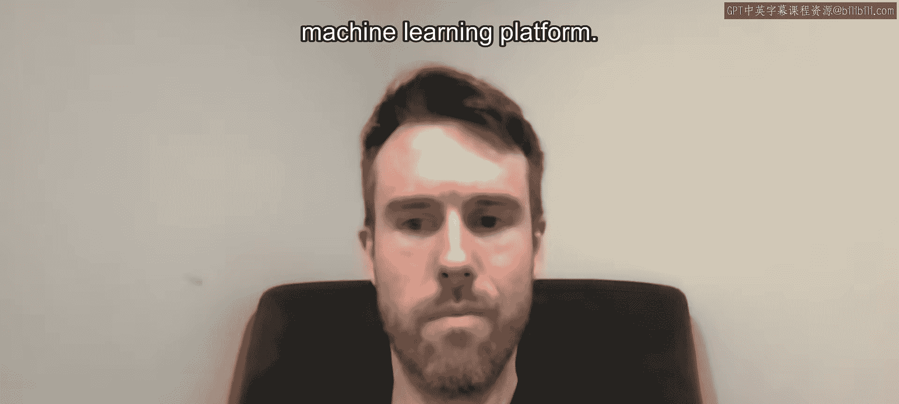
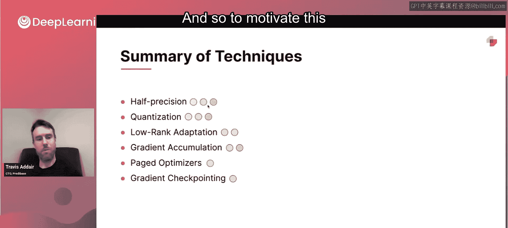
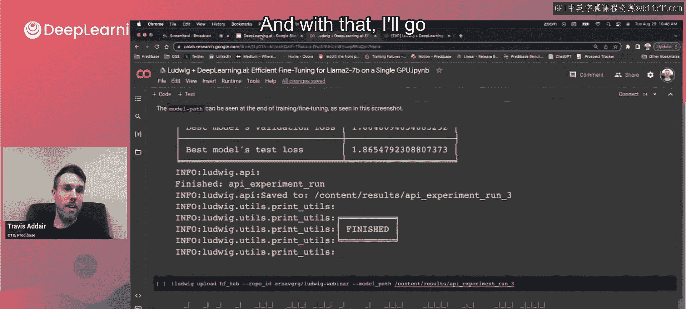
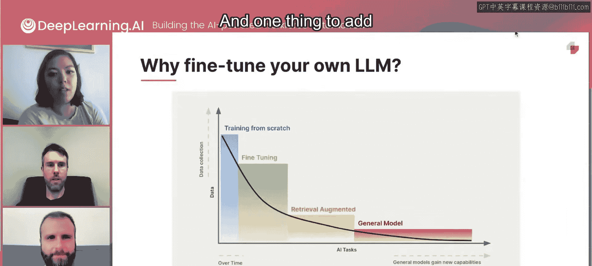

# 高效微调课程：P1：在单GPU上高效微调Llama-v2-7b

## 概述
在本节课中，我们将学习如何在单个GPU上高效地微调大型语言模型Llama-v2-7b。我们将探讨微调面临的独特挑战，特别是内存瓶颈问题，并介绍如何使用开源工具和多种技术来克服这些挑战，包括参数高效微调、量化等。

---

## 微调概述与动机
大家好，我是Diana T Morgan，来自Deeplearning.AI团队。今天我们很荣幸能与来自Prebase的特别演讲者共同举办一场实践研讨会。我们将讨论微调大型语言模型（LLMs）的独特挑战，并通过演示展示如何使用开源工具应对这些挑战。

在课程结束时，所有参与者将理解：
*   如何在单个GPU上微调Llama 2等模型。
*   参数高效微调和量化等技术及其作用。
*   如何通过RLHF持续训练将微调后的模型部署到生产环境。
*   如何使用检索增强生成（RAG）与训练好的LLMs进行问答。

本次研讨会将被录制并发布在我们的YouTube频道上。视频描述和聊天记录中会提供相关笔记本的访问链接。研讨会内容是我们现有AI短期课程的延续教育。

首先，我想介绍我们的第一位演讲者Piero Molino。Piero是Prebase的联合创始人兼CEO。他曾是Uber AI Labs的创始成员之一，参与开发了多个已部署的机器学习系统，包括用于客户支持的LLM模型以及基于图学习和碰撞检测的Uber Eats推荐系统。后来，他成为斯坦福大学的资深研究科学家，专注于机器学习系统。他是Ludwig的作者，这是一个在GitHub上拥有8900颗星的声明式深度学习开源框架。2021年，他联合创立了Prebase，这是一个基于Ludwig构建的低代码声明式机器学习平台。

我们的第二位演讲者是Travis Addair。Travis是Prebase的联合创始人兼CTO，这是一个Linux基金会内专注于预测和生成AI的平台。他担任Horovod分布式深度学习框架的首席维护者，同时也是Ludwig声明式深度学习框架的联合维护者。过去，他曾领导Uber的深度学习训练团队，该团队是Michelangelo机器学习平台的一部分。我们非常高兴他们今天能来到这里。

---

## 微调的意义与Ludwig框架介绍
非常感谢Diana。我也非常兴奋能来到这里。我一直是这个社区的一员，现在能从另一侧为Deeplearning.AI做贡献，感觉非常棒。

让我们开始讨论如何在单个GPU上高效微调700亿参数的Llama 2模型，因为这在单个GPU上实现并不容易。Diana已经介绍过我们，所以我跳过这张幻灯片，直接谈谈我们将要涵盖的内容。

首先，我想概述一下我对微调的看法，以及为什么要微调Llama模型。我将介绍Ludwig，这是一个用于构建定制AI模型的本地框架，我在Uber时开发了它，现在它是我们Prebase技术的基础。我们还将探讨微调的挑战，特别是内存瓶颈，以及如何通过不同技术将700亿参数压缩到消费级GPU（如16GB显存）中。我们将涵盖混合精度训练、量化、低秩适应（LoRA）及其量化版本QLoRA，并演示如何在你自己的环境中实现。

那么，为什么要微调Llama模型呢？我创建了一张图表，展示了组织内AI任务的分布与数据可用性的关系。在左侧，如果你拥有大量数据，甚至可以从头开始训练模型，虽然昂贵但可行。如果你有合理数量的数据，并且有预训练模型可用，你可以在自己的任务上微调它们以获得非常好的性能。如果你没有太多数据，目前最好的选择是通过上下文学习，例如使用通用模型进行检索增强生成（RAG）。

我们将重点关注微调部分，因为它在准确性、性能和速度方面与更大的通用模型相比有很好的权衡。特别是，你可以使用像Llama 2 7B这样较小的模型，在你的数据上进行微调，使其表现得像700亿参数的模型甚至更好。

首先，让我简单介绍一下Ludwig，因为它是我们将用来展示这些功能的工具。我在Uber工作时，处理过不同的机器学习应用，例如客户支持的分类模型、欺诈预测模型以及Diana提到的Uber Eats产品推荐器。在所有案例中，都需要编写大量代码，开发过程耗时很长，主要不是写代码，而是迭代和实验，然后部署这些模型也需要很长时间。因此，我认为应该有更好的方法来做这件事，这就是我提出Ludwig的原因。它是一个开源的声明式机器学习框架，特别针对深度学习用例。

声明式机器学习框架意味着你可以仅通过配置文件来指定深度学习流程。配置文件只需要包含关于数据模式的信息：输入是什么，输出是什么，以及它们关联的数据类型。在这个例子中，你有一个类型为文本的输入`sentence`和一个类型为类别的输出`intent`。这个六行的配置实现了我在Uber时开发的意图分类模型的100%性能。用这种方式迭代模型和开始构建模型非常容易，你不需要编写底层的机器学习代码。

同时，你拥有专家级的控制权。你可以更改模型的每个参数，从训练参数到使用的架构，一直到架构的单个超参数，如单个层的激活函数和预处理参数。有超过一千个不同的参数可以更改和修改。这使得迭代模型变得非常容易，因为你只需更改配置文件中的一行，而不是更改代码中的多行。最后，它是可扩展的，你可以编写自己的Python类，给它们命名，如果在配置中使用这些名称，就可以任意扩展系统。

最后，它包含高级功能，如超参数优化、内置的先进模型以及开箱即用的分布式训练。

采用这种方法后，以前无法构建深度学习模型的新手，现在只需编写15行YAML配置文件，就能在一天内训练出一个用于网站个性化的模型。这些是Uber的工程师，不是产品工程师，也不是深度学习专家。在一周内，他们成功将其部署到生产环境。这种方法使得开发和部署深度学习模型变得简单快捷得多。

其核心在于这种架构，它使得处理多种不同类型（如类别、数值、二进制值、文本、图像、音频）的输入和输出成为可能。输入首先被预处理，然后通过深度学习模型的一部分进行编码，生成向量表示，这些表示随后由一个单一组件组合，提供给解码组件，从而生成不同类型的最終预测。你可以想象，混合和匹配不同类型的输入和输出会导致不同的机器学习应用。例如，如果输入是类别、数值和二进制值，输出是数值，那么你基本上是在训练一个回归模型。如果输入是文本，输出是类别，那么你是在训练一个文本分类器。如果输入是图像，输出是文本，那么你有一个图像字幕系统。你可以想象，输入和输出类型的许多组合会导致不同的应用，这种方法非常灵活。

特别值得注意的是，如果你有文本输入和文本输出，你肯定可以使用LLM来处理这类任务。特别是如果你有这类数据，你可以用它来微调这些LLMs。这里我展示了一个配置，你只需指定模型类型为LLM，基础模型为Llama-2-7b，输入和输出为文本特征。你还可以指定训练器的参数，如学习率、批次大小、梯度累积步数、训练轮数以及其他优化器相关参数。

一旦你编写了这样的配置，你可以将其提供给Ludwig模型对象的构造函数，然后调用`train`方法，同时提供包含你数据的数据框。这将微调整个模型，包括嵌入部分和预测部分。

但是，如果你想微调模型以执行新任务（即用任务特定的头部替换模型的头部），你可以将输出特征更改为包含类别输出（例如情感类别输出），然后将大型语言模型指定为你任务的编码器。创建模型和训练模型的过程完全相同。

如果你只想冻结大型语言模型的权重，也可以这样做。这样做的好处是你可以缓存嵌入，这通常以牺牲一些性能为代价，使训练速度大大加快，因为在这种情况下，你只训练分类器头部，而不是模型的核心主干。

然而，在所有情况下，问题在于这些大型语言模型，特别是像Llama 7B这样的模型，其大小超过了GPU内存的容量。虽然有更新更好的GPU，如H100，拥有80GB的显存，但它们从云提供商那里购买相当昂贵，并且目前这些GPU严重短缺。这意味着如果你从AWS请求这样的GPU，可能需要很长时间才能获得。

因此，更好的想法是使用消费级GPU，如T4或RTX 4080。这些GPU的问题在于它们只有16GB的显存。因此，你需要更聪明地处理，以便将模型装入16GB的显存中。接下来，Travis将在他的演讲部分讨论这个问题，并展示如何在Ludwig中实现。

---

## 内存挑战与优化技术
非常感谢，Piero。希望每个人都能清楚地看到我的屏幕。

正如Piero所说，我们今天要讨论的主要问题是如何最有效地利用有限的资源。当我们谈论训练大型语言模型时，这几乎总是VRAM，即你的GPU卡可用的内存量。特别是因为你的T4或4080通常只有大约16GB的RAM。为了便于可视化，你可以将这里的每个方块视为1GB。

但是，即使你想训练一个像Llama 2 7B这样规模适中的大型语言模型，当你实际去训练时，内存需求看起来是这样的。

如果我们将其分解为三个不同的部分：模型参数、训练期间产生的梯度以及优化器状态（用于跟踪训练变量），你会发现仅模型参数本身就需要大约28GB，梯度也需要等量的内存，而优化器状态通常需要模型参数内存的2倍。所以总共需要大约96GB的内存，这远远超过了你实际可用的内存。因此，试图将所有内容打包到16GB显存中，表面上看起来似乎是一项不可能完成的任务，但这正是我们本次演讲要做的：逐步分解这个问题，直到得到一个非常易于管理且适合单卡的内容。

让我们从第一点开始：首先加载模型。你遇到的第一个问题是，因为有70亿个参数，并且默认情况下每个参数都表示为32位浮点数（32位浮点数意味着4字节），所以你需要70亿乘以4，即28GB的RAM。这是我们需要克服的第一个障碍：如何将模型参数打包成更小的形式。

你可能知道，表示浮点数有不同的方式。浮点32是我们最常用的，因为它提供了动态范围（用橙色指数表示）和精度（用蓝色有效数字/尾数表示）的良好平衡。一个很自然的想法是：如果我们不使用FP32，而是使用FP16呢？这里有一个权衡：如果你只使用FP16，显然可以将内存需求减半，但你会非线性地减少可表示值的范围，因为你减少了指数位。这可能导致梯度值范围显著缩小，进而导致梯度消失或爆炸等问题。

对于拥有相应硬件的人来说，一个替代方案是使用称为BFloat16的数据类型（代表Brain Float），它来自Google，现在在较新一代的卡（如Ampere A100）上得到官方支持。但对于我们这些仍在使用T4和较低代硬件的人来说，必须坚持使用像FP16这样的类型。但如果你使用FP16或BFloat16，仅此一项就可以将内存减半至14GB，突然之间你就可以将所有内容装入单卡，没有问题。

但你很快会遇到下一个问题：梯度。我相信这里的大多数人都熟悉标准的随机梯度下降训练过程。本质上，在训练过程中，你对模型进行前向传播（我们称之为激活），然后使用这些激活结果与你试图预测的目标进行比较，预测与实际目标之间的差异用于产生梯度，然后进行反向传播，最终更新模型。问题在于，梯度通常使用与原始模型参数相同的数据类型，并且通常每个你想要训练和更新的模型参数都有一个梯度。因此，只要进行正常的梯度下降训练，即使没有任何优化器，你需要的训练内存也是模型参数的两倍。

那么我们如何超越这一点呢？一种方法是问：有没有比FP16更低的精度，比如8位？这时，一个常用的技术是量化。当我们说量化时，指的是将一个连续空间（如浮点值表示的空间）离散化为特定有限数量的区间，这些区间可以仅用整数表示，就像索引一样。理论上，你可以通过简单地均匀分割空间并将它们分组来实现，但实际上你经常会发现值集中在范围的某些部分。例如，在均值附近有更高的值集中度。因此，如果你只是简单地进行分桶，你会损失均值附近的很多精度，以换取在分布边缘获得更多精度，而这并不是你想要的。你希望尽可能保留那些细微差别。

因此，通常你需要计算一些关于每个区间代表什么值的统计信息，这允许你在未来想要回到浮点值时重建这个分布，而不会丢失太多数据。离群值裁剪是另一种常用的底层技术，用于避免因极端值而过度移动你的分桶。这个过程看起来很复杂，但像Ludwig这样的声明式框架的好处在于，我们使其变得非常简单。你只需说`quantization_bits: 8`，就能免费获得所有这些压缩效果。

假设你这样做了。现在一切又减半了。本质上，现在分配模型参数只需要7GB，梯度还需要额外的7GB。这意味着我们只使用了16GB中的14GB，很好。然而，真正的难题是优化器。我认为很多人最初没有意识到这一点，但如果你使用像Adam这样非常先进的优化器，它确实有相当高的内存占用。正如我所说，由于优化器跟踪的额外向量，你需要模型参数2倍的内存，这导致了非常严重的问题，正如你在这里看到的，优化器的所有参数完全超出了内存。

你可能会问，为什么Adam使用这么多内存？这是基于梯度更新权重的标准公式。这里的参数是梯度和权重，而这里的参数M和V是动量和方差，这是Adam特有的两个参数，本质上是与梯度长度相同的向量。我们不需要深入数学细节，但重要的是这个动量向量M和方差向量V各自都有70亿个参数大小。这就是为什么你需要模型参数2倍内存的原因。那么我们能做些什么呢？

这就是你或许听说过的低秩适应技术发挥作用的地方。低秩适应（LoRA）是由微软研究院的研究人员首创的技术。有趣的是，我们经常谈论这项技术是为了减少可训练参数的数量，从而减少保存模型权重时的占用空间并加速训练，这些都是事实。但我认为LoRA最初最有价值的一点是，它显著减少了优化器需要跟踪的参数数量以及梯度数量，这最终导致了训练期间内存的显著减少。

快速回顾或解释一下LoRA真正在做什么。LoRA背后的关键思想是，当你微调像Llama这样非常强大的模型时，你实际上不需要微调字面上的每一个参数。通常有些参数或层比其他更重要，通常是那些处理注意力、确定序列中哪些标记以何种方式相关的部分。LoRA背后的想法本质上是获取这些参数（例如查询和键的矩阵），然后在旁边注入另一个低秩矩阵，该矩阵最初充当某种恒等函数，所以它实际上不做任何事情。但随着时间的推移，当你传播梯度并更新参数时，你实际修改的只是你添加的这个辅助矩阵。因此，你真正需要更新的参数就在这里，这意味着你需要保存的总空间只是这个额外的小矩阵。这也意味着你的优化器梯度仅针对这些参数，而不是那些大的预训练权重，预训练权重本质上是冻结的。同样，这一切在Ludwig中都是通过声明式配置完成的，只需一个参数，非常方便。

假设我们这样做，使用LoRA并在现有参数旁边添加了这些额外的低秩矩阵。这对我们的整体内存占用有什么影响？这并不像说优化器中的参数数量是模型参数的2倍那么简单，因为在LoRA过程中添加的参数数量可以根据你为其设置的一些超参数而变化，比如R（即你要添加的矩阵的秩），你还可以更改想要添加这些低秩适应矩阵的层。所以这是可以变化的，但在实践中，它可以低至模型所有参数的0.1%，这是巨大的。即使在更激进的情况下，你通常看到的也是少于10%的参数，通常只有大约1%的参数会通过LoRA被修改。因此，我们可以取一个折中值，假设1GB内存将用于这些LoRA参数。重要的是，在进行量化训练时，你通常的做法（这也是我们将要讨论的QLoRA论文中的做法）是将原始模型参数（此处橙色部分）量化为INT8，但LoRA参数（此处为FP16）你通常使用FP16或FP32，这里我们使用FP16。因为既然这些是你要训练的参数，你通常希望它们有更高的精度，而且由于它们数量很少，在实践中对内存开销影响不大。所以这里是16位的LoRA参数加上这些16位参数的梯度（2倍），再加上优化器状态。这里的优化器状态通常是FP32，这就是为什么它不仅仅是参数数量的2倍，而是4倍（当我们从FP16转到FP32时，参数数量乘以2，再乘以2）。粗略估算，仅使用LoRA和INT8，你可能需要大约4GB的优化器状态。

但还有一个问题：激活本身。激活是在初始前向传播期间，从每一层输出的内容。激活的内存开销将是网络中最大层的大小乘以批次大小（即你一次更新的示例数量）。同样，这不是一个硬性规定，因为如果你增加批次大小，你将需要处理更多的激活内存；如果你更改某些层参数，你可能需要处理更多的激活。粗略估算，激活可能需要大约4到5GB的内存。即使你控制了其他所有因素，这也可能是导致内存不足错误的另一个重要因素。

那么我们还能做什么？再来一个技巧：我们能否从8位量化进一步降到4位？我认为这是QLoRA论文中最有趣和开创性的事情之一。向Tim Dettmers致谢，原始图片来源是他的推文，但一定要查看他和其他人关于QLoRA的论文，我认为这对高效微调方法来说是一个真正的游戏规则改变者。

这种技术的工作方式本质上是：你从全参数微调转向LoRA，LoRA只调整这些适配器权重。然后，对于QLoRA，你本质上将基础模型参数用仅4位表示。这是因为你只对这些参数进行前向传播，不需要更新它们。适配器仍然是FP16（16位），但你仍然有这个优化器状态（FP32）。QLoRA论文中做的另一件事（我们不会在这里深入讨论）是引入了分页Adam实现，这允许他们在需要时将优化器参数卸载到CPU，以减少训练期间内存峰值的影响，从而有效地将整个东西压缩到非常小的形式，可以在非常普通的硬件上训练。但具体来说，为了本图的目的，我们将专注于4位部分。

他们引入了一种新的数据类型，称为NF4（Normal Float 4）。他们定义了一个硬编码的分桶系统，主要思想是试图避免无法表示零的问题，他们非常巧妙地解决了这个问题。但本质上，做了所有这些之后，你突然从INT8降到了NF4，70亿个参数可以装入仅3.5GB的VRAM中。LoRA参数和梯度在FP16中保持不变，优化器状态在FP32中保持不变（抱歉，这里是5个而不是4个绿色方块）。最后，你的激活（红色部分）现在只有大约3GB，因为当你减少模型参数时，你也减少了激活本身的大小，这是一个不错的好处。总的来说，你可能只需要大约13.5GB的峰值内存使用量。

让我们谈谈最后一件事：批次大小。通常，在训练期间，我们尝试将多个序列打包到一个批次中。这样做的一个原因与训练效率关系不大，因为当你在小型硬件上训练时，能在一个批次中放入一个样本就很幸运了，更不用说两个或四个了。但这样做的一个缺点是，它可能会以一种不希望的方式增加训练过程中的方差。回想一下CS229或训练过程的基础知识，在一端是纯随机梯度下降（一个样本一次更新），另一端是全批次梯度下降。我们不喜欢纯随机梯度下降的原因之一是，它在优化空间中的行走非常嘈杂，经常会向不同方向走很多小弯路。而随着批次大小的增加，你走的步子更大，过程更平滑。因此，在采取这些平稳的大步和这些颠簸的小步之间找到一个合适的中间点，是深度学习的一门