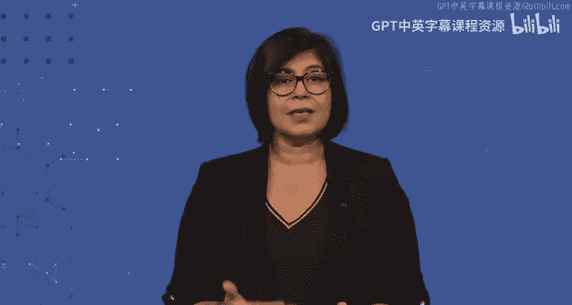
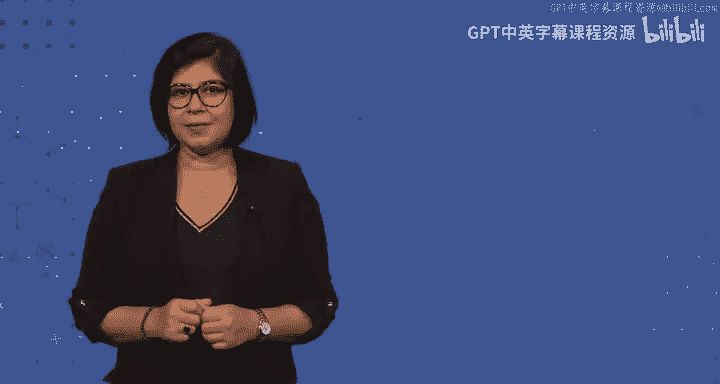
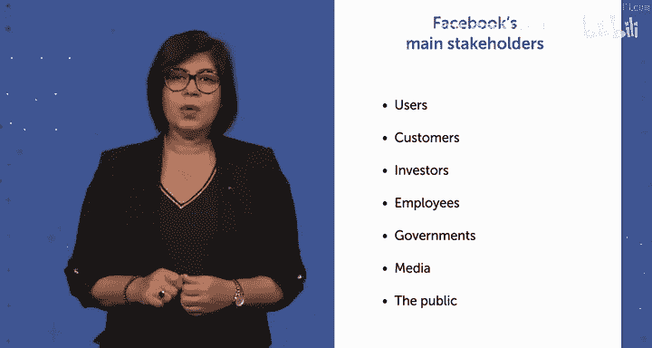
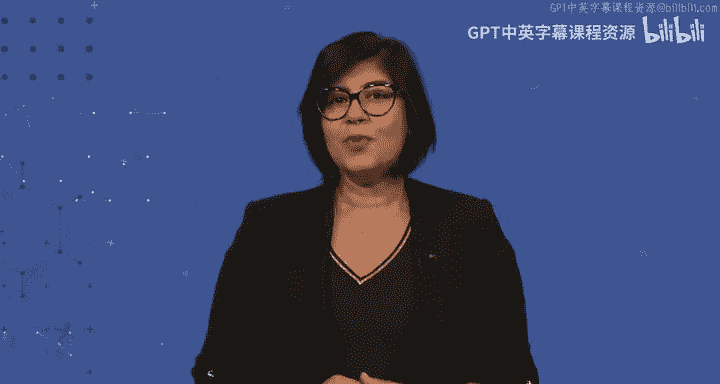
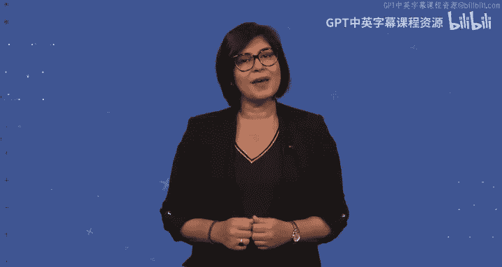

# 声誉危机？Facebook 遇上剑桥分析公司｜Reputation Crisis？ Facebook meets Cambridge Analytica - P10：9_课程总结与核心成果展示.zh_en - GPT中英字幕课程资源 - BV194eTz2E4K

🎼，🎼Welcome to the last week of this moveoc。 In the past five weeks。

 we have taken a close look at the Facebook and the Cambridge Analytica crisis。

 Ex it from the perspective of reputation management， leadership。

 corporate governance and citizenship。 Now， it is time for us to put all the pieces back together and try to identify the actions Facebook can take to move forward。

😊，But our course does not stop here。 Remember， a case study is never just about the company itself。

 It always has a broader relevance with a story of Facebook。

 we may ask what other tech companies can learn from it and to be a more responsible social actor。

 We have introduced a topic relevant to the case every week。 By now。

 you should have a holistic picture about the crisis and be able to analyze it from different angles。

 This week is designed as a capstone project for you to reflect on what you've learned。

 Li them together， make suggestions for Facebook and other tech firms。

 as well as ponder on some fundamental questions about data and society。😊。

Let us take a moment to review what we've learned in the past weeks。

 We started by tracing the story of Facebook， It's sent as a formidable tech player and its involvement with Cambridge Ananalytica。

Drawing on relevant academic concepts， we reflected on the paradoxes confronting Facebook as the ramifications of the scandal unravellled。

We covered several broad topics， including reputation management， what。

 why and how data privacy is a reputation issue， the challenges of leadership in a multivo digital landscape。

 stakeholders exposing unethical business practices and the dilemmas of balancing profit with purpose。

How did Facebook respond to the criticism of its behavior， governance and culture。

Did it do anything to improve This week， you will have an opportunity to look at things from Facebook's point view。

 You will learn about some new developments that are not included in the case you received in week 1。

 For example， in May 2020， Facebook established an oversight board to make a critical content decisions on its platforms。

 such as hate speech Harment and protecting user safety and privacy。However。

 despite this encouraging move in July 2020， more than 500 companies， including Microsoft， Starbucks。

 Coca Cola and Unilever still decided to stop advertising on Facebook platforms。

What is going on there。What do these new developments mean， This case brings out many open questions。

 including some that are fundamental to our understanding of business， society， data and privacy。

Some facts in the case are paradoxical。 The most striking one is between Facebook's societal and financial performance。

 On the one hand， Facebook's reputation， brand and trust took a beating。 and on the other。

 its user base and revenues continued to grow。How do we explain this paradox。Looking beyond Facebook。

 what lessons can other companies draw from this and for individuals。

 what can we do to protect our own data， privacy and security。

What can governments do is regulation enough。This week。

 we will explore these big questions once again with our experts。

This mo was the result of the contribution and effort of many。

 We want to thank our team for their continuous and generous support。 In particular。

 our student assistant Reminta Barreta， who wrote a big part of the case。

 We also like to thank our three experts who contributed their expertise and their perspectives on the case。

 but also on the larger questions of data privacy and the leadership in particular。

We hope that you have enjoyed working with the case and have got a much better understanding about managing a reputation crisis in the big data era。

Thank you again for joining us on this journey。🎼As the case continues to unfold。

 we will closely watch the outcomes for Facebook and remain curious about your recommendations。

 We wish you the best and hope to see you at another time in the future。

