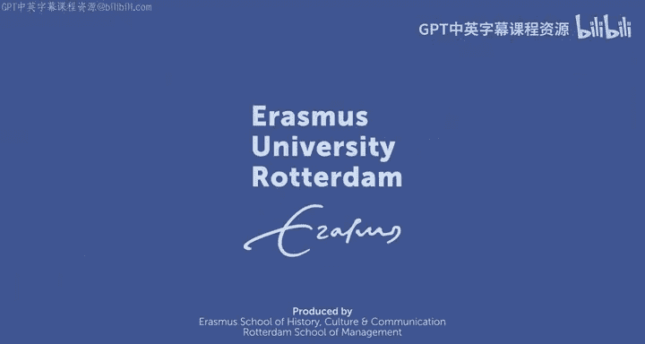

# 声誉危机？Facebook 遇上剑桥分析公司｜Reputation Crisis？ Facebook meets Cambridge Analytica - P11：10_专家研讨：数据隐私与科技巨头的声誉风险.zh_en - GPT中英字幕课程资源 - BV194eTz2E4K

🎼，Coming to the Facebook Cambridge Analytica case in particular。

 there's an interesting paradox that you may have noticed if you've been following the case that on the one hand。

 Facebook's reputation and brand value and consumer trust really took a beating in the immediate aftermath。

 and that continues to happen to some extent。But their user base。

 Facebook's user base and financial performance have consistently grown。

So how do you explain this paradox， perhaps， what are we missing in this picture？Well。

 revenues grow and the user base continues to grow。

 even though initially some people might have left Facebook。

 but that's also because the users are not the ones generating the revenue directly。

 the revenue comes from advertisers， not from regular people like you and me who would have an account on Facebook。

 obviously advertisers pay if they are users， so the two are linked。

But even if the user base would shrink a bit。Or if users would not share as much on Facebook。

I would still expect revenue to grow actually， because it's more likely that people who would anyway not use the platform as much would be the ones leaving。

And another aspect is that if you become more careful about what you're going to post and what you're going to share。

 you're actually going to post and share the things that are even more relevant for you。

 so the information quality of that data will grow， which will be more useful for advertisers。

It is a paradox but it's。So as long as the bottom line is growing and as long as of course。

 the large advertisers， the large businesses that are advertising on Facebook don't take a stand。

We expect to see revenues to continue growing。 In 2019。

 Facebook had 98% of its total revenues come from advertising sales。

And especially if you take a step back and look at how Facebook acquired Instagram and Whatsapp so that people。

 some users might revolt against Facebook and move some of their social activity to these other platforms。

 I mean in the grand scheme of things that doesn't make such a difference and even when focusing on some of these users who might have a declining set of activities。

 we can of course distinguish between data and metadata so if they still have the messenger app and that's still tracking things passively。

 but even for those who coming back to this idea of the paradox。

 knowing the harms that are associated with Facebook but still continuing to use it。

 I mean if you're talking about an app that during any sort of awkward moment in an elevator or when you first wake up when we have a moment- free。

 how easy it is just to pull it out and look at it。

 it's quite understandable why we're not able to shake that off so easily there's also the sense of resignation that how many sort of stories of privacy scandals。

And breaches can you really process right so breach fatigue right so before we were talking about how there's more visibility of these kinds of privacy issues。

 but also privacy and security lapses， but at the same time there is also some kind of a breach fatigue with the number of cases that we hear about。

诶。You might have heard that in July， a lot of advertisers decided to stop advertising on Facebook。

 what are your thoughts about that？Well， you mentioned the revenue that Facebook gets out of advertising。

 so based on that I would call Facebook more of an ad company and not a tech company because their main activity is advertising。

 they an advertising platform， the big advertisingrs do not have that large of a share as we would think。

 so most of the revenue comes actually from smaller companies or medium companies。

 I mean it's good that the large companies are doing something。

But I think we'll just have to wait and see for how successful this ends up to be。

Because earlier you mentioned the regulation part and yes， I agree， more regulation is needed。

 but at the same time， regulation alone cannot actually solve the problem because it's not only about using data in a legal way。

 but also using data in an ethical way and ethics is something that employees in these companies need to have in order for change to actually happen。

And not just have it as sort of a box to tick at the end of the process。

 but yeah ethics at the outset， yeah like actually implement them in practice so wouldn't that be nice so the question that then remains is I mean this is probably not the first or the last。

 I mean certainly not the first， but definitely not the last time that we'll hear sorry we'll hear of these kinds of issues。

What does Facebook in your opinion， need to do going forward and what lessons can other organizations take away from this case or this incident？

I'm not sure what to make of Facebook because especially with the Cambridge Ananalytica scandal and this whole you Mark Zuckerberg going MIA for five days and kind of coming back。

 I mean these things happen on a yearly basis for Facebook and the sort of Zuckerberg apology tour again I don't know how much more spectacular or sort of grandiosea can get and I'm curious about how this shifts public consciousness and governments and other industries attitudes towards platforms like Facebook so I think learning lessons from Facebook again data minimization do you need two to 5000 data points of every single citizen or customer that seems maybe a bit excessive in the same way that a sodium level and potato chips is excessive we can advertise how we're kind of scaling this back a bit。

That's an interesting analogy。Yeah。like health labels。

 but for platforms right right now that's a direction we can think about maybe maybe a last question from both of you。

 both from a research perspective since you were heavily invested in this research。

 what are some burning issues or burning questions that you would like to leave for our users when it comes to thinking about privacy and also its entanglement with responsibility and ethics and reputation？

So some questions that they would think about Yes， sorry that you are thinking about right now。 Yes。

 because there are so many questions that you cannot immediately answer or yeah。Well。

 first to think and read more about the difference between。Privacy of data and security of data。

 because those two are different concepts and the difference is quite important。

Information quality because。In this big data。Errra。

 let's say many companies who might be trying to become something like Facebook are very interested in getting access to big data。

 so lots of data， but having lots of data does not mean that that data is useful and that's where information quality comes in so you don't need to collect so much data so even with data minimization you can still infer enough about your customers or users to give them a good service。

 make good recommendations。But at the same time， reduce the risk of inferring other things that would impact their privacy。

Those two things that's important so security and privacy。

 information quality even as we work with big data and all those are good points Daniel I think yeah positioning privacy and security is absolutely important and not only should we be mindful of these concepts and these values but also trying to avoid slipping into a tradeoff model where these two things are important but we can only have so much of one or the other in a lot of cases the way we apply and use these technologies is still negotiable and we think we can think of ways in which in various contexts we can be both private and secure you know privacy as autonomy as it were。

 but I think also in terms of the emergence of new ways of collecting data through wearables and through Google home and all these kinds of devices even as you say with like fewer data collection points if we sort of scale back。

The types of inferences， as you mentioned， I mean， that leads to brand new ethical issues。

 So one example that I heard a little while ago that stuck with me is the idea of making inferences in terms of whether or not people seem intoxicated and then what kind of heads do you send them at that moment and that I mean。

 that's still largely uncharted territory so we should be careful with that but even with that example。

 we seem to be crossing this very bloodline already ethical line so to speak yeah。

 though it can still be used in some good ways。 So the。

 for instance appear to be intoxicated for because I'm using eye tracking in research。

There are ideas of implementing eye tracking in cars and they would detect if you are tired。

 for example， so then the car would not function anymore and those can be very good。

 very ethical applications so it's not that having access to data is by definition bad it's all the way of in your decisions of how to use that data。

And avoiding function creep， basically， that's， I think an excellent application of this eye tracking technology。

 but as you say， like where else could it go？🎼Absolutely I think that is a great point to end on and a big takeaway from us for us as well that it's not data and data big data are not inherently ethical or inethical unethical it's what you do with these data that really creates continuing and new problems I think you have provided a really valuable and enriching perspective on many different issues related to privacy thank you so much for your time here Anna and Daniel i'm sure we will continue to reflect on what you said thank you very much again thank you thank you。

