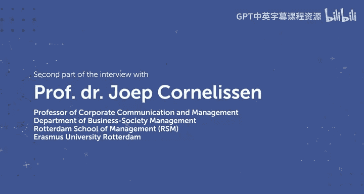
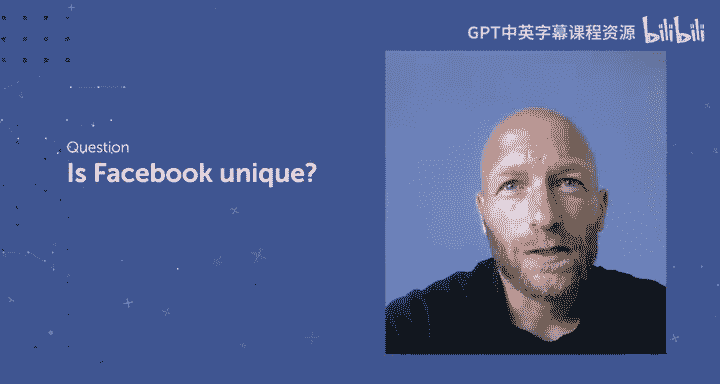
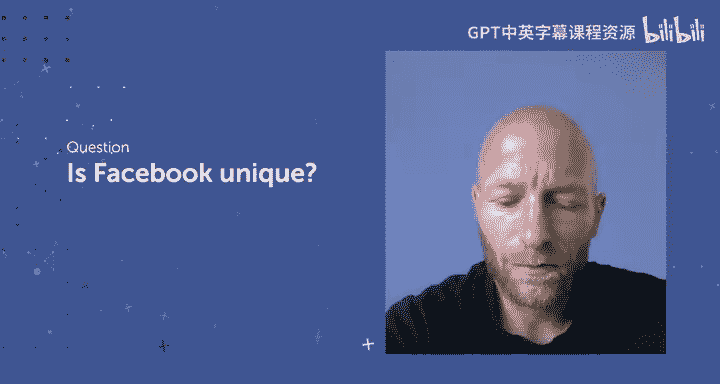
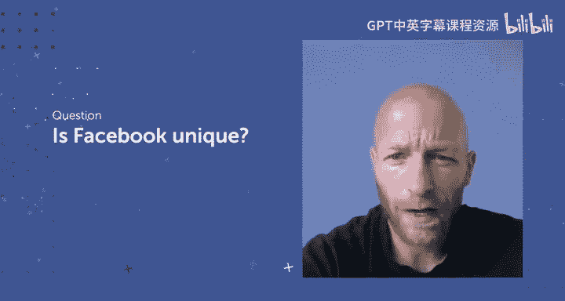
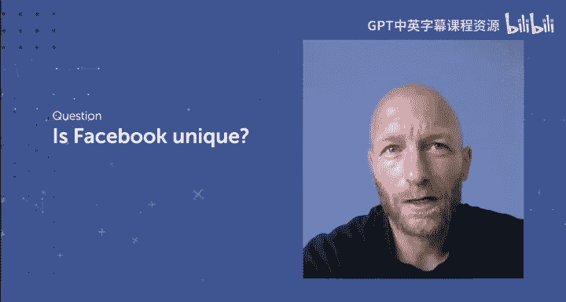
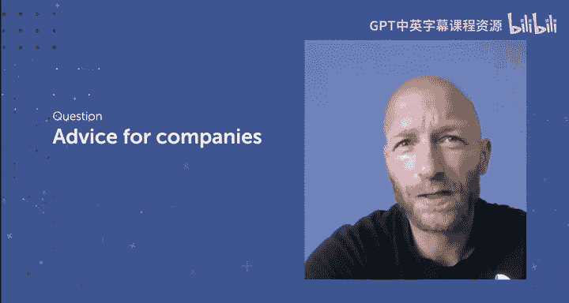
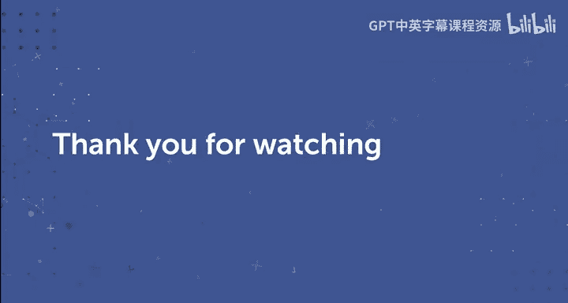

# 声誉危机？Facebook 遇上剑桥分析公司｜Reputation Crisis？ Facebook meets Cambridge Analytica - P12：11_专家对话：领导力文化及其对企业的影响.zh_en - GPT中英字幕课程资源 - BV194eTz2E4K

🎼。

I think a company like Facebook， if you to Facebook for me is a bit like the first type。

 is that it it。Is for the most part driven by growth and profit， I would say。

And unless and it obviously operates within the law and it will change its tactics。

Powerful stakeholders， particularly legislators or。

Shareholders were a big part of its customer base or advertises as we've seen recently。

If they start to ask for a different sense of responsibility for the company to change its behavior。

嗯。It then still takes a lot of leadership from Mark Zuckerberg。

 but also from Cheryl Sandberg and from others。To rethink what how far the responsibility of a company like Facebook fetches and if they can change the very nature of the purpose of their business from where they are at this point in time。

And that requires a lot of strong leadership， so I think that's。

Fbably what we see that Facebook is brushing up against。

 that question of responsibility is wonder they seem to be struggling with。

TheThe nature of these business models， so the nature of these business models is is is they are very disruptive for a lot of the sectors that they operate in。

And they often also seem to have this。Iea of really monopolizing a particular market and squeezing out or pushing out the others and through that dominance Facebook is a good example。

 I mean I think a lot of people are probably having mixed feelings bearing all of these crs in mind I'm not myself on Facebook but I hear people being on Facebook thinking about should I still be on but then obviously it also。

Because they have such a monopoly position， it's very hard to find alternatives to stay in touch with your friends or your connections on the other side of the world。

 so it's a really crude form of capitalism。

Where first and foremost， and at the expense of everything else。

 we need to grow and run our own business。U and it and that also means that a lot of these environmental or social issues are being externalized。

So if we go back to Facebook， obviously if you have to change your business model。

 it also comes potentially with a cost， meaning that you know， you may have。

Less sort of returns coming into the business， maybe your growth rates will be somehow affected so there's real consequences to the responsibility related choices that you might make and that's why theseise are so interesting that Facebook is。

Working its way through is because every social or environmental crisis that now happens is mostly social in their case。

Are around these questions of should you be able to run your business in the way in which you're running it。

 should you ignore the direct and indirect effects of your business？

And that that's to do with inequality， that's to do with democracy。

 that's to do with all sorts of privacy， that's to do with all sorts of important issues that people are obviously concerned about。

As we know from issues， communication and vices communication。You know。

 a lot of these things can be prevented if you have good systems in place where you know that these。

Issues are just around the corner that public debate will will emerge around some of these issues that。

That inevitably will be there for you as a business so companies， when you study them。

 they obviously are very unique in their own ways， but you also have lots of similarities in terms of how they go through these types of things。

Um， and I think one similarity that I often see is that companies try to sort of sit out to storm。

Either you know， externalize the issue or try and。Minimize their own responsibility in relation to it and try and manage initially at least from that vantage point then they you know they try to buffer in doing so the influence from the outside world hope that it goes away if it doesn't go away let's set up。

You know， a set of meetings with our stakeholders or set up an industry platform that shows that we have some credentials in this place。

And manage it。And even if it then doesn't go away， then you know。

 then we'll be into crisis communication mode and try to really give our side of the story in such a way that we minimize the damage on our reputation。

And that way of behaving is not。Always the right way of behaving it goes back to that point that I made earlier that。

A lot of companies are in this way of behaving where they just think。

Unless accountability pressures change， unless I'm really being put under the microscope by the media。

 unless I'm being asked by my stakeholders to really change the way in which I behave。

 I'll just keep doing what I do。And there's not of that， you mentioned earlier， short termism。

 there's not enough forward thinking in terms of what we should be doing in terms of what our responsibilities should be。

🎼。