# 声誉危机？Facebook 遇上剑桥分析公司｜Reputation Crisis？ Facebook meets Cambridge Analytica - P1：0_欢迎加入本课程.zh_en - GPT中英字幕课程资源 - BV194eTz2E4K

🎼。

What do you think when I say Facebook？Do you recall when you first created a Facebook account。

 What made you do it， Did you ever delete your Facebook account。

 What kind of information do you share on Facebook。

 And do you know what happens to the data and stories you share on Facebook。

These are a lot of questions。 Perhaps the most important questions are， why does any of this matter。

 Should we care。Welcome， I'm Dr。 Vity Chadrie， associate professor of media and communication at Erasmus University。

 Rotterdam。😊。

Together with my colleagues at the casese Development Centre， Rotterdam School of Management。

 I have developed this MOO titled Reputation Crisis， Facebook meets Cambridge Ananalytica。

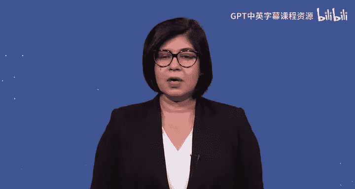

In this video， I will outline the backdrop for our course。

Some of you may be familiar with the controversy of Facebook and Cambridge Analytica。

 the British Analytic firm that harvested data from 87 million Facebook users without their knowledge or consent and used these data to influence voter opinion in favor of Donald Trump's 2016 presidential campaign and in the lead up to the Brexit vote。

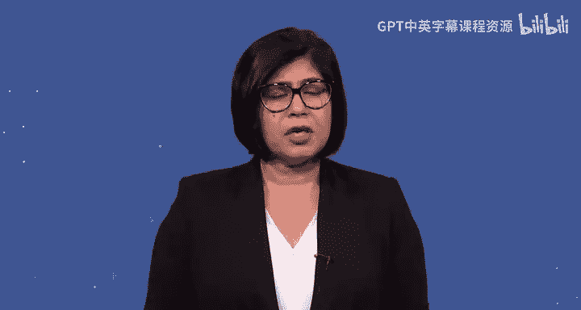

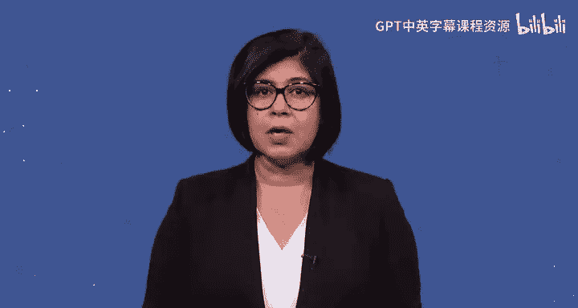

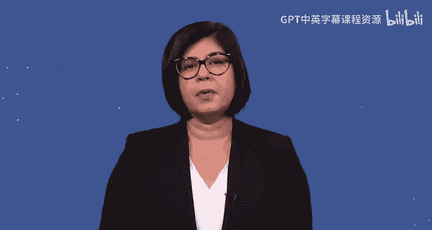

Here you can see a timeline tracing the key developments in the Facebook Cambridge Analytica case。

 its immediate aftermath and the fallout for both organizations。

We end in 2020 with Facebook announcing several measures。

 including an advisory oversight board to address the criticism of its content policies。

At any point in the course， you can link back to the timeline to follow the chronological sequence of events in this complex story。

We will use this case as illustrative of the challenges that confront contemporary organizations in terms of their reputation。

 brand image， trust， leadership， privacy and ethics。 among others。

 We delve into the consequences of the scandal of Facebook and Cambridge Ananalytica on the tech industry and crucially outline the implications in the sociopolitical realm。

As you go through the course， it becomes clear that the effects are far reaching and not confined to one point in time。

So whether you're a student in communication or management or a practitioner interested in crisis and reputation management。

 or just have an interest in case based learning to unpack real life challenges。

 this course is for you。

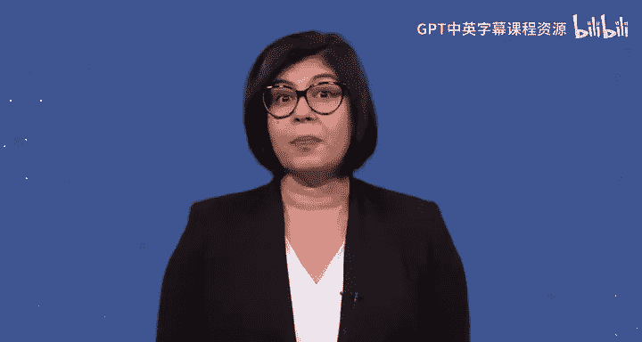

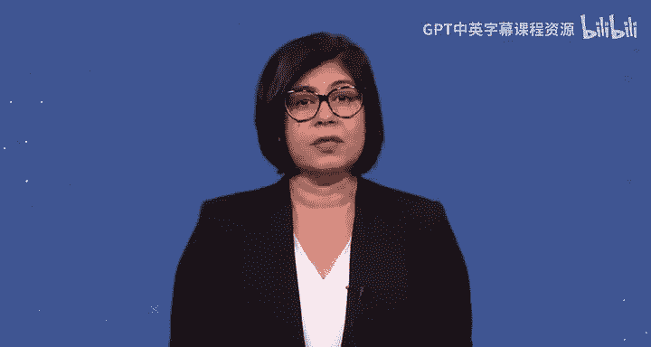

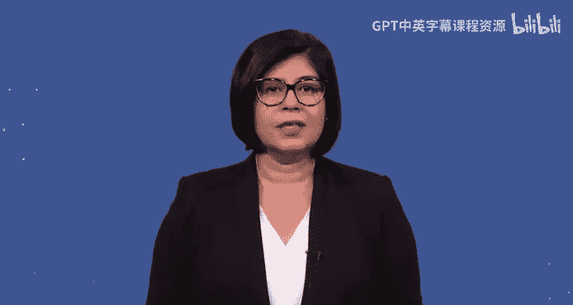

Now let's take a few steps back and provide some context for the case。

The story of Facebook is well known and widely told。

19 year old Mark Zuckerberg and four fellow students developed their Facebook in February 2004 as a social networking site for Harvard students and quickly expanded from there to other colleges。

 Soon after， the Facebook was officially renamed Facebook。By the end of 2004。

 Facebook already had a million active users。 It wasn't long before Facebook was also able to attract businesses to use the platform for paid advertising。

 reportedly investing in a full fledged in house ad sales team in 2006。In 2019。

 ad sales contributed more than 98% of Facebook's total revenue of $70。7 billion US dollars。

So from modest beginnings in 2004， Facebook today is a social behemoth that boasts 3 billion users worldwide。

 If Facebook were a country， it would be the biggest country in the world ahead of China and India。

Here you can see how Facebook defines its mission。To give people the power。

 to build community and bring the world closer together。And how。

Guided by the principles to give people a voice， build connection and community， serve everyone。

 keep people safe and protect privacy and promote economic opportunity。😊，Indeed。

 Facebook's value proposition has pivoted around the idea of community and connection。

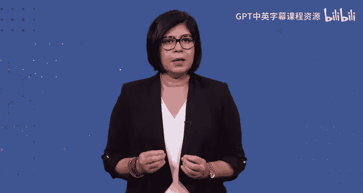

Let's have a look at how the company positions itself。 And at this point。

 you can pause the video to read it carefully。Now， the meteoric rise of Facebook has been peppered with a fair share of controversy。

 starting with its origins and the subject of the 2010 movie， The Social Network。 As the story goes。

 founder， chairman and CEO Mark Zuckerberg allegedly stole the idea from three Harvard Seniors with whom the company eventually reached a settlement。

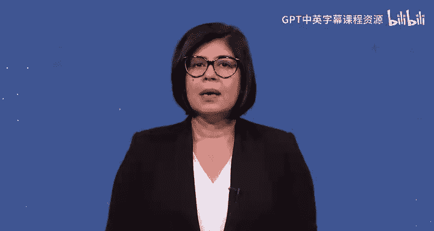

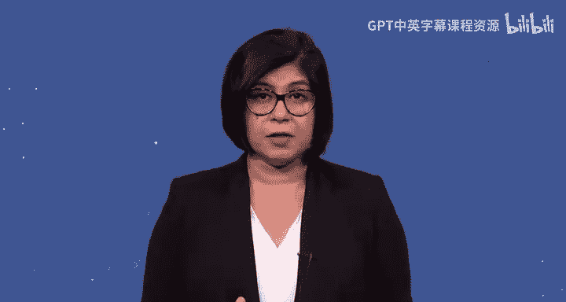

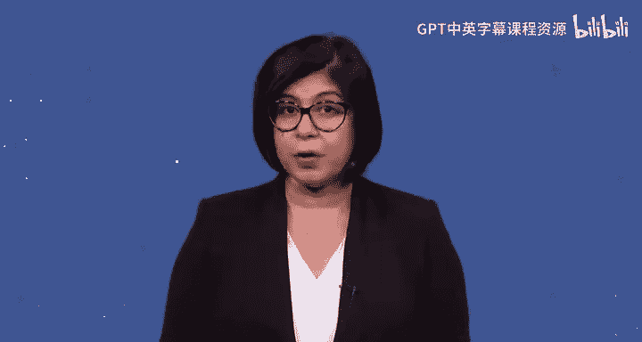

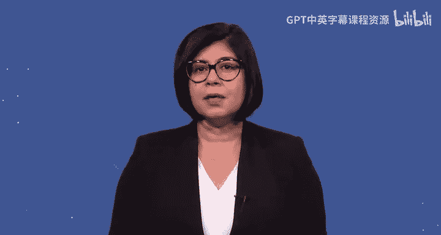

16 years in， Facebook has grown exponentially and found itself embroiled in controversies and debates of a much more serious nature and magnitude。

 from security and privacy of user data to election meddling to role in spreading misinformation。

 fake news and falsehoods。

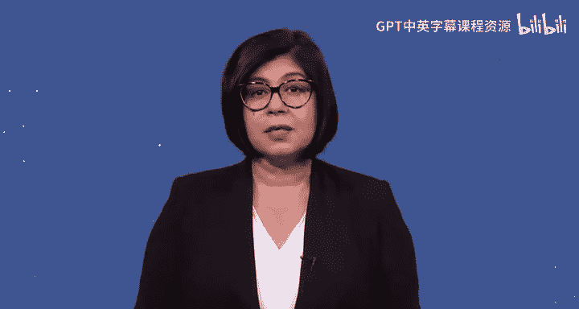

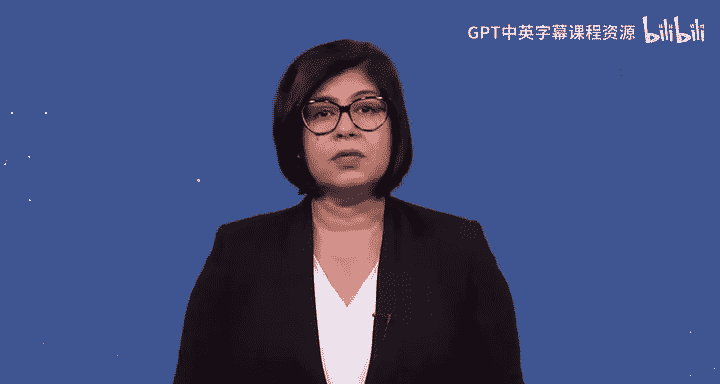

Particularly in the aftermath of the Cambridge Analytica scandal。

 Facebook has suffered a drop in brand value， reputation and trust。

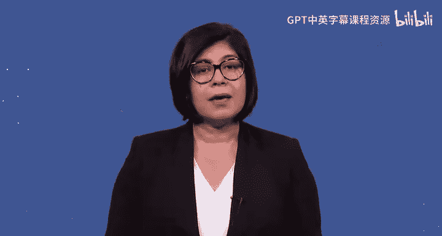

In the wake of widening privacy discussions， Facebook's reputation took a major hit from 51st in the 2018 list of the 100 most reputable companies to 94th in 2019。

Here you can see that since 2017， Facebook has experienced a drop in its brand value and ranking。

 The social network went from 9th place in 2018 to 14th in 2019， a 12% cent drop in brand valuation。

As a consequence of growing criticism， user trust in Facebook's commitment to protect privacy has also suffered significantly。

Paradoxically， user base has continued to grow， as has financial performance。

Here you can see that in 2019， Facebook ranked 57th in the Fortune 500 rankings。

 an annual ranking of the biggest companies by revenue。When it first entered this ranking in 2012。

 it started at number 482。So despite all the scandals and drop in trust。

 Facebook's continuous and constant upward t to its current place among Fortune 500 companies prompt serious questions。

 Is Facebook too big， too influential and too powerful to fail。

Still， the fallout is far from over。 Facebook has announced some changes to address the continuing challenges of ethical behavior。

 transparencypar and data privacy， but has it done enough to future proof its reputation。

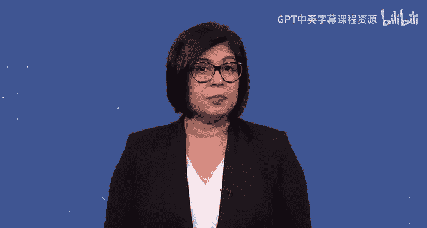

Every week， we will introduce a topic relevant to the case。

 much like peeling away the layers of an onion， you will be able to analyze the case from different theoretical and research perspectives。

By bringing together theory and practice， this mooc will allow you to analyze Facebook's actions and also think critically。

 what， if anything， does Facebook need to do going forward。Next week is all about reputation。

 What it is， why it matters and how is it created， maintained and destroyed。

 We will also hear from experts why the issue of data privacy constitutes a serious reputation challenge。

 especially for tech firms， like Facebook。Are you ready to dive in。

 Then watch the next video to learn how。🎼。

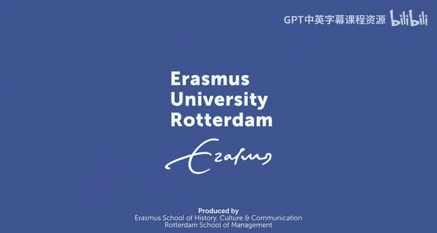