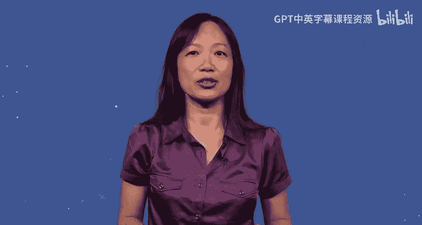
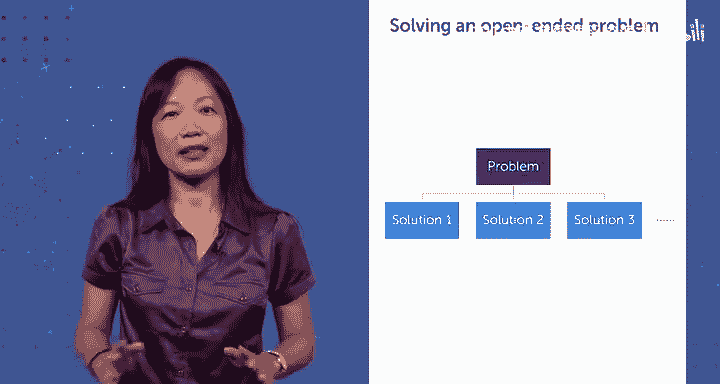
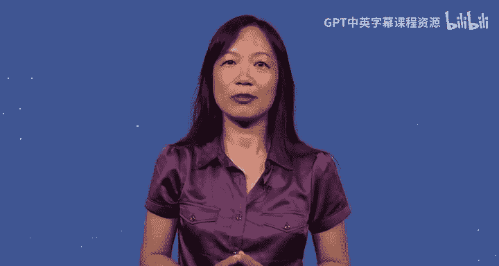
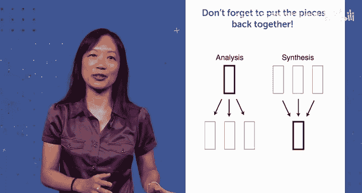
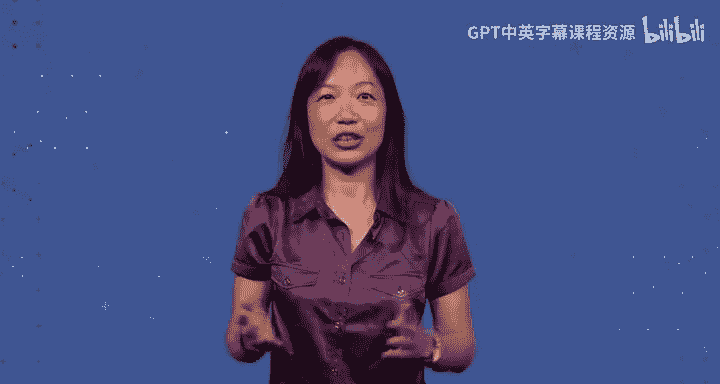

# 声誉危机？Facebook 遇上剑桥分析公司｜Reputation Crisis？ Facebook meets Cambridge Analytica - P2：1_为何采用案例教学法：案例导论.zh_en - GPT中英字幕课程资源 - BV194eTz2E4K

🎼，🎼う。🎼When people talk about what kinds of abilities are most important for success in the workplace。

 they often mention creativity， critical thinking， the ability to analyze complex and ambiguous situations and being able to solve problems and make decisions despite uncertainties。

So how can you cultivate these skills， One good way is by puzzling through real life business cases。

 whether you are full time student or are already working in studying in your free time。

 The case method can help you with this。 My name is Tao Yue。

 I'm the managing editor of the casese Development Center at Rotterdam School of Management here at Erasmus University。

In this video， I will show you the basics of working with a case study。 Afterwards。

 you can put what you have learned into practice and start to build your critical abilities through case solving。

😊，First of all， what is a case study， many of you may have heard that term by it to have different meanings for different people。

 Some may think of a business case that they use to convince their boss about approving a project。

 others may think of a research case that they study up close and in depth in their academic work。

But here we mean a teaching case that educators give to students so that they can learn through real life situations。

 A case study is a unique learning tool in social sciences education。

 It is a multilayed story that places students in the shoes of the main character or organization who is faced with a challenging dilemma。

By vicariously experiencing that stressful situation。

 you can think about how you would analyze and tackle it if you were the person in charge of making the decision。

So how do you use a case study， The first step is to understand what is trying to teach you。

What does the educator who wrote it want you to achieve。

Sometimes this is clearly written out in the instructions。

 but often you need to reverse engineer the case to find out。

The opening and the closing sections usually give you the answer。

Cases typically correspond to one of the layers in the pyramid of learning found in Bloom's taxonomy。

 Your job is to understand where the case is positioned in that pyramid so you can work on it accordingly。

For example。Is the situation already well defined and you simply need to grab the right theoretical tool and apply it。

 or do you need to first do a thorough analysis and evaluate the situation before you can understand what's really going on。

Or is it necessary to go even step further by thinking of your own creative solution to the problem。

Once you understand what you are supposed to do， you can study the entire case and search for the relevant information that you need to analyze and solve the case。

For example， if a case is about reputation crisis， it may be necessary to study the company background to find out what caused the crisis。

Does it have anything to do with a corporate culture， leadership style or reward system？

You might also want to study the industry background and find out if market competition plays a role there。

Or maybe public 카페는？All these elements are usually in the case narrative as well。

 So don't read the narrative just as a story。 It is more than that。Remember。

 the clues to analyzing and solving a case are often embedded in it。

 It's almost never a straightforward presentation。 You need to， you need to do some good digging。

Also， a case doesn't have only one correct answer。 There can be many different ones。

 but you need to justify yours。

Okay， now you have studied the case content carefully。

 What other information is useful for solving the case。

Rightite the exhibits， cases are carefully crafted educational tools。

 No exhibit is putting there without reason。Often， a visual exhibit gives you much more information than lots of text。

Anything else。Be sure to also look at the references， full notes or end notes。

 They show you what articles， videos or other materials the educator consulted when crafting the case。

They can be very useful in giving a much richer background of the case。So far。

 we've talked about the steps of dissecting and analyzing our case。

 The next step is to put all the pieces together and come up with a conclusion。

 Analysis is important， and the synthesis is equally important。In the end。

 you need to go back to the original purpose and generate a coherent solution to the case central challenge。

These are the ABCs of working with a case through a holistic approach to addressing a real life challenge。

 you can practice critical thinking， problem solving， decision making。

 analytical and synthesis skills， all of which are highly valuable in the working world。

That said a good case study doesn't just teach you skills。 It is also informative。

 You can expand your knowledge from reading the facts presented in the case。 Moreover。

 it is often entertaining to read because it is told in story form。Today。

 more and more cases also include videos。Making the learning experience even more fun。😊，In this book。

 developed by myself and my colleague， Dr。 Riie Charer from the Rumus School of History。

 Culture and Communication， you'll be working on the case of Facebook and Cambridge Ananalytica。

By analyzing a string of controversial events， you will gain a deeper understanding of everything about reputation management。

 its key concepts， its relationship with corporate culture and leadership。

 its interaction with whistleblowing and crisis and its challenges in the digital age and amid increasing public awareness about corporate social responsibility。

You may already know a lot about the scandal around Facebook and Cambridge Analytica。

 but I'm certain that this case will make you see things you never noticed before。

 things that are not only relevant to this case companies， but also in your own work and life。

🎼Enjoy the case。

