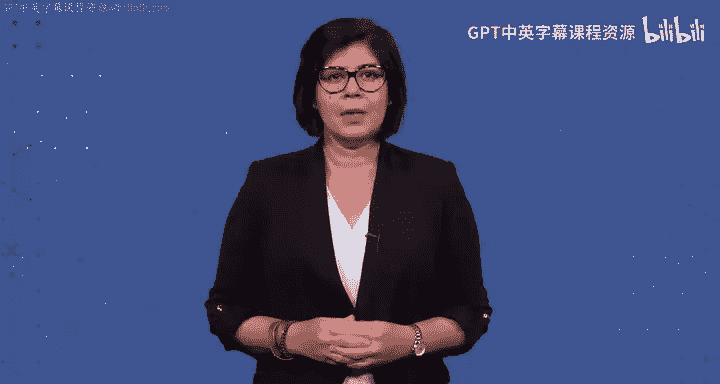
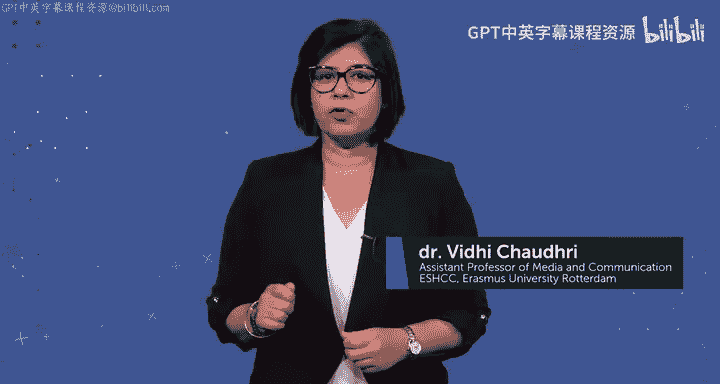
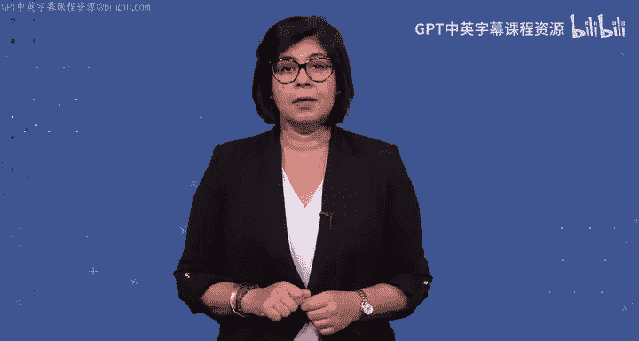
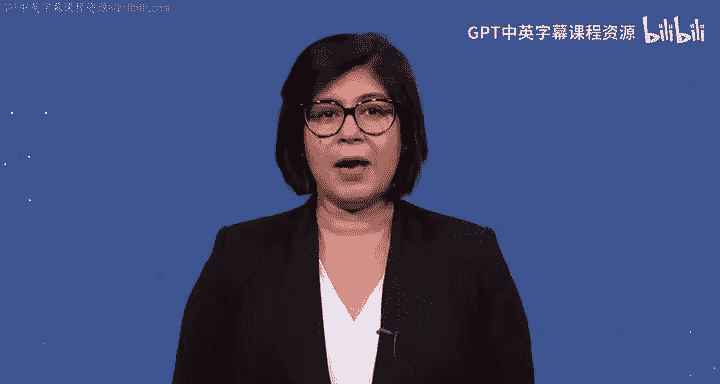
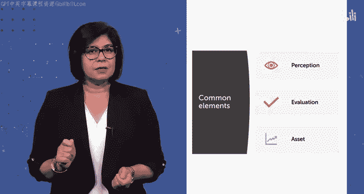
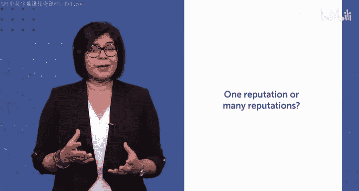
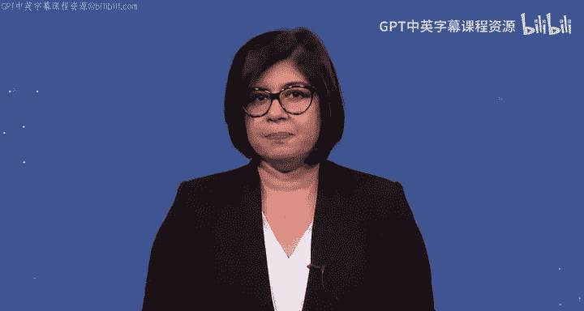
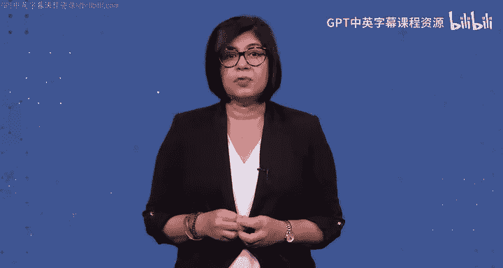

# 声誉危机？Facebook 遇上剑桥分析公司｜Reputation Crisis？ Facebook meets Cambridge Analytica - P3：2_声誉管理的内涵、意义与实践路径.zh_en - GPT中英字幕课程资源 - BV194eTz2E4K

🎼。

🎼Welcome to Week2 In this video， we will outline the basics of corporate reputation。

 and in a next video， we will talk to two experts about what makes data privacy a critical reputation issue in the contemporary sociopolitical and business landscape。

 Let's get to it。😊。

Warren Buffett's now famous quote， it takes 20 years to build a reputation in five minutes to ruin it。

I frequentlyently cited as an expression of the power and fragility of reputation。

But what is reputation and why does it matter。At first glance。

 the concept of reputation seems simple and intuitive and is often used in everyday conversations。

 whether referring to businesses， governments， countries， individuals， brands。

 we say everything and everyone has a reputation。But this pervasive and globally familiar idea is more complex。

Our focus today is on corporate reputation。Here you can see some classic definitions of corporate reputation。

 At any time， you can pause the video to read these carefully。

What is common in these definitions is the claim that reputation is the aggregate perception of an organization by its stakeholders。

 Stakeholder are individuals or groups that can impact or be impacted by an organization's actions。

 be it consumers， employees， investors， suppliers， the media and so on。Second。

 it involves some form of assessment or evaluation of a firm relative to its competition。And finally。

 reputation is seen as a valuable asset， usually an intangible asset。 even though it is intangible。

 reputation is associated with tangible business outcomes。

 as well see a little bit later in the video。😊。

Given the multitude of stakeholders for any organization。

 researchers suggest that a single organization may also have multiple reputations based on these different stakeholder groups。

 For example， consumers may have a certain perception whereas employees may have a different perception of the same organization based on their lived experiences which can problematically create a reputation gap。

Another point that should be emphasized is that reputation is a multidimensional construct。

 What this means is that reputation is not unitary or one dimensional。

 It is comprised of and dependent on many different elements。Here， for instance。

 you can see the drivers of reputation outlined by the Reputation Institute。 According to them。

 reputation is a composite of seven dimensions， including the quality of products and services。

 innovation， workplace practices， governance， citizenship， leadership and financial performance。

In the middle of the slide， you can see that reputation also has an effective or emotional dimension in that it inspires stakeholder trust。

 pride and esteem that can guide stakeholders to experience their relationship with organizations in specific ways。

And why does all of this matter， If you look to the far right。

 you see that reputation is associated with supportive behaviours。

 be it willingness to purchase goods or services or to recommend an organization and much more。

Prior positive reputation is also assumed to act as a buffer or create a halo effect that gives an organization the benefit of doubt。

 should there be a crisis？Data from the 2020 Global Repttrack report of the Reputation Institute confirms that reputation is a predictive metric of support。

 High reputation translates into higher willingness to buy。

 to work for a company and to give the benefit of the doubt in times of crisis。In this sense。

 reputation is a firm's most valuable， intangible asset and a magnet for stakeholder support。

 It's no surprise then that reputation management has flourished both as a field of practice and research in the past two decades。

 but building and managing reputation is not an easy task。hy。😮。

Because organizations can never fully control their reputations。

 Think about how reputation is formed。 It is constructed via direct experience and interaction with an organization or indirect experience。

 such as others experiences or stories， or it is mediated by information sources such as the news media or other third party sources altogether。

 then， reputation is a dance between perception and reality。

Organizations do not control their reputation At best。

 they are able to shape or influence stakeholder perceptions and stories about themselves。

But what happens if there is a crisis。

Before we said that reputation can act as a buffer in a crisis。

 But there are many more variables to consider here。 What kind of crisis， severity and scope。

 Who was responsible， Was the organization a victim， Was this an accident。

 Was it a preventable situation that could have been addressed before it blew up。

As you look at the crisis types on the screen， you can see that not all crises are made equal。

Likewise， the threat to reputation also varies being lowest in a situation where the crisis organization itself was a victim。

Research has shown that preventable crises or those committed knowingly inflict the biggest reputation damage。

In conclusion， a good analogy refers to building reputation as building a house， much like a house。

 reputation needs a strong foundation and continuous maintenance。Of course。

 this makes reputation management a challenging task。

 but one that organizations must undertake on an ongoing basis。

Now that we've outlined the basics of reputation， I invite you to carefully review the case timeline。

In our discussion forum， reflect on the critical events that have possibly impacted Facebook's reputation。

In the next video， we will meet two academic experts to hear their perspective on the issue of data privacy。

Why is it a growing concern for all but especially tech companies like Facebook。

 given the global nature of data， how can tech companies be ethical。

 trustworthy and reputable in different regions of the world that have varied legal and value systems and are accustomed to different levels of data privacy。

Thank you for watching。