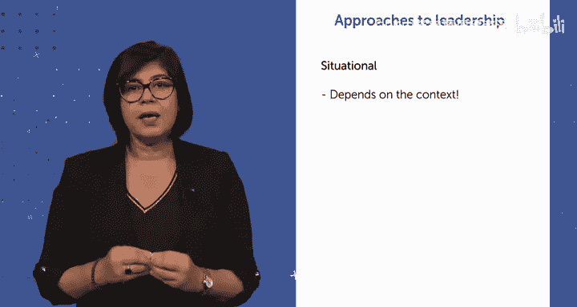
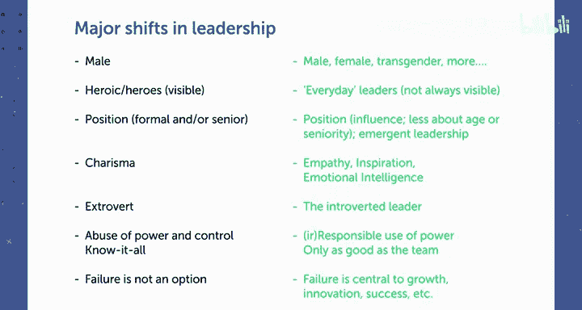
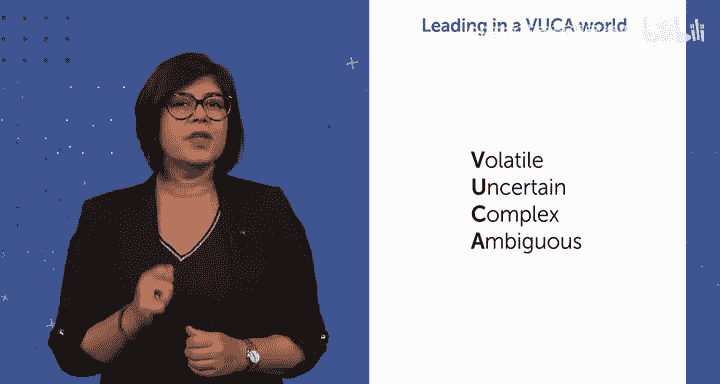

# 声誉危机？Facebook 遇上剑桥分析公司｜Reputation Crisis？ Facebook meets Cambridge Analytica - P5：4_领导力的当务之急.zh_en - GPT中英字幕课程资源 - BV194eTz2E4K

🎼，🎼In this video， we will look at the importance of leadership in today's dynamic business environment。

 we will also highlight the key challenges facing corporate leaders。In the next video。

 we will talk to an academic expert to get an in depthth understanding of the role of leaders in shaping corporate reputation and culture and get some insight into the leadership approach of Facebook CEO Mark Zuckerberg。

Let's get started。Leadership is one of the 1 most overused words in resumes。

Has leadership become a cliche？From a research perspective。

 the prolific field of leadership studies is too extensive to summarize in a short video。

 it's estimated that there are 35，000 definitions of leadership from diverse disciplines ranging from psychology。

 management to communication and more。

Now the media portrayals of leadership tend to be more simplistic。

 on the one hand of the spectrum are the exploitative， arrogant and autocratic leaders。

 usually company bosses who abuse their power you might recognize some of the leadership styles portrayed in the movie posters you see on your screen。

The other extreme is leaders who inspire and hold the team or country together in the face of disaster。

 whether it's a football coach or the president of the free world， who。

 by virtue of their oratory and impassioned speeches can get people to forget all their differences and swear their ultimate allegiance to the cause。

 whatever that might be。Reality is not that black or white。But then what is leadership。

 I leadership about a formal position you hold or about certain behaviors you exhibit？

The conventional approaches to leadership may be encapsulated in the trait approach。

 which sees leadership as a set of specific qualities or skills。

The trade approach emphasized that leaders， mainly men， were born， not made。

 and leadership was determined by personal characteristics such as physical appearance， intelligence。

 speech abilities， and an attractive personality。The other prominent approach is the style approach。

 which focuses on particular ways of leading or specific leadership behaviors， for example。

Auttocratic leadership is characterized by close supervision。

 centralized decision making and little input from group members。

Contrast that with the Democratic leadership style， which is more inclusive and participatory Today。

 there are a plethora of leadership styles。 And you can see a sampling on your screen。

A third approach asks if leadership is situational and contingent on a given situation。

The situation approach pays more attention to context。

 What is good leadership then depends on many factors， the task at hand， the power of the leaders。

 the size of the organization， et cetera。 So there is no single style or trait that will be effective across different situations。

 None of these approaches is wrong or completely redundant。

 but they do not fully account for the complexities of leadership。

 We now see an emergence of new approaches to leadership that view it not as a thing。

 a trait or equality to possess。 Instead， they focus more on the communication dynamics and the processes of leadership。

They see leadership as relational and non hierarchical。

Along these lines， one definition of leadership is the process of influencing the activities of an organized group in its efforts towards goal setting and goal achievement。

Notice the emphasis on the three elements， leadership is a process of influence aimed to enable an organization to work together towards some end goal or objective。

And how might this process be accomplished through communication。For example， leaders set the tone。

 craft the vision， and shape the culture of the organization。

Through stories and narratives and leading by example。

 leaders create meaning and a sense of belongingness or identification for organizational members。

On your screen， you can see some important shifts in our understanding of leadership。

From conventional notions of leadership to more realistic and sophisticated conceptualizations。😊。

For example， you can see the assumption of leaders as men。Is being consistently challenged。Likewise。

 leadership is not just based on formal positions or seniority。

 but may emerge from any strata of the organization。

Take a moment to process these shifts and reflect on whether you recognize them or agree with them。

Now that we've reviewed the major developments in the field。

 let's briefly reflect on the practical challenges confronting business leaders today。

From climate change to the refugee crisis， cyber security to technological disruptions。

 privacy to gender， equity， sustainability to health challenges。

 there are numerous wicked problems to keep corporate leaders up at night。

 dealing with large scale societal issues such as these require foresight and long- term thinking。

Indeed， leader roles are particularly salient in times of crisis because of the heightened sense of insecurities。

 doubts， and emotions that come with it。How organizational leaders。

 help employees and other stakeholders make sense of a crisis goes a long way in mitigating possible reputation damage。

But leadership does not stop at managing the crisis。

 goes well beyond that to what the organization has learned and how it recovers and rebuilds from that experience。

Never let a good crisis go to waste is， in fact， a popular piece of advice。 Collectively。

 the plethora of grand challenges amidst a changing environment of higher expectations and scrutiny creates what has been called a vuca world。

 a world that is volatile， uncertain， complex and ambiguous。

Leading in a vA world requires courage and creativity。

How well businesses anticipate and prepare for these developments will be the true test of leadership。

In the next video， Professor Ype Cornelson of the Rotterdam School of Management answers critical questions about the leadership approach of Mark Zuckerberg。

He shares his analytical perspective on the leadership challenges confronting business and what they should do to remain relevant。

Thank you for watching。