# 声誉危机？Facebook 遇上剑桥分析公司｜Reputation Crisis？ Facebook meets Cambridge Analytica - P6：5_专家对话：领导力文化及其对企业的影响.zh_en - GPT中英字幕课程资源 - BV194eTz2E4K

🎼。

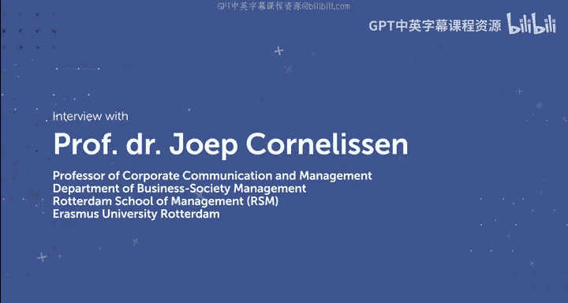

Leadership is such a big container term and it means so many different things to different people。

I suppose historically， it was more associated with power and influence。

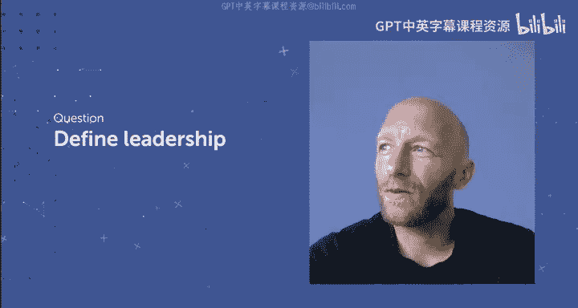

And being able to lead。

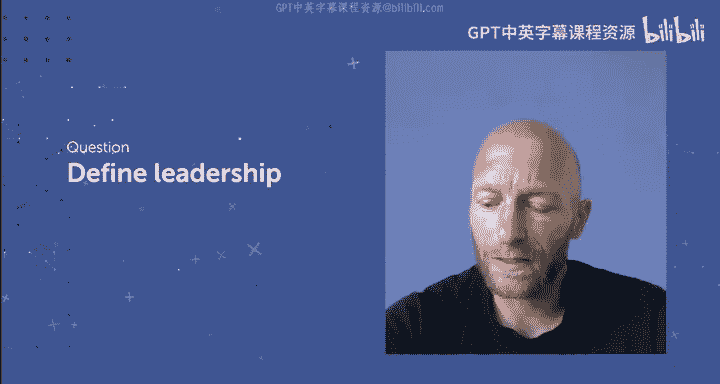

An army or a group of people into a certain direction。

And I think the early leadership theories in the academic world reflected that so there wasn' a lot of emphasis on particular traits or skills that you needed to have as a leader to influence and direct your followers。

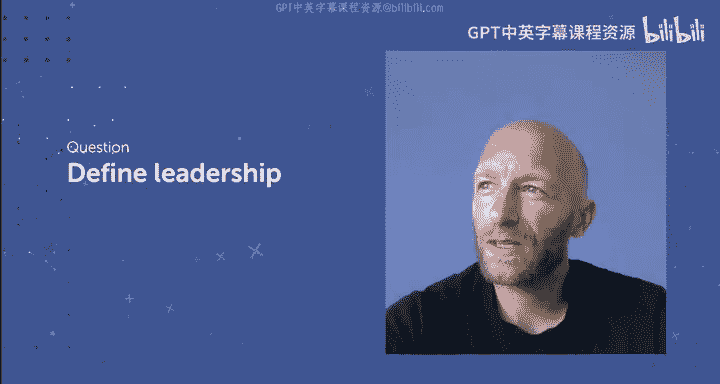

嗯。More recently， I think there's been a bit of a move away from that trade based perspective。

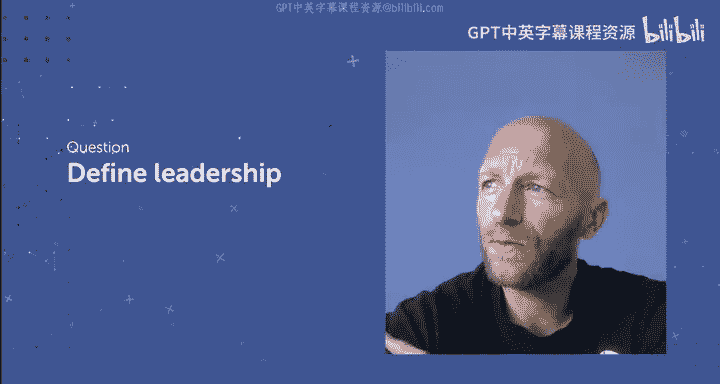

And more towards seeing leadership as a set of skills or a set of activities that you engage in as a person。

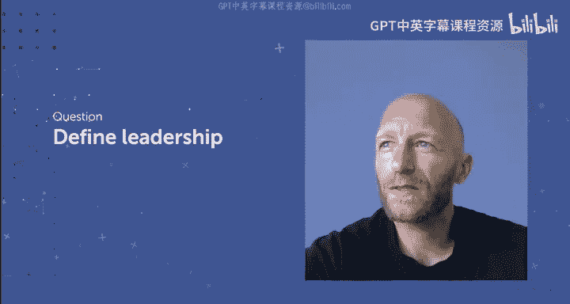

And they're not necessarily given to you to any particular person。

 but theyre things that you can in a particular situation。

 exercise or do to get people to share your point of view or to come on board or to be mobilized in pursuit of a particular direction。

So in that sense， leadership has become a bit broader as a concept， so it's less tied to。

Particular positions of influence or particular formal of positions in an organization。

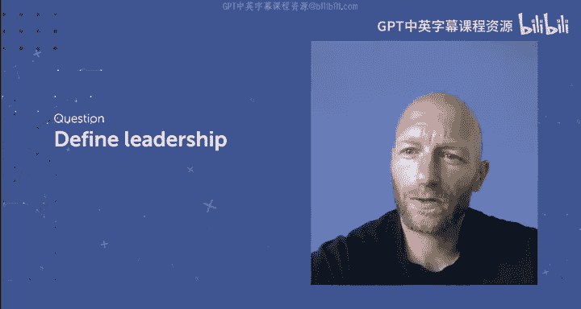

I think the other interesting thing I feel with leadership nowadays is that it's not just only about influence and power anymore。

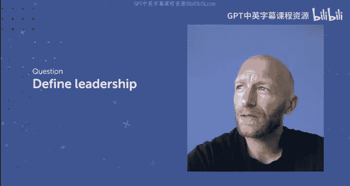

But it's also increasingly about responsibility。 So there's a lot of discussions about。

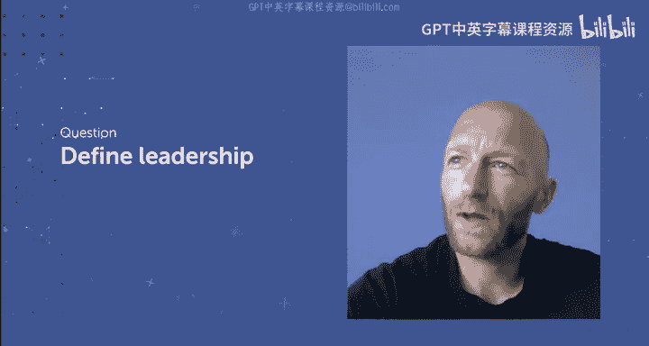

CEos and others in positions of power to do the right thing。

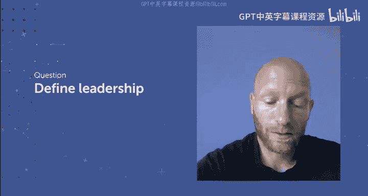

So you see that reflected in concepts like CEO activism or CEOs on behalf of the company taking a stance on particular issues。

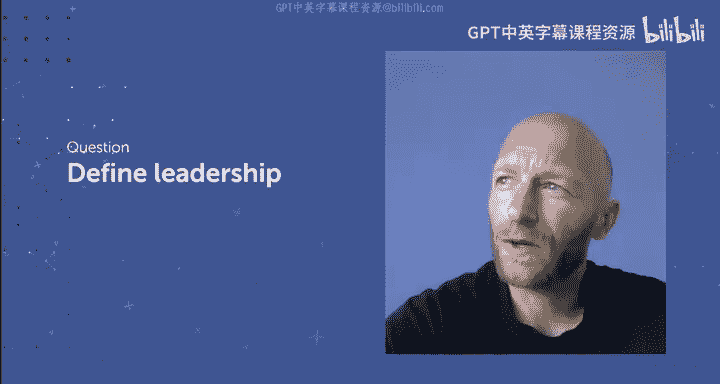

And trying to demonstrate the broader social responsibility of the firm。嗯。

But that also implies then that these individuals themselves also need to personally feel a sense of responsibility for some of the issues that they're working on or campaigning on。

 I think leaders leaders inspire， they set the tone， create also a safe space， if they do it well。

 they create a safe space in terms of the culture where people can speak up and can。

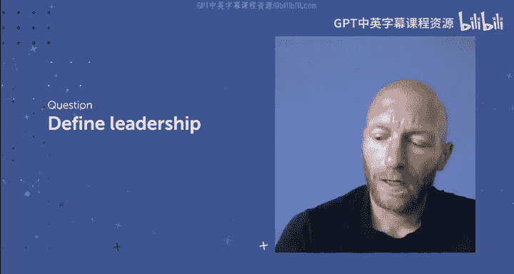

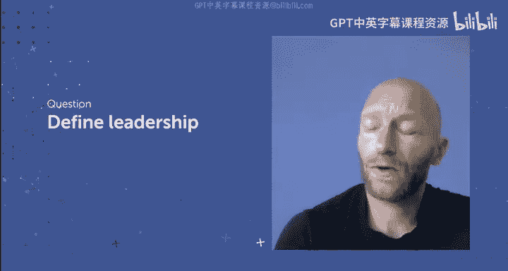

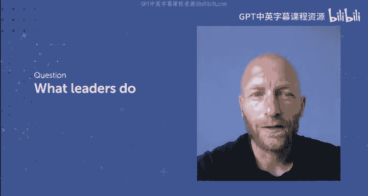

Openly voice issues and they foster their work by doing that a culture where people discuss issues。

 deliberate。as opposed to issues being pushed away or issues being only defined in ways that the top of the organization is how they see it。

 if we really think about these leaders at the top of the organization in these formal positions of power like a CEO or top management team。

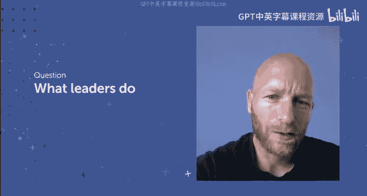

It's giving that direction， but then also inspiring and creating the right ethos and culture within your organization。

Then in terms of direction， that's。Where we also get to that question about responsibility。You know。

 what's the purpose that you see for the organization and that you therefore think also about the corporate social responsibility of the firm。

 so how far does our responsibility stretch？What issues do we take on， Which ones do we， do we not。

Or maybe even openly or actively externalized。And that's a hugely important role and that's one that is also very difficult。

For any human being to be in that position to really have a sense of how you can drive the business forward in ways where it becomes a bit more socially responsible。

and gets the good reputation that comes from that guess the legitimacy and support from its stakeholders。

 it's it's important to have a group of individuals there who have enough experience but also have enough diversity。

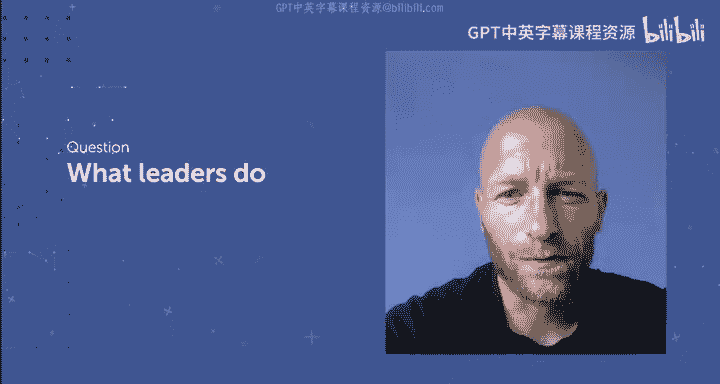

To challenge the diffus of the CEO and also collectively to make better decisions。

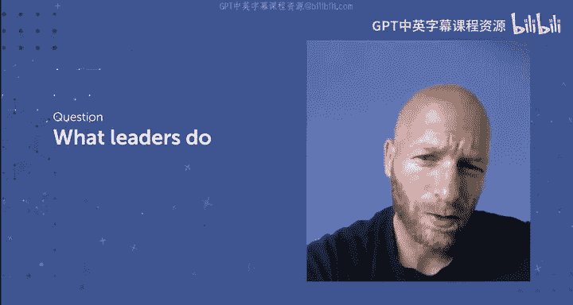

UAnd I think that's that's one if I tied back to Facebook also where I think， yeah。

 the top management team。Probably hasn't had the， the， the turnout over and the developments。

Nor therefore the diversity of views that you would like。

And obviously you can invent all sorts of external advisory board with the great and the good who are going to give you some input。

 but that's not going to change it it's a top management team that then needs to change now more than ever reputations of companies are at stake or there's more issues coming their way and there's more of a call for a greater responsibility on those issues so I think for a leader it's important to start thinking about that moral side of things your personal convictions to your beliefs。

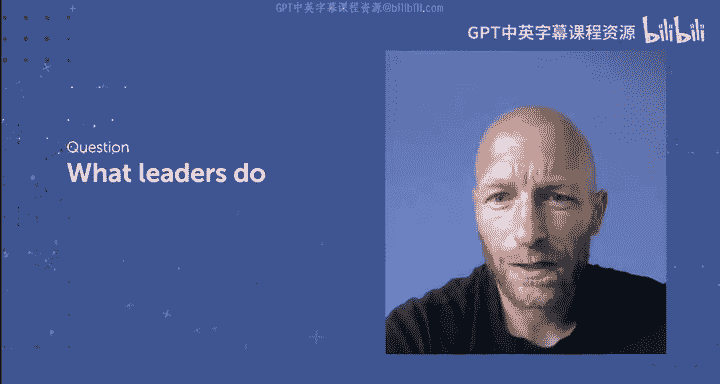

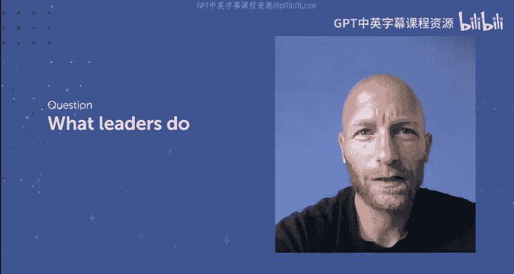

How those are tied into the oval set of beliefs of the organization and its purpose and its sense of responsibility and really start to think about that so we see that reflected in all of the concepts that are now fashionable like moral ethical leadership。

 CEO activism and actively work through those types of issues and particularly now that there's a sense of an enlarged responsibility being expected of a lot of these organizations on environmental and social issues you can you can't let that be。

 you need to have a take on it， you need to and that's taxing that's annoying that's frustrating sometimes that you have to think about these issues and work them through but that is expected and that's maybe the most difficult job that you need to think these things through that you need to have a story there that you need to have a sense。

Of how you are connected to those issues as a person。

 but also how as an organization you're going to tackle those issues and then you need to bring that into the organization and collectively work on it。

 the easy thing is it's easier to just as we talked about it， sit it out believe things will go away。

 run your business model as you always run it and then hope for the better。

That's probably in this day and age， not the most。Sensible thing to do。

 and that's what we see in a lot of these cases like Facebook。

You know now it was the Cambridges Analy scandal now it's the hate speech issue I can tell you next week is' the other thing I mean if they don't change the response their sense of responsibility。

 if the leadership doesn't change it's。It's， you know。

 society will break him sooner or later to absorb a reputation。

 I'm personally convinced of that and something else。Another type of company。

 another type of platform company interface company that does the same that they do will come in its place。

 but probably with a better moral conscience than they have I think what you often see with I think that can be generalized to Silicon Valley Company so there's a lot of leaders like Mark Zuckerberg who。

May have had skill sets at the beginning where they as an entrepreneur。

 were able to grow the business and develop it and obviously had a lot of。

Real influence and real input into the development of the case were really in the driving seat and had everything under control。

That's a different skill set and a different role compared to what you now need。

 which is is someone who。I would like to。Suggests it's much more of a statesman or stateswoman。

 someone who has that strong sense of the dilemmas that the company is running up against and that's really a set of dilemmas that are tied into their business model。

 so are we a media company that takes some responsibility for what we published or what is being published on our platform。

Or do we see ourselves as an intermediary， we just channel content and？Yeah， have some notion of。

 you know， letting that go unfettered and unmediated by us as some sense of。

Free expression that we're supporting through our platform so I think that's really the core question also for Facebook is you know and the regulation in the US is still on their side so they're not regulated as a media company。

 nonetheless society is asking them to take some ownership and responsibility。

For what happens in and through on and through their platform。

And that requires that you that as a leader， you。Are sensitive to some of these concerns that you weigh them up。

 that you engage in deliberation。With your stakeholders。

 with development parties that you think about how in a very progressive sense。

 ideally the company could change and could take on some of these issues。

I don't think he he is the person to at least not if we look at the last couple of crises that have emerged from Facebook。

 he's probably not the person to。Be leading that face in Facebook's existence。

 he still seems to be in the old mindset of controlling sitting things out。

And then hoping for it to go away， obviously what you would like here is that with some of the pressure that is now being put on the company。

For a leader to take not just notice of that， but actually to start to feel it so some perspective taking on his part。

 some realization that they can't go on how they have been going on and that they should take on an enlarged sense of responsibility I know he says these things。

But he says these things more when， you know， he's， he's。

I's is going to the European Commission or is he's testifying to。To MPs or to Congress。

 but ass more as a PR gimmick， it's not a deep sense。Of ownership on his part。

 Nor there a deep sense of ownership on the part of his company to change what their sense of responsibility is。

So I'm not hopeful， I think you really need you probably need new leadership。

 but then you get to the other issue that。Unless he's being pushed out。

 he's the majority shareholder is probably not going to go。

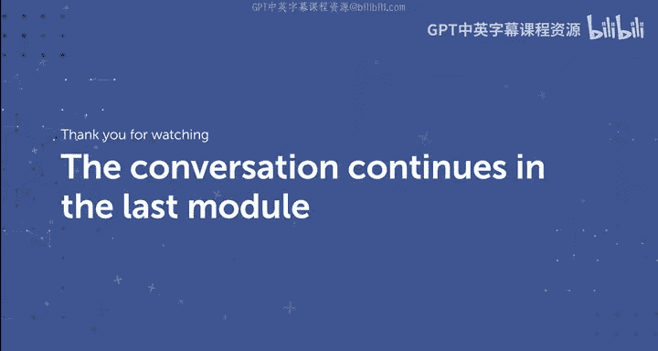

🎼。