# 声誉危机？Facebook 遇上剑桥分析公司｜Reputation Crisis？ Facebook meets Cambridge Analytica - P7：6_勇于发声：组织内部的不当行为揭露机制.zh_en - GPT中英字幕课程资源 - BV194eTz2E4K

🎼。

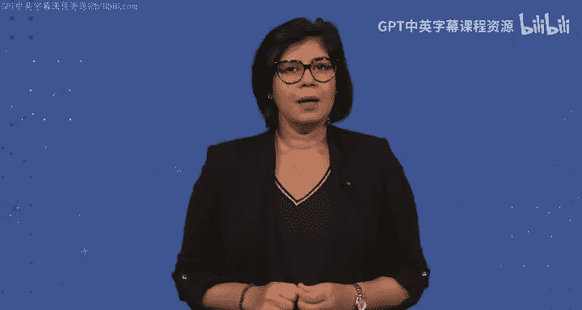

What happens when an employee discovers wrongdoing in his or her organization。

 what are the options available to them？

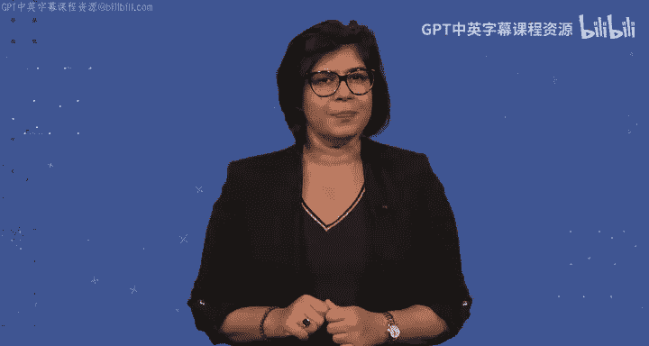

In this video， we will take a look at two well known examples of employees that blew the whistle on unethical business practice。

 and in doing so changed the course of corporate history。

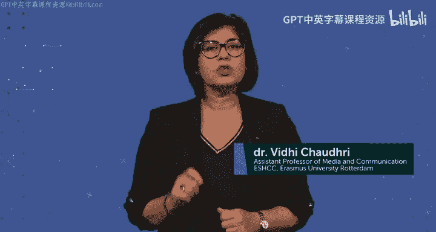

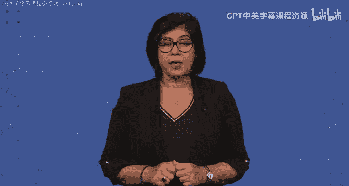

After this video， we invite you to watch the short animation that walks you through the fundamentals of whistleblowing。

 what it is， why it happens， and what are its benefits and risks。

 both for the individual whistleblower and the organization in question。

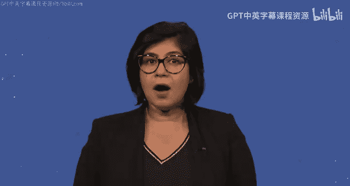

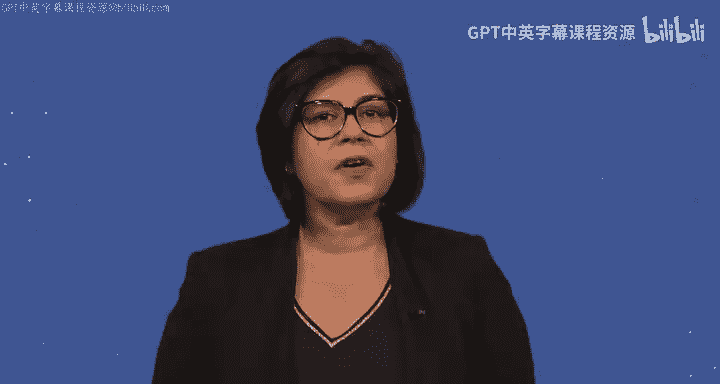

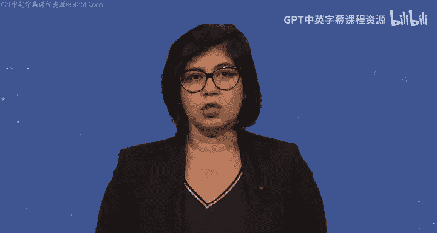

The two individuals you see on your screen will always be etched in business memory as the ones that exposed major fraud at their respective employers。

 Enron and Worldcom at the start of the 21st century。Enron， a U。

 energy trading and utilities company， was one of America's largest corporations and a darling of Wall Street at the height of its success。

In August 2001， Sharon Watkins， then a Vi president at Enron。

 approached the former CEO and current Chaman Kenneth Leigh to alert him of accounting improprieties in the form。

 implicating the CFO and shorttime CEO Jeffrey Skilling， along with other high ranking employees。

As the news spread， the Securities and Exchange Commission began inquiry。

 which later turned into a full criminal investigation into Enron and the partnerships。

Andron admitted that it had cooked the books and revised its financial statements for the previous five years。

 acknowledging that it had overstated its income when actually it had posted $618 million in losses。

On the 2nd of December， Enron filed for Chapter 11 bankruptcy protection。

When it was revealed that the firm was guilty of accounting fraud。

 Andron's stock price stumbled from 90。75 U per share in the mid 2000 to less than $1 per share by the end of November 2001。

At the time， Andron's meteoric fall marked the largest corporate bankruptcy in US。 history。

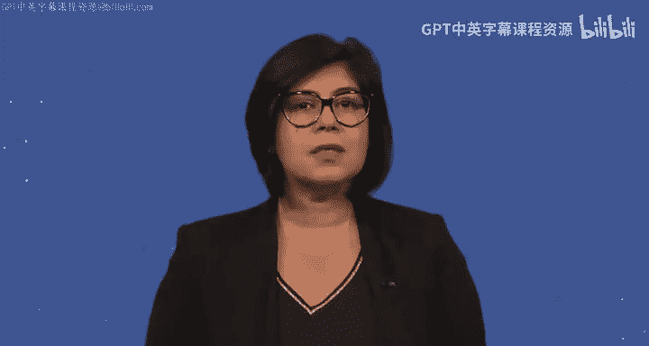

Many employees who had Enron stock worth hundreds of thousands of dollars。

 lost their entire savings as they were not allowed to sell their stock in the lead up to the crash。

The workers later filed a class action lawsuit and won an $85 million settlement。

Even before the dust had settled on， Enron came the fraud at telecommunications firm Worldcom。

The firm was found to have inflated assets by as much as $11 billion， leading to 30。

000 lost jobs and 180 billion in losses for investors。

The fraud was discovered by the internal audititing Department of Worldcom， headed by Cynthia Cooper。

These are just two cases where employees who suspected wrongdoing spoke up and voiced their concerns。

 a decision that is not without personal risk。They are known as whistleblowers。Going back to 1963。

 the first known definition of whistleblowers is someone who reveals something covert or who informs against another。

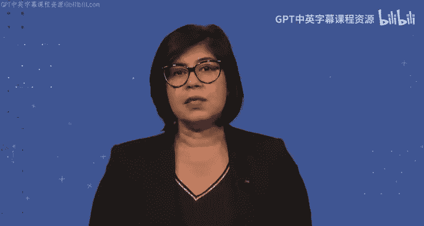

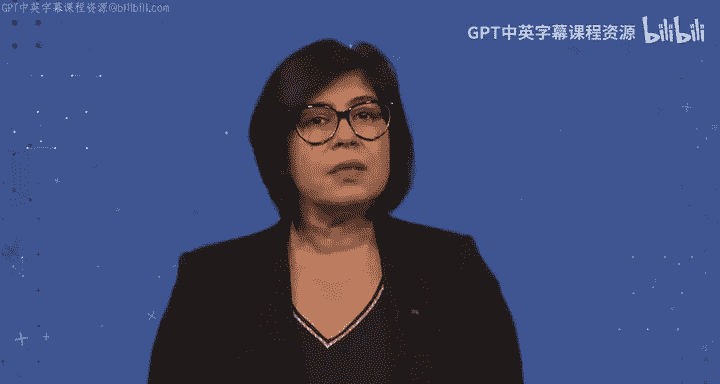

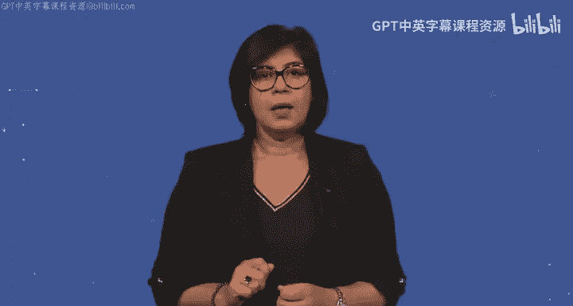

At the time of their revelations in 2001 and 2002 respectively。

 the United States had no legal protection for whistleblowers。

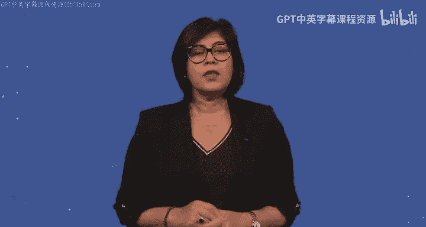

But spurred by the two major scandals， the US government rushed to sign the Sabes Oxley Act in 2002 to protect investors by making corporate disclosures more reliable and accurate。

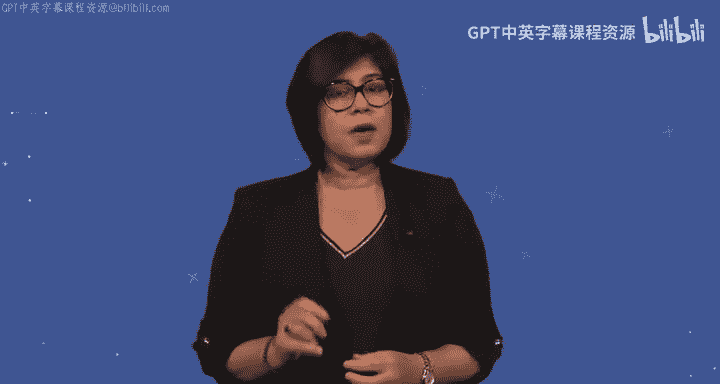

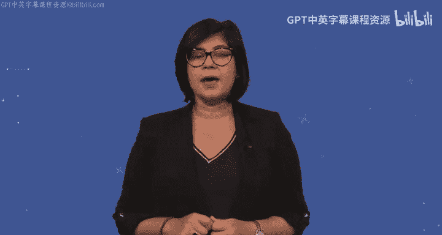

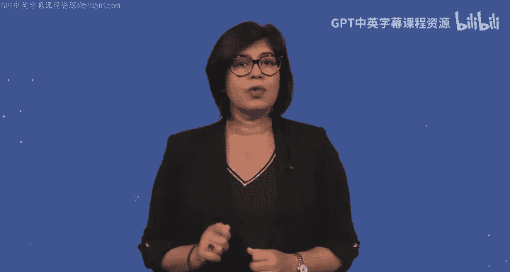

Sharon Watkins of Enron and Cynthia Cooper of Worldcom， along with Colleen Rowley of the FBI。

 were collectively named as Ste Magazine's Perons of the Year in 2002。

These cases suggest that calling out wrongdoing is the ethical and the right thing to do。In fact。

 many real life instances of whistleblowing have been the subject of successful movies， the insider。

 the informant， Aaron Brockovich， to name a few， so what is the problem？

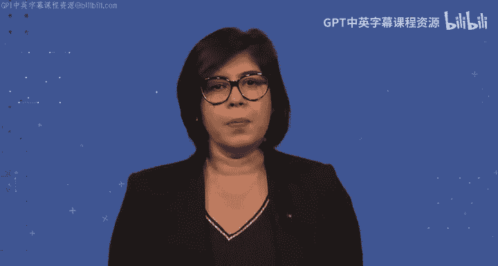

If you look at your screen， you see some synonyms for whistleblowers。

 also noted in the Miriam Webster Dictionary。It doesn't take long to realize that all of these terms are negative。

Equating whistleblowers to a snitch， telltale and betrayer effectively designates them as the villains。

As whistleblowing may imply going against formal power structures for this camp。

 such behavior may be regarded as deviant and aggressive。

Another school of thought sees whistleblowers as heroes。

Challenging entrenched power structures comes with high personal and professional risk。

 including subtle and overt forms of retaliation。Even if there are more laws to protect whistleblowers from such negative consequences。

 such as the whistleblower protection directive in the EU， they are subject to many stipulations。

 therefore protection might not be guaranteed depending on the country in which wrongdoing is reported the nature of the wrongdoing and other factors。

Our goal here is not to argue good or bad， but to illustrate the grey area in which this phenomenon plays out。

 Both Watkins and Cooper have spoken extensively about their experiences and documented their story in their respective books。

In interviews， Watkins has recounted the isolation， both overt and covert to which she was subjected。

Cooper too has reflected on the dilemmas that come with a decision to blow the whistle。

 even if it is the right thing to do。As you can appreciate from the short overview。

 calling out organizational wrongdoing and speaking truth to power evokes polarizing perceptions。

 because on the one hand it can be seen as disloyalty or avoiding taking constructive action。

 and on the other it can be seen as exposing evil and correcting a perverse system。

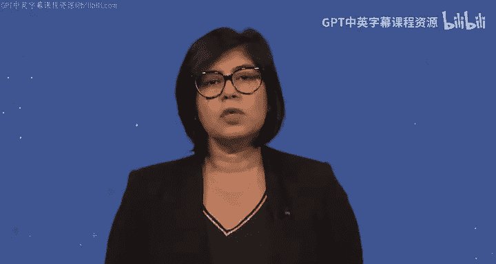

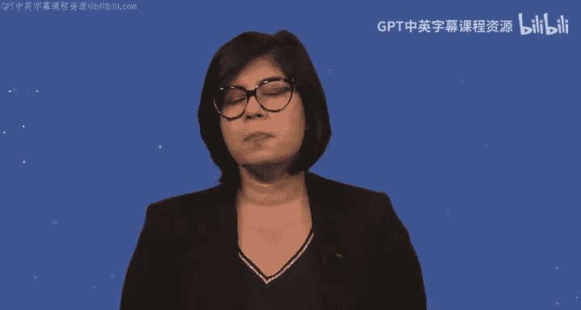

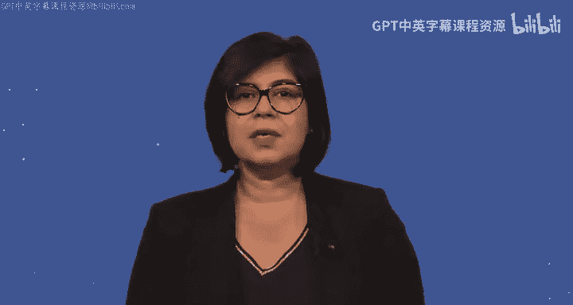

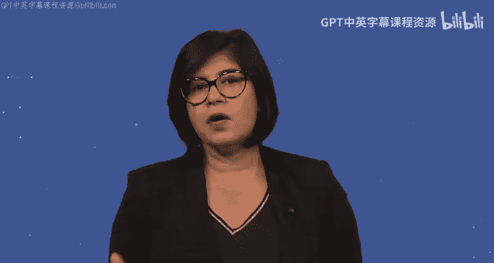

How you see it is dependent on the corporate culture。

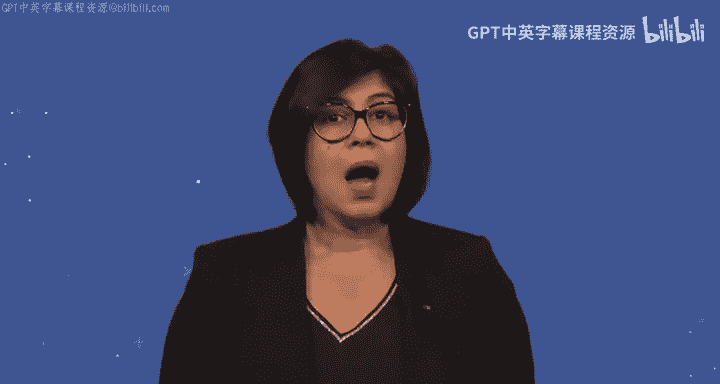

Now I invite you to view the short animation that explains the basics of whistleblowing and reflect on its significance and relevance for governance。

 leadership and reputation。

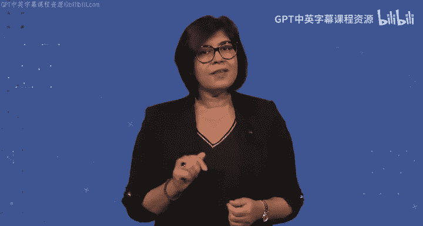

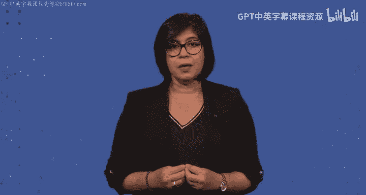

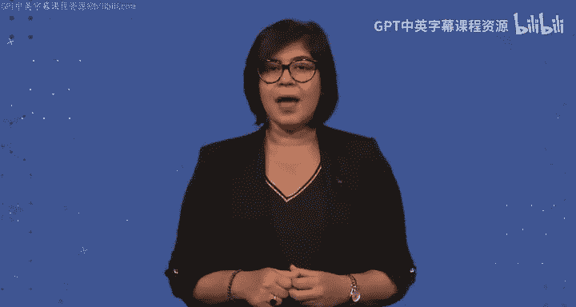

Thank you for watching。