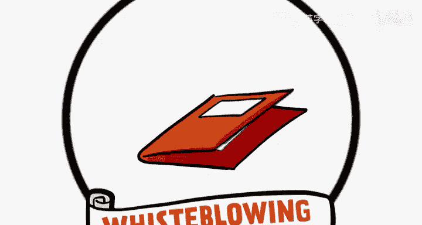
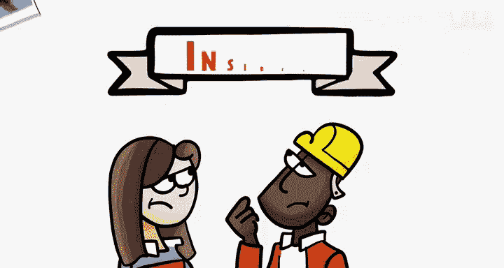
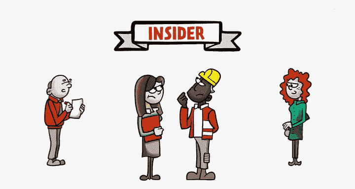
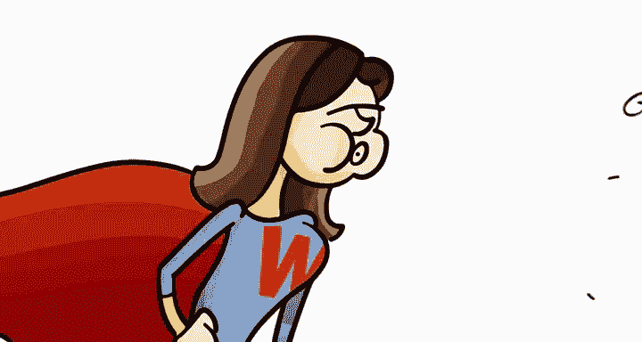
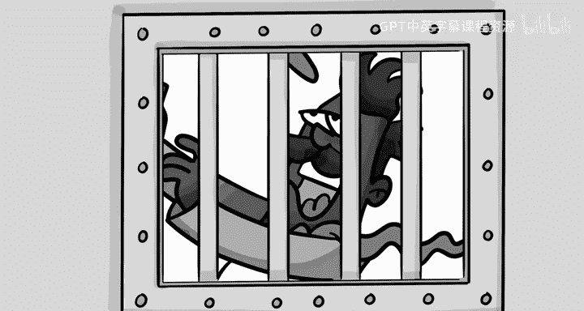
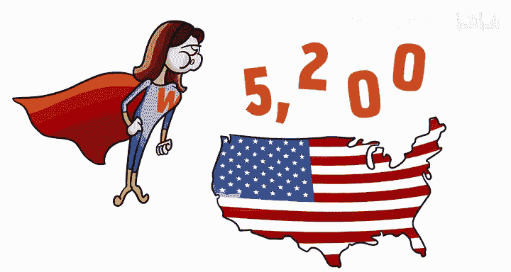
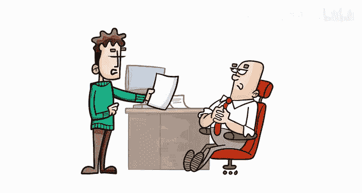
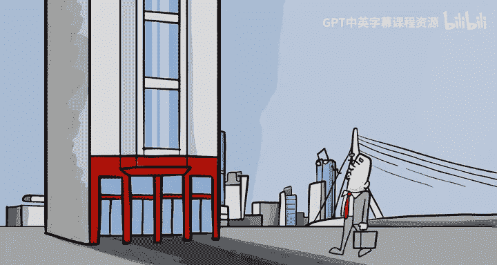
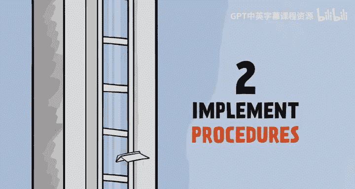
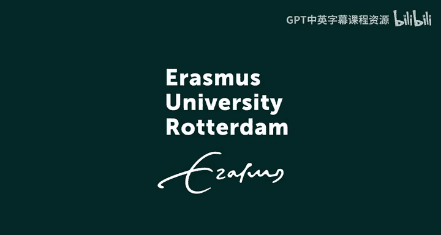

# 声誉危机？Facebook 遇上剑桥分析公司｜Reputation Crisis？ Facebook meets Cambridge Analytica - P8：7_情境动画：论举报行为的道德勇气.zh_en - GPT中英字幕课程资源 - BV194eTz2E4K

Yeah。🎼Dora was a former research director who built huge databases for the company。

 she noticed that the management was using the database to target people for political purposes with fearmongering and racist messages。

🎼She decided to leave the company and shared with the media everything she knew about the wrongdoing at her former employer。

🎼What Dora did is calledWblowing， reporting of organizational wrongdoing such as waste， fraud， abuse。

 corruption， or danger to public health and safety。

 brought to light by members close to the inner workings of the organization。

🎼A whistleblower is often someone who is an insider of the company。

 but it could be anyone who discloses information that would otherwise not be known。

🎼Whistleblowing can help stop or correct wrongdoing by a powerful person or organization when the wrongdoing is severe enough。

 whistleblowing might save an organization。

🎼In the US alone， there have been 5，200 whistleblowing reports submitted in 2019。

🎼Not everyone decides to publicly blow the whistle， many attempt to report wrongdoings internally。

 usually with their supervisor。

🎼However， such internal reports are often not properly looked into or even buried。

Plus， the whistleblower may find themselves in a precarious position。🎼Facing the risk of retaliation。

 threat of dismissal， humiliation or intimidation on top of these challenges is the absence of legislation to protect whistleblowers。

 Even when these exist， they may not be properly enforced。🎼In the EU。

 there was no regional whistleblower protection legislation until the whistleblower directive came into force in 2019。

🎼In the current climate that demands transparency and responsible governance。

 businesses can take leadership in instituting mechanisms for signaling organizational wrongdoing。

🎼What can organizations do？🎼One， establish an internal framework for whistleblower protection to ensure confidentiality and anonymity of the whistleblowers。

🎼Two， implement clear procedures including following up on the results and monitoring the process。

🎼Finally， ensure that these processes are embedded in the organization and have the commitment of top management。

🎼The situation Dora faced is not unheard of， but not everyone acts in the same way that she did。

🎼How would you weigh your decision whether or not to blow the whistle？

