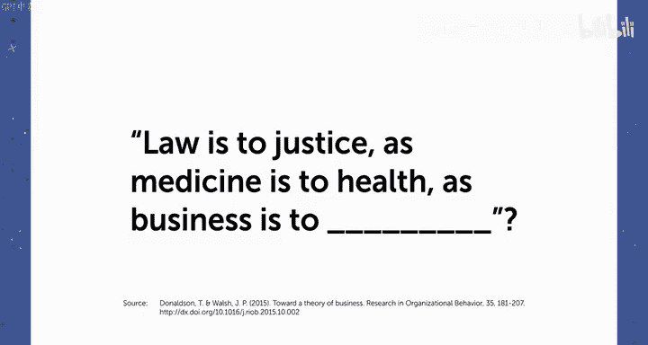
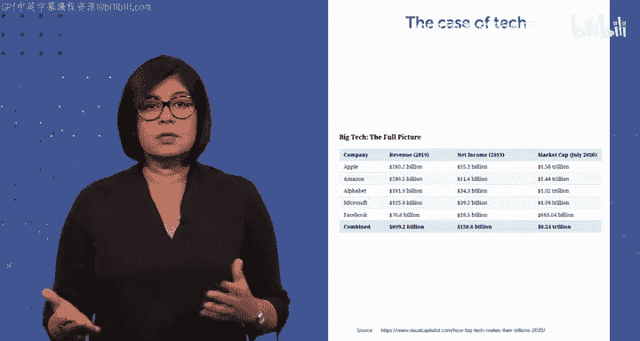
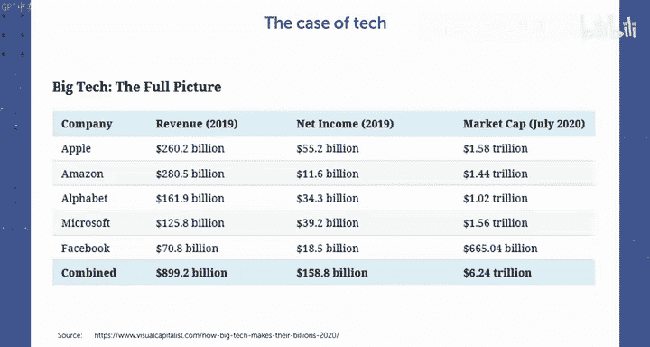
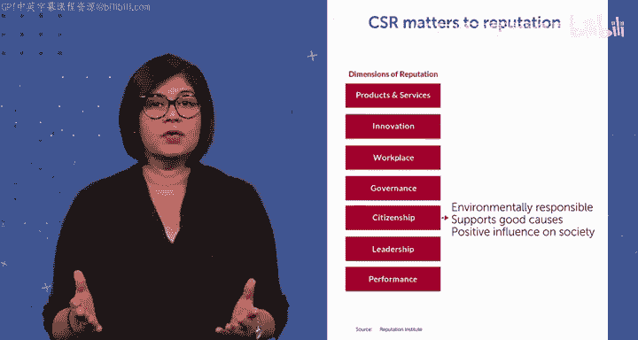

# 声誉危机？Facebook 遇上剑桥分析公司｜Reputation Crisis？ Facebook meets Cambridge Analytica - P9：8_企业社会责任与企业的社会使命.zh_en - GPT中英字幕课程资源 - BV194eTz2E4K

🎼，Welcome to week five this week we will tackle the concept of corporate social responsibility。

Before I say anything else， let's start with a puzzle。

On your screen you will soon see an incomplete statement which you need to complete when you read the statement。

 write the first response you think of and later you can share it in our discussion forum。

Law is to justice as medicine is to health， as business is to。

Perhaps for many of you， the first word was profit for other service or product or capitalism or community。

This exercise was less about a right or wrong answer； There is none。

It was to illustrate the question that is at the core of this week's topic。

 what is the purpose of business？If law strives to deliver justice and medicine health。

 then what is the purpose of business？Or as an article in the economist asked。

 what are companies for？The construct of corporate social responsibility or CSR for shot stems from this very question。

Does business exist or rather， can they exist simply to maximize shareholder value at the exclusion of all else。

 or is there more。Even though CSR has flourished as a field of research since the 1970s and as an area of practice in recent decades。

 there is no universal or unitary definition of CSR。

Here you can see two definitions a few decades apart。

You will see that both are broad conceptualizations that give businesses the room to define for themselves the scope of their responsibilities。

 including the form it takes and the activities that they deem socially responsible。

Some organizations might choose a focus area guided by their core competence or what they do best。

 for example， a business in the health sector may commit to community health programs and ensuring access to care。

 while others may adopt a model based on philanthropy。

 donating money and resources to causes they deem important。

 be it education or environmental preservation。In the past decades。

 we see a shift towards a more holistic approach as encapsulated in the triple bottom line or the triple peas。

 people， profit， planet， and really looking at the totality of impact that their operations have on society on the business itself and on the environment。

Transnational initiatives such as the UN Sustainable Development Goals。

 affirm the necessity of all actors to work together to solve societal grand challenges。

Even with this diversity in definitions， approaches and activities。

 there is agreement on some fundamental aspects。That CSR sees business and society as interwoven and interdependent。

That CSR extends business responsibility beyond its shareholders to a larger group of stakeholders。

And that CSR goes beyond legal compliance and legal obligations。

Some have even argued that CSR begins where the law ends。In principle。

 this all sounds good and noble。 Businesses are due gooders and strive to balance economic imperative and social concerns。

 In practice， the picture is somewhat mixed。 After all。

 the dominant paradigm and management has been to pursue profit at all costs。

 In the 1970s in an influential piece， economist Milton Friedman proclaimed that the social responsibility of business is to increase its profit。

From this dominant logic to an integrative approach of doing good while doing well。

 the shift has not been easy。 However， the excesses of globalization， recurring corporate scandals。

 rising income inequality， political volatility， social media have all challenged traditional notions of business as usual。

Let us look at an example。Some of you may be familiar with Volkswagen's emission scandal of 2015。

 whereby it was found that the automaker had installed defeat devices in some of its diesel cars in order to cheat on emissions tests。

An investigation by the United States Environmental Protection Agency found that these carss performed flawlessly in lab tests。

 but emitted almost 40 times more than the permissible levels of nitrogen oxide on the road。

Volkswagen admitted that defeat devices were installed in 11 million cars sold in the United States and Europe。

As a result， the firm suffered its worst ever annual loss of 1。58 billion euros in 2015。

Shares dropped by 19% on Monday following the revelation and the stock had lost 30% within four days。

The estimated cost of the scandal stands at 30 billion euros。

What is ironic is that before the scandal， Volkswagen ranked among the top 20 most reputed firms globally。

As you can see on the screen after the scandal， the firm even fell out of the top  hundred0 reputable firms ranked by the Reputation Institute。

This is not the only major global manifestation of irresponsible business practice with far reaching consequences for the firm and its stakeholders。

 and it certainly won't be the last。Of course， we cannot paint all organizations with the same brush。

 but in the contemporary business landscape， we see that recurring incidents of corporate crises and failures has fractured trust in business。

Businesses that were once considered icons of social responsibility were found to have engaged in deliberate。

 unethical and manipulative business practice。

On your screen， you can see some interesting data from the Edelman Trust Barometer。For 20 years。

 the barometer has tracked the state of trust in four institutions， business， NGOs。

 government and media。The 2020 barometer defines trust as a composite of two attributes。

 competence or delivering on promises and ethical behavior。

 doing the right thing in working to improve society。If you look carefully at the image。

 you can see that none of the four institutions are seen as both trustworthy and competent。

But perhaps even more critical is their finding that ethical drivers， such as integrity。

 dependability and purpose， drive close to 76% cent of the trust capital of business。

 While competence accounts only for 24 per cent。😊，This is food for thought for all businesses。

Tech companies in particular， face a higher crisis of trust today。

Their influence stems not only from their monetary power。

 but also the quality and quantity of personal information they're able to access。

Our dependence on the big technology companies， Google， Amazon， Facebook， Apple， or GA for short。

 affords them unparalleled market share。

If you look at the chart on your screen， you see that in 2019 tech giantants had combined revenues of nearly $900 billion。

This is greater than the GDP of four of the G20 nations。Effectively。

 this means that Big tech is the 18th largest country by GDP。

 ahead of Saudi Arabia and just behind the Netherlands。

But how and to what end the tech giants use their power and influence is still an unfolding story。

If you are still asking yourself， but why， why should tech companies or any other business for that matter care about social responsibility。

 then a few last words to consider。

CSR matters to trust and reputation。If you recall the discussion of reputation from an earlier week。

 you will see that CSR or citizenship is one of the drivers of reputation。

Firms with a good reputation inspire stakeholder trust， admiration。

 and pride in their affiliation with the organization。Taking a long term view。

 business needs to be mindful that the winds of change are in motion and flowing from different directions。

Increasingly， surveys attest to the fact that consumers and employees expect and demand that companies incorporate social concerns into business conduct。

Millennials in particular are seen as a driving force for change。Tch savvy and digitally connected。

 millennials are willing to punish organizations that are irresponsible and reward those that are responsible and ethical。

Social media have also made it possible for different stakeholder groups to speak up and express dissent。

 especially NGOs and advocacy groups are actively leveraging social media to challenge corporate hypoccrarisies。

Transnational initiatives， such as the UN Sustainable Development Goals and calls from several prominent business leaders collectively reinforce the necessity of business to have a social purpose。

Together， these ongoing developments shine the spotlight on the role of business in society。

Thank you for watching。

🎼。