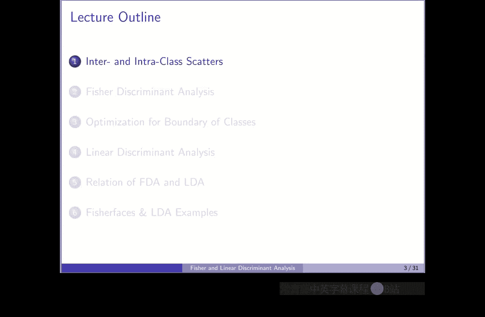
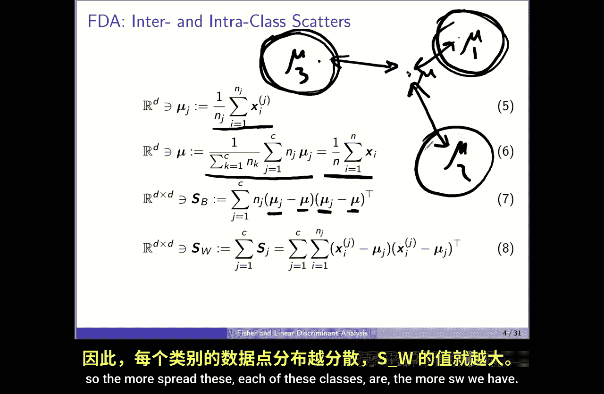
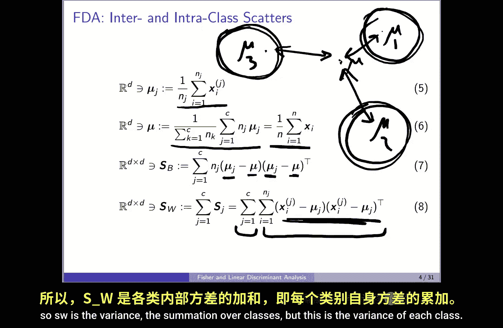
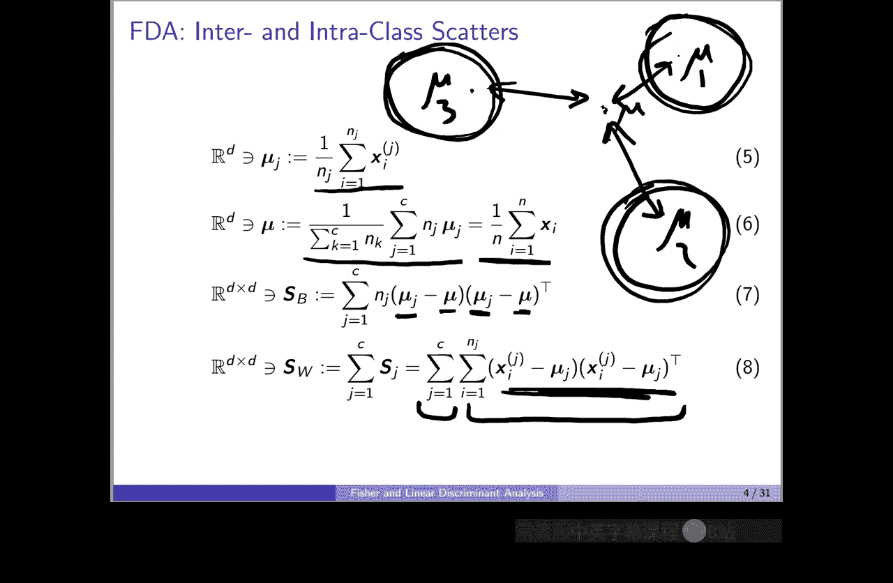
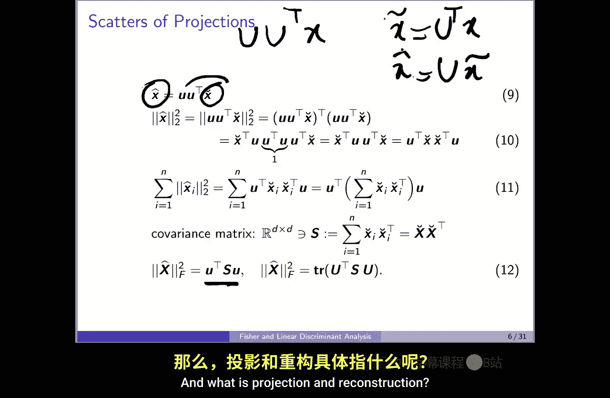
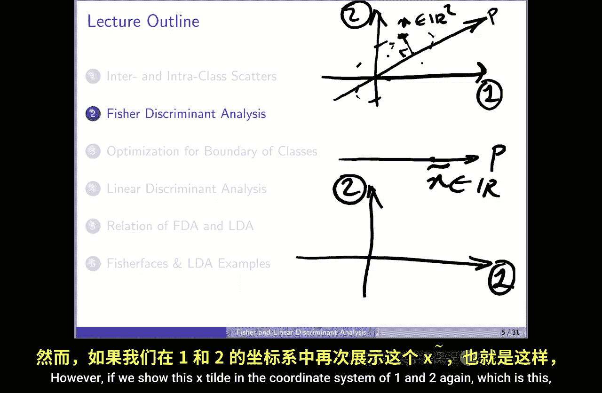
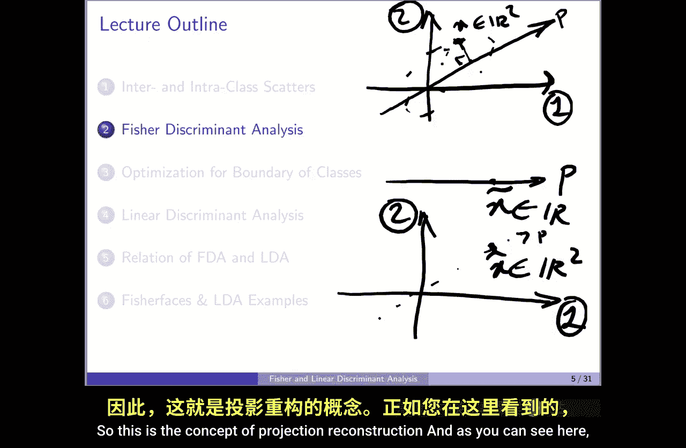
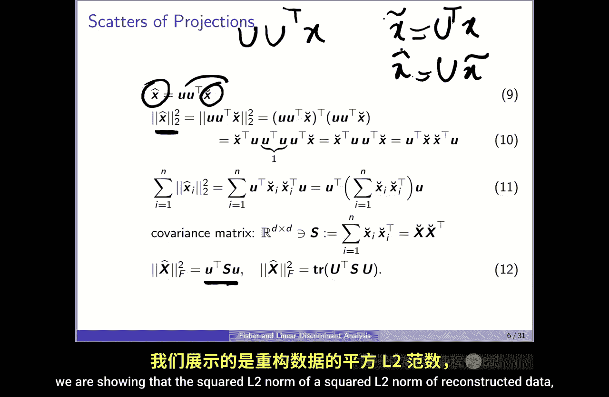
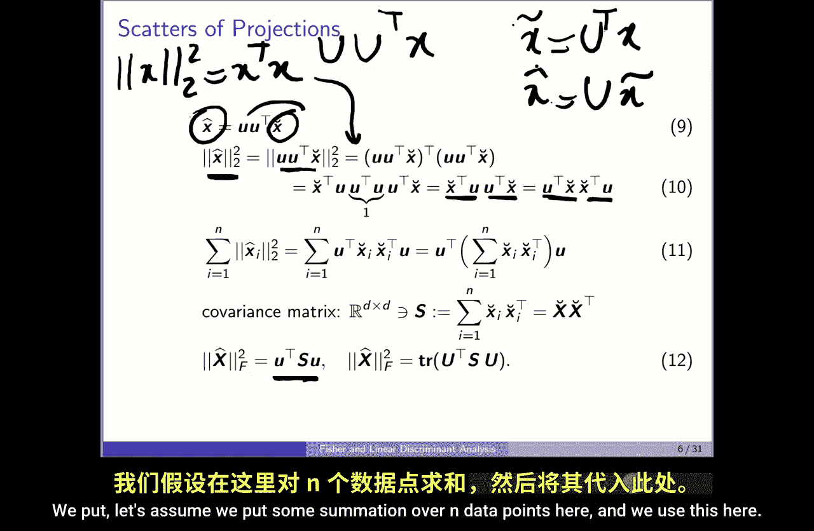

# 多伦多大学【中英⚡降维与流形学习｜2023,Dimensionality Reduction and Manifold Learning】 p03 P3 Fisher Discriminant Analysis (FDA) and Linear Discriminant Analysis (LDA) -BV1aeidBPEiQ_p3-

Hi， everyone。This is the course is 3657A， the course instructor is Professor Mark Cowley。

 I am Benjaminmin Roll， the TAM presenter of the slides。

 and this is the lecture on F discriminants analysis and linear discriminant analysis in this lecture we are explaining both feature discmin analysis and linear discriminant analysis and we say how they are related。

Okay， here we show the with。The notations of data set As assume we have some training data said some training data points each data point training data which is denoted by X I which is d dimensional D is a dimensionality of data and assume we have n data points so we have i from1 to n and we columns the vectors are column vectors and we put the vector if they put if we put the column vectors column y in a matrix will have x as a matrix of data set which is D by n。

Here we have we are supervised， so we have labels of classes， therefore as soon we have C classes。

 J goes from1 to C J is the index of class and we show the I sample of Js class by X I superscript J。

 which is also D dimensional and NJ。And J is this the number of points in the Js class。

The mean of training data。We show it by millix or mi， which is the average of data points and the。

Test dataset set。 We have also test or auto of sample dataset。

 which is not used for finding or train training the projection matrix in Fer discri analysis。

 and we call it X TI， which is the I test point in the test data set assume we have anti test data points and we put them column wise and we call them X T capital T。

It x capital T and which is D by N T matrix。

え？In fier discri analysis， we have interclass scatters and interclass scatters。

 The scatter is kind of another name for variances。 So we have variances and。

Let me tell you why who was Fisher。 Fishcher was the one who proposed Fisher disc analysis。

 Ronald A Fishcher and。He proposed a lot of things in statistics and machine learning。

 And that's why Sta the whole modern statistics owes him。 He proposed variance。

 Can you imagine statistics without variance， And it's， there's no wonder why。

We see that future disc analysis is all about variances。 He also proposed several other things。

 like annova。The famous IrishIS flower dataset set is proposed by Fscher in the same paper which proposed Fssure discriminant analysis。

 and he was a scientist in genetics and these things like fissure discriminant analysis and these things were first used in genetics。

So， here。And question5 is the min Je the Js class。So which just we take the average of which the data points into Js class。

 meal is the total mean， which is the total mean， or it。

 which is equivalent to the weighted average of the。Means of classes。

SB is the between a scatter and SW is the within a scatter between a scatter or also called inter class scatter is the scatter of variance between classes。

SW is the within scatter， which is the schedule variance within classes。

If so S B is the variance between classes， what does it mean。Asume that here is the total mean。Here。

 we have new one。Me to。Mu 3。 And this is this the cloud of points of third class。

 the cloud of puzzle the first class， the cloud of point of the second class assume。

And this is the total me。So， S B calculates this。Howo。If far the classes of。

The means of classes are from the total mean。Or in other words。

 how farther the classes are from each other。 So the farther the classes are from each other。

 the more recipe we have。 S W is the scatter of variance within classes， so。The more spread。These。

Each of these classes are the more established we have。 So establish the variance。

 the summ over classes， but this is the variance of each class。 How spread the cloud of each classes。

And it。We are going to use this before that， I'm going to tell you what projection is。

 because F discants， and obviously uses projection。

The reason is that that's why it's a linear method because it， it uses a linear projection。so。Soon。

 we have。X and express Bva here， express here is a center data。

 although we don't need center data we don't need to center data in future discreteri analysis。

 but for some reason for explaining why it is for explaining what this means you trans S。

 I'm using expressva here。 and then Ive told you that there is no need to center data。

U transport X is the projection of data。And if we have a projection matrix U transpose x is the projection of x onto the column space of U。

 And what is the column space of U is it is the space spanned by the columns of U or the space whose basis vectors are the columns of matrix U。

And what is you you transpose， it's just reconstruction of data。

 and we show reconstruction of data by X hat and。Before that， I we denote。

A projection of data by x tilde， so u transpose x。Is still then ex hat。

Is you your transport ex or you extilda。And what is a projection。And reconstruction。

 let me show you some figure assume that。

I have a two dimensional。对的。And assume soon this is a s。 This is。A projection direction。

 one dimensional。Ifai。Project this data point X unto this projection direction。It is this。

 So if it is P。If it is assumed this is one circle， two circle。

 So this is the coordinate to one circle， two circle。 and this is the projection direction P。

In one dimensional projection direction， this is Itilda， which is one dimensional。

The each itself is two dimensional。In the coordinator one circle2 circle。

 But xtil there is one dimensional in the projection in in the sub space of P。However。

 if we show this extilde in the。Coordinate system of1，1 and2 again， which is this。

Here， we had P。Which is this， this is called X hat， which is two dimension。

So we will have some reconstruction error。So this is the concept of projection reconstruction。

And as you can see here， we are showing that the squared L2 norm。

Of a squared altonum of reconstructed data， What is it If I replace you you transpose express here and here we are using a formula。

 We can have this。

From me。Thanks。Transpotic。If X is。Vor， we are using this here。

 So then you can see that we apply this transpose onto these parentheses。 However。

 when we apply the transpose， the， the order is reversed。 So it's it's transpose U。

 you transpose you。U transse expresser。 And as the projection， we assume that projection。

Mattrix is or is an orthogonal matrix， or in other words。

 the projection directions are ortho normalmal。 Therefore， u transse U is one。

So we will have these two。 And as these two are scalers， we can in multiplication of scalers。

 we can change the order。We change the order and we have this。 And what is this we。

