# 多伦多大学【中英⚡降维与流形学习｜2023,Dimensionality Reduction and Manifold Learning】 p04 P4 Multidimensional Scaling (MDS) and Isomap (optional) -BV1aeidBPEiQ_p4-

Hi， everyone。This is the course is C6，5，7 A。 The course instructor is Professor Mark Crowley。

 I am Ben Mingujo the T A N presenter of the slides。 This is a lecture on。

Multtidimensional scaling and is map。First， I tell you some notations on the dataset set。

 As that we have a training dataset set。Where we have n data points。

Each of which is D dimensionional。And we denote every data point by S I。

we assume that the vectors are column vectors and we put the vectors。Column wise in the matrix。

 to put it。In the matrix capital x， which is D by n。 So in here we put the。

 the matrices are column wise。And soon we want to find some embeddings of these training points。

 low dimensional embiddingnot by Yi， which are p dimensional。And still we have endpoints。

And we put them column Y in order to have a matrix P by n， capital y。

 usually P P is less than or equal to D， and you usually have P much less than d because we want to find a service space。

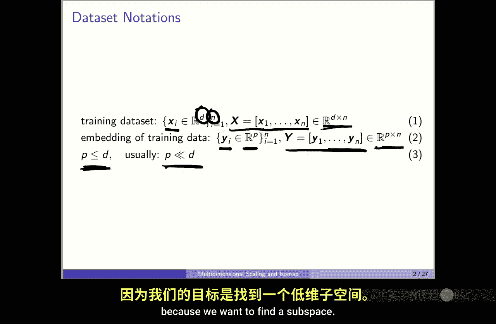

Okay， M D S。We have at least three different types of MDS， multidimensional scaling or MDS。

 one of them is classical MS have which can be classical MS or generalized classical MDS。

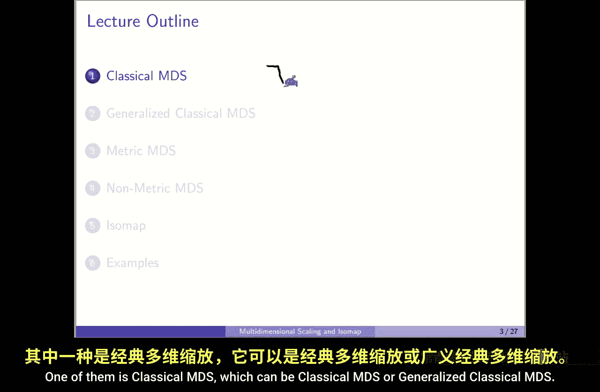

Another one is class metric MS， and the other one is non metric MS。 So we have three type。

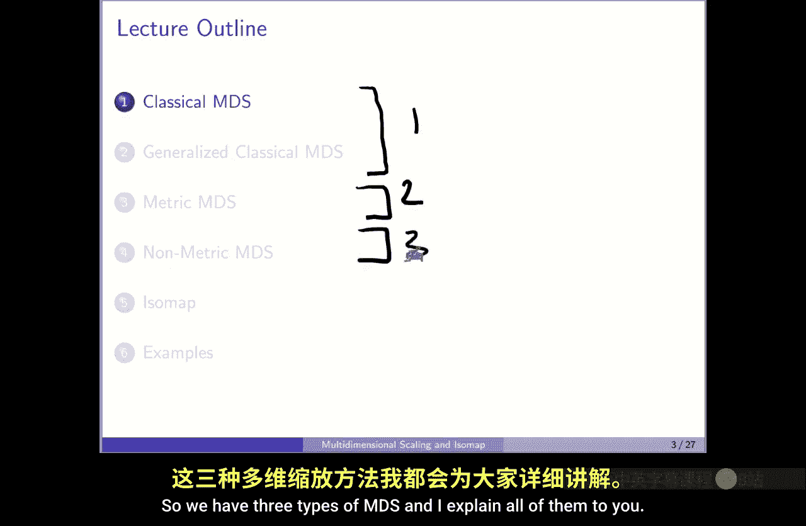

It's called Md S。 and I explained all of them， too。We start from classical ideass。

Mdimensional scaling。The idea is that。I want， so。There are two types of embiddings。 First all。

 I should tell you that this is unsupervised。 So in unsupervised embidding of data points or in unsupervised dimensional reduction。

 usually the idea is this。 most of the dimensional reduction methods which are unsupervised have this goal。

 they want to the similar data points。To be em close to each other， to be too far。

 close to each other in the subspace and at thissimilar data points too far。Far away from each other。

 And what what do I mean by similar dissimilar， because here we don't have labels。

 but we can compare the data points。 We can see the patterns of them。

 whether they are close to each other。 for example。

 using Euclidean distance or something like that in metric distance within any metric distance。

 we can see whether these two data points are close to each other or far away from each other in the input space。

 in the data space。If。So some methods， some unsupervised methods say that I want the similar data points to far close each other。

 and I don't care about dissimilar points or far away data points for。When I fit locally。

 when I say that the similar data points fall close to each other。Hopefully。

 the dissimilar points will far far away from each other。This is fitting locally fitting。

 local fitting。Some methods say I care about dissimilar points。

 I say I say that the dissimilar points， I want them to be。Far away from each other。

 And I don't care about similar points。 Hopefully the similar points fall from close to each other。

And some of them take care about both。 They say that I want close each other clothes points be to close to each other and far points to fall far away from each other。

え。M T S wants to do somehow both。 it says that。で。Although it， it has some local fitting in its idea。

 too， it says that I want the data points which are close to each other to fall close to each other in the emdding space。

 However， far dissimilar points to fall far away from each other， it says that。Rather than。

I want the differences or distances of data。In the input space to be similar to the distances of data in the em space。

 So the difference of distances should be minimized。 And this is Frrobinian storm。

 which is similar to。Al to norm， but for matrices， it's the summation of。

A securitycur summ of a squared elements of matrix。

 and it is this is a squared because we want to make it convets。 We minimize it。

 we find why in the sense that the distant， the difference between distances。Should。

 should be minimized。And then。these， we can look at this in another way。

 rather than saying that I want the differences of distances to be minimized。 Let's say I want the。

 the differences of similarities to be minimized。 So this is similarity in a product。

I want the similarities to be like each other rather than distances。

 And find why in the sense that the Forbius escort forbidion storm of inner products to be similar。

 we are showing this in this figure。 You can see that here we have。

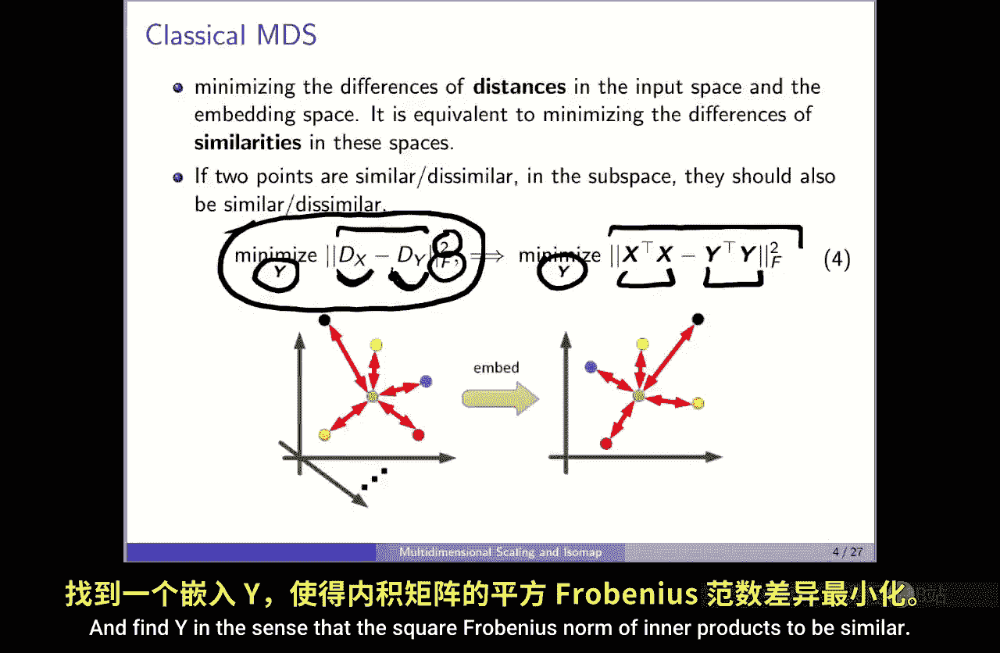

A high dimensional data。And I want these distances or these similarities to be preserved in the eminess space。

 although this eminess space is low dimensional。

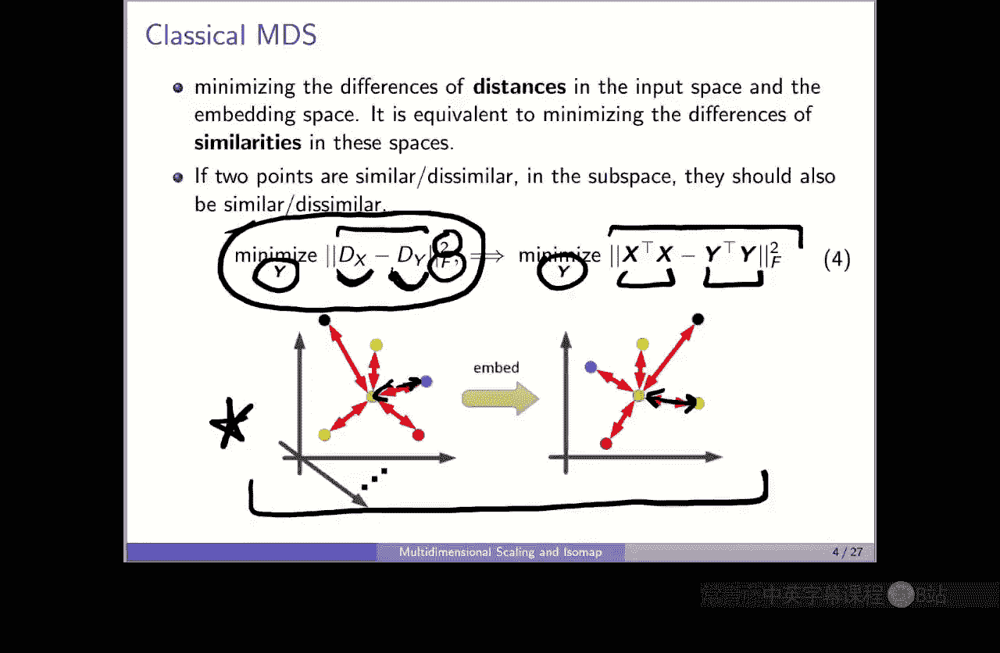

So let's simplify the objective function， which was a squared frobinous normal of inner products。

Here， this is a formula。 Habit from me。If it is the matrix， the squared。Frobinusna is the trace of。

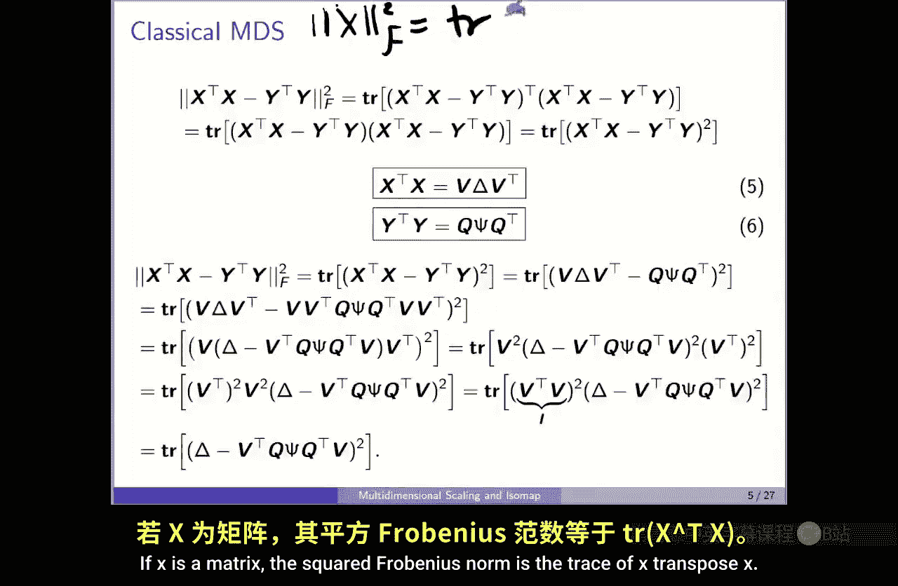

X transpose x。Trace of X transpos is like inner product for matrices。So， using this formula here。

We have this， and then we apply this。Transpose。In these parentheses。え。And you， you can see that。

X transpose again， becomes x transpose X Y transs y because y becomes y transpose y when you apply transse。

And then this is exactly this。 so it is trace of this squared。And then。Keep it here。

 Let's now apply eigenvalue decomposition on x transpose x and also on y transpose y， where V。

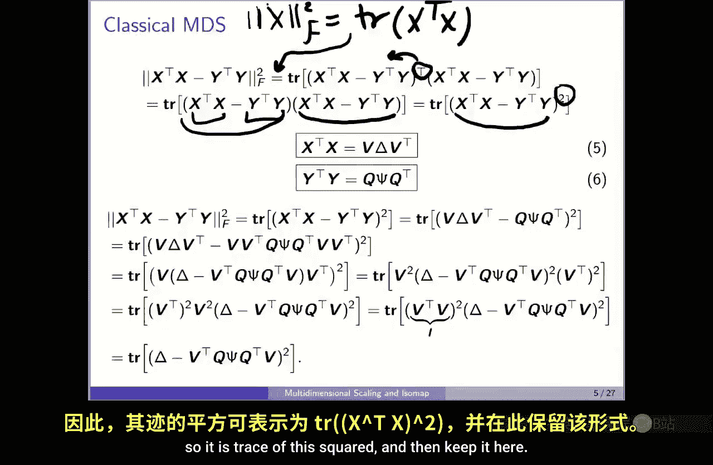

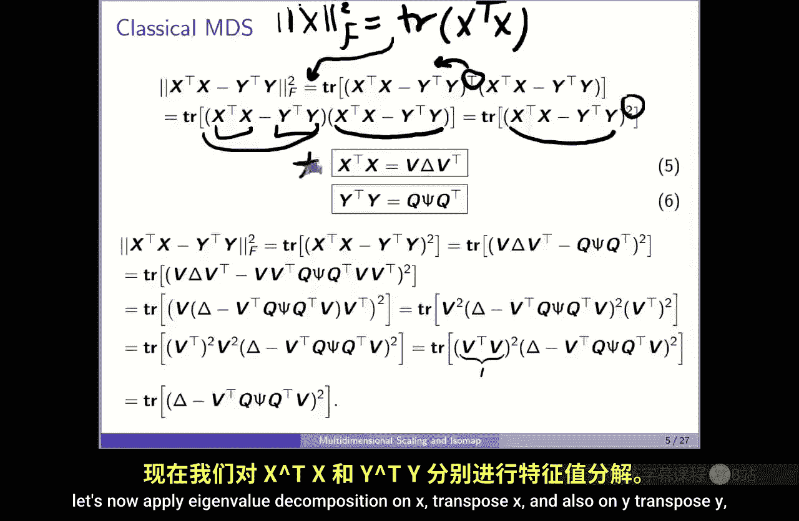

Is the eigen vectorctors of x transpose x lambda lambda or here， sorry。

 Delta is the eigenvalues of x transpose x Here。 Q is the eigenvectors of。

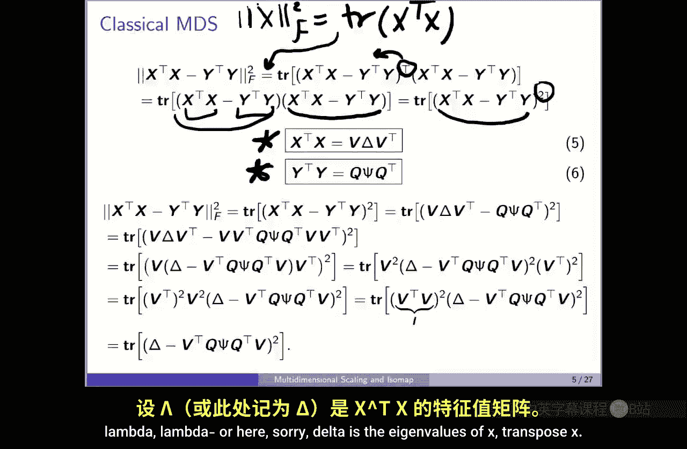

And y transpose y and psi is the eigenvalues of y transpose y。

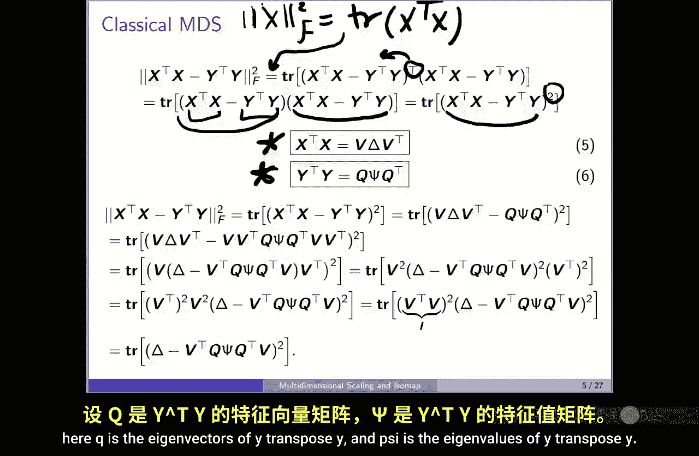

So this is an eigenvalue decomposition now。Let's say that。诶。

Let's continue the simplification of objective function。Here we had this。 We found this above。

Then we replace this eigenvalue decompositions here。We will have this。

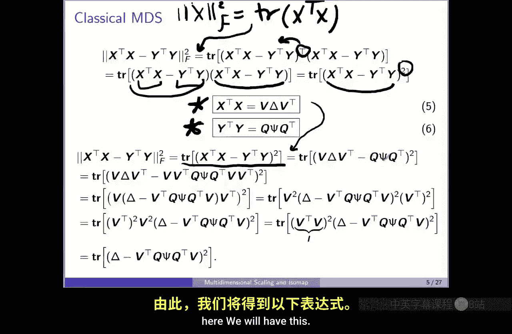

Now。Here I I put this term here and put this term here。

 they are why this is equal to this because V is the eigenvector matrix and the eigenvector matrix if it is not truncated eigenvector matrix is an orthogonal matrix and if it is not truncated Vv transposees identity matrix Also V transpose v's identity matrix。

 so I can put identity matrixrices here。Doesn't matter。

 Then let's factor out left factor V and right factor V transpose from these two。

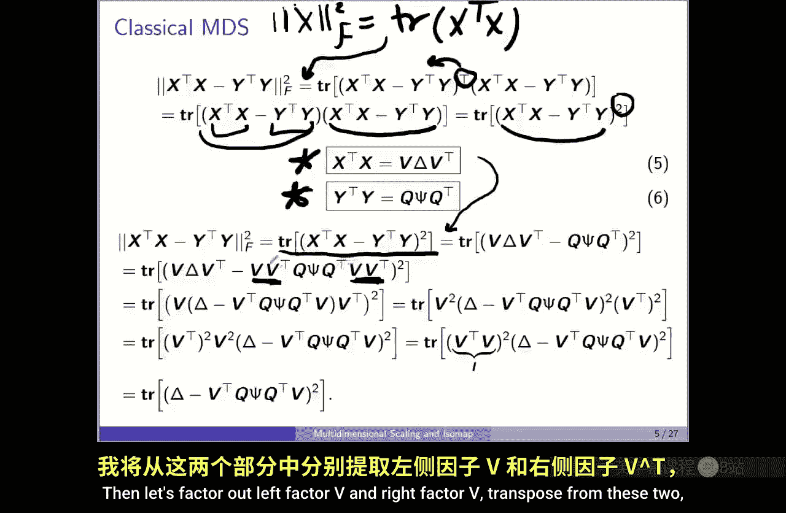

From these two。s parts， terms。 And then。I factor out this。 still， I have this squared here。

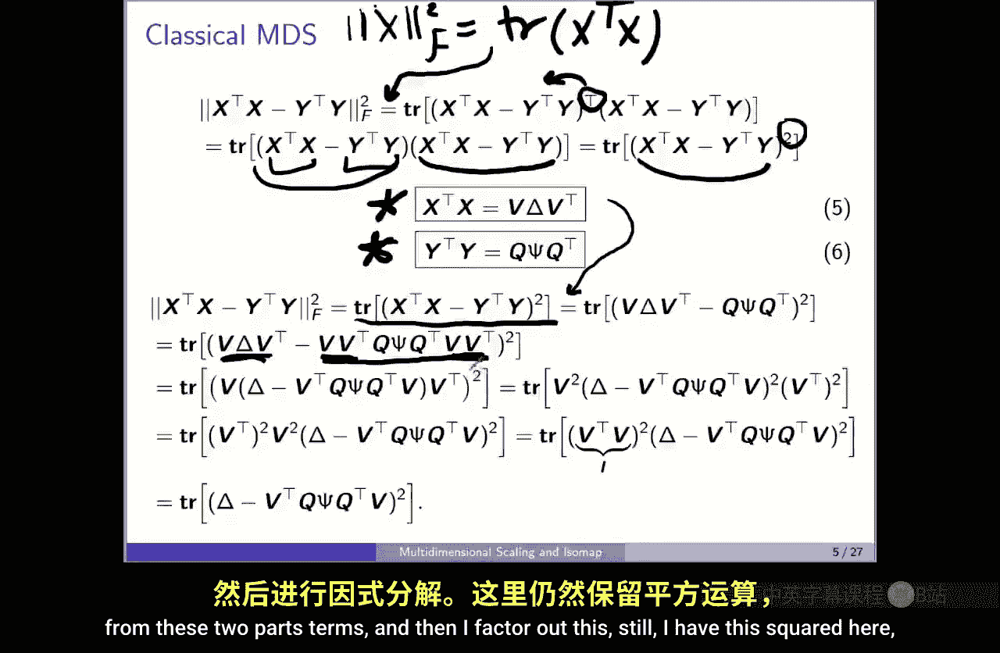

And then。I say， okay， this is I apply this squared to each of these terms of multiplication。

 So I have this。

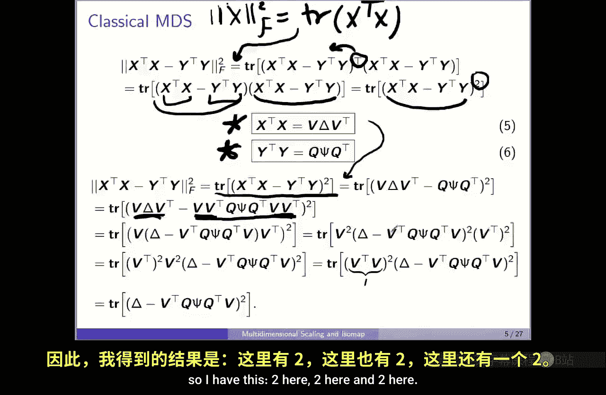

2 here，2 here。 and two here。Then。Here。This term， according to the cyclic property of trace。

 I can put this term。Before this， this is the cyclic property of trace。 So now we have here。

We can say that v transpose squared v squared is v transpose v squared。

 and v as v is the matrix of eigenvectors。It is an orthogonal matrix。

 So V trans V is identity matrix。 So its， it can be gone。

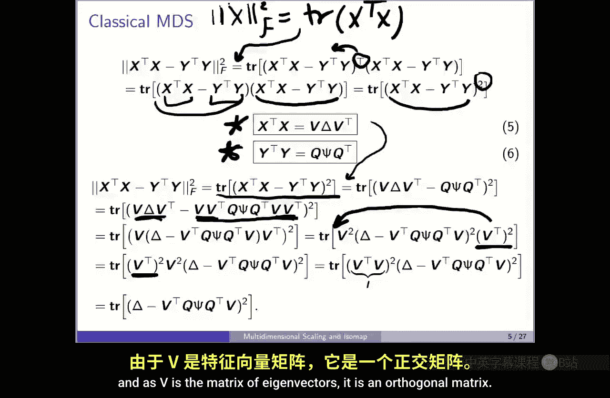

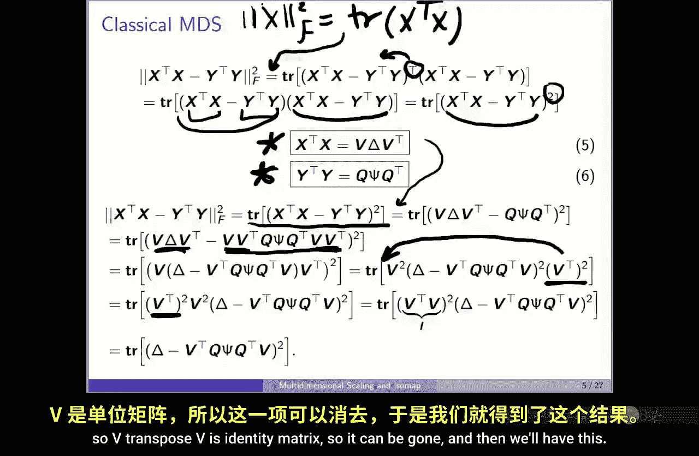

And then we'll have this。 It is simplified to this。AndNow。Here。Let's。He find in this。In this term。

 let's define V transpose Q as M。

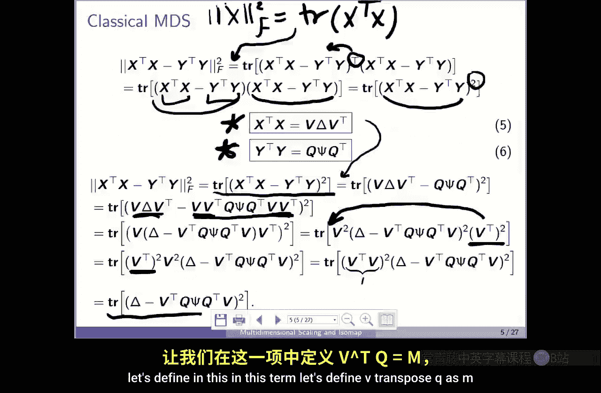

我。

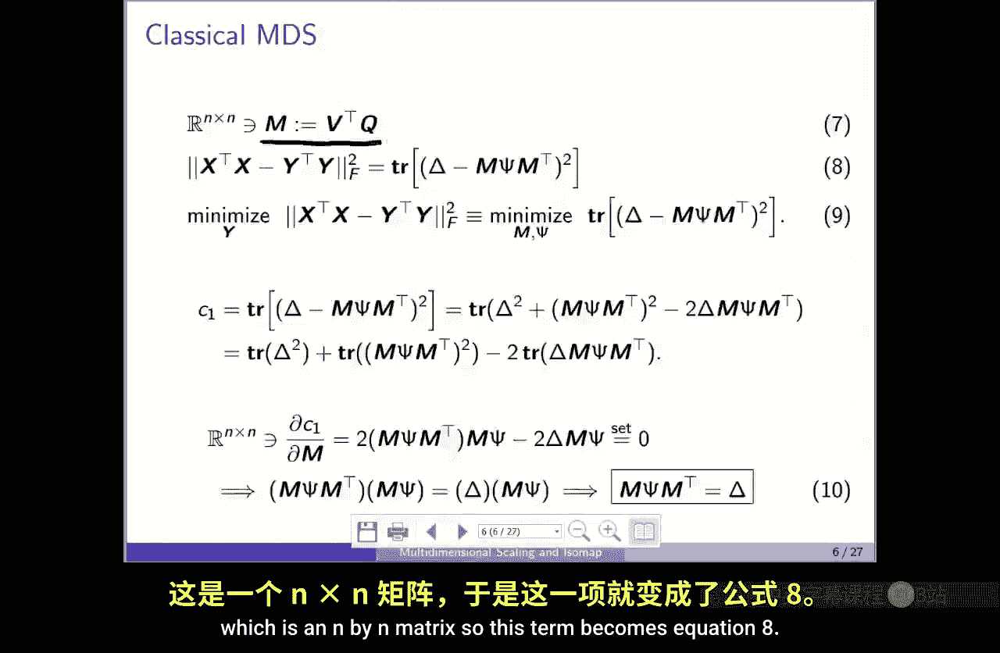