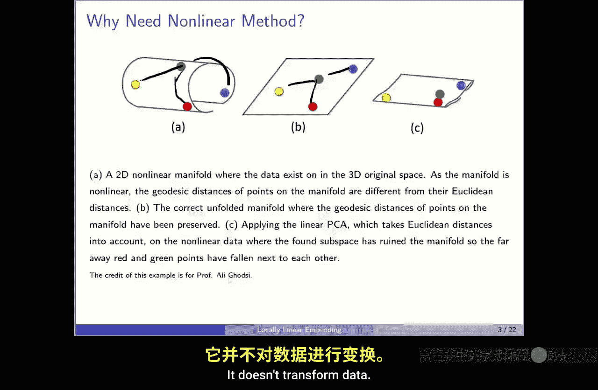
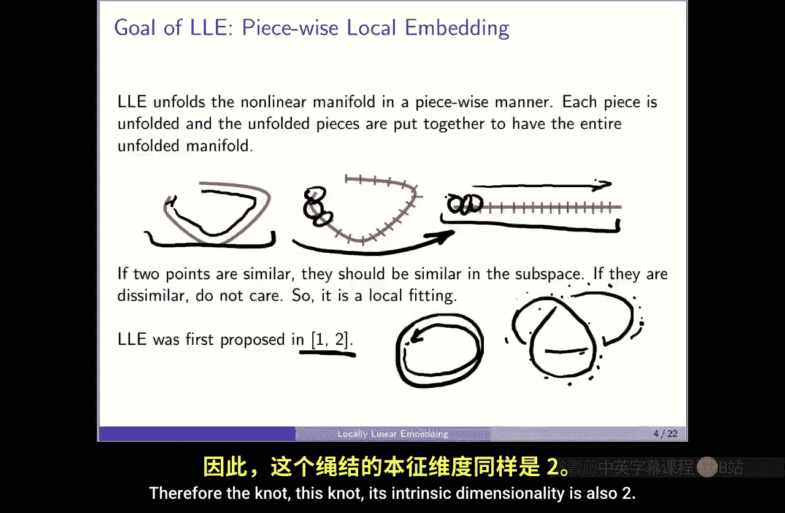
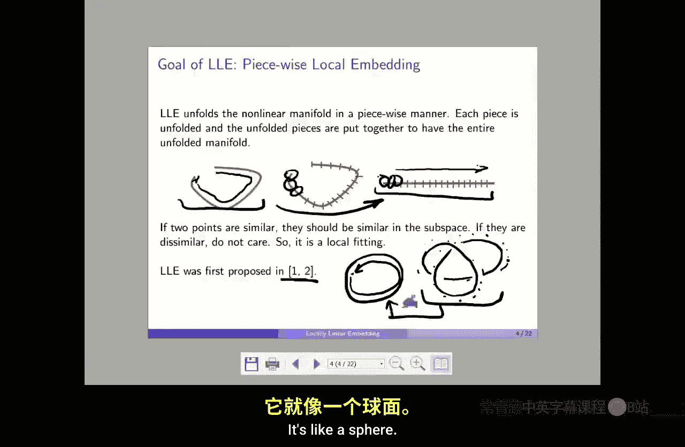
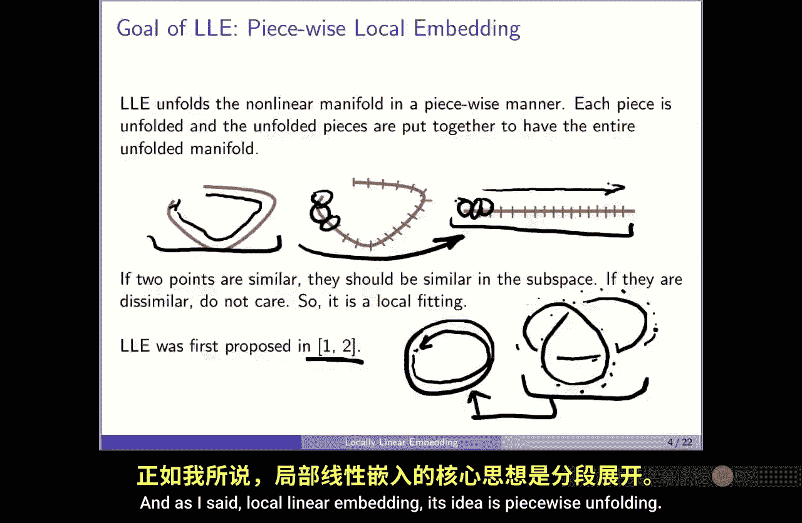
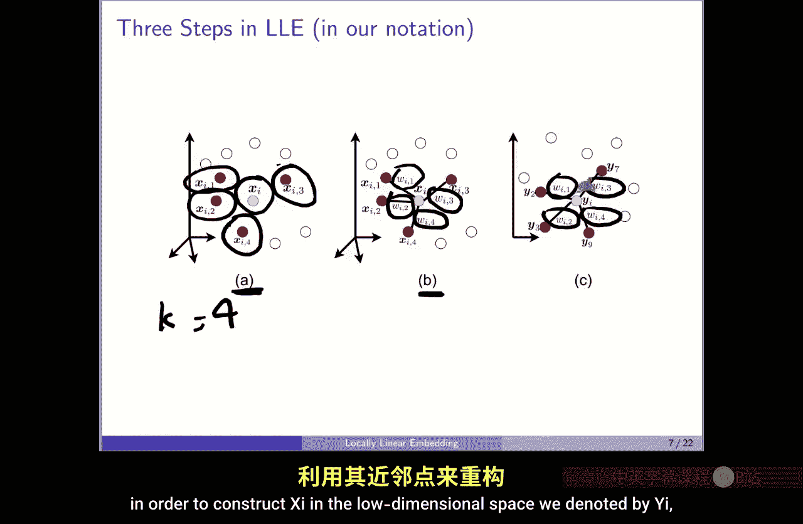

# 多伦多大学【中英⚡降维与流形学习｜2023,Dimensionality Reduction and Manifold Learning】 p05 P5 Locally Linear Embedding (LLE) (optional) -BV1aeidBPEiQ_p5-

Yeah。Hi everyone， this is the course is the 6578。The course instructor is Professor Mark Cowley。

 I'm Benja Mingojo of the TA and presenter of slides， this is the lecture on local linear emdding。

Okay， as I said in previous slides， when we have non nonlinear pattern of data in order to handle non linearity of data。

 you should either have a non nonlinear method or we should transform data。Da two。

A feature space or a hillilberd space， in other words， to carnalize。

In order hoping that the pattern of data becomes linear in that hild space。Why。

 because consider this example， this the credit of this example is for Professor Allioti。

 you can see here we have a nonlinear manifolding。figure a。

As you can see the points are on this non nonlinear manifold。

 the correct unfolding of this manifold is shown in figure B， where you can see that the points。

 the distances of points and the manifold are preserved。呃。However。

 when we apply a linear method on this nonlinear manifold， it ruins the manifold。

 it doesn't unfold it correctly and it comes like figures C where the green point and red point fall on each other。

 although they were far away from each other， in other words。

 it doesn't care about the geodesic distance or the distance on the manifold。呃，是。But so。

We should when we have nonlinear data， it's better to use a nonlinear method or we transform data。

A local linear embidding is a nonlinear method， it doesn't transform data。

 it's a nonlinear method itself。

Okay， it was。Proposed in 2000 in the same journal that IomF was proposed。

AndThe idea is of L is locally local embidding or local piecewise embidding。

 How it's similar the idea of L is similar to the idea of。Peacewise， S P line recreation。

It says that assume I have a non manifolding shown in this figure。

 and then I divide this manifold into linear into pieces， small pieces。 and then I unfold。

Mifold piece wise。 like I put this part here。Then I put this part。Cl to it。 Im unfolded it piecewise。

 And then these here， I do it for all pieces。 And then this non nonlinear manifold has been。

Unfolded to。 So this non nonlinear 2D manifold has been unfolded to a 1 D。Why。

 because its intrinsic dimensionality is one。え。So what is intrinsic dimensionality， I tell you。

 it means that why is it a line， Because when you put an ant on it small。

 assume you put a small ant on this nu in your manifold。

 it doesn't see the whole structure of manifold。 It's very small。 It does see what is in front of it。

 when it goes， moves， moves， moves。Finally， it reaches the to the end of this nonlinear manifold。

 So it's similar to。A line， it is traver a line。However， if， for example， if it was a circle。

If you put an ant here， it goes， goes and comes back to where it was。

 So the intrinsic dimensionality of the circle is 2。Also， the intrinsic dimensionality of a knot。Is2。

 why。The knots are very useful in theoretical physics， especially in strength theory or m theory。

 if you put an ant on this knot。It goes here， here， here， here。

 It doesn't see the structure of manifold。 It just goes forward。 And then finally。

 it comes back to where it was。 Therefore， the knot。

 this knot its intrinsic dimensionality is also too。 It's like a。

A sphere。So this is the concept of intrinsic dimensionality。

 and we want to unfold the manifold tweets intrinsic dimensionality。And as I said。

 local in your embeing， its idea is peacewise unfolding。

So it has three steps。First， it constructs Canyar's Ne。Like here， for example， in this figure1。

It selects the neighbors Consider for every point X I， it finds its neighbors。Nearest neighbors。

 And here， K is 1，2，3，4，5，6，7，8，1，2，3，4，5，6，7，8，8， K is 8 in this figure。

So it finds the nearest neighbors of this point。And then it says in step 2， it says that。

I want to find how each point is reconstructed by its neighbors。Or in other words。

 I want to reconstruct every points by its neighbor。Using a linear combination。 So for example。

 X I is a weight multiplied by its first neighbor plus another weight multiplied by its second neighbor until all this dimension goes until all K neighbors and for every point we do that So we see how every point is reconstructed linearly by its nearest neighbors then in the third step it says now we come to the low dimensional sub space。

 so here it was considered this。Here it was a high dimensional data input data。

 Now in the low dimensional subspace， we say we use the same weights。

In order to construct every point。We use the same weight in order to construct every point half。

 but in in the low dimensional space， not in the original space。So this is the idea of NLE。

 which is also as you can see this is the local embe。 it does this piece spice。

So for some data set notations we show here， we have a training data set。

 We denote every point by X I。 The dimensionality of data is D。 We assume we have n data points and。

Here we assumeoom the vectors are column vectors and in matrices we put vectors column y。

 so if we put the vectors column Y， we will have a matrix capital x of data set， which is D by n。

We denote the J node。Of X， I by X I J， where J goes from one to K。And if we put them column Y。

 x capital I shows the neighbors， the K neighbors of X I， which is a D by K matrix。

 We also have a test data set。Or out of sample dataset set。

 which is not used for finding the weights in the LLE。We denote the I data test data point by X。

 I T superscript。 We assume that we have N T。Test it samples。And if we put them column Y together。

 capital Xt is the test dataset set， which is a D by n matrix。And。We consider the training neighbors。

 not test neighbors， training neighbors of S I T by we denoted by is I T。Sorry。

 by X I1 X I K superscript。 So this means the first training data point， which is neighbor of X I T。

 This means the last one。 And we put them together in order to have a D by K matrix。Okay。

 we show the three steps in L in R notation here again。

 I repeat this here for the sake of clarification in step 1 a。

 we find the nearest neighbors in arm notation we have X I for example。

 for each point and we have here K is 4。So we have the first neighbor， the second neighbor。

 the third neighbor， and the fourth neighbor of Xi。And in step B， step 2， we find the weights。

 and we denote the weights， for example， that we denote the weight of。

Reconstruction of X I by X I by its first neighbor with W I 1。W I 2， W I 3， and W I 4。

Then we use these weights， the same weights here。In order to construct X I in the low。

