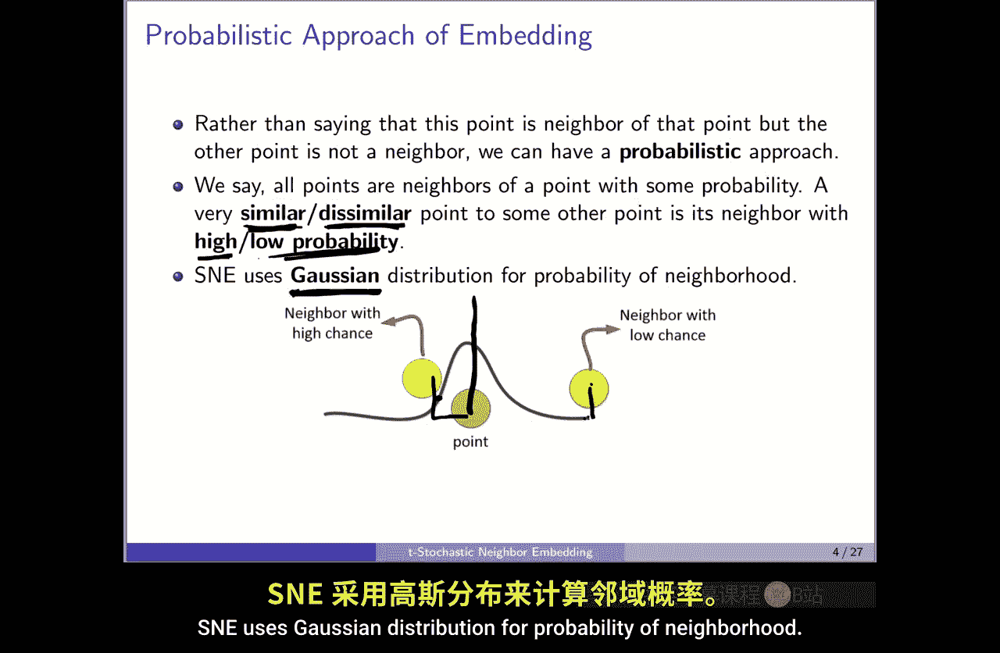
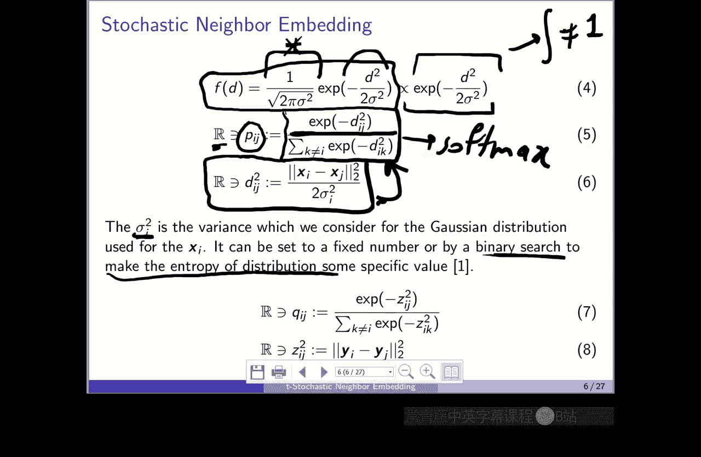
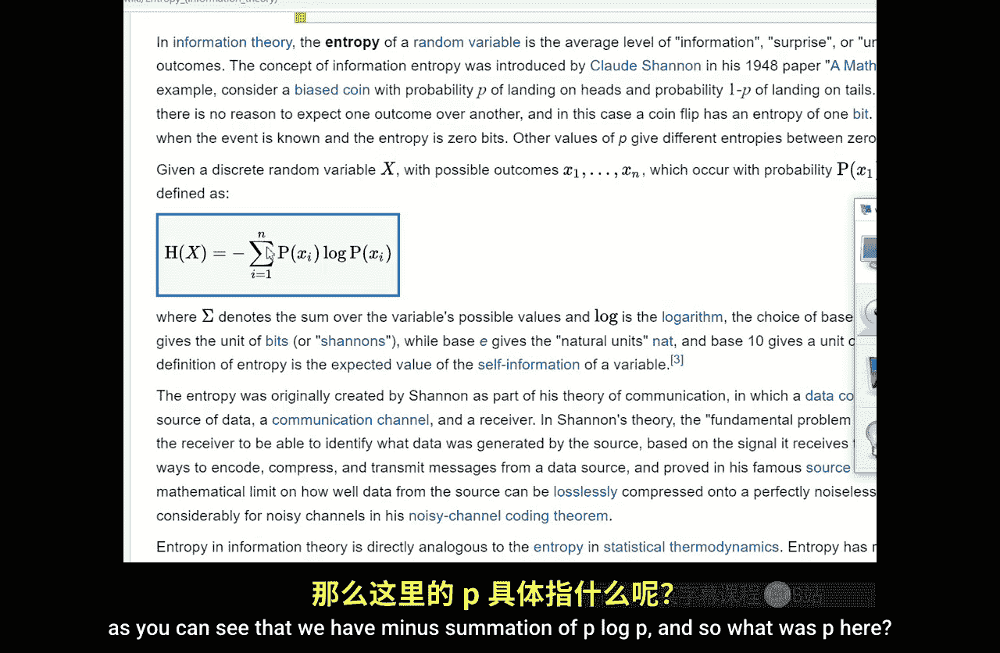
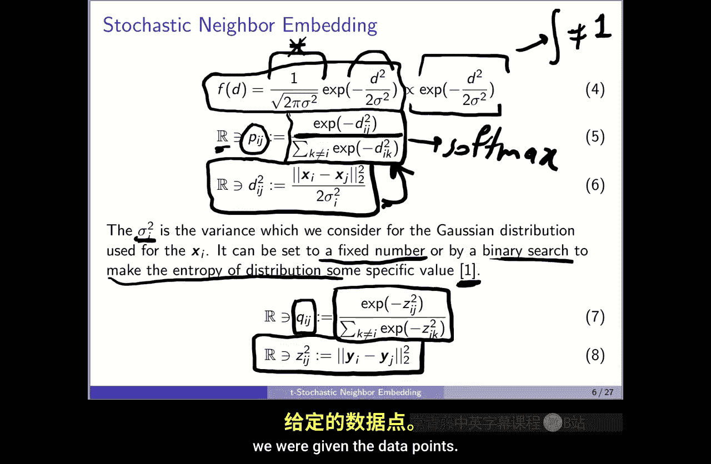

# 多伦多大学【中英⚡降维与流形学习｜2023,Dimensionality Reduction and Manifold Learning】 p06 P6 t-Stochastic Neighbor Embedding (t-SNE) -BV1aeidBPEiQ_p6-

Hi everyone， this is the course system 657A。 The course instructor is Professor Mark Crowley。

 I am many of andro job of the TAM presenter of slides。

This is a electron T T Stochastic neighbor emvdding or。TSE or TSN。诶。First。

 I show some dataset set notations to you。 soon， we have a training data set。

Each data point is denoted by Xi， which is d dimensionional。

 and we assume that we have n data points。We， we consider the vectors to be column vectors。

 and we put。Vectctors in matrixes column wise。 So if we put vectors in matrix。

Capital E will have the dataset set， which is D by air。

We want to find the embidding of training data， which is denoted by Y I。

 The embidding of X I is denoted by Y I assume that the dimensionality of em space is H denoted by H。

 and we have n data points。 we don't in other lectures we had shown the dimensionality of。

Subisspace by P。 But here we show it by H because we use P for the purpose of another rotationtation in this lecture。

And y we put them column Y， if we put the embeddings， column Y in the matrix capital。

 y will have a matrix h by n， usually h is less than or equal to D and usually h is much less than d in SN E and T SN E。

These are usually used for data visualization in either 2 d or 3D。 therefore edge is usually 2 or3。

Okay。do you remember， we have in Can neighbor graph。

 We say that either a point is a neighbor of another point or it's not。 It is either。

So every point accepts another point， either as its neighbor or not。So it's hard decision。 However。

 let's make it a soft decision。 Let's say， let's not say。That you are my neighbor and you are not。

 Every point can say that you are my neighbor with high probability。

 but you are my neighbor with low probability。 So every point。

 every point is the neighbor of every other point， but with different probabilities and what determines this probability。

 if two points are close to each other， we can say that those two points are neighbor of each other with high probability。

 But if they are far away from each other in the input space， we say that they are。Neighbor。

 but with very low probability。So every point can have。

 every point can have a Gaussian distribution around it。

Where it itself stands in the mean of cost and distribution。

 and it says that using this and distribution， I can find out the probability of other points to be my neighbor。

So if a point is very close to me， so it is close to the mean of discussion。 Therefore。

 it it is my neighbor with high probability。 But if it is very far away from me。

 it's a neighbor with low probability。 I'm showing this in this figure。

 So assume that this point is in the middle of this is the mean of。

Discussian distribution and the point which is close to it。iss a neighbor with high probability。

 but the point which is far away from it is neighbor with very low probability。Therefore。

 we can have a distribution。Not necessarily discuss a distribution around every point to determine other points as its neighbors。

 e stochically， not deterministically。Okay， so we can say that similar points or close points are neighbors with high probability。

 Theseim points or far away points are neighbors with low probability。

 This is a probabilistic approach for embedding。And S any， a stochastic Ne and did not T any SN。

TSN is based on。Is a developed version of S&E。SN uses Gaussian distribution。

For probability of neighborhood。Okay， I explain S any here in this a slide。So this is F D， this F D。

This is the definition of Ga and distribution。 we univvariate cost and distribution。 consider this。

 and then you can see that this part is a constant。 therefore if we drop this。

 this is proportional to this exponential term。Usually， we people use。In machine learning。

 you see it a lot。 People use this formula as the for determining or for showing some kind of probability and usually Gaussian distribution。

 This is called softm。Soft next function。And what is this。

 it says that I used this term of Gaussian distribution， which is the exponential term。

 but as we don't have we have dropped the constant here。This is not a P DF anymore。

 a probability density function is it doesn't sum to one or it doesn't integrate to one。

When we draw the constant。So in order to make it like a probability。

 make its behavior similar to probability and make it sum to one or integrate to one， we divide it。

By all summation of all different cases， therefore。

 when we sum all different cases here with sum over I and J over all different points。

 pairs of points。The numerator becomes equal to the denominator， and the summation of total is one。

So we do this trick by dividing to the summation of all different cases。

 we are making this exponential term。Wwhich was proportional to the Gaussian distribution similar to a probability distribution and we use this as kind of Gaussian distribution and we set it to Pj so the probability that the X takes Xj as its neighbor its a scalar also this probability is a scalar。

 the probability that X takes Xj as its neighbor is equal to this Gaussian distribution。

 this soft max 4。It is noteworthy that softmax has a problem。

 What is the problem with softmax in machine learning。The problem is that。

We have a summation in the denominator。 What if we have the number of cases or the number of points here is huge。

What if the summation is over a huge number of cases。

 then this then denominator becomes interactable。 So the soft max problem has is prone to be interactable。

 This is a problem with soft mix machine learning。 And here we are using Euclidean distance。

Here in D I J squared， you are using exactly what we had in the term of exponential term for gaussian distribution。

 Youuc cl square the clton distance over the， the variances， to， two variants。

 This is used in the soft Max4。And these variances。

Is which we consider for the Gaussian distribution for X I。

 and it it can be defined by a binary search to to find to make the entropy of distribution some specific value。

 What What was the entropy of a distribution。And the entropy。

I showed。This is a definition of entropy from Wikipedia。

 and as you can see that we have minus sum of p like P。 And so what was P here in our case。

 P is equation 5 and so we can have we can say that I want entropy distribution to be a specific value and using binary research。

 I can easily find what sigma I I want to have。

Or we can just fix it to a fixed number。This is according to the paper of S this technique and then。

Q I J is the probability that。The embidding of X I takes embidding of Xj as neighbor。

 or in other words， the probability that Y I takes Yj as its neighbor。 we show it by Q I J。

 So it's a corresponding variable for P I J， but in the embi space we also use。

A soft max orgassian distribution。 But but we here we also have E 8 is very similar to equation 6。

 but we don't have sigma I y because it's， it's based on us how to choose。

The embidding in equation 6， we used the variance because we didn't choose the embi。

 we already had we were given。

