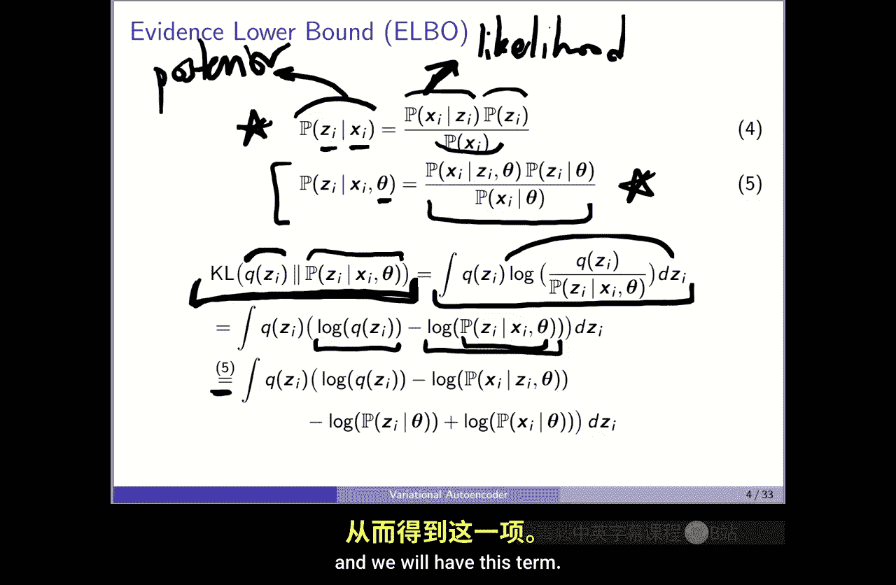
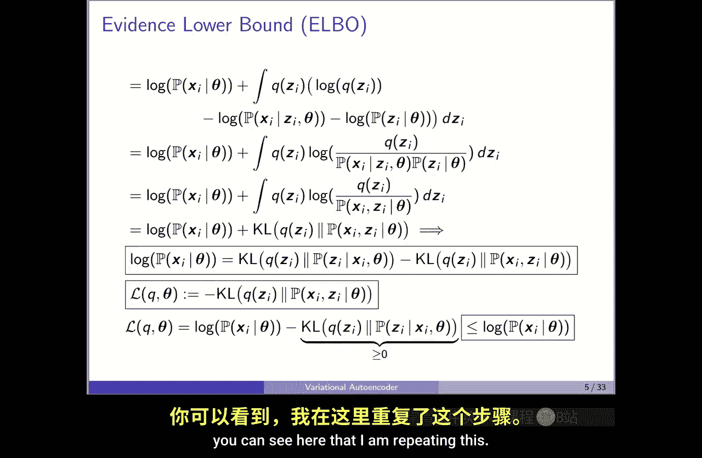
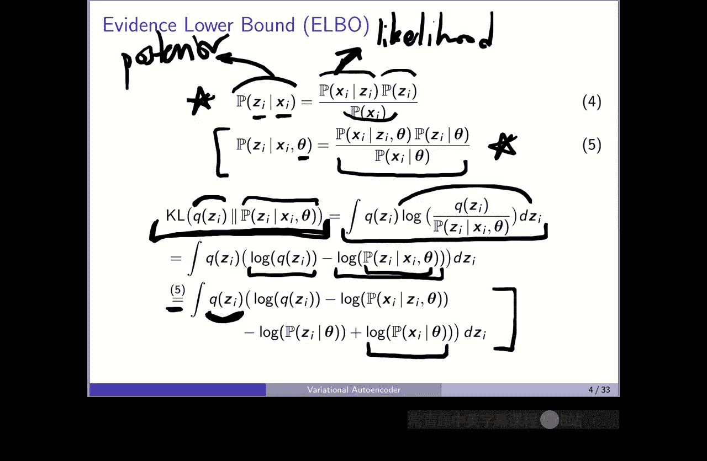
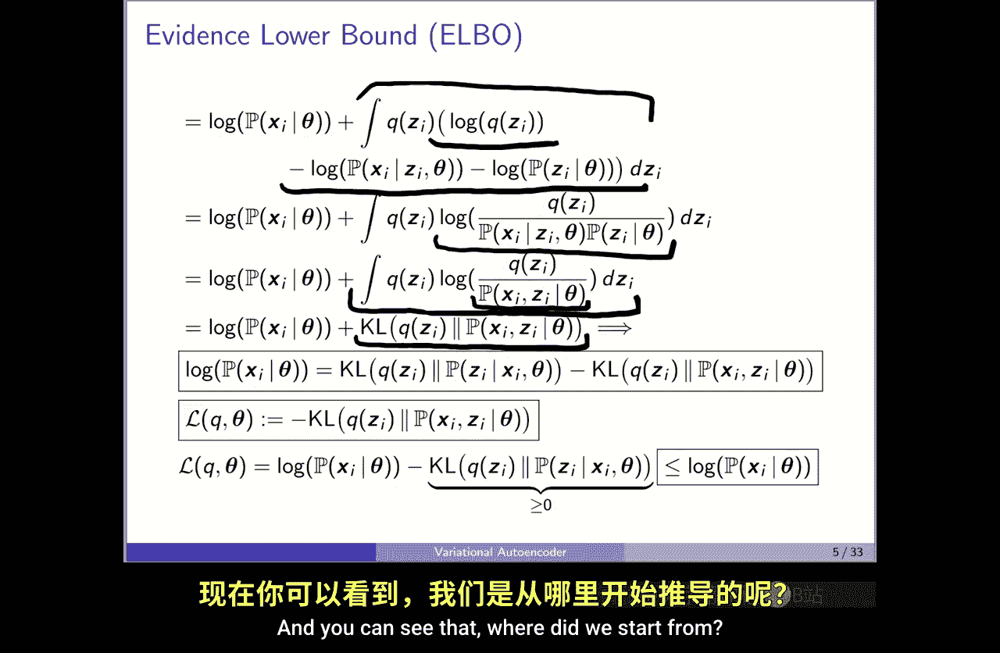
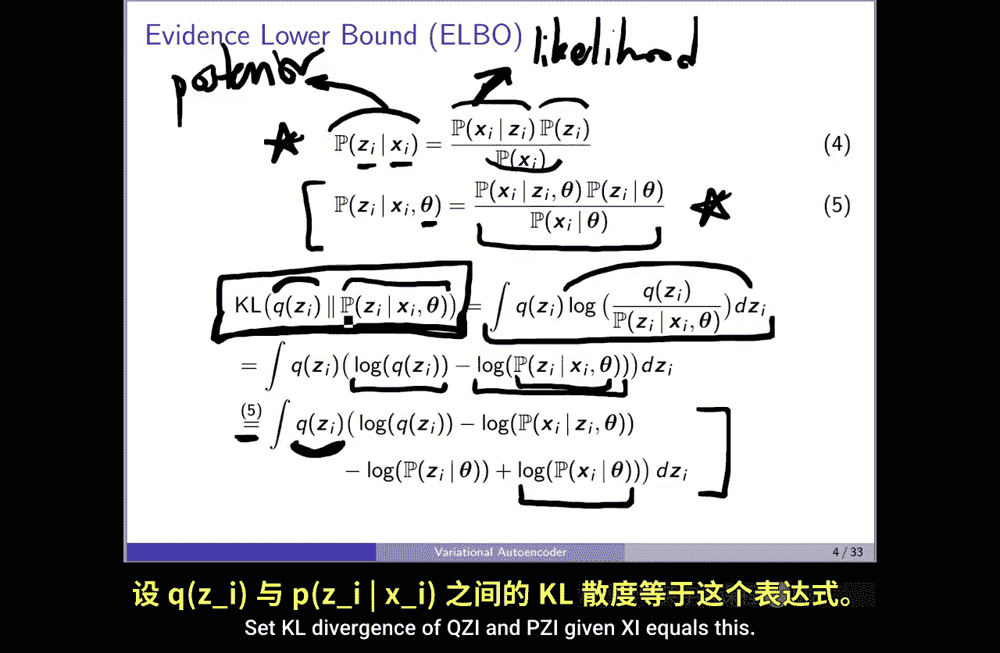
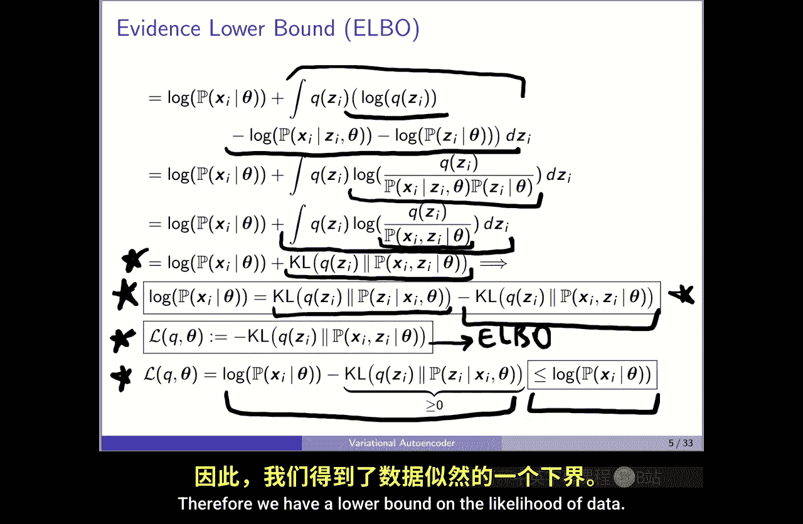
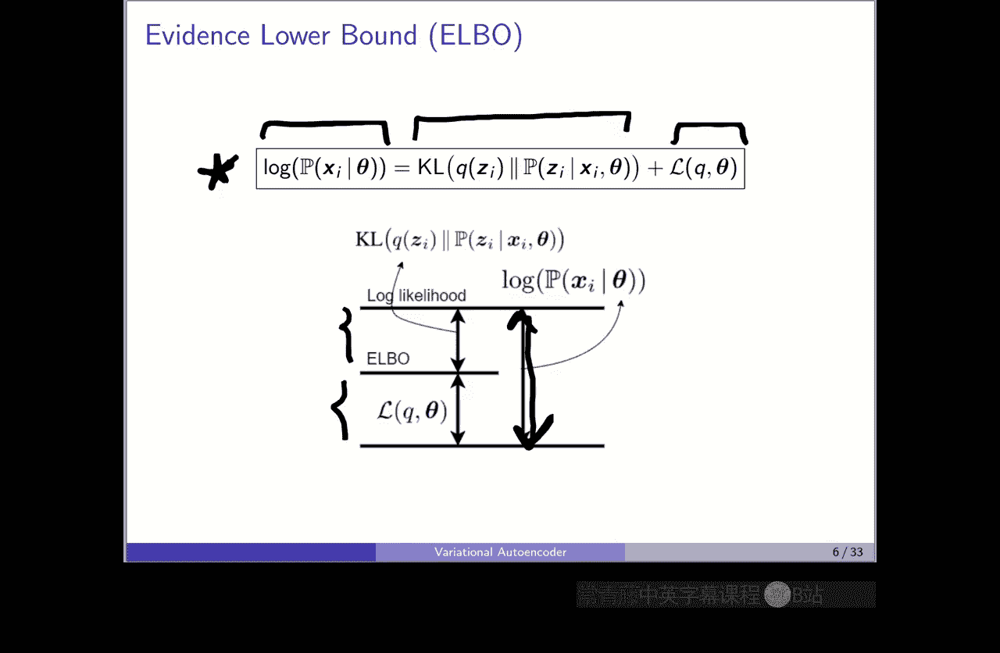

# 多伦多大学【中英⚡降维与流形学习｜2023,Dimensionality Reduction and Manifold Learning】 p07 P7 Variational Autoencoder (VAE) (optional) -BV1aeidBPEiQ_p7-

Hi everyone， Yeah this is the course is is 657，8。The course instructor is Professor MarkCrowley。

 I am Benja Mgo， the TI and presenter of slides。This is the electron on variational auto encoder。

Okay， so first I show you some data set notations， assume that we have a training data set。

Where each data point is denoted by Xi， so the if data point is denoted by X。

 we have n data points and the dimensionality of data is d。The vectors here are column vectors。

 and we put the vectors column y in matrices。 So if we put them column Y。

 we'll have a D by n matrix capital x。And soon that， we have。Embbeddings of these training data。

 which are the latent factors。 We assume here that every data point X I。Is generated。

By latent factor or latent variable， Z I。And this is a probabilistic graphical model that we are showing。

So， and this latent factor is kind of if we take it to be a low dimensional variable。

 And if if X is high dimensional， then this can be considered as then as the embidding of X I2。

So that I assume that it is a p dimensional vector and we have n data points and if we put them columnwise。

 we will have a matrix set。Which is P by n。 x is D dimensional。 P is less than or equal to D。

 We usually we have P is much less than D。In variational inference version and variational auto encoder。

 we assume this probabil the graphical model that I am showing here。But there are some other。

Proorbaistic approaches like factor analysis and probabilistic PCA， where we also assume that。

There is。Noise， so X I is assumed to be summation of some latent variable here。And some noise。

But here we don't have noise in the concept of。Variational， inferior and variational auto to encoder。

First， we explain evidence lower bound。Consider the basees rule。 This is basees rule。

 So that probability of Z I given X I is probability of X I given Z I。

Multiply prior and Z I divided by prior and X i。If we have a parameter setta。

For the conditional probabilities that I give an Xi。

 then we can set probabil that I given an Xi and theta that this parameter can also be also seen as a random variable。

 Then the base rule is changed to this。So。Let us consider the KL divergence between Qs Z I and the probability of Z I given X I and the I。

Okay。First of all， I tell you that this is， this is。The like called likelihood。

This is called posterior。These are priors on that I an Eai。Consider Q Z I as the prior on Z I。

 And this is the posterior。 we want to see what is the k di divergence between the Q Z I and the posterior of Z I given X I with parameter theta What is K divergence。

 It is one one measure。 one of the measures for differences of。Distributions。

 we have different measures for difference of distributions。 One of them is maximum in discrepancy。

 One of them is k divergence。 When two distributions are equal。

 their moments or if all their moments match and they are equal， the their k divergence is 0。

 And if they are more different than each other from each other。

 then they they have larger k divergence。 So k divergence is defined according to definition is this。

Smation or or integral over。Q Z I， log of which is natural log here。 Q。

 Z I over P Z I given X I and theta。So if we simplify this log。

 a log of division becomes a log of numerator minus log of denominator。

And then according to equation 5 base rule here。We can have。呃。We， we replace this PZ I。

With what we have here。And。We simplify log of a log of the fraction to log of numerator minus log of denominator。

 and we will have this。

Now， let's simplify it more。呃。You can see here， that。I am repeating。 I am repeating。

This。II'm factoring out QZ I so here we have factor out a QZ I。

 but if you see this term is not a variable of Z I。

 therefore it can be it can come out of integral and integral over DZ I。

 integral of DZ I over all domain becomes one， therefore becomes this lag of probability。

Times 1。Sometimes my pen doesn't work。O。So。Now， then we will have Q integral of Qs that I。诶。呃，那个。

Do the other terms。So。Now， let's move on to simplify it further。 We can these three terms。

 we can write it as log of fraction again。You can see this here。诶。Then。According。

 we know that P of X I given Z I， P Z I is P of joint distribution X I and Z I。 We have this here。

 We are using this characteristic。Then this， what is this。

 This is definition of k divergence between  Q Z I and P probability of X I and Z I given theta。

 So we replaced it the second term with k divergence。 And you can see that where did we start from。

We started from this。Said K divergence of k equales that I and P that I given X I equals。

This。Lg of P X I giventa plus K。 If we reararrange this term， we will have this boxed equation。

If we define this term。this term。Minus K thergence of Q， Z， I and P， X， I and Z， I。

As the the lower bound， this is E LBO。Or evidence lower bound then。

Replacing this EBO in this box equation， we will have。え。

That equal and rearranging that it will be it will It will give us ELBO equals log of P of X I given theta minus the scale divergence。

A K divergence is always greater than or equal to 0， therefore。This term。

Is always less than or equal to log of P X given theta。 So ELB O， you can see that is a lower bound。

 Why is it a lower bound Because it it is less than or equal to log of P of X I。

 And what is lag of P of X the lag likelihood。Of X I is therefore。

 we have a lower bound on the likelihood of data。

Bixi is the data set。So I'm writing that formula， this formula again。My rear engine is。

 I'm just repeating that equation。 You can see that if we can fee visualize this equation using this figure。

 assume that this。This total thing is the like likelihood that we have here in this side of equation。

Then E LBO is this。So this lag record is the ELBO plus the scale divergence that we have here。

And we want to， because we， we always want improbabilistic approaches。

 We usually want to maximize the lack likelihood of data。

