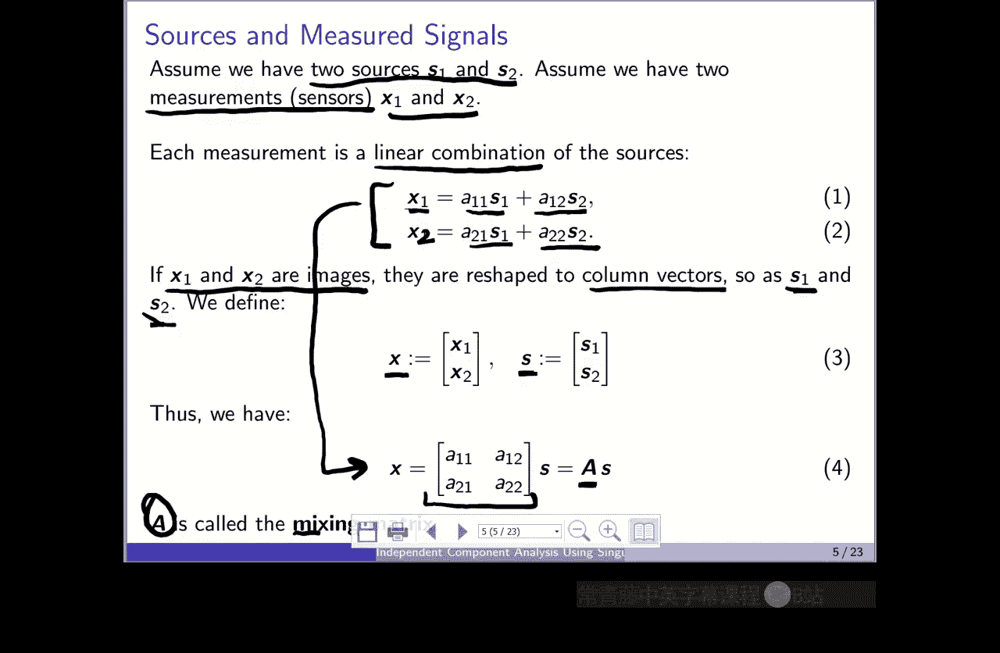
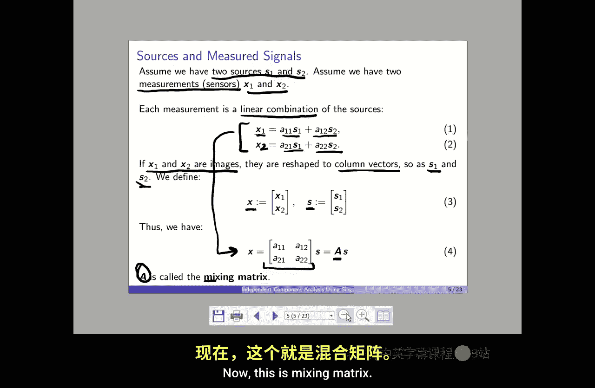
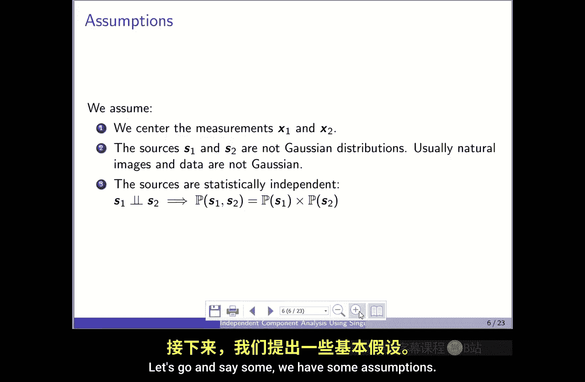
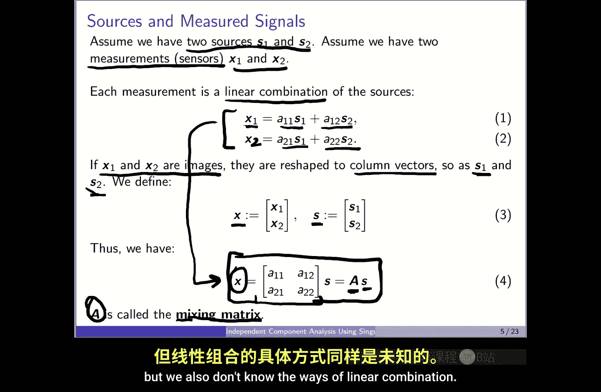
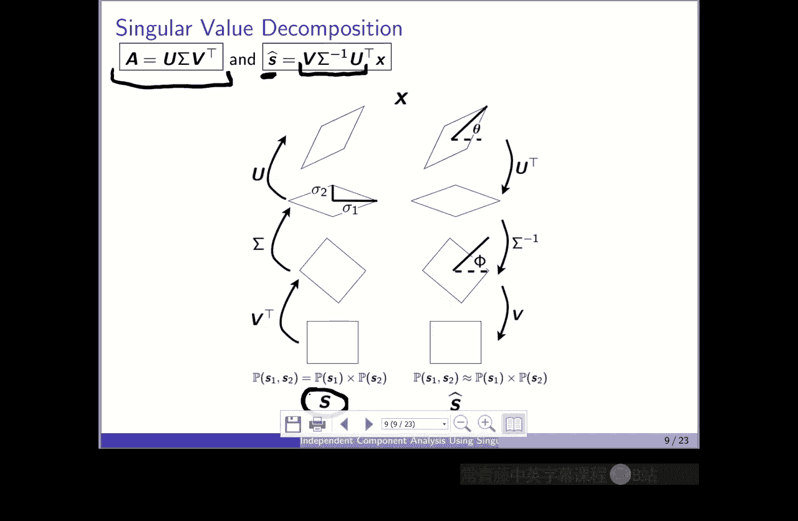

# 多伦多大学【中英⚡降维与流形学习｜2023,Dimensionality Reduction and Manifold Learning】 p08 P8 Independent Component Analysis (ICA) Using Singular Value Decomposition (opti -BV1aeidBPEiQ_p8-

Hi， everyone。 this is。This is the course is 66，5，7 a。

And the course instructor is Professor MarkCowley， I am Benja Mru， the TN presenter of the slides。

And this lecture is independent component analysis using a structure using singular valid decomposition or SVD。

So，First of all， I should say that independent component analysis can be done using different algorithms。

 one of them is maximum likelihood estimation， one of them is singular ra decomposition。

This lecture focuses on ICA or independent component analysis using SVD or singular value。

Thecomposition。First。We talk about cocktail party effect and blind source separation。

What is cocktail party effect， As soon that you are in a cocktail party and there are groups of people who are talking to each other。

As you can see， there's so many voices that are around。

 and it's hard to say that which voice comes from which group。Assume that for simplicity。

 assume that we only have two groups of people who are talking。And their。

Their tone of speaking or what they are talking about。 Everything is different。 So there is。

 so they are not completed。Similar voices are not completely correlated， but they are mixed。

 These voices are mixed。So you have two sources， S1 and S2 and assume that we are recording these voices in the party with two microphones。

 X1 and x2 so X1 and X2 are the measurements which measure the voices in the party and S1 and S2 are the sources。

Who generate the voice voices。 What will I say， wants to do。 I say。

 wants to find the independent components of these voices in order to separate these sources for。

 for the sake of source separation。Or blind source separation。呃。And the thing is that。

It's very a very hard task because the voices are combined and independent component analysis tries to separate these and for example。

 then you can play each the voice of each group separately and you can easily hear what they are talking about。

呃。Now let's go into the mathematics notations of ICA as soon we have two sources as we discussed data this is sooner two sources S1 and S2。

 soon we have two measurements or Sun source x1 and x2。呃。

We assume that each measurement is a linear combination of the sources。Because。Usually。

 this happens in the in nature。 So if we have。A linear combination or each measurement of each microphone is a linear combination of S1 and S2。

This must be x2。X2 is also a linear combination of。S 1 and S 2。Then if X1。Its。

So we can represent this the weights of linear combination by a1，1， A1，2， A21， and A22。

If we might have images， image data rather than sound data， if x1 and x to our images。

 then we should reshape them to column vectors。S1 and S2 are also vectors。 They can be scalrs， too。

 but in general， they are vectors。We can concatenate x1 x or put them together in a vector x。

 also put S1 and S together in a vector S， so we have a vector x of vector of measurements and vector of s or sources。

Then in matrix form， this can be written as this。X is a matrix A118 a12821822 S。

 and we name this matrix capital a， it's called mixing matrix。诶。It's called mix in Matri A。Now。

This is mixing matrix。This go and say some， we have some assumptions。

So first of all， I should say that in this equation 4。As you can see。

 the only thing that we know is X。 We only we because we all。

 we have the measurements of microphones， but we don't know a。The mixing components。

 and we don't know the sources。 What we finally want to know is the sources。

 but we also don't know the ways of linear combination。

And that makes the problem harder。 So we have some assumptions in ICA first we center。

The measurements x1 and x2， we do that in PC2， if you remember。

 we center for the sake of simplicity of computations。And we also assume that sources。

 S1 and S2 are not Gaussian distributions， not Gaussian。

Usually natural images and data are not gaussian， so this assumption is valid and why do we make this assumption we will see later。

呃。Also。One small thing that I can tell you is that。There is another reason that I will tell later。

 but one reason that they shouldn't be Gaussian assume that this is Gaussian。

 a Gaussian distribution。Then， you don't know。Whether this， for example， is the correct component。

Or this is the correct components。 Both can be vet， so it confuses the algorithm。This is one reason。

And。We assume that the sources are statistically independent。 So we dennoted by these。

 as they are statistically independent， we can write their joint distribution as the multiplication of their marginal distributions。

诶。Now， let's talk about singular value decomposition for， for the sake of ICA。

Recall that we had this。 The measurements were the linear combination of the sources。

 both A and S are unknown。 Only X is known。Yes， okay。Now。

 let us apply SVD or singular value decomposition and matrix A。As we have in equation5。

 so U here is the matrix of left singular vectors V is the matrix of right singular vectors。

 Sigma is the diagonal matrix of singular values。We had equals A S replace the singular rather decomposition of a in this equation。

 We will have this。X equals U sigma v transpose S。Now， you， you might say， okay， if I。You。

You can say this。S can be approximately。IfWe can see estimated by this hat means estimate estimation of S inverse。

E， right。So we are doing this here， too。And then we can say that a was this U sigma v transpose。

 so I replaced this here and now when we apply inverse to a multiplication of several matrices that their order is reversed。

 so we have v transpose inverse， sigma inverse， U inverse x。As in singular value decomposition。

 U and V are orthogonal matrices， therefore。You know。

 according to the definition of orthogonal matrix U transpose is U inverse。Also。

 v transposees V inverse， therefore， as v transpose this V inverse。This is v inverse inverse。

 so becomes V。Here， we had。Sigma inverse we still have it here。

 and U inverse will replace it by U transpose。So we signal inverse two transports。

 and then well have x。So。What we had here， we had singular ver decomposition and a and then S the estimation of S。

 the sources we we wanted， do you remember we wanted to separate the sources。

 We wanted to find the separated sources which are S1 and S2。 So this is this what we want to find。

Is v sigma inverse u transpose x， however， also v's and sigma inverse and u transpose are also unknown。

And we need to calculate them。What is the interpretation of this SVD and this S hat equals v sigmaverse U transs x we are showing the interpretation in this figure。

We start from here。 the figure starts from here。 We have S。

