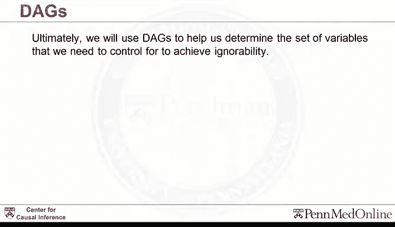

# 宾夕法尼亚大学《因果推断速成课程｜A Crash Course in Causality》中英字幕 - P10：10_02_02_因果图.zh_en - GPT中英字幕课程资源 - BV1Ft42137BF

Hi， this video is on causal graphs。In this video， we'll begin to learn about what causal graphs actually are。

We'll become familiar with the terminology。And we'll also begin to identify what we mean by paths between variables。

The motivation here is that causal graphs。Are useful for causal inference？

Casal graphs are also referred to as directed as cyclic graphs。

At least in the causal inference literature directed ocyclic graphs are the ones that are most commonly used。

 so you could think of that as really a special case of causal graphs in general。

These are going to be helpful for identifying which variables to control for。

 so the causal graphs in general will help us identify the variables that we need to control for。

Casal graphs will also make our assumptions explicit， so what I mean by that is。

In any particular study you'll have。A treatment or exposure of interest。

 you'll have an outcome of interest and you'll have a lot of other variables。

A causal graft will depict whatever your assumptions that you're making about the relationship between these variables。

So it'll be very easy for people to see what you are assuming and also to critique your assumptions。

Here we're just going to present some basic information of graphical models。

So we'll begin with some simple graphs to get the main ideas。

Here we're showing two variables or nodes， A and Y， and you see that there's an arrow between them。

So this error was indicating a direction。You could think of it as here as a affecting Y。

 This is a directed graph because of the arrow。There's also something known as undirected graphs。

So here we have the same two variables or nodes， A and Y。But between them is just a line。

So this is considered an undirected graph。It basically implies that there's an association between A and Y。

 but a causal direction is unknown。As an overview of graphical models。嗯。

One thing to note is that they'll encode assumptions about relationships among variables。

So the graphs will tell us about。Weather variables are independent from each other。

Which variables that they have a dependence on， whether there's conditional independence and so on？

Importantly， they can also be used to derive nonparmetric causal effect estimators。

And I'll talk a little more about what that means shortly。Next。

 we'll begin to introduce some terminology。So here's a directed graph。Where A is affecting Y。

And A and Y are known as nodes or vertices。We can also think of them as variables。

But you could really think of them as a collection of variables potentially。

 so a is not necessarily a single variable， although it could be。You could think of it as。

All of the variables that directly affect Y。So these you could call A and Y either nodes or vertices。

 or you could sort of loosely think of them as variables。

And you'll see that there's a link between them， in this case， the arrow。

And that's also known as an edge。So the link between A and Y in this case is an arrow。

 and that means that there's a direction and so therefore it's a directed path。

And this is also a directed graph。Because all of the links between variables are directed here。

 there's only。Two nodes and one path。But you can imagine that graphs can get more complicated and as long as all of the edges are directed。

 then it's a directed graph。Also variables connected by an edge are adjacent。

 so here A and Y are adjacent。Here's a slightly more complicated graph。

Where we have four nodes or vertices， WZ， BN。And you notice that there's arrows between them。

So a path is a way to get from one vertex to another， traveling along edges。

Imagine that we want to go from W to B。There are basically two ways you could do that。

So one is you could go from W to Z to B。So， you could go。Roide along this path。

But you could also take a different route where you go from W to Z。And then over to a。And then。

 back to be。So they're basically here， there's two ways to get from W to B。

But there's only one path from Z to W。And we could write that。As we have here with Zarrow W。

Now what is a directed acyclic graph， so previously I was talking about causal graphs in general。

But what is a directed acyclicalgraph， Well， the name kind of gives it away。 So first。

 it means that there's no undirected paths。 So you'll see the graph I have depicted here shows an undirected path between A and Z。

 but that's not allowed。 If this is going to be a da or a directed acyclicalgraph。

 we can't have any undirected paths。We also can't have any cycles so that's where the acyclic word comes from no cycles here would be an example of a cycle where A affects B。

 B affects Z and Z affects A and it cycles around over and over so we can have that。

And here would be an example of a dig。 you see that。Everything is directed。

 there's arrows everywhere。There's no cycles。So Z here affects A and B， A affects B。

 but nothing sort of cycles back to Z。 So there's no cycles here。 So this is a proper da。

And I should note that。I introduced Dgs because for the rest of the course。

 that is all we will consider when we talk about causal graphs。

 so from here on out we're going to strictly think about dags。

So next I'll introduce some more terminology。So， that。The terms that I'll introduce here are parents。

 children， ancestors and descendants， and these should be pretty self explanatory。 So， for example。

 in this da。A is Z's parent， so you see that there's an arrow from a to Z。

 you could think of a as causing Z or A is affecting Z。

So we'll think of a as happening first and it affects E， so we'll think of A as Z's parent。Similarly。

 you could think of in this case， B as being a child of Z。So Z is affecting B。

 You could think of Z as kind of happening first and affecting B。

 so we'll think of B as a child of Z。You could also use ancestor and descendant terminology。

 so in this example you'll see that D is a descendant of A。So a was z's parent。

 and then Z was D's parent。 therefore D is a descendant of a。And similarly。

We can flip things around and say that Z is an ancestor of D。And returning back to parents。

 I just want to note that。In Ds， there can be more than one parent。So in this case。

 D has two parents， B and Z。But you're not actually limited to two parents。

 any particular variable of vertex could have multiple parents， more than two potentially。

So as was mentioned previously， we're going to use Dgs to help us determine。

The set of variables that we need to control for confounding。

 which is also equivalent to saying that it's the variables that we would need to achieve iorability。

However， before we get there， we're going to have to think about。

 the relationship between dags and probability distributions。

