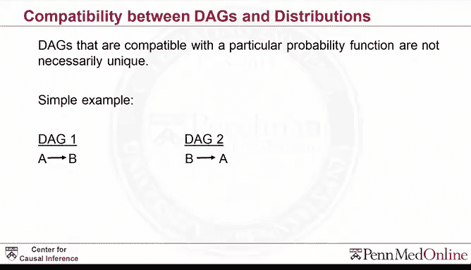

# 宾夕法尼亚大学《因果推断速成课程｜A Crash Course in Causality》中英字幕 - P11：11_02_03_有向无环图与概率分布的关系.zh_en - GPT中英字幕课程资源 - BV1Ft42137BF

Hi， this video was about the relationship between directed acyclic graphs or Dgs and probability distributions。

We have two main objectives。One is to understand how dags encode information about probability distributions。

And the other is we would like to be able to decompose a joint distribution from a Dg， so to begin。

 we'll think about das and probability distributions。In general。

 DegGs want encode assumptions about variables。Or about nodes of vertices。 So a da will tell us。

Which variables are independent from each other？It will also tell us which variables are conditionally independent from each other。

And it will also tell us ways that we can factor and simplify a joint distribution。

So here's an example。So here we have。Four nodes or four sets of variables， D， A， B， and C。

 we see it's a proper directed acyclic graph as there's only directed paths。

And what we're going to take a look at now is how this particular D encodes information about the joint distribution of AB。

C and D， so you can think of all of these ABC and D as random variables or sets of random variables。

 and so they must have a joint distribution。This dag is encoding assumptions about that joint distribution。

So what does this stag actually tell us？So first， and I'm just going to go through some examples。

This dig implies that the conditional distribution of C， given everything else。

 is just equal to the probability of C。In other words， C is independent of all variables。

The reason we know that is because C is just sitting not there off by itself。

 so C is a random variable that has some distribution。

But nothing is affecting it and it's not affecting anything else。 So it's just by itself。

 it's independent。So therefore， the conditional distribution of C given A， B and D。

It's just equal to the probability of C。 So conditioning on A B and D it doesn't tell us any information about the probability of C。

 It's just totally off by itself and independent。So you'll see that just from this De。

 we were able to identify that C is independent of the other variables。

Next we can look at B and in fact， we'll look at the conditional distribution of B。

 given the other variables， so B is affected directly by a。And it's。Affected indirectly by D。

 because D affects A， which then affects B。So in this case， if we condition on everything。C， D and A。

 all that really matters is a here because as a is directly affecting B so as long as I know a。

 I know everything that there is to know about the probability of B for B D is not telling us anything additional because D affected A but I'm conditioning on a。

 so I already know A so D is not telling us anything。In addition to that， and of course。

 C is off by itself， C doesn't affect B in any way。So we can simplify this conditional distribution。

 the probability of B， given AC C and D as the probability of B。Only given a。

Another way to write that。Is using this notation。Here， so B is independent of D。I'm sorry。

 B is independent of D and C， conditional on A。So we were able to learn that just by looking at this graph。

Here's another example where suppose you were interested in the distribution of B given D。

What I write here is that the probability。Of。B given D。Is not equal to the probability of B。

Another way you could think of that is that B and D are actually marginally dependent。

And this is because D affects A， which affects B， so D therefore has to be related to B。

So they're not independent， they're not marginally independent。

D and B are going to have to be associated with each other。

So this is another thing we can learn from the graph。

Now here's another example where we're looking at now the distribution of D conditional on everything else。

And we can simplify that strictly as the probability of D given A for the same kind of reason。

B is also related to D， but only through A。So D affects A， which affects B。

 but as long as we condition on A。That's all that we'll actually need to know about D。And again。

 see is sitting off there by itself。So these are a few examples of ways that。

You can learn about probability distributions from a Dg。

I imagine that some of these ideas are still a little fuzzy。 So we'll look at another example。

 So here's another example of a da。So what does this stag imply？

So one example here is if you look at。The probability of a given everything else。

We can simplify that as the probability of A given D。And。

The way you can basically tell that is because the only thing that's affecting A。Is D。

So as long as we condition on D， we'll basically know everything there is to know about A。Next。

 we could think about the probability of D given the other variables。And in this case。

 we can drop C from the conditioning。But we need to still condition on A and B。

So what that implies is that D is independent of C given B。But why is that the case， Well。

 first of all， if we， why can we drop C from this conditional probability， Well。

 once we condition on B。Then there's no information in C about A。

 so C could potentially tell us something indirectly about A if we didn't condition on B。

But as long as we're conditioning on B， the C doesn't give us any useful information。

C is basically sitting off by itself except it's affected by B well we've already conditioned on B。

So C is not going to tell us anything new。But we do need to condition on both A and B。

 in other words， we can't drop A or B because D affects both A and B。

 so both A and B should independently be telling us something about D。

So next we'll consider another example。This should look just like the previous sta。

 except I added in an arrow from A to C。So what does this imply？

So now if we look at the probability of A given everything else。We can drop B from that conditioning。

 but nothing else。So a is independent of B。Condition1， C And D。So if you look at A。

D is directly affecting it， so we're certainly going to have to keep conditioning on that。

A is directly affecting C。So we're going to have to keep conditioning on that because A andC are clearly related to each other。

But B is only related to A indirectly through other variables that we're already conditioning on。

So we're learning enough through C and D where we can drop conditioning on B。

We have the same kind of idea if we look at D， where really。

All that matters is conditioning on A and B， C is going to give us no new information about the distribution of D。

Because。The only paths from D to C are through either A or B。

 but we're already controlling for that or conditioning on that。

So D is conditionally independent of C given A and B。Next。

 we will look at the decomposition of a joint distribution。So。Given a Dg。

 we can actually use that to decompose a joint distribution by sequentially conditioning on only a set of parents。

To do that， we'll start with roots。 So those are nodes with no parents。

Then we'll proceed from roots down the descendant line where we will always condition on the parents。

Next， we'll look at an example to make that clear。So in this example， there's two roots， C and D。

 so remember a root is a node that has no parents， so C andD have no parents。

So we'll begin with those anytime you have you want to decompose a joint distribution。

So the joint distribution in this case is here， it's a probability of A B，C and D。

 if we want to decompose it in the way described in the previous slide，We'll start with roots。

And roots are just independent random variables the way we're going to。Due the decomposition。

 So we just have the probability of C。Times the probability of D。And next， what we'll do is we'll。

Look for any children of these。Of these roots。Cea doesn't have any children。

 so we're actually done with sea。But D does have a child， which is A。

So then we'll multiply by the probability of a given D。 Next， we'll look for any children of A。

 There's only one which is B， so we'll multiply by the probability of B， given a。

So what this De is telling us is that we can write the joint distribution of A， B， C。

 and D as this particular product， probability of C times probability of D。

 times probability of A given D， and probability of B given A。So this。

This decomposition of the joint distribution is something that is implied by the day。

So of course this decomposition does not hold in general， but it does hold if your da is correct。

 so if this da is correct， this is a proper decomposition of the joint distribution。

So to make it more clear， we'll work through another example。

 so you'll notice here that there's only one root， only one variable that has no parents。

 and that's D。 so we'll begin there。So we'll begin with the probability of D and that's just。

Independent probability distribution off by itself， and next we'll look for its children。

It happens to have two children， A and B。So then we'll multiply by the probability of a given D。

And the probability of B given D。Next we'll look for children of A and B A does not have any children。

 so we're actually done with that node or that variable。But B does have one child and that's C。

So we can multiply by the probability of C， given B。So again， we can based on this De。

 we can decompose the joint distribution of A， B， C and D as the probability of D。

 times the probability of A given D， times the probability of B given D。

 times the probability of C given B。So we were able to learn that。From the da itself。Finally。

 we'll look at another decomposition and this is the one where I now added an arrow from A to C。

But again， there's only one root and that's D， so we have the probability of D。Again。

 D has two children， A and B。So these two terms are the same as in the previous。

In the previous slide， what's different now is that。A and B are both parents of C。

So now when we look at the probability of C， we need to condition on both of its parents， A and B。

So that's how adding that arrow affected our decomposition of the joint distribution。

So in the previous slide， there was no arrow from A to C。So。So here we didn't have to condition on A。

 but now C has two parents， A and B， and we need to condition on both of them。

So we can see that the De is directly telling us how we can decompose a joint distribution。

So then there's this kind of compatibility between dags and distributions。

So if we return to this particular dig。We see that it emits a particular factorization。

So we could think of this particular probability。Decomposition here as being compatible with this particular day。

So if I started with this particular decomposition of the joint distribution。

And then you showed me the De here。I would say that those are compatible， that joint distribution。

 that decomposition is compatible with that particular graph。

So next we're going to flip things around and we'll see that。

Particular probability functions do not necessarily imply a unique dig。

So here's a simple example of two bags。The first one involves。Two nodes， A and B。

But there's an arrow from A to B。So A is affecting B。Whereas in Dg 2。

 there's the same two nodes A and B， but B is affecting A， so the arrow in Dg2 is going from B to A。

Convey different information in the first case， they convey that A is affecting B。

 and the second case they convey that B is affecting A。

So they also are telling us that A and B are dependent。However， imagine。

That instead of starting with a da， I started with。Some kind of probability probability statement。

 So， for example， suppose I told you that the probability of。A and B。

Does not equal the probability of a times the probability of B。

Which another way of saying that is that A and B are dependent。Or A and B are not independent。

So if you started there。If we started with just this statement。You could write either D1 or D two。

You wouldn't know which one is correct， both of those would be compatible with the probability statement you've written down。

So the probability statement would not imply a unique dag。

Whereas if you started with a particular dig， that would imply something about a probability statement。

