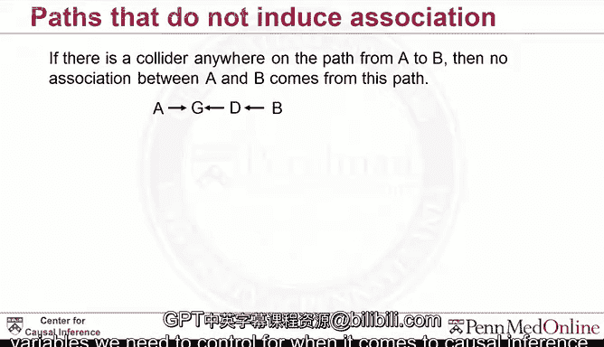

# 宾夕法尼亚大学《因果推断速成课程｜A Crash Course in Causality》中英字幕 - P12：12_02_04_路径与关联.zh_en - GPT中英字幕课程资源 - BV1Ft42137BF

Hi， this video was on paths and associations。We have two main objectives。

One is to understand the various types of paths between nodes。

And the other is to understand which types of paths induce association between nodes。

So we'll begin by looking at different types of paths。First， we'll look at a fork。

 This is an example of a fork。 So we have E sort of sitting in the middle here。

Which is affecting two variables， DNF。You could basically think of it as getting the name because you could rewrite it like this where。

It basically looks a bit like a fork， so we have E affecting DNF。And when you have the arrows there。

 it kind of looks like a fork。So at this point we're just trying to learn the terminology。

 so this is a particular path， right， there's a path between DNF and we'll call it a fork。

Because this middle part， E。Affects the two outer parts， DNF。And that sort of looks like a fork。

Then there's something called the chain。And chain， you could。

Think of as essentially like a chain reaction， so here we see that D affects E， which affects F。

 so everything is sort of flowing in one direction。So we have。A fork and a chain。

 and those are just two different types of paths。Finally， there is something called an inverted fork。

So that looks just like the fork did， except the arrows are flipped around。Next。

 we'll think about when paths induce associations between nodes。

So imagine that A and B are on the ends of a path。And we want to know when are they associated with each other through this path。

So what will need to happen is that there'll have to be some information flowing between them。And so。

Information from one could also make it to the other。

So here's an example of where information would flow to both of them。

 so again we're interested in whether A and B are associated with each other here we're looking at a fork。

And we'll see that information is flowing to both of them from E。

So E is affecting A and E is affecting B。So we can see that there where we saw that E affects A and B。

 so information is flowing to both of them。So that implies A and B are not independent。So。

They have E in common， E affected both of them， so A and B are dependent because E affected both of them。

 so information from E flowed into both of them。You could also consider a more complex kind of path。

And again， we're still thinking about A and B。So here we'll see that information is still going to flow from E to both A and B。

So this is a type of fork， a kind of longish fork。We'll see that we're able to sort of draw it in a way where it becomes clear that E is really the thing that is triggering a chain reaction that ends up affecting both B and A。

So information from E eventually reaches its way to both A and B。

 therefore A and B are going to be dependent on each other through this path。

So you could also write this path in this way， so it was easier to see when we sort of had E at the top and we showed information flowing down。

 but equivalently we could write it this way and on this path A and B are associated with each other。

Next we could consider a chain， and again we're still thinking about the relationship between A and B。

 and are they associated with each other via this path？So here。

 information is going to flow from A to B。So this is a chain， a chain reaction。

 and we see that A ultimately affects B。Through its effect on G。

 you could also consider a longer chain。So here， A affects G， which affects D， which affects F。

 which affects B。So A is getting information to B through G and through D and through F。

 but information is getting there， and so A and B are associated with each other。

Here is an example of a path that does not induce association。So consider this inverted fork。

So both A and B affect G。 so information from A and B basically collided G。

So this is why G is known as a collider so when you have。

Two arrows going into the same node will consider that a collider so you can think of。

These arrows that are flowing into G as some kind of force， and they collide a G。

So A and B both affect G。But there's no information flow from G to either A or B。

So you could think of A and B as things that were。They start off as independent pieces of information。

 they transfer some of their information to G， but there's nothing that flows between A and B。

So A and B are actually independent here。On this path， so there might be other paths between A and B。

 but on this particular path there's no association between A and B。

 so A and B essentially start off as random nodes。They share information with G， they affect G。

 but nothing is flowing back to A and B。So we see that there there's a collision right at G。

So here's another example of a path that does not induce association。

So this is a slightly more complicated path than on the previous slide。But。

It also involves a collision。So here again， G is a collider， so information flows。From A and B。2G。

 but everything stops at G。 So these forces that began at A and B collid a G。

So there's no free flow of information between A and B。

 like that nothing is able to sort of reach B from A or vice versa。

So if there is a collider anywhere on a path from A to B。

Then we have independence between A and B on this particular path。So what we've seen is that。

When we're thinking about whether or not two nodes are associated with each other on a path。

 we need to look at what kind of path it is， and most importantly does it involve is there a collision somewhere。

 is there a collider on that path that would prevent information from getting from one node to another？

We're going to end up using this kind of knowledge。

To help us identify what variables we need to control for when it comes to causal inference。

