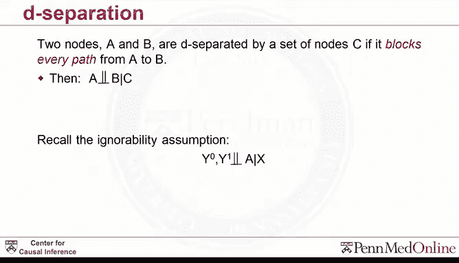

# 宾夕法尼亚大学《因果推断速成课程｜A Crash Course in Causality》中英字幕 - P13：13_02_05_条件独立与d-分离.zh_en - GPT中英字幕课程资源 - BV1Ft42137BF

Hi， this video was about conditional independence and de separation。We have three objectives here。

 so one is to just understand what is meant by blocking。

Another is to understand what collliiders are and what happens when you condition on them。Finally。

Our last goal is to understand what de separationation is and the rules that are associated with it。

We will begin with blogging。So paths can be blocked by conditioning on nodes in the path。

So consider the path。A affecting G， affecting B。Imagine now that we condition on G。

So that's a node in the middle of this chain。In that case， we would block the path for A to be。

So previously， we showed that in a chain like this， information does get from A to B。

 so A and B are dependent。But they're dependent。Through G， So A affects G。

 and then G ultimately affects B。So it's G that is really causing this association between A and B。

 in a sense， it's the thing that links the two together。So if we were to condition on G。

Conditioning on G is another way to say controlling for G。That's blocking it。

 that's blocking this path。So that's the main idea here is if G is sitting in the middle of this chain。

If we blocked it， then we could get independence between A and B。

So as a more concrete sort of hypothetical example， let's think of a as temperature。

 so the outside temperature essentially。That's a。And let's imagine that G is whether or not sidewalks are icy。

So clearly， the outside temperature A will affect whether or not sidewalks are icy。

And then B is whether or not someone falls， so clearly G would affect B right so whether or not the sidewalk is icy might affect whether or not somebody falls。

But I don't have an arrow from A to B。 and so we'll just assume that。

Temperature does not directly affect whether or not somebody falls。

 so if it's cold outside but there's no ice， you're no more likely to fall than if it's warm outside and there's no ice so that's an assumption we'll make just for illustration。

So A and B are here， they're marginally associated with each other。

 clearly temperature and whether or not someone falls or associated with each other。

So if it's a warm day， there's no chance that there's ice， and so somebody's unlikely to fall。

However， imagine now we're going to block G， we're going to G。

 conditioning on G means that we make it homogeneous。In this case。

 that means we hold fixed whether or not the sidewalks are icy right So if we hold that fixed。

Then there should not be an association between A and B here。If， for example， I by。

Conrolling for a G， I mean， I say， imagine a world where the sidewalk is icy。

Then temperature and falling should be unrelated。Similarly， if I conditioned on Ge and said。

 the sidewalk is not icy。Temperature and someone falling still should be unrelated with each other。

So we're blocking G by making it the same for everybody。

That's another way of saying that we're controlling for it。So that's what blocking is。

So associations on a fork can also be blocked， so previously I just showed you blocking on a chain。

 but we can also block on a fork。So here we have a path where G affects both A and B。

 so we have a fork。In this case， again， A and B are associated with each other。

Because G affects both of them， so we've talked about that on a previous video。

But now if we condition on G。We'll block the path from A to B。In this diagram， in this stag。

 the only reason A and B are associated with each other is because G affects both of them。

So if we hold G fixed， if we pick a value for G， if we condition on it。

 we make it the same for everybody。Now there's no relationship between， well， G and A and B。

 in other words， G is no longer affecting A and B because we're holding it fixed。So we've blocked。

That path。And so now A and B are independent from each other。

 so if we condition on G we'll block this path。So that's hopefully straightforward enough。

 we can block those kinds of paths， we can block forks， we can block chains。

But collliders create a different situation， something that's。

You could almost think of it as the opposite。So now consider an inverted fork。

 so we have a collision at G， so if you recall from a previous video。

 A and B are actually independent here。So A and B are not associated via this path。

Information is colliding a G， so if we really want A and B to be independent from each other。

 we actually don't have to do anything here， there's no path that needs to be blocked。

 we would just be done。However， if you were to condition on G。

 we would actually create an association between A and B。So here， if you were to block G。

 it would actually create association between A and B。

 so it would kind of have the opposite effect of what we saw previously。So as examples。

 this is a really simple example to get the idea across because I think it's sometimes it's。

Coterintuitive， this example might help imagine a is the state of an on off switch。

 so you could think of it as a light switch， for example。

 it's either on or off and we'll call that a。Imagine there's a second on off switch and B is the state of that on off switch。

So there's two on off switches A and B。And G is whether or not a light bulb is lit up。Now。

 imagine that。We determine A by a coin flip， so a is just totally independent of everything。

 we just flip a coin and decide whether to flip A on or off。Same thing with B。

 we have a separate coin， we flip it， and we use that to determine whether to have switch B turned on or off。

And now imagine that G is only lit up if both A and B are in the on position。

 right so clearly A and B are independent from each other because they were just based on two coin flips。

So we could depict this with this stag。So A and B both affect G， right。

 because G can only be lit up if both A and B are on。So A and B affect G。

 but A and B are independent from each other。So as we said， A and B are independent。So for example。

 if I told you B is on， it's not telling you anything about A。However。

 A and B are actually dependent now given G。 So if you block G or if you condition on G。

 you induce an association between A and B。And I'm going to depict blocking here with this rectangle around G。

And then I'm putting this dashed curve between A and B to let you know that when you condition on G。

 you open up a path between A and B。So。Imagine I condition on G。

Which means that I tell you what G is or I fixed G。 Okay， so imagine that I told you that。

The light is off。Well， then。A must be off if B is on and vice versa。嗯。

So we know something about the relationship between A and B when I tell you what G is。

 but previously if I told you what B is， I wouldn't have known anything about A because A was just determined by a coin flip。

 but once I tell you what G is， now A and B have information about each other。

So we're depicting that in the dig below。With that dashed curve。

 just indicating that if you were to block G， you open up a new path between A and B。So now。

A and B are conditionally dependent given G。Next， we're going to discuss something called de separation。

So we're going to use some of the rules that we just learned to。

Think about whether a set of nodes creates independence between variables on a given path。

If a set of nodes does do that， we're going to call it dese。D here stands for dependence。

 so what we're thinking of is a path that has that has a dependence between two nodes and we want to know does。

A set of variables C。hi。Remove the dependence。 So we'll say that it deses it。

This will become more clear as we get into it。 But that's the main idea。

 So a path is dese by a set of node C if。It contains a chain。And the middle part is in C。

 So what we mean by the middle part in this case is in this simple da is E is in the middle。

And so when we're thinking about what is a set of。Nodes that would need to be controlled for。嗯。

To have de separationation， to have independence essentially。

 we would need E to be in there right so we saw that previously。

So as long as so you can think of C as being a collection of all the nodes that we're going to control for so as long as。

The middle part of a chain is in there， we should be okay。Or。If the path contains a fork。

And the middle part is in C。So sort the middle part here is that sort what we saw earlier was the top part of the path where information flowed down to the other variables。

 so we would need to control for that if there's a fork。Or if there's an inverted fork。

We don't want to actually control for that middle part， right， but if we saw that previously。

 if we controlled for that middle part， we induced an association。So if it contains an inverted fork。

We don't want that middle part to be and C。 we also don't want any descendants。

Of the Collider to be and sea。So at this point， some of this might be unclear， but we're going to。

Go through it in much more detail。 But those are some of the main ideas。 And these。

 you'll notice that these three things that I just pointed out all follow from earlier slides where we looked at。

These different types of paths and when there's associations。And when we can block it。

On the previous slide， we talked about de separationation of a path。But of course。

 there could be many paths between two variables。So next we'll think about。

Deseparation between two nodes in general， So two nodes。

 A and B are said to be desepar by a set of nodes C。If C blocks every path from A to B。

So you could imagine many paths from A to B。And we will attempt to。

Create conditional independence between A and B。By a blocking。Using a set of node C。

 so we'll condition on C， we'll control for C。And if we're successful， if it's blocked。All the paths。

Then it's dese and we could say that A is independent from B， conditional on C。SoSo far。

 what we're doing is learning a lot of these rules， but building up to something。

 and in particular as motivation， recall call the Iorability assumption。

So the Iorability assumption had to do with treatment assignment A。

Being independent of potential outcomes。Conditional on X。

So hopefully you can see the relationship here， our long term goal is to identify a set of variables。

 X。

That will create conditional independence between A and the potential outcomes。In other words。

 we would have de separation between A and the potential outcomes。

So that is what we're moving towards， at this point。

 we're strictly learning the rules that we'll have to use to figure out when iorability holds。

